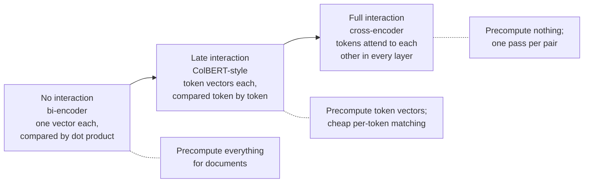

Retrieval and reranking both take a query and produce an ordered list of chunks, so it is tempting to treat them as two versions of the same thing, one cheap and one good. They are not. They answer different questions, run under different constraints, and fail in different ways. **Retrieval** answers "which few dozen chunks, out of millions, could possibly be relevant?". **Reranking** answers "of these few dozen, which are the best, in what order?". A pipeline is healthy only when each stage is designed, tuned and measured for its own question.

This lesson sets out that division of labour precisely. It places [bi-encoders](/learn/reranking-fundamentals/bi-encoders) and [cross-encoders](/learn/reranking-fundamentals/cross-encoders) on one spectrum of query-document interaction, shows how to attribute every failure of a two-stage pipeline to the stage that caused it, and gives you a working failure-attribution script that you can point at your own system.

## Learning objectives

- Contrast retrieval and reranking on scope, input, timing of computation, objective and evaluation metric.
- Place bi-encoders, late-interaction models and cross-encoders on a spectrum of when query and document tokens interact.
- Attribute each failed query to a retrieval miss, a ranking miss or a reranker regression, and compute the ceiling the first stage sets.
- Decide when a reranker is worth adding, when it should be skipped, and when it can make results worse.

## Prerequisites

- [Why reranking is needed](/learn/reranking-fundamentals/why-reranking-is-needed): the two-stage pipeline and the decomposition of success into two factors.
- [Cross-encoders](/learn/reranking-fundamentals/cross-encoders): how the reranking model reads a pair.
- [BM25](/learn/sparse-retrieval/bm25): the lexical first stage used in this lesson's code.
- [Recall@K](/learn/retrieval-fundamentals/recall-k): measuring whether relevant chunks were retrieved.

## Why this matters

When a RAG answer is wrong because of retrieval, there are two very different underlying problems, and their fixes have almost nothing in common. If the relevant chunk was never retrieved, you need a better first stage: hybrid search, query rewriting, a domain-adapted embedding model, a different chunking. If it was retrieved but ranked too low to reach the prompt, you need a better ranking stage: a reranker, a better reranker, or more candidates for it. Applying the wrong fix wastes weeks. A new reranker cannot rescue a chunk that never reaches it, and a new embedding model is a slow, expensive way to fix an ordering problem.

Teams also tend to evaluate the two stages with the same metric, usually some precision at a small cut-off, and so they tune the first stage for the wrong thing. A first stage tuned for hit@1 may sacrifice recall at depth 50, which is the only property the reranker needs from it. Knowing which stage owns which job tells you what to measure, which fix to try first, and when to stop.

## The intuition

Think of a hospital's emergency department. The triage nurse sees everyone who walks in, briefly, and decides who needs a doctor. She is fast and deliberately cautious: sending a healthy patient through costs a little of the doctor's time, while sending away a sick one is a disaster. The doctor then examines the few patients sent through, carefully, one at a time, and decides who needs treatment first.

Nobody judges the triage nurse on whether she diagnosed correctly; she is judged on whether she missed anyone who needed the doctor. Nobody expects the doctor to examine everyone in the waiting room; there is not time. And if a sick patient was sent home at triage, the doctor's skill is irrelevant to that patient. Retrieval is triage: broad, fast, judged on what it misses. Reranking is the examination: narrow, slow, judged on its ordering.

## How it works

### Two stages, two contracts

| | Retrieval (first stage) | Reranking (second stage) |
| --- | --- | --- |
| Question answered | Which chunks could be relevant? | Which candidates are best, and in what order? |
| Scope | Whole corpus: thousands to billions of chunks | A candidate list: typically 20 to 200 |
| Typical model | BM25, bi-encoder, learned sparse, hybrid | Cross-encoder, LLM reranker, late interaction |
| When document work happens | Mostly offline, at indexing | Entirely online, per query |
| Cost grows with | Corpus size (sub-linearly, with an index) | Number and length of candidates |
| Optimised for | Recall at the candidate depth $N$ | Precision, MRR or NDCG at the context depth $k$ |
| Cannot do | Read query and chunk together | See chunks it was not given |
| Changing the model | Re-embed and re-index the corpus | Swap the model; the index is untouched |

The last row has large practical consequences. A first-stage model change is a migration: hours of re-embedding, a new index, a careful cut-over. A reranker change is a deploy. That asymmetry is one reason teams often improve precision at the reranker and keep the first stage stable.

### A spectrum of interaction

The central technical difference between the stages is **when the query and document tokens first interact** inside the model.



1. **No interaction (bi-encoder).** Each side is reduced to one vector before they meet. All document work is precomputable; the comparison is a single dot product. Fastest, least expressive.
2. **Late interaction.** Each side keeps one vector per token, computed separately. At query time, each query token is matched with its most similar document token and the matches are summed. Document token vectors are still precomputable, but storage multiplies by the number of tokens per chunk. ColBERT (Khattab and Zaharia, 2020) introduced this design; it is covered in [Late interaction](/learn/reranking-models/late-interaction) and [ColBERT](/learn/reranking-models/colbert).
3. **Full interaction (cross-encoder).** The two texts are one input, and every layer mixes them. Nothing about the document can be computed before the query arrives. Most expressive, slowest.

Moving right along the spectrum buys accuracy with online compute. Retrieval must sit at the left end because it touches the whole corpus. Reranking can sit at the right end because it touches only $N$ candidates. Late interaction can do either job, which is why it appears both as a first stage and as a reranker in practice.

### Failure attribution

For a query with a known relevant chunk, a two-stage pipeline can end in exactly one of five states. Compute the chunk's rank after the first stage, $r_1$, and after reranking, $r_2$:

1. **Already right.** $r_1 \le k$ and $r_2 \le k$. Both stages succeeded.
2. **Fixed by the reranker.** $k < r_1 \le N$ and $r_2 \le k$. The reranker earned its keep.
3. **Ranking miss.** $r_1 \le N$ but $r_2 > k$, and the first stage had not put it in the top $k$ either. The chunk was available and the reranker did not promote it.
4. **Broken by the reranker.** $r_1 \le k$ but $r_2 > k$. The first stage had it right and the reranker pushed it out. A regression.
5. **Retrieval miss.** $r_1 > N$. The reranker never saw it. Only the first stage can fix this.

Counting these over a labelled query set tells you, in one table, where to invest. A large count in state 5 means first-stage work. A large count in state 3 means a better reranker or better candidates. Any count in state 4 deserves individual inspection, because it means the reranker is actively harmful for some kind of query.

A useful companion measurement is the **oracle**: run the reranker over the *whole* corpus for each test query (feasible for a test set, never in production). If the oracle finds the chunk but the two-stage pipeline does not, the loss is in candidate generation. If even the oracle fails, the reranker itself cannot judge that query, and more candidates will not help.

> [!KEY]
> Measure the first stage by Recall@$N$, the reranker by its ordering of the candidates it actually received, and the pipeline by precision at $k$. Attribute each failure to one stage before choosing a fix.

### When reranking helps, when to skip it, when it hurts

Reranking helps most when the first stage has good recall but weak ordering: many topically similar chunks, multi-topic chunks, question-shaped content, and natural-language questions. It helps least when:

- **The first stage is already near-perfect at the top**, for instance exact lookups by identifier, where BM25 puts the one chunk containing "E-4021" first.
- **The context is large relative to the candidates.** If you send 20 of 25 candidates to the model, reordering changes little about what it sees (though ordering within the prompt still matters somewhat).
- **Latency is the binding constraint** and a few points of precision are not worth 100 ms or more.

Reranking can *hurt* when the reranker is out of its depth. A model trained on English web search may misjudge code, legal citations, tables, or another language, and replace a good first-stage order with a worse one. Exact-identifier queries are a known risk: a lexical first stage matches the identifier perfectly, while a reranker may prefer a fluent passage about the general topic. Count the "broken by the reranker" state per query type, and consider routing some query types around the reranker, or combining the first-stage and reranker scores rather than replacing one with the other ([Ranking scores](/learn/reranking-fundamentals/ranking-scores) shows how).

### Cascades

The two-stage pipeline generalises. If a cross-encoder is too slow for 200 candidates but 200 are needed for recall, put a cheaper ranker in between: BM25 or a bi-encoder retrieves 1,000, a late-interaction model or small cross-encoder trims to 50, a large cross-encoder or LLM orders the top 10. Each stage is cheaper per item than the next and sees fewer items. [Multi-stage retrieval](/learn/advanced-retrieval-optimisation/multi-stage-retrieval) covers designing these. The contracts stay the same: every stage except the last is judged on recall at the depth it hands on.

## The mathematics

### The first stage sets the ceiling

**Intuition.** The reranker only reorders; it cannot add. So the share of queries whose relevant chunk reaches the top $k$ after reranking can never exceed the share whose relevant chunk was among the $N$ candidates.

$$
\text{Hit@}k_{\text{final}} \;\le\; \text{Recall@}N_{\text{first}}
$$

$\text{Hit@}k_{\text{final}}$ is the fraction of test queries whose relevant chunk is in the final top $k$; $\text{Recall@}N_{\text{first}}$ is the fraction whose relevant chunk is among the first stage's $N$ candidates (for one relevant chunk per query, recall and hit rate coincide). This holds for every reranker, however good.

### Attributing the loss

**Intuition.** Every query that does not succeed failed for exactly one reason, so the total shortfall splits cleanly into a retrieval part and a ranking part.

$$
1 - \text{Hit@}k_{\text{final}} = \underbrace{\frac{M_{\text{retrieval}}}{|Q|}}_{\text{first stage}} + \underbrace{\frac{M_{\text{ranking}} + M_{\text{broken}}}{|Q|}}_{\text{reranking}}
$$

$|Q|$ is the number of test queries; $M_{\text{retrieval}}$ counts retrieval misses (state 5), $M_{\text{ranking}}$ ranking misses (state 3) and $M_{\text{broken}}$ reranker regressions (state 4).

**By hand.** The code below runs 10 queries with $N = 3$ and $k = 1$. It finds 4 retrieval misses, 1 ranking miss and no regressions; 4 queries were fixed by the reranker and 1 was already right. So $\text{Hit@}1 = 5/10 = 0.5$, and the loss of $0.5$ splits into $4/10 = 0.4$ from retrieval and $1/10 = 0.1$ from ranking. The ceiling is $\text{Recall@}3 = 6/10 = 0.6$: even a perfect reranker could reach only 0.6. Four-fifths of the problem is in the first stage, so that is where the next change belongs.

```python
counts = {"already right": 1, "fixed by reranker": 4, "ranking miss": 1,
          "broken by reranker": 0, "retrieval miss": 4}
Q = sum(counts.values())
hit = (counts["already right"] + counts["fixed by reranker"]) / Q
ceiling = (Q - counts["retrieval miss"]) / Q
print(f"Hit@1 = {hit:.2f}   ceiling (Recall@N) = {ceiling:.2f}")
print(f"loss from retrieval = {counts['retrieval miss'] / Q:.2f}   "
      f"loss from ranking = {(counts['ranking miss'] + counts['broken by reranker']) / Q:.2f}")
```

```output
Hit@1 = 0.50   ceiling (Recall@N) = 0.60
loss from retrieval = 0.40   loss from ranking = 0.10
```

### Where the compute goes

**Intuition.** Retrieval spends most of its document work once, at indexing time; reranking spends all of its work per query, but only on $N$ items.

$$
C_{\text{query}} \approx c_{\text{enc}}(L_q) + c_{\text{search}}(M) + N \cdot c_{\text{pair}}(L_q + L_d)
$$

$c_{\text{enc}}$ is the cost of encoding the query, $c_{\text{search}}(M)$ the index search over $M$ chunks (roughly logarithmic in $M$ for graph indexes), and $c_{\text{pair}}$ the cost of one reranker pass over a pair of length $L_q + L_d$. Only the first two terms depend on the corpus, and only weakly. Scoring the whole corpus with the reranker would replace $N$ by $M$; in the code below, that is 110 pairs instead of 30 for 10 queries, and in a corpus of a million chunks it is a million passes per query.

## In code

**The problem.** Run a two-stage pipeline (BM25 then a cross-encoder) on a labelled query set, classify every query into the five states, and compare with the whole-corpus oracle, so that you know which stage to work on.

**Dependencies.** rank-bm25, Sentence Transformers and NumPy. BM25 is deliberately the first stage here: it has clear, explainable misses on paraphrased questions.

```bash
pip install rank-bm25 sentence-transformers numpy
```

```python
import re
from collections import Counter
import numpy as np
from rank_bm25 import BM25Okapi
from sentence_transformers import CrossEncoder

DOCS = {
    "hb-leave": "Annual leave is 25 days per year. Leave is booked in the HR portal and approved by your "
                "line manager. Up to 5 unused days carry over and must be used by 31 March.",
    "hb-sick": "Sick days are recorded separately and are not deducted from annual leave.",
    "hb-remote": "Staff may work remotely up to 3 days a week. VPN is required on public Wi-Fi. "
                 "The home-office equipment budget is £400; contractors are not eligible.",
    "hb-expenses": "Expenses must be submitted within 30 days. Anything over £75 needs a receipt.",
    "it-password": "Passwords must be rotated every 90 days and be at least 14 characters.",
    "it-laptop": "Laptops are refreshed on a 3-year cycle. A lost or stolen laptop must be reported "
                 "to the support desk at once.",
    "it-desk": "The support desk is open 08:00 to 18:00 UK time on weekdays.",
    "faq-expense-app": "How to submit an expense claim: open the finance app, photograph the item "
                       "and press submit.",
    "faq-leave-calendar": "Holiday calendar: add your holiday to the team calendar so colleagues "
                          "can plan around it.",
    "faq-password-tips": "Choosing a good password: use a passphrase of several random words.",
    "faq-desk-contact": "Contacting IT: raise a ticket in the IT portal and include your laptop asset tag.",
}
QUERIES = {
    "What is the deadline for submitting an expense claim?": "hb-expenses",
    "How long do I have to claim back a train ticket?": "hb-expenses",
    "How often must I change my password?": "it-password",
    "How long must a password be?": "it-password",
    "Who approves my holiday?": "hb-leave",
    "What happens to holiday I don't use?": "hb-leave",
    "Is being off ill taken from my holiday?": "hb-sick",
    "Who do I tell if my laptop goes missing?": "it-laptop",
    "What are the support desk hours?": "it-desk",
    "Do contractors get the equipment budget?": "hb-remote",
}
N, K = 3, 1          # candidates passed to the reranker; chunks sent to the prompt

ids, texts = list(DOCS), list(DOCS.values())
tokenise = lambda t: re.findall(r"[a-z0-9]+", t.lower())
bm25 = BM25Okapi([tokenise(t) for t in texts])
reranker = CrossEncoder("cross-encoder/ms-marco-MiniLM-L-6-v2")

def classify(first_rank, final_rank):
    if first_rank > N:
        return "retrieval miss"            # never a candidate: reranker cannot help
    if final_rank <= K:
        return "already right" if first_rank <= K else "fixed by reranker"
    return "broken by reranker" if first_rank <= K else "ranking miss"

outcomes, pairs_scored, oracle_pairs = Counter(), 0, 0
for query, relevant in QUERIES.items():
    first = [ids[i] for i in np.argsort(-bm25.get_scores(tokenise(query)), kind="stable")]
    candidates = first[:N]
    scores = reranker.predict([(query, DOCS[c]) for c in candidates])
    final = [candidates[i] for i in np.argsort(-scores)]
    pairs_scored += len(candidates)

    # Oracle: what if the reranker had scored the whole corpus?
    full = reranker.predict([(query, t) for t in texts])
    oracle_rank = [ids[i] for i in np.argsort(-full)].index(relevant) + 1
    oracle_pairs += len(texts)

    r1 = first.index(relevant) + 1
    r2 = final.index(relevant) + 1 if relevant in final else 99
    label = classify(r1, r2)
    outcomes[label] += 1
    print(f"{query:<52} bm25 #{r1:<2} reranked #{'-' if r2 == 99 else r2}  oracle #{oracle_rank}  {label}")

print("\n", dict(outcomes))
print(f"pairs scored: two-stage {pairs_scored}, whole-corpus oracle {oracle_pairs}")
```

```output
What is the deadline for submitting an expense claim? bm25 #9  reranked #-  oracle #1  retrieval miss
How long do I have to claim back a train ticket?     bm25 #9  reranked #-  oracle #1  retrieval miss
How often must I change my password?                 bm25 #4  reranked #-  oracle #1  retrieval miss
How long must a password be?                         bm25 #3  reranked #1  oracle #1  fixed by reranker
Who approves my holiday?                             bm25 #2  reranked #2  oracle #2  ranking miss
What happens to holiday I don't use?                 bm25 #7  reranked #-  oracle #2  retrieval miss
Is being off ill taken from my holiday?              bm25 #2  reranked #1  oracle #1  fixed by reranker
Who do I tell if my laptop goes missing?             bm25 #2  reranked #1  oracle #1  fixed by reranker
What are the support desk hours?                     bm25 #2  reranked #1  oracle #1  fixed by reranker
Do contractors get the equipment budget?             bm25 #1  reranked #1  oracle #1  already right

 {'retrieval miss': 4, 'fixed by reranker': 4, 'ranking miss': 1, 'already right': 1}
pairs scored: two-stage 30, whole-corpus oracle 110
```

**The important lines.**

- `classify` encodes the five states. The order of the tests matters: a retrieval miss is checked first, because once the chunk is not a candidate nothing else about the reranker is relevant.
- `np.argsort(..., kind="stable")` keeps tied BM25 scores in corpus order, so results are reproducible. Many queries give zero to several chunks, and unstable sorting would shuffle them between runs.
- The oracle block scores every chunk for every test query. It is an evaluation tool only; in production it would cost one reranker pass per chunk in the corpus.
- `pairs_scored` against `oracle_pairs` makes the cost of the two designs concrete even on this toy corpus.

**What the output means.** Half the queries succeed. Of the five failures, four are retrieval misses, and they share a cause visible in the text: the query's words differ from the chunk's. "Submitting" does not match "submitted" (this tokeniser does no stemming), "change my password" does not match "rotated", "holiday I don't use" does not match "unused days carry over". In each case the oracle column shows the reranker *would* have ranked the chunk first or second if it had seen it. That is the decisive diagnostic: the reranker can judge these queries, the first stage did not deliver them. The fix is first-stage work, such as stemming, a dense or [hybrid](/learn/hybrid-search/hybrid-retrieval-architecture) first stage, or a larger $N$, not a better reranker.

The four "fixed" queries show the reranker doing its job: BM25 found the chunk at rank 2 or 3, behind an FAQ or a chunk sharing more words, and the reranker moved it to rank 1. The single ranking miss, "who approves my holiday?", fails in the oracle as well (rank 2), so more candidates would not help; this reranker prefers the holiday-calendar FAQ for that phrasing. No query was broken by the reranker in this run. On real traffic, check that count by query type; it is rarely zero everywhere.

With ten queries, these counts illustrate the method, not the merits of BM25 or this model. Run the same script on a few hundred labelled queries from your own logs and the table becomes a work plan.

**Common errors.**

- Counting a query as a ranking failure when the chunk was never a candidate. Always check $r_1 \le N$ first.
- Running the oracle with a different reranker or different text preprocessing from production, which makes the comparison meaningless.
- Leaving the default unstable sort on tied scores and getting different classifications on each run.

**Extending it.** Set `N = 11` (the whole corpus here) and confirm that the retrieval misses disappear and the result matches the oracle. Replace BM25 with the bi-encoder from [Bi-encoders](/learn/reranking-fundamentals/bi-encoders) and compare the retrieval-miss count. Add a `query_type` field and break the table down by type.

## A real-world example

Meridian's Platform team ran a quarterly review of AskMeridian's failure log. The obvious proposal on the table was to replace the small MiniLM reranker with a larger one, which a vendor benchmark suggested was markedly better. Ines, newly on the team, asked a prior question: of last quarter's failed queries, how many were ranking failures at all?

She ran the attribution script over 400 labelled queries drawn from the logs. Retrieval misses outnumbered ranking misses by roughly three to one, and the oracle found most of those missed chunks near the top. The misses clustered in two groups: queries using informal words ("holiday", "kit", "ring IT") against formal handbook language, and queries naming error codes that the dense first stage blurred together. A larger reranker would have improved the minority of failures that were ranking misses and done nothing for the rest.

The team instead added BM25 alongside the dense retriever and merged the candidates, which addressed the error-code group, and added a small synonym list for the commonest informal terms. Re-running the script showed the retrieval-miss count falling sharply, with ranking misses now the larger group. Only then did they trial the larger reranker, against a now-meaningful baseline. The attribution table became part of every quarterly review, so that each proposal starts from where failures actually happen.

## Common mistakes

- **Fixing the wrong stage.** Upgrading the reranker when most failures are retrieval misses, or re-embedding the corpus when the chunk was retrieved at rank 6.
- **Tuning the first stage for precision at the top.** It only needs to deliver the relevant chunk within $N$; tuning it for hit@1 can cost recall at depth.
- **Evaluating the reranker on the full pipeline only.** Its quality is how it orders the candidates it received; mix in retrieval misses and you blame it for something it never saw.
- **Assuming the reranker never makes things worse.** Without counting regressions per query type, harm on identifiers, code or other languages goes unnoticed.
- **Treating the oracle as a production option.** Reranking the whole corpus is an evaluation trick; its cost grows with corpus size on every query.

## Best practices

- Log $r_1$, the first-stage score, $r_2$ and the reranker score for every returned chunk, so failures can be attributed after the fact.
- Keep a labelled query set and run failure attribution on every significant change to either stage.
- Report Recall@$N$ for the first stage and hit@$k$, MRR or NDCG for the pipeline, side by side.
- Use the oracle to separate "the reranker cannot judge this" from "the reranker never saw this" before changing anything.
- Track reranker regressions by query type and route types it harms around it, or blend scores instead of replacing them.
- Change the first stage rarely and deliberately (it means re-indexing); iterate on the reranker more freely.

## Performance considerations

The two stages have different scaling laws, and that should shape capacity planning. First-stage latency grows slowly with corpus size: an HNSW search over 10 million vectors is typically a few times slower than over 100,000, not a hundred times. Its memory, however, grows linearly with the corpus. Reranking latency is flat in corpus size and linear in $N$, with a strong dependence on candidate length.

A worked comparison, using assumed costs to measure on your own hardware: dense search at 30 ms, and a CPU cross-encoder at 3 ms per pair. With $N = 50$, reranking costs 150 ms and dominates retrieval. Growing the corpus tenfold might add 10 to 20 ms to search; doubling $N$ to 100 adds 150 ms to reranking. So when retrieval misses push you to retrieve more candidates, check whether a better first stage (hybrid search, a better model) achieves the same recall at the existing $N$; it is usually cheaper per query than a deeper candidate list. [Candidate selection](/learn/reranking-fundamentals/candidate-selection) takes this up.

Cost of change also differs. Re-embedding a corpus is a batch job whose cost grows with corpus size; changing a reranker costs nothing offline, but its per-query cost is paid forever.

## Summary

- Retrieval selects candidates from the whole corpus and is judged by recall at depth $N$; reranking orders those candidates and is judged by precision at the context depth $k$.
- Bi-encoders, late-interaction models and cross-encoders differ in when query and document tokens interact; earlier interaction means more online cost and more accuracy.
- Every failed query is a retrieval miss, a ranking miss or a reranker regression; counting them tells you which stage to work on.
- The first stage's Recall@$N$ is a hard ceiling on what any reranker can achieve, and the whole-corpus oracle shows whether the reranker could have succeeded.
- Rerankers can hurt on content they were not trained for, so measure regressions by query type.

## Exercises

**1.** A pipeline retrieves $N = 40$ and sends $k = 4$ to the model. On 200 test queries: 150 have the relevant chunk in the final top 4, 30 have it among the 40 candidates but not in the final top 4, and 20 do not have it among the candidates. What is Hit@4, the ceiling, and the split of the loss?

<details><summary>Show solution</summary>

Hit@4 = 150/200 = 0.75. Ceiling = Recall@40 = 180/200 = 0.90. Loss = 0.25, of which retrieval is 20/200 = 0.10 and ranking (misses plus any regressions) is 30/200 = 0.15. The reranking stage has more headroom here, so improving the reranker or its candidates' text is the first move.

</details>

**2.** For the "who approves my holiday?" query, the oracle also ranks the chunk second. Explain why raising $N$ would not help, and suggest two things that might.

<details><summary>Show solution</summary>

The chunk is already a candidate, and with the whole corpus available the reranker still prefers another chunk, so more candidates cannot change its decision. Options: shorten or split the multi-topic leave chunk so that the approval sentence is not diluted; try a different or fine-tuned reranker; or combine the first-stage and reranker scores if the first stage tends to get such queries right.

</details>

**3.** Modify the script to use the bi-encoder `all-MiniLM-L6-v2` as the first stage instead of BM25, keeping $N = 3$. Report the counts and compare.

<details><summary>Show solution</summary>

Replace the BM25 ranking with:

```python
from sentence_transformers import SentenceTransformer
bi = SentenceTransformer("sentence-transformers/all-MiniLM-L6-v2")
doc_vecs = bi.encode(texts, normalize_embeddings=True)
# inside the loop:
first = [ids[i] for i in np.argsort(-(doc_vecs @ bi.encode(query, normalize_embeddings=True)))]
```

With the sandbox's versions, the counts become 7 already right, 1 fixed by the reranker, 1 ranking miss and 1 retrieval miss: Hit@1 rises from 0.5 to 0.8. The dense model does not need shared words, so the paraphrased queries ("change my password", "submitting" against "submitted") now reach the candidate list. On this corpus the bi-encoder is simply the better first stage; the attribution table shows *why* (retrieval misses fell from 4 to 1) rather than only that the final number went up.

</details>

**4.** Design decision. AskMeridian is adding the Atlas error-code catalogue (thousands of short entries such as "E-4021: ..."). Users type bare codes or codes with a few words. Describe how you would decide whether to rerank these queries, and what you would watch for.

<details><summary>Show solution</summary>

Build a labelled set of code queries and run attribution with and without reranking. A lexical first stage will usually place the exact code entry first; the risk is the reranker preferring a fluent neighbouring entry (a nearby code, or a general VPN article), so watch the "broken by reranker" count. If regressions appear, route queries containing a code pattern (for example a regular expression for `E-\d{4}`) to a path that boosts or pins exact-code matches and skips or blends reranking. Re-check after any reranker change.

</details>

## Check your understanding

```quiz
[
  {
    "q": "Which metric should primarily guide tuning of the first-stage retriever in a two-stage pipeline?",
    "options": [
      "Hit@1 of the first stage",
      "Recall at the candidate depth N",
      "The reranker's average score",
      "Latency of the language model"
    ],
    "answer": 1,
    "why": "The first stage's job is to deliver relevant chunks into the candidate list; their order there matters little, because the reranker reorders it."
  },
  {
    "q": "A query's relevant chunk is at first-stage rank 1 with k = 3, and at rank 6 after reranking. How is this failure classified?",
    "options": ["Retrieval miss", "Ranking miss", "Broken by the reranker", "Already right"],
    "answer": 2,
    "why": "The first stage had it inside the top k and the reranker pushed it out: a regression caused by the reranker."
  },
  {
    "q": "Recall@50 of the first stage is 0.82. What is the best possible Hit@5 after reranking those 50 candidates?",
    "options": ["0.82", "1.00", "0.41", "It depends on the reranker and could exceed 0.82"],
    "answer": 0,
    "why": "The reranker cannot add chunks. Hit after reranking is bounded by recall of the candidate list."
  },
  {
    "q": "Where does a ColBERT-style late-interaction model sit relative to bi-encoders and cross-encoders?",
    "options": [
      "It is a kind of BM25",
      "Between them: token vectors are precomputed per side, then matched token by token at query time",
      "It is identical to a cross-encoder but faster",
      "It requires no document storage"
    ],
    "answer": 1,
    "why": "Late interaction keeps per-token vectors computed separately (precomputable) and compares them at query time, trading storage for more expressive matching."
  },
  {
    "q": "The whole-corpus oracle ranks a missed chunk first, but the two-stage pipeline never returned it. What does this tell you?",
    "options": [
      "The reranker is too weak",
      "The language model ignored the context",
      "The loss is in candidate generation: the reranker could judge it but never received it",
      "The labels are wrong"
    ],
    "answer": 2,
    "why": "If the reranker ranks the chunk first when given the whole corpus, it can judge the query. The chunk was lost at the first stage."
  }
]
```

## Further reading

- Khattab, O. and Zaharia, M. (2020). *ColBERT: Efficient and Effective Passage Search via Contextualized Late Interaction over BERT*. [arXiv:2004.12832](https://arxiv.org/abs/2004.12832).
- Lin, J., Nogueira, R. and Yates, A. (2021). *Pretrained Transformers for Text Ranking: BERT and Beyond*. [arXiv:2010.06467](https://arxiv.org/abs/2010.06467). Multi-stage ranking architectures in depth.
- Nogueira, R., Yang, W., Cho, K. and Lin, J. (2019). *Multi-Stage Document Ranking with BERT*. [arXiv:1910.14424](https://arxiv.org/abs/1910.14424).
- Manning, C. D., Raghavan, P. and Schütze, H. (2008). *Introduction to Information Retrieval*, Cambridge University Press, chapter 8 on evaluation. Free online at [nlp.stanford.edu/IR-book](https://nlp.stanford.edu/IR-book/).
