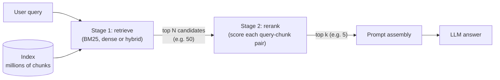

A retriever has two jobs that pull in opposite directions. It must search a corpus of perhaps millions of chunks in a few tens of milliseconds, and it must put the chunk that answers the question at the very top of a short list, because the language model will read only the first handful. No single scoring method does both well. **Reranking** is the standard answer: let a fast first stage gather a few dozen plausible candidates, then let a slower, more careful model reorder just those candidates before anything reaches the prompt.

This lesson explains why the first stage falls short, which mistakes a reranker corrects and which it cannot, and runs a real two-stage pipeline on Meridian's handbook. The rest of the module takes the pieces apart: [bi-encoders](/learn/reranking-fundamentals/bi-encoders), [cross-encoders](/learn/reranking-fundamentals/cross-encoders), the [division of labour](/learn/reranking-fundamentals/retrieval-versus-reranking) between the stages, [candidate selection](/learn/reranking-fundamentals/candidate-selection) and what [ranking scores](/learn/reranking-fundamentals/ranking-scores) mean.

## Learning objectives

- Explain why a first-stage retriever is tuned for recall at depth rather than precision at the top, and why a RAG system needs both.
- Identify three kinds of ranking error that a reranker corrects: topical-but-not-answering chunks, lost fine detail, and diluted multi-topic chunks.
- Name the failures that reranking cannot fix, and the stage that should fix each of them.
- Decompose the probability that a relevant chunk reaches the prompt into a retrieval term and a reranking term, and use it to reason about where to invest.
- Build a two-stage pipeline with a bi-encoder and a cross-encoder and measure its effect with hit@1 and MRR.

## Prerequisites

- [Top-K retrieval](/learn/retrieval-fundamentals/top-k-retrieval): the cut, and the difference between a candidate depth and a context depth.
- [Recall@K](/learn/retrieval-fundamentals/recall-k): how to measure whether relevant chunks were retrieved at all.
- [Dense vector search](/learn/dense-retrieval/dense-vector-search): how an embedding index finds nearest neighbours.
- [Sentence Transformers](/learn/embedding-models/sentence-transformers): the library used for both models in this lesson.

## Why this matters

The language model at the end of a RAG pipeline does not see your ranking; it sees a context of perhaps three to ten chunks. So the quality that matters to the user is **precision at the top**: is the chunk that answers the question among the first few, preferably the first?

A first-stage retriever is not built for that. To be fast over the whole corpus it compares precomputed representations without ever reading the two texts side by side. It is excellent at finding the right *neighbourhood* (the chunks about expenses) and much weaker at deciding which chunk in it answers *this* question. The symptom is subtle. Retrieval metrics at depth 50 look healthy, yet answers are vague or wrong, because the chunk that held the answer was retrieved at position 4 or 7 and the prompt contained only the top 3.

Sending the model 20 chunks instead of 3 costs input tokens on every request, and irrelevant chunks can distract the model ([Context relevance](/learn/context-engineering/context-relevance)). A better first-stage model helps, but every such model shares the same structural limit ([Bi-encoders](/learn/reranking-fundamentals/bi-encoders)). The established answer is to rerank: spend a more expensive model's attention on only the few dozen candidates the first stage found.

## The intuition

Picture a reference librarian asked "what is the deadline for submitting an expense claim?". She cannot read every book in the building, so she uses the catalogue: subject headings and keywords lead her to a shelf, and she pulls down the twenty volumes that look most relevant from their catalogue cards. That is the first stage. It is fast because it never opens a book.

Then she sits down and opens each of the twenty at the relevant page, reading the question and the page together. One volume is titled *Expense Claims* but only explains which button to press in the finance app. Another, a general staff handbook whose catalogue card mentions leave, remote work and expenses, contains the sentence "Expenses must be submitted within 30 days." On the catalogue alone, the first looked better. On reading, the second plainly answers the question. That is the second stage.

Reading is far more accurate than skimming the catalogue and far too slow to do for the whole library. And if the right book was not among the twenty, no careful reading will find it: the first stage sets the ceiling, the second decides how close you get to it.

## How it works

### What the first stage optimises

The first stage, often called **candidate generation**, scores every chunk in the index (or, with an approximate index, a well-chosen subset) and keeps the best $N$, where $N$ is typically 20 to 200. Its scoring function must be cheap enough to apply millions of times per query: shared terms looked up in an [inverted index](/learn/sparse-retrieval/inverted-indexes) for [BM25](/learn/sparse-retrieval/bm25), or a dot product between a query embedding and chunk embeddings computed in advance. Either way, the chunk's representation is fixed before the query exists, and the two meet only through a simple comparison. That is what makes search fast, and it is the root of the first stage's errors. Its success criterion is therefore **recall at depth $N$**: did the relevant chunks make the shortlist? Their order within it matters much less.

### Three errors a reranker corrects

A reranker reads the query and one candidate together and outputs a relevance score. Because it sees both texts at once, it can use evidence the first stage never had. Three kinds of first-stage error recur often enough to name.

**1. Topical but not answering.** A dense retriever measures whether two texts are about the same thing. An FAQ titled "How to submit an expense claim" is very close in meaning to the question "What is the deadline for submitting an expense claim?", closer than the dry handbook section that contains the deadline. In the code below, the dense retriever ranks the FAQ first for exactly this query. An extreme version is the **question echo**: a chunk that restates the question (an FAQ heading, a forum post asking the same thing) can score higher than the chunk that answers it, because a restatement is the most similar text there is. A model trained to judge whether a passage *answers* a query handles this far better, because answering is what it was trained on.

**2. Fine detail lost in compression.** An embedding squeezes a passage into a few hundred numbers. Details that barely change the overall topic, such as one digit of an error code, a "not", or "over" versus "under", can be squeezed out. A reranker attends to the actual tokens of both texts, so "E-4012" in the query can be matched against "E-4012" rather than "E-4021" in the chunk.

**3. Diluted multi-topic chunks.** A handbook section on annual leave covers allowance, booking, approval and carry-over; its single embedding blends all four topics, so for the narrow question "who approves my holiday?" it can lose to a short chunk that is entirely about the holiday calendar. A reranker can find the one sentence that matters inside the longer chunk.

### What reranking cannot fix

A reranker only reorders what it is given. Each of the following needs a fix elsewhere:

| Failure | Why reranking does not help | Where the fix lives |
| --- | --- | --- |
| The relevant chunk was not among the candidates | The reranker never sees it | First stage: better retrieval, [hybrid search](/learn/hybrid-search/dense-versus-sparse-retrieval), deeper [candidate selection](/learn/reranking-fundamentals/candidate-selection) |
| A superseded document outranks the current one | Both are *relevant*; the reranker judges relevance, not currency or authority | Metadata: filter or down-weight archived content ([Metadata-aware retrieval](/learn/advanced-retrieval/metadata-aware-retrieval)) |
| The answer is split across two chunks | Each chunk is scored alone | Chunking, or [parent-child retrieval](/learn/hierarchical-rag/parent-child-retrieval) |
| The question has no answer in the corpus | A ranked list always has a first item | Thresholds and refusal behaviour ([Retrieval thresholding](/learn/advanced-retrieval-optimisation/retrieval-thresholding)) |
| Five near-duplicate chunks fill the top five | Each is individually relevant | Diversity: [MMR](/learn/advanced-retrieval-optimisation/mmr) and [duplicate removal](/learn/advanced-retrieval-optimisation/duplicate-removal) |

The second row surprises people, and the code below shows it happening.

> [!KEY]
> Reranking improves the *order* of the candidates. It cannot add a chunk that was not retrieved, and it judges relevance, not truth, freshness or permission. Measure the first stage by recall at the candidate depth and the reranker by precision at the context depth.

### The two-stage pipeline



Step by step:

1. **Retrieve.** Score the query against the whole index cheaply and keep the top $N$ candidates with their first-stage scores.
2. **Pre-process the candidates (optional).** Deduplicate, apply access and metadata filters, merge several retrievers' results; see [Candidate selection](/learn/reranking-fundamentals/candidate-selection).
3. **Score pairs.** Compute a relevance score $s(q, d)$ for each candidate $d$. The pairs are independent, so they are batched.
4. **Sort and cut.** Order by reranker score and keep the top $k$, perhaps dropping any below a threshold.
5. **Assemble and generate.** Place the $k$ chunks in the prompt ([Context ordering](/learn/context-engineering/context-ordering)).

You can watch the effect interactively: the visualiser below shows a first-stage list being reordered by a reranker.

```playground
reranking
```

### Kinds of reranker

"Reranker" names a role, not a model type. Any function that reorders a short candidate list can fill it:

- **Cross-encoders** read the query and a candidate as one input and output a relevance score. They are the default choice; see [Cross-encoders](/learn/reranking-fundamentals/cross-encoders).
- **Late-interaction models** such as ColBERT compare per-token vectors at search time, between the two in cost and accuracy; see [Late interaction](/learn/reranking-models/late-interaction).
- **Hosted reranking APIs** such as [Cohere rerank](/learn/reranking-models/cohere-rerank) put a reranking model behind an HTTP endpoint.
- **LLM rerankers** prompt a general language model to order passages (Sun and colleagues, 2023). Flexible, but usually far slower and costlier per candidate.
- **Rules and signals** such as recency, authority or diversity, usually applied after the relevance model.

The evidence for the pattern is long-standing. Nogueira and Cho (2019) fine-tuned BERT as a passage reranker on MS MARCO and reported a large improvement over the previous state of the art, and the BEIR benchmark (Thakur and colleagues, 2021) found BM25 followed by a cross-encoder among the strongest approaches on datasets the models were not trained on, at a much higher computational cost. That says the pattern is sound; only your own evaluation set says how much it helps you.

## The mathematics

### Where a relevant chunk can be lost

**Intuition.** A relevant chunk reaches the prompt only if it survives two cuts: the first stage must place it among the $N$ candidates, and the reranker must then place it among the top $k$. Losing it at either cut loses the answer.

$$
P(\text{in context}) = P(\text{in top-}N \text{ of stage 1}) \times P(\text{in top-}k \text{ after reranking} \mid \text{in top-}N)
$$

- $P(\text{in top-}N \text{ of stage 1})$ is the first stage's Recall@$N$ for this chunk (averaged over queries, it is the candidate recall you measure with [Recall@K](/learn/retrieval-fundamentals/recall-k)).
- $P(\text{in top-}k \mid \text{in top-}N)$ is the reranker's success rate on the candidates it is given.
- $N$ is the candidate depth and $k$ the context depth, with $k \le N$.

**By hand.** Suppose candidate recall at $N = 50$ is 0.95 and the reranker puts a candidate in the top 5 with probability 0.70. The chance of reaching the prompt is $0.95 \times 0.70 = 0.665$. Now compare two improvements. Raising reranker quality to 0.90 gives $0.95 \times 0.90 = 0.855$. Raising candidate recall to 1.00 instead gives at most $1.00 \times 0.70 = 0.70$. When candidate recall is already high, the reranking term is where the headroom is. The reverse also holds: with candidate recall at 0.80, even a perfect reranker cannot exceed 0.80. This decomposition is the quickest way to decide which stage deserves your next week of work.

### Mean reciprocal rank

**Intuition.** For questions with one answering chunk, what matters is how far down the list that chunk sits. Position 1 is ideal, position 2 is half as good, position 4 a quarter as good.

$$
\text{MRR} = \frac{1}{|Q|} \sum_{q \in Q} \frac{1}{\text{rank}_q}
$$

$Q$ is the set of test queries, $|Q|$ their number, and $\text{rank}_q$ is the position of the first relevant chunk for query $q$ (with $1/\text{rank}_q = 0$ if it was not found within the list). The [MRR lesson](/learn/retrieval-evaluation/mrr) treats the metric in depth; here it is simply a compact way to see whether reranking moved answers up.

**By hand.** The dense retriever in the code below places the answering chunk at ranks 2, 2, 3, 4, 2, 3, 1, 1 for eight queries. The reciprocals are $0.5, 0.5, 0.333, 0.25, 0.5, 0.333, 1, 1$, which sum to $4.417$. Dividing by 8 gives $\text{MRR} = 0.552$.

```python
import numpy as np

p_cand = np.array([0.95, 0.80])     # recall of the candidate stage at depth N
p_order = np.array([0.70, 0.90])    # P(reranker puts it in the final k | candidate)
for pc in p_cand:
    for po in p_order:
        print(f"P(candidate)={pc:.2f}  P(top-k | candidate)={po:.2f}  ->  P(in context)={pc*po:.3f}")
ranks = [2, 2, 3, 4, 2, 3, 1, 1]
print("MRR dense:", round(np.mean([1/r for r in ranks]), 3))
```

```output
P(candidate)=0.95  P(top-k | candidate)=0.70  ->  P(in context)=0.665
P(candidate)=0.95  P(top-k | candidate)=0.90  ->  P(in context)=0.855
P(candidate)=0.80  P(top-k | candidate)=0.70  ->  P(in context)=0.560
P(candidate)=0.80  P(top-k | candidate)=0.90  ->  P(in context)=0.720
MRR dense: 0.552
```

Treating the stages as independent is an approximation (a chunk the first stage barely found is often hard for the reranker too), but it is the right first model.

## In code

**The problem.** AskMeridian's dense retriever finds the right section for most questions but often not at position 1. Measure how often, then add a cross-encoder reranker over the top 5 candidates and measure again.

**Dependencies.** Sentence Transformers (which brings PyTorch and Hugging Face Transformers) and NumPy. Both models are small and run on a laptop CPU; the first run downloads them, roughly 90 MB each.

```bash
pip install sentence-transformers numpy
```

The corpus mixes handbook sections and runbooks, each covering several facts, with short FAQ chunks that are on the same topics but answer different questions. That mix is deliberate and realistic: most internal knowledge bases contain both.

```python
import numpy as np
from sentence_transformers import SentenceTransformer, CrossEncoder

DOCS = {
    "hb-leave": "Section 4.1 Annual leave. Every permanent employee receives 25 days of annual leave per year. "
                "Leave is booked in the HR portal and approved by your line manager. "
                "Up to 5 unused days carry over and must be used by 31 March.",
    "hb-sick": "Section 4.3 Sickness absence. Tell your manager before 10:00 on the first day. "
               "Sick days are recorded separately and are not deducted from annual leave.",
    "hb-remote": "Section 5.1 Remote work. Staff may work remotely up to 3 days a week. VPN is required on "
                 "public Wi-Fi. Employees receive a home-office equipment budget of £400; contractors are not eligible.",
    "hb-expenses": "Section 6.1 Expenses. Expenses must be submitted within 30 days. Anything over £75 needs "
                   "a receipt. Questions about expense policy go to the finance department.",
    "hb-2023": "Archived: 2023 handbook (superseded). Laptops were refreshed every 4 years and the "
               "home-office equipment budget was £250. Support desk hours were 09:00 to 17:00.",
    "it-password": "Runbook IT-02 Accounts. Passwords must be rotated every 90 days and must be at least "
                   "14 characters. Multi-factor authentication is mandatory for email.",
    "it-laptop": "Runbook IT-05 Hardware. Laptops are refreshed on a 3-year cycle. A lost or stolen laptop "
                 "must be reported to the support desk at once so it can be wiped remotely.",
    "it-desk": "Runbook IT-01 Support desk. The support desk is open 08:00 to 18:00 UK time on weekdays.",
    "it-vpn-errors": "Runbook IT-07 VPN errors. E-4021: the VPN client is out of date; update it from the "
                     "IT portal. E-4012: the VPN certificate has expired; reinstall it from the IT portal.",
    "prod-reports": "Meridian Reports exports dashboards to PDF and CSV. SAML single sign-on is available "
                    "on the Enterprise plan only.",
    "faq-expense-app": "How to submit an expense claim: open the finance app, photograph the item, choose a "
                       "category and press submit.",
    "faq-laptop-new": "Getting a new laptop: new starters receive a laptop on their first day. Laptop models "
                      "are chosen by IT.",
    "faq-leave-calendar": "Holiday calendar: the team holiday calendar shows who is away. Add your holiday "
                          "to the calendar so colleagues can plan around it.",
    "faq-password-tips": "Choosing a good password: use a passphrase of several random words. Never reuse "
                         "your Meridian password on other websites.",
    "faq-sso": "Single sign-on lets staff use their Meridian account to sign in to many tools.",
    "faq-remote-setup": "Setting up a home office: a good chair, a second screen and a proper desk make "
                        "remote work more comfortable.",
}
QUERIES = {   # query -> the one chunk that answers it
    "What is the deadline for submitting an expense claim?": "hb-expenses",
    "Which Meridian Reports plan includes single sign-on?": "prod-reports",
    "How often do we get a new laptop?": "it-laptop",
    "Who approves my holiday?": "hb-leave",
    "How often must I change my password?": "it-password",
    "How much money do I get for home-office equipment?": "hb-remote",
    "What does VPN error E-4012 mean?": "it-vpn-errors",
    "My laptop was stolen. What should I do?": "it-laptop",
}
CANDIDATES = 5     # how many first-stage results the reranker sees

ids, texts = list(DOCS), list(DOCS.values())
bi_encoder = SentenceTransformer("sentence-transformers/all-MiniLM-L6-v2")
reranker = CrossEncoder("cross-encoder/ms-marco-MiniLM-L-6-v2")
doc_vecs = bi_encoder.encode(texts, normalize_embeddings=True)   # offline, once

def rank_of(target, ranking):
    return ranking.index(target) + 1 if target in ranking else None

first_ranks, final_ranks = [], []
for query, relevant in QUERIES.items():
    # Stage 1: dense retrieval over the whole corpus
    q_vec = bi_encoder.encode(query, normalize_embeddings=True)
    order = np.argsort(-(doc_vecs @ q_vec))
    candidates = [ids[i] for i in order[:CANDIDATES]]
    # Stage 2: the cross-encoder reads each (query, candidate) pair together
    scores = reranker.predict([(query, DOCS[c]) for c in candidates])
    reranked = [candidates[i] for i in np.argsort(-scores)]
    first_ranks.append(rank_of(relevant, candidates))
    final_ranks.append(rank_of(relevant, reranked))
    print(f"{query:<55} dense #{first_ranks[-1]}  reranked #{final_ranks[-1]}"
          f"   (dense top-1: {candidates[0]})")

def summary(ranks):
    hit1 = np.mean([r == 1 for r in ranks])
    mrr = np.mean([1 / r if r else 0.0 for r in ranks])
    return f"hit@1 = {hit1:.2f}   MRR@{CANDIDATES} = {mrr:.3f}"

print("\ndense only   :", summary(first_ranks))
print("dense+rerank :", summary(final_ranks))
```

```output
What is the deadline for submitting an expense claim?   dense #2  reranked #1   (dense top-1: faq-expense-app)
Which Meridian Reports plan includes single sign-on?    dense #2  reranked #1   (dense top-1: faq-sso)
How often do we get a new laptop?                       dense #3  reranked #3   (dense top-1: hb-2023)
Who approves my holiday?                                dense #4  reranked #2   (dense top-1: faq-leave-calendar)
How often must I change my password?                    dense #2  reranked #1   (dense top-1: faq-password-tips)
How much money do I get for home-office equipment?      dense #3  reranked #2   (dense top-1: hb-2023)
What does VPN error E-4012 mean?                        dense #1  reranked #1   (dense top-1: it-vpn-errors)
My laptop was stolen. What should I do?                 dense #1  reranked #1   (dense top-1: it-laptop)

dense only   : hit@1 = 0.25   MRR@5 = 0.552
dense+rerank : hit@1 = 0.62   MRR@5 = 0.792
```

**The important lines.**

- `doc_vecs = bi_encoder.encode(...)` runs once, before any query. In production this is the offline indexing step; the vectors live in a vector database.
- `doc_vecs @ q_vec` is the whole first stage: one dot product per chunk, which is why it scales. Because the vectors are normalised, the dot product equals the cosine.
- `reranker.predict([(query, DOCS[c]) for c in candidates])` passes **pairs**. The cross-encoder never sees a chunk on its own; each score depends on both texts, so none of it can be computed before the query arrives.
- `np.argsort(-scores)` sorts by descending reranker score. Only the order is used here; what the score values mean is the subject of [Ranking scores](/learn/reranking-fundamentals/ranking-scores).

**What the output means.** In every case where the dense retriever was wrong, its top result was a chunk *about the same subject* that does not answer the question: the expense FAQ, the general single sign-on FAQ, the password-tips FAQ, the holiday calendar. These are the "topical but not answering" errors described above, and the reranker fixes three of them outright. For "who approves my holiday?" it lifts the leave section from 4 to 2, an improvement but not a fix. Hit@1 rises from 2 of 8 to 5 of 8 and MRR from 0.552 to 0.792.

The two remaining failures are the superseded-document problem from the table: the archived 2023 handbook stays above the current chunk because it *is* relevant, just out of date. The fix is metadata, not a better reranker. With eight queries these numbers illustrate the mechanism; they are not a benchmark.

**Common errors.** The first run downloads both models, which fails behind a proxy unless the Hugging Face proxy or cache settings are configured. `CrossEncoder.predict` needs `(query, passage)` pairs, not bare strings.

**Extending it.** Add a `status` field to each chunk and drop archived chunks before reranking; the laptop and budget questions should then succeed. Swap in `BAAI/bge-reranker-base` and compare.

## A real-world example

Meridian's Platform team, which owns AskMeridian, received a cluster of complaints in the same fortnight. Staff asking about expense deadlines were told how to photograph receipts. Staff asking which plan of Meridian Reports included single sign-on were given a general description of single sign-on. The answers were fluent and grounded in the retrieved text; they were just answers to slightly different questions.

Femi, the engineer on rotation, pulled the traces for twenty of them. In nearly every case the answering chunk had been retrieved, at dense positions 4 to 8, so it never reached the top-3 prompt. The top positions were held by FAQ chunks added the previous quarter: focused, very similar in meaning to the questions, but answering a neighbouring one. Recall@20 had not changed; precision at the top had.

Sending 10 chunks would have roughly tripled input tokens, and deleting the FAQs would have lost useful content. They added a cross-encoder reranker over the top 30 dense candidates and kept sending 3 chunks. On their labelled set the answering chunk reached position 1 far more often, and the complaints stopped.

The case that did not improve, questions about laptop refresh and equipment budgets returning the archived 2023 handbook, led to a separate change: archived documents were tagged at ingestion and excluded by a metadata filter in the first stage. The reranker was never going to fix that, and the team's write-up said so explicitly.

## Common mistakes

- **Expecting reranking to raise recall.** The reranker reorders candidates; if the relevant chunk is not among them, final quality cannot improve. Measure candidate recall first.
- **Reranking too few candidates.** Reranking the top 3 to choose the top 3 changes only their order within the prompt. The reranker needs room below the cut to promote something from.
- **Evaluating only on easy queries.** If the first stage already gets them right, the reranker shows no gain; build the test set from real traffic.
- **Treating the reranker as a truth or permission filter.** It scores relevance. Superseded documents, documents the user may not see and documents that contradict each other all need their own handling.
- **Adding a reranker without a latency budget.** Reranking runs on every query, online. Without a timeout and a fallback to the first-stage order, a slow reranker becomes a slow product.

## Best practices

- Measure the two stages separately: Recall@$N$ for the first stage, hit@1, MRR or [NDCG](/learn/retrieval-evaluation/ndcg) at the context depth for the full pipeline.
- Start with a small, well-known cross-encoder over 20 to 50 candidates, then tune the depth from measurements rather than intuition.
- Keep the first-stage score alongside the reranker score in logs, so that you can tell retrieval failures from ranking failures later.
- Put hard filters (access control, tenancy, archived status) before reranking, not after: they cost nothing to apply and save reranker work.
- Give reranking a time budget and fall back to the first-stage order when it is exceeded, as the [async programming](/learn/python-for-rag-engineering/async-programming) lesson showed.

## Performance considerations

Reranking costs one model forward pass per candidate, at query time. The arithmetic is simple and worth doing before anything is built.

Suppose a small cross-encoder takes about 3 ms per pair on a CPU when batched (an assumption: measure your own hardware, sequence length and model). Reranking 50 candidates is then about 150 ms per query, and a single CPU worker can sustain about $1000 / 150 \approx 6.7$ queries per second. Halving the candidates halves the cost; doubling the chunk length roughly doubles it or worse, because attention cost grows faster than linearly with sequence length. A GPU processes a whole batch of 50 pairs in one pass and typically brings this into the tens of milliseconds, at the price of running a GPU service.

The first stage, by contrast, is one query embedding and an approximate nearest-neighbour search, typically tens of milliseconds. Reranking cost does not grow with the corpus; it grows with the candidate depth. That is why the two-stage design is affordable: the expensive model's cost is fixed by $N$, not by the millions of chunks in the index.

Hosted reranking APIs trade compute for a per-request price and a network round trip; check the provider's current pricing.

## Security considerations

- **Rerankers can be gamed.** A cross-encoder rewards text that looks like an answer. If the corpus includes untrusted content (tickets, web pages, uploads), an attacker can write passages that rank well for target queries, a first step towards indirect prompt injection. Reranking may promote such passages rather than suppress them.
- **Filter for permission before reranking.** A reranker has no notion of who is asking. Apply access control in the first stage or between the stages, never by relying on the reranker to push restricted content down.
- **Hosted rerankers receive the query and every candidate's text.** Treat the provider as a processor of whatever personal data those chunks contain.

## Summary

- A first-stage retriever compares precomputed representations, which makes it fast over a whole corpus and good at recall at depth, but weak at choosing the best few chunks.
- A reranker reads the query and each candidate together and reorders a short list, correcting topical-but-not-answering results, lost fine detail and diluted multi-topic chunks.
- Reranking cannot recover chunks the first stage missed, and it judges relevance, not freshness, authority or permission.
- The chance that an answer reaches the prompt is roughly candidate recall times reranker success; the smaller factor tells you where to work.
- Reranking's cost scales with the candidate depth, not the corpus size, which is what makes the two-stage design affordable.

## Exercises

**1.** A team reports Recall@50 = 0.97 for their first stage and hit@1 = 0.55 for the final pipeline, which sends 3 chunks to the model. Which stage should they work on first, and why?

<details><summary>Show solution</summary>

The ranking stage. Almost every relevant chunk is among the 50 candidates, so the loss is happening when choosing the top few. Using the decomposition, the reranking term is the small factor. Add or improve a reranker, then measure hit@1 and MRR at the context depth. Improving the first stage could gain at most 3 points of recall.

</details>

**2.** Using the code in this lesson, set `CANDIDATES = 3`. Which queries now become impossible for the reranker to fix, and what does that tell you about the candidate depth?

<details><summary>Show solution</summary>

"Who approves my holiday?" had the answering chunk at dense rank 4, so with only 3 candidates it is never reranked and the reranked rank becomes `None` (counted as 0 in MRR). Every other answering chunk was within the top 3. The lesson is that the reranker's ceiling is set by the first stage: the candidate depth must be large enough to contain the relevant chunk, which is why it is chosen from a candidate-recall curve rather than from the context size.

</details>

**3.** For each failure, say whether a reranker can fix it and, if not, what should: (a) the answering chunk is at dense rank 120 with 50 candidates; (b) the answer for a query about laptops is drawn from a chunk the user's department may not see; (c) the answer is at dense rank 6 and the prompt receives 3 chunks; (d) the top 3 results are three copies of the same paragraph from different versions of a PDF.

<details><summary>Show solution</summary>

(a) No: it is not a candidate; improve the first stage or, if recall curves justify it, retrieve more candidates. (b) No: this is access control, which belongs in a first-stage filter. (c) Yes: this is exactly what reranking is for. (d) Not reliably: all three copies score alike. Deduplicate, or use diversity-aware ranking such as MMR.

</details>

**4.** Design decision. AskMeridian's p95 latency budget for retrieval is 300 ms. The first stage takes 40 ms. A CPU cross-encoder costs about 4 ms per candidate in your measurements. What candidate depth can you afford, what would you do if evaluation showed you need 100 candidates, and what should happen when the reranker is slow?

<details><summary>Show solution</summary>

The reranker gets about 300 − 40 = 260 ms, or roughly 65 candidates at 4 ms; with a margin for variance, 50 is a sensible ceiling. If 100 are genuinely needed: a GPU reranker, a smaller model, shorter candidate text, or a cascade in which a cheap model trims 100 to 30 first. In every case, wrap the reranker in a timeout and fall back to the first-stage order.

</details>

## Check your understanding

```quiz
[
  {
    "q": "Why does a first-stage dense retriever often place a topical FAQ above the chunk that actually answers the question?",
    "options": [
      "Because the FAQ chunk is shorter, and dense retrievers always prefer short text",
      "Because it compares precomputed embeddings that capture what a text is about, not whether it answers this particular question",
      "Because cosine similarity cannot be computed for long chunks",
      "Because the vector index is approximate and returns random near neighbours"
    ],
    "answer": 1,
    "why": "The query and the chunk never meet inside the model; each is reduced to an embedding of its topic in advance. A chunk on the same subject can be closer than the chunk containing the answer."
  },
  {
    "q": "First-stage Recall@50 is 0.80. What is the best final hit rate a perfect reranker over those 50 candidates could achieve?",
    "options": ["1.00", "0.90", "0.80", "It depends only on the reranker"],
    "answer": 2,
    "why": "The reranker can only reorder the candidates it receives. If 20% of relevant chunks are missing from the 50, no reordering recovers them."
  },
  {
    "q": "After adding a reranker, AskMeridian still answers a laptop question from the archived 2023 handbook. What is the most appropriate fix?",
    "options": [
      "Use a larger reranker model",
      "Increase the candidate depth from 30 to 100",
      "Tag archived documents at ingestion and filter or demote them using metadata",
      "Lower the temperature of the language model"
    ],
    "answer": 2,
    "why": "The archived chunk is genuinely relevant to the question; it is out of date. Relevance models do not judge currency, so the fix is metadata, not a better reranker."
  },
  {
    "q": "Why can reranker scores not be precomputed at indexing time like chunk embeddings?",
    "options": [
      "Each score depends on the query and the chunk together, and the query does not exist until search time",
      "Reranker models are not deterministic",
      "Vector databases have no field type for scores",
      "Reranker scores are too large to store"
    ],
    "answer": 0,
    "why": "A reranker's input is the pair. Nothing about the pair exists until a query arrives, which is why reranking is always an online cost."
  },
  {
    "q": "A cross-encoder costs about 3 ms per candidate on your CPU. What happens to reranking latency if the corpus grows from 100,000 to 10 million chunks while the candidate depth stays at 40?",
    "options": [
      "It grows about 100 times",
      "It grows logarithmically",
      "It stays about the same, roughly 120 ms",
      "It falls, because the index becomes more selective"
    ],
    "answer": 2,
    "why": "Reranking cost depends on the number of candidates and their length, not on the corpus size. Corpus growth affects the first stage only."
  }
]
```

## Further reading

- Nogueira, R. and Cho, K. (2019). *Passage Re-ranking with BERT*. [arXiv:1901.04085](https://arxiv.org/abs/1901.04085). The paper that established BERT cross-encoders as passage rerankers.
- Thakur, N., Reimers, N., Rücklé, A., Srivastava, A. and Gurevych, I. (2021). *BEIR: A Heterogeneous Benchmark for Zero-shot Evaluation of Information Retrieval Models*. [arXiv:2104.08663](https://arxiv.org/abs/2104.08663). Compares single-stage retrievers with BM25 plus reranking across many datasets.
- Lin, J., Nogueira, R. and Yates, A. (2021). *Pretrained Transformers for Text Ranking: BERT and Beyond*. [arXiv:2010.06467](https://arxiv.org/abs/2010.06467). A book-length survey of multi-stage ranking with transformers.
- Sun, W. and colleagues (2023). *Is ChatGPT Good at Search? Investigating Large Language Models as Re-Ranking Agents*. [arXiv:2304.09542](https://arxiv.org/abs/2304.09542). LLM-based listwise reranking.
- Sentence Transformers documentation, [sbert.net](https://www.sbert.net/): the retrieve-and-rerank examples and the `CrossEncoder` API.
