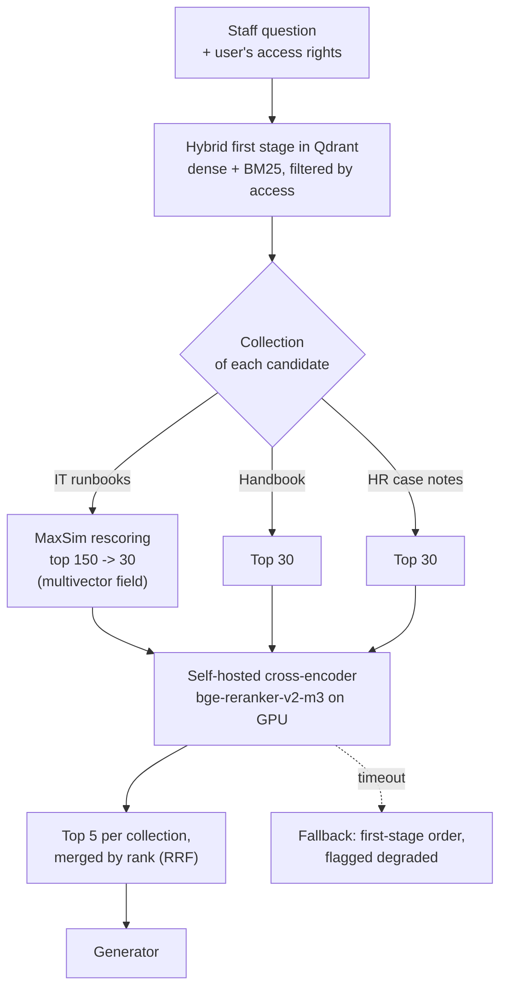

This assessment covers the whole Reranking Models module: the BGE reranker family, Cohere's hosted reranker, Jina's rerankers and long-document windowing, the wider ecosystem of open cross-encoders with their training and evaluation, ColBERT, and late interaction in general. The quiz mixes beginner, intermediate and advanced questions; aim for at least 80 per cent (15 of 18) before moving on. The open sections that follow have hidden model answers: write your own answer first, then compare.

```quiz
[
  {
    "q": "A BGE reranker scores three candidates with raw logits 2.1, -0.4 and -6.0. You apply a sigmoid before sorting. Which candidate is ranked first?",
    "options": [
      "The one with logit 2.1",
      "The one with logit -6.0, because the sigmoid inverts negative scores",
      "It depends on the other candidates' sigmoid values",
      "They tie, because the sigmoid maps all three into (0, 1)"
    ],
    "answer": 0,
    "why": "The sigmoid is strictly increasing, so it changes the values but never the order."
  },
  {
    "q": "Why is a fixed threshold such as 0.5 on a BGE reranker's sigmoid score unreliable as a relevance test?",
    "options": [
      "Because the sigmoid is not monotonic",
      "Because BGE rerankers output two classes",
      "Because the group-wise training loss is unchanged when all of a query's scores shift by a constant, so absolute levels are not anchored",
      "Because scores above 0.5 are clipped"
    ],
    "answer": 2,
    "why": "Softmax over a training group depends only on differences between scores, so a correct chunk can score low and a topical mismatch high."
  },
  {
    "q": "Which BGE reranker is the natural first choice for a multilingual corpus served from a GPU?",
    "options": ["bge-reranker-base", "bge-reranker-v2-m3", "bge-small-en-v1.5", "bge-reranker-large"],
    "answer": 1,
    "why": "v2-m3 is initialised from the multilingual BGE-M3; base and large were trained on Chinese and English, and bge-small-en-v1.5 is an embedding model."
  },
  {
    "q": "A Cohere Rerank response has results with indices [2, 0, 1]. What is the correct way to attach scores to your chunks?",
    "options": [
      "Assign results[i].relevance_score to chunks[i]",
      "Re-sort the results by index and then assign by position",
      "Ignore the scores and keep your original order",
      "Assign each result's relevance_score to chunks[result.index]"
    ],
    "answer": 3,
    "why": "Results are sorted by relevance; index points back into the documents list you sent. (Re-sorting by index then assigning would also work, but index lookup is the direct method.)"
  },
  {
    "q": "A request handler calls a hosted reranker with no timeout and no fallback. The API slows to 10 seconds. What do users see?",
    "options": [
      "Slow answers or errors, because nothing in the application bounds the wait",
      "First-stage results, because the SDK falls back automatically",
      "Faster answers",
      "No change, because reranking is optional"
    ],
    "answer": 0,
    "why": "Graceful degradation must be built: a deadline plus a fallback to first-stage order, flagged as degraded."
  },
  {
    "q": "Which measure most directly reduces what a hosted reranker sees, without changing the user's possible results?",
    "options": [
      "Raising top_n",
      "Sending whole documents instead of chunks",
      "Applying access-control filters in the first stage, before reranking",
      "Caching generator answers"
    ],
    "answer": 2,
    "why": "Chunks a user may not read could never appear in their answer; filtering first keeps them from being sent at all."
  },
  {
    "q": "A reranker's limit is 512 tokens, the query takes 20 and there are 3 special tokens. With a 64-token overlap, how many windows does a 2,000-token document need?",
    "options": ["4", "5", "6", "3"],
    "answer": 1,
    "why": "Room is 489, stride 425; ceil((2000 - 489) / 425) + 1 = ceil(3.56) + 1 = 5."
  },
  {
    "q": "Which aggregation of window scores corresponds to simply truncating a long document?",
    "options": ["MaxP", "MeanP", "FirstP", "SumP"],
    "answer": 2,
    "why": "FirstP uses only the first window's score, which is what the model would see if the document were truncated."
  },
  {
    "q": "What is the main practical consequence of a reranker being listwise rather than pointwise?",
    "options": [
      "It cannot be run on a GPU",
      "Its scores are calibrated probabilities",
      "It needs no query",
      "A document's score depends on the other documents in the input, so batches cannot simply be split and merged"
    ],
    "answer": 3,
    "why": "Listwise models read candidates together, so each score is conditioned on its neighbours."
  },
  {
    "q": "A team wants to self-host jina-reranker-v2-base-multilingual inside a paid product. What must they check first?",
    "options": [
      "The licence: the open weights are released for non-commercial use",
      "Whether the tokeniser supports emoji",
      "Whether it outputs logits",
      "Whether it is larger than 512 MB"
    ],
    "answer": 0,
    "why": "The v2 open weights are CC BY-NC 4.0; commercial use needs another arrangement."
  },
  {
    "q": "What does this print?\n```python\nimport numpy as np\nq = np.array([[1.0, 0.0], [0.0, 1.0]])\nd = np.array([[0.6, 0.8], [1.0, 0.0]])\nprint((q @ d.T).max(axis=1).sum())\n```",
    "options": ["1.4", "1.6", "1.8", "2.0"],
    "answer": 2,
    "why": "The first query vector's best match is 1.0 (with [1, 0]); the second's is 0.8 (with [0.6, 0.8]); the sum is 1.8."
  },
  {
    "q": "What is ColBERT's query augmentation?",
    "options": [
      "Rewriting the query with an LLM",
      "Padding the query with [MASK] tokens whose output vectors also take part in MaxSim",
      "Adding synonyms from WordNet",
      "Encoding the query twice with different seeds"
    ],
    "answer": 1,
    "why": "Mask positions produce learned soft expansion vectors that contribute to scoring."
  },
  {
    "q": "One million chunks of 200 stored tokens, 128-dimensional vectors, ColBERTv2-style compression with a 4-byte centroid ID and 2 bits per dimension. Roughly how large is the index?",
    "options": ["51 GB", "0.5 GB", "26 GB", "7.2 GB"],
    "answer": 3,
    "why": "Each vector takes 4 + 128 x 2 / 8 = 36 bytes; 2 x 10^8 vectors x 36 bytes = 7.2 GB. Uncompressed float16 would be 51.2 GB."
  },
  {
    "q": "Why is a late-interaction model much cheaper than a cross-encoder at query time?",
    "options": [
      "Document token vectors are precomputed, so scoring a candidate is a small matrix multiplication rather than a transformer pass",
      "It uses fewer query tokens",
      "It reads only the document title",
      "It skips the query encoder"
    ],
    "answer": 0,
    "why": "Only the short query is encoded at search time; each candidate costs an n x m similarity matrix, a max and a sum."
  },
  {
    "q": "In a Qdrant collection, a multivector field is used only to rescore dense-prefetched candidates with MaxSim. What should its HNSW setting be?",
    "options": [
      "A large m, to make MaxSim accurate",
      "The same as the dense field",
      "Disabled (m = 0), since no nearest-neighbour search runs over token vectors",
      "HNSW is required for MaxSim to work"
    ],
    "answer": 2,
    "why": "Rescoring reads candidates' vectors directly; a graph over every token vector would waste memory and indexing time."
  },
  {
    "q": "On SciFact, first-stage recall@20 was 0.844. A new reranker is evaluated on those 20 candidates. Which statement is true?",
    "options": [
      "A good enough reranker can reach recall@20 of 1.0",
      "No reranker of these candidates can retrieve the roughly 16 per cent of relevant documents that are not among them",
      "Recall@20 will fall after reranking",
      "NDCG@10 cannot change after reranking"
    ],
    "answer": 1,
    "why": "A reranker reorders a fixed set; first-stage recall is its ceiling."
  },
  {
    "q": "When mining hard negatives to fine-tune a cross-encoder, why skip the very top results for each query?",
    "options": [
      "They are too easy to be useful",
      "They are slow to retrieve",
      "They are always duplicates",
      "They often include relevant passages that lack labels, which would become false negatives"
    ],
    "answer": 3,
    "why": "Treating unlabelled positives as negatives teaches the model to reject relevant text."
  },
  {
    "q": "A team stores token vectors for its whole handbook collection to enable MaxSim reranking, and memory grows by 40 times. Which change reduces storage with the least expected quality loss, provided it is evaluated?",
    "options": [
      "Token pooling by a factor of about 2, plus scalar quantisation of the token vectors",
      "Dropping all but the first 10 tokens of each chunk",
      "Replacing MaxSim with the mean of the token vectors",
      "Storing vectors in float64"
    ],
    "answer": 0,
    "why": "Pooling by 2 to 3 has been reported to cost little quality, and quantisation compounds the saving; both should be checked on labelled queries."
  }
]
```

## Conceptual questions

**1.** Explain why the group-wise cross-entropy loss used to train BGE rerankers produces scores that rank well within a query but are unreliable as absolute relevance judgements. What should a team do instead of a fixed threshold?

<details><summary>Show solution</summary>

The loss for one query is $-\log$ of the softmax probability of the positive within its group. Adding the same constant to every score in the group multiplies every exponential by the same factor, which cancels, so the loss is unchanged. Training therefore constrains only the differences between a query's scores, not their level. The model may learn a rough absolute scale, but nothing guarantees it, and on unfamiliar query types it drifts: in the BGE lesson, the correct receipt chunk scored 0.04 while an irrelevant annual-leave chunk scored 0.99 for a parental-leave question.

Instead of a fixed threshold, keep the top k after reranking and let the generator decline when the context does not answer. If a threshold is genuinely needed, fit it on labelled query-chunk pairs ([score calibration](/learn/advanced-retrieval-optimisation/score-calibration)), validate it per query type, and use it to trim obvious junk rather than as a relevance test.

</details>

**2.** Compare a self-hosted reranker (such as `bge-reranker-v2-m3`) with a hosted API (such as Cohere Rerank) on five dimensions an engineering team must weigh.

<details><summary>Show solution</summary>

- **Data governance.** Self-hosting keeps every candidate inside your infrastructure; an API sends them to a third party, which needs a data processing agreement and may be ruled out for some collections.
- **Operations.** An API needs no GPUs, model serving or upgrades; self-hosting needs provisioning for peak load, a batching inference server and monitoring.
- **Latency.** An API adds a network round trip and is subject to the vendor's performance and rate limits; a local model's latency depends on your hardware and is under your control.
- **Cost model.** APIs bill per request unit, which is cheap at low volume and grows linearly; self-hosting is a mostly fixed cost per GPU, cheaper at high steady volume.
- **Control and change.** Self-hosting lets you pin a revision, fine-tune and inspect logits; an API's model versions are managed by the vendor, so you pin the model name and treat any change as a release.

Either way, the request path needs a deadline and a fallback, and the choice should be validated on the same evaluation harness.

</details>

**3.** A team reranks whole runbook sections of 1,000 to 3,000 tokens with a 512-token cross-encoder and sees long, detailed sections consistently demoted. Explain the cause, and compare three remedies.

<details><summary>Show solution</summary>

The cross-encoder truncates each pair at 512 tokens including the query, so it judges only the beginning of each section. When answers sit later (error-code tables, exceptions, final steps), those sections score as irrelevant.

- **Rerank chunks before expanding to sections.** Cheap and restores quality, but the reranker no longer judges the full context the generator reads.
- **Windowing with MaxP.** Split sections into overlapping sentence-aligned windows, score each and take the best; return the best window as evidence. Accurate for factual questions, but cost multiplies by the number of windows.
- **A longer-context reranker.** Fewer windows, but longer windows cost more per pass, and sections longer still remain a problem; licence and latency must be checked.

A common outcome is windowing with MaxP plus a smaller candidate list to keep within the latency budget.

</details>

**4.** Place bi-encoders, ColBERT-style late interaction and cross-encoders on a spectrum. For each, say what is computed offline, what is computed per query, and what kind of query-document interaction it can model.

<details><summary>Show solution</summary>

- **Bi-encoder.** Offline: one vector per chunk. Per query: one query encoding plus approximate nearest-neighbour search. Interaction: a single dot product between two summaries; fine details can be lost in the pooling.
- **Late interaction.** Offline: one vector per token of each chunk. Per query: one query encoding plus, per candidate, an $n \times m$ similarity matrix, a max per query token and a sum. Interaction: token-level matching between contextual vectors, but no attention across query and document, so relationships that need joint reading are not modelled. Cost: storage.
- **Cross-encoder.** Offline: nothing beyond text. Per query: a full transformer pass over each (query, candidate) pair. Interaction: full attention between every query and document token in every layer, the most expressive and the most expensive.

The spectrum suggests a cascade: bi-encoder (or hybrid) for recall over everything, late interaction to rescore hundreds of candidates cheaply, a cross-encoder for the final few dozen.

</details>

**5.** What does ColBERTv2's residual compression store for each token vector, and why does MaxSim tolerate the reconstruction error well?

<details><summary>Show solution</summary>

Each vector is stored as the ID of its nearest k-means centroid plus a residual (vector minus centroid) quantised to 1 or 2 bits per dimension using bucket values learned from the data. Reconstruction adds the centroid and the decoded residual and renormalises.

MaxSim takes, for each query token, the maximum over many document tokens and sums over many query tokens. Small per-vector errors rarely change which document token is the best match, and errors in the sum partly cancel, so rankings change only where candidates are nearly tied. In the ColBERT lesson's experiment, 2-bit compression kept the top two documents identical for every query; 1-bit compression kept the top one but flipped second places with small margins.

</details>

## Coding exercises

**1.** Write `maxsim_explain(q, d, q_tokens, d_tokens)`, which returns a MaxSim score and, for each query token, the document token it matched and the similarity. Test it with three unit-normalised query vectors for "reset", "vpn", "password" and three document vectors for "restart", "credential", "tunnel".

<details><summary>Show solution</summary>

```python
import numpy as np

def maxsim_explain(q, d, q_tokens, d_tokens):
    """Return the MaxSim score and, per query token, its best document token and similarity."""
    sim = q @ d.T
    best = sim.argmax(axis=1)
    rows = [(qt, d_tokens[j], float(sim[i, j])) for i, (qt, j) in enumerate(zip(q_tokens, best))]
    return float(sim.max(axis=1).sum()), rows

def unit(rows):
    a = np.array(rows, dtype=float)
    return a / np.linalg.norm(a, axis=1, keepdims=True)

q = unit([[1, 0, 0], [0, 1, 0], [0, 0, 1]])
d = unit([[0.9, 0.1, 0.0], [0.1, 0.2, 0.9], [0.0, 0.8, 0.6]])
score, rows = maxsim_explain(q, d, ["reset", "vpn", "password"], ["restart", "credential", "tunnel"])
print(f"score = {score:.3f}")
for qt, dt, s in rows:
    print(f"  {qt:>8} -> {dt:<10} {s:.3f}")
```

```output
score = 2.764
     reset -> restart    0.994
       vpn -> tunnel     0.800
  password -> credential 0.970
```

`sim.argmax(axis=1)` picks each query token's best partner, and the score is the sum of those maxima. The breakdown is the explanation that late interaction offers for free: here every query token found a sensible partner, and "vpn" matched "tunnel" least strongly (0.800). In a real system, log these rows for sampled queries; a winning document whose high-similarity matches are all filler tokens is a ranking failure you can see at a glance.

</details>

**2.** Build a small evaluation harness: BM25 as the first stage over eight Meridian chunks, the top 4 candidates reranked by `cross-encoder/ms-marco-MiniLM-L-6-v2`, and MRR@4 before and after reranking on five labelled questions. Report each question's rank before and after.

<details><summary>Show solution</summary>

```bash
pip install rank-bm25 sentence-transformers numpy
```

```python
import numpy as np
import re
from rank_bm25 import BM25Okapi
from sentence_transformers import CrossEncoder

chunks = [
    "Annual leave is 25 days per year.",
    "Up to 5 unused leave days carry over and must be used by 31 March.",
    "Expenses must be submitted within 30 days.",
    "Anything over £75 needs a receipt.",
    "Passwords must be rotated every 90 days.",
    "VPN is required on public Wi-Fi.",
    "Laptops are refreshed every 3 years.",
    "Report a lost laptop to the support desk at once.",
]
labelled = {                                   # query -> index of the relevant chunk
    "When do carried-over holiday days expire?": 1,
    "Do I need to keep the till slip for a £90 dinner?": 3,
    "I left my laptop on the train, what now?": 7,
    "How often do I have to change my password?": 4,
    "Is the VPN needed in a coffee shop?": 5,
}

def mrr(rankings):
    return np.mean([1 / (r.index(t) + 1) if t in r else 0.0 for r, t in rankings])

tokenise = lambda t: re.findall(r"\w+", t.lower())
bm25 = BM25Okapi([tokenise(c) for c in chunks])
ce = CrossEncoder("cross-encoder/ms-marco-MiniLM-L-6-v2")

first, reranked = [], []
for query, target in labelled.items():
    cands = [int(i) for i in np.argsort(-bm25.get_scores(tokenise(query)), kind="stable")[:4]]
    scores = ce.predict([(query, chunks[i]) for i in cands])
    order = [cands[j] for j in np.argsort(-scores)]
    first.append((cands, target)); reranked.append((order, target))
    print(f"{query[:42]:<44} first-stage rank {cands.index(target) + 1 if target in cands else '-'}, "
          f"reranked {order.index(target) + 1 if target in order else '-'}")
print(f"MRR@4 first stage {mrr(first):.3f}, reranked {mrr(reranked):.3f}")
```

```output
When do carried-over holiday days expire?    first-stage rank 2, reranked 1
Do I need to keep the till slip for a £90    first-stage rank 3, reranked 1
I left my laptop on the train, what now?     first-stage rank 1, reranked 1
How often do I have to change my password?   first-stage rank -, reranked -
Is the VPN needed in a coffee shop?          first-stage rank 1, reranked 1
MRR@4 first stage 0.567, reranked 0.800
```

Reranking raises MRR@4 from 0.567 to 0.800. The holiday question (first-stage rank 2) and the till-slip question (rank 3, a vocabulary mismatch with "receipt") both move to rank 1. The password question shows the ceiling: the query says "password" and the chunk says "Passwords", the tokeniser here does no stemming, so BM25 never retrieves it and the reranker cannot help. The fix belongs in the first stage (stemming, or adding dense retrieval), which is exactly the diagnosis the per-question ranks make possible.

</details>

## Architecture design challenge

Meridian is extending AskMeridian to serve 400 staff with three collections: the employee handbook (HR team, may be sent to approved vendors), IT runbooks with Atlas error codes (identifier-heavy, frequently updated), and HR case notes (must never leave company infrastructure). The team has one GPU server, a Qdrant cluster, and a latency budget of 800 ms at the 95th percentile for retrieval and reranking together. Design the reranking architecture: which rerankers, in which order, over how many candidates, how failures are handled, and how you will know it works.

<details><summary>Show solution</summary>

**Reference design.**



**Choices and reasons.**

- **Access filtering in the first stage.** Restricted chunks are never candidates, so no reranker sees them.
- **One self-hosted cross-encoder for everything.** HR case notes cannot go to an API, and a single GPU-served `bge-reranker-v2-m3` avoids running two reranking paths. Cohere Rerank for the handbook would be allowed, but the gain from splitting is unlikely to justify the extra failure mode; revisit if GPU capacity runs short.
- **Late interaction only for runbooks.** Identifier-heavy questions benefit from token-level matching, and MaxSim lets the pipeline look 150 deep cheaply before the cross-encoder sees 30. Token vectors are stored only for this collection, pooled by 2 and quantised, to contain memory.
- **Candidate counts from measurement.** 30 per collection for the cross-encoder fits the GPU budget at a few hundred tokens per chunk; tune with the recall ceiling on labelled queries.
- **Merging across collections by rank.** Cross-encoder scores are on one scale here, but per-collection quotas plus Reciprocal Rank Fusion stop one collection crowding out the others.
- **Failure handling.** A deadline on the reranker call (for example 500 ms), a fallback to first-stage order, a `degraded` flag on results, and an alert on the degraded rate.

**Trade-offs.** Multivectors add storage and an extra indexing path for runbooks, which update frequently; rebuild pooled vectors on every runbook change. A single cross-encoder is a single point of failure, mitigated by the fallback. Not using an API forgoes vendor upgrades in exchange for data control.

**Knowing it works.** A labelled set of at least 200 questions per collection, stored first-stage candidates, NDCG@5 and MRR before and after each stage, sliced by collection and query type, plus p95 latency under realistic load. Rerun it on every model or configuration change.

</details>

## Troubleshooting scenarios

**1.** After adding a rule "discard chunks with reranker sigmoid score below 0.5", AskMeridian starts answering "I don't know" to routine expenses questions and confidently answers a question about a policy the handbook does not contain. What is happening, and what is the fix?

<details><summary>Show solution</summary>

**Diagnosis.** The reranker's scores are not calibrated. Questions that need a small inference (an amount compared with a limit) give the correct chunk a low absolute score, so the threshold removes it and the generator has no context. Questions on a topic the handbook only touches give a topical neighbour a high score, so the threshold keeps a wrong chunk and the generator answers from it.

**Fix.** Remove the fixed threshold; keep the top k after reranking and rely on the generator's instruction to say it does not know when the context does not answer. If filtering is needed, fit a threshold on labelled pairs, validate it per query type, and set it low enough to trim only obvious junk. Add both failing questions to the evaluation set.

</details>

**2.** A week after a hosted reranker was introduced, dashboards show answer quality unchanged on average but a spike in user complaints every afternoon, when answers look as if they were never reranked. Logs show no errors. What would you check?

<details><summary>Show solution</summary>

**Diagnosis.** The pattern fits silent degradation: in the afternoon (peak traffic, or the vendor's peak), calls exceed the wrapper's deadline or hit rate limits, and the wrapper falls back to first-stage order as designed. Because the fallback is not an error, nothing appears in the error logs.

**Checks and fixes.** Look at the `degraded` counter and reranker latency histogram by hour; confirm whether failures are timeouts or HTTP 429s. If rate limits: check whether a batch job shares the production key, and move it to its own key; request a higher limit. If latency: enable caching for repeated questions, reduce candidates per request, and consider a circuit breaker. Add an alert on the degraded rate so that this is noticed by the team, not by users. If outages are frequent, a small self-hosted cross-encoder is a better fallback than first-stage order.

</details>

**3.** A team enables windowed reranking with MeanP aggregation over long runbook sections. Factual error-code questions get worse, while broad "overview" questions improve. Explain, and propose a configuration.

<details><summary>Show solution</summary>

**Diagnosis.** MeanP averages window scores, so a long section with one precise answer window and many irrelevant windows is pulled down, while sections that are moderately relevant throughout rise. Factual questions (an error code's meaning) depend on one window; overview questions benefit from relevance throughout.

**Fix.** Use MaxP for factual questions, and return the best window as the evidence. If both kinds of question matter, either route by query type (a cheap classifier or rule) to MaxP or MeanP, or use a blend such as MaxP plus a small weight on MeanP, tuned on labelled queries of both types. Measure each query type separately so that an average does not hide the regression.

</details>
