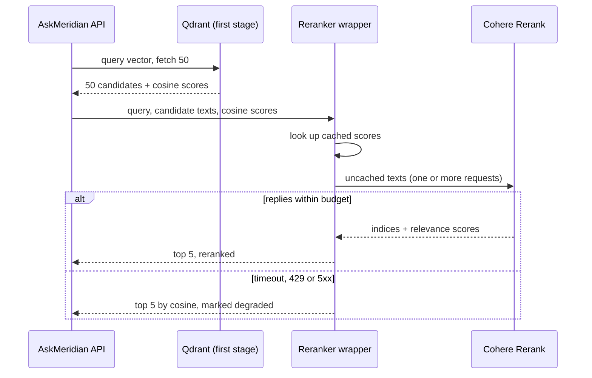

The [BGE rerankers](/learn/reranking-models/bge-rerankers) lesson ran a reranker on your own hardware. **Cohere Rerank** is the best-known alternative: a reranking model that you do not host at all. You send a query and a list of candidate texts to Cohere's API, and it returns the candidates' indices in order with a relevance score for each. There is nothing to download, no GPU to provision, and the model is maintained and upgraded for you.

That convenience changes the engineering problem. With a local model the questions are about hardware and batch sizes. With a hosted reranker they are about the network: how many documents fit in one request, what happens when the service is slow or down, what each call costs, and what it means that your documents now leave your infrastructure. This lesson covers the API itself, then builds a production wrapper that answers those questions, tested against a stand-in client so that it runs without an API key.

## Learning objectives

- Call the Cohere Rerank endpoint with the Python SDK and map its results back to your own candidates.
- Prepare candidates for the API, including long documents and semi-structured records.
- Build a wrapper that batches large candidate lists, caches scores, enforces a latency budget and degrades to first-stage order on failure.
- Estimate the monthly cost and added latency of a hosted reranker from traffic figures.
- Assess the data-governance implications of sending retrieved documents to a third-party API.

## Prerequisites

- [Cross-encoders](/learn/reranking-fundamentals/cross-encoders): the kind of model a reranking API runs.
- [Candidate selection](/learn/reranking-fundamentals/candidate-selection): how many first-stage results to send for reranking.
- [BGE rerankers](/learn/reranking-models/bge-rerankers): a self-hosted reranker, and why reranker scores are not calibrated probabilities.
- [Cohere embeddings](/learn/embedding-models/cohere-embeddings): the Cohere SDK, client setup and API keys.

## Why this matters

Self-hosting a reranker is a real commitment. Someone must choose a model, provision and pay for GPUs sized for peak traffic, build a serving layer that batches requests, monitor it, and re-evaluate when better models appear. For a team with one RAG application and modest traffic, that can be more work than the rest of the retrieval stack together.

A hosted reranker turns all of that into one HTTP call. The trade is a set of new failure modes. A network round trip is added to every query. The service can rate-limit you, slow down or fail, and your users will notice unless you planned for it. Cost becomes per request instead of per GPU hour. And every candidate chunk, which may contain salary details or customer data, is sent to another company. Teams that wire the API straight into the request path, with no timeout and no fallback, usually discover these properties in production. This lesson is about wiring it in properly.

## The intuition

Think of the reranker as an expert reviewer at another firm. You send them a question and a shortlist of documents by courier; they send back the shortlist in order. They are better at judging relevance than your own staff, but the arrangement has rules. The courier takes time. The envelope has a size limit, so a long shortlist must be split across several envelopes. Each envelope is billed. Some days the courier is late, and on those days you cannot hold the customer forever: you go with your own staff's ordering and note that the expert did not see it. And you think carefully about which documents you are allowed to put in an envelope addressed to another firm.

Every part of the wrapper you will build corresponds to one of these rules.

## How it works

### The request and the response

A rerank request has four essential parts: a **model** name, a **query** string, a list of **documents** (plain strings) and **top_n**, how many results to return. The response contains a list of **results**, sorted from most to least relevant, where each result carries:

- `index`: the position of that document in the list you sent. The API identifies documents by position, so you must keep your own list to map results back to chunk IDs.
- `relevance_score`: a number between 0 and 1. Higher means more relevant.

With Cohere's Python SDK (version 5 and later), the call looks like this. It was **not run** for this lesson because it needs an API key.

```bash
pip install cohere
export CO_API_KEY="..."   # from the Cohere dashboard; never commit it
```

```python
import cohere

co = cohere.ClientV2()   # reads the CO_API_KEY environment variable

docs = [
    "Expenses must be submitted within 30 days.",
    "Anything over £75 needs a receipt.",
    "Annual leave is 25 days per year.",
]
response = co.rerank(
    model="rerank-v3.5",
    query="Which expenses need a receipt?",
    documents=docs,
    top_n=2,
)
for result in response.results:
    print(result.index, round(result.relevance_score, 3), docs[result.index])
```

Your exact scores will differ; the output has this shape:

```text
1 0.9xx Anything over £75 needs a receipt.
0 0.0xx Expenses must be submitted within 30 days.
```

The model name is version-sensitive. At the time of writing Cohere's documentation lists `rerank-v3.5` (multilingual) and the older `rerank-english-v3.0` and `rerank-multilingual-v3.0`, and newer generations are released from time to time. Check the [Cohere models page](https://docs.cohere.com/docs/models) and pin the name explicitly; never rely on a default.

### Limits you must design around

Three limits shape how you call the endpoint. Their exact values change between model versions, so read them from the [Rerank API reference](https://docs.cohere.com/reference/rerank) rather than from this lesson.

1. **Document count per request.** Cohere's documentation recommends keeping a request to at most about 1,000 documents. In a RAG pipeline you will usually send 25 to 100, so this rarely bites, but a batch job that reranks large lists needs to split them.
2. **Length per document.** Each document has a token budget (the v2 API exposes it as `max_tokens_per_doc`). Text beyond it is truncated, so an answer sentence near the end of a very long document is invisible to the model, exactly as with a local reranker's `max_length`. Rerank chunks, not whole documents.
3. **Rate limits.** Trial keys are heavily rate-limited, and production keys have limits too. Exceeding them returns HTTP 429 errors, which your code must handle as a normal event.

### Semi-structured documents

Candidates are not always prose. A product record, a support ticket or a runbook entry may have fields. Because the v2 API takes plain strings, the usual approach is to serialise each record into a readable string with field names, for example in YAML, so that the model can see which value belongs to which field:

```text
title: Atlas error E-4021
product: Atlas
body: The VPN client is out of date. Update it from the IT portal.
```

Including the field names helps the model match a query such as "Atlas VPN error" to the right parts. Keep the serialisation consistent between documents, and leave out fields that carry no meaning for relevance (internal IDs, timestamps) because they consume the token budget.

### Is each score independent of the batch?

To split a large candidate list across several requests and merge the results, you need each document's score to depend only on the query and that document, not on which other documents shared the request. That is how a pointwise cross-encoder behaves, and it is the assumption behind batching. Cohere's scores are documented as normalised relevance scores, but rather than take independence on trust for whichever model version you use, check it: score one document inside two different batches and compare. If the scores match, merging batches is safe; if they differ slightly, merging still gives a sensible order but not an exact one.

### Where the call sits in the request path



The key property is that the application always gets an answer within a known time. The reranker improves the order when it can, and its absence is recorded rather than turned into a user-facing error.

## In code

**The problem.** Put Cohere Rerank into AskMeridian's request path safely: split large candidate lists into requests of a bounded size, avoid paying twice for the same query-document pair, return within a fixed latency budget, fall back to first-stage order on any failure, and make every fallback visible. The wrapper must be testable without an API key or a network.

**Dependencies.** None beyond the Python standard library for the wrapper and its tests. In production you add `pip install cohere` and pass a real `cohere.ClientV2()` as the client.

The design separates the wrapper from the client. `HostedReranker` accepts any object with a `rerank(model=..., query=..., documents=..., top_n=...)` method whose response has `results`, each with `index` and `relevance_score`, which is the shape of the Cohere SDK's response. `FakeCohere` is a test double with the same shape: it scores by word overlap and can be made slow or broken on demand.

```python
import hashlib
import math
import time
from concurrent.futures import ThreadPoolExecutor
from dataclasses import dataclass
from types import SimpleNamespace


@dataclass
class Ranked:
    index: int        # position in the caller's candidate list
    score: float      # reranker score, or first-stage score if degraded
    degraded: bool    # True if the hosted reranker was not used


class HostedReranker:
    """Wraps any client with a Cohere-style rerank(model, query, documents, top_n) method."""

    def __init__(self, client, model, max_docs_per_call=100, timeout_s=1.0):
        self.client, self.model = client, model
        self.max_docs, self.timeout_s = max_docs_per_call, timeout_s
        self.cache = {}                       # (model, query, doc hash) -> score
        self.calls = 0                        # billable requests made
        self.pool = ThreadPoolExecutor(max_workers=4)

    def _key(self, query, doc):
        return (self.model, query, hashlib.sha256(doc.encode()).hexdigest())

    def _score_batch(self, query, docs):
        self.calls += 1
        resp = self.client.rerank(model=self.model, query=query, documents=docs, top_n=len(docs))
        scores = [0.0] * len(docs)
        for r in resp.results:                # results come back sorted, not in input order
            scores[r.index] = r.relevance_score
        return scores

    def rerank(self, query, docs, first_stage_scores, top_n):
        missing = [i for i, d in enumerate(docs) if self._key(query, d) not in self.cache]
        batches = [missing[i:i + self.max_docs] for i in range(0, len(missing), self.max_docs)]
        try:
            futures = [self.pool.submit(self._score_batch, query, [docs[i] for i in b]) for b in batches]
            deadline = time.monotonic() + self.timeout_s
            for b, f in zip(batches, futures):
                for i, s in zip(b, f.result(timeout=max(0.0, deadline - time.monotonic()))):
                    self.cache[self._key(query, docs[i])] = s
        except Exception as exc:              # timeout, network, rate limit, server error
            print(f"  reranker unavailable ({type(exc).__name__}); falling back to first-stage order")
            order = sorted(range(len(docs)), key=lambda i: -first_stage_scores[i])
            return [Ranked(i, first_stage_scores[i], True) for i in order[:top_n]]
        scores = [self.cache[self._key(query, d)] for d in docs]
        order = sorted(range(len(docs)), key=lambda i: -scores[i])
        return [Ranked(i, scores[i], False) for i in order[:top_n]]


class FakeCohere:
    """Test double with the same call shape and response shape as the Cohere SDK."""

    def __init__(self, delay_s=0.0, fail=False):
        self.delay_s, self.fail = delay_s, fail

    def rerank(self, model, query, documents, top_n):
        time.sleep(self.delay_s)
        if self.fail:
            raise ConnectionError("simulated network failure")
        q = set(query.lower().replace("?", "").split())
        scored = [(i, len(q & set(d.lower().rstrip(".").split())) / len(q)) for i, d in enumerate(documents)]
        scored.sort(key=lambda x: -x[1])
        return SimpleNamespace(results=[SimpleNamespace(index=i, relevance_score=s) for i, s in scored[:top_n]])


docs = [
    "Expenses must be submitted within 30 days.",
    "Anything over £75 needs a receipt.",
    "Annual leave is 25 days per year.",
    "Staff may work remotely up to 3 days a week.",
]
first_stage = [0.71, 0.64, 0.30, 0.22]           # cosine scores from the vector search
query = "which expenses need a receipt?"

print("1. Normal call")
rr = HostedReranker(FakeCohere(), model="rerank-v3.5")
for r in rr.rerank(query, docs, first_stage, top_n=2):
    print(f"  {r.index} {r.score:.2f} degraded={r.degraded}  {docs[r.index]}")
print(f"  billable calls so far: {rr.calls}")

print("2. Same query again (cache)")
rr.rerank(query, docs, first_stage, top_n=2)
print(f"  billable calls so far: {rr.calls}")

print("3. 250 candidates, at most 100 per call")
many = [f"Policy note {i}: expenses need a receipt over £75." if i == 137 else f"Policy note {i}." for i in range(250)]
rr_many = HostedReranker(FakeCohere(), model="rerank-v3.5", max_docs_per_call=100)
best = rr_many.rerank(query, many, [0.5] * 250, top_n=1)[0]
print(f"  calls={rr_many.calls} (expected {math.ceil(250 / 100)}), best index={best.index}")

print("4. Slow service (1.5 s) with a 1.0 s budget")
slow = HostedReranker(FakeCohere(delay_s=1.5), model="rerank-v3.5", timeout_s=1.0)
t = time.perf_counter()
out = slow.rerank(query, docs, first_stage, top_n=2)
print(f"  returned in {time.perf_counter() - t:.1f} s: {[(r.index, r.degraded) for r in out]}")

print("5. Network failure")
down = HostedReranker(FakeCohere(fail=True), model="rerank-v3.5")
print(f"  {[(r.index, r.degraded) for r in down.rerank(query, docs, first_stage, top_n=2)]}")
for h in (rr, rr_many, slow, down):
    h.pool.shutdown(wait=False)
```

```output
1. Normal call
  1 0.40 degraded=False  Anything over £75 needs a receipt.
  0 0.20 degraded=False  Expenses must be submitted within 30 days.
  billable calls so far: 1
2. Same query again (cache)
  billable calls so far: 1
3. 250 candidates, at most 100 per call
  calls=3 (expected 3), best index=137
4. Slow service (1.5 s) with a 1.0 s budget
  reranker unavailable (TimeoutError); falling back to first-stage order
  returned in 1.0 s: [(0, True), (1, True)]
5. Network failure
  reranker unavailable (ConnectionError); falling back to first-stage order
  [(0, True), (1, True)]
```

**The important lines.**

- `scores[r.index] = r.relevance_score` puts each score back in the caller's order. The API returns results sorted by score, so code that assumes `results[i]` belongs to `documents[i]` silently scrambles the ranking. This is the most common integration bug.
- `top_n=len(docs)` inside `_score_batch` asks for every document's score, so that all of them can be cached and the wrapper can apply its own `top_n` after merging. A per-batch `top_n` at least as large as the final one would also merge correctly; a smaller one would not.
- `batches = [missing[i:i + self.max_docs] ...]` splits the uncached candidates into requests of bounded size. The batches are submitted to a thread pool so that they run in parallel; three sequential round trips would triple the added latency.
- `self.cache` keys on model, query and a hash of the document text. Including the model means an upgrade cannot serve stale scores from the old model; hashing the text means an edited chunk is rescored.
- `f.result(timeout=...)` enforces one overall deadline across all batches, not one per batch.
- `except Exception` is deliberately broad. Timeouts, refused connections, HTTP 429 rate limits and 5xx server errors all lead to the same decision, which is to serve the first-stage order now. The `degraded=True` flag on every result is what makes this safe: the caller can log it, count it and alert on it.

**What the output means.**

- **Case 1:** the receipt chunk, second in first-stage order, is moved to the top. One billable request was made.
- **Case 2:** the same query and documents are answered entirely from the cache; the request count stays at 1. In an internal assistant, repeated questions ("how many days of leave do I get?") are common, so a cache with a sensible expiry can remove a large share of calls.
- **Case 3:** 250 candidates become three requests of at most 100, and the relevant note at index 137, in the second batch, still wins after merging. That is the payoff of asking each batch for all its scores.
- **Case 4:** the simulated service takes 1.5 s, the budget is 1.0 s, and the wrapper returns at 1.0 s with first-stage order marked as degraded. Without the deadline the user would have waited for the slow call, or for the SDK's own retries.
- **Case 5:** a network failure produces the same safe outcome instead of an exception in the request handler.

**Errors people commonly hit.**

- **Mapping results by position.** Use `result.index`, always.
- **Passing a list of dicts in the v2 API.** The v2 endpoint takes strings; serialise records first.
- **Retries that blow the budget.** HTTP clients often retry automatically. Two retries with back-off can turn a 300 ms call into several seconds. Either disable automatic retries in the request path or make sure your own deadline is shorter than the worst case.
- **Unbounded caches.** A dictionary that never forgets will grow without limit in a long-running service. In production use an LRU cache or Redis with an expiry.
- **Different results after a silent model change.** Pinning the model name prevents this; changing it should be a deliberate, evaluated release.

**How to extend it.** Swap `FakeCohere()` for `cohere.ClientV2()` and nothing else changes. Add metrics: a counter of degraded responses, a histogram of reranker latency, and a counter of billable requests, so that a rising fallback rate or a cost spike appears on a dashboard rather than in a support ticket. A circuit breaker is the natural next step: after several consecutive failures, skip the API for a short period instead of waiting for the timeout on every request.

## A real-world example

The Platform team wanted better ranking for AskMeridian but had no GPU capacity, so Hana, the engineer on rotation, proposed Cohere Rerank. Before writing any code she raised three questions with the team lead.

**Is it allowed?** The handbook and IT runbooks are internal but not secret; the HR team confirmed that sending handbook chunks to a vetted vendor under the company's data processing agreement was acceptable. Customer documents, which a future version of AskMeridian might index, were explicitly excluded. Hana added a check that only chunks from approved collections are ever sent to the API.

**Is it worth it?** She ran the 200-question evaluation set twice, without reranking and with Cohere reranking the top 40, and compared [MRR](/learn/retrieval-evaluation/mrr). The improvement was clear on long policy questions and negligible on short lookups of error codes such as E-4021, where the first stage was already reliable.

**What happens on a bad day?** She set a 600 ms budget, built the fallback path, and agreed with the team lead that a degraded rate above 2 per cent for 10 minutes would page the on-call engineer.

The fallback earned its place in the first month, when a regional network problem delayed API calls for most of an afternoon. AskMeridian kept answering, with first-stage order, and the dashboard showed exactly when and for how long reranking had been off. The one thing Hana had not anticipated was cost from a batch job: a colleague's nightly script re-evaluated every query in the logs through the production wrapper. The request counter caught it within a day, and the script was moved to a separate API key with its own budget.

## Common mistakes

- **No timeout on the rerank call.** A slow API becomes a slow product, and an outage becomes an outage of your product.
- **Treating `relevance_score` as a calibrated probability.** It is normalised to 0 to 1, but a fixed cut such as 0.5 behaves differently across query types, as with any reranker. Fit a threshold on labelled data or keep the top k; see [score calibration](/learn/advanced-retrieval-optimisation/score-calibration).
- **Sending whole documents.** Text beyond the per-document token budget is truncated, and long documents may also count as several billable units. Send chunks.
- **Sending candidates the user is not allowed to see.** Apply access control filters in the first stage, before reranking, so restricted text is never shipped to the vendor at all.
- **Asking each batch for fewer results than you need overall.** If the final list needs 10 and each batch returns 5, documents that belong in the overall top 10 are lost inside their batches.
- **Using the production key for experiments and batch jobs.** They consume the same rate limit and budget as live traffic.

## Best practices

- Pin the model name in configuration, and treat a change of model as a release that is evaluated before it ships.
- Wrap the client in a component with a deadline, a degraded flag and metrics; never call the SDK directly from a request handler.
- Cache scores keyed on model, query and document hash, with an expiry.
- Send 20 to 100 chunks per query, chosen by measuring candidate recall, not the maximum the API allows.
- Serialise structured records consistently, with field names, and drop fields that do not bear on relevance.
- Keep a self-hosted fallback in mind: the first-stage order is the minimum, and a small local cross-encoder is a stronger fallback if outages are frequent.

## Performance considerations

**Latency.** A hosted call adds network round-trip time plus model time. Within the same cloud region the round trip is typically tens of milliseconds; across continents it can exceed 100 ms before any computation. Model time grows with the number and length of documents. A practical budget is first stage plus reranking within a few hundred milliseconds, measured at the 95th or 99th percentile, not the average, because users feel the slow tail. Parallel batches keep the added latency close to that of the slowest single request.

**Cost.** Hosted rerankers are billed per request unit, not per GPU hour. At the time of writing Cohere bills Rerank per "search", which its pricing page defines in terms of one query with up to 100 documents, with long documents counting as more than one. Treat the following as an illustration with an **assumed** price of USD 2 per 1,000 searches; check the [pricing page](https://cohere.com/pricing) for real figures.

AskMeridian receives about 400 staff × 8 questions per working day ≈ 3,200 queries a day. With 40 candidates per query, each query is one search. Over 22 working days that is $3{,}200 \times 22 = 70{,}400$ searches a month, about USD 141 at the assumed price. A 30 per cent cache hit rate cuts that to about USD 99. Doubling candidates to 120 would make each query two searches and double the bill, which is why the number of candidates should come from measurement.

**Self-hosting break-even.** Compare that with the cost of one GPU instance running all month, plus the engineering time to run it. At low traffic the API is almost always cheaper; at very high, steady traffic a self-hosted model on owned capacity can win. The answer depends on prices that change, so redo the arithmetic with current figures.

## Security considerations

- **Data leaves your boundary.** Every candidate chunk is sent to Cohere. Check the vendor's data retention and training-use terms and your data processing agreement before sending anything sensitive, and confirm with whoever owns the data (here, the HR team for the handbook).
- **Filter before you send.** Apply [document-level access control](/learn/access-control-and-privacy) in the first stage, so the reranker never receives text the requesting user may not read, and so you send less to a third party.
- **Personal data.** If chunks can contain personal data, consider redacting identifiers before reranking; relevance rarely depends on a name or an employee number.
- **Keys.** Read the key from the environment or a secrets manager, use separate keys per environment and per workload, and rotate them. A leaked key lets someone else spend your budget.
- **Region and residency.** If your data must stay in a jurisdiction, check where the endpoint processes requests. Cohere's models are also offered through some cloud providers' platforms and in private deployments, which can keep traffic inside your own cloud account; availability varies by model and region.

## Summary

- Cohere Rerank is a hosted reranker: send a query and candidate strings, receive indices with relevance scores between 0 and 1, sorted by relevance.
- Always map results back through `index`; results are sorted by score, not returned in input order.
- Design around the per-request document limit, the per-document token budget and rate limits, and send chunks rather than whole documents.
- Wrap the client with batching, a cache, an overall deadline and a degraded fallback to first-stage order, and monitor the fallback rate.
- Cost scales with queries × request units per query, and every candidate leaves your infrastructure: filter by access rights first and check the data terms.

## Exercises

**1.** A response to a request with five documents has results with indices `[3, 0, 4, 1, 2]` and scores `[0.91, 0.40, 0.12, 0.05, 0.01]`. The caller's code does `for i, r in enumerate(response.results): chunk_scores[chunk_ids[i]] = r.relevance_score`. What goes wrong, and what is the fix?

<details><summary>Show solution</summary>

It assigns the highest score, 0.91, to `chunk_ids[0]`, but that score belongs to the document at index 3. Every chunk gets the wrong score, so the top chunk after "reranking" is whichever happened to be first in the original list. The fix is `chunk_scores[chunk_ids[r.index]] = r.relevance_score`.

</details>

**2.** Add a simple circuit breaker to `HostedReranker`: after 3 consecutive failures, skip the API for 30 seconds and return degraded results immediately. Show that a sequence of failing calls stops waiting for the timeout after the third.

<details><summary>Show solution</summary>

Add `self.failures = 0` and `self.open_until = 0.0` in `__init__`. At the start of `rerank`, if `time.monotonic() < self.open_until`, return the first-stage fallback at once. In the `except` branch, increment `self.failures` and, when it reaches 3, set `self.open_until = time.monotonic() + 30` and reset the counter. After a successful call, set `self.failures = 0`.

With `FakeCohere(delay_s=1.5)` and a 1.0 s budget, the first three calls each take about 1.0 s; the fourth returns in well under a millisecond with `degraded=True`. Move the fallback ranking into a helper method so that both paths share it.

</details>

**3.** Meridian's traffic grows to 20,000 queries a day, seven days a week, with 150 candidates per query. Using this lesson's assumptions (one search per 100 documents, USD 2 per 1,000 searches, both illustrative), estimate the monthly cost. Name two changes that would reduce it, and how you would check that each does not hurt quality.

<details><summary>Show solution</summary>

150 candidates need 2 searches per query. $20{,}000 \times 2 \times 30 = 1{,}200{,}000$ searches a month, about USD 2,400.

- **Cut candidates to 100 or fewer:** one search per query, halving the cost. Check candidate recall at 100 versus 150 on a labelled set; if the relevant chunk is almost never between ranks 101 and 150, the cut is free.
- **Cache:** at a 30 per cent hit rate, cost falls by about 30 per cent. Check the hit rate on real logs and use an expiry tied to index updates so that cached scores for edited chunks do not linger.

At this volume, also price a self-hosted reranker on a GPU for comparison.

</details>

**4.** Design decision. Meridian's legal team rules that HR case notes may never leave company infrastructure, but the handbook may. AskMeridian will index both. Design the reranking stage.

<details><summary>Show solution</summary>

Route by collection. Each chunk already carries its source collection in its metadata. After the first stage, split candidates into two groups: handbook chunks go to Cohere Rerank; HR case notes go to a self-hosted cross-encoder such as `bge-reranker-v2-m3`. The two groups' scores are on different scales, so do not merge them by raw score. Either keep separate top-k lists per collection and allocate context space between them, or merge by rank using [Reciprocal Rank Fusion](/learn/hybrid-search/reciprocal-rank-fusion).

A simpler alternative is to self-host for everything, which removes the routing logic and the data-boundary risk at the cost of running a GPU. Enforce the rule in code (an allow-list of collections the API wrapper accepts) and test it, rather than relying on configuration alone.

</details>

## Check your understanding

```quiz
[
  {
    "q": "Cohere Rerank returns results sorted by relevance. How do you find which of your chunks each result refers to?",
    "options": [
      "By the order of results, which matches the order of the documents you sent",
      "By each result's index field, which is the position in the documents list you sent",
      "By matching the returned text against your chunk texts",
      "By the relevance_score, which encodes the chunk ID"
    ],
    "answer": 1,
    "why": "Results are sorted by score, so their order does not match the input. The index field points back into the list you sent."
  },
  {
    "q": "A request handler calls the rerank API with no timeout. The API slows to 8 seconds during an incident. What do users experience?",
    "options": [
      "Nothing, because the SDK falls back to first-stage order automatically",
      "Faster answers, because fewer documents are reranked",
      "An error message within 100 ms",
      "Answers that take at least 8 seconds, or time out at a higher layer"
    ],
    "answer": 3,
    "why": "Without a deadline and fallback in your own code, the request waits for the slow call. Graceful degradation has to be built."
  },
  {
    "q": "You split 300 candidates into 3 requests and ask each for top_n=5, then merge the 15 results. What is wrong?",
    "options": [
      "Nothing; the overall top 5 must be among the 15",
      "The API rejects requests with fewer than 100 documents",
      "Scores from different batches can never be compared",
      "The merged list will contain duplicates"
    ],
    "answer": 0,
    "why": "If scores are independent of the batch, each batch's top 5 contains every document that could be in the overall top 5, so this merge is correct. The lesson's wrapper asks for all scores because it caches them, not because top_n=5 per batch would be wrong."
  },
  {
    "q": "Which change most directly reduces the data sent to a hosted reranker without hurting the user's results?",
    "options": [
      "Raising top_n",
      "Switching to a multilingual model",
      "Applying access-control filters in the first stage before reranking",
      "Caching the generator's answers"
    ],
    "answer": 2,
    "why": "Chunks the user may not read should never be candidates; filtering first removes them before anything is sent, and they could not have been used anyway."
  },
  {
    "q": "Why should the cache key include the model name?",
    "options": [
      "Cohere requires it",
      "So that upgrading the model does not serve scores computed by the old model",
      "Because the model name changes the length of the query",
      "To make the hash shorter"
    ],
    "answer": 1,
    "why": "Scores from different model versions are on different scales and give different orders. Keying on the model invalidates old scores automatically on upgrade."
  }
]
```

## Further reading

- [Cohere Rerank documentation](https://docs.cohere.com/docs/rerank-overview). Overview, best practices and guidance on structured data.
- [Cohere Rerank API reference](https://docs.cohere.com/reference/rerank). Current parameters, limits and response fields.
- [Cohere Python SDK on GitHub](https://github.com/cohere-ai/cohere-python). Client setup, error types and request options.
- Nogueira, R. and Cho, K. (2019). *Passage Re-ranking with BERT*. [arXiv:1901.04085](https://arxiv.org/abs/1901.04085). The cross-encoder reranking approach that hosted rerankers productise.
- Nygard, M. T. (2018). *Release It! Design and Deploy Production-Ready Software* (2nd edition). Pragmatic Bookshelf. The standard treatment of timeouts, circuit breakers and graceful degradation.
