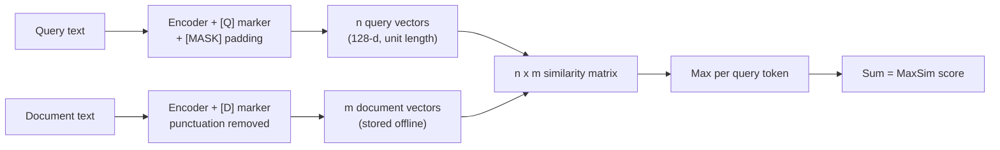

Every model in this module so far has been a cross-encoder: accurate because it reads the query and the passage together, and expensive for the same reason, since nothing can be computed before the query arrives. **ColBERT** (Khattab and Zaharia, 2020) is the best-known model that sits between that and a [bi-encoder](/learn/reranking-fundamentals/bi-encoders). It encodes documents in advance, like a bi-encoder, but keeps **one vector per token** instead of squeezing the passage into one. At query time it compares every query token with every document token and adds up the best matches, a scoring rule called **MaxSim**. The comparison happens late, after both sides are encoded, which is why the approach is called *late interaction*.

This lesson is about ColBERT the model and ColBERT the retrieval engine: how the encoder is built, how it is trained, how ColBERTv2 shrinks an index that would otherwise be enormous, and how the PLAID engine searches it. You will implement MaxSim and ColBERTv2-style residual compression in NumPy and watch the compressed index keep the same rankings at about an eighth of the size. The broader family of late-interaction models, and how to run them inside a vector database, follows in [Late interaction](/learn/reranking-models/late-interaction).

## Learning objectives

- Describe ColBERT's query and document encoders, including the marker tokens, query augmentation, the projection to a small dimension and punctuation filtering.
- Compute a MaxSim score by hand and in NumPy, and explain why it can be decomposed per query token.
- Explain ColBERTv2's residual compression and estimate an index's size with and without it.
- Outline how ColBERT retrieves from a full collection (candidate generation, then exact scoring) and what PLAID adds.
- Decide whether ColBERT should act as a first-stage retriever or as a reranker in a given system.

## Prerequisites

- [Bi-encoders](/learn/reranking-fundamentals/bi-encoders): independent encoding and single-vector similarity.
- [Cross-encoders](/learn/reranking-fundamentals/cross-encoders): joint encoding and why it cannot be precomputed.
- [Embeddings](/learn/understanding-large-language-models/embeddings): contextual token vectors from a transformer.
- [Product quantisation](/learn/vector-indexing-algorithms/product-quantisation): compressing vectors with centroids and codes.

## Why this matters

A single-vector bi-encoder has to summarise a whole passage in one point. Everything the passage says competes for the same few hundred numbers, so specific details are blurred: an error code, a number, a rare name. That is one reason dense retrieval misses exact matches that BM25 finds easily. A cross-encoder sees every detail but costs a full transformer pass per candidate at query time, which limits it to short candidate lists.

ColBERT keeps the detail without paying the per-candidate transformer cost. Each document token keeps its own contextual vector, so "E-4021" in a runbook remains a distinct, findable signal instead of being averaged away. At query time only the query is encoded; scoring is matrix multiplication against stored vectors. In the original paper this gave quality close to a BERT cross-encoder at a small fraction of the query-time computation.

The price is storage. One vector per token means a passage of 200 tokens stores 200 vectors instead of 1. Without compression a ColBERT index for a large collection runs to tens or hundreds of gigabytes. Understanding ColBERT is understanding that trade and the engineering (compression, centroid-based search) that makes it affordable.

## The intuition

Think of comparing a question with a passage word by word. For each word in the question, find the single word in the passage that best matches it in meaning and context, and note how good that match is. Add up those best-match scores. A passage that has a good partner for every important question word scores highly; a passage that matches only the general topic leaves several question words without good partners.

Take "how do I fix error E-4021" against two runbook lines. In the E-4021 line, "error" finds "error", the pieces of "4021" find their exact counterparts, and "fix" finds "update" reasonably well. In the E-4012 line, "error" still finds "error", but "4021" has to settle for the pieces of "4012", weaker partners. The first line wins on the strength of that one token, which a single averaged vector for each line would struggle to keep.

Each match is computed with **contextual** vectors, so "fix" in the query has already absorbed that it is about an error, and "update" in the document has absorbed that it is about a VPN client. That context is what separates ColBERT from simply counting shared words.

## How it works

### The encoders

ColBERT uses one BERT-style encoder for both sides, with small differences in how each side is prepared.

1. **Mark the input.** A special marker token, `[Q]` for queries or `[D]` for documents, is inserted after `[CLS]`, so the shared encoder knows which side it is encoding.
2. **Augment the query.** Queries are padded with `[MASK]` tokens to a fixed length (32 tokens in the original paper). The encoder produces vectors at those mask positions too, and they take part in scoring. The paper calls this **query augmentation**: the mask vectors act as learned, soft expansions of the query, re-weighting or adding terms.
3. **Encode.** The transformer produces a contextual vector for every token.
4. **Project.** A linear layer maps each vector from the encoder's width (768 for BERT-base) down to a small dimension, 128 in the original model. This cuts storage sixfold.
5. **Normalise.** Every vector is scaled to unit length, so a dot product is a cosine similarity.
6. **Filter (documents only).** Vectors of punctuation tokens are dropped from documents, because they carry little meaning and would only take space.

### MaxSim scoring

For a query with token vectors $q_1, \dots, q_n$ and a document with token vectors $d_1, \dots, d_m$:

1. Compute the similarity of every query vector with every document vector: an $n \times m$ matrix of dot products.
2. For each query token, keep the maximum over the document's tokens.
3. Sum those maxima.



The document side of this diagram runs once, at indexing time. At query time only the top branch runs through the transformer.

### Training

ColBERT is trained on triples: a query, a relevant passage and a non-relevant passage. Both passages are scored with MaxSim and the model is trained with a softmax cross-entropy over the pair, so that the relevant one scores higher. The encoder, the projection layer and the marker embeddings are all learned together. Because the loss only ever sees MaxSim scores, the token vectors are shaped specifically for this scoring rule. This matters later: token vectors taken from a model trained for some other purpose can be scored with MaxSim, but they were not optimised for it.

**ColBERTv2** (Santhanam and colleagues, 2022) improved training with *denoised supervision*: hard negatives are mined with an earlier ColBERT model, and a cross-encoder's scores over each query's candidates are used as soft targets, a form of [knowledge distillation](/learn/reranking-models/cross-encoder-models) from the slower, stronger model into ColBERT.

### Retrieving from a whole collection

MaxSim needs a document's vectors before it can score it, so scoring every document for every query is far too slow on a large collection. ColBERT therefore retrieves in two steps.

1. **Candidate generation.** Every document token vector goes into an approximate nearest-neighbour index. Each query vector searches it for its nearest document token vectors; the documents those tokens belong to become candidates. A document with a very good match for even one query token is found this way.
2. **Exact scoring.** Gather the candidates' full token matrices and compute MaxSim for each; sort.

The original ColBERT used a FAISS index for step 1. **PLAID** (Santhanam and colleagues, 2022) is the engine designed for ColBERTv2. It represents each document token by its nearest centroid, scores candidates first with centroids alone (cheap), prunes aggressively, and only decompresses full residual vectors for the few documents that survive. This is why ColBERTv2 indexes can be searched with latencies comparable to single-vector search despite storing many vectors per passage.

### ColBERTv2 residual compression

Each token vector is stored as two parts:

1. **A centroid ID.** Cluster all token vectors with k-means; store the index of the nearest centroid (a few bytes).
2. **A quantised residual.** The residual is the vector minus its centroid. Each of its dimensions is quantised to 1 or 2 bits, choosing among a few bucket values learned from the data.

To reconstruct a vector, look up the centroid, add the bucket values for the codes, and renormalise. Because many token vectors in a collection are near-repeats (every "the", every "laptop" in similar contexts), the centroid carries most of the information and a coarse residual is enough. The ColBERTv2 paper reports a 6 to 10 times smaller index than the uncompressed original with little loss in quality. The idea is a close relative of the [product quantisation](/learn/vector-indexing-algorithms/product-quantisation) used in vector indexes.

### Using ColBERT today

The reference implementation is the Stanford `colbert-ai` package. Most teams use a friendlier wrapper: **RAGatouille** wraps ColBERT's indexing, search and reranking behind a short API, and **PyLate**, from LightOn, builds on `sentence-transformers` for training and running late-interaction models. Pretrained checkpoints include `colbert-ir/colbertv2.0` (the original v2, English), small modern models such as `answerdotai/answerai-colbert-small-v1`, and multilingual ones such as `jinaai/jina-colbert-v2`. Check each checkpoint's licence; the original ColBERTv2 weights, like some cross-encoders, were trained on MS MARCO, whose terms restrict commercial use.

The RAGatouille interface looks like this. It was **not run** for this lesson (RAGatouille is not installed in the sandbox, and indexing needs the ColBERT checkpoint), so read it as the documented usage pattern:

```python
from ragatouille import RAGPretrainedModel

rag = RAGPretrainedModel.from_pretrained("colbert-ir/colbertv2.0")

# Build a compressed PLAID index on disk.
rag.index(collection=docs, index_name="meridian-handbook", max_document_length=180, split_documents=True)
results = rag.search(query="How do I fix error E-4021?", k=3)

# Or use ColBERT purely as a reranker over candidates from another retriever,
# encoding the candidates on the fly with no index.
reranked = rag.rerank(query="How do I fix error E-4021?", documents=candidate_texts, k=3)
```

The two calls at the end are the two roles ColBERT can play: a first-stage retriever over a full index, or a reranker over someone else's candidates.

## The mathematics

### MaxSim

**Intuition.** Every query token votes with its best match in the document; the document's score is the sum of the votes.

$$
s(q, d) = \sum_{i=1}^{n} \max_{j = 1, \dots, m} \; \mathbf{q}_i \cdot \mathbf{d}_j
$$

- $\mathbf{q}_i$ is the unit-length vector of query token $i$ (including the `[MASK]` augmentation tokens), $n$ the number of query vectors.
- $\mathbf{d}_j$ is the unit-length vector of document token $j$, $m$ the number of document vectors after punctuation filtering.
- $\mathbf{q}_i \cdot \mathbf{d}_j$ is their dot product, equal to the cosine because both have length 1.

Two properties follow. The score is a **sum over query tokens of independent terms**, so each query token's contribution can be computed and inspected separately; that is what makes candidate generation by per-token nearest-neighbour search sensible. And the score has no normalisation for document length: a longer document has more tokens to choose from, so its maxima can only stay the same or rise.

**Worked example.** Two query vectors $\mathbf{q}_1 = (1, 0)$, $\mathbf{q}_2 = (0, 1)$ and two document vectors $\mathbf{d}_1 = (0.8, 0.6)$, $\mathbf{d}_2 = (0.6, -0.8)$, all of length 1.

- $\mathbf{q}_1$: dot products $0.8$ and $0.6$; maximum $0.8$.
- $\mathbf{q}_2$: dot products $0.6$ and $-0.8$; maximum $0.6$.
- $s = 0.8 + 0.6 = 1.4$.

Note that both query tokens chose $\mathbf{d}_1$. MaxSim does not require a one-to-one alignment; one document token may serve several query tokens.

### Index size

With $N$ documents of on average $\bar{m}$ stored tokens, each a $k$-dimensional vector:

$$
\text{bytes}_{\text{fp16}} = N \bar{m} \cdot 2k, \qquad \text{bytes}_{\text{v2}} \approx N \bar{m} \left( c + \frac{b\,k}{8} \right)
$$

where $c$ is the bytes for a centroid ID (4 here) and $b$ the bits per residual dimension. For one million chunks of 200 tokens with $k = 128$: fp16 needs $2 \times 10^8 \times 256 = 51.2$ GB; with $b = 2$, each vector needs $4 + 32 = 36$ bytes, so $7.2$ GB. For comparison, one 768-dimensional float32 vector per chunk would be $3.1$ GB.

```python
import numpy as np

q = np.array([[1.0, 0.0], [0.0, 1.0]])        # two query token vectors
d = np.array([[0.8, 0.6], [0.6, -0.8]])       # two document token vectors
sim = q @ d.T                                  # every query token against every document token
print(sim)
print("MaxSim score:", sim.max(axis=1).sum())

n_vectors = 1_000_000 * 200
print(f"float16: {n_vectors * 128 * 2 / 1e9:.1f} GB, 2-bit residuals: {n_vectors * (4 + 128 * 2 // 8) / 1e9:.1f} GB")
```

```output
[[ 0.8  0.6]
 [ 0.6 -0.8]]
MaxSim score: 1.4
float16: 51.2 GB, 2-bit residuals: 7.2 GB
```

## In code

**The problem.** Before committing AskMeridian to a ColBERT index, the Platform team wants to understand the two mechanisms that make it work, MaxSim scoring and residual compression, and to check that compression preserves rankings. Build both from scratch on Meridian's documents.

**Dependencies.** `sentence-transformers`, scikit-learn and NumPy. The model `all-MiniLM-L6-v2` downloads on first use. No API key.

```bash
pip install sentence-transformers scikit-learn numpy
```

There is one honest substitution. A real ColBERT checkpoint produces 128-dimensional token vectors trained for MaxSim. Here the token vectors come from `all-MiniLM-L6-v2`, a single-vector model whose per-token outputs are normally averaged. They are contextual and meaningful, but they were never trained for MaxSim, so treat the scores as illustrating the mechanism rather than ColBERT's quality. The code also filters punctuation from queries as well as documents, and adds no `[MASK]` augmentation; real ColBERT does both differently.

```python
import numpy as np
from sentence_transformers import SentenceTransformer
from sklearn.cluster import KMeans

docs = [
    "Annual leave is 25 days per year; up to 5 unused days carry over to 31 March.",
    "Expenses must be submitted within 30 days, and anything over £75 needs a receipt.",
    "Passwords must be rotated every 90 days, and VPN is required on public Wi-Fi.",
    "Error E-4021 means the Atlas VPN client is out of date; update it from the IT portal.",
    "Error E-4012 means the VPN certificate has expired; reinstall it from the IT portal.",
    "Laptops are refreshed every 3 years; report a lost laptop to the support desk at once.",
]
queries = ["how do I fix error E-4021", "do I need a receipt for a taxi", "lost my laptop"]

model = SentenceTransformer("sentence-transformers/all-MiniLM-L6-v2")
tok = model.tokenizer

def token_vectors(texts):
    """One L2-normalised vector per token, with [CLS], [SEP] and punctuation removed."""
    out = []
    for text, emb in zip(texts, model.encode(texts, output_value="token_embeddings")):
        ids = tok(text, truncation=True, max_length=model.max_seq_length)["input_ids"]
        words = tok.convert_ids_to_tokens(ids)
        keep = [i for i, w in enumerate(words) if w not in ("[CLS]", "[SEP]") and any(c.isalnum() for c in w)]
        v = emb[keep].cpu().numpy()
        out.append(v / np.linalg.norm(v, axis=1, keepdims=True))
    return out

def maxsim(q, d):
    """Late-interaction score: each query token takes its best-matching document token."""
    return (q @ d.T).max(axis=1).sum()

D = token_vectors(docs)
Q = token_vectors(queries)
n_tok, dim = sum(len(d) for d in D), D[0].shape[1]
print(f"{len(docs)} documents -> {n_tok} token vectors of {dim} dimensions")

# --- ColBERTv2-style residual compression ---------------------------------
all_vecs = np.vstack(D)
km = KMeans(n_clusters=16, n_init=10, random_state=0).fit(all_vecs)
centroids = km.cluster_centers_
residuals = all_vecs - centroids[km.labels_]
cuts = np.quantile(residuals, [0.25, 0.5, 0.75])               # 3 cut points -> 4 buckets = 2 bits
bucket_values = np.array([np.quantile(residuals, p) for p in (0.125, 0.375, 0.625, 0.875)])
codes = np.searchsorted(cuts, residuals)                       # integers 0..3, one per dimension

def decompress(labels, codes):
    v = centroids[labels] + bucket_values[codes]
    return v / np.linalg.norm(v, axis=1, keepdims=True)

D_hat, start = [], 0
for d in D:
    D_hat.append(decompress(km.labels_[start:start + len(d)], codes[start:start + len(d)]))
    start += len(d)

full_bytes = n_tok * dim * 2                                   # float16
compressed_bytes = n_tok * (4 + dim * 2 // 8)                  # 4-byte centroid id + 2 bits per dim
print(f"storage: float16 {full_bytes:,} bytes, compressed {compressed_bytes:,} bytes "
      f"({full_bytes / compressed_bytes:.1f}x smaller)")
cos = np.sum(all_vecs * np.vstack(D_hat), axis=1)
print(f"cosine(original, reconstructed): mean {cos.mean():.3f}, min {cos.min():.3f}")

for q_text, q in zip(queries, Q):
    exact = np.array([maxsim(q, d) for d in D])
    approx = np.array([maxsim(q, d) for d in D_hat])
    e, a = np.argsort(-exact), np.argsort(-approx)
    print(f"\nQuery: {q_text!r} ({len(q)} query tokens)")
    print(f"  exact  top-2: {[int(i) for i in e[:2]]} scores {np.round(exact[e[:2]], 2)}")
    print(f"  2-bit  top-2: {[int(i) for i in a[:2]]} scores {np.round(approx[a[:2]], 2)}")
```

```output
6 documents -> 106 token vectors of 384 dimensions
storage: float16 81,408 bytes, compressed 10,600 bytes (7.7x smaller)
cosine(original, reconstructed): mean 0.957, min 0.856

Query: 'how do I fix error E-4021' (8 query tokens)
  exact  top-2: [3, 4] scores [5.99 4.44]
  2-bit  top-2: [3, 4] scores [5.66 4.46]

Query: 'do I need a receipt for a taxi' (8 query tokens)
  exact  top-2: [1, 5] scores [4.64 1.35]
  2-bit  top-2: [1, 5] scores [4.48 1.25]

Query: 'lost my laptop' (3 query tokens)
  exact  top-2: [5, 4] scores [2.3  0.72]
  2-bit  top-2: [5, 4] scores [2.19 0.66]
```

**The important lines.**

- `model.encode(texts, output_value="token_embeddings")` returns one vector per token instead of the pooled sentence vector. This is the step that turns a bi-encoder's internals into a multi-vector representation.
- The `keep` list removes `[CLS]`, `[SEP]` and tokens with no letters or digits, ColBERT's punctuation filter. Note that "E-4021" is split into the word pieces `e`, `-`, `402` and `##1`; the hyphen is dropped, while the other three survive as separate vectors.
- `(q @ d.T).max(axis=1).sum()` is the whole of MaxSim: the similarity matrix, the best match per query token, the sum.
- `KMeans(n_clusters=16, ...)` builds the centroid codebook. Real ColBERTv2 indexes use many thousands of centroids, growing with the size of the collection.
- `np.searchsorted(cuts, residuals)` quantises each residual dimension into one of four buckets, so 2 bits per dimension. `bucket_values` holds the value that each bucket decodes to.
- `decompress` adds the centroid and the decoded residual and renormalises, exactly the reconstruction step a ColBERTv2 index performs for candidates that survive pruning.

**What the output means.**

- **106 token vectors for 6 sentences.** About 18 stored vectors per short document, against 1 for a single-vector index. That multiplier is the storage cost of late interaction.
- **7.7 times smaller.** Each vector shrinks from 768 bytes (384 dimensions in float16) to 100 bytes (a 4-byte centroid ID plus 96 bytes of 2-bit codes). With ColBERT's native 128 dimensions the compressed vector would be 36 bytes.
- **Reconstruction is close, not exact.** The mean cosine between original and reconstructed vectors is 0.957, the worst 0.856.
- **Rankings survive.** For all three queries the top two documents are identical before and after compression, and the scores move by a few per cent. MaxSim takes maxima over many tokens, which averages out much of the per-vector error. For the E-4021 query, the E-4021 runbook line beats the E-4012 line by a clear margin (5.99 against 4.44), the distinction a single averaged vector often blurs.

**Errors people commonly hit.**

- `TypeError: can't convert mps:0 device type tensor to numpy` (or `cuda:0`): token embeddings come back as tensors on the model's device. Call `.cpu()` before `.numpy()`.
- **Misaligned tokens.** If you tokenise with different settings from the model (another `max_length`, or no truncation), the `keep` indices point at the wrong vectors. Use the model's own tokeniser and limits.
- **Forgetting to normalise.** Without unit-length vectors, MaxSim favours tokens with large norms rather than good matches.

**How to extend it.** Swap in a real late-interaction checkpoint through PyLate or RAGatouille and compare rankings with this stand-in. Add 1-bit residuals (two buckets) and measure how far the top-2 agreement holds. Time MaxSim for 1,000 candidate documents to see why ColBERT is cheap as a reranker: it is one matrix multiplication per document, with no transformer pass.

## A real-world example

AskMeridian's error-code questions were a persistent weakness. Staff ask about codes from the Atlas catalogue such as E-4021, and the dense first stage, which represents each chunk by one vector, regularly ranked the chunk for a neighbouring code above the right one. The team already ran BM25 beside dense search, which fixed exact-code queries, but paraphrased questions about specific error behaviour still went wrong.

Ifeoma, who led the investigation, prototyped ColBERT in two roles. As a **first-stage retriever** over the IT runbooks, a PLAID index gave the best rankings in her evaluation, but it meant a second index type to operate beside the existing Qdrant cluster, with its own build, update and backup process. As a **reranker** over the existing hybrid candidates, ColBERT encoded the 50 candidates on the fly (one transformer pass per candidate, like a cross-encoder) or, if the team stored token vectors, scored them with no transformer pass at all.

She chose the reranker role with stored vectors: token vectors for the runbook collection only (a few thousand chunks, small enough to keep uncompressed) computed at indexing time, MaxSim over the hybrid candidates at query time. It kept a single serving stack and cost a few milliseconds per query. The handbook collection, where the cross-encoder was already doing well, was left alone. The decision rested on operations as much as on quality: the best model in the evaluation was not worth a second database to run.

## Common mistakes

- **Underestimating storage.** Planning a ColBERT index as if it held one vector per chunk. Multiply by the average token count and budget for compression.
- **Treating any model's token embeddings as ColBERT vectors.** MaxSim works mechanically on any token vectors, but quality depends on training for it.
- **Ignoring document length effects.** MaxSim does not normalise for length; a very long chunk has more chances to match each query token. Keep chunk lengths reasonably even.
- **Re-encoding documents at query time when they could be stored.** Using ColBERT as a reranker without stored vectors gives up its main advantage over a cross-encoder.
- **Assuming the original ColBERTv2 weights are free for commercial use.** Check the training data's terms, not only the code licence.
- **Updating a PLAID index as if it were a vector database.** Centroids are learned from the collection; heavy change over time can degrade compression, so plan periodic rebuilds.

## Best practices

- Decide the role first: first-stage retriever when exact token-level matching across a large collection matters most, reranker when you want to keep your existing retrieval stack.
- Use compressed indexes (ColBERTv2 / PLAID) for anything beyond a few hundred thousand chunks.
- Evaluate against a cross-encoder reranker on the same candidates; the comparison tells you whether the storage is buying anything.
- Keep chunk lengths within the model's document limit (often around 180 to 512 tokens depending on the checkpoint), so no tokens are silently dropped.
- Pin checkpoints and record their licences and training data.

## Performance considerations

**Query time.** Encoding a 32-token query is one short transformer pass. Scoring a candidate costs about $n \times m \times k$ multiply-adds: for $32 \times 200 \times 128$ that is about 0.8 million, trivial for a CPU, so a thousand candidates is under a billion operations, fractions of a second on one core and milliseconds with a vectorised library. Compare a cross-encoder, which needs a full transformer pass per candidate.

**Storage.** From the formula above: tokens per chunk × bytes per vector. With 2-bit residuals and 128 dimensions, 36 bytes per token, so a 200-token chunk takes about 7 KB, roughly two to three times a single 768-dimensional float32 vector. Uncompressed, it would be 51 KB.

**Memory during search.** PLAID keeps centroids and compressed codes in memory and decompresses only survivors. The pruning thresholds trade latency for recall, like the search parameters of an [HNSW](/learn/vector-indexing-algorithms/hnsw) index.

**Indexing time.** Every chunk passes through the encoder once, as with a bi-encoder, plus k-means over a sample of token vectors. Indexing is heavier than for a single-vector index, mainly because of the volume of vectors written.

## Summary

- ColBERT encodes queries and documents separately into one 128-dimensional, unit-length vector per token, with marker tokens, `[MASK]` query augmentation and punctuation filtering.
- MaxSim scores a document as the sum, over query tokens, of each token's best dot product with any document token.
- Document vectors are computed offline, so query-time cost is one short encoder pass plus matrix multiplications, far cheaper than a cross-encoder.
- Storage is the cost: one vector per token. ColBERTv2 stores a centroid ID plus a 1- or 2-bit residual per dimension, shrinking indexes several-fold, and PLAID searches them using centroids first.
- ColBERT can be a first-stage retriever over a PLAID index or a reranker over another retriever's candidates; the choice is as much operational as about quality.

## Exercises

**1.** A query has vectors $(1, 0)$ and $(0.6, 0.8)$. Document A has $(0.6, 0.8)$ and $(0, 1)$; document B has $(1, 0)$ and $(0.8, -0.6)$. Compute both MaxSim scores. Which wins, and which document token does each query token choose?

<details><summary>Show solution</summary>

Document A: $(1,0)$ against $(0.6,0.8)$ gives $0.6$ and against $(0,1)$ gives $0$; max $0.6$. $(0.6,0.8)$ gives $0.36 + 0.64 = 1.0$ and $0.8$; max $1.0$. Score $1.6$.

Document B: $(1,0)$ gives $1.0$ and $0.8$; max $1.0$. $(0.6,0.8)$ gives $0.6$ and $0.48 - 0.48 = 0$; max $0.6$. Score $1.6$.

A tie. In A, both query tokens choose $(0.6, 0.8)$; in B, both choose $(1, 0)$. Each document perfectly matches one query token and partly matches the other.

</details>

**2.** Estimate the index size for 5 million chunks of 150 tokens with a 96-dimensional late-interaction model, uncompressed (float16) and with 1-bit residuals and 4-byte centroid IDs.

<details><summary>Show solution</summary>

Vectors: $5 \times 10^6 \times 150 = 7.5 \times 10^8$.

Float16: $96 \times 2 = 192$ bytes per vector, so $1.44 \times 10^{11}$ bytes, 144 GB.

1-bit: $4 + 96/8 = 16$ bytes per vector, so $1.2 \times 10^{10}$ bytes, 12 GB.

</details>

**3.** Change the code to use 1-bit residuals (two buckets split at the median). Report the compression ratio, the mean reconstruction cosine and whether the top-2 rankings still match.

<details><summary>Show solution</summary>

Set `cuts = np.quantile(residuals, [0.5])`, `bucket_values = np.array([np.quantile(residuals, 0.25), np.quantile(residuals, 0.75)])` and the compressed size to `n_tok * (4 + dim // 8)`. Each vector becomes 4 + 48 = 52 bytes, 14.8 times smaller than float16. Running it gives a mean reconstruction cosine of 0.900 (worst 0.722), down from 0.957. The top-1 document is still correct for all three queries, but the second place changes for two of them (for the receipt query, document 0 replaces document 5; for "lost my laptop", document 3 replaces document 4). Second places here have low scores and small margins, so they are the first to flip. On a large collection with many close competitors, that is where 1-bit errors appear, which is why ColBERTv2 offers both settings and why compression should be evaluated, not assumed.

</details>

**4.** Design decision. A legal-documents team has 20 million chunks, strict accuracy needs on exact clause references, a single Elasticsearch cluster, and a small platform team. Should they adopt ColBERT, and in which role?

<details><summary>Show solution</summary>

At 20 million chunks of about 200 tokens, a compressed ColBERTv2 index is roughly $4 \times 10^9 \times 36$ bytes, about 144 GB, plus a new engine to operate. For a small team, a first-stage PLAID index is a significant operational commitment.

A reasonable design keeps Elasticsearch for first-stage hybrid retrieval (BM25 handles exact clause references well) and adds ColBERT as a reranker over the top 100 to 200 candidates, either encoding them on the fly or storing token vectors only for the most-queried collections. Evaluate against a cross-encoder reranker on the same candidates; if the cross-encoder matches ColBERT's quality within the latency budget, it is simpler still. Move to a first-stage ColBERT index only if candidate recall from Elasticsearch proves to be the bottleneck.

</details>

## Check your understanding

```quiz
[
  {
    "q": "What does ColBERT store for each document?",
    "options": [
      "One pooled vector per document",
      "The raw text only; everything is computed at query time",
      "One vector per token (after punctuation filtering), computed at indexing time",
      "A sparse vector of term weights"
    ],
    "answer": 2,
    "why": "ColBERT keeps a contextual vector for each document token, computed offline, and compares them with the query's token vectors at search time."
  },
  {
    "q": "Query vectors (1,0) and (0,1); document vectors (0.8,0.6) and (0.6,-0.8). What is the MaxSim score?",
    "options": ["0.6", "1.4", "2.0", "0.2"],
    "answer": 1,
    "why": "Best match for (1,0) is 0.8, for (0,1) is 0.6; their sum is 1.4."
  },
  {
    "q": "What is query augmentation in ColBERT?",
    "options": [
      "Padding the query with [MASK] tokens whose output vectors also take part in MaxSim",
      "Rewriting the query with an LLM before encoding",
      "Adding synonyms from a thesaurus",
      "Repeating the query twice"
    ],
    "answer": 0,
    "why": "Queries are padded to a fixed length with [MASK] tokens; the encoder's vectors at those positions act as learned soft expansions."
  },
  {
    "q": "How does ColBERTv2 shrink its index?",
    "options": [
      "By keeping only the top 10 tokens of each document",
      "By storing a centroid ID plus a 1- or 2-bit quantised residual for each token vector",
      "By averaging token vectors into one per sentence",
      "By storing vectors in float8"
    ],
    "answer": 1,
    "why": "Residual compression represents each vector by its nearest centroid and a coarse per-dimension residual, typically 6 to 10 times smaller."
  },
  {
    "q": "Why is ColBERT cheaper than a cross-encoder at query time?",
    "options": [
      "It uses a smaller tokeniser",
      "It skips the query encoder",
      "It scores only the first 32 document tokens",
      "Document vectors are precomputed, so scoring a candidate is a matrix multiplication rather than a transformer pass"
    ],
    "answer": 3,
    "why": "Only the short query is encoded at search time; each candidate costs a similarity matrix and a max, not a forward pass."
  }
]
```

## Further reading

- Khattab, O. and Zaharia, M. (2020). *ColBERT: Efficient and Effective Passage Search via Contextualized Late Interaction over BERT*. SIGIR 2020. [arXiv:2004.12832](https://arxiv.org/abs/2004.12832).
- Santhanam, K., Khattab, O., Saad-Falcon, J., Potts, C. and Zaharia, M. (2022). *ColBERTv2: Effective and Efficient Retrieval via Lightweight Late Interaction*. NAACL 2022. [arXiv:2112.01488](https://arxiv.org/abs/2112.01488).
- Santhanam, K., Khattab, O., Potts, C. and Zaharia, M. (2022). *PLAID: An Efficient Engine for Late Interaction Retrieval*. CIKM 2022. [arXiv:2205.09707](https://arxiv.org/abs/2205.09707).
- [ColBERT on GitHub](https://github.com/stanford-futuredata/ColBERT). The reference implementation.
- [RAGatouille on GitHub](https://github.com/AnswerDotAI/RAGatouille). A high-level wrapper for indexing, search and reranking with ColBERT.
