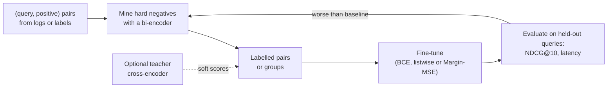

The [Cross-encoders](/learn/reranking-fundamentals/cross-encoders) lesson explained the architecture: query and passage in one input, full attention between them, one relevance score out. The previous lessons in this module looked at three particular families, [BGE](/learn/reranking-models/bge-rerankers), [Cohere](/learn/reranking-models/cohere-rerank) and [Jina](/learn/reranking-models/jina-rerankers). This lesson is about the wider open ecosystem of cross-encoder models and the engineering skills that apply to all of them: reading a model card, understanding how a model was trained and what that implies, **measuring** a candidate model on a real benchmark rather than trusting a leaderboard, fine-tuning one for your domain, and serving it efficiently.

The centre of the lesson is a real evaluation. You will run a first-stage retriever over the 5,183 abstracts of the SciFact benchmark, rerank its top 20 with two different cross-encoders, and measure NDCG@10 and latency for each. The numbers that come out are the kind of evidence a model choice should rest on.

## Learning objectives

- Survey the main families of open cross-encoder models and read a model card for size, language, maximum length, output type and licence.
- Explain pointwise, pairwise, listwise and distillation training objectives, and compute a binary cross-entropy and a Margin-MSE loss by hand.
- Evaluate rerankers on a labelled benchmark with fixed first-stage candidates, reporting NDCG@10, the recall ceiling and latency.
- Fine-tune a cross-encoder on in-domain pairs with mined hard negatives using `sentence-transformers`.
- Choose serving options (batching, precision, ONNX or OpenVINO backends, `max_length`) to meet a latency budget.

## Prerequisites

- [Cross-encoders](/learn/reranking-fundamentals/cross-encoders): the architecture this lesson assumes.
- [BGE rerankers](/learn/reranking-models/bge-rerankers): running a reranker, logits and sigmoid scores, group-wise training.
- [NDCG](/learn/retrieval-evaluation/ndcg): the ranking metric used in the evaluation.
- [Hard negative mining](/learn/embedding-optimisation/hard-negative-mining): finding the near-miss examples that make training informative.

## Why this matters

There are hundreds of cross-encoders on Hugging Face. They differ in size by a factor of a hundred, in languages, in maximum input length, in how they were trained and in what they may legally be used for. Leaderboards rank them on public benchmarks, but a public benchmark is not your corpus: models trained on web search queries can stumble on internal jargon, error codes or scientific prose. Picking a model by reputation, then discovering in production that it adds latency without improving answers, is a common and expensive outcome.

The remedy is a repeatable evaluation harness: fixed candidates, labelled relevance, a ranking metric, latency per query. With it, choosing a reranker becomes an experiment that takes an afternoon. Without it, every later change (a new model, a fine-tune, a different `max_length`) is a guess. Fine-tuning is the second skill: when no off-the-shelf model knows your domain, a few thousand in-domain pairs can make a small model competitive with a large one.

## The intuition

Choosing a reranker is like hiring an editor to put a shortlist of articles in order. You would not hire on the strength of a famous name alone. You would hand each candidate editor the same twenty shortlists from your own archive, compare their orderings with the ones your experts agree on, and time how long each took. You would also check the obvious practicalities: does this editor read the languages you publish in, can they cope with long articles, and are they allowed to work for a commercial publisher?

If no editor knows your field, you train one: show a capable generalist many examples of "this article answers this question; these similar-looking ones do not". The near misses are what teach discrimination; obviously irrelevant examples teach nothing.

## How it works

### The landscape

Open cross-encoders fall into a few recognisable groups. Sizes and licences below are from model cards at the time of writing; check before use.

- **Small MS MARCO cross-encoders.** The `cross-encoder/ms-marco-*` models distributed with `sentence-transformers`: TinyBERT and MiniLM variants with 2, 4, 6 or 12 layers. `ms-marco-MiniLM-L-6-v2` has about 22.7 million parameters, is English-only, and is fast enough for CPU reranking. Fewer layers are faster and weaker; the L-6 model is a common default. Multilingual variants trained on translated MS MARCO data (mMARCO) also exist.
- **Larger general rerankers.** The BGE, Jina and mixedbread (`mxbai-rerank-*`) families, typically 100 million to 600 million parameters for encoder models, trained on broader data than MS MARCO alone.
- **LLM-based rerankers.** Decoder language models of one to several billion parameters fine-tuned to emit a relevance judgement, such as monoT5 (Nogueira and colleagues, 2020), which reads "Query: … Document: … Relevant:" and scores the probability of "true", and the LLM-based BGE models. Stronger on hard and multilingual queries, much more expensive per candidate.
- **Prompted general LLMs.** Asking a chat model to order a list of passages (listwise prompting, studied by Sun and colleagues, 2023, as RankGPT). Flexible and often strong, but slow, costly and sensitive to prompt and position; mainly a research tool and a source of training labels.

### Reading a model card

Before running anything, extract six facts:

1. **Size** (parameters), which sets latency and memory.
2. **Languages** the training data covered.
3. **Maximum sequence length**, shared by query and passage.
4. **Output**: one logit (`num_labels = 1`), or two classes requiring a softmax. `sentence-transformers` applies a sigmoid to single-output models by default unless the model's configuration specifies otherwise; the MS MARCO MiniLM models return raw logits.
5. **Training data and objective**, which predict where it will be strong.
6. **Licence**, of the weights and, where relevant, the training data. MS MARCO was released for non-commercial research use, and some organisations' legal reviews take that into account for models trained on it even when the weights carry a permissive licence.

### How cross-encoders are trained

All objectives start from labelled (query, passage) pairs, usually with hard negatives: passages that a retriever ranked highly but that are not relevant.

1. **Pointwise.** Each pair is a binary classification: relevant (1) or not (0). The loss is binary cross-entropy on the sigmoid of the logit. Simple, and the most common default.
2. **Pairwise.** Each training example is a positive and a negative for the same query; the loss pushes the positive's score above the negative's (RankNet-style).
3. **Listwise.** A query with one positive and several negatives; a softmax over the group, as in the BGE lesson's group-wise cross-entropy, or losses that optimise ranking metrics more directly (LambdaLoss).
4. **Distillation.** A larger teacher (often a big cross-encoder or an ensemble) scores many pairs; the student is trained to reproduce the teacher's **score margins** between a positive and a negative (Margin-MSE, Hofstätter and colleagues, 2020). This transfers ranking knowledge into a smaller, faster model, and it is how many small rerankers get their quality.



### An evaluation protocol

1. **Fix the first stage.** Retrieve the top $K$ candidates for every test query once, and store them. Every reranker then sees exactly the same candidates, so differences come from the reranker alone.
2. **Measure the ceiling.** Compute recall@$K$ of the candidates. A reranker can only reorder; if the relevant document is not in the top $K$, nothing downstream can find it.
3. **Score the baseline.** NDCG@10 of the first-stage order.
4. **Rerank and score.** For each candidate model, rerank the stored candidates and compute NDCG@10.
5. **Time it.** Wall-clock milliseconds per query on the hardware you will deploy on, with realistic batch sizes.
6. **Slice.** Break results down by query type; an average can hide a model that is excellent on long questions and harmful on identifier lookups.

## The mathematics

### Binary cross-entropy (pointwise)

**Intuition.** Turn the logit into a probability with a sigmoid, and penalise confident mistakes heavily.

$$
\mathcal{L}_{\text{BCE}} = -\big[\, y \log \sigma(s) + (1 - y)\log\big(1 - \sigma(s)\big) \big]
$$

- $s$ is the model's logit for the pair; $\sigma(s) = 1/(1 + e^{-s})$.
- $y$ is the label: 1 for relevant, 0 for not.

**Worked example.** A positive with $s = 2.0$: $\sigma(2.0) = 0.881$, loss $-\ln 0.881 = 0.127$. A negative with $s = -1.0$: $\sigma(-1.0) = 0.269$, loss $-\ln(1 - 0.269) = 0.313$. The negative contributes more loss: the model is not yet confident enough that it is irrelevant.

### Margin-MSE (distillation)

**Intuition.** Do not copy the teacher's scores, which may be on a different scale; copy the **gap** it puts between a positive and a negative.

$$
\mathcal{L}_{\text{MarginMSE}} = \Big( (s^{+} - s^{-}) - (t^{+} - t^{-}) \Big)^2
$$

- $s^{+}, s^{-}$ are the student's logits for the positive and negative passage of one query.
- $t^{+}, t^{-}$ are the teacher's.

**Worked example.** Teacher: $t^{+} = 9.0$, $t^{-} = 3.0$, margin 6.0. Student: $s^{+} = 2.0$, $s^{-} = -1.0$, margin 3.0. Loss $(3.0 - 6.0)^2 = 9.0$. The student already ranks correctly, but the loss still pushes it to separate the two as decisively as the teacher does, which is what makes the student's ordering robust.

```python
import numpy as np

s, y = np.array([2.0, -1.0]), np.array([1, 0])
p = 1 / (1 + np.exp(-s))
print(p.round(4), (-(y * np.log(p) + (1 - y) * np.log(1 - p))).round(4))
teacher_margin, student_margin = 9.0 - 3.0, 2.0 - (-1.0)
print(teacher_margin, student_margin, (student_margin - teacher_margin) ** 2)
```

```output
[0.8808 0.2689] [0.1269 0.3133]
6.0 3.0 9.0
```

## In code

**The problem.** Decide between a 22.7-million-parameter MS MARCO cross-encoder and the 278-million-parameter `bge-reranker-base`, on evidence. SciFact, part of the BEIR benchmark, provides scientific claims as queries, 5,183 paper abstracts, and relevance labels: a domain unlike the web queries both models mostly learned from.

**Dependencies.** `sentence-transformers`, `datasets` and NumPy. The first run downloads the dataset (a few MB) and three models (about 1.3 GB in total). No API key.

```bash
pip install sentence-transformers datasets numpy
```

```python
import time
from collections import defaultdict
import numpy as np
from datasets import load_dataset
from sentence_transformers import SentenceTransformer, CrossEncoder

# 1. Data: SciFact from the BEIR benchmark (5,183 abstracts, 300 test queries)
corpus = load_dataset("BeIR/scifact", "corpus", split="corpus")
queries = {str(r["_id"]): r["text"] for r in load_dataset("BeIR/scifact", "queries", split="queries")}
qrels = defaultdict(set)
for r in load_dataset("BeIR/scifact-qrels", split="test"):
    qrels[str(r["query-id"])].add(str(r["corpus-id"]))
doc_ids = [str(d) for d in corpus["_id"]]
doc_texts = [f"{t}. {x}" for t, x in zip(corpus["title"], corpus["text"])]
test_q = [q for q in qrels if q in queries]

def ndcg_at_10(ranked, relevant):
    dcg = sum(1 / np.log2(i + 2) for i, d in enumerate(ranked[:10]) if d in relevant)
    ideal = sum(1 / np.log2(i + 2) for i in range(min(len(relevant), 10)))
    return dcg / ideal

# 2. First stage: a small bi-encoder, top 20 candidates per query
FETCH_K = 20
bi = SentenceTransformer("sentence-transformers/all-MiniLM-L6-v2")
D = bi.encode(doc_texts, normalize_embeddings=True, batch_size=64)
Q = bi.encode([queries[q] for q in test_q], normalize_embeddings=True)
top = np.argsort(-(Q @ D.T), axis=1)[:, :FETCH_K]
first = {q: [doc_ids[j] for j in top[i]] for i, q in enumerate(test_q)}
recall = np.mean([len(qrels[q] & set(first[q])) / len(qrels[q]) for q in test_q])
print(f"{len(test_q)} queries, {len(doc_ids)} documents; recall@{FETCH_K} of first stage: {recall:.3f}")
print(f"{'pipeline':<36}{'NDCG@10':>8}{'ms/query':>10}")
print(f"{'bi-encoder only':<36}{np.mean([ndcg_at_10(first[q], qrels[q]) for q in test_q]):>8.3f}{'-':>10}")

# 3. Rerank the same candidates with two cross-encoders
text_of = dict(zip(doc_ids, doc_texts))
for name in ["cross-encoder/ms-marco-MiniLM-L-6-v2", "BAAI/bge-reranker-base"]:
    ce = CrossEncoder(name, max_length=512)
    scores, t0 = [], time.perf_counter()
    for q in test_q:
        s = ce.predict([(queries[q], text_of[d]) for d in first[q]], batch_size=32)
        ranked = [first[q][j] for j in np.argsort(-s)]
        scores.append(ndcg_at_10(ranked, qrels[q]))
    ms = (time.perf_counter() - t0) * 1000 / len(test_q)
    print(f"{'+ ' + name:<36}{np.mean(scores):>8.3f}{ms:>10.0f}")
```

The full run took several minutes on the author's laptop. The output:

```output
300 queries, 5183 documents; recall@20 of first stage: 0.844
pipeline                             NDCG@10  ms/query
bi-encoder only                        0.648         -
+ cross-encoder/ms-marco-MiniLM-L-6-v2   0.689       134
+ BAAI/bge-reranker-base               0.703      1144
```

**The important lines.**

- `load_dataset("BeIR/scifact", ...)` loads the corpus, the queries and the test relevance judgements. `qrels` maps each test query to the set of relevant document IDs.
- `ndcg_at_10` implements the metric with binary relevance: each relevant document in the top 10 contributes $1/\log_2(\text{rank} + 1)$, and the total is divided by the best achievable value for that query.
- `top = np.argsort(-(Q @ D.T), axis=1)[:, :FETCH_K]` computes the first stage once and stores the candidates in `first`. Both rerankers then receive identical candidates, the first rule of the protocol.
- `recall` reports the ceiling: the fraction of relevant documents present anywhere in the top 20.
- `ce.predict(..., batch_size=32)` scores all 20 candidates of a query in one batch; timing per query includes tokenisation and the forward passes.

**What the output means.**

- **The ceiling is 0.844.** About 16 per cent of relevant abstracts are not in the top 20 at all; no reranker can recover them. Raising `FETCH_K` raises the ceiling, at proportional reranking cost.
- **Both rerankers help, on a domain neither was built for.** NDCG@10 rises from 0.648 to 0.689 with the small model and to 0.703 with `bge-reranker-base`.
- **The extra quality has a price.** On this machine the small model took 134 ms per query and the larger one 1,144 ms, about 8.5 times longer for a further 0.014 of NDCG@10. Whether that is worth it depends on the latency budget and on whether the gain holds on your own queries; for an interactive assistant on CPU, the small model would probably win this comparison, while with a GPU the larger one becomes affordable.
- **The absolute numbers are specific to this setup.** A different first stage, `FETCH_K` or hardware would change them. What transfers is the method.

**Errors people commonly hit.**

- **Reranking different candidates for each model.** If each experiment re-runs a non-deterministic first stage, differences mix first-stage noise with reranker quality. Store candidates.
- **Truncating abstracts silently.** Scientific abstracts can exceed a model's `max_length`; check the token length distribution of your corpus against the model's limit.
- **Counting model loading in latency.** Load once, warm up with one batch, then time.
- **Over-reading small differences.** With 300 queries, a difference of 0.01 in NDCG@10 may be noise. Bootstrap confidence intervals, or a paired test over per-query scores, tell you whether a gap is real.

**How to extend it: fine-tuning.** If neither model is good enough on your domain, fine-tune the small one on in-domain pairs. The sketch below uses the `sentence-transformers` training API (version 4 and later): mine hard negatives for each (query, positive) pair with a bi-encoder, then train with binary cross-entropy. It was written against the installed library's API but **not executed** here, because the training loop needs the `accelerate` package, which is not available in this sandbox.

```python
import torch
from datasets import Dataset
from sentence_transformers import SentenceTransformer, CrossEncoder
from sentence_transformers.util import mine_hard_negatives
from sentence_transformers.cross_encoder import CrossEncoderTrainer, CrossEncoderTrainingArguments
from sentence_transformers.cross_encoder.losses import BinaryCrossEntropyLoss

# pairs: a Dataset with "query" and "answer" columns of in-domain positives
# corpus_texts: every passage that negatives may be drawn from
embedder = SentenceTransformer("sentence-transformers/all-MiniLM-L6-v2")
labelled = mine_hard_negatives(
    pairs, embedder, corpus=corpus_texts,
    num_negatives=4, range_min=5, range_max=50,   # skip the top 5, which may be unlabelled positives
    sampling_strategy="top", output_format="labeled-pair",
)
model = CrossEncoder("cross-encoder/ms-marco-MiniLM-L-6-v2", max_length=512)
args = CrossEncoderTrainingArguments(
    output_dir="ce-meridian", num_train_epochs=1, per_device_train_batch_size=16,
    learning_rate=2e-5, warmup_ratio=0.1, seed=12,
)
trainer = CrossEncoderTrainer(
    model=model, args=args, train_dataset=labelled,
    loss=BinaryCrossEntropyLoss(model, pos_weight=torch.tensor(4.0)),  # 4 negatives per positive
)
trainer.train()
model.save_pretrained("ce-meridian/final")
```

`range_min=5` skips the very top of each query's ranking, where unlabelled true positives tend to sit; treating them as negatives (false negatives) teaches the model the wrong thing. `pos_weight` balances one positive against four negatives. Evaluate the fine-tuned model with exactly the harness above, on queries held out from training.

## A real-world example

The Platform team needed a reranker for AskMeridian and had a shortlist of four open models. Rather than argue, Sven built the harness from this lesson using 250 real staff questions labelled by the HR team and the IT support desk, with candidates from the production hybrid retriever stored once.

The results split by query type. On handbook policy questions all four rerankers improved NDCG@10 over the first stage, and the larger ones by more. On IT questions that mentioned Atlas error codes, the two MS MARCO-trained models made things slightly **worse**: they had learned from web search that a passage about a topic is relevant, and ranked general VPN advice above the specific code entry. The ceiling check explained a third category: for questions about Meridian Relay, recall@30 was low, so no reranker could help, and the fix belonged in the first stage.

Sven fine-tuned the small MiniLM model on 3,000 pairs drawn from support tickets resolved with a runbook link, with hard negatives mined from the runbooks. The fine-tuned model matched the largest candidate on handbook questions, beat every candidate on error-code questions, and ran at the small model's speed on CPU. The team shipped it, kept the harness in the repository, and made "rerun the harness" a required step for any retrieval change.

## Common mistakes

- **Choosing by leaderboard rank alone.** Public benchmark gains often fail to transfer to internal jargon and identifiers.
- **Ignoring the recall ceiling.** Spending weeks on rerankers when the relevant chunk is missing from the candidates.
- **Evaluating on training queries.** A fine-tuned model scored on the queries it learned from looks far better than it is.
- **Random negatives in fine-tuning.** Easy negatives teach nothing; the model must see near misses.
- **Mining negatives from the very top of the ranking.** These often include unlabelled relevant passages, which become false negatives.
- **Overlooking the training-data licence.** A permissive weight licence does not settle questions about restrictive training data.

## Best practices

- Keep a versioned evaluation harness with stored candidates, labelled queries, NDCG@10, recall@$K$ and latency, and run it for every retrieval change.
- Report results per query type, with confidence intervals.
- Start with a small model; move up only for measured gains that fit the latency budget.
- Fine-tune on in-domain pairs with hard negatives when off-the-shelf models plateau; consider distillation from a large reranker to a small one.
- Record model name, revision, `max_length`, output type and licence in configuration.
- Re-evaluate periodically on fresh queries, since traffic drifts.

## Performance considerations

**Size dominates.** Cost per pair scales roughly with parameters × tokens. The 278 M model above is about 12 times larger than the 22.7 M one, and in the measurement it was about 8.5 times slower per query; the gap is smaller than the parameter ratio because fixed overheads (tokenisation, data movement) do not scale with size.

**Precision and runtimes.** On GPUs, fp16 or bf16 roughly halves memory and usually speeds inference substantially. On CPUs, the `CrossEncoder` class accepts `backend="onnx"` or `backend="openvino"`, which run exported versions of the model through optimised runtimes; combined with int8 quantisation, they often reduce CPU latency noticeably. Verify that rankings are unchanged on your harness after any such conversion.

**Sequence length.** Set `max_length` to cover the real length of your chunks and no more. Inputs are padded only to the longest pair in each batch, so a generous limit costs nothing for short chunks, but a long tail of very long chunks slows every batch they appear in.

**Batching across users.** A serving process that gathers pairs from concurrent requests into larger batches makes much better use of a GPU than one forward pass per user; this is a job for an inference server.

## Summary

- Open cross-encoders range from tens of millions of parameters (MS MARCO MiniLM models) to billions (LLM-based rerankers); read size, languages, maximum length, output type, training data and licence from the model card.
- Training objectives are pointwise (binary cross-entropy), pairwise, listwise and distillation (Margin-MSE), almost always with hard negatives.
- Evaluate with stored first-stage candidates, the recall ceiling, NDCG@10 and latency per query; on SciFact, reranking the top 20 raised NDCG@10 from 0.648 to 0.689 with a small model and 0.703 with a larger one, at 8.5 times the latency.
- Fine-tuning a small cross-encoder on in-domain pairs with mined hard negatives can match larger models at a fraction of the cost.
- Serving speed comes from model size, precision, optimised runtimes, sensible `max_length` and batching.

## Exercises

**1.** Compute the binary cross-entropy for a positive pair with logit $-0.5$ and a negative pair with logit $0.5$. What do these losses say about the model?

<details><summary>Show solution</summary>

$\sigma(-0.5) = 0.378$, so the positive's loss is $-\ln 0.378 = 0.974$. $\sigma(0.5) = 0.622$, so the negative's loss is $-\ln(1 - 0.622) = 0.974$. Both pairs are on the wrong side of zero by the same amount: the model ranks this negative above this positive, and the losses are large and equal.

</details>

**2.** Using the harness, change `FETCH_K` to 50 and rerun with the small cross-encoder. Predict what happens to the ceiling, NDCG@10 and latency before you run it, then explain any surprise.

<details><summary>Show solution</summary>

The ceiling (recall@50) must rise, since the top 50 contains the top 20. Latency should rise roughly 2.5 times, because 50 rather than 20 pairs are scored per query. NDCG@10 usually rises a little, because some relevant documents formerly at ranks 21 to 50 can now be promoted, but it can also fall slightly: more candidates give the reranker more chances to promote a plausible-looking irrelevant document. If NDCG@10 falls while the ceiling rises, the reranker is the weak link on this domain, not the first stage.

</details>

**3.** A teacher gives a positive 7.5 and a negative 1.5. The student gives 0.8 and 1.2. Compute the Margin-MSE loss and say what the gradient will push the student to do.

<details><summary>Show solution</summary>

Teacher margin $7.5 - 1.5 = 6.0$; student margin $0.8 - 1.2 = -0.4$. Loss $(-0.4 - 6.0)^2 = 40.96$. The student ranks the pair the wrong way round; the gradient pushes its positive score up and its negative score down until the gap approaches 6.0.

</details>

**4.** Design decision. AskMeridian must rerank 40 candidates within 150 ms on CPU. The small cross-encoder meets the budget; a larger model gives 0.03 more NDCG@10 on your harness but takes 600 ms. List three ways to try to get most of the larger model's quality inside the budget.

<details><summary>Show solution</summary>

1. **Distil** the larger model into the small one: score your in-domain training pairs with the large model and fine-tune the small one with Margin-MSE.
2. **Cascade**: rerank 40 with the small model, then the top 8 with the large model. At 600 ms for 40, the large model on 8 takes about 120 ms; together with the small model's pass this may exceed 150 ms, so measure, and consider the cascade only on a GPU or with a faster runtime.
3. **Speed up the large model**: an ONNX or OpenVINO backend with int8 quantisation, or a shorter `max_length` if chunks allow. Check rankings on the harness after each change.

Fine-tuning the small model directly on in-domain pairs with hard negatives is a fourth option, often the most effective.

</details>

## Check your understanding

```quiz
[
  {
    "q": "Why should every reranker in an evaluation receive the same stored first-stage candidates?",
    "options": [
      "So that differences in NDCG@10 are caused by the rerankers, not by variation in the first stage",
      "Because rerankers cannot read new documents",
      "To make the evaluation faster",
      "Because NDCG requires exactly 20 candidates"
    ],
    "answer": 0,
    "why": "Fixing the candidates isolates the variable being tested."
  },
  {
    "q": "In the SciFact run, recall@20 of the first stage was 0.844. What does that bound?",
    "options": [
      "The latency of the reranker",
      "The NDCG@10 of the first stage",
      "How many relevant documents any reranker of those candidates can possibly place in its results",
      "The number of queries that were evaluated"
    ],
    "answer": 2,
    "why": "A reranker only reorders the 20 candidates; relevant documents outside them are unreachable."
  },
  {
    "q": "What does Margin-MSE train a student cross-encoder to reproduce?",
    "options": [
      "The teacher's exact scores",
      "The gap between the teacher's scores for a positive and a negative passage",
      "The teacher's tokeniser",
      "Binary labels only"
    ],
    "answer": 1,
    "why": "Matching margins rather than raw scores lets the student learn the teacher's ranking behaviour even if its scale differs."
  },
  {
    "q": "When mining hard negatives, why skip the top few results for each query (range_min > 0)?",
    "options": [
      "They are too easy",
      "They are always duplicates",
      "They take too long to score",
      "They often contain relevant passages that simply lack labels, which would become false negatives"
    ],
    "answer": 3,
    "why": "Unlabelled positives near the top would teach the model to reject relevant text."
  },
  {
    "q": "A 278 M reranker gives +0.014 NDCG@10 over a 22.7 M one at 8.5 times the CPU latency. What is the best next step?",
    "options": [
      "Always choose the larger model; quality matters most",
      "Check whether the gain is statistically reliable and holds on your own queries, then weigh it against the latency budget",
      "Always choose the smaller model",
      "Average the two models' scores"
    ],
    "answer": 1,
    "why": "Small gains on 300 queries may be noise and may not transfer; the decision must also respect latency."
  }
]
```

## Further reading

- Nogueira, R. and Cho, K. (2019). *Passage Re-ranking with BERT*. [arXiv:1901.04085](https://arxiv.org/abs/1901.04085). The original BERT cross-encoder reranker.
- Nogueira, R., Jiang, Z., Pradeep, R. and Lin, J. (2020). *Document Ranking with a Pretrained Sequence-to-Sequence Model*. Findings of EMNLP 2020. The monoT5 reranker.
- Hofstätter, S., Althammer, S., Schröder, M., Sertkan, M. and Hanbury, A. (2020). *Improving Efficient Neural Ranking Models with Cross-Architecture Knowledge Distillation*. [arXiv:2010.02666](https://arxiv.org/abs/2010.02666). Margin-MSE.
- Thakur, N. et al. (2021). *BEIR: A Heterogeneous Benchmark for Zero-shot Evaluation of Information Retrieval Models*. [arXiv:2104.08663](https://arxiv.org/abs/2104.08663). The benchmark that includes SciFact.
- [Sentence Transformers documentation](https://www.sbert.net). Cross-encoder usage, pretrained models, training and efficient inference backends.
