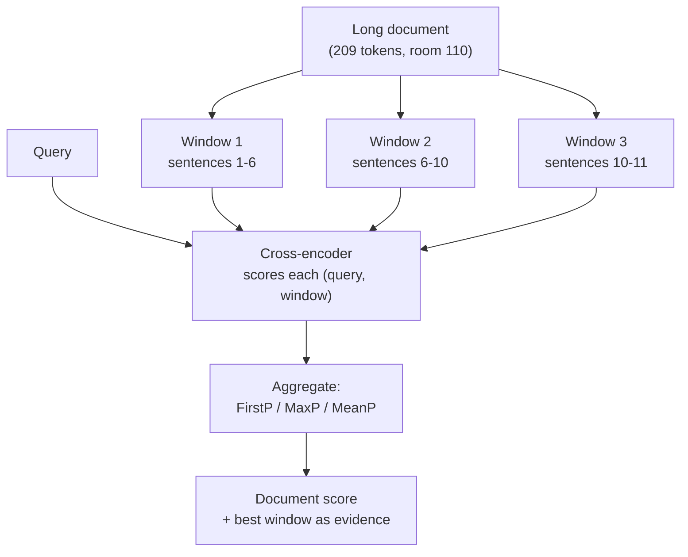

Jina AI, whose [embedding models](/learn/embedding-models/jina-embeddings) appeared earlier in the course, also publishes a line of rerankers. They are worth a lesson of their own not because they are a third interchangeable option beside [BGE](/learn/reranking-models/bge-rerankers) and [Cohere](/learn/reranking-models/cohere-rerank), but because the family illustrates three problems that every reranker deployment eventually meets: **documents longer than the model's window**, the difference between scoring documents **one at a time and as a list**, and **licences** that decide whether open weights can be used commercially at all. Jina's models have also been early to rerank code, function definitions and page images, which shows how far the cross-encoder idea stretches.

This lesson surveys the family, explains how a reranker with a fixed window handles a long document by scoring it in overlapping pieces, and makes you build that mechanism yourself with a small local model so that you can see truncation fail and windowing succeed.

## Learning objectives

- Describe the Jina reranker generations and the licensing and deployment options of each.
- Call the Jina rerank API and run the open weights, and explain why the open weights require `trust_remote_code`.
- Implement sliding-window reranking of long documents and compare FirstP, MaxP and MeanP aggregation.
- Compute the number of windows and the cost multiplier for a document of a given length.
- Distinguish pointwise from listwise reranking and state what listwise scoring changes about batching.

## Prerequisites

- [Cross-encoders](/learn/reranking-fundamentals/cross-encoders): joint encoding of a query and a passage.
- [BGE rerankers](/learn/reranking-models/bge-rerankers): running a reranker locally, and the effect of `max_length`.
- [Jina embeddings](/learn/embedding-models/jina-embeddings): the Jina embedding models and their long-context design.
- [Chunk size](/learn/chunking-fundamentals/chunk-size): why chunk length is a retrieval decision, not just a storage one.

## Why this matters

Every cross-encoder has a maximum input length, and the query and the document share it. Many classic rerankers stop at 512 tokens; newer ones allow more, but always some fixed amount. What happens to text beyond the limit is simple and brutal: it is cut off. The model never reads it, so a document whose answer sits in its last paragraph scores as if it were irrelevant.

In a pipeline that reranks small chunks this rarely matters. But many systems rerank larger units: whole runbook pages, parent sections expanded from [small-to-big retrieval](/learn/chunking-optimisation/small-to-big-retrieval), or full documents because the team wants to rank documents rather than fragments. Those units routinely exceed the window. Without a deliberate strategy the reranker quietly demotes exactly the long, detailed documents that often contain the best answers.

The second reason is licensing. Several of Jina's open-weight rerankers are released under a non-commercial licence. A team that downloads one from Hugging Face, ships it inside a commercial product and only later reads the model card has a legal problem, not a technical one. Knowing to check is part of choosing a model.

## The intuition

Imagine judging whether a 40-page report answers a question, but you are only allowed to look through a letter-box slot that shows one page at a time. Reading only page one (truncation) is fast and often wrong. A better rule is to slide the slot along the report, judge each page, and score the report by its best page: if any page answers the question, the report does. You could instead average all the pages, but then a report with one perfect page and thirty-nine irrelevant ones would look mediocre.

Slide the slot so that consecutive views overlap a little, because an answer that straddles the edge of a page would otherwise be cut in half in both views. That is the whole mechanism of long-document reranking: windows, overlap, and a rule for combining window scores.

## How it works

### The family

The table summarises Jina's reranker generations as described in their model cards and announcements at the time of writing. Model details and licences change; read the current card before deploying.

| Model | Approximate size | What is distinctive | Open-weight licence |
| --- | --- | --- | --- |
| `jina-reranker-v1-base-en` (and `-turbo-en`, `-tiny-en`) | 137 M (base) | English; long inputs via an ALiBi-based backbone; smaller distilled variants | Apache 2.0 |
| `jina-reranker-v2-base-multilingual` | 278 M | Multilingual cross-encoder; also trained to rank code, function signatures and table schemas | CC BY-NC 4.0 |
| `jina-reranker-m0` | about 2.4 B | Multimodal: ranks text and images of document pages, built on a vision-language model | CC BY-NC 4.0 |
| `jina-reranker-v3` | about 0.6 B | Listwise: reads the query and many documents in one pass | CC BY-NC 4.0 |

"CC BY-NC 4.0" means Creative Commons Attribution-NonCommercial: you may use the weights for research and evaluation, but commercial use needs a separate arrangement, which in practice usually means calling Jina's paid API or licensing the model. Apache 2.0 permits commercial use. This single column often decides the choice before quality is even measured.

### Two ways to use them

**The API.** Jina hosts every model behind one endpoint, `https://api.jina.ai/v1/rerank`, authenticated with a bearer token. The request has the same shape as Cohere's (model, query, documents, `top_n`), and the response lists results with an `index` and a `relevance_score`. As with any hosted reranker, the engineering concerns of the [Cohere lesson](/learn/reranking-models/cohere-rerank) apply unchanged: timeouts, fallback, batching, cost and data leaving your boundary.

**The open weights.** The models are on Hugging Face. They use custom model code shipped in the repository, so loading them requires `trust_remote_code=True`, which executes Python from the model repository on your machine. That is acceptable for a repository you trust and have pinned to a specific revision; it is a supply-chain risk otherwise.

### Long documents: windows and aggregation

`jina-reranker-v2-base-multilingual` was trained with a context of 1,024 tokens for the query and document together. Jina's model code includes a `rerank` helper that, according to the model card, splits documents that exceed the limit into chunks and combines the chunk scores. The mechanism is general, and you can apply it to any cross-encoder:

1. **Measure the room.** Subtract the query's tokens and the special tokens from the model's maximum length. What is left is the space for document text in one window.
2. **Split the document into windows** that fit that room. Prefer whole sentences, so no window starts or ends mid-sentence.
3. **Overlap consecutive windows** by a sentence or a few dozen tokens, so an answer near a boundary appears whole in at least one window.
4. **Score every window** with the query, in one batch.
5. **Aggregate** the window scores into a document score:
   - **FirstP**: the first window's score. Equivalent to truncation.
   - **MaxP**: the best window's score. "The document answers if any part does."
   - **MeanP** (or SumP): the average. Rewards documents that are relevant throughout.
6. **Rank documents** by the aggregated score, and keep the best window as the evidence to show the generator.

The names FirstP, MaxP and SumP come from Dai and Callan's 2019 study of BERT for document ranking, which found that taking the best passage usually works well when relevance is concentrated in one place, as it is for most factual questions.



### Pointwise versus listwise

All the rerankers so far are **pointwise**: each (query, document) pair is scored in its own forward pass, and a document's score does not depend on what else is in the list. That is what makes it safe to split candidates across batches and merge.

A **listwise** reranker reads the query and several documents in one input and scores them together. Jina describes `jina-reranker-v3` this way: the query and a set of documents share one context window, each document can attend to the others, and a score is read for each document from the model's output. The potential gains are that the model can compare candidates directly (spotting that two are near-duplicates, or that one is more specific than another) and that shared work is done once. The costs are practical:

- **Scores depend on the list.** The same document can score differently alongside different neighbours, so batches cannot be merged as simply. Lists longer than the model's capacity need a strategy such as scoring overlapping groups.
- **Context is shared.** The total length of all documents must fit the window, which limits how many long candidates one pass can handle.
- **Position can matter.** Models that read lists can be sensitive to the order documents appear in, so the first-stage order may leak into the result.

Listwise reranking with small dedicated models is newer and less established than pointwise cross-encoders; treat published comparisons as promising and verify on your own data.

### Beyond plain text

`jina-reranker-v2` was trained to rank code snippets and structured inputs such as function definitions for tool selection, and `jina-reranker-m0` ranks screenshots and scanned pages directly, without extracting their text first. The second matters for visually rich documents (slides, diagrams, forms) where text extraction loses layout. Both remain cross-encoders in spirit: something representing the query and something representing the candidate are processed jointly and produce one relevance score.

## The mathematics

### How many windows?

**Intuition.** Each new window advances by its width minus the overlap. Count how many steps fit after the first window.

$$
n_{\text{windows}} = \left\lceil \frac{L - w}{w - o} \right\rceil + 1 \quad \text{for } L > w
$$

- $L$ is the document length in tokens.
- $w$ is the room per window: maximum length minus query tokens minus special tokens.
- $o$ is the overlap in tokens; $w - o$ is the stride.
- $\lceil \cdot \rceil$ rounds up. If $L \le w$ there is one window.

**Worked example.** A 2,000-token runbook page, a reranker with a 512-token limit, a 20-token query and 3 special tokens: $w = 512 - 20 - 3 = 489$. With $o = 64$, the stride is 425, so $n = \lceil (2000 - 489)/425 \rceil + 1 = \lceil 3.56 \rceil + 1 = 5$. Scoring this one document costs five forward passes of up to 512 tokens instead of one, so a candidate list of 30 such pages costs 150 passes. Long-document reranking is a real cost multiplier.

### Aggregation

With window scores $s_1, \dots, s_n$: FirstP $= s_1$, MaxP $= \max_j s_j$, MeanP $= \frac{1}{n}\sum_j s_j$. For the runbook in the code below, the scores are $-10.77$, $1.35$ and $6.95$, so FirstP $= -10.77$, MaxP $= 6.95$ and MeanP $= (-10.77 + 1.35 + 6.95)/3 = -0.82$. MeanP is dragged down by the irrelevant installation section even though the document contains the exact answer.

```python
import math
L, w, o = 2000, 489, 64
print(math.ceil((L - w) / (w - o)) + 1)
s = [-10.77, 1.35, 6.95]
print(s[0], max(s), round(sum(s) / len(s), 2))
```

```output
5
-10.77 6.95 -0.82
```

## In code

**The problem.** AskMeridian reranks whole runbook pages, and the Atlas VPN runbook keeps losing to short, loosely related pages on error-code questions. Show why, and fix it with sentence-aware windows and MaxP aggregation.

**Dependencies.** `sentence-transformers` and NumPy. The model `cross-encoder/ms-marco-MiniLM-L-6-v2` (about 90 MB) downloads on first use. No API key.

```bash
pip install sentence-transformers numpy
```

To keep the example short, the reranker's maximum length is set to 128 tokens, so a 209-token runbook plays the role of a multi-thousand-token page against a 1,024-token window. The mechanism is identical at any scale. The small English model stands in for a Jina reranker so that the code runs anywhere; the windowing code works unchanged with any cross-encoder.

```python
import re
import numpy as np
from sentence_transformers import CrossEncoder

MAX_LEN = 128   # deliberately small, so a short runbook is "long" for this model

runbook = (
    "Atlas VPN runbook. Install the Atlas VPN client from the IT portal; administrator rights are not needed. "
    "On first launch, sign in with your Meridian account and approve the multi-factor prompt on your phone. "
    "The client connects automatically when it detects public Wi-Fi, because VPN is required on public networks. "
    "Split tunnelling is disabled, so all traffic passes through the Meridian gateway while connected. "
    "If the connection drops repeatedly, restart the client and check that your laptop clock is correct. "
    "Logs are written to the Atlas folder in your user directory and can be attached to a support ticket. "
    "The support desk is open 08:00 to 18:00 UK time and can reset a locked VPN account. "
    "Certificates are renewed automatically every 12 months while the laptop is on the corporate network. "
    "Error E-4012 means the VPN certificate has expired; reinstall it from the IT portal. "
    "Error E-4021 means the Atlas VPN client is out of date; update it from the IT portal and restart the laptop."
)
docs = {
    "atlas-runbook": runbook,
    "wifi-policy": "VPN is required on public Wi-Fi. Passwords must be rotated every 90 days.",
    "sync-faq": "Meridian Sync shows an error when the laptop is offline; reconnect and retry.",
}
query = "What does error E-4021 mean and how do I fix it?"

model = CrossEncoder("cross-encoder/ms-marco-MiniLM-L-6-v2", max_length=MAX_LEN)
n_tokens = lambda text: len(model.tokenizer(text, add_special_tokens=False)["input_ids"])

def windows(query, text, overlap_sentences=1):
    """Pack whole sentences into windows that fit beside the query; overlap by one sentence."""
    room = MAX_LEN - n_tokens(query) - 3            # [CLS] query [SEP] passage [SEP]
    sentences = re.split(r"(?<=\.)\s+", text)
    spans, start = [], 0
    while start < len(sentences):
        end, used = start, 0
        while end < len(sentences) and used + n_tokens(sentences[end]) <= room:
            used += n_tokens(sentences[end])
            end += 1
        end = max(end, start + 1)                    # a single over-long sentence gets truncated
        spans.append(" ".join(sentences[start:end]))
        if end == len(sentences):
            break
        start = max(end - overlap_sentences, start + 1)
    return spans, room

results = {}
for doc_id, text in docs.items():
    spans, room = windows(query, text)
    scores = model.predict([(query, s) for s in spans])  # raw logits for this model
    results[doc_id] = scores
    print(f"{doc_id}: {n_tokens(text)} tokens, room {room}, {len(spans)} window(s)")
    for k, (s, sc) in enumerate(zip(spans, scores)):
        print(f"   w{k} {sc:7.2f}  '{s[:28]} ... {s[-34:]}'")

print("\nRanking by aggregation strategy")
for name, agg in [("FirstP (truncate)", lambda s: s[0]),
                  ("MaxP (best window)", np.max),
                  ("MeanP (average)", np.mean)]:
    ranked = sorted(results, key=lambda d: -agg(results[d]))
    print(f"  {name:<19}", "  ".join(f"{d}={agg(results[d]):.2f}" for d in ranked))
```

```output
atlas-runbook: 209 tokens, room 110, 3 window(s)
   w0  -10.77  'Atlas VPN runbook. Install t ... that your laptop clock is correct.'
   w1    1.35  'If the connection drops repe ... ; reinstall it from the IT portal.'
   w2    6.95  'Error E-4012 means the VPN c ...  IT portal and restart the laptop.'
wifi-policy: 19 tokens, room 110, 1 window(s)
   w0  -11.28  'VPN is required on public Wi ... rds must be rotated every 90 days.'
sync-faq: 19 tokens, room 110, 1 window(s)
   w0   -8.33  'Meridian Sync shows an error ... p is offline; reconnect and retry.'

Ranking by aggregation strategy
  FirstP (truncate)   sync-faq=-8.33  atlas-runbook=-10.77  wifi-policy=-11.28
  MaxP (best window)  atlas-runbook=6.95  sync-faq=-8.33  wifi-policy=-11.28
  MeanP (average)     atlas-runbook=-0.82  sync-faq=-8.33  wifi-policy=-11.28
```

**The important lines.**

- `room = MAX_LEN - n_tokens(query) - 3` reserves space for the query and the three special tokens of a BERT-style pair. Forgetting the query is the classic off-by-a-lot error: windows that look as if they fit are truncated anyway.
- `re.split(r"(?<=\.)\s+", text)` splits after full stops. It is a simple sentence splitter, adequate for this runbook; for real documents use a proper sentence segmenter, or split on the structure your [document parser](/learn/document-engineering) already found.
- The inner `while` loop packs sentences until the next one would overflow; `max(end, start + 1)` guarantees progress when a single sentence is longer than the room (that sentence is then truncated by the model).
- `start = max(end - overlap_sentences, start + 1)` begins the next window one sentence before the previous one ended. That is the overlap.
- `model.predict` scores every window of a document in one batch. For this model the result is a raw logit; positive means the model leans towards relevant.

**What the output means.**

- **Truncation (FirstP) ranks the right document second.** The first window is about installation and sign-in; it scores −10.77, below the Sync FAQ, which at least mentions an error. A pipeline that simply truncates long pages puts the wrong page first.
- **MaxP ranks it first, decisively.** The third window (`w2`) contains the error-code reference and scores 6.95. The document score is its best evidence.
- **MeanP lands in between.** Averaging −10.77, 1.35 and 6.95 gives −0.82: still first here, but by a far smaller margin, and on a longer document with more irrelevant sections it would sink further. Use MeanP only when you want documents that are relevant throughout.
- **The overlap is visible.** Window `w0` ends with the clock-check sentence and `w1` begins with it; the E-4012 sentence is likewise shared by `w1` and `w2`.

**Errors people commonly hit.**

- **The warning "Token indices sequence length is longer than the specified maximum".** It comes from counting the whole document's tokens in `n_tokens` and is harmless here, because nothing that long is sent to the model. If you see it from `predict`, a window is too long.
- **Windows measured in characters or words.** Token counts differ from word counts, especially for code, numbers and non-English text. Measure in the model's own tokens.
- **Forgetting to return the evidence.** If you rank by MaxP but then pass the whole document to the generator, you lose the benefit and spend context on irrelevant text. Pass the best window, or the window plus its neighbours.

**How to extend it.** Replace the model with `jinaai/jina-reranker-v2-base-multilingual` and `MAX_LEN` with 1024 to handle real page lengths. Following the model card, loading the open weights looks like this (not run here; it needs `trust_remote_code` and, for speed, a GPU):

```python
from transformers import AutoModelForSequenceClassification

model = AutoModelForSequenceClassification.from_pretrained(
    "jinaai/jina-reranker-v2-base-multilingual",
    torch_dtype="auto",
    trust_remote_code=True,       # runs the repository's own model code
    revision="<pinned commit>",   # pin it; see Security considerations
)
model.eval()
scores = model.compute_score([[query, d] for d in documents], max_length=1024)
```

The hosted API needs only an HTTP client. This was not run, because it needs a `JINA_API_KEY`:

```python
import os
import httpx

response = httpx.post(
    "https://api.jina.ai/v1/rerank",
    headers={"Authorization": f"Bearer {os.environ['JINA_API_KEY']}"},
    json={
        "model": "jina-reranker-v2-base-multilingual",
        "query": query,
        "documents": documents,       # a list of strings
        "top_n": 3,
    },
    timeout=2.0,
)
response.raise_for_status()
for r in response.json()["results"]:
    print(r["index"], round(r["relevance_score"], 3))
```

The response also reports token usage, which is what the API bills on, so long documents cost more through the API as well as locally.

## A real-world example

The Platform team at Meridian had been reranking chunks of about 200 tokens with good results. When they introduced parent-document expansion (retrieve a chunk, then return its whole runbook section), Kofi, an engineer on the team, moved the reranker to after the expansion, reasoning that the reranker should judge exactly what the generator would read.

Answer quality on IT questions fell. Investigating the failures, Kofi found that runbook sections averaged well over 1,000 tokens, the reranker's limit was 512, and the error-code tables that answered most IT questions sat at the end of their sections. The reranker was judging introductions.

He considered three fixes. Moving reranking back before expansion was simplest and restored the old quality, but lost the benefit of judging full context. Switching to a long-context reranker helped but did not remove the problem, because some sections were longer still. The fix that shipped was windowed reranking with MaxP over the expanded sections, returning the best window plus one neighbour to the generator. It raised reranking cost by a factor equal to the average window count, which the team measured on real traffic and accepted after shrinking the candidate list from 40 sections to 20.

Kofi also caught a licensing issue before it shipped: the long-context model he had trialled was released under a non-commercial licence. Meridian sells software, and AskMeridian supports staff who build it, so the team's legal adviser ruled that self-hosting it was out. The team kept the windowed approach on a permissively licensed model instead.

## Common mistakes

- **Reranking documents longer than the window without windowing.** The reranker scores only the beginning, so long documents with late answers are systematically demoted.
- **Averaging window scores by default.** MeanP penalises long documents that contain one precise answer, which is the common case for factual questions.
- **Shipping CC BY-NC weights in a commercial product.** The licence forbids it; check the model card before the first download, not before launch.
- **Running `trust_remote_code=True` against an unpinned repository.** Any later change to the repository's code runs on your servers.
- **Merging listwise scores across batches as if they were pointwise.** Scores from a listwise model depend on the other documents in the input.
- **Ignoring the cost multiplier.** Thirty candidates of five windows each is 150 forward passes, not 30.

## Best practices

- Prefer reranking chunks that fit the window; use windowing when the unit you must rank is genuinely longer.
- Build windows from whole sentences in the model's own tokens, with a small overlap, and reserve room for the query.
- Use MaxP for factual question answering, and return the best window as the evidence.
- Record the licence of every model in your configuration, next to its name and pinned revision.
- For multilingual corpora, evaluate the multilingual reranker per language; quality is rarely uniform.
- Treat listwise rerankers as an experiment to measure against a strong pointwise baseline, not as a default.

## Performance considerations

**Windowing multiplies cost.** The number of forward passes is the sum of window counts across candidates. For 20 candidates averaging 3 windows, that is 60 passes; at an illustrative 15 ms per 512-token pass on a GPU-less server, roughly 0.9 s. Options to cut it: fewer candidates, smaller overlap (fewer windows), or a first pass that scores only each document's best-matching window chosen by a cheap lexical score.

**Longer windows are not free.** A 1,024-token window costs more than twice a 512-token one, because attention cost grows with the square of length. Fewer, longer windows are not automatically cheaper than more, shorter ones; measure.

**Model size.** The 278 M v2 model is comparable to `bge-reranker-base` in cost. The 2.4 B multimodal model is roughly ten times larger per pass, and image inputs add many tokens each, so it is suitable for short candidate lists of page images on a GPU.

**Listwise economics.** Scoring many documents in one pass can share work, but one pass over a long concatenated input is itself expensive and cannot be split across devices as easily as independent pairs. Measure end-to-end latency for your candidate count.

## Security considerations

- **Remote code.** `trust_remote_code=True` executes code from the model repository. Pin the `revision` to a reviewed commit, mirror the repository internally if you can, and never enable it for repositories you have not inspected.
- **Hosted data flow.** Using the API sends every candidate to Jina; the data-governance checks from the [Cohere rerank lesson](/learn/reranking-models/cohere-rerank) apply equally.
- **Licence compliance.** Using non-commercial weights commercially is a legal exposure. Keep a record of model licences, and include it in your release checklist.
- **Untrusted long documents.** Windowing means any part of a long document can now win the ranking. A malicious paragraph appended to a long, otherwise benign document can carry it to the top for targeted queries; restrict who can edit indexed content.

## Summary

- Jina's rerankers span English and multilingual cross-encoders, a multimodal page-image reranker and a listwise model; several open-weight versions are licensed for non-commercial use only.
- Every reranker has a fixed window shared by the query and document; text beyond it is never read.
- Long documents are scored by splitting them into overlapping, sentence-aligned windows and aggregating; MaxP suits factual questions, FirstP equals truncation, and MeanP penalises long documents with one good section.
- Windowing multiplies reranking cost by the number of windows: $\lceil (L - w)/(w - o) \rceil + 1$ per document.
- Listwise rerankers score documents together, so scores depend on the list; they are promising but newer than pointwise cross-encoders.

## Exercises

**1.** A reranker has a 1,024-token limit. Queries average 30 tokens and there are 3 special tokens. With a 100-token overlap, how many windows does a 4,000-token document need? How many forward passes does reranking 25 such documents take?

<details><summary>Show solution</summary>

$w = 1024 - 30 - 3 = 991$; stride $= 991 - 100 = 891$. $n = \lceil (4000 - 991)/891 \rceil + 1 = \lceil 3.38 \rceil + 1 = 5$. For 25 documents, 125 forward passes of up to 1,024 tokens.

</details>

**2.** Modify the code so that each document's result includes the text of its best window, and print the evidence the generator would receive for the top-ranked document.

<details><summary>Show solution</summary>

Keep the spans: store `results[doc_id] = (scores, spans)`, then after ranking by MaxP take `best = int(np.argmax(scores))` and print `spans[best]`. For the runbook this is the third window, "Error E-4012 means the VPN certificate has expired; reinstall it from the IT portal. Error E-4021 means the Atlas VPN client is out of date; update it from the IT portal and restart the laptop." That is about 50 tokens of evidence instead of 209 tokens of runbook, and it contains the answer.

</details>

**3.** Construct a case where MeanP is the better aggregation. Describe the query, the two competing documents, and why MaxP ranks them wrongly.

<details><summary>Show solution</summary>

Query: "Give me an overview of Meridian's remote work policy." Document A is the full remote-work policy, every section of which concerns remote work. Document B is a general handbook page with one sentence, "Staff may work remotely up to 3 days a week", among sections on leave and expenses. MaxP may rank B level with or above A, because B's best window contains a crisp matching sentence. MeanP ranks A clearly higher because all its windows are relevant. Broad, overview-style questions reward documents that are relevant throughout; precise factual questions reward the single best passage.

</details>

**4.** Design decision. Meridian wants AskMeridian to answer questions from slide decks whose key content is in diagrams. Options: extract text with OCR and rerank it with a text reranker, or rerank page images with a multimodal reranker such as `jina-reranker-m0`. What would you evaluate, and what constraints might decide it before evaluation?

<details><summary>Show solution</summary>

Constraints first: the open weights of `jina-reranker-m0` are non-commercial, so self-hosting it at Meridian would need a licence; the alternative is the API, which sends slide images to a third party and must be cleared with the data owners. A model of about 2.4 B parameters with image inputs also needs a GPU and a short candidate list.

Evaluation: build a labelled set of questions whose answers live in diagrams and in body text, and compare both pipelines on [NDCG](/learn/retrieval-evaluation/ndcg)@5 per question type, plus latency and cost per query. Expect the image reranker to help most on diagram questions and little on text-heavy slides; a hybrid that uses the image reranker only for pages that OCR finds text-poor is a reasonable outcome.

</details>

## Check your understanding

```quiz
[
  {
    "q": "A reranker with a 512-token limit receives a 1,500-token document whose answer is in the last paragraph. With no windowing, what happens?",
    "options": [
      "The model reads the whole document more slowly",
      "The model raises an error and the document is skipped",
      "The document is truncated, the answer is never read, and the document scores as irrelevant",
      "The model automatically summarises the document first"
    ],
    "answer": 2,
    "why": "Input beyond the limit is cut off. The model only judges the text it sees."
  },
  {
    "q": "Which aggregation makes a long document's score equal to its best window's score?",
    "options": ["FirstP", "MeanP", "SumP", "MaxP"],
    "answer": 3,
    "why": "MaxP takes the maximum over window scores: the document is as relevant as its most relevant part."
  },
  {
    "q": "Why must you reserve room for the query when building windows?",
    "options": [
      "The query and the window share the same model input, so the window must fit in what the query leaves",
      "The query is encoded separately and cached",
      "Special tokens are added only to the query",
      "The tokeniser drops the query if the window is too long"
    ],
    "answer": 0,
    "why": "A cross-encoder reads query and passage as one sequence; the maximum length covers both plus special tokens."
  },
  {
    "q": "What changes when you move from a pointwise to a listwise reranker?",
    "options": [
      "Nothing; listwise is a marketing term",
      "A document's score can depend on the other documents in the same input, so batches cannot simply be merged",
      "Scores become calibrated probabilities",
      "The model no longer needs the query"
    ],
    "answer": 1,
    "why": "Listwise models read several candidates together, so each score is conditioned on the list it appeared in."
  },
  {
    "q": "A team plans to self-host jina-reranker-v2-base-multilingual in a paid product. What should they check first?",
    "options": [
      "Whether it supports fp16",
      "Whether its tokeniser is multilingual",
      "Whether it needs a GPU",
      "Its licence, because the open weights are released for non-commercial use"
    ],
    "answer": 3,
    "why": "The v2 open weights are CC BY-NC 4.0; commercial use requires another arrangement, such as the API or a licence."
  }
]
```

## Further reading

- [Jina AI reranker documentation](https://jina.ai/reranker/). Current models, API parameters and pricing.
- [jinaai/jina-reranker-v2-base-multilingual model card](https://huggingface.co/jinaai/jina-reranker-v2-base-multilingual). Usage, the `rerank` helper for long documents, and the licence.
- Dai, Z. and Callan, J. (2019). *Deeper Text Understanding for IR with Contextual Neural Language Modeling*. SIGIR 2019. [arXiv:1905.09217](https://arxiv.org/abs/1905.09217). Introduces FirstP, MaxP and SumP for long documents.
- Nogueira, R. and Cho, K. (2019). *Passage Re-ranking with BERT*. [arXiv:1901.04085](https://arxiv.org/abs/1901.04085). The pointwise cross-encoder baseline.
- [Creative Commons BY-NC 4.0 licence summary](https://creativecommons.org/licenses/by-nc/4.0/). What "non-commercial" permits and forbids.
