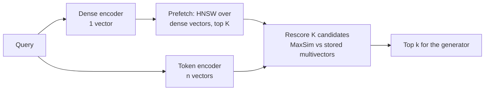

The [ColBERT](/learn/reranking-models/colbert) lesson studied one model and its engine. This lesson steps back to the idea underneath it, **late interaction**: encode query and document separately into many vectors, and let them interact only at scoring time through a cheap operation such as MaxSim. Since ColBERT, the idea has spread well beyond one model. BGE-M3 emits multi-vector outputs alongside its dense vector, ColPali applies the same scoring to image patches of document pages, and several vector databases now store a list of vectors per point and score them with MaxSim natively.

This lesson places late interaction precisely between bi-encoders and cross-encoders, works out what each costs, and shows how to use it in practice: as a reranking stage inside a vector database, with the token-level explanations that come almost for free, and with the techniques that make its storage affordable. The code runs a two-stage dense-then-MaxSim query in an in-memory Qdrant collection and then halves the stored vectors with token pooling.

## Learning objectives

- Place bi-encoders, late-interaction models and cross-encoders on a cost-accuracy spectrum, and estimate the query-time computation of each.
- Configure a multi-vector field in a vector database and run a dense first stage followed by MaxSim reranking.
- Read a MaxSim score as a per-token explanation of why a document was ranked where it was.
- Explain and apply storage reductions for multi-vector indexes: dimension reduction, quantisation, token pooling and single-vector proxies.
- Decide when late interaction is worth adopting, including for visually rich documents.

## Prerequisites

- [ColBERT](/learn/reranking-models/colbert): MaxSim, the encoder design and residual compression.
- [Bi-encoders](/learn/reranking-fundamentals/bi-encoders) and [cross-encoders](/learn/reranking-fundamentals/cross-encoders): the two ends of the spectrum.
- [Candidate selection](/learn/reranking-fundamentals/candidate-selection): how many first-stage candidates a reranker should see.
- [BGE models](/learn/embedding-models/bge-models): BGE-M3's dense, sparse and multi-vector outputs.

## Why this matters

Teams that add a reranker usually reach straight for a cross-encoder, and often that is right. But a cross-encoder runs a transformer over every candidate on every query, so its cost rises with candidate count and length, and it caps how many candidates you can afford to rescue from deeper in the first-stage list. A single-vector bi-encoder is cheap but blurs detail: identifiers, numbers and rare terms are averaged into one point.

Late interaction offers a middle position that is easy to overlook. Document-side work is done once, at indexing time, like a bi-encoder; scoring keeps token-level detail, like a cross-encoder, though less expressive. Scoring a candidate costs a small matrix multiplication rather than a forward pass, so you can rerank hundreds of candidates in the time a cross-encoder spends on a few dozen. It also explains itself: every score decomposes into per-token matches you can show to a developer or a user. The costs are storage and some operational complexity, and knowing how to shrink both is what makes late interaction practical.

## The intuition

Picture three ways of checking whether a job applicant fits a role. The **bi-encoder** way: everyone writes a one-line summary in advance, and you compare the summary of the role with the summaries of the applicants. Fast, but details vanish. The **cross-encoder** way: interview every applicant against the role, in depth. Accurate, but you can only interview a few. The **late-interaction** way: each applicant hands in a full CV in advance, broken into individual skills. For each requirement of the role, you find the best-matching skill on each CV and add up the match quality. You never interview, so it is quick, yet no individual skill is lost in a summary.

What late interaction cannot do is notice relationships the CV did not encode, such as two skills that only matter in combination. That is the expressiveness a full interview (cross-attention between query and document) still has.

## How it works

### The spectrum

| | Bi-encoder | Late interaction | Cross-encoder |
| --- | --- | --- | --- |
| Document representation | 1 vector, precomputed | 1 vector per token, precomputed | None; text read at query time |
| Query-time model work | Encode query once | Encode query once | One forward pass per candidate |
| Scoring a candidate | One dot product | $n \times m$ dot products, max, sum | Full transformer over query + document |
| Storage per chunk | One vector | Tens to hundreds of vectors | Text only |
| Interaction between query and document | None until the final dot product | Token-level, after encoding | Every layer |
| Can search a full index? | Yes (ANN) | Yes, with a specialised engine | No |

### Multi-vector fields in a vector database

Several vector databases now store a **multivector**: a variable-length list of vectors attached to one point, scored against a query that is itself a list of vectors. Qdrant (since version 1.10) supports this with a `MAX_SIM` comparator, and other engines such as Vespa, Weaviate and Elasticsearch offer comparable features in recent versions; check your engine's documentation for exact support. The common pattern is:

1. Store, for each chunk, a normal dense vector (indexed with HNSW) and a multivector of token vectors.
2. Disable the approximate index on the multivector field. Building an HNSW graph over every token vector is expensive, and reranking does not need one.
3. At query time, **prefetch** candidates with the dense vector, then **rescore** only those candidates with MaxSim against the query's token vectors, inside the database, in one request.



This is late interaction used purely as a reranker: no PLAID engine, no new database, and the token vectors only ever compared with a few hundred candidates. It trades away ColBERT's ability to find documents the dense stage missed, in exchange for operational simplicity.

### Reading the score as an explanation

Because MaxSim is a sum of per-query-token maxima, every score comes with its own breakdown: for each query token, which document token it matched and how strongly. This makes late interaction unusually debuggable. When the wrong chunk wins, you can see whether it won on the meaningful tokens (an error code, a product name) or on filler ("what", "should", "do"), and whether the right chunk was missing a partner for some key query token. Cross-encoders offer no such breakdown without separate attribution methods.

### Shrinking multi-vector storage

Storage is the main cost, so a family of techniques targets it. They combine.

- **Smaller dimensions.** ColBERT projects to 128 dimensions; some newer late-interaction models offer 96 or 64.
- **Quantisation.** ColBERTv2's centroid-plus-residual scheme, or simpler scalar and binary quantisation of each token vector.
- **Token pooling.** Cluster each document's token vectors and keep one mean vector per cluster. Clavié and colleagues (2024) reported that pooling by a factor of 2 to 3 loses very little retrieval quality on standard benchmarks, which is a large saving for no retraining. Higher factors cost more quality.
- **Single-vector proxies.** MUVERA (Dhulipala and colleagues, 2024) converts a set of vectors into one long fixed-length vector whose dot product approximates MaxSim, so ordinary single-vector search can generate candidates, which are then rescored with true MaxSim. This is newer and less widely deployed than the techniques above.
- **Pruning low-value tokens.** Dropping punctuation (as ColBERT does) and, more aggressively, stop words. This changes behaviour and must be evaluated.

### Beyond text

The same scoring applies to anything that can be broken into pieces. **ColPali** (Faysse and colleagues, 2024) feeds an image of a document page to a vision-language model and keeps one vector per image patch, roughly a thousand per page. A text query's token vectors are scored against the patch vectors with MaxSim. This retrieves pages of slides, forms and diagrams without OCR or layout parsing, and the per-token matches can be drawn as a heat map over the page. The cost is storage: about a thousand vectors per page makes pooling and quantisation close to mandatory at scale. Treat page-image retrieval as a strong, fast-moving option for visually rich documents rather than settled practice.

## The mathematics

### Query-time computation of each architecture

**Intuition.** A transformer forward pass costs roughly two floating-point operations per parameter per token. MaxSim costs two operations per element of each dot product. Compare them for the same candidate list.

$$
C_{\text{cross}} \approx K \cdot 2P\,(n + m), \qquad C_{\text{late}} \approx 2P\,n + K \cdot 2\,n\,m\,k
$$

- $K$ is the number of candidates; $n$ and $m$ the query and document lengths in tokens.
- $P$ is the number of model parameters.
- $k$ is the dimension of each token vector.
- The late-interaction cost has one query encoding ($2Pn$) plus $K$ similarity matrices of $n \times m$ dot products of length $k$.

**Worked example.** $K = 50$ candidates, $n = 32$, documents of 218 tokens (so $n + m = 250$ for the cross-encoder, and $m = 200$ stored vectors after punctuation filtering), $k = 128$, and a 22.7-million-parameter encoder (the size of MiniLM-L6).

- Cross-encoder: $2 \times 22.7 \times 10^6 \times 250 = 11.35$ GFLOP per candidate, so $567.5$ GFLOP for 50.
- Late interaction: scoring needs $50 \times 2 \times 32 \times 200 \times 128 \approx 82$ MFLOP, plus about $1.5$ GFLOP to encode the query once.

Scoring is thousands of times cheaper than running the cross-encoder; the query encoding dominates. That is why a late-interaction reranker can afford hundreds of candidates. The estimate ignores memory traffic, which in practice matters: loading 200 stored vectors per candidate from disk or a remote database can cost more time than the arithmetic.

```python
P = 22.7e6
print(2 * P * 250 / 1e9, 2 * P * 250 * 50 / 1e9, 50 * 32 * 200 * 128 * 2 / 1e6)
```

```output
11.35 567.5 81.92
```

## In code

**The problem.** AskMeridian already uses dense retrieval on Qdrant. The Platform team wants to add MaxSim reranking without new infrastructure, see why it ranks as it does, and check whether token pooling can halve the stored vectors.

**Dependencies.** `qdrant-client` (in-memory mode, no server), `sentence-transformers`, SciPy and NumPy. No API key.

```bash
pip install qdrant-client sentence-transformers scipy numpy
```

As in the ColBERT lesson, the token vectors come from `all-MiniLM-L6-v2`'s per-token outputs, a stand-in for a real late-interaction checkpoint. The database calls, the pooling and the explanation code are exactly what you would use with a real model; the scores illustrate the mechanism rather than a trained model's quality.

```python
import numpy as np
from qdrant_client import QdrantClient, models
from scipy.cluster.hierarchy import fcluster, linkage
from sentence_transformers import SentenceTransformer

docs = [
    "Error E-4021 means the Atlas VPN client is out of date; update it from the IT portal.",
    "Error E-4012 means the VPN certificate has expired; reinstall it from the IT portal.",
    "VPN is required on public Wi-Fi, and passwords must be rotated every 90 days.",
    "Expenses must be submitted within 30 days, and anything over £75 needs a receipt.",
    "Laptops are refreshed every 3 years; report a lost laptop to the support desk at once.",
    "The support desk is open 08:00 to 18:00 UK time.",
]
query = "my VPN client says E-4021, what should I do?"

model = SentenceTransformer("sentence-transformers/all-MiniLM-L6-v2", device="cpu")
tok = model.tokenizer

def token_vectors(text):
    """Unit-length token vectors without [CLS], [SEP] or punctuation, plus their tokens."""
    emb = model.encode(text, output_value="token_embeddings").cpu().numpy()
    words = tok.convert_ids_to_tokens(tok(text)["input_ids"])
    keep = [i for i, w in enumerate(words) if w not in ("[CLS]", "[SEP]") and any(c.isalnum() for c in w)]
    v = emb[keep]
    return v / np.linalg.norm(v, axis=1, keepdims=True), [words[i] for i in keep]

dense = model.encode(docs, normalize_embeddings=True)
multi = [token_vectors(d) for d in docs]

client = QdrantClient(":memory:")
client.create_collection(
    "runbooks",
    vectors_config={
        "dense": models.VectorParams(size=384, distance=models.Distance.COSINE),
        "tokens": models.VectorParams(
            size=384,
            distance=models.Distance.COSINE,
            multivector_config=models.MultiVectorConfig(comparator=models.MultiVectorComparator.MAX_SIM),
            hnsw_config=models.HnswConfigDiff(m=0),     # no graph: used only for reranking
        ),
    },
)
client.upsert("runbooks", points=[
    models.PointStruct(id=i, vector={"dense": dense[i].tolist(), "tokens": multi[i][0].tolist()},
                       payload={"text": docs[i]})
    for i in range(len(docs))
])

q_dense = model.encode(query, normalize_embeddings=True)
q_tok, q_words = token_vectors(query)

print("Dense only:")
for p in client.query_points("runbooks", query=q_dense.tolist(), using="dense", limit=3).points:
    print(f"  {p.score:.3f}  {p.payload['text'][:60]}")

print("Dense top 4, reranked by MaxSim:")
hits = client.query_points(
    "runbooks",
    prefetch=models.Prefetch(query=q_dense.tolist(), using="dense", limit=4),
    query=q_tok.tolist(), using="tokens", limit=3,
).points
for p in hits:
    print(f"  {p.score:.3f}  {p.payload['text'][:60]}")

best_vecs, best_words = multi[hits[0].id]
sim = q_tok @ best_vecs.T
print(f"Why doc {hits[0].id} won: each query token's best match")
for qw, row in zip(q_words, sim):
    j = int(row.argmax())
    print(f"  {qw:>8} -> {best_words[j]:<8} {row[j]:.2f}")

def pool(vecs, factor=2):
    """Token pooling: cluster a document's vectors and keep one mean vector per cluster."""
    k = max(1, len(vecs) // factor)
    labels = fcluster(linkage(vecs, method="ward"), t=k, criterion="maxclust")
    pooled = np.stack([vecs[labels == c].mean(axis=0) for c in np.unique(labels)])
    return pooled / np.linalg.norm(pooled, axis=1, keepdims=True)

pooled = [pool(v) for v, _ in multi]
full = np.array([(q_tok @ v.T).max(axis=1).sum() for v, _ in multi])
half = np.array([(q_tok @ v.T).max(axis=1).sum() for v in pooled])
print(f"Token pooling: {sum(len(v) for v, _ in multi)} -> {sum(len(v) for v in pooled)} stored vectors")
print("  full   order:", np.argsort(-full).tolist(), np.round(np.sort(full)[::-1][:3], 2))
print("  pooled order:", np.argsort(-half).tolist(), np.round(np.sort(half)[::-1][:3], 2))
```

```output
Dense only:
  0.680  Error E-4021 means the Atlas VPN client is out of date; upda
  0.649  Error E-4012 means the VPN certificate has expired; reinstal
  0.442  VPN is required on public Wi-Fi, and passwords must be rotat
Dense top 4, reranked by MaxSim:
  7.932  Error E-4021 means the Atlas VPN client is out of date; upda
  6.338  Error E-4012 means the VPN certificate has expired; reinstal
  3.974  VPN is required on public Wi-Fi, and passwords must be rotat
Why doc 0 won: each query token's best match
        my -> the      0.48
        vp -> vp       0.89
       ##n -> ##n      0.90
    client -> client   0.81
      says -> means    0.60
         e -> e        0.92
       402 -> 402      0.94
       ##1 -> ##1      0.91
      what -> from     0.32
    should -> from     0.33
         i -> the      0.50
        do -> from     0.33
Token pooling: 101 -> 49 stored vectors
  full   order: [0, 1, 2, 4, 5, 3] [7.93 6.34 3.97]
  pooled order: [0, 1, 2, 4, 5, 3] [7.53 5.99 3.62]
```

**The important lines.**

- `multivector_config=models.MultiVectorConfig(comparator=models.MultiVectorComparator.MAX_SIM)` declares the `tokens` field as a list of vectors scored with MaxSim. Each point can hold a different number of vectors.
- `hnsw_config=models.HnswConfigDiff(m=0)` turns off graph construction for that field. The token vectors are only ever used to rescore prefetched candidates, so a graph would cost memory and indexing time for nothing.
- `prefetch=models.Prefetch(query=..., using="dense", limit=4)` runs the dense HNSW search first; the outer `query=q_tok.tolist(), using="tokens"` rescores only those four candidates with MaxSim. Both stages run in one database request.
- `sim = q_tok @ best_vecs.T` recomputes the similarity matrix on the client to explain the winner; `row.argmax()` is each query token's chosen partner.
- `pool` clusters a document's token vectors with Ward linkage into half as many clusters and averages each cluster, then renormalises.

**What the output means.**

- **Both stages rank the E-4021 chunk first, but with very different margins.** Dense scores separate the two error-code chunks by 0.031 (0.680 against 0.649); a small perturbation could swap them. MaxSim separates them by 1.59 (7.93 against 6.34), because the query's pieces of "4021" find exact partners in one chunk and only near misses in the other.
- **The explanation shows where the score comes from.** The tokens `e`, `402`, `##1`, `vp`, `##n` and `client` all match their counterparts at 0.81 to 0.94. "says" sensibly matches "means". The filler tokens "what", "should", "do" match "from" at about 0.33 and "my" and "i" match "the"; these add a similar amount to every document and mostly wash out, but they do add noise, which is one reason trained late-interaction models learn to give such tokens less distinctive vectors.
- **Pooling halves storage and keeps the order.** 101 vectors become 49, and all six documents keep their positions. Scores fall slightly (7.93 to 7.53), because a pooled vector is an average and matches each query token a little less sharply. On a corpus with many near-ties, evaluate pooling before adopting it.

**Errors people commonly hit.**

- **Sending a single vector to a multivector field,** or a list of lists to a dense field. Qdrant rejects the mismatch; a multivector query must be a list of vectors.
- **Building HNSW on the multivector field by default.** Indexing becomes slow and memory-hungry. Disable it when the field is only for reranking.
- **Mismatched dimensions.** Every vector in a multivector must have the field's declared size.
- **Different encoders for indexing and querying.** Token vectors from different models are not comparable; MaxSim then returns numbers without meaning.

**How to extend it.** Replace the stand-in with a real late-interaction model through PyLate or with BGE-M3's multi-vector output (see the [BGE models](/learn/embedding-models/bge-models) lesson for its `colbert_vecs`). Add a sparse BM25 prefetch beside the dense one so that the MaxSim stage rescores a [hybrid](/learn/hybrid-search/hybrid-retrieval-architecture) candidate set. Store pooled vectors and compare NDCG@10 against unpooled on your labelled queries.

## A real-world example

The Platform team had a cross-encoder reranking AskMeridian's top 30 hybrid candidates, and wanted to rerank deeper because evaluation showed the right IT runbook chunk sometimes sat between positions 30 and 100. Moving the cross-encoder to 100 candidates more than tripled reranking latency, past the team's budget.

Maya, who owned retrieval quality, tried a two-step design: MaxSim over the top 150 inside Qdrant, using token vectors stored in a multivector field, then the existing cross-encoder over MaxSim's top 20. The MaxSim step added only a few milliseconds of database time, and the cross-encoder now saw fewer candidates than before, so total latency fell while candidate depth rose. This is a [multi-stage retrieval](/learn/advanced-retrieval-optimisation/multi-stage-retrieval) pipeline, each stage more expensive per candidate and seeing fewer.

The cost appeared in storage. Token vectors for every chunk multiplied the collection's memory several times over. Maya applied token pooling with a factor of 2 and scalar quantisation to the multivector field, re-ran the evaluation to confirm the gain held, and limited multivectors to the IT runbooks, where identifier-heavy questions benefited most. The handbook collection kept dense vectors only.

The per-token explanations had an unexpected use. When support staff disputed an answer, the team could show which words in the question had matched which words in the chosen chunk, which turned several "the AI is broken" tickets into concrete fixes to runbook wording.

## Common mistakes

- **Adding multivectors to every collection by default.** Storage grows by tens of times for collections where a dense vector or a cross-encoder was already enough.
- **Treating any model's token embeddings as a trained late-interaction model.** The mechanism runs, but quality depends on training for MaxSim.
- **Comparing MaxSim scores across queries.** The score grows with the number of query tokens; it is meaningful only for ranking one query's candidates.
- **Assuming late interaction matches a cross-encoder everywhere.** It has no cross-attention between query and document, so it misses some relationships a cross-encoder catches; measure on your data.
- **Pooling or quantising without evaluation.** Savings are real, and so are occasional ranking flips among close competitors.
- **Forgetting memory traffic.** Fetching hundreds of vectors per candidate from slow storage can dominate latency, whatever the arithmetic says.

## Best practices

- Start with late interaction as a reranking stage over a dense or hybrid prefetch inside your existing database; move to a dedicated engine only if first-stage recall is the bottleneck.
- Disable graph indexing on multivector fields used only for rescoring.
- Combine reductions: a smaller-dimension model, pooling by 2 and quantisation, each validated on labelled queries.
- Log the per-token matches for sampled queries; they are the fastest way to understand ranking failures.
- Consider a late-interaction stage in front of a cross-encoder to deepen the candidate pool without raising cross-encoder cost.
- For visually rich documents, evaluate page-image retrieval such as ColPali against OCR plus text retrieval, including storage at your page count.

## Performance considerations

**Compute.** From the mathematics, MaxSim scoring is negligible next to transformer passes: about 82 MFLOP for 50 candidates at the sizes above, against roughly 570 GFLOP for a small cross-encoder on the same candidates. In practice latency is governed by fetching stored vectors and by query encoding.

**Memory.** Multiply chunks by stored tokens per chunk by bytes per vector. With 200 tokens of 128 dimensions in float32 that is about 100 KB per chunk; in float16, 51 KB; pooled by 2 and quantised to one byte per dimension, about 13 KB. For a million chunks, the difference is between about 100 GB and 13 GB. Qdrant and similar engines can keep multivectors on disk while keeping the dense HNSW index in memory, since only prefetched candidates are read.

**Page images.** At around a thousand 128-dimensional vectors per page, an uncompressed float16 page takes about 256 KB. A 100,000-page collection is roughly 26 GB before pooling or quantisation, which is why those techniques were developed alongside page-image retrieval.

**Indexing.** Encoding cost is similar to a bi-encoder (one pass per chunk), but write volume is many times larger. Bulk uploads should be batched, and rebuilds planned accordingly.

## Summary

- Late interaction encodes query and document separately into many vectors and scores them at query time with a cheap operation, usually MaxSim; it sits between bi-encoders and cross-encoders.
- Scoring a candidate is a small matrix multiplication, thousands of times cheaper than a cross-encoder pass, so late interaction can rerank hundreds of candidates.
- Vector databases with multivector fields let you prefetch with a dense vector and rescore with MaxSim in one request, without a new engine.
- MaxSim scores explain themselves: each query token's best match shows why a document ranked where it did.
- Storage is the cost; dimension reduction, quantisation, token pooling and single-vector proxies such as MUVERA reduce it, and the same scoring extends to page images with ColPali.

## Exercises

**1.** A query has 20 tokens. You rerank 300 candidates of 180 stored tokens each with 96-dimensional vectors. Estimate the MaxSim FLOPs. Compare with a 110-million-parameter cross-encoder over 300 candidates of 200 total tokens.

<details><summary>Show solution</summary>

MaxSim: $300 \times 2 \times 20 \times 180 \times 96 \approx 2.07 \times 10^8$, about 0.2 GFLOP.

Cross-encoder: $300 \times 2 \times 1.1 \times 10^8 \times 200 = 1.32 \times 10^{13}$, about 13,200 GFLOP.

The cross-encoder needs roughly 60,000 times more arithmetic, which is why it is usually restricted to tens of candidates.

</details>

**2.** In the code, print the per-token breakdown for the E-4012 chunk as well, and identify which query tokens account for its lower score.

<details><summary>Show solution</summary>

Use `best_vecs, best_words = multi[1]` and repeat the loop. Running it shows that "E-4012" is tokenised as `e`, `-`, `401`, `##2`, so the query's `402` can only reach `401` (0.36, against 0.94 in the E-4021 chunk) and `##1` reaches `##2` (0.43 against 0.91). The chunk has no "client", so that query token settles for "the" (0.34 against 0.81). Those three tokens account for about 1.53 of the 1.59 gap; `vp`, `##n`, `e` and the filler tokens score almost the same in both chunks. The margin rests on the code and on "client", which is the behaviour you want.

</details>

**3.** Change `pool` to use a factor of 4. Report the number of stored vectors and whether the ranking survives. What would you need to check before using that factor in production?

<details><summary>Show solution</summary>

Call `pool(v, factor=4)`. The 101 vectors become 23. Running it, the order of all six documents is unchanged, but the top scores fall to 5.92 and 5.25, so the margin between the E-4021 and E-4012 chunks shrinks from 1.59 to 0.67: the pooled vectors have averaged away much of what distinguished the codes. Before production use, measure NDCG@10 and Recall@k on labelled queries with factors 1, 2, 3 and 4, paying attention to queries with near-tied candidates (such as neighbouring error codes), where pooling is most likely to hurt.

</details>

**4.** Design decision. Meridian's product documentation for Meridian Reports includes many screenshots of export dialogs, and questions about them fail. Sketch two retrieval designs (one text-based, one page-image-based) and the criteria for choosing.

<details><summary>Show solution</summary>

**Text-based:** run OCR over screenshots, attach the text and a generated caption to the surrounding chunk, and keep the existing dense plus reranker pipeline. Cheap to store, fits the current stack, but loses layout and depends on OCR quality.

**Page-image-based:** render each documentation page to an image, embed it with a ColPali-style model (about a thousand vectors per page), store the vectors in a multivector field, and retrieve pages by MaxSim, ideally after a cheap prefetch. Captures layout and visual detail without OCR, but needs a GPU for encoding, much more storage (reduce with pooling and quantisation), and a generator that can read page images.

Criteria: retrieval quality on a labelled set of screenshot questions, storage at the real page count, encoding and query latency, licences of the models, and how many questions actually depend on visuals. A hybrid, page images only for screenshot-heavy pages, is a reasonable outcome.

</details>

## Check your understanding

```quiz
[
  {
    "q": "Where does late interaction sit between bi-encoders and cross-encoders?",
    "options": [
      "It encodes query and document together, like a cross-encoder, but with fewer layers",
      "It encodes them separately into many vectors and compares them only at scoring time",
      "It uses one vector per document but compares it with many query vectors",
      "It is another name for hybrid search"
    ],
    "answer": 1,
    "why": "Encoding is independent, like a bi-encoder, but token-level vectors are kept and compared at query time."
  },
  {
    "q": "Why disable HNSW indexing on a multivector field used only for reranking?",
    "options": [
      "MaxSim cannot run on indexed vectors",
      "Qdrant requires it",
      "Only prefetched candidates are rescored, so a graph over every token vector would cost memory and indexing time for nothing",
      "It makes the dense search more accurate"
    ],
    "answer": 2,
    "why": "Rescoring reads the candidates' vectors directly; no nearest-neighbour search over token vectors is needed."
  },
  {
    "q": "What does token pooling do?",
    "options": [
      "Clusters a document's token vectors and stores one mean vector per cluster",
      "Removes all stop words from the query",
      "Concatenates token vectors into one long vector",
      "Averages the query's token vectors into one"
    ],
    "answer": 0,
    "why": "Pooling reduces the number of stored vectors per document; factors of 2 to 3 have been reported to cost little quality."
  },
  {
    "q": "For a query, document A scores 7.9 with MaxSim and document B 6.3. For a different, longer query, document C scores 9.0. What can you conclude?",
    "options": [
      "C is more relevant to its query than A is to its query",
      "A and C are equally relevant",
      "The second query has a bug",
      "Only that A ranks above B for the first query; scores grow with query length and are not comparable across queries"
    ],
    "answer": 3,
    "why": "MaxSim sums over query tokens, so longer queries tend to produce larger scores. Use scores to rank one query's candidates."
  },
  {
    "q": "What does ColPali apply late interaction to?",
    "options": [
      "Audio transcripts",
      "Patch vectors from images of document pages, scored against text query token vectors",
      "SQL tables",
      "Only the OCR text of scanned documents"
    ],
    "answer": 1,
    "why": "ColPali embeds page images as roughly a thousand patch vectors and scores them with MaxSim, avoiding OCR."
  }
]
```

## Further reading

- Khattab, O. and Zaharia, M. (2020). *ColBERT: Efficient and Effective Passage Search via Contextualized Late Interaction over BERT*. [arXiv:2004.12832](https://arxiv.org/abs/2004.12832). The origin of late interaction with MaxSim.
- Faysse, M. et al. (2024). *ColPali: Efficient Document Retrieval with Vision Language Models*. [arXiv:2407.01449](https://arxiv.org/abs/2407.01449). Late interaction over page images.
- Clavié, B., Chaffin, A. and Adams, G. (2024). *Reducing the Footprint of Multi-Vector Retrieval with Minimal Performance Impact via Token Pooling*. The token-pooling study.
- Dhulipala, L., Hadian, M., Jayaram, R., Lee, J. and Mirrokni, V. (2024). *MUVERA: Multi-Vector Retrieval via Fixed Dimensional Encodings*. Single-vector proxies for MaxSim.
- [Qdrant documentation on multivectors](https://qdrant.tech/documentation/concepts/vectors/). Configuring multivector fields and the MaxSim comparator.
