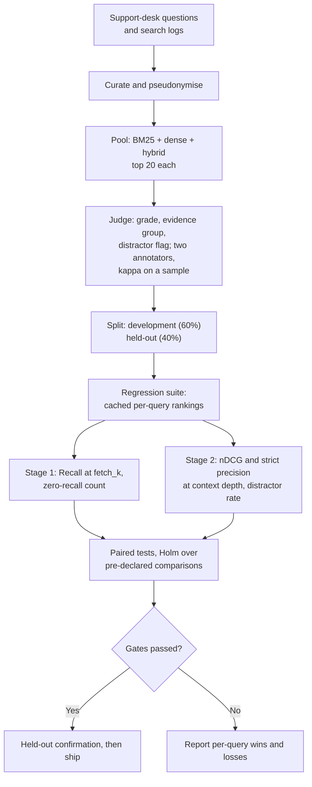

This assessment covers the Retrieval Evaluation module: Recall@K curves and elusion estimates, graded and strict precision, MRR and tie handling, NDCG, hit rate and its statistics, comparing systems with paired tests, and the use and misuse of public benchmarks. It has a 16-question quiz, conceptual questions, coding exercises with runnable solutions, a design challenge and troubleshooting scenarios. The pass mark for the quiz is 12 out of 16 (75%). Attempt the written parts before opening the solutions.

## Quiz

```quiz
[
  {
    "q": "A query has three relevant chunks, first appearing at ranks 2, 7 and 40. What are Recall@5 and Recall@10?",
    "options": ["0.333 and 0.667", "0.667 and 1.0", "0.333 and 0.333", "1.0 and 1.0"],
    "answer": 0,
    "why": "Within the top 5 only rank 2 is included (1/3); within the top 10 ranks 2 and 7 are (2/3)."
  },
  {
    "q": "A reranker sees only the top 20 candidates. Recall@20 of the first stage is 0.70 and Recall@100 is 0.85. What is the best possible Recall after reranking?",
    "options": ["0.85", "0.70", "1.0", "It depends on the reranker"],
    "answer": 1,
    "why": "A reranker reorders candidates; it cannot recover relevant chunks that were not among them."
  },
  {
    "q": "A relevant chunk is not in the top 100 for a query. Which fix is least likely to help?",
    "options": [
      "Adding a lexical retriever alongside the dense one",
      "Rewriting the query",
      "Raising fetch_k from 20 to 40",
      "Changing the chunking"
    ],
    "answer": 2,
    "why": "This is a representation miss; a deeper cut at 40 still does not reach beyond rank 100."
  },
  {
    "q": "Every query has exactly one relevant chunk and K = 5. What is the highest Precision@5 any system can score?",
    "options": ["1.0", "0.5", "0.2", "0.1"],
    "answer": 2,
    "why": "At most one of the five slots can hold a relevant chunk, so the ceiling is 1/5."
  },
  {
    "q": "The top five for a query hold two chunks that answer it (copies of the same fact), one on-topic chunk that does not answer, and two unrelated chunks. What are strict precision, lenient precision and unique strict precision?",
    "options": ["0.4, 0.6, 0.2", "0.4, 0.4, 0.4", "0.6, 0.6, 0.2", "0.2, 0.6, 0.2"],
    "answer": 0,
    "why": "Strict counts the two answering chunks (2/5), lenient adds the on-topic one (3/5), unique counts the shared fact once (1/5)."
  },
  {
    "q": "Why is the distractor rate reported separately from precision?",
    "options": [
      "Precision cannot be computed for stale chunks",
      "Precision scores a harmful stale chunk the same as harmless noise, so it cannot show the risk",
      "Distractors are always rare",
      "Distractor rate is the same as recall"
    ],
    "answer": 1,
    "why": "Both are zeros to precision, but only the stale or contradicting chunk can make the answer wrong."
  },
  {
    "q": "Ranks of the first relevant chunk for four queries are 1, 2, 4 and not found within the cutoff. What is MRR?",
    "options": ["0.438", "0.583", "0.5", "0.438 only if the failed query is dropped"],
    "answer": 0,
    "why": "(1 + 0.5 + 0.25 + 0) / 4 = 0.4375. Dropping the failed query would give 0.583, which inflates the score."
  },
  {
    "q": "Every chunk gets a score of 0 and the relevant chunk is among them. An evaluation computes rank as (number of strictly higher scores) + 1. What reciprocal rank results?",
    "options": ["0", "1", "1/N for N chunks", "Undefined"],
    "answer": 1,
    "why": "No chunk scores higher, so the rank is 1: the optimistic tie rule turns a total failure into a perfect score."
  },
  {
    "q": "What does this print?\n```python\nimport math\nrel = [0, 1, 1]          # relevance of ranks 1-3\nideal = [1, 1, 0]\nd = lambda g: sum(x / math.log2(i + 1) for i, x in enumerate(g, 1))\nprint(round(d(rel) / d(ideal), 3))\n```",
    "options": ["0.693", "0.5", "1.0", "0.631"],
    "answer": 0,
    "why": "DCG = 1/log2(3) + 1/log2(4) = 0.631 + 0.5 = 1.131; ideal DCG = 1 + 0.631 = 1.631; the ratio is 0.693."
  },
  {
    "q": "NDCG@5 is computed with the ideal ranking built from the chunks the system retrieved, not from all judged chunks. What happens?",
    "options": [
      "Scores are unchanged",
      "Scores are inflated, most for systems that miss the most relevant chunks",
      "Scores are deflated",
      "The metric becomes MRR"
    ],
    "answer": 1,
    "why": "Missed relevant chunks no longer lower the ideal, so weak retrievers can score near 1."
  },
  {
    "q": "With binary judgements, how do linear and exponential gain compare in NDCG?",
    "options": ["They are identical", "Exponential is always higher", "Linear is undefined", "Exponential doubles every score"],
    "answer": 0,
    "why": "A grade-1 item has gain 1 under both (2^1 - 1 = 1) and a grade-0 item has gain 0."
  },
  {
    "q": "Which statement about NDCG@K is correct?",
    "options": [
      "It never decreases as K grows",
      "It can decrease as K grows, because the ideal can gain a relevant item the system lacks",
      "NDCG@10 always exceeds NDCG@5",
      "It is independent of K"
    ],
    "answer": 1,
    "why": "Extending the cut can raise the ideal DCG more than the system's DCG, lowering the ratio."
  },
  {
    "q": "A retriever hits 20 of 20 test questions at K = 3. What does a 95% Wilson interval give?",
    "options": [
      "Exactly [1, 1]",
      "An interval whose lower end is about 0.84",
      "An interval whose lower end is 0.5",
      "No interval can be computed"
    ],
    "answer": 1,
    "why": "Twenty successes are compatible with a true rate noticeably below 1; Wilson reflects that while the normal interval collapses."
  },
  {
    "q": "System A and B are compared on 100 questions. Both hit 70 questions, only A hits 12 more, only B hits 18 more, and the rest are missed by both. Which questions does McNemar's test use?",
    "options": ["All 100", "The 70 both hit", "The 30 discordant questions (12 and 18)", "The 0 both miss"],
    "answer": 2,
    "why": "Only questions where exactly one system hits carry information about which is better."
  },
  {
    "q": "A team compares 10 configurations with 45 pairwise tests at the 5% level and reports the pair with the smallest p-value as significant. What is the main problem?",
    "options": [
      "Pairwise tests are invalid",
      "Uncorrected multiple comparisons: some significant results are expected by chance",
      "p-values cannot be used with NDCG",
      "Too few queries are always required"
    ],
    "answer": 1,
    "why": "With 45 tests, false positives are likely even when nothing differs; apply Holm or reduce the number of comparisons."
  },
  {
    "q": "On a public benchmark, model A leads model B by 0.02 nDCG@10 but on your labelled questions B leads A. What is the sensible reading?",
    "options": [
      "Your labels must be wrong",
      "Domain shift is plausible; trust a well-built in-house benchmark for the decision",
      "Average the two numbers",
      "The public benchmark is contaminated"
    ],
    "answer": 1,
    "why": "Public scores average over other domains; a sound in-house benchmark measures your problem."
  },
  {
    "q": "In a TREC run file, which column does a typical evaluation tool trust to order results?",
    "options": ["The rank column", "The score column", "The run tag", "The Q0 column"],
    "answer": 1,
    "why": "Most tools sort by score and ignore the rank column, so inconsistent scores silently change the evaluated ranking."
  }
]
```

## Conceptual questions

**1.** A colleague says "Recall@5 went from 0.80 to 0.85, so the retriever improved". List three things you would check before agreeing.

<details><summary>Show model answer</summary>

(1) How many queries: on 20 queries the change may be one question, so ask for the per-query changes and an interval or paired test. (2) The relevance definition: did the judgements, the pool or the chunking change between runs, and are unjudged chunks being counted as irrelevant for the new retriever? (3) Whether recall at 5 is the right metric for the stage: if it feeds a reranker, recall at the candidate depth matters instead. Also ask what happened to precision and to the ranking at the top, since a recall rise can come with a worse context.

</details>

**2.** Explain the difference between a ranking miss and a representation miss, and give one fix for each.

<details><summary>Show model answer</summary>

A ranking miss is a relevant chunk the retriever finds within the evaluation depth (say the top 100) but places below the cut that the next stage reads. Fixes: raise `fetch_k`, add or improve a reranker. A representation miss is a relevant chunk not found at any practical depth because query and chunk do not resemble each other in this retriever's representation. Fixes: add a retriever with a different representation (lexical for identifiers, dense for paraphrases), rewrite queries, or change the chunking or embedding model. More depth does not help a representation miss.

</details>

**3.** When should you use MRR, when NDCG and when all-hit@K? Give one RAG situation for each.

<details><summary>Show model answer</summary>

MRR (or Hit@1) fits single-answer lookups where the first useful chunk matters, such as an error-code lookup with a one-chunk context. NDCG fits graded relevance and several useful chunks where position matters, such as comparing rerankers on questions with essential and background chunks. All-hit@K (or Recall@K) fits multi-part questions where every needed chunk must be present, such as "can a contractor claim the budget and how much is it", where retrieving only the amount gives a wrong answer.

</details>

**4.** Why should the primary metric and the comparisons be chosen before running an evaluation?

<details><summary>Show model answer</summary>

Choosing the metric, cutoff or comparison after seeing results is an uncorrected multiple comparison: whichever happened to improve is selected, so the stated significance level is wrong. The same applies to picking the best of many configurations on one test set, whose score is then optimistic. Pre-registering the primary metric, cutoff, comparisons and smallest worthwhile effect, and confirming on held-out data, keeps the test meaningful.

</details>

**5.** Give two reasons a public benchmark score may not predict performance on your documents, and one practical use the benchmark still has.

<details><summary>Show model answer</summary>

Domain shift (different vocabulary, length and query style, so system orderings can change entirely) and contamination or leaderboard overfitting (training on or tuning to the test set). Incomplete labels also bias scores. A public benchmark is still useful for validating your evaluation harness (your figure should be close to published ones) and for shortlisting models before testing on your own set.

</details>

## Coding exercises

**1.** Write `metrics_at_k(ranked, grades, k)` returning recall, precision, reciprocal rank, NDCG and hit for one query from graded judgements (grade 1 or more is relevant; the ideal comes from all judged chunks). Run it on three rankings of chunks `a`, `b`, `c` (grades 3, 2, 1) at k = 3.

<details><summary>Show solution</summary>

```python
import math

def metrics_at_k(ranked, grades, k):
    """grades: dict doc -> grade (>=1 relevant). Returns the five metrics at cutoff k."""
    rel = {d for d, g in grades.items() if g >= 1}
    top = ranked[:k]
    found = [d for d in top if d in rel]
    first = next((i for i, d in enumerate(top, 1) if d in rel), None)
    dcg = sum(grades.get(d, 0) / math.log2(i + 1) for i, d in enumerate(top, 1))
    ideal = sorted(grades.values(), reverse=True)[:k]
    idcg = sum(g / math.log2(i + 1) for i, g in enumerate(ideal, 1))
    return {
        "recall": len(found) / len(rel),
        "precision": len(found) / k,
        "rr": 1 / first if first else 0.0,
        "ndcg": dcg / idcg,
        "hit": float(bool(found)),
    }

grades = {"a": 3, "b": 2, "c": 1}
for ranked in (["x", "a", "y", "b", "z", "c"], ["a", "b", "c", "x", "y", "z"], ["x", "y", "z", "a", "b", "c"]):
    m = metrics_at_k(ranked, grades, 3)
    print(" ".join(ranked), {k: round(v, 3) for k, v in m.items()})
```

```output
x a y b z c {'recall': 0.333, 'precision': 0.333, 'rr': 0.5, 'ndcg': 0.397, 'hit': 1.0}
a b c x y z {'recall': 1.0, 'precision': 1.0, 'rr': 1.0, 'ndcg': 1.0, 'hit': 1.0}
x y z a b c {'recall': 0.0, 'precision': 0.0, 'rr': 0.0, 'ndcg': 0.0, 'hit': 0.0}
```

The first ranking finds one of three at rank 2, so recall and precision are both 1/3 while NDCG (0.397) reflects both the late position and the missing higher-grade chunks.

</details>

**2.** Write a loader for TREC run and qrels text that (a) warns when a query's scores do not decrease with rank, (b) reports queries that are in the run but not the qrels or vice versa, and (c) computes MRR over every judged query, counting queries missing from the run as 0.

<details><summary>Show solution</summary>

```python
qrels_text = """q1 0 d1 2
q1 0 d2 1
q2 0 d3 1
q3 0 d9 1"""
run_text = """q1 Q0 d2 1 0.90 sys
q1 Q0 d5 2 0.80 sys
q1 Q0 d1 3 0.70 sys
q2 Q0 d4 1 0.95 sys
q2 Q0 d3 2 0.40 sys
q2 Q0 d8 3 0.50 sys
q4 Q0 d1 1 0.60 sys"""

def parse_qrels(text):
    qrels = {}
    for line in text.splitlines():
        q, _, d, g = line.split()
        qrels.setdefault(q, {})[d] = int(g)
    return qrels

def parse_run(text):
    """Return {query: ranked doc list}, sorted by score, plus a list of problems found."""
    rows, problems = {}, []
    for line in text.splitlines():
        q, tag, d, rank, score, _ = line.split()
        rows.setdefault(q, []).append((float(score), int(rank), d))
    run = {}
    for q, items in rows.items():
        by_rank = [d for _, _, d in sorted(items, key=lambda t: t[1])]
        by_score = [d for _, _, d in sorted(items, key=lambda t: -t[0])]
        if by_rank != by_score:
            problems.append(f"{q}: score order differs from rank order")
        run[q] = by_score          # tools usually trust the scores
    return run, problems

qrels, (run, problems) = parse_qrels(qrels_text), parse_run(run_text)
print("problems:", problems)
print("queries in run but not in qrels (ignored):", sorted(set(run) - set(qrels)))
print("queries in qrels but not in run (score 0):", sorted(set(qrels) - set(run)))

rr = []
for q in sorted(qrels):                       # every judged query counts
    ranked = run.get(q, [])
    first = next((i for i, d in enumerate(ranked, 1) if qrels[q].get(d, 0) >= 1), None)
    rr.append(1 / first if first else 0.0)
    print(q, ranked, round(rr[-1], 3))
print("MRR:", round(sum(rr) / len(rr), 3))
```

```output
problems: ['q2: score order differs from rank order']
queries in run but not in qrels (ignored): ['q4']
queries in qrels but not in run (score 0): ['q3']
q1 ['d2', 'd5', 'd1'] 1.0
q2 ['d4', 'd8', 'd3'] 0.333
q3 [] 0.0
MRR: 0.444
```

Note q2: the written ranks say d3 is second, but its score is lowest, so a score-sorting tool evaluates d3 at rank 3. The missing query q3 contributes 0 rather than being dropped; q4 has no judgements and is ignored.

</details>

**3.** Given per-query nDCG@10 for a current system and three candidates (A, B, C) on 60 queries, compute a paired randomisation p-value for each candidate against the current system, apply Holm's correction, and report better/worse counts.

<details><summary>Show solution</summary>

```python
import numpy as np

rng = np.random.default_rng(0)
n = 60
base = rng.beta(2, 2, size=n)                       # per-query nDCG of the current system
systems = {
    "current": base,
    "A": np.clip(base + rng.normal(0.00, 0.10, n), 0, 1),   # no real change
    "B": np.clip(base + rng.normal(0.06, 0.10, n), 0, 1),   # small real gain
    "C": np.clip(base + rng.normal(0.02, 0.10, n), 0, 1),   # tiny gain
}

def randomisation_p(diff, trials=20_000, seed=1):
    r = np.random.default_rng(seed)
    signs = r.choice([-1.0, 1.0], size=(trials, len(diff)))
    return float((np.abs((signs * diff).mean(axis=1)) >= abs(diff.mean()) - 1e-12).mean())

def holm(p):
    p = np.asarray(p)
    adj, running = np.empty_like(p), 0.0
    for rank, i in enumerate(np.argsort(p)):
        running = max(running, min(1.0, (len(p) - rank) * p[i]))
        adj[i] = running
    return adj

names = ["A", "B", "C"]
raw = [randomisation_p(systems[s] - systems["current"]) for s in names]
adj = holm(raw)
for s, r, a in zip(names, raw, adj):
    d = systems[s] - systems["current"]
    print(f"{s}: mean diff {d.mean():+.3f}  better/worse {int((d > 0).sum())}/{int((d < 0).sum())}  raw p {r:.4f}  Holm p {a:.4f}")
```

```output
A: mean diff -0.021  better/worse 23/37  raw p 0.1326  Holm p 0.2653
B: mean diff +0.060  better/worse 45/15  raw p 0.0000  Holm p 0.0000
C: mean diff +0.014  better/worse 31/29  raw p 0.2474  Holm p 0.2653
```

Only B survives: its gain is broad (45 queries better, 15 worse) and large relative to its spread. A and C are indistinguishable from the current system. A raw p of 0.0000 means no random sign pattern in 20,000 trials matched; report it as p < 0.0001. The data are synthetic, generated for the exercise.

</details>

## Architecture design challenge

**Brief.** Meridian's AskMeridian indexes the employee handbook (HR team), IT runbooks, and product documentation, with a superseded 2023 handbook still partly in the index. The Platform team ships retrieval changes monthly. Design an evaluation system that tells them, for each proposed change, whether to ship it. Requirements: it must cover candidate generation and context quality separately, detect harmful stale answers, resist selection bias, and run in under 30 minutes on a laptop-class machine for the regression suite.

<details><summary>Show reference design</summary>



**Data.** Questions come from real support tickets and logs, including identifiers, paraphrases, multi-part questions and unanswerable ones (evaluated separately for abstention). Judging is pooled across several retrievers and graded on a written guideline with explicit rules for superseded content; two annotators judge a stratified sample and weighted kappa is tracked. Chunk IDs are mapped to evidence spans so re-chunking does not invalidate labels. Queries and judgements are versioned with the guideline.

**Metrics per stage.** Candidate stage: Recall@`fetch_k` and the recall curve to depth 100, plus the count of queries with zero recall at the ceiling. Context stage: nDCG at the context depth with graded gains, strict precision, unique precision, all-hit for multi-chunk questions, and the distractor rate with a target of zero for policy questions.

**Procedure.** Per-query rankings and reranker scores are cached by (query, chunk text, model version) so the suite re-runs only what changed. Before each evaluation the primary metric, cutoff, comparisons and smallest worthwhile effect are written down. Comparisons use paired randomisation tests (McNemar for yes-or-no gates), Holm-corrected over the declared family, with wins, losses and the largest per-query changes reported. Exploration uses the development set; the final claim is confirmed on the held-out set, which is used once per release decision.

**Trade-offs.** Larger test sets give tighter intervals at a labelling cost that grows roughly with the square of the precision wanted. Graded labels with groups and flags cost more per judgement than binary ones but make precision, duplication and stale-answer risk measurable. Caching reranker scores trades disk for speed. A public benchmark such as SciFact is run only to check the harness. Weekly production sampling with fresh judgements guards against drift in what users ask.

</details>

## Troubleshooting scenarios

**1.** After a library upgrade, the weekly dashboard shows MRR@10 jumping from 0.71 to 0.86 although no retrieval code changed. Diagnose.

<details><summary>Show diagnosis and fix</summary>

Compare per-query ranks between the two runs. A rise with no retrieval change usually comes from the evaluation: here, most likely a changed tie rule or rank computation (for example, rank as strictly-greater scores plus one), so answers tied with many other chunks at score 0 now count as rank 1. Confirm by feeding an all-zero score vector to the metric and checking it returns 0. Fix: use pessimistic or expected tie handling in the headline figure, add the all-equal-scores unit test, pin the evaluation library version, and show the histogram of first-relevant ranks beside MRR.

</details>

**2.** A reranker is added in front of the generator. Retrieval Recall@50 is 0.93, yet answer quality barely changes and the team concludes rerankers do not help. What do you look at?

<details><summary>Show diagnosis and fix</summary>

Check how many candidates the reranker actually receives and its effect on ordering. If it scores only the top 20 while Recall@20 is far below Recall@50, relevant chunks at ranks 21 to 50 are never seen, so raise the candidate depth to the knee of the recall curve within the latency budget. Then measure the reranker with order-aware metrics at the context depth (nDCG, MRR, strict precision), not recall at the candidate depth, which it cannot change. Read per-query wins and losses, and test the paired difference. If the order metrics improve but answers do not, the problem lies downstream (prompt, context size or generator).

</details>

**3.** A new embedding model beats the incumbent by 2.1 points nDCG@10 on the team's test set (p = 0.03), but after launch, support tickets about outdated policy rise. What went wrong in the evaluation?

<details><summary>Show diagnosis and fix</summary>

The nDCG gain may have come from queries unrelated to stale content, while the new model ranks superseded 2023 chunks higher: precision and nDCG count a stale chunk as merely irrelevant. Check the distractor rate on the policy questions and the per-query losses. Also check whether this was one of many comparisons (uncorrected p = 0.03), whether the test set was used repeatedly for selection, and whether labelled judgements treat stale chunks consistently (kappa on those pairs). Fix: add the distractor rate as a release gate, filter superseded documents by validity metadata at ingestion, apply Holm over the declared comparisons, and confirm on held-out data before shipping.

</details>
