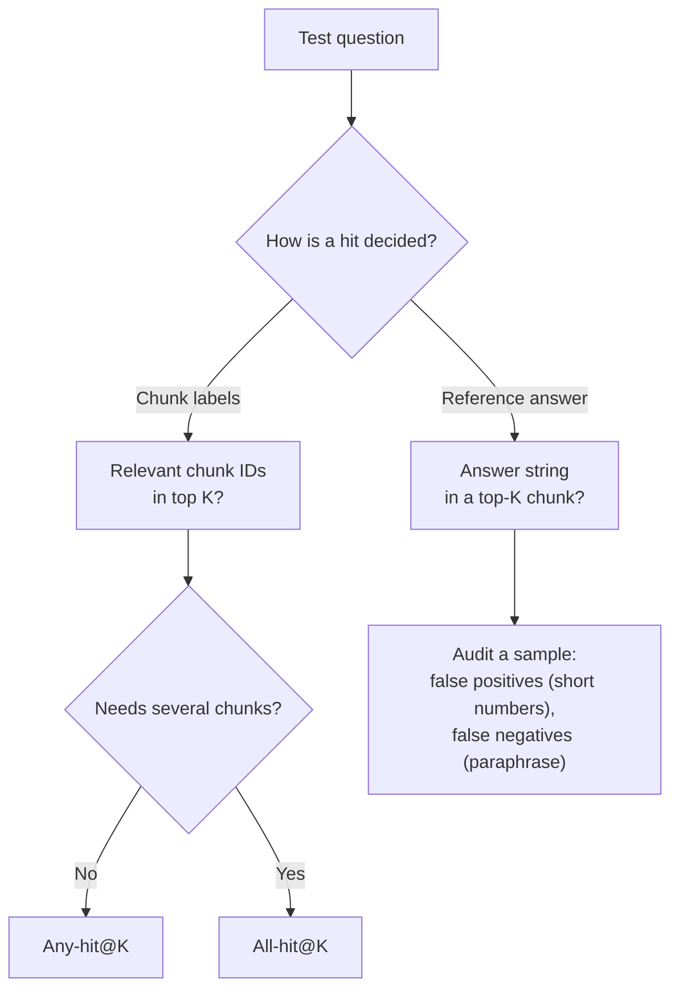

**Hit rate** is the simplest retrieval metric there is: the fraction of questions for which at least one relevant chunk appears in the top $K$. It goes by several names (success@K, top-K accuracy, Hit@K), it is one of the two default retrieval metrics in LlamaIndex's evaluator, and it is the number a product manager understands without explanation: "for 87% of questions, something useful was in the top three". That simplicity is its value and its danger. Hit rate answers a yes-or-no question per query, so it inherits the statistics of a coin toss, and "something useful" can hide that the most important chunk was missing.

This lesson treats hit rate properly as a proportion. You will compute it with an honest confidence interval, plan how many test questions it needs, compare two systems with a paired test built for yes-or-no outcomes, and see where it misleads: multi-part questions, and the popular shortcut of counting a hit whenever the answer string appears in the retrieved text. The code measures all of this for BM25 and a dense retriever on 16 Meridian questions.

## Learning objectives

- Define Hit@K and relate it exactly to Recall@K, Precision@1 and MRR.
- Compute a Wilson confidence interval for a hit rate and estimate the number of test questions needed for a given margin.
- Compare two retrievers' hit rates with an exact McNemar test on discordant questions.
- Explain the false positives and false negatives of answer-string matching, and when it is acceptable.
- Choose between any-hit and all-hit for questions that need several chunks.

## Prerequisites

- [Recall@K](/learn/retrieval-evaluation/recall-k): recall curves and the elusion interval, where the Wilson interval first appeared.
- [MRR](/learn/retrieval-evaluation/mrr): first-relevant ranks and Hit@1.
- [Top-K retrieval](/learn/retrieval-fundamentals/top-k-retrieval): the cut and its role in a pipeline.

## Why this matters

Hit rate is often the first metric a team adopts, and sometimes the only one. Three things go wrong when it is used carelessly.

First, small test sets make hit rate look precise when it is not. A hit rate of 14 out of 16 is "87.5%", which sounds like a measurement accurate to a tenth of a per cent. Its 95% interval runs from about 0.64 to 0.97. Teams compare 87.5% with 81.3% and declare a winner; on 16 questions that is one question's difference.

Second, many RAG questions need more than one chunk. "Can a contractor claim the £400 equipment money?" needs both the budget figure and the eligibility rule. Retrieving only the budget chunk is a hit, and it produces a confidently wrong answer ("yes, £400").

Third, labelling relevant chunks is effort, so teams reach for a shortcut: write a reference answer and count a hit whenever the answer string appears in a retrieved chunk. That is fast and needs no chunk IDs (it survives re-chunking), but it has systematic errors in both directions, and they can cancel in the average while misjudging individual questions.

## The intuition

Think of a library helpdesk. For each visitor, the librarian fetches three books. Afterwards you ask one question per visitor: "did at least one of those books have what they needed?" Count the yeses and divide by the visitors. That is hit rate at three.

It is a good question to ask, because a visitor who got one useful book usually leaves satisfied. But notice three things it ignores:

- It does not ask whether the useful book was on top of the pile or at the bottom (that is MRR's question).
- It does not ask whether the visitor needed two books and got only one (that is recall's question).
- A yes from 16 visitors is weak evidence. If a second librarian gets 13 yeses and the first 16, you would want to know whether those were the same visitors, and whether three visitors' worth of difference could be luck.

## How it works

### The definition and its relatives

For query $q$ with relevant set $R_q$:

$$
\text{Hit@}K(q) = \mathbf{1}\left[\, \text{Top}_K(q) \cap R_q \ne \emptyset \,\right]
$$

and hit rate is its mean over queries. Its relationships with the other metrics are exact, and worth knowing because they let you sanity-check any evaluation report:

- **Hit@K is at least Recall@K** for every query, since any non-zero recall is a hit. They are equal when every query has exactly one relevant item.
- **Hit@1 equals Precision@1**: the top item is either relevant or not.
- **MRR@K is at most Hit@K**, because each query's reciprocal rank is at most 1 when it is a hit and 0 when it is not.
- **Hit@K is monotone in $K$**: it can only rise as the cut deepens.

The LlamaIndex `HitRate` metric computes this over whatever list of retrieved IDs you pass it; it has no $K$ argument of its own, so the cut is the retriever's `similarity_top_k`. Its `use_granular_hit_rate` option instead returns the number of relevant items retrieved divided by the number expected, which is Recall@K under another name. As with MRR, check the definition before comparing figures across tools.

### A proportion needs an interval

Each query's hit is a Bernoulli outcome, so the hit rate over $n$ queries behaves like the proportion of heads in $n$ coin tosses. Its uncertainty is therefore well understood, and you should always report it:

1. Count the hits $h$ among $n$ test queries; the hit rate is $\hat{p} = h/n$.
2. Compute a 95% **Wilson score interval** for $\hat{p}$ (the formula is in the mathematics section, and you met it for elusion in the [Recall@K](/learn/retrieval-evaluation/recall-k) lesson).
3. Report "13/16 = 0.81, 95% CI 0.57 to 0.93", not "81%".

The textbook normal interval $\hat{p} \pm 1.96\sqrt{\hat{p}(1-\hat{p})/n}$ is a poor choice here. Hit rates in good systems are close to 1, and near the edges the normal interval is too narrow, can extend past 1, and collapses to zero width at $\hat{p} = 1$, which is when a team most needs to know how sure it can be.

The same formula, rearranged, tells you how many questions you need. For a margin of error $E$ at 95% confidence and an expected hit rate around $p$, the normal approximation gives $n \approx 1.96^2\, p(1-p)/E^2$. Near $p = 0.8$, a margin of $\pm 0.05$ needs about 246 questions. That is a useful number to have in mind when someone proposes judging a retriever on twenty.

### Comparing two systems: McNemar's test

Two retrievers evaluated on the same questions produce paired yes-or-no outcomes. Only the **discordant** questions, where one system hits and the other misses, carry information about which system is better. If the systems were equally good, each discordant question would be equally likely to favour either, like a fair coin. **McNemar's test** asks how surprising the observed split is:

1. Count $b$, the questions only system A hits, and $c$, the questions only system B hits.
2. Under the null hypothesis that the systems are equally good, the smaller of $b$ and $c$ follows a binomial distribution with $b + c$ trials and probability 0.5.
3. The exact two-sided p-value is twice the binomial tail probability (capped at 1). In SciPy, `binomtest(c, b + c, 0.5).pvalue` computes it.

Questions both systems hit, or both miss, do not enter the test at all. That is the point: a 0.81 against 1.00 difference built from three discordant questions out of 16 is weak evidence, and McNemar's test says so directly. For metrics that are not yes-or-no (MRR, NDCG), use the paired bootstrap or randomisation test covered in [Ranking quality](/learn/retrieval-evaluation/ranking-quality).

### Any-hit and all-hit

For a question whose answer needs several chunks, "at least one relevant chunk" is the wrong test. Define instead:

- **Any-hit@K**: at least one of the needed chunks is in the top $K$ (the standard hit rate).
- **All-hit@K**: every needed chunk is in the top $K$. This is the indicator that Recall@K equals 1.

All-hit is the honest yes-or-no metric for multi-part questions, because a context missing one needed chunk yields an incomplete or wrong answer. On a test set where most questions need one chunk, the two coincide for those questions; slice the set and report all-hit for the multi-chunk slice. The distinction also applies within single answers: if the relevant set contains an essential chunk and a background chunk, a hit on the background chunk alone is not a success. Either restrict $R_q$ to the essential chunks for hit-rate purposes, or use graded judgements and [NDCG](/learn/retrieval-evaluation/ndcg).

### Answer-string matching

The cheapest way to get hit labels is to skip chunk judgements entirely: write a short reference answer per question, and count a hit if any retrieved chunk contains it. The DPR paper (Karpukhin and colleagues, 2020) reported retrieval accuracy on open-domain QA benchmarks this way: the fraction of questions for which a top-$K$ passage contains a gold answer string. It survives re-chunking and index rebuilds, since it never refers to chunk IDs.

It has errors in both directions:

- **False positives**: the string occurs in a chunk that does not answer the question. Short numeric answers are the classic case. A reference answer of "5" (days of carry-over) matches "25 days" in the annual-leave chunk.
- **False negatives**: the chunk answers the question in different words. A reference answer of "8am to 6pm" does not match "08:00 to 18:00".

String matching is defensible when answers are distinctive strings (names, codes, multi-word phrases), when you normalise text (case, punctuation, number formats), and when you audit a sample against human labels. It is a poor substitute for judgements when answers are short numbers, yes or no, or paraphrased. The code below shows both error types appearing and cancelling in the average.



## The mathematics

**Hit rate.** Over a test set $Q$ of $n$ queries:

$$
\text{HitRate@}K = \frac{1}{n} \sum_{q \in Q} \mathbf{1}\left[\, \text{Top}_K(q) \cap R_q \ne \emptyset \,\right]
$$

and all-hit replaces the condition with $R_q \subseteq \text{Top}_K(q)$.

**Wilson interval.** With $\hat{p} = h/n$ and $z = 1.96$:

$$
\frac{\hat{p} + \frac{z^2}{2n}}{1 + \frac{z^2}{n}} \pm \frac{z}{1 + \frac{z^2}{n}}\sqrt{\frac{\hat{p}(1-\hat{p})}{n} + \frac{z^2}{4n^2}}
$$

The centre is pulled slightly towards 0.5, and the half-width never collapses to zero, which is why it behaves well near 0 and 1.

**By hand.** BM25 hits 13 of 16 questions at $K = 3$, so $\hat{p} = 0.8125$. With $z^2 = 3.842$ and $z^2/n = 0.240$: the centre is $(0.8125 + 0.120)/1.240 = 0.752$; the square root is $\sqrt{0.8125 \times 0.1875/16 + 3.842/1{,}024} = \sqrt{0.00952 + 0.00375} = 0.115$; the half-width is $1.96 \times 0.115/1.240 = 0.182$. The interval is $[0.570, 0.934]$. The naive normal interval is $0.8125 \pm 0.191$, or $[0.621, 1.004]$, which extends past 1.

**Sample size.**

$$
n \approx \frac{z^2\, p(1-p)}{E^2}
$$

With $p = 0.8$ and $E = 0.05$: $3.842 \times 0.16/0.0025 = 245.9$, so about 246 questions.

**Exact McNemar test.** With $b$ and $c$ discordant counts, the two-sided p-value is

$$
p = \min\left(1,\ 2 \sum_{i=0}^{\min(b, c)} \binom{b + c}{i} 0.5^{\,b + c}\right)
$$

**By hand.** Three questions are hit only by the dense retriever and none only by BM25: $b = 0$, $c = 3$. The probability of a 3 to 0 split or more extreme in either direction is $2 \times 0.5^3 = 0.25$. Three discordant questions cannot establish a difference at conventional levels, however one-sided they are.

**In Python:**

```python
import numpy as np
from scipy.stats import binomtest

hits, n, z = 13, 16, 1.96
p = hits / n
centre = (p + z**2 / (2 * n)) / (1 + z**2 / n)
half = z * np.sqrt(p * (1 - p) / n + z**2 / (4 * n**2)) / (1 + z**2 / n)
print(f"hit rate {p:.4f}, Wilson 95% CI [{centre - half:.3f}, {centre + half:.3f}]")
print(f"naive normal CI [{p - z * np.sqrt(p * (1 - p) / n):.3f}, {p + z * np.sqrt(p * (1 - p) / n):.3f}]")

# Queries needed for a +/-0.05 margin when the hit rate is near 0.8
print("queries needed:", int(np.ceil(z**2 * 0.8 * 0.2 / 0.05**2)))

# Exact McNemar test: 3 queries only system B hits, 0 only system A hits
print("McNemar p =", binomtest(3, 3, 0.5).pvalue)
```

```output
hit rate 0.8125, Wilson 95% CI [0.570, 0.934]
naive normal CI [0.621, 1.004]
queries needed: 246
McNemar p = 0.25
```

## In code

**The problem.** Measure Hit@1, Hit@3 and Hit@5 with Wilson intervals for BM25 and a dense retriever on 16 Meridian questions, two of which need two chunks; compare any-hit with all-hit; compare chunk-label hits with answer-string hits; and test the difference between the retrievers with McNemar's test.

**Dependencies.** NumPy, SciPy, rank-bm25 and sentence-transformers (all-MiniLM-L6-v2, about 90 MB on first use). No API key.

```bash
pip install numpy scipy rank-bm25 sentence-transformers
```

Each test question carries the set of chunks it needs and a short reference answer of the kind an annotator writes.

```python
import re
import numpy as np
from rank_bm25 import BM25Okapi
from scipy.stats import binomtest
from sentence_transformers import SentenceTransformer

chunks = {
    "leave":    "Annual leave is 25 days per year for full-time staff.",
    "parttime": "Part-time staff receive annual leave in proportion to their hours.",
    "carry":    "Up to 5 unused leave days carry over and must be used by 31 March.",
    "public":   "Public holidays are in addition to annual leave.",
    "request":  "Leave requests go to your line manager through the HR portal.",
    "remote":   "Staff may work remotely up to 3 days a week.",
    "budget":   "The home-office equipment budget is £400.",
    "contract": "Contractors are not eligible for the home-office equipment budget.",
    "deadline": "Expenses must be submitted within 30 days.",
    "late":     "Late expense claims need written approval from finance.",
    "receipt":  "Any expense over £75 needs a receipt.",
    "approve":  "Expense claims are approved by the finance department.",
    "password": "Passwords must be rotated every 90 days.",
    "vpn":      "VPN is required on public Wi-Fi.",
    "e4021":    "Atlas error E-4021: the VPN client is out of date; update it from the IT portal.",
    "e4012":    "Atlas error E-4012: the VPN certificate has expired.",
    "laptop":   "The laptop refresh cycle is 3 years.",
    "lost":     "Report a lost laptop to the support desk at once.",
    "desk":     "The support desk is open 08:00 to 18:00 UK time.",
}
ids = list(chunks)
# question -> (chunks that must ALL be retrieved, reference answer string)
tests = {
    "How many days of holiday do I get a year?":         ({"leave"}, "25 days"),
    "How many days of leave can I keep for next year?":  ({"carry"}, "5"),
    "Do I lose leftover holiday at some point?":         ({"carry"}, "31 March"),
    "How much is the home-office budget?":               ({"budget"}, "£400"),
    "Can contractors use the home-office budget?":       ({"contract"}, "not eligible"),
    "Can a contractor claim the £400 equipment money?":  ({"contract", "budget"}, "not eligible"),
    "How long do I have to submit expenses?":            ({"deadline"}, "30 days"),
    "Do I need a receipt for a £20 lunch?":              ({"receipt"}, "£75"),
    "Who signs off expense claims?":                     ({"approve"}, "finance"),
    "My claim is late, what now?":                       ({"late", "approve"}, "written approval"),
    "How often must I change my password?":              ({"password"}, "90 days"),
    "Do I need the VPN in a coffee shop?":               ({"vpn"}, "VPN is required"),
    "What does E-4012 mean?":                            ({"e4012"}, "certificate has expired"),
    "When will my laptop be replaced?":                  ({"laptop"}, "3 years"),
    "What are the support desk hours?":                  ({"desk"}, "8am to 6pm"),
    "How many days a week can I work from home?":        ({"remote"}, "3 days"),
}

def wilson(hits, n, z=1.96):
    p = hits / n
    centre = (p + z**2 / (2 * n)) / (1 + z**2 / n)
    half = z * np.sqrt(p * (1 - p) / n + z**2 / (4 * n**2)) / (1 + z**2 / n)
    return centre - half, centre + half

tok = lambda t: re.findall(r"[a-z0-9£]+", t.lower())
bm25 = BM25Okapi([tok(t) for t in chunks.values()])
model = SentenceTransformer("sentence-transformers/all-MiniLM-L6-v2", device="cpu")
D = model.encode(list(chunks.values()), normalize_embeddings=True)
rank = {
    "BM25": lambda q: [ids[i] for i in np.argsort(-bm25.get_scores(tok(q)), kind="stable")],
    "dense": lambda q: [ids[i] for i in np.argsort(-(D @ model.encode([q], normalize_embeddings=True)[0]), kind="stable")],
}

hit3 = {}
for name, ranker in rank.items():
    rows = {"hit@1": [], "hit@3": [], "hit@5": [], "all@3": [], "string@3": []}
    for q, (needed, ans) in tests.items():
        r = ranker(q)
        for k in (1, 3, 5):
            rows[f"hit@{k}"].append(bool(needed & set(r[:k])))
        rows["all@3"].append(needed <= set(r[:3]))
        rows["string@3"].append(any(ans.lower() in chunks[c].lower() for c in r[:3]))
    hit3[name] = np.array(rows["hit@3"])
    n = len(tests)
    print(name)
    for metric, vals in rows.items():
        lo, hi = wilson(sum(vals), n)
        print(f"  {metric:<9} {sum(vals):>2}/{n} = {np.mean(vals):.3f}   95% CI [{lo:.2f}, {hi:.2f}]")
    disagree = [q for q, a, b in zip(tests, rows["hit@3"], rows["string@3"]) if a != b]
    print("  label hit and string hit disagree on:", disagree)

# Paired comparison at K=3: only queries where the systems differ carry information
b_only = int(np.sum(hit3["BM25"] & ~hit3["dense"]))
d_only = int(np.sum(hit3["dense"] & ~hit3["BM25"]))
p = binomtest(d_only, b_only + d_only, 0.5).pvalue if b_only + d_only else 1.0
print(f"\nhit@3 discordant queries: dense only {d_only}, BM25 only {b_only}; exact McNemar p = {p:.3f}")
```

```output
BM25
  hit@1     10/16 = 0.625   95% CI [0.39, 0.82]
  hit@3     13/16 = 0.812   95% CI [0.57, 0.93]
  hit@5     16/16 = 1.000   95% CI [0.81, 1.00]
  all@3     12/16 = 0.750   95% CI [0.51, 0.90]
  string@3  13/16 = 0.812   95% CI [0.57, 0.93]
  label hit and string hit disagree on: ['How many days of leave can I keep for next year?', 'What are the support desk hours?']
dense
  hit@1     13/16 = 0.812   95% CI [0.57, 0.93]
  hit@3     16/16 = 1.000   95% CI [0.81, 1.00]
  hit@5     16/16 = 1.000   95% CI [0.81, 1.00]
  all@3     15/16 = 0.938   95% CI [0.72, 0.99]
  string@3  14/16 = 0.875   95% CI [0.64, 0.97]
  label hit and string hit disagree on: ['Can a contractor claim the £400 equipment money?', 'What are the support desk hours?']

hit@3 discordant queries: dense only 3, BM25 only 0; exact McNemar p = 0.250
```

**The important lines.**

- `bool(needed & set(r[:k]))` is any-hit: the intersection is non-empty. `needed <= set(r[:3])` is all-hit: every needed chunk is a subset of the top three.
- `ans.lower() in chunks[c].lower()` is answer-string matching with only case normalisation. Real implementations also normalise punctuation, whitespace and number formats; even then the errors below remain.
- `wilson` returns the interval for every row, so no figure is printed without its uncertainty.
- `binomtest(d_only, b_only + d_only, 0.5)` is the exact McNemar test: the number of questions only dense hits, out of all discordant questions, against a fair coin.

**What the output means.**

- **The intervals are wide.** BM25's Hit@3 is 0.81 with an interval from 0.57 to 0.93; dense's is 1.00 with an interval from 0.81 to 1.00. They overlap. Sixteen questions are enough to find gross failures and not enough to rank two reasonable retrievers.
- **The paired test agrees.** Three questions are hit only by dense ("Do I lose leftover holiday…", "Do I need the VPN in a coffee shop?" and the keep-for-next-year question) and none only by BM25. The exact McNemar p-value is 0.25: a 3 to 0 split happens one time in four between equally good systems. The direction is suggestive; the evidence is not yet there.
- **All-hit is lower than any-hit** for both systems. For BM25, the multi-part "My claim is late, what now?" retrieves the late-claims chunk but not the approver; for dense, "Can a contractor claim the £400 equipment money?" retrieves the budget chunk but not the eligibility rule. Any-hit counts both as successes. The second is the dangerous one: a generator given only "the budget is £400" will tell a contractor they can claim it.
- **String matching agrees with labels on BM25's total and is wrong twice.** For "How many days of leave can I keep for next year?" BM25 retrieved the annual-leave chunk, not the carry-over chunk, but the reference answer "5" occurs inside "25 days": a false positive. For "What are the support desk hours?" the right chunk was retrieved, but "8am to 6pm" does not match "08:00 to 18:00": a false negative. The errors cancel in BM25's 13/16, which is exactly why an aggregate comparison between string hits and label hits is not a validation: compare per question.
- **For dense, string matching is arguably more right than any-hit** on the contractor question: the answer phrase "not eligible" is absent from the top three, and that is the true state of the context. String matching on a distinctive phrase behaves like a check on the essential chunk. On a bare number it behaves like a coin toss.

**Errors people commonly hit.**

- Reporting a hit rate without $n$. "100%" from 16 questions and from 1,600 are different claims.
- Using a normal-approximation interval near 1. At $\hat{p} = 1$ it has zero width; Wilson's interval for 16/16 still extends down to 0.81.
- Running McNemar's test with the concordant questions included, or using an unpaired test of two proportions. The systems answered the same questions; ignore the pairing and you throw away the strongest information.

**Extending it.** Normalise numbers before string matching (convert "08:00" and "8am" to a common form) and count how many false negatives disappear; replace bare numeric reference answers with short phrases ("5 unused days") and count false positives; add the `HitRate` metric from `llama_index.core.evaluation` and confirm it matches `hit@3` when given each query's top three IDs.

## A real-world example

The Platform team at Meridian wanted a weekly retrieval check that would survive re-chunking, so Leon, a new engineer, set one up with answer-string matching: each of 300 test questions had a reference answer written by the HR or IT owner, and a hit was any top-five chunk containing it. The weekly figure sat between 0.91 and 0.93 for months.

Then the team changed the chunker to split handbook tables into one row per chunk, and string hit rate rose to 0.96. Before celebrating, Leon audited 60 questions against hand labels. Most of the rise came from numeric reference answers ("3", "5", "30") now matching table rows about something else, such as a row listing "30" as a cost centre number. Meanwhile a handful of questions about support hours and VPN errors had been "missing" for months because the reference answers were phrased differently from the runbooks.

The team kept string matching as a cheap smoke test but changed three things. Reference answers became distinctive phrases rather than bare values, and numbers were normalised before matching. A monthly audit compared string hits with chunk labels on a random 60 questions and reported the disagreement count. And the headline metric became label-based all-hit@5, sliced into single-chunk and multi-chunk questions, reported with Wilson intervals; changes between releases were tested with McNemar's test on the 300 paired outcomes. The first time a chunker change was proposed under the new process, its apparent gain of 0.02 came from four discordant questions against two, and the team chose not to call it an improvement.

## Common mistakes

- **Quoting hit rate without its interval or its $n$.** Hit rate is a proportion; on small sets its interval spans tens of points.
- **Using any-hit for multi-part questions.** It scores a context that lacks the decisive chunk as a success.
- **Treating answer-string hits as ground truth.** Short numeric answers cause false positives; paraphrased answers cause false negatives; the two can cancel in the average.
- **Comparing systems with unpaired statistics.** The same questions were asked of both; only discordant questions matter, and McNemar's test uses them.
- **Mixing up hit rate and recall in framework output.** A "granular" hit rate is recall; check the definition.
- **Choosing $K$ after seeing results.** Hit@K rises with $K$; pick the $K$ the context actually uses before evaluating.

## Best practices

- Report hit rate as $h/n$ with a Wilson interval, at the $K$ the pipeline actually uses.
- Plan the test set size from the margin you need; around 250 questions for $\pm 0.05$ near a hit rate of 0.8.
- Slice by single-chunk and multi-chunk questions, and report all-hit for the multi-chunk slice.
- Compare systems with McNemar's test on paired outcomes, and list the discordant questions by name.
- If you use answer strings, make them distinctive phrases, normalise text and numbers, and audit against chunk labels regularly.
- Read hit rate with MRR or NDCG: hit rate says the answer was present, the others say where.

## Performance considerations

Hit rate is the cheapest metric to compute: one set intersection per query, and it can stop at the first relevant item found. Its labelling cost depends on the method. Chunk-label hits need relevant chunk IDs per question, and these must be redone (or mapped) whenever chunking changes. Answer strings cost one short reference answer per question, written once, plus periodic audits. If writing an answer takes about a minute and judging a pooled list of ten chunks takes about five (assumptions; measure your own team), 300 questions cost about 5 hours as strings against 25 hours as chunk labels, and the chunk labels must be refreshed after re-chunking. A common compromise is strings for frequent smoke tests and labels for release decisions.

Sample size dominates everything else. Because the interval half-width shrinks with $\sqrt{n}$, halving it from $\pm 0.10$ to $\pm 0.05$ quadruples the number of questions, and the labelling bill with it.

## Summary

- Hit@K is 1 if any relevant chunk is in the top $K$; it is at least Recall@K, equals Precision@1 at $K = 1$, and bounds MRR@K from above.
- Hit rate is a proportion: report $h/n$ with a Wilson interval, and plan for about 250 questions to reach $\pm 0.05$.
- Compare two systems with McNemar's test on discordant questions; a 3 to 0 split gives p = 0.25.
- Use all-hit for multi-part questions; any-hit counted the budget-only context for a contractor question as a success.
- Answer-string matching is label-free and survives re-chunking, but short numbers cause false positives and paraphrases cause false negatives, and these can cancel in the average.

## Exercises

**1.** A retriever hits 47 of 50 test questions at $K = 5$. Compute the Wilson 95% interval and state the result in one sentence suitable for a release note.

<details><summary>Show solution</summary>

$\hat{p} = 0.94$, $z^2/n = 3.842/50 = 0.0768$. Centre $= (0.94 + 0.0384)/1.0768 = 0.909$. Square root $= \sqrt{0.94 \times 0.06/50 + 3.842/10{,}000} = \sqrt{0.001128 + 0.000384} = 0.0389$. Half-width $= 1.96 \times 0.0389/1.0768 = 0.0708$. Interval $\approx [0.84, 0.98]$. Release note: "Hit@5 was 47/50 (0.94; 95% CI 0.84 to 0.98) on the 50-question test set."

</details>

**2.** On 200 paired questions, system A hits 170 and system B hits 176. Of these, 160 are hit by both. Compute the discordant counts and say whether McNemar's test is likely to show a difference.

<details><summary>Show solution</summary>

Only A: $170 - 160 = 10$. Only B: $176 - 160 = 16$. There are 26 discordant questions, split 10 to 16. Under a fair coin, a split this uneven or more is not unusual: `binomtest(16, 26, 0.5).pvalue` is about 0.33. The six-question advantage for B is not convincing evidence, despite a headline difference of three percentage points.

</details>

**3.** Write a function `string_hit(answer, chunks_text)` that normalises times written as "8am", "6pm", "08:00" and "18:00" to a common 24-hour form before matching, and show that it fixes the support-desk false negative.

<details><summary>Show solution</summary>

```python
import re

def norm_times(text):
    text = text.lower()
    text = re.sub(r"\b(\d{1,2})\s*am\b", lambda m: f"{int(m.group(1)) % 12:02d}:00", text)
    text = re.sub(r"\b(\d{1,2})\s*pm\b", lambda m: f"{int(m.group(1)) % 12 + 12:02d}:00", text)
    return text

def string_hit(answer, chunks_text):
    a = norm_times(answer)
    return any(a in norm_times(c) for c in chunks_text)

print(string_hit("8am to 6pm", ["The support desk is open 08:00 to 18:00 UK time."]))
```

This prints `True`. Normalisation fixes this class of false negative but cannot fix paraphrase in general ("eight till six"), and it does nothing for false positives from short numbers. Audit remains necessary.

</details>

**4.** Design decision: your test set has 120 single-chunk questions and 30 multi-chunk questions. Your manager wants one number. What do you report, and what do you put underneath it?

<details><summary>Show solution</summary>

Report all-hit@K over all 150 questions as the single number: for single-chunk questions it equals any-hit, and for multi-chunk questions it is the honest success criterion, so it is never more flattering than the truth. Underneath, give it as $h/150$ with a Wilson interval, then the two slices separately (single-chunk all-hit over 120, multi-chunk all-hit over 30) with their intervals, because the multi-chunk slice is small and its interval will be wide. If a comparison with the previous release is requested, give the McNemar discordant counts and p-value.

</details>

## Check your understanding

```quiz
[
  {
    "q": "Every test question has exactly one relevant chunk. How do Hit@5 and Recall@5 compare?",
    "options": [
      "Hit@5 is always higher",
      "They are equal",
      "Recall@5 is always higher",
      "They cannot be compared"
    ],
    "answer": 1,
    "why": "With one relevant chunk, recall per query is 1 if it is retrieved and 0 otherwise, which is exactly the hit indicator."
  },
  {
    "q": "A retriever hits all 20 test questions. Which statement is most accurate?",
    "options": [
      "The retriever's true hit rate is 1.0",
      "The normal interval correctly shows no uncertainty",
      "The Wilson 95% interval still extends well below 1 (to about 0.84)",
      "Hit rate cannot be computed when all queries hit"
    ],
    "answer": 2,
    "why": "Twenty successes are compatible with a true rate somewhat below 1. The Wilson interval reflects that; the normal interval collapses to zero width."
  },
  {
    "q": "Two retrievers are run on the same 100 questions. Which questions does McNemar's test use?",
    "options": [
      "All 100",
      "Only those both systems hit",
      "Only those where exactly one system hits",
      "Only those both systems miss"
    ],
    "answer": 2,
    "why": "Concordant questions say nothing about which system is better; the test is a binomial test on the discordant ones."
  },
  {
    "q": "The reference answer is \"5\" and a retrieved chunk says \"Annual leave is 25 days\". What does naive string matching report, and what kind of error is it?",
    "options": [
      "A miss; a false negative",
      "A hit; a false positive",
      "A hit; correct",
      "A miss; correct"
    ],
    "answer": 1,
    "why": "The substring \"5\" occurs in \"25\", so the match succeeds although the chunk does not contain the carry-over answer."
  },
  {
    "q": "A question needs both the budget chunk and the eligibility chunk. The top 3 contains only the budget chunk. What are any-hit@3 and all-hit@3?",
    "options": [
      "1 and 1",
      "0 and 0",
      "1 and 0",
      "0 and 1"
    ],
    "answer": 2,
    "why": "At least one needed chunk is present (any-hit = 1), but not every needed chunk (all-hit = 0)."
  }
]
```

## Further reading

- Karpukhin, V. and colleagues (2020). *Dense Passage Retrieval for Open-Domain Question Answering*. [arXiv:2004.04906](https://arxiv.org/abs/2004.04906). Reports top-K retrieval accuracy by answer-string matching.
- Wilson, E. B. (1927). *Probable inference, the law of succession, and statistical inference*. Journal of the American Statistical Association 22(158). The score interval.
- Brown, L. D., Cai, T. T. and DasGupta, A. (2001). *Interval Estimation for a Binomial Proportion*. Statistical Science 16(2). Why the normal interval fails near 0 and 1, and what to use instead.
- McNemar, Q. (1947). *Note on the sampling error of the difference between correlated proportions or percentages*. Psychometrika 12(2). The paired test.
- [SciPy `binomtest` documentation](https://docs.scipy.org/doc/scipy/reference/generated/scipy.stats.binomtest.html).
- [LlamaIndex documentation](https://docs.llamaindex.ai/): retrieval evaluation and the `HitRate` metric.
