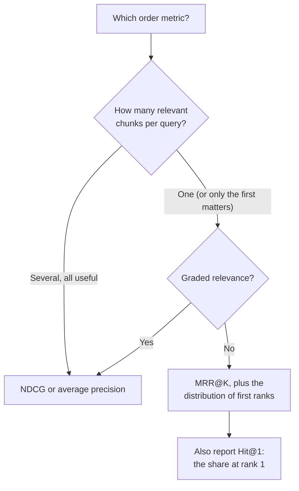

Recall and precision ignore order inside the cut: a relevant chunk at rank 1 and one at rank 5 count the same. For many RAG questions that is the wrong model of success. A question such as "What does error E-4012 mean?" has one answering chunk, and what matters is how high it sits: at rank 1 it leads the context and survives any truncation; at rank 5 it competes with four plausible neighbours. **Mean reciprocal rank** (MRR) is the metric built for exactly this situation. It scores each query by one over the rank of the first relevant result, and averages.

This lesson derives MRR from the behaviour it models, works it by hand, and then covers what makes it trustworthy or misleading in practice: the cutoff, tied scores (which can move BM25's MRR by half), the metric's peculiar scale, its high variance on small test sets, and a variant in a popular framework that shares the name but measures something else. The code compares BM25, a dense retriever and a dense retriever with a cross-encoder reranker on Meridian questions, and finds a case where MRR catches a regression that Recall@5 cannot see.

## Learning objectives

- Compute reciprocal rank and MRR by hand and in code, with a stated cutoff.
- Explain the user model behind MRR and the kinds of query for which it is appropriate.
- Handle tied scores with optimistic, pessimistic and expected reciprocal rank, and explain why the choice matters.
- Describe the non-linear scale of MRR and its consequences for averaging and for interpreting differences.
- Diagnose an MRR change by reading per-query rank changes rather than the average.

## Prerequisites

- [Recall@K](/learn/retrieval-evaluation/recall-k) and [Precision@K](/learn/retrieval-evaluation/precision-k): order-blind metrics, and how judgements work.
- [Why reranking is needed](/learn/reranking-fundamentals/why-reranking-is-needed): where MRR first appeared in this course, measuring a reranker.
- [BM25](/learn/sparse-retrieval/bm25): the lexical retriever in the code, and the source of many tied scores.

## Why this matters

Several pipeline decisions are really about the top of the ranking:

- **Rerankers** do not change which chunks are in the candidate set; they change the order. An order-blind metric at the candidate depth cannot see them at all.
- **Small contexts.** Latency- or cost-sensitive systems may pass only one to three chunks. Then "was it at rank 1?" is close to "was it in the context?".
- **Ordering effects in the generator.** Language models do not use all positions of a long context equally well; the [lost-in-the-middle](/learn/context-engineering/lost-in-the-middle-problem) results are the best-known evidence. A relevant chunk at the top of the context is safer than one in the middle.
- **Single-answer lookups.** Error codes, policy figures, contact details: one chunk answers, and the rest are at best redundant.

For all of these, MRR is the standard summary. It is also easy to compute, which makes it easy to compute wrongly. A team that resolves ties in its own favour, or forgets the cutoff, or uses a framework's "MRR" that averages over every relevant result, will report numbers that cannot be compared with anyone else's, or with their own from last month.

## The intuition

Picture someone scanning a list of search results from the top, who stops at the first one that answers their question. If it is first, they read one result; if it is fourth, they read four. Their **effort** is the rank of the first useful result.

Now turn effort into a score where higher is better. The simplest choice is one over the effort: 1 for rank 1, 1/2 for rank 2, 1/3 for rank 3, and 0 if nothing useful appears at all. This **reciprocal rank** has a distinctive shape. Moving the answer from rank 2 to rank 1 gains 0.5. Moving it from rank 10 to rank 9 gains about 0.01. The score cares a great deal about the very top and very little about anything below the first few places.

That shape is a statement about the user: the first result matters enormously, the second quite a lot, and after that, the difference between "eighth" and "ninth" is barely worth noticing. For a RAG question with one answering chunk feeding a small context, that is a fair description.

Notice what the user ignores. Once they find the first useful result they stop, so any further relevant results contribute nothing. MRR measures **how quickly the first answer appears**, not how many answers there are.

## How it works

### The definition

For a query $q$, let $\text{rank}_q$ be the position of the first relevant result in the ranking. The **reciprocal rank** is

$$
\text{RR}(q) = \begin{cases} 1/\text{rank}_q & \text{if a relevant result appears within the cutoff } K \\ 0 & \text{otherwise} \end{cases}
$$

and **MRR** is its mean over the test queries. The procedure:

1. Retrieve the ranked list for each query, to the cutoff depth $K$.
2. Walk down the list from rank 1 and stop at the first result judged relevant.
3. Record its reciprocal rank, or 0 if there was none within $K$.
4. Average over all queries, including those that scored 0.

Watching the walk for one query makes the stopping rule concrete:

```trace
{"title": "Reciprocal rank for one query", "code": ["ranking = [\"e4021\", \"vpn\", \"e4012\", \"desk\"]", "relevant = {\"e4012\"}", "rr = 0.0", "for i, chunk in enumerate(ranking, start=1):", "    if chunk in relevant:", "        rr = 1 / i", "        break", "print(round(rr, 3))"], "steps": [{"line": 1, "vars": {"ranking": "['e4021', 'vpn', 'e4012', 'desk']"}, "note": "The retriever's ranked list for 'What does E-4012 mean?'."}, {"line": 2, "vars": {"relevant": "{'e4012'}"}, "note": "One chunk answers the question."}, {"line": 3, "vars": {"rr": "0.0"}, "note": "If no relevant chunk is found, RR stays 0."}, {"line": 4, "vars": {"i": "1", "chunk": "'e4021'"}, "note": "Rank 1 is the neighbouring error code."}, {"line": 5, "vars": {"i": "1", "chunk": "'e4021'"}, "note": "Not relevant; keep walking."}, {"line": 4, "vars": {"i": "2", "chunk": "'vpn'"}, "note": "Rank 2."}, {"line": 5, "vars": {"i": "2", "chunk": "'vpn'"}, "note": "Not relevant either."}, {"line": 4, "vars": {"i": "3", "chunk": "'e4012'"}, "note": "Rank 3."}, {"line": 5, "vars": {"i": "3", "chunk": "'e4012'"}, "note": "Relevant."}, {"line": 6, "vars": {"i": "3", "rr": "0.333"}, "note": "RR is one over the rank of the first relevant chunk."}, {"line": 7, "vars": {"rr": "0.333"}, "note": "Stop: later chunks cannot change the score, relevant or not."}, {"line": 8, "vars": {"rr": "0.333"}, "out": ["0.333"], "note": "This query contributes 0.333 to the mean."}]}
```

### The cutoff is part of the metric

MRR is always computed to some depth, and the depth must be stated: MRR@10 is the most common, and it is the official metric of the MS MARCO passage ranking task. Two systems that put the answer at ranks 12 and 50 score 0 at cutoff 10 and $1/12$ and $1/50$ without one. Because reciprocals deep in the list are tiny, the cutoff usually changes MRR only slightly, but "only slightly" is still enough to make two unlabelled figures incomparable. For RAG, choose the cutoff that matches what the next stage consumes: the reranker's candidate depth when evaluating the first stage, the context depth when evaluating what the generator reads.

### Ties

Retrievers often give several chunks exactly the same score. BM25 gives every chunk that shares no term with the query a score of 0; quantised vectors and integer-valued features produce ties too. When the relevant chunk ties with others, its rank is not determined by the scores, and you must choose a rule:

- **Optimistic**: the relevant chunk wins every tie. This is the rule you get by accident if you compute rank as "number of chunks with a higher score, plus one". It can award RR = 1 to a retriever that found nothing, when every chunk scores 0.
- **Pessimistic**: the relevant chunk loses every tie. Safe, and never flatters a system.
- **Expected**: average RR over every position the chunk could occupy if ties were broken at random. This is the fairest summary. McSherry and Najork (2008) show how to compute tie-aware versions of standard metrics efficiently.

Many evaluation tools break ties by a deterministic secondary key, such as document ID. That makes results reproducible but arbitrary: renaming documents can change the score. Whatever you choose, use the same rule for every system you compare, and check how many relevant results are involved in ties at all.

### What scale is MRR on?

Reciprocal rank takes only the values $1, 1/2, 1/3, \dots$ and 0. Differences between those values are very uneven. Moving from rank 1 to rank 2 costs exactly as much (0.5) as moving from rank 2 to "not found at all". Averaging RR therefore treats one query dropping from first to second place as equivalent to another query losing its answer entirely.

This has a technical consequence that has been argued over in the IR literature. Fuhr (2017) argued that because the gaps between RR values do not correspond to equal differences in user effort, averaging RR is not meaningful and MRR should not be used; Sakai (2020) replied that the metric's interpretation as a user model justifies the mean, and the debate continues. You do not need to take a side to draw the practical conclusions:

- **Report the distribution of first-relevant ranks** alongside MRR: how many queries at rank 1, 2, 3, deeper, not found. It is more informative than the mean and is not subject to the scale argument.
- **Do not read MRR differences as linear.** An MRR gain of 0.05 can be one query moving from rank 2 to rank 1 in a set of ten, or many queries moving a little. Look at which.
- **Use it where its user model fits**: one answer, the top few positions. For several relevant chunks or graded relevance, use [NDCG](/learn/retrieval-evaluation/ndcg).

There is also a neat identity worth knowing. When every query finds its answer within the cutoff, MRR is the reciprocal of the **harmonic mean** of the first-relevant ranks. The harmonic mean is dominated by small values, which is another way of saying MRR is dominated by what happens near the top, and largely indifferent to how bad the bad queries are.

### Variance on small test sets

Because RR jumps in steps of 0.5 at the top, MRR on a small test set is noisy. On 14 queries, one query moving from rank 1 to rank 2 moves MRR by $0.5/14 = 0.036$. A reported "improvement of 0.04" can be a single query. This is why every MRR comparison should come with per-query changes (wins, losses, ties) and, for anything that matters, a paired bootstrap or randomisation test, as in [Ranking quality](/learn/retrieval-evaluation/ranking-quality).

### The same name, a different metric

LlamaIndex's `MRR` retrieval metric has a `use_granular_mrr` option. With it set, the metric sums the reciprocal ranks of *all* relevant results in the list and divides by the number of relevant results found. That is a reasonable quantity, but it is not MRR: it rewards finding second and third relevant results, which the standard definition deliberately ignores. Its default setting computes the standard first-hit reciprocal rank, over whatever list you pass in (there is no separate cutoff argument, so the cutoff is the length of the retrieved list). Check which definition any framework uses before comparing its numbers with a paper or another tool.



## The mathematics

**Intuition.** Score each query by how early its first answer appears, on a scale that rewards the top heavily.

**Formula.**

$$
\text{MRR@}K = \frac{1}{|Q|} \sum_{q \in Q} \text{RR@}K(q), \qquad \text{RR@}K(q) = \begin{cases} \dfrac{1}{\text{rank}_q} & \text{rank}_q \le K \\ 0 & \text{otherwise} \end{cases}
$$

$Q$ is the set of test queries; $\text{rank}_q$ is the 1-based position of the first relevant result for query $q$; $K$ is the cutoff.

**Harmonic-mean form.** If every $\text{rank}_q \le K$, then

$$
\text{MRR} = \frac{1}{H}, \qquad H = \frac{|Q|}{\sum_{q} 1/\text{rank}_q}
$$

where $H$ is the harmonic mean of the ranks.

**Expected RR under random tie-breaking.** If the relevant result ties with others and could be at any rank from $a$ to $b$ with equal probability,

$$
\mathbb{E}[\text{RR}] = \frac{1}{b - a + 1} \sum_{r=a}^{b} \frac{1}{r}
$$

This is not the same as $1/\text{(average rank)}$; the mean of reciprocals is larger than the reciprocal of the mean.

**By hand.** Three queries have their first relevant chunk at ranks 1, 2 and 4. RR values are $1$, $0.5$ and $0.25$, so MRR $= 1.75/3 = 0.583$. The harmonic mean of the ranks is $3/1.75 = 1.714$, and $1/1.714 = 0.583$. The arithmetic mean rank is $7/3 = 2.33$; it is a different summary.

Now five queries at ranks 1, 1, 1, 1 and 100. MRR is $(4 + 0.01)/5 = 0.802$, a respectable score, while the mean rank is $104/5 = 20.8$, dominated by the one disaster. MRR barely notices that one query is effectively a failure.

Ties: the relevant chunk ties with three others for ranks 2 to 5. Expected RR is $(1/2 + 1/3 + 1/4 + 1/5)/4 = 1.283/4 = 0.321$, whereas $1/3.5 = 0.286$.

**In Python:**

```python
import numpy as np

ranks = np.array([1, 2, 4])                    # first relevant rank for three queries
rr = 1 / ranks
print("RR per query:", np.round(rr, 3))
print("MRR:", round(rr.mean(), 3))
print("harmonic mean rank:", round(len(ranks) / rr.sum(), 3), "-> 1/H =", round(rr.sum() / len(ranks), 3))
print("arithmetic mean rank:", round(ranks.mean(), 3))

# One deep failure: MRR barely notices, mean rank is dominated by it
ranks2 = np.array([1, 1, 1, 1, 100])
print("MRR:", round((1 / ranks2).mean(), 3), " mean rank:", ranks2.mean())

# Equal steps on the RR scale
print("rank 1 -> 2 costs", 1 / 1 - 1 / 2, "; rank 2 -> not found costs", 1 / 2 - 0)

# Expected RR when the relevant chunk ties with 3 others at ranks 2-5
print("expected RR over ranks 2..5:", round(np.mean([1 / r for r in range(2, 6)]), 3),
      " vs 1/(mean rank 3.5):", round(1 / 3.5, 3))
```

```output
RR per query: [1.   0.5  0.25]
MRR: 0.583
harmonic mean rank: 1.714 -> 1/H = 0.583
arithmetic mean rank: 2.333
MRR: 0.802  mean rank: 20.8
rank 1 -> 2 costs 0.5 ; rank 2 -> not found costs 0.5
expected RR over ranks 2..5: 0.321  vs 1/(mean rank 3.5): 0.286
```

## In code

**The problem.** AskMeridian's team is deciding whether to add a cross-encoder reranker over the dense retriever's top five. Measure MRR@10 for BM25, the dense retriever, and dense plus reranker on 14 single-answer questions; show the per-query first-relevant ranks; and measure how much the tie rule changes BM25's score.

**Dependencies.** NumPy, rank-bm25 and sentence-transformers. The first run downloads all-MiniLM-L6-v2 (about 90 MB) and the cross-encoder `cross-encoder/ms-marco-MiniLM-L-6-v2` (about 90 MB). No API key.

```bash
pip install numpy rank-bm25 sentence-transformers
```

The questions are phrased the way staff ask them ("till slip", "time off", "stolen"), not the way the handbook is written.

```python
import re
import numpy as np
from rank_bm25 import BM25Okapi
from sentence_transformers import CrossEncoder, SentenceTransformer

chunks = {
    "leave":    "Annual leave is 25 days per year for full-time staff.",
    "parttime": "Part-time staff receive annual leave in proportion to their hours.",
    "carry":    "Up to 5 unused leave days carry over and must be used by 31 March.",
    "public":   "Public holidays are in addition to annual leave.",
    "request":  "Leave requests go to your line manager through the HR portal.",
    "remote":   "Staff may work remotely up to 3 days a week.",
    "budget":   "The home-office equipment budget is £400; contractors are not eligible.",
    "deadline": "Expenses must be submitted within 30 days.",
    "late":     "Late expense claims need written approval from finance.",
    "receipt":  "Any expense over £75 needs a receipt.",
    "approve":  "Expense claims are approved by the finance department.",
    "password": "Passwords must be rotated every 90 days.",
    "vpn":      "VPN is required on public Wi-Fi.",
    "e4021":    "Atlas error E-4021: the VPN client is out of date; update it from the IT portal.",
    "e4012":    "Atlas error E-4012: the VPN certificate has expired.",
    "laptop":   "The laptop refresh cycle is 3 years.",
    "lost":     "Report a lost laptop to the support desk at once.",
    "desk":     "The support desk is open 08:00 to 18:00 UK time.",
}
ids = list(chunks)
# One answering chunk per question: the setting MRR was designed for.
answer = {
    "I have 4 days of holiday left in December. Do I lose them?": "carry",
    "How much holiday do I get if I work three days a week?": "parttime",
    "Who signs off my time off?": "request",
    "Can I buy a monitor for working at home on the company?": "budget",
    "I forgot to claim a hotel from two months ago, can I still?": "late",
    "Do I need to keep the till slip for a £20 taxi?": "receipt",
    "Who approves expense claims?": "approve",
    "How often must I change my password?": "password",
    "Do I need the VPN in a coffee shop?": "vpn",
    "What does E-4012 mean?": "e4012",
    "My computer was stolen, who do I tell?": "lost",
    "When can I phone IT support?": "desk",
    "Is Christmas Day taken out of my 25 days?": "public",
    "When will I get a new laptop?": "laptop",
}
queries = list(answer)

def tied_ranks(scores, target):
    """Best and worst 1-based rank of the target among chunks with equal scores."""
    s = scores[ids.index(target)]
    better, equal = int(np.sum(scores > s)), int(np.sum(scores == s))
    return better + 1, better + equal

def rr(ranks_possible, cutoff=10):
    """Reciprocal rank averaged over equally likely tie positions (0 beyond the cutoff)."""
    return np.mean([1 / r if r <= cutoff else 0.0 for r in ranks_possible])

tok = lambda t: re.findall(r"[a-z0-9£]+", t.lower())
bm25 = BM25Okapi([tok(t) for t in chunks.values()])
bi = SentenceTransformer("sentence-transformers/all-MiniLM-L6-v2", device="cpu")
ce = CrossEncoder("cross-encoder/ms-marco-MiniLM-L-6-v2", device="cpu")
D = bi.encode(list(chunks.values()), normalize_embeddings=True)

runs = {"BM25": [], "dense": [], "dense+rerank": []}
bm25_tie = {"optimistic": [], "expected": [], "pessimistic": []}
for q in queries:
    target = answer[q]
    s_bm25 = bm25.get_scores(tok(q))
    best, worst = tied_ranks(s_bm25, target)
    bm25_tie["optimistic"].append(rr([best]))
    bm25_tie["expected"].append(rr(range(best, worst + 1)))
    bm25_tie["pessimistic"].append(rr([worst]))
    runs["BM25"].append(worst)
    s_dense = D @ bi.encode([q], normalize_embeddings=True)[0]
    runs["dense"].append(tied_ranks(s_dense, target)[1])
    top5 = np.argsort(-s_dense, kind="stable")[:5]            # rerank the dense top 5
    ce_scores = ce.predict([(q, chunks[ids[i]]) for i in top5])
    reranked = [ids[top5[i]] for i in np.argsort(-ce_scores, kind="stable")]
    runs["dense+rerank"].append(reranked.index(target) + 1 if target in reranked else np.inf)

print(f"{'system':<13}{'MRR@10':>7}{'Hit@1':>7}{'R@5':>6}   first-relevant ranks")
for name, ranks in runs.items():
    r = np.array(ranks, dtype=float)
    print(f"{name:<13}{np.mean([rr([x]) for x in r]):>7.3f}{np.mean(r == 1):>7.2f}{np.mean(r <= 5):>6.2f}   "
          + " ".join("-" if np.isinf(x) else str(int(x)) for x in r))
print("\nBM25 MRR@10 by tie rule: " + ", ".join(f"{t} {np.mean(v):.3f}" for t, v in bm25_tie.items()))
```

```output
system        MRR@10  Hit@1   R@5   first-relevant ranks
BM25           0.333   0.14  0.57   8 18 18 3 1 5 2 2 6 1 18 3 18 2
dense          0.871   0.79  1.00   2 5 2 1 1 1 1 1 1 1 1 1 1 1
dense+rerank   0.824   0.71  1.00   2 5 1 1 2 1 1 1 1 1 1 1 3 1

BM25 MRR@10 by tie rule: optimistic 0.505, expected 0.389, pessimistic 0.333
```

**The important lines.**

- `tied_ranks` returns the best and worst positions the target could occupy given the scores. Every tie rule is derived from these two numbers, so the evaluation never depends on how `argsort` happened to order equal scores.
- `rr(range(best, worst + 1))` is expected reciprocal rank: the mean of $1/r$ over every possible tied position, with positions beyond the cutoff contributing 0.
- `runs["BM25"].append(worst)` records the pessimistic rank for display, so the main table never flatters a system through ties.
- The reranker rescores only the dense top five, so its Recall@5 is the dense retriever's by construction. Any change it makes is a change of order, which only an order-aware metric can see.

**What the output means.**

- **Recall@5 cannot tell the dense system from the reranked one.** Both are 1.00. MRR and Hit@1 can.
- **The reranker made things slightly worse here, and MRR shows exactly how.** Reading the rank lists side by side: it fixed "Who signs off my time off?" (rank 2 to 1, +0.5) but broke "I forgot to claim a hotel…" (1 to 2, −0.5) and "Is Christmas Day taken out of my 25 days?" (1 to 3, −0.667). Net change: $-0.667/14 = -0.048$, which is the gap between 0.871 and 0.824. Three queries explain the whole difference. The cross-encoder was trained on web search queries, and on these short policy sentences it preferred the "25 days" chunk for the Christmas question; a test set this small cannot say whether that is a pattern or bad luck.
- **BM25's tie rule moves its score by half.** Four questions share no useful term with their answer (the pessimistic rank of 18 is the whole collection tied). The optimistic rule puts the answer first in every tie, including "My computer was stolen, who do I tell?", where every chunk scores exactly zero and BM25 has found nothing. That is how 0.333 becomes 0.505. The expected value, 0.389, is the honest middle.
- **BM25 is the wrong tool for these questions**, not because of MRR but because they are paraphrases: "time off", "till slip", "stolen" share no words with the handbook. That is the vocabulary mismatch from [Query-document matching](/learn/rag-architecture-fundamentals/query-document-matching).

**Errors people commonly hit.**

- Computing rank as `np.sum(scores > s) + 1`. That is the optimistic rule in disguise, and it awards full marks to a retriever that scored everything zero.
- Dropping queries whose answer was not found from the average. They must contribute 0; removing them inflates MRR and hides the worst failures.
- Comparing MRR from a reranker evaluated on its own candidate list with MRR from a retriever evaluated on the full collection. A reranker over the top five can never find an answer at rank six; state what list each metric was computed over.

**Extending it.** Rerank the dense top 10 instead of top 5 and see whether the reranker's errors persist. Add a paired randomisation test on the per-query RR differences. Swap in `BAAI/bge-reranker-base` and compare the first-relevant rank lists, not just the means.

## A real-world example

The Platform team at Meridian runs a weekly evaluation of AskMeridian's IT-runbook search, which answers questions about Atlas error codes. The dashboard metric is MRR@10, because each code has exactly one runbook entry and the assistant passes only three chunks to the generator.

One week MRR jumped from 0.71 to 0.86 after a dependency upgrade nobody expected to matter. Sofia, on call for the evaluation, was suspicious of improvements nobody had worked for. The per-query table showed the jump came entirely from questions that previously had no lexical overlap with their runbook entry. The new version of their in-house evaluation helper computed rank as "number of strictly higher scores, plus one", so an answer tied at score zero with the whole collection now counted as rank 1. Nothing about retrieval had changed.

The team fixed the evaluation in three ways: ranks are now computed with the pessimistic rule in the main dashboard, with the expected rule reported beside it; the dashboard shows a histogram of first-relevant ranks (rank 1, 2, 3, 4 to 10, not found) under the MRR figure; and the evaluation suite has a unit test that feeds an all-zero score vector and asserts that MRR is 0. The following month, when a real reranker change raised MRR by 0.04, they could see it came from twelve queries moving from rank 2 or 3 to rank 1, with no query losing its answer, and shipped it with confidence.

## Common mistakes

- **Not stating the cutoff.** MRR@10 and MRR to the full list are different numbers; unlabelled figures cannot be compared.
- **Resolving ties optimistically by accident.** Rank computed from "scores strictly greater than mine" credits ties to the relevant result and can turn retrieval failure into perfect scores.
- **Using MRR when queries need several chunks.** A multi-part question with three needed chunks scores 1 if any one of them is first; the other two could be missing.
- **Reading MRR differences linearly.** A drop of 0.05 can be one query moving from rank 1 to 2, or many queries losing their answers. Look at the per-query changes.
- **Mixing up standard and "granular" MRR.** A framework option that averages over all relevant results measures something else; numbers will not match papers or other tools.
- **Trusting MRR on a handful of queries.** On 14 queries one rank change at the top moves MRR by 0.036.

## Best practices

- Report MRR@K with $K$ equal to the depth the next stage consumes, and always state $K$.
- Use pessimistic or expected tie handling, the same for every system, and record how many relevant results were tied.
- Show the distribution of first-relevant ranks beside the mean; report Hit@1 too, since it is the share at rank 1.
- Diagnose every MRR change by listing the queries whose rank changed, with before and after ranks.
- Use MRR for single-answer questions; switch to NDCG or average precision when several results matter or relevance is graded.
- Add a unit test with all-equal scores to your evaluation code.

## Performance considerations

Computing RR needs only the position of the first relevant result, so evaluation can stop early: for each query, scan down until a relevant ID appears or the cutoff is reached. With precomputed rankings this is microseconds per query. The cost in practice is the rankings themselves. For the first stage that is one retrieval per query to depth $K$. For a reranker it is $K$ cross-encoder inferences per query: the 14-query example above makes 70, which take well under a second on a laptop CPU, but a 2,000-query test set reranking the top 50 is 100,000 inferences. At an assumed 5 ms each on CPU (measure your own; it depends heavily on model size and input length), that is about eight minutes. Cache reranker scores keyed by (query, chunk text, model version) so that re-running the evaluation after an unrelated change costs nothing.

## Summary

- Reciprocal rank scores a query by $1/\text{rank}$ of its first relevant result (0 if none within the cutoff); MRR is its mean. Its user model is someone who stops at the first answer.
- MRR fits single-answer questions and small contexts, and it is the right lens for rerankers, which change order but not membership.
- The cutoff and the tie rule are part of the metric. Optimistic tie-breaking can award RR = 1 for a retrieval that found nothing; in the Meridian run it raised BM25's MRR from 0.333 to 0.505.
- MRR's scale is uneven (1 to 2 costs as much as 2 to not found), so read changes through per-query rank tables, not as linear quantities.
- On small test sets, MRR moves in large steps; one query can explain a whole difference, as the reranker comparison showed.

## Exercises

**1.** Five queries have first-relevant ranks 1, 3, not found, 2 and 1 (cutoff 10). Compute MRR@10, Hit@1, and the MRR you would get if the "not found" query were wrongly dropped.

<details><summary>Show solution</summary>

RR values: $1, 0.333, 0, 0.5, 1$. MRR@10 $= 2.833/5 = 0.567$. Hit@1 $= 2/5 = 0.4$. Dropping the failed query gives $2.833/4 = 0.708$, an inflation of 0.14 from hiding one failure.

</details>

**2.** A relevant chunk ties with four other chunks for ranks 3 to 7, with a cutoff of 5. Compute its optimistic, pessimistic and expected RR@5.

<details><summary>Show solution</summary>

Optimistic: rank 3, RR $= 0.333$. Pessimistic: rank 7, beyond the cutoff, RR $= 0$. Expected: positions 3, 4, 5 contribute $1/3, 1/4, 1/5$ and positions 6 and 7 contribute 0, so $(0.333 + 0.25 + 0.2 + 0 + 0)/5 = 0.157$.

</details>

**3.** Write a function `rank_histogram(ranks, cutoff=10)` that returns counts for the bins "1", "2", "3", "4-10" and "not found", and apply it to the three systems in the code example. What does it show that MRR hides for BM25?

<details><summary>Show solution</summary>

```python
def rank_histogram(ranks, cutoff=10):
    bins = {"1": 0, "2": 0, "3": 0, "4-10": 0, "not found": 0}
    for r in ranks:
        if r > cutoff:
            bins["not found"] += 1
        elif r <= 3:
            bins[str(int(r))] += 1
        else:
            bins["4-10"] += 1
    return bins

for name, ranks in runs.items():
    print(name, rank_histogram(ranks))
```

For BM25 (pessimistic ranks 8 18 18 3 1 5 2 2 6 1 18 3 18 2) the bins are 1: 2, 2: 3, 3: 2, 4-10: 3, not found: 4. MRR of 0.333 could describe many shapes; the histogram shows a retriever that finds most answers somewhere in the top 10 but rarely first, and finds nothing at all for four questions. That points to two different fixes: a reranker for the first group, a different representation for the second.

</details>

**4.** Design decision: AskMeridian's product search will answer questions that often need two chunks (for example, "Can contractors get the home-office budget, and how much is it?"). The team proposes MRR@3 as the headline metric. Argue for or against.

<details><summary>Show solution</summary>

Against, as the headline. MRR stops at the first relevant chunk, so a question needing two chunks scores 1 when only one of them is retrieved, and the answer will be incomplete. Better choices: Recall@3 (are both needed chunks in the context?) or an "all needed chunks retrieved" rate, with NDCG@3 if order matters. MRR@3 can still be reported as a secondary metric for the single-answer subset of questions. Whatever is chosen, slice the test set by "needs one chunk" and "needs several", because the right metric differs between them.

</details>

## Check your understanding

```quiz
[
  {
    "q": "A query's ranking is [x, y, a, b] and the relevant set is {a, b}. What is its reciprocal rank?",
    "options": ["0.5", "0.333", "0.583", "0.25"],
    "answer": 1,
    "why": "The first relevant result, a, is at rank 3, so RR = 1/3. The second relevant result, b, does not count."
  },
  {
    "q": "A reranker reorders a fixed top 5 and Recall@5 is unchanged. Which metric can show whether it helped?",
    "options": [
      "Recall@5",
      "Precision@5",
      "MRR@5",
      "The number of candidates"
    ],
    "answer": 2,
    "why": "Recall and precision at the same cut are order-blind. MRR depends on the position of the first relevant result, which the reranker changes."
  },
  {
    "q": "Every chunk in the collection receives a BM25 score of 0 for a query. An evaluation script computes rank as (number of chunks with a strictly higher score) + 1. What RR does it assign?",
    "options": [
      "0, because nothing was found",
      "1, because no chunk scores higher than the relevant one",
      "1 divided by the collection size",
      "It raises an error"
    ],
    "answer": 1,
    "why": "That formula resolves every tie in the relevant chunk's favour, so a total failure is scored as a perfect result. Use pessimistic or expected tie handling."
  },
  {
    "q": "Which change lowers MRR the most for a single query?",
    "options": [
      "Rank 10 to rank 20 with cutoff 100",
      "Rank 3 to rank 4",
      "Rank 1 to rank 2",
      "Rank 5 to not found"
    ],
    "answer": 2,
    "why": "Rank 1 to 2 costs 0.5. Rank 5 to not found costs 0.2, rank 3 to 4 costs about 0.083, and rank 10 to 20 costs 0.05."
  },
  {
    "q": "On 20 queries, system B's MRR is 0.05 higher than system A's. What should you check first?",
    "options": [
      "Whether the difference exceeds 0.01",
      "The per-query rank changes, because one query moving from rank 2 to 1 is worth 0.025",
      "The embedding dimension",
      "Whether MRR@20 agrees with MRR@10"
    ],
    "answer": 1,
    "why": "On 20 queries, two queries moving from rank 2 to 1 explain the whole difference. Per-query changes show whether it is broad or a couple of flips."
  }
]
```

## Further reading

- Voorhees, E. M. (1999). *The TREC-8 Question Answering Track Report*. Proceedings of TREC-8. The QA track that popularised mean reciprocal rank.
- Nguyen, T. and colleagues (2016). *MS MARCO: A Human Generated MAchine Reading COmprehension Dataset*. [arXiv:1611.09268](https://arxiv.org/abs/1611.09268). The passage ranking task whose official metric is MRR@10.
- McSherry, F. and Najork, M. (2008). *Computing Information Retrieval Performance Measures Efficiently in the Presence of Tied Scores*. ECIR 2008. Tie-aware metric computation.
- Fuhr, N. (2017). *Some Common Mistakes in IR Evaluation, and How They Can Be Avoided*. SIGIR Forum 51(3). Includes the argument against averaging reciprocal rank.
- Sakai, T. (2020). *On Fuhr's Guideline for IR Evaluation*. SIGIR Forum 54(1). A reply defending MRR and related measures.
- [LlamaIndex documentation](https://docs.llamaindex.ai/): the retrieval evaluation module and its `MRR` metric options.
