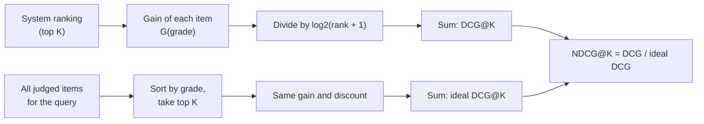

The metrics so far each answer a narrow question. Recall asks whether the relevant chunks got in; precision asks how much of what got in was relevant; MRR asks how high the first relevant chunk sits. None of them can say that a ranking with the essential chunk first and a useful background chunk second is better than one with the background chunk first and the essential chunk fifth. **Normalised discounted cumulative gain** (NDCG) can. It credits each result with a *graded* value, discounts that value by position, and compares the total with the best total possible.

NDCG is the headline metric of the BEIR benchmark, the default choice for evaluating rerankers, and the metric most often quoted on embedding-model leaderboards. This lesson builds it up piece by piece, works it by hand, and then covers the decisions that make two NDCG figures comparable or not: the gain function, the ideal ranking, the cutoff, ties and empty queries. The code computes it for two retrievers on graded Meridian judgements, checks the result against scikit-learn, and shows the most common implementation bug inflating scores by about 0.1.

## Learning objectives

- Compute DCG, ideal DCG and NDCG@K by hand from graded judgements.
- Explain the role of the gain function and the discount, and choose between linear and exponential gain.
- Build the ideal ranking correctly from all judged items, and recognise the bug of building it from the retrieved list.
- Explain why NDCG@K is not monotone in $K$ and why figures at different cutoffs are not comparable.
- Reconcile an NDCG figure with a library implementation, including tie handling and queries with no relevant items.

## Prerequisites

- [What is retrieval?](/learn/retrieval-fundamentals/what-is-retrieval): binary and graded relevance judgements.
- [Precision@K](/learn/retrieval-evaluation/precision-k): graded labels and how they are produced.
- [MRR](/learn/retrieval-evaluation/mrr): position-sensitive evaluation and tie handling.

## Why this matters

Real RAG questions rarely have one relevant chunk of one kind. "How much holiday do I get and can I carry some over?" needs two chunks that are each essential, and benefits slightly from a third about part-time entitlement. A context that contains the essential chunks near the top is better than one that contains only the background chunk, and better again than one that contains the essential chunks at positions four and five behind irrelevant material. Binary metrics flatten all of this into "relevant or not", and MRR stops at the first hit.

Rerankers make the need sharper. A reranker's whole job is to reorder candidates by *how* relevant they are. Judging it with a metric that cannot distinguish "essential" from "on topic" means you cannot see whether it put the right chunk first. And when you compare an embedding model on a public leaderboard, the number is almost always nDCG@10: reading it, and reproducing it on your own data, requires knowing exactly what it measures.

Finally, NDCG has more free choices than any other common retrieval metric (gain function, discount, ideal ranking, cutoff, tie rule, empty queries). Two correct implementations can disagree by several points. If you do not pin these choices down, you will spend days chasing a "regression" that is a change of library.

## The intuition

Imagine judging a shortlist of five job candidates that a recruiter has ranked. Each candidate has a quality grade: 3 for excellent, 2 for good, 1 for acceptable, 0 for unsuitable. You will interview from the top and you are busy, so the first candidate gets your full attention, the second a little less, and the fifth barely any.

- The **gain** of each position is the candidate's grade: how much value they offer.
- The **discount** shrinks that value according to position: what is at the top counts more.
- Add up the discounted gains: that is the **discounted cumulative gain** (DCG) of the recruiter's ordering.

DCG on its own is hard to interpret. A shortlist for a role with many excellent applicants will score higher than one for a niche role, even if the second recruiter did a perfect job. So you compare with the **best possible ordering** of the same applicants: all the 3s first, then the 2s, and so on. Its DCG is the **ideal DCG**. Dividing the recruiter's DCG by the ideal gives a number between 0 and 1: the fraction of the achievable value the recruiter actually delivered. That ratio is NDCG.

## How it works

### The pieces

For a query with graded judgements $g(d)$ for each judged item $d$ (unjudged items count as 0), and a ranking $d_1, d_2, \dots$:

1. **Gain.** Turn each grade into a value with a gain function $G$. Linear gain uses the grade itself, $G(g) = g$. Exponential gain uses $G(g) = 2^g - 1$, which makes a grade-3 item worth 7 and a grade-1 item worth 1.
2. **Discount.** Divide the gain at rank $i$ by $\log_2(i + 1)$. Rank 1 is divided by 1, rank 2 by 1.585, rank 3 by 2, rank 7 by 3. The discount grows slowly, so lower ranks still count, just less.
3. **DCG@K.** Sum the discounted gains of the top $K$ results.
4. **Ideal DCG@K.** Sort **all judged items for the query** by grade, best first, take the top $K$, and compute their DCG. This is the best any system could achieve with these judgements.
5. **NDCG@K.** Divide DCG@K by ideal DCG@K. If the ideal is 0 (the query has no relevant items), NDCG is undefined; see below.
6. **Average over queries**, as with every other metric.



### Choosing the gain

The gain function encodes how much better a highly relevant item is than a marginal one.

- **Linear gain** says a grade-3 item is worth three grade-1 items. It is the form in Järvelin and Kekäläinen's original work, and it is what scikit-learn's `ndcg_score` uses (the "true relevance" values are the gains).
- **Exponential gain** says a grade-3 item is worth seven grade-1 items. It became common in web search and learning-to-rank (Burges and colleagues, 2005, used it in the RankNet paper), where an excellent result matters far more than a fair one.

Neither is correct in general. For RAG, ask what a generator does with each grade. If grade 3 means "the answer is in this chunk" and grade 1 means "background the answer would not miss", the gap is large and exponential gain reflects it. With binary judgements the two are identical, since $2^1 - 1 = 1$. Whichever you choose, write it down, because it changes the number: the worked example below gives 0.817 with linear gain and 0.790 with exponential gain for the same ranking.

### Building the ideal correctly

The ideal ranking must come from **every judged relevant item for the query**, not from the items the system happened to retrieve. If you compute the ideal from the retrieved top $K$, a system that retrieves only one weakly relevant item and nothing else gets a perfect 1.0: the ideal ordering of what it found is exactly what it returned. This bug is easy to write, because the retrieved list is the data you have in hand, and it inflates scores in proportion to how much the system missed. The code measures it.

Implementations also differ on whether the ideal is capped at $K$ items. The standard definition takes the top $K$ of the ideal ordering, so a query with eight relevant items can still reach 1.0 at $K = 5$. Some implementations sum the ideal over all relevant items regardless of $K$, which makes 1.0 unreachable whenever there are more relevant items than slots. For example, LlamaIndex's `NDCG` metric (version 0.14 at the time of writing) uses binary relevance and sums the ideal over every expected ID; read the source of whatever library you use.

### The cutoff changes the metric

NDCG@5 and NDCG@10 are different metrics, not the same metric at two resolutions, because the ideal changes with $K$ as well as the system's DCG. A consequence that surprises people: **NDCG@K is not monotone in $K$.** Adding a non-relevant item at rank $K+1$ leaves DCG unchanged but can raise the ideal (if a relevant item would have occupied that slot), so NDCG falls. Adding a relevant item raises it. Recall, by contrast, can never fall as $K$ grows. Compare systems only at the same cutoff, and choose the cutoff that matches the context or candidate depth you deploy.

### Ties and empty queries

- **Ties.** When several items share a score, their order is arbitrary. scikit-learn's `ndcg_score` handles this by averaging the gains over tied positions by default; `ignore_ties=True` skips that step for speed when scores are continuous, and tied items then fall in whatever order the sort leaves them. A hand-written implementation that sorts with `np.argsort` takes whatever order the sort produces. For a retriever with many tied scores, such as BM25 on short chunks, these can differ noticeably, as the code shows.
- **Queries with no relevant items.** The ideal DCG is 0 and NDCG is undefined. Some libraries return 0 for such queries (scikit-learn does), which drags the mean down; others skip them. Exclude them from the NDCG average deliberately and evaluate them separately (for instance, does the system abstain?), as with [Recall@K](/learn/retrieval-fundamentals/recall-k).

### When to use NDCG

Use NDCG when relevance is graded or several relevant items per query matter, and when position within the cut matters. It is the natural metric for rerankers and for comparing embedding models on judged benchmarks. Prefer simpler metrics when they answer the question better: Recall@K for a candidate stage feeding a reranker (order there is irrelevant), MRR or Hit@1 for single-answer lookups. NDCG is also harder to explain to non-specialists: "0.82 of the achievable discounted gain" means less to a product manager than "the answer was in the top three for 91% of questions". Report it alongside a plain-language metric.

## The mathematics

**Intuition.** Add up how valuable each result is, counting high positions more, and divide by the best total any ordering could have achieved.

**Formulas.**

$$
\text{DCG@}K = \sum_{i=1}^{K} \frac{G(g_i)}{\log_2(i + 1)}, \qquad \text{NDCG@}K = \frac{\text{DCG@}K}{\text{IDCG@}K}
$$

- $g_i$ is the grade of the item at rank $i$ in the system's ranking (0 if unjudged).
- $G$ is the gain function: $G(g) = g$ (linear) or $G(g) = 2^g - 1$ (exponential).
- $\log_2(i + 1)$ is the position discount: 1 at rank 1, 1.585 at rank 2, 2 at rank 3.
- $\text{IDCG@}K$ is the DCG@K of the ideal ranking: all judged items for the query sorted by grade, descending.

**By hand.** The query "Can a contractor get the £400 home-office money?" has three judged chunks: contract (grade 3), budget (2) and remote (1). The dense retriever's top five are budget (2), contract (3) and three unjudged chunks (0).

Linear gain:

- DCG@5 $= 2/\log_2 2 + 3/\log_2 3 = 2/1 + 3/1.585 = 2 + 1.893 = 3.893$.
- Ideal order: 3, 2, 1. IDCG@5 $= 3/1 + 2/1.585 + 1/2 = 3 + 1.262 + 0.5 = 4.762$.
- NDCG@5 $= 3.893/4.762 = 0.817$.

Exponential gain: grades 2 and 3 become gains 3 and 7.

- DCG@5 $= 3/1 + 7/1.585 = 3 + 4.417 = 7.417$.
- Ideal gains 7, 3, 1: IDCG@5 $= 7 + 3/1.585 + 1/2 = 7 + 1.893 + 0.5 = 9.393$.
- NDCG@5 $= 7.417/9.393 = 0.790$.

Exponential gain penalises the swap more, because the item placed second is worth much more than the one placed first.

**Non-monotonicity.** A query has two relevant items, grades 3 and 2. The system ranks the grade-3 item first, two non-relevant items next, and the grade-2 item fourth. NDCG@1 $= 1$ (the ideal top 1 is also the grade-3 item). NDCG@2 $= 3/(3 + 2/1.585) = 3/4.262 = 0.704$: the ideal now expects the grade-2 item at rank 2. NDCG@3 stays 0.704. NDCG@4 $= (3 + 2/\log_2 5)/4.262 = 3.861/4.262 = 0.906$.

**In Python:**

```python
import numpy as np

def dcg(gains):
    return sum(g / np.log2(i + 2) for i, g in enumerate(gains))

ranked_grades = [2, 3, 0, 0, 0]       # budget, contract, receipt, deadline, approve
ideal_grades = [3, 2, 1]              # every judged chunk, best first
for name, gain in (("linear", lambda g: g), ("exponential", lambda g: 2**g - 1)):
    d = dcg([gain(g) for g in ranked_grades])
    i = dcg([gain(g) for g in ideal_grades])
    print(f"{name:<12} DCG {d:.3f}  IDCG {i:.3f}  NDCG {d / i:.3f}")

# NDCG@K is not monotone in K: adding a non-relevant rank can lower it
grades = [3, 0, 0, 2]
for k in (1, 2, 3, 4):
    print(f"NDCG@{k} = {dcg(grades[:k]) / dcg(sorted([3, 2], reverse=True)[:k]):.3f}")
```

```output
linear       DCG 3.893  IDCG 4.762  NDCG 0.817
exponential  DCG 7.417  IDCG 9.393  NDCG 0.790
NDCG@1 = 1.000
NDCG@2 = 0.704
NDCG@3 = 0.704
NDCG@4 = 0.906
```

In `dcg`, `enumerate` counts from 0, so the item at Python index `i` is at rank $i + 1$ and its discount is $\log_2(i + 2)$. Off-by-one errors in this line are the second most common NDCG bug.

## In code

**The problem.** Compute NDCG@5 for BM25 and a dense retriever on six multi-part Meridian questions with graded judgements; compare linear and exponential gain; check the implementation against scikit-learn; and measure how much the "ideal from the retrieved list" bug inflates the scores.

**Dependencies.** NumPy, scikit-learn, rank-bm25 and sentence-transformers (all-MiniLM-L6-v2, about 90 MB on first use). No API key.

```bash
pip install numpy scikit-learn rank-bm25 sentence-transformers
```

The grading scale is 3 for essential (the answer depends on it), 2 for answering part of the question, and 1 for useful background.

```python
import re
import numpy as np
from rank_bm25 import BM25Okapi
from sentence_transformers import SentenceTransformer
from sklearn.metrics import ndcg_score

chunks = {
    "leave":    "Annual leave is 25 days per year for full-time staff.",
    "parttime": "Part-time staff receive annual leave in proportion to their hours.",
    "carry":    "Up to 5 unused leave days carry over and must be used by 31 March.",
    "public":   "Public holidays are in addition to annual leave.",
    "request":  "Leave requests go to your line manager through the HR portal.",
    "remote":   "Staff may work remotely up to 3 days a week.",
    "budget":   "The home-office equipment budget is £400.",
    "contract": "Contractors are not eligible for the home-office equipment budget.",
    "deadline": "Expenses must be submitted within 30 days.",
    "late":     "Late expense claims need written approval from finance.",
    "receipt":  "Any expense over £75 needs a receipt.",
    "approve":  "Expense claims are approved by the finance department.",
    "vpn":      "VPN is required on public Wi-Fi.",
    "e4021":    "Atlas error E-4021: the VPN client is out of date; update it from the IT portal.",
    "e4012":    "Atlas error E-4012: the VPN certificate has expired.",
    "laptop":   "The laptop refresh cycle is 3 years.",
    "lost":     "Report a lost laptop to the support desk at once.",
    "desk":     "The support desk is open 08:00 to 18:00 UK time.",
}
ids = list(chunks)
# Graded judgements: 3 = essential, 2 = answers part of the question, 1 = useful background.
qrels = {
    "How much holiday do I get and can I carry some over?": {"leave": 3, "carry": 3, "parttime": 1, "public": 1},
    "Can a contractor get the £400 home-office money?":     {"contract": 3, "budget": 2, "remote": 1},
    "I missed the expenses deadline for a £90 hotel. What now?": {"late": 3, "deadline": 2, "receipt": 2, "approve": 1},
    "My VPN shows E-4021 on hotel Wi-Fi":                   {"e4021": 3, "vpn": 1, "e4012": 1},
    "My laptop was stolen and I need a new one":            {"lost": 3, "laptop": 2, "desk": 1},
    "How many days can I work from home and is there kit money?": {"remote": 3, "budget": 3, "contract": 1},
}
K = 5

def dcg(gains):
    return sum(g / np.log2(i + 2) for i, g in enumerate(gains))   # rank i+1 -> log2(i+2)

def ndcg_at_k(ranked, rel, k, gain=lambda g: g, ideal_from="judgements"):
    got = [gain(rel.get(c, 0)) for c in ranked[:k]]
    pool = rel.values() if ideal_from == "judgements" else [rel.get(c, 0) for c in ranked[:k]]
    ideal = sorted((gain(g) for g in pool), reverse=True)[:k]
    return dcg(got) / dcg(ideal) if dcg(ideal) > 0 else 0.0

tok = lambda t: re.findall(r"[a-z0-9£]+", t.lower())
bm25 = BM25Okapi([tok(t) for t in chunks.values()])
model = SentenceTransformer("sentence-transformers/all-MiniLM-L6-v2", device="cpu")
D = model.encode(list(chunks.values()), normalize_embeddings=True)
scorers = {
    "BM25": lambda q: bm25.get_scores(tok(q)),
    "dense": lambda q: D @ model.encode([q], normalize_embeddings=True)[0],
}

print(f"{'system':<7}{'linear':>8}{'expon.':>8}{'sklearn':>9}{'R@5':>6}{'bad IDCG':>10}")
for name, score in scorers.items():
    lin, exp_, skl, rec, bad = [], [], [], [], []
    for q, rel in qrels.items():
        s = score(q)
        ranked = [ids[i] for i in np.argsort(-s, kind="stable")]
        lin.append(ndcg_at_k(ranked, rel, K))
        exp_.append(ndcg_at_k(ranked, rel, K, gain=lambda g: 2**g - 1))
        y_true = np.array([[rel.get(c, 0) for c in ids]])
        skl.append(ndcg_score(y_true, s.reshape(1, -1), k=K))
        rec.append(len(set(ranked[:K]) & set(rel)) / len(rel))
        bad.append(ndcg_at_k(ranked, rel, K, ideal_from="retrieved"))
    print(f"{name:<7}{np.mean(lin):>8.3f}{np.mean(exp_):>8.3f}{np.mean(skl):>9.3f}"
          f"{np.mean(rec):>6.2f}{np.mean(bad):>10.3f}")

q = "Can a contractor get the £400 home-office money?"
s = scorers["dense"](q)
ranked = [ids[i] for i in np.argsort(-s, kind="stable")][:K]
print(f"\n{q}\n  dense top {K}: " + ", ".join(f"{c}({qrels[q].get(c, 0)})" for c in ranked))
print(f"  NDCG@{K} linear {ndcg_at_k(ranked, qrels[q], K):.3f}, "
      f"exponential {ndcg_at_k(ranked, qrels[q], K, gain=lambda g: 2**g - 1):.3f}")
```

```output
system   linear  expon.  sklearn   R@5  bad IDCG
BM25      0.803   0.777    0.748  0.81     0.896
dense     0.820   0.794    0.820  0.79     0.921

Can a contractor get the £400 home-office money?
  dense top 5: budget(2), contract(3), receipt(0), deadline(0), approve(0)
  NDCG@5 linear 0.817, exponential 0.790
```

**The important lines.**

- `ndcg_at_k` builds the ideal from `rel.values()`, every judged grade for the query. The `ideal_from="retrieved"` branch reproduces the bug for comparison.
- `sorted(..., reverse=True)[:k]` caps the ideal at $K$ items, the standard definition.
- `ndcg_score(y_true, s.reshape(1, -1), k=K)` passes scikit-learn the grades of *every* chunk and the raw scores. scikit-learn sorts by score itself, builds the ideal from all the grades, and uses linear gain, so it should match the hand-written linear column whenever there are no ties.
- `gain=lambda g: 2**g - 1` switches to exponential gain without touching the rest of the code.

**What the output means.**

- **The hand-written implementation matches scikit-learn exactly for the dense retriever (0.820), and does not for BM25 (0.803 against 0.748).** Dense scores are continuous, so there are no ties. BM25 gives many short chunks identical scores (often exactly 0), and scikit-learn averages gains over tied positions, while `np.argsort(kind="stable")` keeps tied chunks in dictionary order, which happens to favour BM25 here. Neither is wrong; they are different tie rules, and they differ by 0.055 on six queries. This is the most common reason two "correct" NDCG implementations disagree.
- **Exponential gain lowers both systems by about 0.025** and keeps their order. The worked example shows why: putting a grade-2 chunk above a grade-3 chunk is penalised harder when grade 3 is worth 7 rather than 3.
- **Recall and NDCG disagree on which system is better.** BM25 finds slightly more of the judged chunks in its top five (0.81 against 0.79) but orders them less well. NDCG combines both, which is its strength and also why it should be read beside Recall@K rather than instead of it.
- **The ideal-from-retrieved bug adds roughly 0.1** to both systems (0.896 and 0.921), and it adds more to whichever system misses more, because missing a relevant chunk no longer lowers the ideal. A bug that inflates the weaker system can reverse a comparison.
- **The per-query line** reproduces the worked example: 0.817 linear, 0.790 exponential. The retriever found both answering chunks but put the budget figure above the eligibility rule, which is what the contractor question depends on.

**Errors people commonly hit.**

- Passing scikit-learn a ranked list of IDs instead of per-item grades and scores. `ndcg_score` expects two arrays of shape (queries, items): true grades and predicted scores for the same items in the same column order.
- Passing only the retrieved items to `ndcg_score`. Then the ideal is built from the retrieved grades only, which is the inflation bug again.
- Forgetting that scikit-learn returns 0 for a query whose grades are all zero. If unanswerable queries are in the set, they pull the mean down silently.

**Extending it.** Add the cross-encoder from the [MRR lesson](/learn/retrieval-evaluation/mrr) over the dense top 10 and compare NDCG@5; set `ignore_ties=True` in `ndcg_score` and notice that it still does not reproduce the hand-written BM25 figure (it gives 0.748 here), because scikit-learn then breaks ties in a different order from the stable sort; and compute NDCG@3 and NDCG@10 to see how the system comparison depends on the cutoff.

## A real-world example

The Platform team at Meridian had two candidate rerankers for AskMeridian and an evaluation set of 220 questions with graded judgements made by the HR and IT teams. Reranker A scored nDCG@10 0.71 in the team's notebook; reranker B's vendor reported 0.78 on the same questions using its own evaluation script. The team was about to buy B.

Kwame, who maintained the evaluation harness, asked for the vendor's script. It differed from the team's in three ways: it used exponential gain, it scored at cutoff 10 against the vendor's candidate list rather than the full index, and it built the ideal ranking from the reranked list. The last choice alone inflated every system's score, and it inflated a reranker given a poor candidate list the most, because missing chunks did not lower the ideal.

Re-run in the team's harness, with the ideal built from all judgements, linear gain and the production cutoff of 5, the two rerankers were within 0.01 of each other, and a paired test could not separate them. The team chose A, which was cheaper to run, and wrote the metric definition into the harness's README: gain function, discount, cutoff, ideal from all judgements, pessimistic tie handling, unanswerable questions excluded and reported separately. Every vendor evaluation since has been re-run in the team's harness before any figure is compared.

## Common mistakes

- **Building the ideal from the retrieved list.** It hides every relevant item the system missed and can turn a weak system into a perfect one.
- **Not stating the gain function.** Linear and exponential NDCG are different numbers; a comparison across reports that mix them is meaningless.
- **Comparing NDCG at different cutoffs.** NDCG@5 and NDCG@10 have different ideals and are not ordered; NDCG can fall as $K$ grows.
- **Ignoring ties.** Libraries average tied positions or take input order; the difference can exceed the effect you are measuring.
- **Letting empty queries count as zeros.** An unanswerable question with no relevant items is not a retrieval failure; exclude it and evaluate abstention separately.
- **Reporting NDCG alone.** It blends coverage and ordering. A pair of systems can swap places between NDCG and Recall@K, as BM25 and dense did above.

## Best practices

- Write the full definition next to every reported figure: gain, discount, cutoff, ideal construction, tie rule, handling of empty queries.
- Build the ideal from all judged items for the query, capped at $K$.
- Validate your implementation once against a library (scikit-learn's `ndcg_score` with continuous scores) and keep that check as a unit test.
- Choose the cutoff to match the deployed context or candidate depth, and keep it fixed across comparisons.
- Report NDCG with Recall@K and a plain-language metric such as Hit@3, so readers can see coverage and ordering separately.
- Use exponential gain only when the grades are well separated in usefulness and the judging guideline says so.

## Performance considerations

NDCG@K needs the top $K$ grades for each query and the sorted grades of its judged items, so evaluation is $O(K + |R_q| \log |R_q|)$ per query: negligible. Calling scikit-learn's `ndcg_score` with a full row of scores for every chunk is convenient for a toy collection but wasteful for a real one: for 1,000 queries over 1,000,000 chunks it would build two dense $1{,}000 \times 1{,}000{,}000$ arrays, about 8 GB each at 64-bit precision. For real collections, compute NDCG from each query's top-$K$ IDs and its judgement dictionary, as `ndcg_at_k` does, and use the library only to validate on a small sample.

## Summary

- NDCG@K sums graded gains discounted by $\log_2(\text{rank} + 1)$ over the top $K$, and divides by the same sum for the ideal ordering of all judged items.
- Gain is a choice: linear (the grade) or exponential ($2^g - 1$); they agree for binary judgements and differ for graded ones.
- The ideal must come from all judgements, not from the retrieved list; the bug inflated scores by about 0.1 in the Meridian run.
- NDCG@K is not monotone in $K$, so compare only at the same cutoff.
- Tie handling and empty-query handling differ between implementations and can move results by more than real improvements do; pin them down and validate against a library.

## Exercises

**1.** A query has judged items with grades 3, 2, 2 and 1. A system's top four have grades 2, 0, 3, 1. Compute NDCG@4 with linear gain.

<details><summary>Show solution</summary>

DCG@4 $= 2/1 + 0/1.585 + 3/2 + 1/2.322 = 2 + 0 + 1.5 + 0.431 = 3.931$.
Ideal 3, 2, 2, 1: IDCG@4 $= 3/1 + 2/1.585 + 2/2 + 1/2.322 = 3 + 1.262 + 1 + 0.431 = 5.693$.
NDCG@4 $= 3.931/5.693 = 0.690$.

</details>

**2.** With the same judgements, a different system retrieves only one judged item, grade 1, at rank 1, followed by three unjudged items. Compute its NDCG@4 correctly, and with the ideal built from the retrieved list.

<details><summary>Show solution</summary>

DCG@4 $= 1/1 = 1$. Correct ideal is 5.693 (from exercise 1), so NDCG@4 $= 1/5.693 = 0.176$. With the ideal built from the retrieved grades [1, 0, 0, 0], IDCG $= 1$ and NDCG $= 1.0$: a nearly useless ranking scores perfectly.

</details>

**3.** Modify `ndcg_at_k` to compute expected NDCG under random tie-breaking by passing it the scores rather than a ranked list. Hint: for each group of tied chunks occupying ranks $a$ to $b$, every chunk's gain contributes the average discount over those ranks.

<details><summary>Show solution</summary>

```python
def ndcg_ties(scores, rel, k, gain=lambda g: g):
    order = np.argsort(-scores, kind="stable")
    disc = np.array([1 / np.log2(i + 2) if i < k else 0.0 for i in range(len(scores))])
    dcg_val, i = 0.0, 0
    while i < len(order):
        j = i
        while j + 1 < len(order) and scores[order[j + 1]] == scores[order[i]]:
            j += 1                                   # ranks i..j are tied
        group_gain = sum(gain(rel.get(ids[order[t]], 0)) for t in range(i, j + 1))
        dcg_val += group_gain * disc[i:j + 1].mean()
        i = j + 1
    ideal = sorted((gain(g) for g in rel.values()), reverse=True)[:k]
    return dcg_val / dcg(ideal)
```

Each tied group shares its total gain evenly over its positions' discounts, which is the expected DCG if the tie were broken uniformly at random. This is the rule scikit-learn applies by default, so for BM25 the mean of `ndcg_ties` over the six queries should reproduce scikit-learn's 0.748.

</details>

**4.** Design decision: AskMeridian passes five chunks to the generator, and the reranker scores 30 candidates. Which metric and cutoff would you use to evaluate (a) the first-stage retriever and (b) the reranker, and why?

<details><summary>Show solution</summary>

(a) Recall@30 (and its curve to depth 100): the first stage only has to get relevant chunks into the 30 candidates; their order is irrelevant because the reranker reorders them. NDCG here would penalise ordering the reranker will undo. (b) NDCG@5 with graded judgements, since the reranker's job is to put the most useful chunks into the five context slots in a sensible order, plus Recall@5 so that coverage is visible separately. If most questions have one answering chunk, add MRR@5 or Hit@1.

</details>

## Check your understanding

```quiz
[
  {
    "q": "Why is DCG divided by the ideal DCG?",
    "options": [
      "To convert it into a probability of relevance",
      "To make scores comparable across queries that have different numbers and grades of relevant items",
      "To remove the effect of the position discount",
      "To make it equal to Recall@K"
    ],
    "answer": 1,
    "why": "Raw DCG grows with how much relevant material a query has. Normalising by the best achievable DCG puts every query on a 0 to 1 scale."
  },
  {
    "q": "A system retrieves a single grade-1 item at rank 1 and nothing else relevant; the query has a grade-3 item it missed. An implementation reports NDCG@5 = 1.0. What is the likely bug?",
    "options": [
      "It uses exponential gain",
      "It builds the ideal ranking from the retrieved items instead of all judged items",
      "It uses log base 2",
      "It averages over queries"
    ],
    "answer": 1,
    "why": "If the ideal comes from what was retrieved, the system's ordering is already ideal and missed items have no effect."
  },
  {
    "q": "With binary judgements (grades 0 or 1), how do linear and exponential gain compare?",
    "options": [
      "Exponential gain is always higher",
      "They are identical, because 2^1 - 1 = 1",
      "Linear gain cannot be used with binary judgements",
      "Exponential gain doubles every score"
    ],
    "answer": 1,
    "why": "For grade 1, both give a gain of 1, and grade 0 gives 0 in both."
  },
  {
    "q": "Which statement about NDCG@K is true?",
    "options": [
      "It never decreases as K increases",
      "It can decrease as K increases, because the ideal DCG can grow faster than the system's DCG",
      "NDCG@10 is always at least NDCG@5",
      "It is undefined for K greater than the number of relevant items"
    ],
    "answer": 1,
    "why": "Adding a non-relevant item at rank K+1 leaves DCG unchanged but may add a relevant item to the ideal, lowering the ratio."
  },
  {
    "q": "Two correct NDCG@10 implementations give 0.748 and 0.803 for the same BM25 run. What is the most likely cause?",
    "options": [
      "One of them has a bug in the logarithm",
      "Different handling of tied scores",
      "One uses Recall@10 instead",
      "BM25 scores are random"
    ],
    "answer": 1,
    "why": "BM25 produces many identical scores. Averaging over tied positions and keeping input order give different results, as in this lesson's code."
  }
]
```

## Further reading

- Järvelin, K. and Kekäläinen, J. (2002). *Cumulated gain-based evaluation of IR techniques*. ACM Transactions on Information Systems 20(4). The original definition of DCG and NDCG.
- Burges, C. and colleagues (2005). *Learning to Rank using Gradient Descent*. ICML 2005. The RankNet paper, which uses the exponential-gain form of NDCG.
- Thakur, N. and colleagues (2021). *BEIR: A Heterogeneous Benchmark for Zero-shot Evaluation of Information Retrieval Models*. [arXiv:2104.08663](https://arxiv.org/abs/2104.08663). Uses nDCG@10 as its primary metric.
- [scikit-learn `ndcg_score` documentation](https://scikit-learn.org/stable/modules/generated/sklearn.metrics.ndcg_score.html): input format, tie handling and the `ignore_ties` option.
- Manning, C. D., Raghavan, P. and Schütze, H. (2008). *Introduction to Information Retrieval*, chapter 8. [Online edition](https://nlp.stanford.edu/IR-book/).
