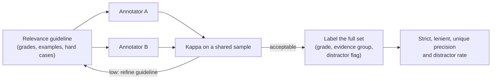

[Precision@K in Retrieval Fundamentals](/learn/retrieval-fundamentals/precision-k) defined the metric, the fraction of the top $K$ that is relevant, and dealt with its ceiling, its identity with recall, variable-length lists, unjudged chunks, R-precision and average precision. All of that assumed a simple thing: that "relevant" is a fixed, agreed label. In an evaluation you run, it is neither. Someone chose what counts as relevant, someone (or something) applied that choice to each chunk, and the precision figure you report inherits every one of those decisions.

This lesson is about making precision a trustworthy measurement. It covers graded judgements and the threshold that turns them into a yes or no, duplicated evidence that inflates precision without adding information, stale chunks that a precision figure counts as merely irrelevant when they are actively harmful, and agreement between the people who label. The code measures all four on a Meridian test set and shows a retriever whose precision is at its theoretical maximum while more than a sixth of its context is outdated.

## Learning objectives

- Compute strict and lenient Precision@K from graded judgements and explain what each one measures.
- Compute unique (evidence-level) precision and explain why duplicated chunks inflate ordinary precision.
- Measure a distractor rate separately from precision and justify reporting it.
- Compute Cohen's kappa between two annotators by hand and in code, and interpret it.
- Write a relevance guideline that makes precision figures reproducible.

## Prerequisites

- [Precision@K](/learn/retrieval-fundamentals/precision-k): the definition, the ceiling, judged fraction.
- [What is retrieval?](/learn/retrieval-fundamentals/what-is-retrieval): binary and graded relevance judgements.
- [Recall@K](/learn/retrieval-evaluation/recall-k): reading recall curves, the companion measurement.

## Why this matters

Precision at the context depth is a measurement of what the generator reads. If it is computed carelessly, the number looks fine while the context is not. Three concrete ways this happens in RAG:

- **The label is too generous.** "Relevant" often ends up meaning "about the same topic". A chunk on leave requests is on topic for "How many days of leave do I get?" but does not answer it. Counted as relevant, it lifts precision while adding nothing the generator can use.
- **The same fact appears several times.** Handbooks, FAQs and wiki pages repeat each other. Three copies of "25 days of annual leave" in the top five give a precision of 0.6 and one fact's worth of evidence. The other two slots could have held something useful, such as the carry-over rule.
- **The worst chunks are invisible.** A superseded 2023 handbook chunk saying the laptop cycle is 4 years is not "irrelevant noise" when the question is about laptop replacement. It is a confident wrong answer. Precision counts it the same as a chunk about expenses.

On top of these, two careful people often disagree on whether a chunk is relevant. If they disagree on a quarter of the judgements, a precision difference of 0.02 between two retrievers says more about who labelled the data than about the retrievers.

## The intuition

A newspaper editor asks a researcher for five cuttings to support a story about a council's housing budget. The researcher returns five. How good was the selection?

- If "good" means "about the council", all five might qualify. If it means "states the housing budget figure", perhaps two do. Both answers are right; they measure different things. The editor needs to know which question was asked.
- If three of the five are the same agency report reprinted by three newspapers, the editor has two sources, not four. Counting reprints separately overstates what was delivered.
- If one cutting is last year's budget, it is not merely unhelpful. A hurried writer might quote it. It deserves its own warning label, not just a mark of "not relevant".
- Finally, if a second editor reviewed the same five cuttings and disagreed about two of them, any claim that "this researcher is 10% better than that one" based on these marks is shaky.

Each bullet is one section of this lesson.

## How it works

### Graded judgements and the threshold

A graded scale gives more information than relevant or not. A common three-level scale for RAG:

- **2, answers**: the chunk contains what the question needs.
- **1, on topic**: the chunk is about the subject but does not contain the answer.
- **0, irrelevant**: anything else, including chunks with no judgement.

Precision needs a yes or no per chunk, so you choose a threshold. **Strict precision** counts only grade 2; **lenient precision** counts grade 1 and above. They measure different properties:

- Strict precision is the share of the context that does the work. It is the one that tracks answer quality and is the right default for the context stage.
- Lenient precision is the share of the context that is at least on the subject. It is useful as a diagnostic: a large gap between lenient and strict means the retriever finds the right neighbourhood but not the right chunk, which is exactly the situation a [cross-encoder reranker](/learn/reranking-fundamentals/cross-encoders) is good at fixing.

Report which one you mean. "Precision@5 = 0.43" and "Precision@5 = 0.25" can describe the same top fives.

The ceiling from the fundamentals lesson applies per threshold: with $|R^{\ge t}_q|$ chunks at or above threshold $t$, Precision@K cannot exceed $\min(K, |R^{\ge t}_q|)/K$. Strict precision usually has a much lower ceiling than lenient, because few chunks truly answer a question.

### Duplicated evidence and unique precision

In a real corpus many chunks state the same fact: a handbook paragraph and its FAQ version, two versions of a runbook, a policy and the announcement that introduced it. Ordinary precision counts each copy. That makes a retriever that returns three copies of one fact look better than one that returns one copy and two different useful facts.

To measure the information delivered, group chunks that state the same evidence (by hand, by a shared source section, or with a [near-duplicate detector](/learn/data-processing/duplicate-detection)), and count each group once:

1. Give every relevant chunk an **evidence group** label when you judge it. Chunks stating the same fact share a label.
2. Take the top $K$ and keep the chunks at or above your threshold.
3. Count the distinct evidence groups among them.
4. Divide by $K$.

This **unique precision** never exceeds ordinary precision. The gap between them is the share of the context spent on repetition. Reducing that gap is the job of [duplicate removal](/learn/advanced-retrieval-optimisation/duplicate-removal) and of [diversity-aware ranking](/learn/advanced-retrieval-optimisation/diversity-aware-ranking), and this is the measurement that tells you whether they are needed.

### Distractors are a separate count

A **distractor** is a retrieved chunk that is likely to make the answer wrong, not just weaker: a superseded policy, a different product's setting, the neighbouring error code. Precision treats it as a zero, the same as an unrelated chunk. But an unrelated chunk is mostly harmless, while a distractor can be copied into the answer.

So judge distractors explicitly (a flag beside the grade, or a negative grade) and report the **distractor rate**: the fraction of top-$K$ slots holding one, averaged over queries. It is not folded into precision because the two answer different questions. Precision asks "how much of the context helps?"; distractor rate asks "how much of it could hurt?". A retriever can score well on the first and badly on the second, as the code shows.

Where distractors come from is usually structural: superseded documents left in the index, near-identical documents for different products or regions, numbered items (error codes, runbook IDs) that embed close together. Each has a fix upstream of the metric (metadata filtering on validity dates, [document versioning](/learn/document-engineering/document-versioning), hybrid search for identifiers), and the distractor rate tells you whether the fix worked.

### Who judged, and do they agree?

Precision is only as reproducible as its labels. Two careful annotators given the same chunks and a vague instruction ("is this relevant?") will disagree, mostly on the borderline grade-1 cases and on stale content. Measuring that disagreement tells you how much precision difference you can trust.

**Raw agreement** (the fraction of items labelled identically) overstates agreement, because two annotators who both label most chunks "irrelevant" agree often by chance. **Cohen's kappa** corrects for this by comparing observed agreement with the agreement expected if each annotator labelled at random with their own label frequencies:

- $\kappa = 1$: perfect agreement.
- $\kappa = 0$: no better than chance.
- Negative: systematic disagreement.

For graded labels, **weighted kappa** gives partial credit when the annotators are one grade apart (2 against 1) rather than two (2 against 0). Commonly quoted verbal bands (for example, Landis and Koch's description of 0.41 to 0.60 as "moderate") are conventions, not laws; what matters is whether disagreement is large enough to move your metric.

To use agreement in practice:

1. Write a short **relevance guideline**: the grade definitions, worked examples for each, and explicit rules for the hard cases (stale versions, partial answers, duplicates).
2. Have two people judge the same sample of query-chunk pairs independently, ideally 50 to 100 pairs stratified to include borderline cases.
3. Compute kappa (weighted, for graded labels) and read every disagreement.
4. Refine the guideline where disagreements cluster, then judge the rest of the set.
5. Report kappa with the precision figures, and treat precision differences smaller than the effect of switching annotators as unproven.

The same procedure validates an automated judge: the judge is simply another annotator, and its agreement with people is measured the same way. [Context precision](/learn/advanced-retrieval-optimisation/context-precision) and [LLM-as-a-judge](/learn/testing-and-benchmarking/llm-as-a-judge) cover judge-based labelling.



## The mathematics

**Thresholded precision.** For query $q$ with grades $g_q(c)$ (0 when unjudged) and a threshold $t$:

$$
\text{P}_t\text{@}K(q) = \frac{1}{K} \sum_{c \in \text{Top}_K(q)} \mathbf{1}[\,g_q(c) \ge t\,]
$$

Strict is $t = 2$; lenient is $t = 1$.

**Unique precision.** With $\text{grp}(c)$ the evidence group of chunk $c$:

$$
\text{UP}_t\text{@}K(q) = \frac{\left|\{\,\text{grp}(c) : c \in \text{Top}_K(q),\ g_q(c) \ge t\,\}\right|}{K}
$$

The numerator is the number of distinct facts, not chunks.

**Distractor rate.** With $S_q$ the set of chunks flagged as distractors for $q$:

$$
\text{DR@}K(q) = \frac{|\text{Top}_K(q) \cap S_q|}{K}
$$

**By hand.** The top five for "How many days of annual leave do I get?" are faq-leave (2), hb-leave (2), hb-carry (1), hb-public (1) and hb-remote (0), where both grade-2 chunks state the same fact. Strict precision is $2/5 = 0.4$; lenient is $4/5 = 0.8$; unique strict precision is $1/5 = 0.2$, because both answering chunks belong to the evidence group "leave-days".

**Cohen's kappa.** With $p_o$ the observed agreement and $p_e$ the agreement expected by chance from each annotator's label frequencies:

$$
\kappa = \frac{p_o - p_e}{1 - p_e}, \qquad p_e = \sum_{\ell} p_A(\ell)\, p_B(\ell)
$$

where $p_A(\ell)$ is the fraction of items annotator A gave label $\ell$.

**By hand.** Two annotators judge ten chunks as relevant (1) or not (0). A marks six relevant, B marks five. They agree on seven items (four both relevant, three both not). So $p_o = 0.7$. Chance agreement is $p_e = 0.6 \times 0.5 + 0.4 \times 0.5 = 0.5$. Then $\kappa = (0.7 - 0.5) / (1 - 0.5) = 0.4$. Seventy per cent raw agreement sounds solid; kappa says it is less than half of the way from chance to perfect.

**In Python:**

```python
from sklearn.metrics import cohen_kappa_score

# Ten chunks judged relevant (1) or not (0) by two annotators
a = [1, 1, 1, 1, 1, 1, 0, 0, 0, 0]
b = [1, 1, 1, 1, 0, 0, 1, 0, 0, 0]
p_o = sum(x == y for x, y in zip(a, b)) / len(a)
pa, pb = sum(a) / len(a), sum(b) / len(b)
p_e = pa * pb + (1 - pa) * (1 - pb)
print(f"observed {p_o:.2f}, chance {p_e:.2f}, kappa {(p_o - p_e) / (1 - p_e):.2f}")
print(f"sklearn kappa {cohen_kappa_score(a, b):.2f}")

# Strict, lenient and unique precision for one top-5 list
top = ["faq-leave", "hb-leave", "hb-carry", "hb-public", "hb-remote"]
grade = {"hb-leave": 2, "faq-leave": 2, "hb-carry": 1, "hb-public": 1}
group = {"hb-leave": "leave-days", "faq-leave": "leave-days"}
K = len(top)
print("strict ", sum(grade.get(c, 0) >= 2 for c in top) / K)
print("lenient", sum(grade.get(c, 0) >= 1 for c in top) / K)
print("unique ", len({group[c] for c in top if grade.get(c, 0) >= 2}) / K)
```

```output
observed 0.70, chance 0.50, kappa 0.40
sklearn kappa 0.40
strict  0.4
lenient 0.8
unique  0.2
```

## In code

**The problem.** Evaluate a dense retriever's top five on a Meridian test set with graded judgements, evidence groups and stale distractors. Report strict, lenient and unique precision and the distractor rate, then measure how much a second annotator's labels change the picture.

**Dependencies.** NumPy, scikit-learn and sentence-transformers (all-MiniLM-L6-v2, about 90 MB on first use). No API key.

```bash
pip install numpy scikit-learn sentence-transformers
```

The corpus deliberately contains what real ones contain: FAQ copies of handbook facts, and three chunks from the superseded 2023 handbook that are still in the index.

```python
import numpy as np
from sentence_transformers import SentenceTransformer
from sklearn.metrics import cohen_kappa_score

# chunk id -> (text, evidence group). Chunks in the same group state the same fact.
chunks = {
    "hb-leave":     ("Annual leave is 25 days per year for full-time staff.", "leave-days"),
    "faq-leave":    ("FAQ: How much annual leave do I get? 25 days a year.", "leave-days"),
    "hb-carry":     ("Up to 5 unused leave days carry over and must be used by 31 March.", "carry-over"),
    "hb-request":   ("Leave requests go to your line manager through the HR portal.", "leave-request"),
    "hb-public":    ("Public holidays are in addition to annual leave.", "public-holidays"),
    "hb-remote":    ("Staff may work remotely up to 3 days a week.", "remote-days"),
    "hb-budget":    ("The home-office equipment budget is £400.", "budget"),
    "faq-budget":   ("FAQ: Is there money for a home desk or chair? Yes, a £400 equipment budget.", "budget"),
    "hb-contract":  ("Contractors are not eligible for the home-office equipment budget.", "contractors"),
    "old-budget":   ("2023 handbook (superseded): the home-office equipment budget is £250.", "stale"),
    "hb-exp":       ("Expenses must be submitted within 30 days.", "expense-deadline"),
    "hb-receipt":   ("Any expense over £75 needs a receipt.", "receipt"),
    "it-laptop":    ("The laptop refresh cycle is 3 years.", "laptop-cycle"),
    "old-laptop":   ("2023 handbook (superseded): the laptop refresh cycle is 4 years.", "stale"),
    "it-desk":      ("The support desk is open 08:00 to 18:00 UK time.", "desk-hours"),
    "old-desk":     ("2023 handbook (superseded): support desk hours are 09:00 to 17:00.", "stale"),
}
ids = list(chunks)

# Graded judgements: 2 = answers the question, 1 = on topic but does not answer,
# 0 or absent = irrelevant. Stale chunks are judged 0 and listed separately as distractors.
qrels = {
    "How many days of annual leave do I get?":    {"hb-leave": 2, "faq-leave": 2, "hb-carry": 1, "hb-public": 1, "hb-request": 1},
    "How much can I spend on home-office kit?":   {"hb-budget": 2, "faq-budget": 2, "hb-contract": 1, "hb-remote": 1},
    "Can contractors claim the equipment budget?": {"hb-contract": 2, "hb-budget": 1, "faq-budget": 1},
    "When does my laptop get replaced?":          {"it-laptop": 2},
    "What are the IT support desk hours?":        {"it-desk": 2},
    "Do I need a receipt for a £40 taxi?":        {"hb-receipt": 2, "hb-exp": 1},
    "Can I carry unused holiday into next year?": {"hb-carry": 2, "hb-leave": 1, "faq-leave": 1},
    "How many days can I work from home?":        {"hb-remote": 2, "hb-budget": 1},
}
stale = {i for i, (_, g) in chunks.items() if g == "stale"}

model = SentenceTransformer("sentence-transformers/all-MiniLM-L6-v2", device="cpu")
D = model.encode([t for t, _ in chunks.values()], normalize_embeddings=True)
K = 5

rows, tops = [], {}
for query, rel in qrels.items():
    q = model.encode([query], normalize_embeddings=True)[0]
    top = [ids[i] for i in np.argsort(-(D @ q), kind="stable")[:K]]
    tops[query] = top
    strict = sum(rel.get(c, 0) >= 2 for c in top) / K
    lenient = sum(rel.get(c, 0) >= 1 for c in top) / K
    # unique precision: each answering evidence group counts once
    groups = {chunks[c][1] for c in top if rel.get(c, 0) >= 2}
    unique = len(groups) / K
    distract = sum(c in stale for c in top) / K
    rows.append((strict, lenient, unique, distract))
    print(f"{query[:44]:<45} strict {strict:.1f} lenient {lenient:.1f} unique {unique:.1f} "
          f"stale {distract:.1f}  top: {', '.join(top)}")

m = np.mean(rows, axis=0)
print(f"\nmean P@{K}: strict {m[0]:.3f}  lenient {m[1]:.3f}  unique {m[2]:.3f}  stale-in-context {m[3]:.3f}")

# --- a second annotator judges the same pairs, plus the three stale chunks ---
pairs = [(q, c) for q, rel in qrels.items() for c in rel] + [
    ("How much can I spend on home-office kit?", "old-budget"),
    ("When does my laptop get replaced?", "old-laptop"),
    ("What are the IT support desk hours?", "old-desk"),
]
qrels_b = {q: dict(rel) for q, rel in qrels.items()}
for q, c in pairs:                 # B: stricter about "on topic", but calls stale chunks on topic
    if qrels[q].get(c) == 1 and c in ("hb-public", "hb-request", "hb-remote", "hb-budget"):
        qrels_b[q][c] = 0
    if c in stale:
        qrels_b[q][c] = 1
ann_a = [qrels[q].get(c, 0) for q, c in pairs]
ann_b = [qrels_b[q].get(c, 0) for q, c in pairs]
print(f"\njudged pairs: {len(pairs)}, raw agreement {np.mean(np.array(ann_a) == np.array(ann_b)):.3f}, "
      f"kappa {cohen_kappa_score(ann_a, ann_b):.3f}, "
      f"linear-weighted kappa {cohen_kappa_score(ann_a, ann_b, weights='linear'):.3f}")
lenient_b = np.mean([sum(qrels_b[q].get(c, 0) >= 1 for c in top) / K for q, top in tops.items()])
print(f"lenient P@{K}: annotator A {m[1]:.3f}, annotator B {lenient_b:.3f}")
```

```output
How many days of annual leave do I get?       strict 0.4 lenient 0.8 unique 0.2 stale 0.0  top: faq-leave, hb-leave, hb-carry, hb-public, hb-remote
How much can I spend on home-office kit?      strict 0.4 lenient 0.6 unique 0.2 stale 0.2  top: old-budget, hb-budget, faq-budget, hb-contract, hb-exp
Can contractors claim the equipment budget?   strict 0.2 lenient 0.6 unique 0.2 stale 0.2  top: hb-contract, old-budget, hb-budget, hb-exp, faq-budget
When does my laptop get replaced?             strict 0.2 lenient 0.2 unique 0.2 stale 0.4  top: old-laptop, it-laptop, old-desk, hb-carry, it-desk
What are the IT support desk hours?           strict 0.2 lenient 0.2 unique 0.2 stale 0.2  top: old-desk, it-desk, hb-remote, hb-leave, faq-budget
Do I need a receipt for a £40 taxi?           strict 0.2 lenient 0.4 unique 0.2 stale 0.2  top: hb-receipt, hb-budget, old-budget, faq-budget, hb-exp
Can I carry unused holiday into next year?    strict 0.2 lenient 0.4 unique 0.2 stale 0.0  top: hb-public, hb-carry, hb-receipt, hb-exp, hb-leave
How many days can I work from home?           strict 0.2 lenient 0.2 unique 0.2 stale 0.2  top: hb-remote, hb-leave, faq-leave, hb-carry, old-desk

mean P@5: strict 0.250  lenient 0.425  unique 0.200  stale-in-context 0.175

judged pairs: 24, raw agreement 0.667, kappa 0.470, linear-weighted kappa 0.566
lenient P@5: annotator A 0.425, annotator B 0.450
```

**The important lines.**

- Each chunk carries an evidence group alongside its text. That one extra field is what makes unique precision computable; adding it at judging time costs seconds per chunk, while reconstructing it later costs a re-read of the corpus.
- `rel.get(c, 0) >= 2` and `>= 1` apply the two thresholds to the same graded judgements. Nothing about the retrieval changes; only the definition of success does.
- `{chunks[c][1] for c in top if ...}` is a set, so two chunks from the same evidence group collapse to one.
- `cohen_kappa_score(..., weights="linear")` is scikit-learn's weighted kappa: a disagreement of one grade costs half as much as a disagreement of two.

**What the output means.**

- **Strict precision is at its ceiling.** Six queries have one answering chunk and two have two, so the average strict ceiling at $K = 5$ is $(6 \times 0.2 + 2 \times 0.4) / 8 = 0.25$. The retriever scores exactly 0.250: every answering chunk is in every top five. On precision alone, there is nothing to improve.
- **Unique precision is lower, 0.200.** On the leave and home-office queries, two of the five slots are spent on the same fact (handbook and FAQ). The context held one fact's worth of answer in two slots.
- **The distractor rate is 0.175.** On three questions the superseded 2023 chunk is ranked *first*, above the current answer, because it is almost word for word the same sentence with a different number. For "When does my laptop get replaced?" two of the five chunks are stale. Precision counted these as zeros, the same as an expenses chunk; the distractor rate shows that the context for six of eight questions contains a superseded statement. This is the most important finding in the table, and precision alone hid it.
- **Lenient precision depends on who labelled.** Annotators A and B agree on two thirds of the 24 judged pairs, kappa 0.47 (0.57 weighted). Their lenient precision figures are 0.425 and 0.450: close, but only because their disagreements partly cancel. B dropped five on-topic chunks to 0 and raised three stale chunks to 1. A different retriever that returned more stale chunks would gain under B's labels and lose under A's. The guideline must settle the stale case explicitly.

**Errors people commonly hit.**

- Treating an unjudged chunk as a 0 when computing precision for a *new* retriever. If it surfaces chunks nobody judged, precision is understated; check the judged fraction first, as the fundamentals lesson explains.
- Computing kappa only over pairs where at least one annotator said "relevant". That discards the easy agreements and changes the chance correction; compute it over every pair both annotators judged.
- Assigning evidence groups by exact text match. "25 days per year" and "25 days a year" are the same fact; group by meaning, by source section, or with a near-duplicate detector reviewed by a person.

**Extending it.** Add a cross-encoder reranker over the top 10 and see whether it lifts the current chunk above its stale twin (it may not: they say the same thing about the same subject). Then filter by a `superseded` metadata flag before ranking and confirm the distractor rate falls to zero without changing strict precision.

## A real-world example

The HR team at Meridian reported that AskMeridian sometimes quoted the old £250 equipment budget. The Platform team's dashboard showed Precision@5 of 0.41 on their test set, stable for months, and the reranker change under review raised it to 0.44. Nobody had connected the dashboard to the complaint.

Amara, who ran the evaluation, found that the 0.41 was lenient precision: their labelling guideline said "relevant if it helps or is related", and the two contractors who labelled the set had marked superseded handbook chunks as relevant, since they were "about the question". Under those labels, a retriever that surfaced the 2023 budget chunk was being *rewarded*.

She rewrote the guideline with three grades, an evidence-group field and a distractor flag, with worked examples for each hard case. A pilot of 80 pairs labelled by two people gave a weighted kappa she judged too low; most disagreements were on whether a partial answer counted as grade 2. After a clarifying rule and a second pilot, agreement improved and the full set was relabelled.

The new dashboard showed strict precision, unique precision and distractor rate side by side. The reranker change raised strict precision only slightly. The distractor rate, however, was well above zero for budget, laptop and support-hours questions, and the reranker did not change it. The fix was upstream: the ingestion pipeline now filters out documents marked superseded, and the distractor rate became a release gate with a target of zero for the policy questions. The complaints stopped; the precision figure barely moved.

## Common mistakes

- **Reporting "precision" without the threshold.** Strict and lenient precision on the same rankings can differ by a factor of two. A comparison across teams or months that mixes them is meaningless.
- **Letting "on topic" count as relevant by default.** It rewards retrievers for finding the neighbourhood rather than the answer, which is the failure you most want to see.
- **Counting duplicates as separate evidence.** It makes redundancy look like quality, and it hides the room a context could have had for the second fact a question needs.
- **Folding distractors into "irrelevant".** Precision then cannot distinguish a harmless miss from a confident wrong source.
- **Using raw agreement as evidence of label quality.** When most pairs are irrelevant, two careless annotators can agree 90% of the time.

## Best practices

- Judge on a graded scale with written definitions and worked examples; record an evidence group and a distractor flag at the same time.
- Report strict precision as the headline at the context depth, with lenient precision, unique precision and distractor rate beside it.
- Pilot every new guideline with two annotators on a stratified sample, compute weighted kappa, and read every disagreement before labelling the full set.
- Version the guideline and the labels together, and never compare figures produced under different versions without saying so.
- Treat any automated judge as one more annotator and measure its agreement with people the same way.
- Fix distractors upstream (validity metadata, filtering, versioning), and use the distractor rate to confirm the fix.

## Performance considerations

The computations are trivial; the cost is labelling. Graded judgements with an evidence group take longer than binary ones. If a binary judgement takes 20 seconds and a graded judgement with a group and a flag takes 30 (assumptions; measure your own annotators), a set of 200 queries with 10 pooled chunks each costs about $2{,}000 \times 30 / 3{,}600 \approx 17$ hours instead of 11. The double-labelling pilot adds $100$ pairs $\times 2$ annotators $\times 30$ s $\approx 1.7$ hours. That is cheap insurance against a guideline that produces unreliable labels for the whole set.

The same evidence grouping can later drive a de-duplication step before the context is built, saving tokens on every request.

## Security considerations

Distractors are not always accidental. A document planted to contradict official policy ([data poisoning](/learn/rag-security-fundamentals/data-poisoning)) is a distractor by design, and it will be written to rank well. A distractor rate measured only on known superseded documents will not see it. Include adversarial or unexpected sources in the judging pool, flag any chunk that contradicts the authoritative answer whatever its origin, and treat a sudden rise in the distractor rate as a possible integrity incident rather than a quality blip.

## Summary

- A precision figure is defined by its relevance threshold; report strict (answers) and lenient (on topic) explicitly, with strict as the headline at the context depth.
- Unique precision counts distinct evidence, not chunks, and exposes contexts that spend slots repeating one fact.
- Distractors (stale or contradicting chunks) deserve their own rate, because precision scores them the same as harmless noise; in the Meridian run, strict precision was at its ceiling while 17.5% of context slots held superseded policy.
- Annotators disagree; measure it with (weighted) Cohen's kappa on a pilot, refine the guideline, and do not trust precision differences smaller than the effect of switching annotators.

## Exercises

**1.** A top five has grades 2, 1, 2, 0, 1, and the two grade-2 chunks are copies of the same fact. The fourth chunk is a superseded policy. Compute strict, lenient and unique strict precision and the distractor rate.

<details><summary>Show solution</summary>

Strict: two chunks at grade 2, so $2/5 = 0.4$. Lenient: four chunks at grade 1 or above, $4/5 = 0.8$. Unique strict: both grade-2 chunks share one evidence group, $1/5 = 0.2$. Distractor rate: one flagged chunk, $1/5 = 0.2$. A one-line summary would be "strict 0.4, but one fact's worth of answer and one stale contradicting chunk in five".

</details>

**2.** Two annotators label 200 pairs as relevant or not. Each marks 10% relevant, and they agree on 180 pairs. Compute kappa and say what it suggests.

<details><summary>Show solution</summary>

$p_o = 180/200 = 0.9$. $p_e = 0.1 \times 0.1 + 0.9 \times 0.9 = 0.82$. $\kappa = (0.9 - 0.82) / (1 - 0.82) = 0.08 / 0.18 \approx 0.44$. Ninety per cent raw agreement sounds excellent, but nearly all of it comes from agreeing on the many irrelevant pairs. On the pairs that matter (the relevant ones), they disagree a lot: each marked 20 relevant, and agreeing on 180 of 200 means they disagree on 20 pairs, so only 10 pairs are relevant to both. The guideline needs work before precision computed from either annotator's labels can be compared reliably.

</details>

**3.** Extend the code to compute, per query, the strict precision ceiling $\min(K, |R^{\ge 2}_q|)/K$, and print the mean ceiling next to the mean strict precision. Then remove the three stale chunks from the index and re-run. Which metrics change, and why?

<details><summary>Show solution</summary>

```python
ceiling = np.mean([min(K, sum(g >= 2 for g in rel.values())) / K for rel in qrels.values()])
print(f"strict ceiling {ceiling:.3f}")
```

The ceiling is 0.250, equal to the measured strict precision. After deleting the `old-*` entries from `chunks` and re-running, the distractor rate becomes 0 and other chunks fill the freed slots. Strict precision stays at 0.250 and, in this run, lenient precision stays at 0.425. The stale chunks never hurt precision; they hurt the answer, which only the distractor rate showed.

</details>

**4.** Design decision: your team will label 300 queries. Budget allows either one annotator labelling everything, or two annotators each labelling half with 60 pairs double-labelled. Which do you choose, and what do you do with the double-labelled pairs?

<details><summary>Show solution</summary>

Choose two annotators with an overlap. A single annotator gives consistent labels but no way to know whether they are reproducible, and one person's idiosyncrasies (for example, treating stale chunks as relevant) become invisible properties of the metric. With 60 shared pairs, compute weighted kappa and read every disagreement, before most labelling is done: run the overlap as a pilot first. Refine the guideline, resolve the shared pairs by discussion (adjudication), and then split the rest. Report kappa alongside the precision figures. If the budget permits, make the overlap stratified so it contains borderline and stale cases, where disagreement concentrates.

</details>

## Check your understanding

```quiz
[
  {
    "q": "A retriever's strict Precision@5 equals its average strict ceiling. What can you conclude?",
    "options": [
      "The context contains no stale or misleading chunks",
      "Every answering chunk for every query is in the top five, so strict precision cannot be improved by reordering",
      "Lenient precision must also be at its ceiling",
      "Recall@5 is low"
    ],
    "answer": 1,
    "why": "Reaching the ceiling means all answering chunks are in the cut. It says nothing about what fills the other slots, which may include distractors."
  },
  {
    "q": "Three of the top five chunks state the same fact, and all are judged relevant. Ordinary precision is 0.6. What does unique precision measure that ordinary precision does not?",
    "options": [
      "The rank of the first relevant chunk",
      "The number of distinct pieces of evidence per slot, so repeated facts count once",
      "The fraction of chunks that are on topic",
      "The agreement between annotators"
    ],
    "answer": 1,
    "why": "Unique precision counts evidence groups, not chunks, so three copies of one fact contribute one."
  },
  {
    "q": "Why is the distractor rate reported separately rather than folded into precision as a zero?",
    "options": [
      "Because distractors are always rare",
      "Because precision already counts distractors as negative values",
      "Because a stale or contradicting chunk can make the answer wrong, while an unrelated chunk is mostly harmless, and precision scores both as zero",
      "Because distractors cannot be identified by annotators"
    ],
    "answer": 2,
    "why": "Precision cannot distinguish harmful from harmless irrelevance; a separate rate exposes the harmful kind."
  },
  {
    "q": "Two annotators agree on 92% of pairs. Why might Cohen's kappa still be low?",
    "options": [
      "Kappa ignores agreements on irrelevant pairs",
      "If most pairs are irrelevant, high agreement is expected by chance, and kappa measures agreement beyond chance",
      "Kappa only works for graded labels",
      "Kappa is always lower than raw agreement by a fixed amount"
    ],
    "answer": 1,
    "why": "Kappa subtracts the agreement expected from each annotator's label frequencies; with skewed labels, that expected agreement is high."
  },
  {
    "q": "Annotator B scores retriever X higher than annotator A does, mostly because B labels superseded chunks as on topic. What is the right fix?",
    "options": [
      "Average the two annotators' precision figures",
      "Use only the annotator who gives higher scores",
      "Add an explicit rule for stale content to the guideline, relabel the affected pairs and re-measure agreement",
      "Switch to lenient precision"
    ],
    "answer": 2,
    "why": "The disagreement is systematic and comes from an unresolved case in the guideline. Fixing the rule makes the labels, and therefore precision, reproducible."
  }
]
```

## Further reading

- Cohen, J. (1960). *A coefficient of agreement for nominal scales*. Educational and Psychological Measurement 20(1). The original kappa paper.
- Landis, J. R. and Koch, G. G. (1977). *The measurement of observer agreement for categorical data*. Biometrics 33(1). The source of the commonly quoted verbal bands for kappa.
- Voorhees, E. M. (2000). *Variations in relevance judgments and the measurement of retrieval effectiveness*. Information Processing and Management 36(5). How disagreement between assessors affects system comparisons.
- Manning, C. D., Raghavan, P. and Schütze, H. (2008). *Introduction to Information Retrieval*, chapter 8, including the section on assessing relevance and kappa. [Online edition](https://nlp.stanford.edu/IR-book/).
- [scikit-learn `cohen_kappa_score` documentation](https://scikit-learn.org/stable/modules/generated/sklearn.metrics.cohen_kappa_score.html).
