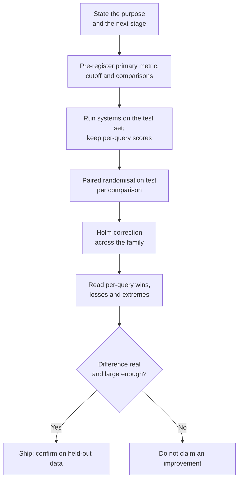

The previous lessons each introduced one metric. A real evaluation uses several at once, on one test set, to answer questions such as "did the reranker help?" or "is the hybrid retriever better than dense search?". Three things then go wrong that no single metric lesson can show. The metrics disagree about which system is best. A difference that looks real turns out to be noise from a finite test set. And someone runs fifteen comparisons, finds one that is "significant", and ships it. **Ranking quality** is the discipline of comparing ranked lists soundly: choosing metrics for a stated purpose, understanding what each rewards, testing differences, and correcting for multiple comparisons.

You will compute five metrics on four systems over the 300 SciFact test claims (BM25, a dense retriever, a reciprocal-rank-fusion hybrid and a dense retriever with a cross-encoder reranker), see how the orderings differ, and run paired randomisation tests with a Holm correction. You will also meet rank-biased precision, a metric with an explicit user model, and a way of reading per-query results that explains a difference rather than just testing it.

## Learning objectives

- Choose a primary metric and supporting metrics for a stated pipeline stage, and say what each rewards.
- Compute rank-biased precision by hand and relate its persistence parameter to a user model.
- Run a paired randomisation test on per-query metric differences and interpret the p-value.
- Apply a Holm correction when several system pairs are compared, and explain why it is needed.
- Explain a metric difference by examining per-query wins, losses and ties, not only the mean.

## Prerequisites

- [Recall@K](/learn/retrieval-evaluation/recall-k), [Precision@K](/learn/retrieval-evaluation/precision-k), [MRR](/learn/retrieval-evaluation/mrr), [NDCG](/learn/retrieval-evaluation/ndcg) and [Hit rate](/learn/retrieval-evaluation/hit-rate): the metrics compared here.
- [Reciprocal Rank Fusion](/learn/hybrid-search/reciprocal-rank-fusion): the hybrid system in the code.
- [Cross-encoders](/learn/reranking-fundamentals/cross-encoders): the reranker in the code.

## Why this matters

A retrieval change is shipped on the strength of a comparison, and a comparison has three ways to mislead. The **metric** may not match the purpose: Recall@10 improves for a candidate stage, which is fine, but P@1 falls, which hurts the system that passes one chunk to the generator. The **sample** may be too small or too lucky: a mean difference of 0.03 over 300 queries may or may not survive a different 300. And the **procedure** may be flawed: if you compare six pairs of systems and report whichever has p < 0.05, the chance of at least one false positive is far above 5%.

Retrieval evaluation is full of examples of each. Teams pick the metric that improved after seeing the results. They report a mean difference without an interval. They try twelve configurations against the same test set and announce the best, which is partly selected for luck. None of this requires bad faith; it follows from having many numbers and one deadline. The remedy is a small set of habits: decide the primary metric in advance, test differences with a paired test, correct for the number of comparisons, and look at the queries behind the numbers.

## The intuition

A school ranks pupils by a series of tests. Pupil A is best at the single hardest question (P@1 in spirit), pupil B has the best average over the whole paper (nDCG), and pupil C answered the most questions at all (recall). "Who is best?" has no answer until you say what the ranking is for: choosing a quiz-team captain, awarding the prize for overall performance, or picking who passes the minimum standard.

Now suppose two pupils differ by two marks out of 100 on one paper. Would they differ again on another paper from the same syllabus? Only a sense of how much marks vary between papers can say. That is the role of a significance test. And if you compare every pair among twenty pupils and announce each pair that differs "significantly", some of those differences are luck, because twenty pupils make 190 pairs.

## How it works

### Choose the metric for the purpose

Each metric rewards something different, and the choice should follow from what the next stage does with the ranking:

| Purpose | Primary metric | Why |
| --- | --- | --- |
| Candidate stage feeding a reranker | Recall@N at the candidate depth | Order is irrelevant; membership is everything ([Recall@K](/learn/retrieval-evaluation/recall-k)) |
| One chunk reaches the generator | Hit@1 or MRR | Only the top slot is used |
| A few chunks, graded relevance | nDCG@K at the context depth | Position and degree of relevance both matter |
| Several needed chunks, completeness | All-hit@K or Recall@K at the context depth | A missing chunk makes the answer wrong ([Hit rate](/learn/retrieval-evaluation/hit-rate)) |
| Context cost matters | Precision@K, with unique precision and distractor rate | Every slot is paid for and read ([Precision@K](/learn/retrieval-evaluation/precision-k)) |

Choose one **primary** metric before running anything, and treat the others as diagnostics. If you choose after seeing which metric improved, a significance test no longer means what it says.

### Rank-biased precision

nDCG's discount, $1/\log_2(i + 1)$, is a convenient shape rather than a model of behaviour. **Rank-biased precision** (RBP; Moffat and Zobel, 2008) starts from a user model instead. The user looks at rank 1; after each result, they continue to the next with probability $p$ (the **persistence**) and stop with probability $1 - p$. The probability of looking at rank $i$ is $p^{i-1}$, so the expected value delivered is

$$
\text{RBP} = (1 - p) \sum_{i=1}^{\infty} \text{rel}_i \, p^{\,i-1}
$$

where $\text{rel}_i$ is 1 if the result at rank $i$ is relevant. With $p = 0.5$ the user rarely gets past rank 3; with $p = 0.8$ they read about five results on average, since the expected number examined is $1/(1-p)$. The model has an unusual and useful property: the weights sum to 1 over the whole ranking, so RBP is a proper weighted average, and you can say how much of the user's attention lies beyond your evaluation depth. If you judge only the top 10, the unjudged tail carries weight $p^{10}$ (0.107 for $p = 0.8$), which RBP reports as a **residual**: the score is known only to within that amount. Few other metrics make their own uncertainty from truncation explicit.

For RAG, $p$ can be read as a statement about the generator and context: a system that passes three chunks has an effective $p$ near 0.5 or below; one that passes ten and reads them all has a high $p$. Pick $p$ to match, state it, and report the residual.

### Per-query effect sizes

A mean difference of 0.03 can arise in two quite different ways: a handful of queries improve a lot, or many queries improve a little. They need different reactions. So list, for each pair of systems, the number of queries where system B scores higher, lower and equal, and the size of the largest changes. Then read the extreme queries: the biggest gains and the biggest losses. This is where you find out why. If the hybrid's gains are concentrated on queries with rare technical terms, that is a story about lexical matching; if its losses are on paraphrases, that is a story about fusion weights. The mean says whether; the queries say why.

### Paired randomisation test

Two systems evaluated on the same queries give paired scores, and the paired differences $d_q = a_q - b_q$ carry the information. A **paired randomisation test** (also called a sign-flip permutation test) asks: if the two systems were interchangeable, how often would random relabelling produce a mean difference at least this large?

1. Compute the per-query difference $d_q$ for each of $n$ queries and the observed absolute mean $|\bar{d}|$.
2. If the systems were exchangeable, the sign of each $d_q$ would be equally likely to be positive or negative. Simulate that: multiply each $d_q$ by $+1$ or $-1$ at random.
3. Recompute the absolute mean of the flipped differences. Repeat many times (10,000 is typical).
4. The p-value is the fraction of repetitions whose absolute mean is at least $|\bar{d}|$.

The test makes no assumption about the distribution of metric values (they are bounded, skewed and often clumped at 0 and 1, so a normal-theory t-test is questionable), and uses the pairing, which removes the large query-to-query variation in difficulty. Smucker, Allan and Carterette (2007) compared the common tests on TREC data and recommended the randomisation test and the bootstrap over the Wilcoxon and sign tests; Sakai's work on statistical reform in IR evaluation covers the broader picture. For yes-or-no metrics such as hit rate, McNemar's test from the [Hit rate](/learn/retrieval-evaluation/hit-rate) lesson is the right tool.

A p-value is a statement about the data under a null hypothesis, not the probability that the systems are equal. It also says nothing about size: with enough queries, a trivial difference becomes "significant". Report the mean difference with its p-value and a confidence interval (a paired bootstrap, as in [Recall@K](/learn/retrieval-fundamentals/recall-k)), and decide in advance what size of difference would matter.

### Many comparisons

If you run $m$ independent tests at the 5% level and every null hypothesis is true, the chance of at least one false positive is $1 - 0.95^m$: 26% for $m = 5$, 54% for $m = 15$. Real comparisons are rarely independent, but the problem is real. Comparing four systems pairwise gives $m = 6$ tests; comparing ten configurations gives 45.

The simplest remedy is the **Bonferroni** correction: multiply each p-value by $m$ (or equivalently test each at $0.05/m$). It is safe but conservative. **Holm's step-down** procedure is uniformly at least as powerful and just as safe against false positives, so prefer it:

1. Sort the $m$ p-values from smallest to largest: $p_{(1)} \le \dots \le p_{(m)}$.
2. Compute the adjusted values $\tilde{p}_{(i)} = \min\{1,\ \max_{j \le i}\,(m - j + 1)\,p_{(j)}\}$: multiply the smallest by $m$, the next by $m - 1$, and so on, and enforce that adjusted values never decrease.
3. Declare significant the comparisons with adjusted p below the chosen level.

Holm controls the probability of any false positive among the family of tests. A better remedy than any correction is fewer comparisons: decide the comparisons you care about in advance (new system against current system) rather than testing everything against everything.

### Selection bias and the test set

Choosing the best of many configurations on one test set gives an optimistic estimate for that winner, because the winner is partly selected for luck on those queries. Use a development set for exploration, a separate **held-out** test set for the final comparison, and avoid reusing the test set for repeated decisions. [Test set construction](/learn/testing-and-benchmarking/test-set-construction) and [Benchmark design](/learn/testing-and-benchmarking/benchmark-design) go further into this.



## The mathematics

**Rank-biased precision.** For binary relevance $\text{rel}_i \in \{0, 1\}$ over the top $K$ ranks:

$$
\text{RBP}_p@K = (1 - p) \sum_{i=1}^{K} \text{rel}_i\, p^{\,i-1}, \qquad \text{residual} = p^{K}
$$

$p$ is the persistence (probability of continuing to the next rank). The residual is the maximum amount the unjudged tail could add.

**Randomisation test.** For paired differences $d_1, \dots, d_n$ and a random sign vector $\epsilon \in \{-1, +1\}^n$:

$$
p\text{-value} = \Pr_{\epsilon}\left( \left|\frac{1}{n}\sum_q \epsilon_q d_q\right| \ge \left|\frac{1}{n}\sum_q d_q\right| \right)
$$

For small $n$ this can be enumerated exactly over all $2^n$ sign patterns.

**Holm adjustment.** With sorted p-values $p_{(1)} \le \dots \le p_{(m)}$:

$$
\tilde{p}_{(i)} = \min\left\{1,\ \max_{j \le i}\ (m - j + 1)\, p_{(j)}\right\}
$$

**By hand: RBP.** Relevant results at ranks 1 and 3, $p = 0.8$, $K = 10$. The weights $0.2 \times 0.8^{i-1}$ are 0.2 at rank 1 and $0.2 \times 0.64 = 0.128$ at rank 3. RBP $= 0.2 + 0.128 = 0.328$. The residual is $0.8^{10} = 0.107$, so the true score lies between 0.328 and 0.435.

**By hand: exact randomisation test.** Four queries have differences $0.20, 0.10, -0.05, 0.15$; the mean is 0.10. Of the $2^4 = 16$ sign patterns, four give an absolute mean at least 0.10 (the observed pattern, its mirror, and two others). So $p = 4/16 = 0.25$. Four queries cannot show significance however consistent the sign: the smallest possible p-value is $2/16 = 0.125$.

**By hand: Holm.** Three comparisons with p-values 0.01, 0.03 and 0.04. Adjusted: $3 \times 0.01 = 0.03$; $2 \times 0.03 = 0.06$; $1 \times 0.04 = 0.04$, raised to 0.06 to keep the sequence non-decreasing. Only the first comparison stays below 0.05.

**In Python:**

```python
import itertools
import numpy as np

ranks = np.arange(1, 11)
print("rank      " + " ".join(f"{r:>5}" for r in ranks))
print("P@10      " + " ".join(f"{0.1:>5.2f}" for r in ranks))
print("DCG       " + " ".join(f"{1 / np.log2(r + 1):>5.2f}" for r in ranks))
for p in (0.5, 0.8):
    print(f"RBP p={p}  " + " ".join(f"{(1 - p) * p ** (r - 1):>5.2f}" for r in ranks))

# RBP by hand: relevant at ranks 1 and 3, p = 0.8, judged to depth 10
rel = np.zeros(10); rel[[0, 2]] = 1
rbp = 0.2 * (rel * 0.8 ** np.arange(10)).sum()
print(f"RBP = {rbp:.3f}, residual = {0.8 ** 10:.3f}")

# Exact randomisation test on four per-query differences
d = np.array([0.20, 0.10, -0.05, 0.15])
obs = abs(d.mean())
flips = [abs((np.array(s) * d).mean()) >= obs - 1e-12 for s in itertools.product([-1, 1], repeat=4)]
print(f"mean diff {d.mean():.3f}; {sum(flips)} of {len(flips)} sign patterns as extreme; p = {np.mean(flips):.3f}")
```

```output
rank          1     2     3     4     5     6     7     8     9    10
P@10      0.10  0.10  0.10  0.10  0.10  0.10  0.10  0.10  0.10  0.10
DCG       1.00  0.63  0.50  0.43  0.39  0.36  0.33  0.32  0.30  0.29
RBP p=0.5   0.50  0.25  0.12  0.06  0.03  0.02  0.01  0.00  0.00  0.00
RBP p=0.8   0.20  0.16  0.13  0.10  0.08  0.07  0.05  0.04  0.03  0.03
RBP = 0.328, residual = 0.107
mean diff 0.100; 4 of 16 sign patterns as extreme; p = 0.250
```

The table shows what each metric pays for a relevant result at each rank. Precision pays the same for every rank; the DCG discount falls fast and then flattens; RBP falls geometrically, and its steepness is the persistence $p$.

## In code

**The problem.** Compare four retrieval systems on SciFact with five metrics; show that the metrics rank them differently; then test every pair on nDCG@10 with a paired randomisation test and a Holm correction.

**Dependencies.** pandas, NumPy, rank-bm25, sentence-transformers and huggingface_hub. The first run downloads SciFact and two small models (MiniLM and the cross-encoder `cross-encoder/ms-marco-MiniLM-L-6-v2`, about 90 MB each). No API key. The whole script takes about four minutes on a laptop CPU, most of it encoding abstracts and reranking 6,000 claim-abstract pairs.

```bash
pip install pandas pyarrow numpy rank-bm25 sentence-transformers huggingface_hub
```

The four systems are BM25; all-MiniLM-L6-v2 dense search; reciprocal rank fusion of the two (with the conventional constant 60); and the dense top 20 reranked by the cross-encoder.

```python
import itertools
import re
import numpy as np
import pandas as pd
from huggingface_hub import hf_hub_download
from rank_bm25 import BM25Okapi
from sentence_transformers import CrossEncoder, SentenceTransformer

def get(repo, path):
    return hf_hub_download(repo, path, repo_type="dataset")

corpus = pd.read_parquet(get("BeIR/scifact", "corpus/corpus-00000-of-00001.parquet"))
queries = pd.read_parquet(get("BeIR/scifact", "queries/queries-00000-of-00001.parquet"))
qrels = pd.read_csv(get("BeIR/scifact-qrels", "test.tsv"), sep="\t", dtype=str)
relevant = qrels.groupby("query-id")["corpus-id"].apply(set).to_dict()
queries = queries[queries["_id"].isin(relevant)].reset_index(drop=True)
doc_ids = corpus["_id"].to_numpy()
doc_texts = (corpus["title"] + ". " + corpus["text"]).tolist()
claims = queries["text"].tolist()
rels = [relevant[q] for q in queries["_id"]]

# ---------- four systems, each a list of ranked doc-id lists ----------
tok = lambda t: re.findall(r"[a-z0-9]+", t.lower())
bm25 = BM25Okapi([tok(t) for t in doc_texts])
runs = {"BM25": [list(doc_ids[np.argsort(-bm25.get_scores(tok(c)), kind="stable")[:100]]) for c in claims]}

bi = SentenceTransformer("sentence-transformers/all-MiniLM-L6-v2", device="cpu")
bi.max_seq_length = 256
D = bi.encode(doc_texts, normalize_embeddings=True, batch_size=64)
Q = bi.encode(claims, normalize_embeddings=True)
runs["MiniLM"] = [list(doc_ids[r]) for r in np.argsort(-(Q @ D.T), axis=1, kind="stable")[:, :100]]

def rrf(*lists, k=60):
    score = {}
    for lst in lists:
        for rank, d in enumerate(lst, start=1):
            score[d] = score.get(d, 0.0) + 1 / (k + rank)
    return sorted(score, key=lambda d: -score[d])[:100]

runs["RRF hybrid"] = [rrf(b, m) for b, m in zip(runs["BM25"], runs["MiniLM"])]

ce = CrossEncoder("cross-encoder/ms-marco-MiniLM-L-6-v2", device="cpu", max_length=256)
text_of = dict(zip(doc_ids, doc_texts))
reranked = []
for c, cands in zip(claims, runs["MiniLM"]):
    top = cands[:20]
    s = ce.predict([(c, text_of[d]) for d in top], batch_size=32)
    reranked.append([top[i] for i in np.argsort(-s, kind="stable")] + cands[20:])
runs["MiniLM+rerank"] = reranked

# ---------- per-query metrics ----------
def metrics(run, rel, k=10, p=0.8):
    hits = np.array([d in rel for d in run[:k]], dtype=float)
    disc = 1 / np.log2(np.arange(2, k + 2))
    ideal = disc[:min(len(rel), k)].sum()
    first = np.argmax(hits) + 1 if hits.any() else None
    return {
        "nDCG@10": (hits * disc).sum() / ideal,
        "MRR@10": 1 / first if first else 0.0,
        "R@10": hits.sum() / len(rel),
        "P@1": hits[0],
        "RBP.8": (1 - p) * (hits * p ** np.arange(k)).sum(),
    }

per_query = {name: pd.DataFrame([metrics(r, rel) for r, rel in zip(run, rels)]) for name, run in runs.items()}
table = pd.DataFrame({name: df.mean() for name, df in per_query.items()}).T
print(table.round(3).to_string())
print("\norder of systems by each metric:")
for m in table.columns:
    print(f"  {m:<8} " + " > ".join(table[m].sort_values(ascending=False).index))

# ---------- paired randomisation tests on nDCG@10, Holm-corrected ----------
rng = np.random.default_rng(0)
def randomisation_test(a, b, trials=10_000):
    diff = a - b
    observed = abs(diff.mean())
    signs = rng.choice([-1.0, 1.0], size=(trials, len(diff)))
    return (np.abs((signs * diff).mean(axis=1)) >= observed).mean()

pairs = list(itertools.combinations(runs, 2))
results = []
for a, b in pairs:
    x, y = per_query[a]["nDCG@10"].to_numpy(), per_query[b]["nDCG@10"].to_numpy()
    results.append((a, b, x.mean() - y.mean(), randomisation_test(x, y), int((x > y).sum()), int((x < y).sum())))
results.sort(key=lambda r: r[3])
print("\nnDCG@10 pairwise (randomisation test, 10,000 trials; Holm-adjusted p):")
m_tests = len(results)
running = 0.0
for i, (a, b, d, p, wins, losses) in enumerate(results):
    running = max(running, min(1.0, (m_tests - i) * p))
    print(f"  {a:<13} vs {b:<13} diff {d:+.3f}  wins/losses {wins:>3}/{losses:<3} p {p:.4f}  Holm {running:.4f}")
```

The output below is from one CPU run with sentence-transformers 6.3. Metric values should be reproducible; the randomisation p-values vary slightly with the random seed and number of trials.

```output
               nDCG@10  MRR@10   R@10    P@1  RBP.8
BM25             0.652   0.618  0.776  0.523  0.143
MiniLM           0.648   0.607  0.788  0.503  0.145
RRF hybrid       0.685   0.654  0.799  0.563  0.152
MiniLM+rerank    0.685   0.654  0.806  0.573  0.152

order of systems by each metric:
  nDCG@10  RRF hybrid > MiniLM+rerank > BM25 > MiniLM
  MRR@10   RRF hybrid > MiniLM+rerank > BM25 > MiniLM
  R@10     MiniLM+rerank > RRF hybrid > MiniLM > BM25
  P@1      MiniLM+rerank > RRF hybrid > BM25 > MiniLM
  RBP.8    RRF hybrid > MiniLM+rerank > MiniLM > BM25

nDCG@10 pairwise (randomisation test, 10,000 trials; Holm-adjusted p):
  BM25          vs RRF hybrid    diff -0.032  wins/losses  30/63  p 0.0031  Holm 0.0186
  MiniLM        vs MiniLM+rerank diff -0.036  wins/losses  49/69  p 0.0082  Holm 0.0410
  MiniLM        vs RRF hybrid    diff -0.036  wins/losses  42/84  p 0.0124  Holm 0.0496
  BM25          vs MiniLM+rerank diff -0.032  wins/losses  48/75  p 0.0691  Holm 0.2073
  BM25          vs MiniLM        diff +0.004  wins/losses  71/72  p 0.8402  Holm 1.0000
  RRF hybrid    vs MiniLM+rerank diff +0.000  wins/losses  57/54  p 0.9946  Holm 1.0000
```

**The important lines.**

- `metrics` returns every metric for one query from one ranked list, so all five are computed from the same per-query hit vector and nothing can drift between them. `per_query` keeps one row per query, which every later step needs.
- `rrf` implements reciprocal rank fusion: each list contributes $1/(60 + \text{rank})$ to a document's score, and documents are sorted by the sum. It uses ranks only, so BM25 and cosine scores need no common scale.
- The reranker scores only the dense top 20 and leaves ranks 21 to 100 untouched, so its candidate set is the dense retriever's. Any difference from dense is a difference of order.
- `randomisation_test` draws a matrix of random signs, one row per trial, multiplies it into the per-query differences, and counts how often the absolute mean matches or exceeds the observed one. The generator is seeded, so the p-values reproduce.
- The Holm loop sorts the tests by raw p-value, multiplies by the number of remaining tests, and takes a running maximum so adjusted values never fall.

**What the output means.**

- **The metrics mostly agree here, but not entirely.** nDCG@10 and MRR@10 give the same order. Recall@10 puts the reranked system first and MiniLM above BM25, which flips MiniLM and BM25 relative to nDCG, because the dense model finds slightly more relevant abstracts but places them a little lower. RBP with $p = 0.8$ also puts MiniLM above BM25 where nDCG does not. These flips are among systems whose nDCG values differ by 0.004, so they are noise-level; the lesson is that the order of near-ties depends on the metric, so name the primary metric before looking.
- **The hybrid and the reranked system are the best two and indistinguishable from each other.** Both score 0.685 on nDCG@10, with a difference of 0.000 and 57 queries favouring one against 54 the other; the randomisation p-value is 0.99. They get there by different routes: the reranker has the better P@1 (0.573 against 0.563) and recall (0.806 against 0.799), but the difference is far too small to claim.
- **Improvements over MiniLM and BM25 are real at 300 queries, but modest.** RRF against BM25: +0.032, 63 queries better and 30 worse, raw p 0.003, Holm-adjusted 0.019. MiniLM against its reranked version: +0.036, p 0.008, Holm 0.041. MiniLM against RRF: Holm 0.050, only just on the line.
- **Holm changes the story for one comparison.** BM25 against the reranked system has a raw p of 0.069 (not significant), and BM25 against MiniLM is plainly a tie (p 0.84). With six tests in the family the adjusted values are larger than the raw ones, and the borderline MiniLM versus RRF result at raw 0.012 becomes 0.050.
- **Wins and losses explain more than means.** RRF's gain over BM25 comes from 63 queries improving against 30 worsening: broad but not universal. That is the signature of complementary systems, as in the [Recall@K](/learn/retrieval-evaluation/recall-k) lesson, and the 30 losses are where a fusion weight might be tuned.

**Errors people commonly hit.**

- Using an unpaired test (for example, a two-sample t-test) on per-query metrics. It ignores that both systems saw the same queries, and loses most of its power.
- Recomputing the random signs with a different seed per comparison and then comparing p-values near the threshold: with 10,000 trials the Monte Carlo error is about $\pm 0.002$ near 0.05, so a result at 0.0496 and one at 0.0504 are not meaningfully different.
- Correcting only some of the comparisons you ran. The family is every comparison you looked at, including the ones you did not report.

**Extending it.** Add a paired bootstrap confidence interval for each difference; add RBP at $p = 0.5$ and see whether the order of the top two systems changes; sort queries by the RRF-minus-BM25 difference and read the ten biggest gains and losses.

## A real-world example

The Platform team at Meridian had five candidate configurations for AskMeridian's retrieval: dense only, BM25 only, two hybrid fusion settings and a hybrid with a reranker. Mei, the engineer running the comparison, tested each against the current production system on a 300-question test set and found that three of the five "beat production at p < 0.05". The product owner wanted to ship the one with the lowest p-value.

Mei raised two issues. The family was five comparisons, so a corrected threshold applied; after Holm adjustment, one comparison remained significant, and its improvement of 0.021 in nDCG@10 was smaller than the 0.03 the team had agreed in advance as worth the extra latency. The primary metric had also been chosen after the fact: the lowest p-value was for Recall@10, while the team's agreed primary metric for the context stage was nDCG@5, on which the same configuration's difference was not significant.

She went back to the plan, with the metric, the cutoff and the minimum worthwhile effect agreed in advance, ran the single planned comparison on a fresh held-out set of 300 newly written questions, and reported the mean difference with a paired bootstrap interval and the number of questions better and worse. The reranked hybrid improved nDCG@5 by 0.028, with an interval that included values below the agreed threshold. The team shipped it behind a flag, with the held-out result recorded as an estimate, not a guarantee.

## Common mistakes

- **Choosing the primary metric after seeing results.** Whichever metric improved becomes the one that "matters", and the test loses its meaning.
- **Reporting a mean difference without a paired test or interval.** On a finite test set, many small differences are noise.
- **Using unpaired tests.** Systems evaluated on the same queries are paired; ignoring this throws away most of the information.
- **Not correcting for many comparisons.** Fifteen tests at the 5% level have better than even odds of a false positive when nothing differs.
- **Confusing significant with important.** With enough queries a 0.002 difference is significant and worthless. Pre-agree the smallest difference worth shipping.
- **Selecting the best of many on one test set and quoting its score.** The winner's score is optimistic; confirm on held-out data.
- **Comparing metric values across datasets.** nDCG@10 on SciFact and on your handbook are not comparable; only comparisons within one test set are meaningful.

## Best practices

- Write down the purpose, primary metric, cutoff, comparisons and smallest worthwhile effect before running the evaluation.
- Keep per-query scores for every system, so any later test, interval or slice needs no re-run.
- Test differences with a paired randomisation test (or a paired bootstrap) for graded metrics, and McNemar's test for yes-or-no outcomes.
- Apply Holm's correction across the family of comparisons you actually ran.
- Report wins, losses and ties alongside the mean difference, and read the largest gains and losses.
- Use a development set for exploration and a held-out set for the final claim.
- Report RBP's residual, or the equivalent uncertainty from truncation, when judged depth is limited.

## Performance considerations

Metric computation is trivial compared with producing the rankings. The costs to plan are the rankings themselves (the four systems above need one BM25 search, one dense search, a fusion and 6,000 cross-encoder inferences) and the labelling of the test set. Cache the per-query rankings and scores; every metric, test and slice afterwards is a few vectorised operations.

The randomisation test costs $O(T \cdot n)$ for $T$ trials and $n$ queries: 10,000 trials over 300 queries is three million multiplications, negligible. For $n \le 20$ you can enumerate all $2^n$ sign patterns exactly (about a million for $n = 20$). The six tests in the example share one random-sign generator; for a large family, draw one sign matrix and reuse it across comparisons to save time.

The cost that does not scale down is test-set size. The standard error of a mean difference shrinks as $1/\sqrt{n}$, so detecting an effect half as large needs four times the queries. Decide the smallest worthwhile effect first, then estimate $n$ from the pilot standard deviation of per-query differences: $n \approx (z_{\alpha/2} + z_{\beta})^2 \sigma_d^2 / \delta^2$, where $\delta$ is the effect and $\sigma_d$ the standard deviation of per-query differences.

## Summary

- Choose the primary metric from the purpose of the stage, fix it with the cutoff before running anything, and treat other metrics as diagnostics.
- Different metrics reward different things; systems with near-equal scores can swap order between them.
- Rank-biased precision has an explicit user model (persistence $p$) and reports the residual weight beyond the judged depth.
- Test differences with a paired randomisation test, and correct for the number of comparisons with Holm's procedure; in the SciFact run, the hybrid and reranked systems beat BM25 and MiniLM but were indistinguishable from each other.
- Read per-query wins, losses and ties; they explain a difference and show whether it is broad or concentrated.

## Exercises

**1.** Four systems are compared pairwise (six tests) with raw p-values 0.004, 0.012, 0.020, 0.040, 0.300 and 0.700. Apply Holm's procedure and state which comparisons are significant at 0.05.

<details><summary>Show solution</summary>

Sorted p-values times $(m - j + 1)$ for $m = 6$: $0.004 \times 6 = 0.024$; $0.012 \times 5 = 0.060$; $0.020 \times 4 = 0.080$; $0.040 \times 3 = 0.120$; $0.300 \times 2 = 0.600$; $0.700 \times 1 = 0.700$. Running maximum: 0.024, 0.060, 0.080, 0.120, 0.600, 0.700. Only the first comparison is significant at 0.05. The second, at raw 0.012, would have looked significant without correction.

</details>

**2.** Compute RBP with $p = 0.5$ and $K = 5$ for a ranking with relevant results at ranks 1, 2 and 5, and state the residual.

<details><summary>Show solution</summary>

Weights $0.5 \times 0.5^{i-1}$: 0.5, 0.25, 0.125, 0.0625, 0.03125. Relevant at ranks 1, 2 and 5: $0.5 + 0.25 + 0.03125 = 0.781$. Residual $= 0.5^5 = 0.031$. The score lies between 0.781 and 0.813.

</details>

**3.** Write a function `holm(pvalues)` that returns adjusted p-values in the original order, and test it on the six SciFact p-values from the output (0.0031, 0.0082, 0.0124, 0.0691, 0.8402, 0.9946).

<details><summary>Show solution</summary>

```python
import numpy as np

def holm(pvalues):
    p = np.asarray(pvalues, dtype=float)
    order = np.argsort(p)
    adjusted = np.empty_like(p)
    running = 0.0
    for rank, idx in enumerate(order):
        running = max(running, min(1.0, (len(p) - rank) * p[idx]))
        adjusted[idx] = running
    return adjusted

print(holm([0.0031, 0.0082, 0.0124, 0.0691, 0.8402, 0.9946]).round(4))
```

This prints `[0.0186 0.041  0.0496 0.2073 1.     1.    ]`, matching the table: three of the six comparisons stay below 0.05.

</details>

**4.** Design decision: you have 40 candidate chunking and retrieval configurations and a 200-question test set. A teammate proposes running all 780 pairwise comparisons with Holm correction. What do you do instead?

<details><summary>Show solution</summary>

Do not test all pairs. Use the 200 questions as a development set to narrow the 40 down to two or three plausible finalists, accepting that screening on it is exploratory and its scores are optimistic. Write down the one or two comparisons that matter (finalist against current production) with the primary metric and smallest worthwhile effect. Run those on a fresh held-out set (new questions, not seen during screening), apply Holm over those few comparisons only, and report effect sizes with intervals. With 780 tests the correction would make almost nothing significant, and the screening would still leak into the final claim.

</details>

## Check your understanding

```quiz
[
  {
    "q": "Why is a paired test preferred when comparing two retrievers on the same queries?",
    "options": [
      "It needs fewer queries because it ignores the metric values",
      "Per-query difficulty varies widely, and pairing removes that variation by testing the per-query differences",
      "It guarantees p-values below 0.05",
      "It avoids multiple-comparison problems"
    ],
    "answer": 1,
    "why": "Pairing tests the differences on each query, which cancels the large query-to-query variation in difficulty."
  },
  {
    "q": "You run 15 independent tests at the 5% level and nothing truly differs. About how likely is at least one false positive?",
    "options": ["5%", "26%", "54%", "95%"],
    "answer": 2,
    "why": "1 - 0.95^15 is about 0.54."
  },
  {
    "q": "In rank-biased precision with persistence p = 0.8 judged to depth 10, what does the residual 0.8^10 = 0.107 mean?",
    "options": [
      "The probability the top result is relevant",
      "The maximum score that unjudged ranks beyond 10 could still add",
      "The error rate of the annotators",
      "The fraction of queries with no relevant result"
    ],
    "answer": 1,
    "why": "RBP weights sum to 1 over the whole ranking; the weight beyond rank 10 is p^10, so the score is known only to within that amount."
  },
  {
    "q": "Raw p-values from three tests are 0.01, 0.03 and 0.04. Using Holm's procedure, which are significant at 0.05?",
    "options": [
      "All three",
      "None",
      "Only the first (adjusted 0.03)",
      "The first two"
    ],
    "answer": 2,
    "why": "Adjusted values are 0.03, 0.06 and 0.06 (the third is raised to keep the sequence non-decreasing), so only the first stays below 0.05."
  },
  {
    "q": "A team picks the metric after seeing which one improved most, then tests that metric. What is the problem?",
    "options": [
      "The metric will be biased low",
      "The test no longer controls its error rate, because the choice of metric depended on the result",
      "Paired tests cannot be used with several metrics",
      "Nothing, as long as the p-value is below 0.05"
    ],
    "answer": 1,
    "why": "Choosing among metrics after the fact is an uncorrected multiple comparison, so the stated significance level is wrong."
  }
]
```

## Further reading

- Smucker, M. D., Allan, J. and Carterette, B. (2007). *A comparison of statistical significance tests for information retrieval evaluation*. CIKM 2007. Recommends randomisation and bootstrap tests.
- Moffat, A. and Zobel, J. (2008). *Rank-biased precision for measurement of retrieval effectiveness*. ACM Transactions on Information Systems 27(1). The RBP definition and residual.
- Holm, S. (1979). *A simple sequentially rejective multiple test procedure*. Scandinavian Journal of Statistics 6(2). The Holm procedure.
- Manning, C. D., Raghavan, P. and Schütze, H. (2008). *Introduction to Information Retrieval*, chapter 8. [Online edition](https://nlp.stanford.edu/IR-book/).
