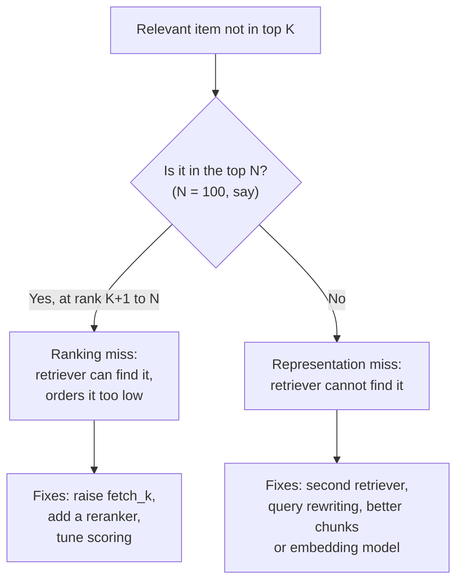

The [Recall@K lesson in Retrieval Fundamentals](/learn/retrieval-fundamentals/recall-k) defined the metric: the fraction of a query's relevant items that appear in the top $K$. It also covered macro and micro averaging, capped recall, the difference between relevance recall and approximate-nearest-neighbour recall, pooling, and a bootstrap interval. This lesson takes that definition as given and turns it into an evaluation instrument. A single Recall@5 figure tells you very little; a recall *curve* across many depths, read correctly, tells you how deep the candidate stage must go, whether misses are a ranking problem or a representation problem, and whether two retrievers would be stronger together.

You will also meet the hard case that the earlier lesson only touched on: estimating recall when nobody knows how many relevant items exist, because the collection is too large to judge. The code runs two real retrievers over the 300 test claims of the public SciFact benchmark and reads their recall curves to depth 100.

## Learning objectives

- Compute and plot a macro-averaged Recall@K curve and identify its slope, knee and ceiling.
- Choose a candidate depth from a recall curve using a stated target, and justify it.
- Attribute each retrieval miss to ranking (found beyond $K$) or representation (not found at any practical depth).
- Compare two retrievers at an equal candidate budget, including the union of their candidate lists.
- Estimate recall from a random sample of unretrieved items, with a confidence interval, and explain why the interval is wide.

## Prerequisites

- [Recall@K](/learn/retrieval-fundamentals/recall-k): the definition, macro averaging, judgements and pooling.
- [Candidate generation](/learn/retrieval-fundamentals/candidate-generation): why the first stage is judged on recall at its candidate depth.
- [BM25](/learn/sparse-retrieval/bm25) and [Dense vector search](/learn/dense-retrieval/dense-vector-search): the two retrievers compared in the code.

## Why this matters

Most retrieval decisions in a RAG system are depth decisions. How many candidates does the first stage hand to the reranker (`fetch_k`)? How many chunks reach the generator? Is it worth running a second retriever in parallel? Each of these is answered, or should be, by looking at how recall grows with depth. Teams that look at one Recall@K figure answer them by habit instead: `fetch_k=50` because a tutorial used it, five chunks because that fitted the prompt.

The failure that follows is predictable. A reranker is added, the answers barely improve, and the team concludes that rerankers do not help on their data. The real cause is that the relevant chunk was at rank 70 for a fifth of the queries, and the reranker only ever saw the top 20. No reranker can promote a chunk it was not given. A recall curve shows this in one glance; a single number at $K = 5$ hides it.

The second failure is subtler. When recall is low, teams raise $K$. But if the relevant chunk is not in the top 100 either, a deeper cut only adds noise to the context; that query needs a different representation. Telling these two cases apart is the core skill of retrieval evaluation, and the recall curve is the tool.

## The intuition

Imagine a search party looking for three lost walkers on a moor. They search in widening circles from the car park. After the first circle (radius 100 metres) they have found nobody. By the fifth circle they have found one walker; by the tenth, two. The third is never found, however far they walk, because she took a bus home.

Plot "walkers found" against "circles searched" and you have a recall curve. Its shape tells the coordinator three things:

- **The slope.** Early circles that find people are good value; later circles that find nobody are expensive and pointless.
- **The knee.** There is a point after which another circle rarely finds anyone. That is where to stop.
- **The ceiling.** Some walkers will never be found by searching this moor. More circles will not help; someone needs to check the bus station. In retrieval terms, those queries need a different method, not a larger $K$.

The coordinator also needs to know how many walkers there were; if that count is wrong, so is the fraction found. The last part of this lesson deals with that problem.

## How it works

### From a number to a curve

For one query $q$ with relevant set $R_q$, Recall@K is $|\text{Top}_K(q) \cap R_q| / |R_q|$. Computed at every $K$ from 1 to some depth $N$, it forms a staircase that steps up at each rank where a relevant item appears and is flat everywhere else. Averaged over queries (macro averaging, as in the fundamentals lesson), the staircases blend into a smooth, non-decreasing curve.

There is an efficient way to compute the whole curve. For each query, record the rank at which each relevant item first appears, or infinity if it is beyond $N$. Then Recall@K for that query is just the fraction of those ranks that are at most $K$. One retrieval to depth $N$ gives every Recall@K for $K \le N$, so a curve costs no more than its deepest point.

### Reading the curve

A recall curve has three features worth naming.

- **The ceiling**, $\text{Recall@}N$ for a generous depth $N$ such as 100. It is the best this retriever can do for any downstream stage that looks at no more than $N$ items. Whatever is missing at depth $N$ is, for practical purposes, invisible.
- **The slope** at small $K$, which says how well the retriever *orders* the items it can find. A steep start means relevant items tend to be near the top.
- **The knee**, where the curve flattens. Past it, each extra slot buys little recall and costs reranker time or context tokens.

To choose a candidate depth from the curve:

1. Fix the evaluation depth $N$ well beyond any depth you might deploy (100 is common for a first stage).
2. Compute the macro Recall@K curve for $K = 1 \dots N$ on your labelled test set.
3. State a target as a fraction of the ceiling, for example 90% or 95%, before looking at the result.
4. Take the smallest $K$ whose recall meets the target. That is the shortest candidate list that keeps almost everything this retriever can find.
5. Check the cost of that $K$ downstream (reranker latency per candidate, or context tokens), and if it is too high, decide whether to accept lower recall or to improve the retriever.

Stating the target before looking matters. Otherwise the knee is wherever you want it to be.

### Where misses come from

Every relevant item that is not in the top $K$ falls into exactly one of two groups, and they need different fixes.



- A **ranking miss** is an item the retriever finds, but below the cut. Raising `fetch_k` and adding a [reranker](/learn/reranking-fundamentals/why-reranking-is-needed) are the right tools: the item is in the candidate pool, it just needs promoting.
- A **representation miss** is an item the retriever does not find at any practical depth. The query and the item do not resemble each other in this retriever's representation: a vocabulary mismatch for BM25, a paraphrase or identifier problem for an embedding model. Depth will not fix it. A second retriever with a different representation, [query rewriting](/learn/advanced-retrieval/query-rewriting) or a different chunking might.

The proportion of each is a property of your system, and it changes what you should work on next. Measuring it needs nothing more than the first-appearance ranks you already computed for the curve.

### Complementarity and equal budgets

Two retrievers with similar curves can fail on quite different queries. A lexical retriever finds exact terms, codes and rare names; a dense retriever finds paraphrases. Counting, per query, which retriever misses it entirely at a given $K$ reveals whether their failures overlap. If they mostly do not, the [union of their candidate lists](/learn/hybrid-search/hybrid-retrieval-architecture) may recover far more than either alone.

Comparing a union fairly needs care. The union of two top-10 lists has between 10 and 20 items, so it must be compared with a single retriever at a similar number of candidates, not with each retriever at $K = 10$. Otherwise you are crediting the union with a larger budget rather than with complementarity. The reranker's cost depends on the number of candidates it scores, so equal candidate count is the honest axis.

### Document-level and chunk-level recall

Compute recall at the level of the judgements. If they are per document, map retrieved chunks to documents and de-duplicate first, or three chunks of one relevant document count as three hits. If they are per chunk, re-chunking invalidates them; labelling evidence as text spans avoids that, as [Chunk quality evaluation](/learn/chunking-optimisation/chunk-quality-evaluation) shows.

### When the denominator is unknown

Recall's denominator, $|R_q|$, assumes someone knows every relevant item. For a test set of focused questions over a few thousand chunks, pooling (judging the union of several systems' top results) gets close enough. But some RAG uses are recall-critical over a large corpus: "find every contract clause that mentions the old notice period", "every runbook that still refers to the retired VPN client". Missing one is the failure, and the relevant set may be large and unknown.

For these, you can **estimate** recall by sampling, an approach standard in legal e-discovery, where it is often called an *elusion* test:

1. Run the retriever and judge every item it returned. Call the number of relevant items found $f$.
2. The items it did *not* return form the **discard set**, of size $D$. Draw a simple random sample of $n$ of them and judge each one.
3. If $x$ of the sampled items are relevant, the **elusion rate** is $\hat{e} = x / n$: the estimated proportion of the discard set that is relevant.
4. The estimated number of missed relevant items is $\hat{e} \cdot D$, and the estimated recall is $f / (f + \hat{e} \cdot D)$.
5. Put a confidence interval on $\hat{e}$ (a binomial proportion) and carry its endpoints through the same formula to get an interval on recall.

The catch is that relevant items are usually rare in the discard set, and estimating a rare proportion precisely takes a large sample. The worked example below shows how wide the interval is with a sample of 500. Treat a recall estimate without its interval as meaningless in this setting.

### What a recall report should contain

Report the curve (or several depths including a deep one), the ceiling at a named depth, the number of test queries, the judgement level and method, the count of queries with nothing found at the ceiling, and an interval or paired comparison for any difference you claim. The fundamentals lesson's bootstrap applies unchanged to every point on the curve.

## The mathematics

**The recall curve.** For a test set $Q$, let $r_{q,j}$ be the rank at which the $j$-th relevant item of query $q$ first appears (infinite if beyond depth $N$). Then

$$
\text{Recall@}K = \frac{1}{|Q|} \sum_{q \in Q} \frac{1}{|R_q|} \sum_{j=1}^{|R_q|} \mathbf{1}[\,r_{q,j} \le K\,]
$$

where $\mathbf{1}[\cdot]$ is 1 when the condition holds and 0 otherwise. The inner sum counts relevant items found by depth $K$. Because each indicator can only switch from 0 to 1 as $K$ grows, the curve never decreases.

**The target depth.** With a ceiling $C = \text{Recall@}N$ and a target fraction $\alpha$ (say 0.9), the chosen depth is

$$
K_\alpha = \min\{\, K \le N : \text{Recall@}K \ge \alpha \cdot C \,\}
$$

**By hand.** One query has three relevant items, first appearing at ranks 2, 7 and 40. Recall@1 $= 0/3 = 0$. Recall@5 $= 1/3 = 0.333$ (only rank 2 is within 5). Recall@10 $= 2/3 = 0.667$. Recall@50 $= 3/3 = 1$. With $N = 50$ the ceiling is 1, and at $\alpha = 0.9$ the target is 0.9, first reached when the third item enters at $K = 40$: one query alone can push $K_\alpha$ deep.

**The elusion estimate.** With $f$ relevant items found in the retrieved set, a discard set of size $D$ and $x$ relevant in a random sample of $n$ from it:

$$
\hat{e} = \frac{x}{n}, \qquad \widehat{\text{Recall}} = \frac{f}{f + \hat{e}\, D}
$$

Because recall falls as $\hat{e}$ rises, the upper end of the interval on $\hat{e}$ gives the lower end of the interval on recall. For the interval on $\hat{e}$ use the **Wilson score interval**, which behaves sensibly for small counts where the textbook $\hat{p} \pm 1.96\sqrt{\hat{p}(1-\hat{p})/n}$ fails (with $x = 0$ that formula gives an interval of zero width):

$$
\frac{\hat{p} + \frac{z^2}{2n}}{1 + \frac{z^2}{n}} \pm \frac{z}{1 + \frac{z^2}{n}} \sqrt{\frac{\hat{p}(1-\hat{p})}{n} + \frac{z^2}{4n^2}}
$$

with $\hat{p} = x/n$ and $z = 1.96$ for 95%.

**By hand.** The retriever returned 200 items, all judged; $f = 45$ are relevant. The discard set holds $D = 9{,}800$ items. A random sample of $n = 500$ contains $x = 2$ relevant ones. Then $\hat{e} = 2/500 = 0.004$, the estimated number missed is $0.004 \times 9{,}800 = 39.2$, and the estimated recall is $45 / (45 + 39.2) = 0.534$. The Wilson interval on $\hat{e}$ is roughly $[0.0011, 0.0145]$, which maps to a recall interval of roughly $[0.24, 0.81]$. Two relevant items in a sample of 500 cannot pin recall down any better than that.

**In Python:**

```python
import numpy as np

# Recall curve for one query: relevant docs first appear at ranks 2, 7 and 40
depths = np.array([2, 7, 40])
for k in (1, 5, 10, 50):
    print(f"Recall@{k} = {(depths <= k).mean():.3f}")

# Elusion estimate of recall when the unretrieved set is too big to judge
found, retrieved = 45, 200          # judged every retrieved chunk: 45 relevant
discard = 9_800                     # chunks never retrieved
n, x = 500, 2                       # random sample of the discard, 2 judged relevant

def wilson(x, n, z=1.96):
    p = x / n
    centre = (p + z**2 / (2 * n)) / (1 + z**2 / n)
    half = z * np.sqrt(p * (1 - p) / n + z**2 / (4 * n**2)) / (1 + z**2 / n)
    return centre - half, centre + half

def recall_from_elusion(e):
    return found / (found + e * discard)

e = x / n
lo, hi = wilson(x, n)
print(f"elusion {e:.4f}, 95% interval [{lo:.4f}, {hi:.4f}]")
print(f"estimated missed: {e * discard:.1f}")
print(f"recall estimate {recall_from_elusion(e):.3f}, "
      f"95% interval [{recall_from_elusion(hi):.3f}, {recall_from_elusion(lo):.3f}]")
```

```output
Recall@1 = 0.000
Recall@5 = 0.333
Recall@10 = 0.667
Recall@50 = 1.000
elusion 0.0040, 95% interval [0.0011, 0.0145]
estimated missed: 39.2
recall estimate 0.534, 95% interval [0.241, 0.807]
```

To halve the width of that interval you need roughly four times the sample, because the standard error of a proportion shrinks with $\sqrt{n}$. When the stakes justify it, stratify the discard set (for instance by retriever score band, sampling more heavily just below the cut where relevant items are likelier) and weight the strata; Webber (2013) analyses the interval methods in detail.

## In code

**The problem.** Measure the recall curves of a lexical retriever (BM25) and a dense retriever (all-MiniLM-L6-v2) to depth 100 on a public benchmark with known judgements; find each one's ceiling and the depth that reaches 90% of it; count representation misses; and test whether the union of two short candidate lists beats one longer list at a similar budget.

**Dependencies.** pandas, NumPy, rank-bm25, sentence-transformers and huggingface_hub. The first run downloads the SciFact dataset (a few megabytes) and the MiniLM model (about 90 MB). No API key. Encoding 5,183 abstracts takes about a minute on a laptop CPU.

```bash
pip install pandas pyarrow numpy rank-bm25 sentence-transformers huggingface_hub
```

SciFact is one of the datasets in the BEIR benchmark: 5,183 scientific abstracts and 300 test claims, each judged against the abstracts that support or refute it. Most claims have one relevant abstract; some have several. The [Retrieval benchmarks](/learn/retrieval-evaluation/retrieval-benchmarks) lesson says more about where it comes from and its limits.

```python
import re
import numpy as np
import pandas as pd
from huggingface_hub import hf_hub_download
from rank_bm25 import BM25Okapi
from sentence_transformers import SentenceTransformer

def get(repo, path):
    return hf_hub_download(repo, path, repo_type="dataset")

corpus = pd.read_parquet(get("BeIR/scifact", "corpus/corpus-00000-of-00001.parquet"))
queries = pd.read_parquet(get("BeIR/scifact", "queries/queries-00000-of-00001.parquet"))
qrels = pd.read_csv(get("BeIR/scifact-qrels", "test.tsv"), sep="\t", dtype=str)
relevant = qrels.groupby("query-id")["corpus-id"].apply(set).to_dict()
queries = queries[queries["_id"].isin(relevant)].reset_index(drop=True)
doc_ids = corpus["_id"].to_numpy()
doc_texts = (corpus["title"] + ". " + corpus["text"]).tolist()
claims = queries["text"].tolist()
DEPTH = 100                                   # how deep we look for the ceiling

# --- two retrievers, each returning a ranked list of DEPTH doc ids per query ---
tok = lambda t: re.findall(r"[a-z0-9]+", t.lower())
bm25 = BM25Okapi([tok(t) for t in doc_texts])
bm25_runs = [doc_ids[np.argsort(-bm25.get_scores(tok(c)), kind="stable")[:DEPTH]] for c in claims]

model = SentenceTransformer("sentence-transformers/all-MiniLM-L6-v2", device="cpu")
model.max_seq_length = 256
D = model.encode(doc_texts, normalize_embeddings=True, batch_size=64)
Q = model.encode(claims, normalize_embeddings=True)
dense_runs = [doc_ids[row] for row in np.argsort(-(Q @ D.T), axis=1, kind="stable")[:, :DEPTH]]

def first_hit_depths(runs):
    """For each query and each relevant doc, the 1-based rank where it appears (inf if beyond DEPTH)."""
    out = []
    for qid, run in zip(queries["_id"], runs):
        pos = {d: i + 1 for i, d in enumerate(run)}
        out.append(np.array([pos.get(d, np.inf) for d in relevant[qid]]))
    return out

def recall_curve(depths, ks):
    """Macro-averaged Recall@K for every K in ks."""
    return np.array([np.mean([(d <= k).mean() for d in depths]) for k in ks])

ks = np.arange(1, DEPTH + 1)
report_ks = [1, 3, 5, 10, 20, 50, 100]
curves = {}
for name, runs in (("BM25", bm25_runs), ("MiniLM", dense_runs)):
    depths = first_hit_depths(runs)
    curve = recall_curve(depths, ks)
    curves[name] = (depths, curve)
    ceiling = curve[-1]
    k90 = int(ks[np.argmax(curve >= 0.9 * ceiling)])
    lost = sum(np.isinf(d).all() for d in depths)
    print(f"{name:<7}" + "  ".join(f"R@{k}={curve[k - 1]:.3f}" for k in report_ks))
    print(f"        ceiling R@{DEPTH}={ceiling:.3f}; 90% of ceiling first reached at K={k90}; "
          f"queries with nothing found by {DEPTH}: {lost}")

# --- complementarity: which queries does each retriever fully miss at K=10? ---
miss = {n: np.array([(d > 10).all() for d in dep]) for n, (dep, _) in curves.items()}
print(f"\nqueries with no relevant doc in top 10 -> BM25 only: {(miss['BM25'] & ~miss['MiniLM']).sum()}, "
      f"MiniLM only: {(miss['MiniLM'] & ~miss['BM25']).sum()}, both: {(miss['BM25'] & miss['MiniLM']).sum()}")

# --- equal candidate budget: one retriever at depth 20, or both at depth 10? ---
def recall_of(cands, qid):
    return len(set(cands) & relevant[qid]) / len(relevant[qid])

union = [recall_of(set(b[:10]) | set(d[:10]), qid) for qid, b, d in zip(queries["_id"], bm25_runs, dense_runs)]
sizes = [len(set(b[:10]) | set(d[:10])) for b, d in zip(bm25_runs, dense_runs)]
print(f"union of top 10 + top 10: recall {np.mean(union):.3f} from {np.mean(sizes):.1f} candidates on average")
```

The output below is from a CPU run with sentence-transformers 6.3 and rank-bm25 0.2. Small differences are possible with other versions.

```output
BM25   R@1=0.507  R@3=0.673  R@5=0.727  R@10=0.776  R@20=0.831  R@50=0.869  R@100=0.873
        ceiling R@100=0.873; 90% of ceiling first reached at K=11; queries with nothing found by 100: 35
MiniLM R@1=0.485  R@3=0.656  R@5=0.741  R@10=0.788  R@20=0.844  R@50=0.889  R@100=0.925
        ceiling R@100=0.925; 90% of ceiling first reached at K=19; queries with nothing found by 100: 22

queries with no relevant doc in top 10 -> BM25 only: 23, MiniLM only: 22, both: 38
union of top 10 + top 10: recall 0.865 from 16.8 candidates on average
```

**The important lines.**

- `first_hit_depths` is the heart of the evaluation. It turns a ranked list into one number per relevant document: where it first appears. Everything else (any Recall@K, the ceiling, the miss attribution) is derived from these numbers without retrieving again.
- `np.argsort(..., kind="stable")` makes ties deterministic. BM25 gives many documents a score of exactly zero, and an unstable sort would order them differently between runs.
- `recall_curve` macro-averages: per-query recall first, then the mean. A query with three relevant abstracts counts the same as a query with one.
- `np.argmax(curve >= 0.9 * ceiling)` finds the first $K$ meeting the target, because `argmax` on a Boolean array returns the first `True`.

**What the output means.**

- **The curves cross.** BM25 is ahead at $K \le 3$; MiniLM is ahead from $K = 5$ and pulls away at depth. SciFact claims share precise scientific vocabulary with their abstracts, which suits exact matching at the very top, while the dense model's advantage is in finding abstracts that use different wording, which tend to sit lower. A single Recall@5 comparison (0.727 against 0.741) would have called it a near tie and missed both facts.
- **The ceilings differ more than the curves at 10.** At depth 100, BM25 has 35 queries with nothing found at all, and MiniLM 22. These are representation misses: no depth fixes them for that retriever.
- **The knees differ.** BM25 reaches 90% of its ceiling at $K = 11$; MiniLM needs $K = 19$, because its ceiling is higher and it keeps finding relevant abstracts deeper. If MiniLM fed a reranker, a `fetch_k` of 10 would leave a noticeable part of its recall unused.
- **The failures overlap only partly.** Of the queries where at least one retriever finds nothing in its top 10, 23 are rescued by MiniLM, 22 by BM25, and 38 defeat both. That is the signature of complementary retrievers.
- **The union wins at equal budget.** The two top-10 lists merge into 16.8 candidates on average (some abstracts appear in both) and reach recall 0.865. MiniLM alone with 20 candidates reaches 0.844, and even at 50 candidates only 0.889. For a candidate stage feeding a reranker, two short lists beat one long one here. This is the measurement that justifies [hybrid search](/learn/hybrid-search/dense-versus-sparse-retrieval).

**Errors people commonly hit.**

- Computing Recall@K by retrieving separately for each $K$. It is slower and, with unstable tie-breaking, can even give a non-monotone curve. Retrieve once to the deepest $K$.
- Forgetting `queries["_id"].isin(relevant)`. SciFact's query file contains claims from other splits; queries with no judgements in the test split would divide by zero or be scored as failures.

**Extending it.** Plot both curves (`plt.plot(ks, curve)`) and mark each knee; add the paired bootstrap from the fundamentals lesson at $K = 10$ and $K = 100$; replace the union with [Reciprocal Rank Fusion](/learn/hybrid-search/reciprocal-rank-fusion) and compare at 17 candidates.

## A real-world example

The Platform team at Meridian added a cross-encoder reranker to AskMeridian and saw almost no improvement in answer quality. The first-stage dense retriever fed it 20 candidates. Before trying a larger reranker model, Tomás, an engineer on the team, built the recall curve on their 180-question test set to depth 100.

The curve settled the argument in an afternoon. The dense retriever's ceiling at 100 was well above its recall at 20, so a real share of relevant chunks sat between ranks 21 and 100 where the reranker never saw them. Those were ranking misses, and `fetch_k` was the fix. A separate group of questions had nothing relevant anywhere in the top 100. Tomás read them: almost all quoted an Atlas error code or a runbook number, such as "E-4021" or "NET-114", and the dense model blurred them with neighbouring codes. Those were representation misses, and no `fetch_k` would fix them.

The team stated a target before choosing: 95% of the dense ceiling. They raised `fetch_k` to the smallest depth that met it, which the reranker could score within its latency budget, and added a BM25 retriever whose top candidates were merged in. They re-measured on the union, at an equal candidate count, and recorded the ceiling and the number of zero-recall queries as release gates.

A month later, HR changed the carry-over rule and asked the team to find every chunk still describing the old one. With no labels, they judged everything the hybrid retriever returned, had HR staff judge a random sample of the remaining chunks, and reported the elusion estimate with its interval. The interval was wide, so they sampled again, more heavily in the score band just below the cut, before signing off.

## Common mistakes

- **Reporting one depth.** Recall@5 alone hides crossing curves and cannot tell a ranking problem from a representation problem.
- **Raising $K$ for representation misses.** If the relevant item is not in the top 100, a larger context only adds noise and tokens. Check the ceiling first.
- **Choosing the knee after looking.** Without a pre-stated target, the "knee" moves to wherever supports the decision someone already wanted.
- **Comparing a union with single retrievers at the same nominal $K$.** The union of two top-10 lists holds up to 20 items. Compare at an equal number of candidates.
- **Quoting an elusion-based recall estimate without its interval.** A point estimate from two positives in a sample of 500 is close to a guess.

## Best practices

- Pre-register the target (for example 95% of the ceiling) before choosing `fetch_k`.
- Split misses into ranking misses and representation misses, read a sample of each, and route them to the right fix.
- When considering hybrid retrieval, count complementary failures and compare unions at equal candidate budget.
- Track two numbers as regression gates: Recall@`fetch_k` and the count of queries with zero recall at the ceiling depth.
- For recall-critical searches over unjudged collections, estimate recall by elusion sampling, report the interval, and stratify the sample if it is too wide.

## Performance considerations

A recall curve is cheap to compute. Exact search to depth 100 costs the same similarity computation as depth 5; only the partial sort grows. With an approximate index a deeper list costs a little more (HNSW's search list must be at least $K$), but evaluation runs offline.

The expensive part of recall evaluation is human judgement. Pooling the top 20 of two retrievers for 200 queries means judging up to $200 \times 40 = 8{,}000$ query-item pairs before de-duplication. At, say, 30 seconds a pair (an assumption; it varies widely with item length and domain), that is about 67 hours. Pooling the top 10 instead halves it. Choose pool depth by the depth you deploy plus a margin, not by habit.

Elusion sampling costs $n$ judgements per estimate, and halving the interval width quadruples $n$.

## Summary

- One retrieval to depth $N$ yields the whole recall curve; compute it from the rank where each relevant item first appears.
- Read three features: the slope (ordering quality), the knee (where extra depth stops paying) and the ceiling (what the retriever can ever find).
- Misses beyond $K$ but within $N$ are ranking misses (raise `fetch_k`, rerank); misses beyond $N$ are representation misses (change the representation).
- Retrievers with similar curves can fail on different queries; compare unions at an equal candidate budget, as the SciFact run showed (0.865 from 16.8 candidates against 0.844 from 20).
- When the relevant set is unknown, estimate recall from a random sample of the discard set, and always report the interval, which is usually wide.

## Exercises

**1.** A query has four relevant chunks, first appearing at ranks 1, 6, 15 and beyond 100. Compute Recall@5, Recall@10, Recall@20 and Recall@100, and classify each miss at $K = 10$.

<details><summary>Show solution</summary>

Recall@5 $= 1/4 = 0.25$; Recall@10 $= 2/4 = 0.5$; Recall@20 $= 3/4 = 0.75$; Recall@100 $= 3/4 = 0.75$. At $K = 10$ two chunks are missing. The one at rank 15 is a ranking miss: the retriever finds it, below the cut, so a larger `fetch_k` plus a reranker can recover it. The one beyond 100 is a representation miss: depth will not help.

</details>

**2.** A retriever's curve on your test set has Recall@100 = 0.80, Recall@10 = 0.70 and Recall@20 = 0.73. Your target is 95% of the ceiling. Recall@40 = 0.76 is the first depth reaching it. The reranker costs 2 ms per candidate and the latency budget for reranking is 50 ms. What do you do?

<details><summary>Show solution</summary>

The target is $0.95 \times 0.80 = 0.76$, met at $K = 40$, which costs $40 \times 2 = 80$ ms: over the 50 ms budget. Within budget, the reranker can take at most 25 candidates, which gives a recall somewhere between 0.73 and 0.76. Options, in order of preference: accept that and record the shortfall; reduce reranking cost per candidate (a smaller model, shorter inputs, batching on a GPU); or improve the first stage's ordering so that the knee moves earlier. Raising the budget is a product decision, not an evaluation one. Do not quietly lower the target after seeing the result.

</details>

**3.** In an elusion test, the retrieved set contains $f = 120$ relevant chunks, the discard set has $D = 50{,}000$ chunks, and a sample of $n = 1{,}000$ contains $x = 0$ relevant ones. A colleague reports "recall = 1.0". What should the report say instead?

<details><summary>Show solution</summary>

With $x = 0$ the point estimate of elusion is 0, so the point estimate of recall is 1, but the Wilson interval on elusion is roughly $[0, 0.0038]$ for $n = 1{,}000$. The upper end implies up to about $0.0038 \times 50{,}000 = 190$ missed chunks, so recall could be as low as $120 / (120 + 190) \approx 0.39$. The honest report is "no relevant chunk found in a random sample of 1,000 from the discard set; 95% interval on recall roughly 0.39 to 1.0". A sample of zero positives shows that misses are rare, not that they are absent.

</details>

## Check your understanding

```quiz
[
  {
    "q": "Retriever A has Recall@5 = 0.74 and Recall@100 = 0.92. Retriever B has Recall@5 = 0.73 and Recall@100 = 0.87. Which statement is best supported?",
    "options": [
      "The retrievers are equivalent because their Recall@5 is nearly the same",
      "A can find more of the relevant items at depth, so it gives a reranker more to work with",
      "B is better because its recall grows less, which means it is more stable",
      "Recall@100 is meaningless because no system passes 100 chunks to the generator"
    ],
    "answer": 1,
    "why": "The ceiling at depth 100 is what a reranker fed 100 candidates can ever recover. Near-identical Recall@5 hides the difference in what each retriever can find."
  },
  {
    "q": "A relevant chunk is absent from the top 100 for a query. Which change is least likely to help?",
    "options": [
      "Adding a lexical retriever alongside the dense one",
      "Rewriting the query before retrieval",
      "Raising fetch_k from 20 to 40",
      "Re-chunking so the evidence is not split across chunks"
    ],
    "answer": 2,
    "why": "This is a representation miss. The chunk is not found at depth 100, so depth 40 will not find it either; the fix must change how query or chunk is represented."
  },
  {
    "q": "The union of BM25's top 10 and a dense retriever's top 10 averages 17 distinct candidates. What is the fair comparison?",
    "options": [
      "Each retriever alone at K = 10",
      "Each retriever alone at about 17 to 20 candidates",
      "Each retriever alone at K = 100",
      "The union is incomparable with single retrievers"
    ],
    "answer": 1,
    "why": "Downstream cost depends on candidate count. Comparing at equal budget credits the union for complementarity rather than for simply having more candidates."
  },
  {
    "q": "In an elusion test, why does the upper end of the interval on the elusion rate give the lower end of the interval on recall?",
    "options": [
      "Because the Wilson interval is asymmetric",
      "Because recall = f / (f + e D) falls as the elusion rate e rises",
      "Because the discard set is always larger than the retrieved set",
      "It does not; both ends map to the same end"
    ],
    "answer": 1,
    "why": "The estimated recall is a decreasing function of the elusion rate, so the largest plausible elusion corresponds to the smallest plausible recall."
  },
  {
    "q": "Judgements are at document level, and a retriever returns three chunks of the same relevant document in its top 5. How should Recall@5 count them?",
    "options": [
      "As three relevant items found",
      "As one relevant document found, after mapping chunks to documents and de-duplicating",
      "As zero, because chunks are not documents",
      "As three divided by the number of chunks in the document"
    ],
    "answer": 1,
    "why": "Recall must be computed at the level of the judgements. Counting each chunk would let a retriever inflate recall by returning many chunks of one document."
  }
]
```

## Further reading

- Manning, C. D., Raghavan, P. and Schütze, H. (2008). *Introduction to Information Retrieval*, chapter 8, "Evaluation in information retrieval". Cambridge University Press. [Online edition](https://nlp.stanford.edu/IR-book/).
- Thakur, N., Reimers, N., Rücklé, A., Srivastava, A. and Gurevych, I. (2021). *BEIR: A Heterogeneous Benchmark for Zero-shot Evaluation of Information Retrieval Models*. [arXiv:2104.08663](https://arxiv.org/abs/2104.08663). The source of the SciFact split used here, and of the observation that BM25 and dense models fail differently across domains.
- Wadden, D. and colleagues (2020). *Fact or Fiction: Verifying Scientific Claims*. EMNLP 2020. The original SciFact dataset.
- Webber, W. (2013). *Approximate recall confidence intervals*. ACM Transactions on Information Systems 31(1). Interval methods for sampled recall estimates.
- Voorhees, E. M. and Harman, D. K., editors (2005). *TREC: Experiment and Evaluation in Information Retrieval*. MIT Press. Pooling and test-collection construction.
