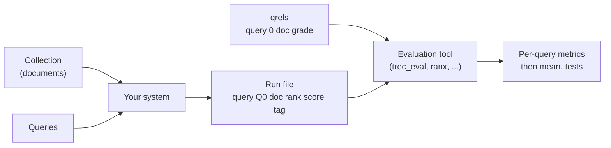

Every claim that one retriever or embedding model is better than another rests on a **benchmark**: a fixed set of queries, a fixed collection, and relevance judgements, scored with a metric. Public benchmarks let strangers compare systems on the same footing, which is why model cards and leaderboards quote them. They also tempt teams into a specific mistake: picking a model because of its rank on a benchmark that has little to do with their own documents.

This lesson covers the benchmarks a RAG engineer meets (MS MARCO, BEIR, MTEB's retrieval tasks, TREC-style test collections), what each does and does not measure, how benchmark scores go wrong (domain mismatch, contamination, tuning to the leaderboard), the standard file formats used to exchange runs and judgements, and how to build a small benchmark of your own. The code scores four retrievers on SciFact, a public BEIR dataset, and on a small Meridian set, and shows that the two disagree about which model is best.

## Learning objectives

- Describe what MS MARCO, BEIR, MTEB retrieval and TREC collections are, and the metric each is conventionally reported with.
- Explain zero-shot evaluation and why a benchmark score does not transfer automatically to your data.
- Identify the main threats to benchmark validity: domain shift, label incompleteness, contamination and leaderboard overfitting.
- Read and write the TREC run and qrels formats, and name the standard tools that consume them.
- Design a small in-house benchmark and use a public one only as a sanity check and a pilot.

## Prerequisites

- [NDCG](/learn/retrieval-evaluation/ndcg): the metric most benchmarks report.
- [Ranking quality](/learn/retrieval-evaluation/ranking-quality): significance tests and selection effects.
- [Embedding evaluation](/learn/embedding-optimisation/embedding-evaluation): evaluating embedding models on your own data.
- [Model selection](/learn/embedding-optimisation/model-selection): where benchmark scores enter the choice of a model.

## Why this matters

Choosing an embedding model, a reranker or a chunking strategy is expensive to reverse. Re-embedding a large collection costs compute and time, and a retrieval change that quietly hurts answers is hard to see in production. Public benchmarks give a cheap first signal and a common vocabulary, so a team that cannot read them is guessing.

But benchmarks answer a different question from yours. They measure retrieval over somebody else's documents and queries, labelled by somebody else's guidelines. A model that tops a leaderboard on scientific abstracts and web passages may rank below a simpler one on a company's HR handbook and error-code runbooks, as the code below shows on a deliberately small example. Teams that treat a benchmark rank as a purchasing decision learn this after migrating.

Benchmarks also age. Test sets leak into training data, models are tuned for the metric that the leaderboard rewards, and old datasets saturate: when the best systems are separated by less than the label noise, the benchmark has stopped discriminating. Knowing these failure modes is as important as knowing the names of the datasets.

## The intuition

A driving school publishes pass rates from its test route. The route is fixed: the same roads, the same junctions, the same examiner. Pass rates let you compare schools fairly, and that is the strength of a benchmark. But if you live in the mountains, the route's pass rate says little about how well you will cope on hairpin bends. And if a school drills only the test route until pupils can drive it blindfolded, the rate stops reflecting driving ability. The first is **domain shift**; the second is **overfitting to the benchmark**.

The sensible approach is to use the published route to filter out schools that cannot drive at all, then run your own short test on the roads you will use. A public benchmark is the published route; your own labelled questions are the local test.

## How it works

### The landscape

- **TREC collections.** The Text REtrieval Conference, run by NIST since 1992, produced the methodology that retrieval evaluation still uses: a document collection, a set of topics (queries), and relevance judgements made by assessors on a **pool** of documents drawn from the top results of participating systems. Its tracks are the origin of precision, recall, MAP and NDCG as standard measures. See the [Recall@K](/learn/retrieval-fundamentals/recall-k) lesson for pooling.
- **MS MARCO.** A large dataset of real search-engine queries with passages from web documents, released by Microsoft in 2016 (Nguyen and colleagues). The passage-ranking task has about 8.8 million passages, with sparse labels: most queries have one passage marked relevant. Its conventional metric is MRR@10. Because the training data is large, MS MARCO is also the dataset on which many retrievers and cross-encoders are trained, including the `ms-marco` cross-encoders used in this module's code.
- **BEIR.** A "heterogeneous benchmark" (Thakur and colleagues, 2021) that gathers existing retrieval datasets from different domains and tasks (the paper uses 18 datasets, among them fact checking, question answering, biomedical retrieval, argument retrieval and duplicate-question detection) and evaluates models **zero-shot**: trained on one dataset, typically MS MARCO, then tested on the others without fine-tuning. Its headline metric is nDCG@10. Its main finding is that BM25 is a strong baseline across domains, and that dense models trained on MS MARCO often fall behind it on data unlike what they were trained on, while rerankers and late-interaction models did better at higher compute cost.
- **MTEB.** The Massive Text Embedding Benchmark (Muennighoff and colleagues, 2022) covers many embedding tasks (classification, clustering, retrieval, semantic similarity and others) across many datasets and languages. Its **retrieval** tasks reuse BEIR datasets, scored with nDCG@10. Embedding-model leaderboards typically report an average across tasks, and a separate retrieval average.
- **Domain and language variants.** Benchmarks exist for specific domains and languages; check that one matches yours.

Treat these as families, not leaderboards to chase: the dataset list, scoring details and leaderboard rules change between versions, so check the current documentation before quoting any number.

### Zero-shot and why it matters

In a **zero-shot** evaluation the model has not been trained on the target dataset. That is also your deployment situation until you fine-tune ([Domain adaptation](/learn/embedding-optimisation/domain-adaptation)), so it is the right thing to measure. But a rank on the average over datasets need not hold on any single dataset, such as yours; the spread between datasets in the BEIR paper is the evidence.

### What a benchmark score hides

1. **Domain shift.** Scientific claims, web questions and forum duplicates differ from internal policy text and error codes in vocabulary, length and query style. A model's rank can reorder entirely, as the code shows.
2. **Incomplete labels.** Large collections cannot be fully judged, so unjudged documents count as irrelevant. A retriever that finds true but unjudged answers is penalised; this is the pooling bias discussed in [Recall@K](/learn/retrieval-fundamentals/recall-k). BEIR datasets differ in how complete their judgements are, so scores are not comparable across datasets.
3. **Contamination.** If benchmark documents, queries or labels appear in a model's training data, the score reflects memory more than retrieval skill. For public benchmarks scraped into large web corpora this is hard to rule out, and for models whose training data is not published, impossible to check.
4. **Leaderboard overfitting.** When many teams optimise for the same public test set, selection pressure produces gains that do not transfer, the same effect as picking the best of many configurations in [Ranking quality](/learn/retrieval-evaluation/ranking-quality).
5. **Saturation.** When top systems differ by less than the effect of label noise or annotator disagreement, the benchmark can no longer rank them reliably.
6. **Task mismatch.** A benchmark may measure document retrieval when you retrieve passages from long documents, or single-hop questions when yours are multi-part.

### Exchange formats and tools

Retrieval research standardised two plain-text formats, and nearly every tool reads them.

- **qrels** (relevance judgements): one line per judged pair, `query_id  0  document_id  grade`, whitespace-separated. The second column is an unused iteration field, conventionally 0. BEIR's qrels files are tab-separated with a header: `query-id`, `corpus-id`, `score`.
- **Run file** (a system's results): one line per retrieved document, `query_id  Q0  document_id  rank  score  run_tag`. The `Q0` is a constant; the score should decrease with rank, and evaluation tools usually sort by score and ignore the rank column, so a score that does not match the rank can silently reorder results.

These are the formats read by `trec_eval`, the long-standing NIST evaluation program, and by Python wrappers around it such as `pytrec_eval`, `ir_measures` and `ranx`. None of those packages is installed in this course's sandbox, so the code below uses the hand-written metrics from earlier lessons and only shows what a run file looks like. If you adopt one, validate it once against your own implementation on a small example, as for NDCG: libraries differ on ties, cutoffs and handling of queries without judgements.



### Building your own benchmark

An in-house benchmark is the only one that measures your problem. A workable procedure:

1. **Collect real questions.** Support-desk tickets, search logs and Slack questions are better than questions written from reading the documents, which reuse the documents' wording and make retrieval look easier than it is. Include the awkward kinds: paraphrases, identifiers, multi-part questions, and questions with no answer.
2. **Define the unit and the guideline.** Decide whether relevance is judged at the chunk, document or span level, and write the grades and hard-case rules, as in [Precision@K](/learn/retrieval-evaluation/precision-k).
3. **Pool candidates.** Run several different retrievers (lexical, dense, hybrid), take the union of their top results for each query, and judge that pool. This reduces the bias against new systems.
4. **Judge and check agreement.** Have two people judge a sample and compute kappa. Adjudicate disagreements.
5. **Split.** Keep a development set for exploration and a held-out set for final claims.
6. **Version and freeze.** Store queries, judgements and the guideline together under version control; record when documents change.
7. **Use a public benchmark as a pilot.** Run your pipeline on a related public dataset first to catch bugs in the harness (if your SciFact nDCG@10 is wildly different from published figures, your pipeline, not the model, is probably wrong), then switch to your own set for decisions.

How many queries? [Ranking quality](/learn/retrieval-evaluation/ranking-quality) and [Hit rate](/learn/retrieval-evaluation/hit-rate) give the arithmetic: a few hundred for differences of a few points; tens only for catching gross failures. More detail on set design is in [Test set construction](/learn/testing-and-benchmarking/test-set-construction).

### Reading a benchmark claim

Before believing "model X scores 0.72", ask which dataset and version, which metric and cutoff, whether the model may have trained on the test data, who ran the evaluation, and whether the gap is larger than the benchmark's own noise (a point or less is often within the variation from sequence length or tokenisation).

## The mathematics

Benchmarks add little new mathematics to the metrics, but two quantities are worth pinning down.

**Rank agreement between two benchmarks.** To ask whether a public benchmark predicts your own, compare how it ranks your candidate systems with how your data ranks them, using **Kendall's $\tau$**:

$$
\tau = \frac{C - D}{\binom{n}{2}}
$$

where $n$ is the number of systems, $C$ is the number of system pairs ordered the same way by both benchmarks (concordant) and $D$ the number ordered oppositely (discordant), and $\binom{n}{2} = n(n-1)/2$ is the total number of pairs. $\tau = 1$ means identical orderings, $-1$ reversed, and $0$ no association.

**By hand.** Four systems, A to D. Benchmark 1 orders them A, B, C, D. Benchmark 2 orders them B, D, A, C. There are $\binom{4}{2} = 6$ pairs. Pair by pair: (A,B) discordant (A above B on benchmark 1, below on 2); (A,C) concordant; (A,D) discordant; (B,C) concordant; (B,D) concordant; (C,D) discordant. So $C = 3$, $D = 3$ and $\tau = 0$.

**Precision of a benchmark mean.** The mean nDCG over $n$ queries has standard error $s/\sqrt{n}$, where $s$ is the standard deviation of per-query scores. For per-query nDCG near $s = 0.35$ (an assumption typical of retrieval scores spread between 0 and 1), $n = 300$ gives a standard error of $0.35/\sqrt{300} = 0.020$, so a 95% interval of about $\pm 0.04$. Differences between systems smaller than that, unpaired, are within noise; paired tests are more sensitive, as in [Ranking quality](/learn/retrieval-evaluation/ranking-quality).

**In Python:**

```python
import numpy as np
from scipy.stats import kendalltau

# Orders from the by-hand example, as scores (higher is better)
bench1 = {"A": 4, "B": 3, "C": 2, "D": 1}   # A, B, C, D
bench2 = {"B": 4, "D": 3, "A": 2, "C": 1}   # B, D, A, C
systems = list(bench1)
tau, _ = kendalltau([bench1[s] for s in systems], [bench2[s] for s in systems])
print("tau =", round(float(tau), 2))

s, n = 0.35, 300
print(f"standard error {s / np.sqrt(n):.3f}, 95% half-width {1.96 * s / np.sqrt(n):.3f}")
```

```output
tau = 0.0
standard error 0.020
95% half-width 0.040
```

## In code

**The problem.** Score four retrievers (BM25 and three small open embedding models) on a public benchmark, SciFact, and on a small Meridian benchmark of 18 labelled questions, then measure how well the public ranking predicts the in-house one. Write one system's SciFact results as a TREC run file.

**Dependencies.** pandas, NumPy, SciPy, rank-bm25, sentence-transformers and huggingface_hub. The first run downloads SciFact and the three embedding models (all-MiniLM-L6-v2, bge-small-en-v1.5 and e5-small-v2, roughly 90 to 130 MB each). No API key. Expect several minutes on a laptop CPU, dominated by encoding the 5,183 abstracts three times.

```bash
pip install pandas pyarrow numpy scipy rank-bm25 sentence-transformers huggingface_hub
```

E5 models expect `query: ` and `passage: ` prefixes, which the code applies; BGE and MiniLM need none for this use. The Meridian set is deliberately tiny and is **not** a good benchmark; it is there to show a mechanism, and its conclusions should not be generalised.

```python
import re
import numpy as np
import pandas as pd
from huggingface_hub import hf_hub_download
from rank_bm25 import BM25Okapi
from scipy.stats import kendalltau
from sentence_transformers import SentenceTransformer

# ---------------- public benchmark: BEIR SciFact (test split) ----------------
def get(repo, path):
    return hf_hub_download(repo, path, repo_type="dataset")

corpus = pd.read_parquet(get("BeIR/scifact", "corpus/corpus-00000-of-00001.parquet"))
queries = pd.read_parquet(get("BeIR/scifact", "queries/queries-00000-of-00001.parquet"))
qrels = pd.read_csv(get("BeIR/scifact-qrels", "test.tsv"), sep="\t", dtype=str)
sci = {
    "docs": dict(zip(corpus["_id"], corpus["title"] + ". " + corpus["text"])),
    "rel": qrels.groupby("query-id")["corpus-id"].apply(set).to_dict(),
}
sci["queries"] = {q: t for q, t in zip(queries["_id"], queries["text"]) if q in sci["rel"]}

# ---------------- in-house set: Meridian questions with labelled chunks ----------------
chunks = {
    "leave": "Annual leave is 25 days per year for full-time staff.",
    "parttime": "Part-time staff receive annual leave in proportion to their hours.",
    "carry": "Up to 5 unused leave days carry over and must be used by 31 March.",
    "public": "Public holidays are in addition to annual leave.",
    "request": "Leave requests go to your line manager through the HR portal.",
    "remote": "Staff may work remotely up to 3 days a week.",
    "budget": "The home-office equipment budget is £400.",
    "contract": "Contractors are not eligible for the home-office equipment budget.",
    "deadline": "Expenses must be submitted within 30 days.",
    "late": "Late expense claims need written approval from finance.",
    "receipt": "Any expense over £75 needs a receipt.",
    "approve": "Expense claims are approved by the finance department.",
    "password": "Passwords must be rotated every 90 days.",
    "vpn": "VPN is required on public Wi-Fi.",
    "e4021": "Atlas error E-4021: the VPN client is out of date; update it from the IT portal.",
    "e4012": "Atlas error E-4012: the VPN certificate has expired.",
    "laptop": "The laptop refresh cycle is 3 years.",
    "lost": "Report a lost laptop to the support desk at once.",
    "desk": "The support desk is open 08:00 to 18:00 UK time.",
    "sso": "Meridian Reports offers SAML single sign-on on the Enterprise plan.",
    "export": "Meridian Reports can export reports as PDF or CSV.",
}
labelled = {
    "I have 4 days of holiday left in December. Do I lose them?": {"carry"},
    "How much holiday do I get if I work three days a week?": {"parttime"},
    "Who signs off my time off?": {"request"},
    "Is Christmas Day taken out of my 25 days?": {"public"},
    "Can I buy a monitor for working at home on the company?": {"budget"},
    "I'm a contractor, can I get the home-office money?": {"contract"},
    "I forgot to claim a hotel from two months ago, can I still?": {"late"},
    "Do I need to keep the till slip for a £20 taxi?": {"receipt"},
    "Who approves expense claims?": {"approve"},
    "How often must I change my password?": {"password"},
    "Do I need the VPN in a coffee shop?": {"vpn"},
    "What does E-4012 mean?": {"e4012"},
    "VPN says client out of date": {"e4021"},
    "My computer was stolen, who do I tell?": {"lost"},
    "When will I get a new laptop?": {"laptop"},
    "When can I phone IT support?": {"desk"},
    "Can we log in to Reports with Okta?": {"sso"},
    "Can I get my report as a spreadsheet?": {"export"},
}
meridian = {
    "docs": chunks,
    "queries": {f"m{i}": q for i, q in enumerate(labelled)},
    "rel": {f"m{i}": r for i, r in enumerate(labelled.values())},
}

# ---------------- systems ----------------
def bm25_search(data, k=10):
    ids = list(data["docs"])
    tok = lambda t: re.findall(r"[a-z0-9£]+", t.lower())
    index = BM25Okapi([tok(data["docs"][d]) for d in ids])
    return {q: [ids[i] for i in np.argsort(-index.get_scores(tok(t)), kind="stable")[:k]]
            for q, t in data["queries"].items()}

def dense_search(name, q_prefix="", d_prefix=""):
    model = SentenceTransformer(name, device="cpu")
    model.max_seq_length = 256
    def search(data, k=10):
        ids = list(data["docs"])
        D = model.encode([d_prefix + data["docs"][d] for d in ids], normalize_embeddings=True, batch_size=64)
        qids = list(data["queries"])
        Q = model.encode([q_prefix + data["queries"][q] for q in qids], normalize_embeddings=True)
        top = np.argsort(-(Q @ D.T), axis=1, kind="stable")[:, :k]
        return {q: [ids[i] for i in row] for q, row in zip(qids, top)}
    return search

systems = {
    "BM25": bm25_search,
    "all-MiniLM-L6-v2": dense_search("sentence-transformers/all-MiniLM-L6-v2"),
    "bge-small-en-v1.5": dense_search("BAAI/bge-small-en-v1.5"),
    "e5-small-v2": dense_search("intfloat/e5-small-v2", "query: ", "passage: "),
}

def ndcg10(run, rel):
    scores = []
    for q, ranked in run.items():
        gains = np.array([d in rel[q] for d in ranked[:10]], dtype=float)
        disc = 1 / np.log2(np.arange(2, 12))
        scores.append((gains * disc).sum() / disc[:min(len(rel[q]), 10)].sum())
    return np.array(scores)

def write_trec_run(run, path, tag):
    with open(path, "w") as f:
        for q, ranked in run.items():
            for r, d in enumerate(ranked, start=1):
                f.write(f"{q} Q0 {d} {r} {1 / r:.4f} {tag}\n")   # score: any decreasing value

results = {}
for name, search in systems.items():
    sci_run, mer_run = search(sci), search(meridian)
    results[name] = (ndcg10(sci_run, sci["rel"]).mean(), ndcg10(mer_run, meridian["rel"]).mean())
    if name == "BM25":
        write_trec_run(sci_run, "scifact.bm25.run", "bm25")

table = pd.DataFrame(results, index=["SciFact nDCG@10", "Meridian nDCG@10"]).T
print(table.round(3).to_string())
tau, p = kendalltau(table.iloc[:, 0], table.iloc[:, 1])
print(f"\nKendall's tau between the two system orderings: {tau:.2f}")
print("first lines of the TREC run file:")
print("".join(open("scifact.bm25.run").readlines()[:3]), end="")
```

The output below is from one CPU run with sentence-transformers 6.3. Exact figures can differ slightly across library versions and hardware.

```output
                   SciFact nDCG@10  Meridian nDCG@10
BM25                         0.652             0.496
all-MiniLM-L6-v2             0.648             0.925
bge-small-en-v1.5            0.709             0.871
e5-small-v2                  0.677             0.821


Kendall's tau between the two system orderings: 0.00
first lines of the TREC run file:
1 Q0 10608397 1 1.0000 bm25
1 Q0 43385013 2 0.5000 bm25
1 Q0 40212412 3 0.3333 bm25
```

**The important lines.**

- `sci` and `meridian` are dictionaries with the same three keys (`docs`, `queries`, `rel`), so every system and metric function runs unchanged on either benchmark. This uniform shape is what a harness should provide.
- `ndcg10` builds the ideal from all judged items for the query and caps it at 10, as in the [NDCG lesson](/learn/retrieval-evaluation/ndcg). It is applied to both benchmarks.
- `dense_search` takes optional prefixes, because forgetting E5's `query: ` and `passage: ` markers is a common silent error that lowers its score without raising any exception.
- `write_trec_run` writes the six-column run format. The score column is a stand-in (1 divided by the rank) because only a decreasing value is needed; if you write real scores, make sure they never contradict the rank column.
- `kendalltau` compares the two orderings of the same four systems.

**What the output means.**

- **On SciFact the order is bge-small, e5-small, BM25, MiniLM.** nDCG@10 of 0.709, 0.677, 0.652 and 0.648. BM25 and MiniLM are essentially tied, consistent with the curves in the [Recall@K lesson](/learn/retrieval-evaluation/recall-k).
- **On the Meridian set the order is MiniLM, bge-small, e5-small, BM25.** nDCG@10 of 0.925, 0.871, 0.821 and 0.496. The model that was last-but-one on SciFact is first here, and BM25 is far behind because staff phrase questions in words the handbook does not use.
- **Kendall's $\tau$ is 0.00.** Of the six system pairs, three are ordered the same way by both benchmarks and three oppositely: the public benchmark has no predictive value for this ordering. This is a tiny sample (four systems, 18 questions, a corpus of 21 chunks); the honest reading is "the evidence does not support using SciFact rank to choose between these models for Meridian text", not "SciFact is useless" or "MiniLM is best".
- **The Meridian numbers are far less reliable than SciFact's.** With 18 queries, a single question moving from rank 1 to rank 2 changes nDCG@10 by about $0.37/18 = 0.02$, and the corpus has only 21 chunks, so most systems find the right chunk somewhere in the top ten. The ordering among the three dense models (0.925, 0.871, 0.821) could easily reverse on a different 18 questions. Use the set to see the mechanism, not to pick a winner.
- **The run file** shows what a system hands to an evaluation tool: query ID, the constant `Q0`, document ID, rank, score and a tag naming the run.

**Errors people commonly hit.**

- Forgetting E5's prefixes. The model still runs and returns vectors; its scores are simply lower.
- Writing a run file whose score column does not decrease with rank. Tools that sort by score will evaluate a different ranking from the one you wrote.
- Treating query IDs as integers in one file and strings in the other, so that no judgement matches. Read both as strings.
- Comparing your SciFact number with a published one without matching the corpus text (title plus abstract here), the sequence length (256 tokens here, truncating long abstracts) and the metric. Small differences are expected; large ones signal a bug.

**Extending it.** Add `BAAI/bge-reranker-base` over the top 20 of the best dense model on both benchmarks; double the Meridian question set with questions from real support tickets and see whether the Meridian ordering changes; use `ranx` or `pytrec_eval` (not run here) on the written run file and confirm they reproduce the BM25 SciFact nDCG@10 from your own code.

## A real-world example

The Platform team at Meridian was choosing an embedding model for a re-index of AskMeridian. Two candidates led the public leaderboard's retrieval average, and a third, smaller, was a few points behind. The proposal was to adopt the leader. Chiara, an engineer new to the team, asked what the leaderboard score measured and whether the team's own documents resembled it.

They did not. Leaderboard retrieval tasks were largely web, scientific and forum text, and the team's questions were short staff queries against policy paragraphs and runbook entries with error codes. Chiara built a benchmark from three months of support-desk questions: 250 questions, each judged on a pool made from the top 10 of BM25, the current model and both candidates, by two reviewers with a written guideline, after a pilot that fixed the guideline's treatment of superseded documents. She split it into 150 development and 100 held-out questions and ran SciFact first, to check the harness reproduced published figures within a small margin.

On the in-house set the leaderboard ranking did not hold: the smaller model matched the leader within the noise of a paired test, and a hybrid of BM25 and the smaller model beat all dense-only options on the identifier questions. The team adopted the smaller model with a lexical channel, saving index size and embedding cost, and kept the held-out set untouched for later releases. When a vendor's new model arrived with a headline benchmark gain, the answer to "should we switch?" became a one-hour run on the team's own set.

## Common mistakes

- **Choosing a model from a leaderboard average.** The average reflects datasets unlike yours; domain shift can reorder models entirely.
- **Treating unjudged documents as definitely irrelevant.** Incomplete labels penalise systems that find true but unlabelled answers.
- **Tuning on the benchmark's test set.** Repeated tuning against one test set selects for luck; hold out a separate final set.
- **Writing in-house questions from the documents.** They reuse the documents' words and make every retriever look better than it will on real queries.

## Best practices

- Use public benchmarks to shortlist and to validate your harness; make decisions on a benchmark built from your own questions and documents.
- Build the in-house set from real queries, pooled and judged under a written guideline, with measured annotator agreement.
- Keep a development set and a held-out set, version both with the guideline, and re-judge when the corpus changes materially.
- Check how well a public ranking predicts yours (Kendall's $\tau$ or simply list the pairs that flip) before relying on it.
- Exchange runs and judgements in TREC formats so any standard tool can re-score them, and validate a library against your own code once.

## Performance considerations

Running a benchmark is dominated by encoding the corpus. SciFact has 5,183 abstracts; encoding it with a small model takes about a minute on a laptop CPU, and the script above encodes it three times. Large benchmarks are another matter: MS MARCO's roughly 8.8 million passages at, say, 1,000 passages per second (an assumption for a small model on a GPU; CPUs are much slower) would take about 2.4 hours per model, and a hundred times that on a CPU at 10 per second. Cache embeddings keyed by model name, version, text and prefix so re-scoring costs nothing.

Storage follows from dimensions: $8.8\times10^{6} \times 384 \times 4$ bytes is about 13.5 GB of 32-bit vectors for a 384-dimension model, so a laptop cannot hold them all in memory. For a development loop, evaluate on a subsample of the corpus that keeps all judged documents plus a random sample of the rest, remembering that a smaller corpus makes retrieval easier and inflates scores, so use the subsample only to compare systems under identical conditions.

The in-house benchmark's cost is judging, not computing: 250 questions with pools of about 20 chunks is 5,000 judgements, roughly 40 hours at 30 seconds each (an assumption).

## Security considerations

Benchmarks drawn from real support tickets, chats or documents contain personal and confidential data. Strip or pseudonymise personal data before queries enter a shared benchmark, apply the same access controls to the test set as to the source systems, and do not send it to third-party hosted rerankers or judges without a data-processing agreement. Treat downloaded corpora as untrusted input if an LLM later judges relevance over them.

## Summary

- Public benchmarks (TREC collections, MS MARCO, BEIR, MTEB retrieval) give a shared yardstick, usually reported as nDCG@10 (MRR@10 for MS MARCO), and a first filter for choosing systems.
- Zero-shot evaluation measures transfer, and average scores hide large differences between datasets; in the SciFact and Meridian runs the system orderings had Kendall's $\tau$ of 0.
- Benchmark scores can mislead through domain shift, incomplete labels, contamination, leaderboard overfitting, saturation and task mismatch.
- Runs and judgements travel in the TREC run and qrels formats; validate any evaluation library against your own implementation once.
- Build an in-house benchmark from real queries, pooled, judged under a written guideline with measured agreement, and split into development and held-out sets; use public benchmarks to validate the harness and shortlist models.

## Exercises

**1.** Two benchmarks rank five systems as A B C D E and C A B E D. Compute Kendall's $\tau$.

<details><summary>Show solution</summary>

Number of pairs: $\binom{5}{2} = 10$. Benchmark 2 order: C, A, B, E, D. Check each pair in benchmark-1 order: (A,B) A before B in both: concordant. (A,C) benchmark 2 puts C first: discordant. (A,D) concordant. (A,E) concordant. (B,C) discordant. (B,D) concordant. (B,E) concordant. (C,D) concordant. (C,E) concordant. (D,E) E before D in 2: discordant. So $C = 7$, $D = 3$, $\tau = (7 - 3)/10 = 0.4$.

</details>

**2.** A run file line reads `q7 Q0 doc42 3 0.91 mysys` and the line after it reads `q7 Q0 doc17 4 0.95 mysys`. What will many evaluation tools do, and what is the fix?

<details><summary>Show solution</summary>

Many tools sort by score and ignore the rank column, so they will place doc17 (0.95) above doc42 (0.91), the opposite of the ranks written. Fix the writer so scores strictly decrease with rank (or write real scores in sorted order). Add a validation step that reads the file back and asserts per query that scores are non-increasing in rank order.

</details>

**3.** Modify the code to compute, for each system, the 95% half-width of its mean SciFact nDCG@10 from the per-query scores, and say which pairs of systems have overlapping intervals.

<details><summary>Show solution</summary>

`ndcg10` already returns the per-query array, so keep it instead of taking the mean immediately:

```python
scores = ndcg10(search(sci), sci["rel"])
half = 1.96 * scores.std(ddof=1) / np.sqrt(len(scores))
print(f"{name}: {scores.mean():.3f} +/- {half:.3f}")
```

With 300 queries and per-query standard deviation around 0.35 to 0.4, half-widths are about 0.04. Intervals for BM25 and MiniLM (0.652 and 0.648) overlap almost completely; bge-small (0.709) and BM25 overlap slightly; this is an unpaired view. A paired randomisation test on the per-query differences (as in [Ranking quality](/learn/retrieval-evaluation/ranking-quality)) is more sensitive and should be used for any decision.

</details>

**4.** Design decision: a vendor offers a new embedding model with a leaderboard retrieval average three points above your current model. Your documents are German-language contracts. Outline how you decide whether to switch.

<details><summary>Show solution</summary>

First check whether the leaderboard tasks include German and legal text and whether the vendor's model is multilingual; an English-dominated average says little. Build or extend an in-house benchmark of real contract questions (pooled over current, candidate and BM25 results, double-judged, with a guideline for superseded clauses), with a held-out split. Run both models and BM25 on it with the agreed primary metric and cutoff, and test the paired difference with a randomisation test and interval. Compare the difference with the smallest worthwhile effect and the migration cost (re-embedding the corpus, index size from dimensions, latency). Check contamination risk if the vendor's training data is undisclosed. Switch only if the in-house paired difference is both significant and larger than the agreed threshold.

</details>

## Check your understanding

```quiz
[
  {
    "q": "What does \"zero-shot\" mean in BEIR's evaluation?",
    "options": [
      "Models are evaluated with no queries",
      "Models are trained on one dataset (typically MS MARCO) and tested on others without fine-tuning on them",
      "Models are evaluated with a score of zero for unjudged documents only",
      "Models retrieve with zero latency"
    ],
    "answer": 1,
    "why": "Zero-shot tests transfer to data the model was not trained on, which resembles deploying a model on your own documents."
  },
  {
    "q": "On a public benchmark model A beats model B by two points, but on your own labelled questions B beats A. What is the most reasonable action?",
    "options": [
      "Trust the public benchmark because it has more queries",
      "Investigate, then prefer your own benchmark for the decision if it is well built (real queries, judged pool, held-out set)",
      "Average the two scores",
      "Discard your benchmark"
    ],
    "answer": 1,
    "why": "Your benchmark measures your documents and queries; a public result from a different domain is a weaker guide, provided yours is sound."
  },
  {
    "q": "Why can unjudged documents distort benchmark scores?",
    "options": [
      "They are always relevant",
      "They are treated as irrelevant, so a system that finds true but unjudged answers is penalised",
      "They make the corpus larger",
      "They change the query"
    ],
    "answer": 1,
    "why": "Unjudged documents count as irrelevant by convention, so labelling gaps bias scores, particularly against systems unlike those used to build the judgements."
  },
  {
    "q": "A run file lists, for one query, doc B at rank 1 with score 0.40 and doc A at rank 2 with score 0.80. A tool that sorts by score reports...",
    "options": [
      "B above A, as ranked",
      "A above B, ignoring the rank column",
      "An error in every case",
      "The average of both"
    ],
    "answer": 1,
    "why": "Many tools sort by score and ignore the rank column, so inconsistent scores silently change the ranking being evaluated."
  },
  {
    "q": "Two benchmarks order four systems identically except that the top two systems swap. What is Kendall's tau?",
    "options": ["1.0", "0.67", "0.0", "-0.67"],
    "answer": 1,
    "why": "Of six pairs, five are concordant and one discordant: (5 - 1) / 6 = 0.67."
  }
]
```

## Further reading

- Thakur, N., Reimers, N., Rücklé, A., Srivastava, A. and Gurevych, I. (2021). *BEIR: A Heterogeneous Benchmark for Zero-shot Evaluation of Information Retrieval Models*. [arXiv:2104.08663](https://arxiv.org/abs/2104.08663).
- Muennighoff, N., Tazi, N., Magne, L. and Reimers, N. (2022). *MTEB: Massive Text Embedding Benchmark*. [arXiv:2210.07316](https://arxiv.org/abs/2210.07316).
- Nguyen, T. and colleagues (2016). *MS MARCO: A Human Generated MAchine Reading COmprehension Dataset*. [arXiv:1611.09268](https://arxiv.org/abs/1611.09268).
- Wadden, D. and colleagues (2020). *Fact or Fiction: Verifying Scientific Claims*. EMNLP 2020. The SciFact dataset.
