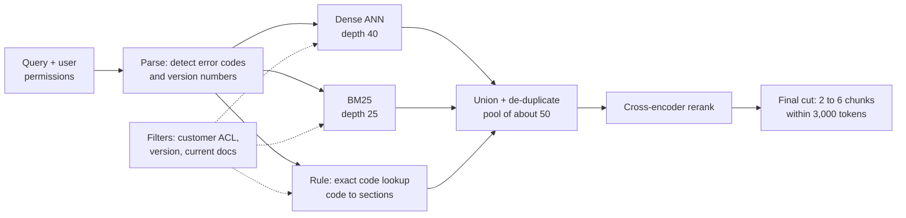

This assessment covers the whole Retrieval Fundamentals module: retrieval as ranking, query-document scoring functions and what their scores mean, the top-K cut, Recall@K and Precision@K, retrieval latency, and candidate generation in a retrieval cascade. It mixes quick recall with calculations, code-reading and production scenarios. Aim for at least 70% on the quiz (13 of 18) before moving on, and write an answer to every open question before opening its model answer. The coding exercises use only Python and NumPy and need no API key or model download.

```quiz
[
  {
    "q": "Which statement best distinguishes retrieval from a database lookup?",
    "options": [
      "Retrieval is always faster than a database query",
      "Retrieval returns a ranking by estimated relevance; a lookup returns the exact set of rows satisfying a predicate",
      "Retrieval only works on vectors; lookups only work on text",
      "A lookup can return an empty result; retrieval cannot be evaluated"
    ],
    "answer": 1,
    "why": "Retrieval is an estimate, ordered by confidence and judged statistically. A lookup has a correct answer defined by its predicate."
  },
  {
    "q": "The probability ranking principle says sorting by probability of relevance maximises the expected number of relevant results in the top k. Which situation breaks its assumption?",
    "options": [
      "Scores are cosine similarities rather than probabilities",
      "k is larger than 10",
      "The top two results are near-duplicates of the same paragraph",
      "The collection contains more than one million chunks"
    ],
    "answer": 2,
    "why": "The principle assumes each result's relevance is independent of the others shown. A duplicate adds little once its twin is present."
  },
  {
    "q": "Why can BM25 be served from an index while a cross-encoder cannot?",
    "options": [
      "BM25 decomposes into an inner product of a query term-count vector and precomputed document weights",
      "BM25 uses fewer parameters",
      "Cross-encoders output negative scores",
      "BM25 scores are bounded between 0 and 1"
    ],
    "answer": 0,
    "why": "Decomposability lets document representations be precomputed and stored in an inverted index. A cross-encoder needs a model pass per query-chunk pair."
  },
  {
    "q": "For query A the correct chunk has cosine 0.42. For query B, which no document answers, the top chunk also has cosine 0.42. What follows?",
    "options": [
      "A threshold of 0.42 separates answerable from unanswerable queries",
      "The embedding model must be retrained",
      "Both chunks are equally relevant to their queries",
      "No raw-score threshold can accept A's answer and reject B's non-answer"
    ],
    "answer": 3,
    "why": "Raw scores are comparable within one query, not across queries. Identical scores for an answer and a non-answer defeat any raw threshold."
  },
  {
    "q": "What does this print?\n```python\nscores = [0.9, 0.5, 0.4, 0.2]\ntop = max(scores)\nmm = [round((s - min(scores)) / (top - min(scores)), 2) for s in scores]\nprint(mm[0])\n```",
    "options": [
      "0.9",
      "1.0",
      "0.71",
      "It depends on whether the top chunk is relevant"
    ],
    "answer": 1,
    "why": "Min-max normalisation always maps the highest score in the list to 1.0, whether or not that chunk is relevant."
  },
  {
    "q": "Which property of the top-k cut guarantees that Recall@K never decreases as K grows?",
    "options": [
      "The top k is always contained in the top k+1",
      "Scores are normalised",
      "Approximate indexes are exact for large k",
      "Relevant chunks always score above 0.5"
    ],
    "answer": 0,
    "why": "Raising k only adds chunks below the old cut; it never removes any."
  },
  {
    "q": "An index is split across 10 shards and the application needs the top 20. How many results must each shard return for the merge to be exact?",
    "options": [
      "2",
      "10",
      "200",
      "20"
    ],
    "answer": 3,
    "why": "All of the global top 20 might live on one shard, so every shard must return its own top 20."
  },
  {
    "q": "A relative cut-off keeps chunks scoring at least 0.75 times the top score. On which queries does it most often lose needed evidence?",
    "options": [
      "Single-fact lookups",
      "Multi-part questions whose second part matches its chunk weakly",
      "Queries with exact identifiers",
      "Queries where all scores are high"
    ],
    "answer": 1,
    "why": "The weaker-matching part's chunk falls below the relative threshold, leaving half an answer."
  },
  {
    "q": "What does this print?\n```python\nranked = [\"x\", \"a\", \"y\", \"b\", \"z\"]\nrelevant = {\"a\", \"b\", \"c\"}\nk = 4\nprint(round(len(set(ranked[:k]) & relevant) / len(relevant), 3))\n```",
    "options": [
      "0.5",
      "0.667",
      "0.4",
      "1.0"
    ],
    "answer": 1,
    "why": "This is Recall@4: two of the three relevant chunks (a and b) are in the top 4, giving 2/3."
  },
  {
    "q": "A vector database reports \"recall@10 = 0.98\" for its HNSW index. What does this measure?",
    "options": [
      "How faithfully the approximate index reproduces the exact nearest neighbours under the same embeddings",
      "The fraction of user questions answered correctly",
      "The fraction of relevant chunks found according to human judgements",
      "Precision of the top 10"
    ],
    "answer": 0,
    "why": "That is ANN recall, measured against brute-force search. It says nothing about relevance to users."
  },
  {
    "q": "Every query in a test set has exactly one relevant chunk. A retriever's macro Precision@5 is 0.2. What can you conclude?",
    "options": [
      "80% of its results are wrong, so it is poor",
      "Its Recall@5 is 0.2",
      "It places the relevant chunk in the top 5 for every query",
      "It should use k = 1"
    ],
    "answer": 2,
    "why": "The ceiling for Precision@5 with one relevant chunk is 1/5 = 0.2, reached only if every query's relevant chunk is in its top 5."
  },
  {
    "q": "A judgement set was built by labelling the old retriever's top 20 results. A new retriever surfaces several relevant chunks nobody judged. How are its recall and precision affected?",
    "options": [
      "Both are overestimated",
      "Recall is overestimated, precision underestimated",
      "Neither is affected",
      "Both are underestimated, because unjudged chunks count as irrelevant"
    ],
    "answer": 3,
    "why": "Unjudged chunks are conventionally treated as irrelevant, so the new retriever gets no credit for them in either metric."
  },
  {
    "q": "Retriever B beats A by 0.05 in Recall@10 on 30 queries, with a paired bootstrap 95% interval of -0.02 to +0.12. What is the right reading?",
    "options": [
      "The data are consistent with no difference; more queries are needed",
      "B is better by 5 points",
      "A is better",
      "The bootstrap does not apply to recall"
    ],
    "answer": 0,
    "why": "An interval that includes zero means the observed gap could plausibly be noise from a small sample."
  },
  {
    "q": "Ten latencies (ms) are 10, 11, 11, 12, 12, 13, 14, 15, 30, 120. Which summary best describes the typical request?",
    "options": [
      "The mean, 24.8 ms",
      "The maximum, 120 ms",
      "The median, 12 ms",
      "The minimum, 10 ms"
    ],
    "answer": 2,
    "why": "Latency is right-skewed; the median describes the typical request and high percentiles describe the tail."
  },
  {
    "q": "What does this print?\n```python\nprint(round(1 - 0.99 ** 50, 2))\n```",
    "options": [
      "0.5",
      "0.01",
      "0.61",
      "0.39"
    ],
    "answer": 3,
    "why": "0.99 to the power 50 is about 0.605, so the chance that at least one of 50 shards is in its slowest 1% is about 0.39."
  },
  {
    "q": "A reranker has a mean service time of 20 ms. Under the M/M/1 model, what is its mean response time at 80% utilisation?",
    "options": [
      "100 ms",
      "24 ms",
      "36 ms",
      "16 ms"
    ],
    "answer": 0,
    "why": "W = S / (1 - rho) = 20 / 0.2 = 100 ms. Waiting dominates near capacity."
  },
  {
    "q": "Candidate Recall@50 is 0.70 and final Recall@5 after reranking is 0.66. A colleague wants a larger reranker. What is the most that change can gain in final recall?",
    "options": [
      "0.34",
      "0.04",
      "0.30",
      "It is unbounded"
    ],
    "answer": 1,
    "why": "The pool's recall (0.70) is a ceiling on any later stage, so a perfect reranker could gain at most 0.04. The problem is mostly upstream."
  },
  {
    "q": "Two candidate generators have Recall@20 of 0.80 and 0.50; their union has 0.81. What does this tell you?",
    "options": [
      "The second generator finds most of what the first misses",
      "The union was computed incorrectly",
      "Their misses are highly correlated, so the second generator adds almost nothing",
      "The pool should be cut before reranking"
    ],
    "answer": 2,
    "why": "The union barely exceeds the stronger generator, so the second generator rarely finds anything the first missed."
  }
]
```

## Conceptual questions

**1.** Explain the difference between an information need, a query, and a relevance judgement, using a Meridian example. Then explain why a chunk can be highly relevant and still harmful to an answer.

<details><summary>Show model answer</summary>

An **information need** is what the person wants to know: "may I carry my eight unused leave days into next year, and until when?". The **query** is the text they type to express it: "holiday rollover". A **relevance judgement** is a person's assessment, made offline for evaluation, of whether a particular chunk helps satisfy the need behind a test query: the chunk "Up to 5 unused leave days carry over and must be used by 31 March" is judged relevant.

A chunk can be topically relevant and still harmful when it is **incorrect or out of date**. The superseded 2023 handbook's statement that the laptop refresh cycle is 4 years is highly relevant to "how often do I get a new laptop?" and wrong. Similarity cannot detect this; version metadata and filtering can. A chunk can also be relevant but **useless** ("leave policy is described in section 4"), consuming a context slot without supplying the facts the answer needs.

</details>

**2.** A colleague says: "BM25 and embeddings are completely different technologies, so we need completely different infrastructure to search them." Explain in what precise sense they are the same, and in what sense their infrastructure differs.

<details><summary>Show model answer</summary>

Both are **decomposable scoring functions**: the score is an inner product $\langle \phi(q), \psi(d) \rangle$ of a query representation and a precomputed document representation. For BM25, $\phi(q)$ holds query term counts and $\psi(d)$ holds per-term weights (IDF times the saturated, length-normalised term frequency); for a dense model both are embedding vectors. That shared structure is what lets both be indexed and served at scale.

The infrastructure differs because the vectors differ. BM25's vectors are **sparse** (vocabulary-sized, mostly zeros), so an inverted index stores, for each term, the documents with a non-zero weight, and a query reads only its terms' lists; this is exact. Dense vectors are **short and fully populated**, so there is no list to skip to; finding the largest inner products quickly needs approximate nearest-neighbour structures such as HNSW or IVF, which trade a little ANN recall for speed. Many databases now host both kinds of index side by side, but they are different data structures.

</details>

**3.** Why is it wrong to tune a single `k` for a pipeline that has a reranker? Describe how you would choose `fetch_k` and the final `k` separately, naming the metric each is chosen by.

<details><summary>Show model answer</summary>

The two cuts have different jobs and different consumers. `fetch_k` feeds a reranker that examines every candidate carefully and cheaply per item, so its job is to make sure relevant chunks survive: it should be chosen by **candidate Recall@fetch_k**, as the depth at which the recall curve flattens on a labelled set, subject to the reranker's latency budget (cost is roughly linear in `fetch_k`). The final `k` feeds the generator, which reads, pays for and can be misled by everything, so it should be chosen by **precision and answer quality at the final cut**, subject to keeping the Recall@k that answers need (multi-part questions need more than one chunk), and capped by a token budget.

A single `k` forces a compromise: large enough to catch low-ranked relevant chunks, small enough to keep the prompt clean. It achieves neither well.

</details>

**4.** Explain why fan-out to many shards worsens tail latency, and why an M/M/1-style queue explains latency spikes at peak traffic. What would you measure to tell the two causes apart in production?

<details><summary>Show model answer</summary>

**Fan-out:** a sharded query waits for the slowest shard. If each shard independently has probability $p$ of a slow response, the chance that at least one of $n$ is slow is $1 - (1-p)^n$, which grows quickly with $n$ (about 0.63 for $p = 0.01$, $n = 100$). The rare per-shard tail becomes the common per-query experience. This happens at any load.

**Queueing:** under load, requests wait for a free worker. In the M/M/1 model, mean time in the system is $S / (1 - \rho)$; it grows sharply as utilisation $\rho$ approaches 1. At peak traffic, a busy stage's latency rises because of waiting, not working.

To distinguish them: per-stage, per-shard tracing. Fan-out shows as query latency driven by one or a few slow shards in each trace, independent of overall traffic. Queueing shows as latency rising with request rate and stage utilisation (CPU or worker busy-time near 100%), with time spent before processing starts (queue wait) growing while the processing time itself stays roughly constant.

</details>

**5.** What is the difference between a candidate miss and a ranking miss? Give one fix appropriate to each, and explain why classifying failures this way saves engineering time.

<details><summary>Show model answer</summary>

A **candidate miss** is a relevant chunk that never entered the candidate pool; a **ranking miss** is a relevant chunk that was in the pool but was cut by a later stage (reranker, filter, final `k`).

Candidate-miss fixes are upstream: add a generator with different failure modes (BM25 for identifiers), improve the embedding model or chunking, rewrite or expand the query, or increase generator depth if the recall curve is still rising. Ranking-miss fixes are downstream: a better or better-configured reranker, metadata filters that remove superseded or ineligible chunks before ranking, or a larger final `k` (for multi-part questions).

Because the pool's recall is a ceiling on any later stage, effort spent on the wrong stage is wasted: a bigger reranker cannot fix a chunk it never sees, and a deeper pool cannot fix a reranker that discards the right chunk. Classifying each lost chunk tells you which stage to work on before anything is changed.

</details>

## Coding exercises

**1. An evaluation function.** Write `evaluate(run, qrels, ks)` that returns macro Recall@K and Precision@K for each K. `run` maps each query id to a ranked list of chunk ids; `qrels` maps each query id to its set of relevant chunk ids, possibly empty. Recall must skip queries with no relevant chunks; precision must include them. Test it on four queries, one unanswerable.

<details><summary>Show solution</summary>

```python
import numpy as np

def recall_at_k(ranked, relevant, k):
    return len(set(ranked[:k]) & relevant) / len(relevant)

def precision_at_k(ranked, relevant, k):
    return len(set(ranked[:k]) & relevant) / k

def evaluate(run, qrels, ks=(1, 3, 5)):
    answerable = [q for q in qrels if qrels[q]]
    report = {}
    for k in ks:
        report[f"R@{k}"] = np.mean([recall_at_k(run[q], qrels[q], k) for q in answerable])
        report[f"P@{k}"] = np.mean([precision_at_k(run[q], qrels[q], k) for q in qrels])
    return report

qrels = {
    "q1": {"leave-1", "leave-2"},
    "q2": {"exp-2"},
    "q3": {"it-3"},
    "q4": set(),                         # unanswerable: no relevant chunk
}
run = {
    "q1": ["leave-2", "remote-1", "leave-1", "exp-1", "sec-1"],
    "q2": ["exp-1", "remote-2", "it-2", "exp-2", "leave-1"],
    "q3": ["it-3", "it-2", "it-1", "old-1", "sec-2"],
    "q4": ["leave-1", "leave-2", "remote-1", "it-3", "exp-1"],
}
for name, value in evaluate(run, qrels).items():
    print(f"{name} = {value:.3f}")
```

```output
R@1 = 0.500
P@1 = 0.500
R@3 = 0.667
P@3 = 0.250
R@5 = 1.000
P@5 = 0.200
```

Recall is averaged over the three answerable queries and precision over all four. Check R@3 by hand: q1 has both relevant chunks in its top 3 (1.0), q2's relevant chunk is at rank 4 (0.0), q3's is at rank 1 (1.0), so $(1 + 0 + 1)/3 = 0.667$. P@3: $(2/3 + 0 + 1/3 + 0)/4 = 0.25$. The unanswerable q4 contributes 0 to every precision value, which is the cost of always returning $k$ chunks.

</details>

**2. A correct sharded merge.** Write `merge_shards(shard_results, k)` that merges per-shard top-k lists into the global top k, breaking score ties deterministically by chunk id. Demonstrate that it is exact when each shard returns k results, and wrong when shards return fewer.

<details><summary>Show solution</summary>

```python
import heapq

def merge_shards(shard_results, k):
    """shard_results: one list of (chunk_id, score) per shard, each that shard's top k."""
    pooled = [hit for results in shard_results for hit in results]
    # highest score first; ties broken by chunk id so every replica agrees
    best = heapq.nsmallest(k, pooled, key=lambda hit: (-hit[1], hit[0]))
    return [cid for cid, _ in best]

def shard_search(shard, k):
    return heapq.nsmallest(k, shard.items(), key=lambda kv: (-kv[1], kv[0]))

shards = [
    {"a1": 0.91, "a2": 0.88, "a3": 0.80, "a4": 0.80},
    {"b1": 0.80, "b2": 0.30},
    {"c1": 0.65},
]
k = 4
print("merged top 4:", merge_shards([shard_search(s, k) for s in shards], k))
print("too shallow: ", merge_shards([shard_search(s, 2) for s in shards], k))
```

```output
merged top 4: ['a1', 'a2', 'a3', 'a4']
too shallow:  ['a1', 'a2', 'b1', 'c1']
```

The key `(-score, chunk_id)` sorts by descending score and then ascending id, so the three chunks tied at 0.80 (a3, a4, b1) are ordered the same way on every run and every replica. With each shard returning 4, the merge is the true top 4: a1, a2, then a3 and a4, which win the tie with b1 on id. With each shard returning only 2, a3 and a4 never leave shard 0, and the merge wrongly includes b1 and c1.

</details>

**3. Fan-out tail simulation.** Simulate a shard whose latency is normally about 10 ms but which stalls for an extra 60 ms on 2% of calls. For 1, 8 and 32 shards, compute the query's p50, p95 and p99 when it waits for the slowest shard, and compare with the predicted probability that at least one shard stalls.

<details><summary>Show solution</summary>

```python
import numpy as np

rng = np.random.default_rng(1)
# Simulated per-shard latencies in ms: mostly ~10 ms, 2% of calls hit a 60 ms stall.
def shard_latency(size):
    base = rng.normal(10, 1.5, size)
    stall = rng.random(size) < 0.02
    return np.where(stall, base + 60, base)

for n in (1, 8, 32):
    per_query = shard_latency((50_000, n)).max(axis=1)      # wait for the slowest shard
    p50, p95, p99 = np.percentile(per_query, [50, 95, 99])
    print(f"{n:>2} shards: p50 {p50:5.1f}  p95 {p95:5.1f}  p99 {p99:5.1f} ms   "
          f"predicted P(any stall) = {1 - 0.98 ** n:.2f}")
```

```output
 1 shards: p50  10.0  p95  12.8  p99  70.0 ms   predicted P(any stall) = 0.02
 8 shards: p50  12.3  p95  70.7  p99  72.3 ms   predicted P(any stall) = 0.15
32 shards: p50  14.4  p95  72.1  p99  73.2 ms   predicted P(any stall) = 0.48
```

With one shard, stalls affect 2% of queries, so they appear only at p99 (about 70 ms). With 8 shards, about 15% of queries hit at least one stall, so the p95 jumps to the stall level. With 32 shards, nearly half do, and even the p50 creeps up because the maximum of 32 normal draws is larger than one. The stall rate per shard did not change; only the fan-out did.

</details>

## Architecture design challenge

Meridian is extending AskMeridian to answer questions about Atlas from customer-facing support staff. The corpus will be about 2 million chunks: product documentation, the error-code catalogue (codes such as E-4021), release notes for every version, and resolved support tickets. Questions arrive in three forms: natural-language how-to questions, pasted error messages and codes, and questions about a specific release ("does 7.3 still support SAML on the Enterprise plan?"). Some tickets belong to specific customers and may only be retrieved by staff assigned to that customer. The target is a p95 retrieval latency of 400 ms at a peak of 60 queries per second, and the final context must not exceed 3,000 tokens.

Design the retrieval stage: candidate generators, filters, pool size, reranking, the final cut, and how you would evaluate it before launch.

<details><summary>Show reference design</summary>



**Candidate generators.** Dense ANN (HNSW) at depth about 40 for how-to questions. BM25 at depth about 25 for pasted error messages and exact product terms. A rule-based generator that fires when the parser detects a code matching the catalogue's pattern and looks it up directly. Each generator is judged by its unique contribution on a labelled set; depths are set at the knee of the union's recall curve.

**Filters inside every generator.** Customer-specific tickets carry an access-control field; the user's assignments become a filter applied during search in all three generators, so restricted text never enters the pool or the reranker. A detected version number becomes a filter or boost on release-note version metadata. Superseded documentation is excluded by status.

**Pool and reranking.** The union, de-duplicated, is typically 40 to 60 chunks. At an assumed 1.5 ms per pair on the chosen hardware, 60 pairs is about 90 ms, leaving budget for the generators (run in parallel, tens of milliseconds), the query embedding and the network. If measurement shows the reranker cannot hold its p95 at 60 queries per second, add workers until peak utilisation is comfortably below 1 (queueing grows sharply near capacity), or use a GPU.

**Final cut.** A floor of 2 and a ceiling of 6 chunks, filled in reranked order up to 3,000 tokens, so multi-part questions keep their second chunk while single-fact lookups stay short.

**Evaluation before launch.** A labelled set of a few hundred real support questions, stratified by the three query types and including some with no answer, with judgements extended to every candidate's unjudged chunks. Report per type: candidate Recall@pool, final Recall@k and Precision@k (with ceilings), and the classification of lost chunks into candidate and ranking misses. Bootstrap intervals for every comparison. A load test at 60 queries per second with an open-loop generator, reporting per-stage p50, p95 and p99 against a latency budget.

**Trade-offs.** Three generators cost more memory and operational work than one, justified only by their measured unique contributions. Pre-filtering by customer needs an index that searches efficiently within a filtered subset; if the number of customers is large, per-tenant partitions may be simpler. A deeper pool improves recall at a linear reranking cost. Version filtering is precise but brittle if release notes are mislabelled, so a boost may be safer than a hard filter at first.

</details>

## Troubleshooting scenarios

**1.** After a re-chunking project, AskMeridian's offline Recall@5 on the labelled set falls from 0.86 to 0.41 overnight, but spot checks of answers look fine. What is the most likely cause, and how do you confirm and fix it?

<details><summary>Show diagnosis and fix</summary>

The most likely cause is that the **relevance judgements reference chunk ids that no longer exist**. Re-chunking assigns new ids, so the retriever now returns chunks the judgements do not know; they count as irrelevant, and recall collapses even though retrieval may be as good as before (which is why answers look fine).

Confirm: check what fraction of the top-5 results have any judgement (the judged fraction). If it fell sharply, the judgements are stale. Also check whether judged ids still exist in the index.

Fix: store judgements against stable identifiers (document id plus a character span, or a content hash), and map them to the new chunks after every re-chunking: a new chunk is relevant if it contains the judged span. Then re-run the evaluation; only after that compare old and new chunking.

</details>

**2.** Users report that AskMeridian sometimes answers the same question differently when asked twice in a row. Retrieval logs show that the fifth chunk in the context differs between the two runs, while chunks 1 to 4 are identical. Nothing has been deployed. What is happening, and what do you change?

<details><summary>Show diagnosis and fix</summary>

The fifth and sixth candidates are probably **tied or nearly tied** at the cut, and the order between them is decided by something non-deterministic: which shard or replica answered first, the sort's handling of equal keys, or an approximate index's search path. Duplicate or near-duplicate chunks (identical embeddings) make exact ties common.

Check the logged scores of ranks 5 and 6 in both runs; equal or almost equal scores confirm it. Fixes: break ties explicitly (sort by score, then chunk id) in the merge and the final cut; de-duplicate near-identical chunks at indexing time so ties of that kind disappear; ensure each shard returns a full $k$ so merges are exact; and if replicas serve from indexes built at different times, make sure they are built from the same snapshot.

</details>

**3.** During the 09:00 peak, p95 retrieval latency rises from 250 ms to 1.4 seconds; at noon it is back to normal. The vector database's dashboard shows steady search times all day. Traces show the time is spent in the reranking stage, but per-request reranking compute time is unchanged at peak. Diagnose and fix.

<details><summary>Show diagnosis and fix</summary>

The reranker's **compute** time is constant but its **latency** rises at peak, so requests are waiting, not working: a queueing problem. At 09:00 the arrival rate pushes the reranker's utilisation close to 1, and waiting time grows roughly as $S / (1 - \rho)$. The vector database is not involved, as its steady numbers show.

Confirm by plotting reranker queue wait (time from arrival to start of processing) and worker utilisation against request rate across the day.

Fixes, in order of preference: add reranker workers (or a GPU) so peak utilisation stays well below 1, sized with Little's law and the peak arrival rate; reduce work per request by lowering `fetch_k` to the depth at which candidate recall stops improving, or by capping input length; use a shared queue in front of all workers rather than one per worker; and set a timeout with a fallback (return the first-stage order) so the tail is bounded even when the reranker is saturated.

</details>
