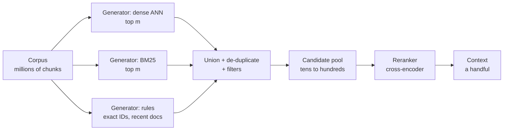

The lessons in this module have circled one idea: a single scoring function cannot be both cheap enough to run over every chunk and careful enough to rank the best few correctly. [Query-document similarity](/learn/retrieval-fundamentals/query-document-similarity) showed why (only decomposable scorers can be indexed), [Top-K retrieval](/learn/retrieval-fundamentals/top-k-retrieval) introduced the two cuts, and [Recall@K](/learn/retrieval-fundamentals/recall-k) and [Precision@K](/learn/retrieval-fundamentals/precision-k) gave each cut its own metric. This lesson puts them together under the name the industry uses for the first stage: **candidate generation**.

Candidate generation means treating first-stage retrieval not as "find the answer" but as "produce a short list that almost certainly contains the answer, cheaply". That reframing changes what you optimise, how you combine retrievers, how deep you search and how you diagnose failures. You will build a two-generator candidate stage feeding a reranker, measure each layer, and classify every lost chunk as a candidate miss or a ranking miss.

## Learning objectives

- Describe a retrieval cascade and state the objective of its candidate-generation stage.
- Prove that a later stage's recall can never exceed the candidate stage's recall, and use this to locate failures.
- Combine several candidate generators by union with de-duplication, and measure their complementarity.
- Choose the per-generator depth and the candidate pool size from a recall curve and a reranking budget.
- Classify retrieval failures as candidate misses or ranking misses, and name the fixes appropriate to each.

## Prerequisites

- [Top-K retrieval](/learn/retrieval-fundamentals/top-k-retrieval): `fetch_k` and final $k$.
- [Recall@K](/learn/retrieval-fundamentals/recall-k) and [Precision@K](/learn/retrieval-fundamentals/precision-k).
- [Query-document similarity](/learn/retrieval-fundamentals/query-document-similarity): decomposable versus interaction-based scoring.
- [Retrieval latency](/learn/retrieval-fundamentals/retrieval-latency): stage costs and budgets.

## Why this matters

Without the candidate-generation frame, teams make one retriever do everything and then tune it against contradictory goals: deeper for recall, shallower for precision, more accurate but also faster. Each change helps one complaint and causes another. With the frame, each stage gets one job and one metric. The first stage is judged by **recall at the pool size**; the later stages by **precision and order at the final cut**; and the whole by both.

The frame also makes failures diagnosable. When AskMeridian gives a wrong answer, the first question is no longer "is retrieval bad?" but "was the right chunk in the candidate pool?". If not, the fix is upstream: chunking, the embedding model, a second generator, query rewriting. If it was, and the reranker dropped it, the fix is downstream: the reranker, metadata filters, the final $k$. Teams that skip this question routinely fix the wrong stage: swapping rerankers to cure a problem that is actually a chunk the first stage never found.

Finally, it changes how you add retrievers. A second retriever is not judged by whether it is better than the first on its own, but by whether it finds relevant chunks the first one misses. A weak lexical retriever can be very valuable in the candidate stage if its failures are different.

## The intuition

Think of how a large company hires. Thousands apply. Nobody interviews thousands of people. Instead, several cheap screens run in parallel: an automated keyword filter on CVs, referrals from current staff, a recruiter browsing a professional network. Each screen is crude, and each misses good people the others catch: the keyword filter misses the brilliant candidate who described her work in unusual words, referrals miss everyone outside existing networks, the recruiter misses the quiet applicant. Their combined shortlist, a few dozen people, goes to expensive interviews.

Three things are true of this process, and all three carry over to retrieval.

First, **the interviews can only choose among the shortlist.** If the best candidate was filtered out at the screen, no interview panel, however skilled, will hire her. Second, **the screens are judged by what they let through, not by how they rank.** A screen that passes 30 people including the best is excellent, even if it ranks her 29th; ranking is the interviews' job. Third, **diverse screens beat one good screen.** Adding referrals to the keyword filter helps not because referrals are better, but because they fail differently.

## How it works

### The cascade

A retrieval **cascade** is a sequence of stages, each applying a more expensive, more accurate scorer to fewer items:



The pattern is old and general. Web search engines have long used multi-stage ranking, and YouTube's recommender, described by Covington, Adams and Sargin in 2016, is a well-known example that names its stages "candidate generation" and "ranking". In RAG, the candidate stage is usually one or more decomposable retrievers (dense, lexical, learned sparse, metadata rules), and the ranking stage a cross-encoder, a late-interaction model or occasionally a language model.

Each stage's job follows from what comes after it:

1. **Candidate generation**: return a pool of size $P$ (tens to a few hundred) containing as many relevant chunks as possible, at a cost per query that is low and roughly independent of corpus size. Metric: Recall@$P$ of the pool.
2. **Ranking**: order the pool so that the relevant chunks come first. Metric: precision and rank-aware measures at the final $k$.
3. **Context selection**: cut to the final $k$ or token budget, de-duplicate, order for the prompt. Metric: answer quality, plus Precision@$k$ and Recall@$k$ of the context.

### The ceiling principle

Every later stage only reorders or removes; it never adds. So for any query, the relevant chunks in the final context are a subset of the relevant chunks in the candidate pool, and therefore

$$
\text{Recall}_{\text{final}} \leq \text{Recall}_{\text{pool}}
$$

The candidate stage sets a hard **ceiling**. A perfect reranker achieves the ceiling; a real one falls short of it. This gives a simple and powerful diagnostic. Measure both numbers on a labelled set:

- If $\text{Recall}_{\text{pool}}$ is low, the problem is upstream, and no reranker can fix it.
- If $\text{Recall}_{\text{pool}}$ is high but $\text{Recall}_{\text{final}}$ is much lower, the reranker (or the final cut, or a filter after it) is losing chunks the pool contained.

Per query, every relevant chunk that fails to reach the context is either a **candidate miss** (never in the pool) or a **ranking miss** (in the pool, cut later). The code below classifies each lost chunk this way. In practice, a failure-analysis notebook that prints this classification for every failing test query is one of the most useful tools a RAG team can have.

### What makes a good candidate generator

A good generator has four properties:

- **High recall at moderate depth.** It ranks relevant chunks somewhere in its top $m$, even if not first.
- **Low cost that does not grow with the corpus.** In practice this means a decomposable scorer behind an index: ANN for dense vectors, an inverted index for lexical or learned sparse vectors, a database index for metadata rules.
- **Support for filters.** Permissions, document status and tenant boundaries must be enforced here, inside each generator, before the cut. A filter applied after the pool is formed can empty it; a filter applied only after reranking risks showing the reranker, and its logs, text the user may not see.
- **Distinct failure modes.** What matters for the pool is the union. A generator whose misses overlap entirely with another's adds cost and nothing else.

Common generators in RAG systems:

| Generator | Finds | Misses |
| --- | --- | --- |
| Dense ANN | Paraphrases, conceptual matches | Exact identifiers, rare names, new jargon |
| BM25 / lexical | Exact terms, codes, names | Synonyms, paraphrase |
| Learned sparse (e.g. SPLADE) | Terms plus learned expansions | Depends on training domain |
| Rule-based | Exact ID lookups ("E-4021"), title matches, recent or pinned documents | Anything not covered by a rule |
| Query variants | The same generators run on rewritten or decomposed queries ([multi-query retrieval](/learn/advanced-retrieval/multi-query-retrieval)) | Adds model-call latency |

### Combining generators

The simplest combination is a **union with de-duplication**: take each generator's top $m$, merge, and drop repeats (the same chunk id found twice). The pool size is at most the sum of the per-generator depths and usually less, because generators agree on the easy cases. The order of the pool does not matter if a reranker scores every member; it matters a great deal if the pool is cut before reranking, which is when rank fusion such as [Reciprocal Rank Fusion](/learn/hybrid-search/reciprocal-rank-fusion) earns its place. The [Hybrid search](/learn/hybrid-search) module covers fusion in depth; this lesson treats the pool as a set.

Per-generator depths need not be equal. If dense retrieval is generally stronger, give it a deeper $m$ and use BM25 at a shallow depth to catch the identifier queries dense misses. Decide by measuring each generator's *marginal* contribution: the relevant chunks found by it and by no other generator.

### Choosing the depth

Two curves decide the pool size:

1. **Pool recall against depth.** Increase $m$ (per generator) and plot the union's recall on a labelled set. It rises and flattens; past the knee, extra depth buys little.
2. **Reranking cost against pool size.** Reranking is linear in the pool size: if one pair costs $c$ ms, a pool of $P$ costs about $P \times c$ ms, as measured in [Retrieval latency](/learn/retrieval-fundamentals/retrieval-latency).

Choose the smallest depth at the knee of the first curve whose cost fits the reranking budget. If the knee is beyond the budget, the right response is usually a better generator (or a cheaper reranker), not a pool that is too shallow.

### Candidate generation at scale

At larger scale, a few more concerns appear. **Per-tenant or per-permission indexes** keep filters cheap. **Caching** the pool for repeated queries saves the expensive stages (see [Query caching](/learn/performance-optimisation/query-caching)). **Approximate indexes** make the generator's own recall a product of model quality and index fidelity (ANN recall), so tune the index's search effort with the pool depth in mind, as [Top-K retrieval](/learn/retrieval-fundamentals/top-k-retrieval) explained. And **logging the pool**, not just the final context, for a sample of production traffic lets you compute candidate misses on real queries once someone labels them.

## The mathematics

### The ceiling, stated precisely

**Intuition.** Later stages pick from the pool; they cannot pick what is not there.

For query $q$, let $R_q$ be the relevant set, $P_q$ the candidate pool and $C_q \subseteq P_q$ the final context. Then $C_q \cap R_q \subseteq P_q \cap R_q$, so

$$
\frac{|C_q \cap R_q|}{|R_q|} \leq \frac{|P_q \cap R_q|}{|R_q|}
$$

and averaging over queries preserves the inequality. The gap between the two sides is exactly the ranking misses.

### Union recall

**Intuition.** Two generators together find at least as much as the better of them, and at most what both find added together.

For generators $A$ and $B$ with per-query pools $A_q, B_q$, the union's recall satisfies

$$
\max(r_A, r_B) \leq r_{A \cup B} \leq \min(1, r_A + r_B)
$$

per query, where $r_A = |A_q \cap R_q| / |R_q|$ and so on. Where the union lands between those bounds depends on whether the generators miss the same chunks. If you treat each generator's recall as a probability of finding a given relevant chunk, and assume the two generators' misses are **independent**, the union finds it unless both miss:

$$
r_{A \cup B} \approx 1 - (1 - r_A)(1 - r_B)
$$

**By hand.** In the code below, at depth $m = 1$, BM25's recall is 0.375 and dense's is 0.792. The bounds give $0.792 \leq r_{\cup} \leq 1$. Independence predicts $1 - (0.625)(0.208) = 1 - 0.130 = 0.870$. The measured union recall is 0.917, higher than independence predicts. That means the two generators' misses are **negatively correlated**: BM25 tends to succeed precisely where dense fails (the identifier-like and exact-phrase queries), which is the ideal property for a pair of generators. If the measured union had been close to the larger of the two individual recalls, the misses would be highly correlated, and the second generator would be nearly worthless. Treat these as rough diagnostics on a small set, not precise estimates.

In Python, the independence estimate is `1 - (1 - 0.375) * (1 - 0.792)`, which gives `0.87`.

## In code

**The problem.** Build a candidate stage from two generators (BM25 and dense), union and de-duplicate their results, rerank the pool with a cross-encoder to a final $k = 2$, and measure candidate recall, final recall and the cause of every lost chunk on the labelled Meridian test set used throughout this module.

**Dependencies.** NumPy, rank-bm25 and sentence-transformers (two small models download on first use). No API key.

```bash
pip install numpy rank-bm25 sentence-transformers
```

```python
import re
import numpy as np
from rank_bm25 import BM25Okapi
from sentence_transformers import SentenceTransformer, CrossEncoder

chunks = {
    "leave-1":  "Annual leave is 25 days per year for full-time staff.",
    "leave-2":  "Up to 5 unused leave days carry over and must be used by 31 March.",
    "remote-1": "Staff may work remotely up to 3 days a week.",
    "remote-2": "The home-office equipment budget is £400. Contractors are not eligible.",
    "exp-1":    "Expenses must be submitted within 30 days of purchase.",
    "exp-2":    "Any expense over £75 needs a receipt.",
    "sec-1":    "Passwords must be rotated every 90 days.",
    "sec-2":    "VPN is required on public Wi-Fi.",
    "it-1":     "The laptop refresh cycle is 3 years.",
    "it-2":     "Report a lost laptop to the support desk at once.",
    "it-3":     "The support desk is open 08:00 to 18:00 UK time.",
    "old-1":    "2023 handbook (superseded): the laptop refresh cycle is 4 years.",
    "prod-1":   "Meridian Reports exports reports as PDF or CSV files.",
    "prod-2":   "Meridian Reports offers SAML single sign-on on the Enterprise plan.",
    "err-1":    "Atlas error E-4021: the VPN client is out of date. Update it from the IT portal.",
}
qrels = {
    "How much holiday do I get and can I carry days over?": {"leave-1", "leave-2"},
    "Can I claim back a £120 train ticket?": {"exp-1", "exp-2"},
    "Working from home rules": {"remote-1", "remote-2"},
    "Who do I tell if my computer is stolen?": {"it-2"},
    "Do I need to keep the till slip for a taxi?": {"exp-2"},
    "What's the deadline for using leftover holiday?": {"leave-2"},
    "How long do I have to file a claim?": {"exp-1"},
    "When can I phone IT support?": {"it-3"},
    "Laptop replacement policy": {"it-1"},
    "Does Reports support SSO?": {"prod-2"},
    "What should I do about Atlas error E-4021?": {"err-1"},
    "How often must I change my password?": {"sec-1"},
}
ids = list(chunks)

def recall(found, relevant):
    return len(set(found) & relevant) / len(relevant)

tok = lambda text: re.findall(r"[a-z0-9£]+", text.lower())
bm25 = BM25Okapi([tok(t) for t in chunks.values()])
encoder = SentenceTransformer("sentence-transformers/all-MiniLM-L6-v2")
D = encoder.encode(list(chunks.values()), normalize_embeddings=True)
reranker = CrossEncoder("cross-encoder/ms-marco-MiniLM-L-6-v2")

def top(scores, m):
    return [ids[i] for i in np.argsort(-np.asarray(scores), kind="stable")[:m]]

# Two cheap candidate generators, each returning its own top m.
def lexical(query, m):
    return top(bm25.get_scores(tok(query)), m)

def dense(query, m):
    return top(D @ encoder.encode([query], normalize_embeddings=True)[0], m)

def candidates(query, m):
    seen = {}
    for cid in lexical(query, m) + dense(query, m):   # union, first occurrence wins
        seen.setdefault(cid, None)
    return list(seen)

def rerank(query, cands, k):
    scores = reranker.predict([(query, chunks[c]) for c in cands])
    return [cands[i] for i in np.argsort(-scores, kind="stable")[:k]]

# How deep should each generator go? Candidate recall and pool size per m.
print(" m  lexical  dense  union  pool size")
for m in (1, 2, 3, 5):
    lex = np.mean([recall(lexical(q, m), rel) for q, rel in qrels.items()])
    den = np.mean([recall(dense(q, m), rel) for q, rel in qrels.items()])
    uni = np.mean([recall(candidates(q, m), rel) for q, rel in qrels.items()])
    size = np.mean([len(candidates(q, m)) for q in qrels])
    print(f"{m:>2}   {lex:.3f}   {den:.3f}  {uni:.3f}   {size:.2f}")

M, K = 2, 2
rows = {"lexical": [], "dense": [], "union": [], "final": []}
sizes, misses = [], []
for q, rel in qrels.items():
    cands = candidates(q, M)
    final = rerank(q, cands, K)
    rows["lexical"].append(recall(lexical(q, M), rel))
    rows["dense"].append(recall(dense(q, M), rel))
    rows["union"].append(recall(cands, rel))
    rows["final"].append(recall(final, rel))
    sizes.append(len(cands))
    for r in rel - set(final):                       # classify every lost chunk
        stage = "ranking miss" if r in cands else "candidate miss"
        misses.append(f"{stage:<15} {r:<9} {q}")

print(f"\neach generator keeps m={M}; union averages {np.mean(sizes):.2f} candidates")
for name, vals in rows.items():
    label = f"Recall@{K} after rerank" if name == "final" else f"candidate recall ({name})"
    print(f"  {label:<32} {np.mean(vals):.3f}")
print("lost relevant chunks:")
print("\n".join("  " + line for line in misses))
```

```output
 m  lexical  dense  union  pool size
 1   0.375   0.792  0.917   1.67
 2   0.375   0.917  1.000   3.42
 3   0.542   1.000  1.000   4.83
 5   0.667   1.000  1.000   7.42

each generator keeps m=2; union averages 3.42 candidates
  candidate recall (lexical)       0.375
  candidate recall (dense)         0.917
  candidate recall (union)         1.000
  Recall@2 after rerank            0.917
lost relevant chunks:
  ranking miss    it-1      Laptop replacement policy
```

**The important lines.**

- `lexical` and `dense` are the generators: each a decomposable scorer returning its own top `m`. In production each would be an index query with filters.
- `candidates` forms the pool as an ordered union, keeping the first occurrence of each chunk id. Order does not matter here because the reranker scores every member.
- `rerank` is the interaction-based stage: one cross-encoder pass per (query, candidate) pair, then the top `K`.
- The `misses` loop is the failure classification: a relevant chunk absent from the final list is a *ranking miss* if it was in the pool and a *candidate miss* if it was not.

**What the output means.**

- **The union beats both generators at every depth.** At $m = 1$, BM25 finds 0.375 and dense 0.792, but together 0.917 with a pool of only 1.67 candidates on average. At $m = 2$ the union reaches 1.000 with 3.42 candidates; dense alone needs $m = 3$ (and BM25 more than 5). The weaker generator earns its place by failing on different queries.
- **Pool sizes are smaller than $2m$** (3.42 rather than 4 at $m = 2$) because the generators often agree; de-duplication matters, or the reranker would score the same chunk twice.
- **A perfect pool does not guarantee a perfect result.** With candidate recall 1.000, the final Recall@2 is 0.917: the ceiling was 1, and the reranker fell short of it.
- **The classification says exactly where.** The one lost chunk is a *ranking miss*: `it-1` ("The laptop refresh cycle is 3 years") for "Laptop replacement policy". It was in the pool, but the cross-encoder ranked the superseded 2023 chunk (`old-1`) and the lost-laptop chunk above it. Changing the embedding model or deepening the pool would not help; this is a ranking-stage problem, and more specifically a problem that should never reach the ranking stage, because the superseded chunk should have been filtered out during candidate generation (Exercise 3).

**Common errors.** Unioning without de-duplication sends duplicate pairs to the reranker, wasting time and, after the cut, filling two context slots with one chunk. Applying permission filters only after reranking exposes restricted text to the reranker and its logs. Cutting the union to a fixed size *before* reranking, in arbitrary order, silently drops candidates from whichever generator was appended last.

**Extending it.** Add a third, rule-based generator that returns any chunk containing an exact error code found in the query (a regular expression for `E-\d{4}`), and measure its marginal contribution. Then log, for each query, which generators found each relevant chunk, and compute each generator's unique contribution.

## A real-world example

AskMeridian's IT team reported that questions about specific Atlas error codes were answered badly: "E-4021" often produced an answer about a different code. The Platform team's first instinct was to try a larger reranker, since the reranker made the final choice.

Before doing that, they ran the failure classification on their labelled set, which included 30 error-code questions. Almost every lost chunk for those questions was a **candidate miss**: the correct runbook section was not in the 30-candidate pool at all. The dense generator placed chunks about similar codes (E-4012, E-4020) close together and the right one often fell below the cut. A larger reranker could not have helped; it never saw the right chunk.

They added two generators. A BM25 index over the runbooks, at depth 10, caught most exact-code queries; and a rule-based generator, triggered by a regular expression for the error-code pattern, looked the code up directly in a small table mapping codes to runbook section ids. Candidate recall on the error-code questions rose to nearly 1. The overall pool grew by only a few chunks per query, because for ordinary policy questions BM25 and dense largely agreed and the rule never fired.

The classification then showed a remaining handful of **ranking misses**, where the reranker preferred a general VPN troubleshooting page over the specific code's section. Those were fixed by indexing each runbook section with its error code in a metadata field and passing the code to the reranker as part of the chunk text. Both fixes were cheap; both would have been missed by a team that tuned the reranker first.

## Common mistakes

- **Judging the first stage by precision or by its top-ranked result.** Its job is recall at the pool size; ranking is the next stage's job.
- **Adding a generator because it is "better" on its own.** What matters is its marginal contribution to the union; a second dense model with the same failures adds cost only.
- **Fixing ranking misses upstream or candidate misses downstream.** Without classifying failures, teams swap rerankers to fix chunks that never reached them.
- **Filtering after the pool or after reranking.** Filters belong inside each generator, before its cut, or the pool can be emptied or restricted text exposed.
- **Pools sized by habit.** Pool depth must come from the recall curve and the reranking budget, measured together.
- **Not logging candidate pools.** Without them, production failures cannot be classified.

## Best practices

- Assign each stage one metric: Recall@pool for candidate generation, precision and rank-aware metrics for ranking, answer quality end to end.
- Measure each generator's unique contribution and keep only generators that find what others miss.
- Use union with de-duplication when a reranker scores the whole pool; use rank fusion when the pool must be cut before reranking.
- Enforce filters (permissions, status, tenant) inside every generator.
- Maintain a failure-analysis report that classifies every lost relevant chunk as a candidate or ranking miss.
- Revisit depths whenever a generator, the reranker or the corpus changes.

## Performance considerations

The cascade's cost is the sum of its stages:

$$
T \approx \max_g T_g + T_{\text{merge}} + P \times c_{\text{rerank}}
$$

where the generators $g$ run in parallel (so their maximum, not their sum, is on the critical path), $P$ is the pool size and $c_{\text{rerank}}$ the per-pair reranking cost. Merging is negligible. With an assumed $c_{\text{rerank}} = 1.5$ ms per pair on a CPU, a pool of 30 costs about 45 ms and a pool of 100 about 150 ms; generator searches over an ANN and an inverted index are typically a few milliseconds each.

Two consequences follow. First, adding a generator is cheap in latency if it runs in parallel and its results overlap with the others' (small growth in $P$). Second, every extra unique candidate costs reranking time, so a generator that contributes many candidates and few unique relevant chunks is expensive. Track pool size alongside pool recall.

Memory costs add up per generator: a dense index (vectors), an inverted index (postings), and any rule tables. For most RAG corpora the inverted index is small relative to the vectors.

## Security considerations

Candidate generation is where access control must happen. If a user may not read a document, its chunks must not enter the pool: the reranker is a model that processes text, its inputs may be logged, and a chunk that reaches it is one bug away from reaching the context. Enforce document-level permissions and tenant boundaries as filters inside every generator, including rule-based ones, which are easy to forget. Multiple generators also mean multiple paths by which a planted document can enter the pool: a document stuffed with error codes might be ignored by the dense generator and promoted by the lexical one. Treat every candidate as untrusted text, as covered in [Document-level permissions](/learn/access-control-and-privacy/document-level-permissions) and [Retrieval manipulation](/learn/rag-security-fundamentals/retrieval-manipulation).

## Summary

- Candidate generation is the first stage of a retrieval cascade: cheap, decomposable retrievers produce a pool that should contain the relevant chunks; expensive stages then rank and cut it.
- The pool's recall is a hard ceiling on the final recall; the gap between them is ranking misses.
- Combine generators by union with de-duplication, and judge each by its marginal contribution; generators with different failure modes are worth more than a single better one.
- Choose pool depth from the union's recall curve and the reranker's per-pair cost.
- Classify every lost chunk as a candidate miss (fix upstream) or a ranking miss (fix downstream), and enforce filters inside every generator.

## Exercises

**1.** A pipeline has candidate Recall@50 = 0.72 and final Recall@5 after reranking = 0.68 on a labelled set. A colleague proposes replacing the reranker with a larger model. Using the ceiling principle, what is the most the change can achieve, and where should effort go instead?

<details><summary>Show solution</summary>

The final recall cannot exceed the pool's 0.72, so even a perfect reranker gains at most 0.04. Effort should go to candidate generation: 28% of relevant chunks never reach the pool. Classify the candidate misses (vocabulary mismatch? identifiers? chunks split across boundaries?) and add or improve generators accordingly (BM25 for identifiers, query rewriting for vague questions, re-chunking if answers are split), or increase the depth if the recall curve is still rising at 50.

</details>

**2.** Two generators have Recall@20 of 0.80 and 0.60 on the same test set. What are the bounds on their union's recall? What value would independence predict? You measure 0.82. What does that tell you about the second generator?

<details><summary>Show solution</summary>

Bounds: $0.80 \leq r_{\cup} \leq 1$. Independence predicts $1 - (0.2)(0.4) = 0.92$. A measured 0.82 is barely above the stronger generator's 0.80: the second generator's successes almost all coincide with the first's, so their misses are strongly correlated. It contributes very little. Unless it is nearly free, replace it with a generator whose failures differ, for example lexical if both are dense models.

</details>

**3.** In the code, the superseded 2023 chunk (`old-1`) caused the only ranking miss. Apply a filter that excludes superseded chunks inside each generator, before its top-$m$ cut, and re-run. What happens to candidate and final recall? Why should the filter go inside the generators rather than after the union?

<details><summary>Show solution</summary>

Change `top` so that it skips superseded ids before slicing:

```python
SUPERSEDED = {"old-1"}

def top(scores, m):
    order = [ids[i] for i in np.argsort(-np.asarray(scores), kind="stable")]
    return [c for c in order if c not in SUPERSEDED][:m]
```

Re-running gives dense candidate recall at $m = 2$ of 1.000 (up from 0.917, because `old-1` no longer occupies one of dense's two slots for the laptop query), union recall 1.000 with 3.33 candidates on average, and final Recall@2 after reranking 1.000, with no lost chunks.

Filtering inside the generators means each generator's $m$ slots are spent on eligible chunks. Filtering after the union would remove `old-1` but leave its slot unfilled, so the pool would be smaller and the dense generator's recall would not improve. For permissions the argument is stronger still: restricted chunks must never enter the pool.

</details>

**4.** Design decision. Meridian Reports' customer documentation search must handle three query types: product-feature questions in natural language, error messages pasted verbatim, and questions mentioning a specific release version ("does 4.2 support SAML?"). You have a 200 ms p95 budget for retrieval, of which 120 ms can go to a cross-encoder at about 1.5 ms per pair. Design the candidate stage: which generators, at what depths, and how will you validate the design?

<details><summary>Show solution</summary>

A defensible design:

- **Dense ANN**, depth about 40: natural-language feature questions.
- **BM25**, depth about 20: verbatim error messages (exact strings) and product terms.
- **Metadata filter or rule**: when a version number is detected, restrict all generators to documents tagged with that version (or boost them), since "4.2" is a constraint, not a topic.

The pool's upper bound is 60 before de-duplication. At 1.5 ms per pair, 60 pairs cost about 90 ms, within the 120 ms reranking budget with room for the tail, and de-duplication will usually shrink the pool. Run the generators in parallel.

Validation: build a labelled set with all three query types, at least a few dozen each. Plot union Recall@pool against per-generator depth, per query type, and pick depths at the knee. Measure each generator's unique contribution, and drop any that adds candidates but no unique relevant chunks. Classify failures as candidate or ranking misses after reranking. Load-test the full stage at peak concurrency against the 200 ms p95.

</details>

## Check your understanding

```quiz
[
  {
    "q": "What is the primary objective of the candidate-generation stage?",
    "options": [
      "To put the single best chunk at rank 1",
      "To return a pool that contains as many relevant chunks as possible, cheaply",
      "To maximise Precision@5",
      "To generate an answer"
    ],
    "answer": 1,
    "why": "The candidate stage is judged by recall at the pool size; ordering and precision are the ranking stage's job."
  },
  {
    "q": "Candidate Recall@40 is 0.85. What is the highest final Recall@5 a reranker over that pool can achieve?",
    "options": [
      "1.0, if the reranker is good enough",
      "0.85 x 5 / 40",
      "0.85",
      "It depends on the embedding model"
    ],
    "answer": 2,
    "why": "Later stages only reorder or remove candidates, so the pool's recall is a ceiling on the final recall."
  },
  {
    "q": "Generator A alone has recall 0.9 and generator B alone 0.6. Their union has recall 0.98. What does this suggest?",
    "options": [
      "B is useless because it is weaker",
      "The measurement is wrong; the union cannot exceed A",
      "Their misses are highly correlated",
      "B finds many of the relevant chunks that A misses, so their failures differ"
    ],
    "answer": 3,
    "why": "The union rises well above the stronger generator, so B covers A's misses. A generator's value lies in its marginal contribution, not its standalone score."
  },
  {
    "q": "A relevant chunk was in the candidate pool but is missing from the final context. How is this failure classified, and where is the fix?",
    "options": [
      "A ranking miss; fix the reranker, filters or final cut",
      "A candidate miss; fix the embedding model",
      "A candidate miss; increase fetch_k",
      "Neither; it is a generation error"
    ],
    "answer": 0,
    "why": "The chunk reached the pool, so the loss happened at a later stage: ranking, filtering or the final cut."
  },
  {
    "q": "Where should a document-level permission filter be applied in a cascade?",
    "options": [
      "After reranking, before the prompt",
      "Inside each generator, before its top-m cut",
      "In the system prompt, by instructing the model",
      "Only in the lexical generator"
    ],
    "answer": 1,
    "why": "Filtering inside each generator keeps restricted chunks out of the pool and the reranker, and spends each generator's slots on eligible chunks."
  }
]
```

## Further reading

- Paul Covington, Jay Adams and Emre Sargin (2016), "Deep Neural Networks for YouTube Recommendations", *RecSys 2016*. The candidate-generation and ranking split, in a recommender system.
- Rodrigo Nogueira and Kyunghyun Cho (2019), "Passage Re-ranking with BERT", [arXiv:1901.04085](https://arxiv.org/abs/1901.04085). BM25 candidates reranked by a cross-encoder.
- Jimmy Lin, Rodrigo Nogueira and Andrew Yates (2021), *Pretrained Transformers for Text Ranking: BERT and Beyond*, [arXiv:2010.06467](https://arxiv.org/abs/2010.06467). Multi-stage ranking architectures.
- Nandan Thakur and colleagues (2021), "BEIR: A Heterogeneous Benchmark for Zero-shot Evaluation of Information Retrieval Models", [arXiv:2104.08663](https://arxiv.org/abs/2104.08663). Lexical and dense first stages compared, with reranking.
