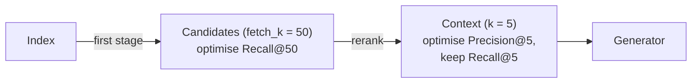

[Recall@K](/learn/retrieval-fundamentals/recall-k) asks whether the evidence got in. **Precision@K** asks the opposite question: of what got in, how much was evidence? A retriever that returns the right chunk buried among nine irrelevant ones has perfect recall at 10 and a precision of 0.1, and the generator reading that context has to find one useful paragraph in ten.

This lesson defines Precision@K, shows the ceiling that makes raw precision numbers easy to misread in RAG, and connects precision to recall through a simple identity that explains the trade-off between them. It then covers where in a pipeline precision matters (and where it does not), how to measure it fairly when lists vary in length or contain unjudged chunks, and two rank-aware relatives, R-precision and average precision, that summarise a whole ranking in one number.

## Learning objectives

- Define Precision@K and compute it by hand, together with its ceiling for a query with a given number of relevant chunks.
- Derive the identity linking Precision@K and Recall@K, and use it to explain why they move in opposite directions as $K$ grows.
- Identify the pipeline stages where precision should be optimised and where recall should be.
- Measure precision fairly for variable-length result lists, unanswerable queries and partly judged rankings.
- Compute R-precision and average precision, and explain what they add over Precision@K.

## Prerequisites

- [Recall@K](/learn/retrieval-fundamentals/recall-k): the definition, macro averaging, judgements.
- [Top-K retrieval](/learn/retrieval-fundamentals/top-k-retrieval): candidate depth versus context depth, adaptive cut-offs.
- [What is retrieval?](/learn/retrieval-fundamentals/what-is-retrieval): relevance and test collections.

## Why this matters

Everything in the generator's context competes for its attention. An irrelevant chunk is not neutral padding. It costs input tokens on every request. It can contain a statement that contradicts the relevant chunk: Meridian's superseded 2023 handbook says the laptop refresh cycle is 4 years, the current one says 3, and a context containing both invites the model to pick the wrong one or hedge. It can contain an instruction planted by someone with write access to a document. And research on long contexts, such as the "lost in the middle" study by Liu and colleagues, found that models used relevant information less reliably when it sat among many other passages, particularly in the middle; see the [lost-in-the-middle problem](/learn/context-engineering/lost-in-the-middle-problem).

So precision at the final context depth is a direct lever on answer quality, cost and safety. Yet many teams measure only recall, or only end-to-end answer quality, and then raise $K$ whenever an answer is missing something. Each increase helps recall slightly and erodes precision silently. Measuring both is what lets you see the trade-off you are making.

Precision is also easy to misread. A Precision@5 of 0.2 sounds poor. If each test query has exactly one relevant chunk, it is perfect. Without understanding the ceiling, teams set impossible targets or dismiss good retrievers.

## The intuition

You ask a research assistant for "the best material on our remote-work policy" and they hand you five documents. Two are the policy's sections; three are about something else (the office move, the expenses rules, a newsletter). Their precision is 2 out of 5: forty per cent of what you were given was worth reading.

Precision is about the reader's time. Recall asked "did I get everything I needed?"; precision asks "how much of what I got was worth my attention?" They pull against each other. Ask for twenty documents and you will probably get both policy sections plus anything else related, so recall is high, but you will read eighteen documents for nothing. Ask for one and, if it is a policy section, precision is perfect, but you are missing half the policy.

There is a subtlety. If the policy has only two sections in total, the assistant cannot possibly hand you five documents that are all relevant: the best they can do is 2 out of 5. Judging them harshly for a precision of 0.4 would be unfair; it is the maximum. Precision always has to be read against what was achievable.

## How it works

### The definition

For a query $q$ with relevant set $R_q$ and top-$K$ results $\text{Top}_K(q)$:

$$
\text{Precision@}K(q) = \frac{|\,\text{Top}_K(q) \cap R_q\,|}{K}
$$

The numerator is the same as recall's: relevant chunks retrieved within the cut. The denominator is the number of slots, $K$, rather than the number of relevant chunks. Like recall, it is averaged over queries (macro averaging is the default) and it is blind to order within the cut.

Unlike recall, precision is **defined for queries with no relevant chunks**: the numerator is 0, so Precision@K is 0. That is meaningful. A retriever that always returns $K$ chunks puts $K$ irrelevant chunks into the context of every unanswerable question, and precision records it.

### The ceiling

A query with $|R_q|$ relevant chunks can fill at most $\min(K, |R_q|)$ of the $K$ slots with relevant chunks. So:

$$
\text{Precision@}K(q) \leq \frac{\min(K, |R_q|)}{K}
$$

For a typical RAG question answered by one chunk, the ceiling at $K = 5$ is 0.2. A perfect retriever, putting the one relevant chunk in its top 5, scores 0.2. This is the most common misreading of precision in RAG: a dashboard shows "Precision@5 = 0.21" and someone concludes the retriever is bad, when it is within a whisker of perfect.

Two ways to read precision correctly:

- **Report the ceiling alongside it.** Compute the average ceiling over the test set (it depends only on the judgements) and compare. The code below does this.
- **Use R-precision** (below), which sets $K = |R_q|$ per query, so the ceiling is always 1.

### The trade-off, as an identity

Precision and recall share a numerator. Divide one by the other:

$$
\text{Precision@}K(q) = \text{Recall@}K(q) \cdot \frac{|R_q|}{K}
$$

This identity explains the shape of the trade-off without any assumptions about the retriever:

1. As $K$ grows, recall can only rise or stay flat (the top-$K$ cut is monotone).
2. Once recall reaches 1 (all relevant chunks found), it stops rising, and precision falls exactly as $|R_q|/K$: halving with every doubling of $K$.
3. Before that, precision falls whenever an added slot holds an irrelevant chunk and rises (slightly) when it holds a relevant one.

So the two curves cross. Choosing $K$ is choosing a point on them, and the right point depends on what the stage is for.

### Where precision matters

Different stages of a pipeline should optimise different metrics, because they hand their output to different consumers.



- **The candidate stage** hands its output to a reranker, which can afford to look at every candidate carefully. Irrelevant candidates cost a little reranking time and nothing else. Precision here barely matters; recall at `fetch_k` is everything. A first-stage Precision@50 of 0.02 is normal and fine.
- **The context stage** hands its output to the generator, which reads all of it, pays for all of it, and can be misled by any of it. Here precision matters, subject to keeping the recall the answer needs. This is the job of [reranking](/learn/reranking-fundamentals/why-reranking-is-needed) and of [thresholding](/learn/advanced-retrieval-optimisation/retrieval-thresholding): turning a high-recall, low-precision candidate list into a short, high-precision context.

> [!KEY]
> Optimise recall where the next stage is careful and cheap per item; optimise precision where the next stage is the generator. A pipeline that reports one number for "retrieval quality" hides which stage is failing.

Evaluation frameworks for RAG often report **context precision**, a related idea computed on the final context, sometimes with a language model judging relevance instead of human labels. It is covered in [Context precision](/learn/advanced-retrieval-optimisation/context-precision).

### Variable-length lists and unanswerable queries

Adaptive cut-offs and thresholds return lists of different lengths per query, sometimes empty. Precision then needs care:

- **Use the list's own length** as the denominator: precision is the fraction of *returned* chunks that are relevant.
- **Decide a convention for empty lists.** An empty list for an unanswerable query is the ideal outcome; an empty list for an answerable one is a recall failure. A common convention is to exclude empty lists from the precision average and report separately how many lists were empty and whether the query was answerable.
- **Always report recall and average list length alongside.** Precision of variable-length lists is easy to inflate: return one chunk per query and precision soars while recall drops. The three numbers together tell the honest story, as the code shows.

For unanswerable queries, a fixed-$K$ retriever always scores precision 0. A relative cut-off (keep chunks within a fraction of the top score) cannot help, because it always keeps the top chunk. Only an absolute decision ("nothing here is good enough") can return an empty list, which is why detecting unanswerable questions is a calibration problem rather than a precision trick.

### Unjudged chunks in the top K

Precision has the mirror image of recall's judgement problem. If a chunk in the top $K$ was never judged, convention treats it as irrelevant, and precision is **underestimated**. This bites when evaluating a new retriever against judgements made on an old one: the new retriever's top 5 may contain chunks nobody looked at.

Two habits keep this honest. Report the **judged fraction**: the proportion of top-$K$ slots, averaged over queries, that have a judgement. If it falls well below 1, judge the gaps before trusting precision. And when comparing retrievers, compute precision on the same judgement pool, extended to cover every system's top $K$.

### Rank-aware precision

Precision@K, like Recall@K, ignores order inside the cut. Two summaries built from precision restore some sensitivity to rank.

**R-precision** is precision at $K = |R_q|$, a different cut-off for each query. A query with one relevant chunk is scored on its top 1; a query with three on its top 3. At that cut-off precision and recall are equal (both are "relevant found divided by $|R_q|$"), and the ceiling is 1 for every query.

**Average precision** (AP) walks down the ranking and, at each position $i$ where a relevant chunk appears, records Precision@$i$. It averages those values over all relevant chunks, counting any relevant chunk that was never retrieved as contributing 0. A ranking that puts relevant chunks early scores high, because the precision values recorded at their positions are high. The mean over queries is **mean average precision** (MAP), a long-standing standard in IR evaluation. In RAG, rank-aware evaluation is more often done with [MRR](/learn/retrieval-evaluation/mrr) and [NDCG](/learn/retrieval-evaluation/ndcg), covered in the evaluation module, but AP is the natural extension of this lesson's metric and you will meet it in papers and benchmarks.

## The mathematics

**Intuition.** Precision divides by slots, recall by relevant chunks; average precision rewards putting relevant chunks before irrelevant ones.

**Average precision formula.**

$$
\text{AP}(q) = \frac{1}{|R_q|} \sum_{i=1}^{n} \text{Precision@}i(q) \cdot \text{rel}_i
$$

where $n$ is the length of the ranking, $\text{rel}_i$ is 1 if the chunk at rank $i$ is relevant and 0 otherwise, and $|R_q|$ is the total number of relevant chunks (so relevant chunks never retrieved contribute 0). MAP is the mean of AP over queries.

**By hand.** Relevant set $\{a, b, c\}$; two rankings of six chunks.

Ranking 1: $x, a, y, b, z, c$.

- Precision@1 $= 0/1 = 0$; Precision@2 $= 1/2 = 0.5$; Precision@4 $= 2/4 = 0.5$; Precision@6 $= 3/6 = 0.5$.
- Relevant chunks sit at ranks 2, 4 and 6, with Precision@$i$ of $1/2$, $2/4$, $3/6$. AP $= (0.5 + 0.5 + 0.5) / 3 = 0.5$.

Ranking 2: $a, b, x, y, z, c$.

- Precision@1 $= 1$; Precision@2 $= 1$; Precision@4 $= 2/4 = 0.5$; Precision@6 $= 0.5$.
- Relevant chunks at ranks 1, 2 and 6: Precision@$i$ of $1/1$, $2/2$, $3/6$. AP $= (1 + 1 + 0.5) / 3 = 0.833$.

At $K = 6$ the two rankings are indistinguishable (Precision@6 = 0.5, Recall@6 = 1 for both). AP separates them because ranking 2 puts two relevant chunks at the very top.

**Checking the identity.** For ranking 1 at $K = 4$: Recall@4 $= 2/3$, and $\text{Recall@}4 \times |R_q| / K = (2/3) \times 3/4 = 0.5$, which is Precision@4.

**In Python:**

```python
def precision_at_k(ranked, relevant, k):
    return len(set(ranked[:k]) & relevant) / k

def average_precision(ranked, relevant):
    hits, total = 0, 0.0
    for i, cid in enumerate(ranked, start=1):
        if cid in relevant:
            hits += 1
            total += hits / i
    return total / len(relevant)

relevant = {"a", "b", "c"}
for ranked in (["x", "a", "y", "b", "z", "c"], ["a", "b", "x", "y", "z", "c"]):
    p = [round(precision_at_k(ranked, relevant, k), 3) for k in (1, 2, 4, 6)]
    print(ranked, "P@1,2,4,6 =", p, " AP =", round(average_precision(ranked, relevant), 3))
```

```output
['x', 'a', 'y', 'b', 'z', 'c'] P@1,2,4,6 = [0.0, 0.5, 0.5, 0.5]  AP = 0.5
['a', 'b', 'x', 'y', 'z', 'c'] P@1,2,4,6 = [1.0, 1.0, 0.5, 0.5]  AP = 0.833
```

## In code

**The problem.** On the labelled Meridian test set from the [Recall@K](/learn/retrieval-fundamentals/recall-k) lesson, compute Precision@K with its ceiling and Recall@K for BM25 and a dense retriever; summarise each ranking with R-precision and MAP; and measure a variable-length relative cut-off fairly.

**Dependencies.** NumPy, rank-bm25 and sentence-transformers (all-MiniLM-L6-v2 downloads on first use). No API key.

```bash
pip install numpy rank-bm25 sentence-transformers
```

```python
import re
import numpy as np
from rank_bm25 import BM25Okapi
from sentence_transformers import SentenceTransformer

chunks = {
    "leave-1":  "Annual leave is 25 days per year for full-time staff.",
    "leave-2":  "Up to 5 unused leave days carry over and must be used by 31 March.",
    "remote-1": "Staff may work remotely up to 3 days a week.",
    "remote-2": "The home-office equipment budget is £400. Contractors are not eligible.",
    "exp-1":    "Expenses must be submitted within 30 days of purchase.",
    "exp-2":    "Any expense over £75 needs a receipt.",
    "sec-1":    "Passwords must be rotated every 90 days.",
    "sec-2":    "VPN is required on public Wi-Fi.",
    "it-1":     "The laptop refresh cycle is 3 years.",
    "it-2":     "Report a lost laptop to the support desk at once.",
    "it-3":     "The support desk is open 08:00 to 18:00 UK time.",
    "old-1":    "2023 handbook (superseded): the laptop refresh cycle is 4 years.",
    "prod-1":   "Meridian Reports exports reports as PDF or CSV files.",
    "prod-2":   "Meridian Reports offers SAML single sign-on on the Enterprise plan.",
    "err-1":    "Atlas error E-4021: the VPN client is out of date. Update it from the IT portal.",
}
qrels = {
    "How much holiday do I get and can I carry days over?": {"leave-1", "leave-2"},
    "Can I claim back a £120 train ticket?": {"exp-1", "exp-2"},
    "Working from home rules": {"remote-1", "remote-2"},
    "Who do I tell if my computer is stolen?": {"it-2"},
    "Do I need to keep the till slip for a taxi?": {"exp-2"},
    "What's the deadline for using leftover holiday?": {"leave-2"},
    "How long do I have to file a claim?": {"exp-1"},
    "When can I phone IT support?": {"it-3"},
    "Laptop replacement policy": {"it-1"},
    "Does Reports support SSO?": {"prod-2"},
    "What should I do about Atlas error E-4021?": {"err-1"},
    "How often must I change my password?": {"sec-1"},
}
ids = list(chunks)

def precision_at_k(ranked_ids, relevant, k):
    """Fraction of the top k slots filled by relevant chunks."""
    return len(set(ranked_ids[:k]) & relevant) / k

def recall_at_k(ranked_ids, relevant, k):
    return len(set(ranked_ids[:k]) & relevant) / len(relevant)

def average_precision(ranked_ids, relevant):
    """Mean of precision@i over the ranks i at which a relevant chunk appears."""
    hits, total = 0, 0.0
    for i, cid in enumerate(ranked_ids, start=1):
        if cid in relevant:
            hits += 1
            total += hits / i
    return total / len(relevant)

tok = lambda text: re.findall(r"[a-z0-9£]+", text.lower())
bm25 = BM25Okapi([tok(t) for t in chunks.values()])
model = SentenceTransformer("sentence-transformers/all-MiniLM-L6-v2")
D = model.encode(list(chunks.values()), normalize_embeddings=True)

def rank(scores):
    return [ids[i] for i in np.argsort(-np.asarray(scores), kind="stable")]

runs = {
    "bm25":  {q: rank(bm25.get_scores(tok(q))) for q in qrels},
    "dense": {q: rank(D @ model.encode([q], normalize_embeddings=True)[0]) for q in qrels},
}

# 1. Precision and recall at each k, against the best achievable precision.
ceiling = {k: np.mean([min(k, len(rel)) / k for rel in qrels.values()]) for k in (1, 2, 3, 5)}
print("        k   P@k   ceiling   R@k")
for name, run in runs.items():
    for k in (1, 2, 3, 5):
        p = np.mean([precision_at_k(run[q], rel, k) for q, rel in qrels.items()])
        r = np.mean([recall_at_k(run[q], rel, k) for q, rel in qrels.items()])
        print(f"{name:<6} {k:>3}  {p:.3f}   {ceiling[k]:.3f}    {r:.3f}")

# 2. Rank-aware summaries: R-precision and mean average precision.
for name, run in runs.items():
    r_prec = np.mean([precision_at_k(run[q], rel, len(rel)) for q, rel in qrels.items()])
    mean_ap = np.mean([average_precision(run[q], rel) for q, rel in qrels.items()])
    print(f"{name:<6} R-precision {r_prec:.3f}   MAP {mean_ap:.3f}")

# 3. Variable-length lists: a relative cut-off versus a fixed k = 3 (dense).
def relative_cutoff(query, alpha=0.75, k_max=5):
    s = D @ model.encode([query], normalize_embeddings=True)[0]
    ranked = np.argsort(-s, kind="stable")[:k_max]
    return [ids[i] for i in ranked if s[i] >= alpha * s[ranked[0]]]

lists = {q: relative_cutoff(q) for q in qrels}
p = np.mean([len(set(lists[q]) & rel) / len(lists[q]) for q, rel in qrels.items()])
r = np.mean([len(set(lists[q]) & rel) / len(rel) for q, rel in qrels.items()])
n = np.mean([len(v) for v in lists.values()])
print(f"\nrelative cut-off: precision {p:.3f}  recall {r:.3f}  mean list length {n:.2f}")
```

```output
        k   P@k   ceiling   R@k
bm25     1  0.500   1.000    0.375
bm25     2  0.250   0.625    0.375
bm25     3  0.222   0.417    0.542
bm25     5  0.167   0.250    0.667
dense    1  0.917   1.000    0.792
dense    2  0.583   0.625    0.917
dense    3  0.417   0.417    1.000
dense    5  0.250   0.250    1.000
bm25   R-precision 0.375   MAP 0.520
dense  R-precision 0.917   MAP 0.944

relative cut-off: precision 0.861  recall 0.958  mean list length 1.50
```

**The important lines.**

- `precision_at_k` differs from `recall_at_k` only in its denominator: `k` instead of `len(relevant)`.
- `ceiling` depends only on the judgements: for each query, `min(k, len(rel)) / k`, averaged. Nine queries have one relevant chunk and three have two, so at $k = 2$ the ceiling is $(9 \times 0.5 + 3 \times 1) / 12 = 0.625$.
- `average_precision` implements the formula directly: accumulate Precision@$i$ at each relevant hit, divide by the number of relevant chunks.
- `relative_cutoff` returns lists of varying length, so its precision uses `len(lists[q])` as the denominator, and its recall and average list length are printed beside it.

**What the output means.**

- **Dense Precision@3 = 0.417 is perfect.** It equals the ceiling exactly, as does Precision@5 = 0.250. A reader seeing "precision 0.25" without the ceiling would think the retriever weak; it is placing every relevant chunk in the top 5. The low number is a property of the test set (most questions have one answer), not of the retriever.
- **BM25 is below the ceiling everywhere**, by the most at $k = 2$ (0.250 against 0.625): its top two slots are often filled with term-matching but irrelevant chunks.
- **The identity is visible in the dense rows.** Once recall reaches 1.000 at $k = 3$, precision falls exactly as the ceiling does from 3 to 5. Every additional slot is pure noise.
- **R-precision and MAP summarise the whole ranking in one number.** Dense scores 0.917 R-precision and 0.944 MAP; BM25 0.375 and 0.520. MAP is higher than R-precision for BM25 because AP gives partial credit for relevant chunks found below rank $|R_q|$.
- **The relative cut-off trades a little recall for much precision.** Its lists average 1.5 chunks, with precision 0.861 and recall 0.958, against fixed $k = 3$'s 0.417 and 1.000. Whether that trade is good depends on what the missing 4% of evidence was: in the [Top-K retrieval](/learn/retrieval-fundamentals/top-k-retrieval) lesson it was the second chunk of multi-part questions.

**Common errors.** Silently dropping zero-score padding before dividing turns Precision@K into precision of a shorter list and inflates it; be explicit about the denominator. Comparing precision of a fixed-$K$ system with a variable-length one without recall and list length is meaningless.

**Extending it.** Add two unanswerable queries with empty relevant sets. Confirm that Precision@3 falls (each contributes 0), that recall must skip them, and look at what the relative cut-off returns for them (Exercise 3).

## A real-world example

The HR team complained that AskMeridian's answers about leave were "waffly": accurate, but padded with caveats about remote work, expenses and the superseded 2023 handbook. The Platform team's dashboard showed Recall@8 at 0.94 on the labelled set, which they had treated as a sign of health. They had raised $k$ from 5 to 8 a month earlier to fix a few missing-evidence complaints.

They added Precision@8 to the dashboard, with its ceiling. Precision was 0.16 against a ceiling of 0.17: almost perfect by the definition, because most leave questions have one or two relevant chunks. The retriever was not the problem. The problem was the choice of $k$: with one relevant chunk per question, eight slots meant seven irrelevant chunks in every prompt, and the generator dutifully mentioned some of them.

The fix was to separate the two jobs. Vector search kept `fetch_k = 30` for recall. A cross-encoder reranked to a final list of 3 to 5 chunks, with a token cap. On the labelled set, precision of the final list rose to about three times its old value while Recall@final stayed within the bootstrap interval of the old Recall@8. HR's waffle complaints stopped. The team kept both metrics, with ceilings, on the dashboard, and added the judged fraction after noticing that the reranker sometimes surfaced chunks the original judges had never seen.

## Common mistakes

- **Reading Precision@K without its ceiling.** A one-answer test set caps Precision@5 at 0.2; low numbers can be perfect.
- **Optimising precision at the candidate stage.** It shrinks `fetch_k` and starves the reranker of relevant chunks it could have rescued.
- **Raising $k$ to fix recall without watching precision.** Each extra slot is mostly noise once recall is near its ceiling.
- **Comparing variable-length and fixed-length systems on precision alone.** Short lists inflate precision; report recall and list length too.
- **Ignoring unjudged chunks.** Precision of a new retriever is underestimated when its top results were never judged.
- **Dropping unanswerable queries from the precision average.** They are where fixed-$K$ retrieval does the most damage to the context.

## Best practices

- Report Precision@K with the average ceiling, or use R-precision, so the number can be read correctly.
- Measure precision at the context stage and recall at the candidate stage; report both for the final context.
- Use a reranker or a calibrated threshold to raise precision, rather than shrinking the first-stage cut.
- For variable-length lists, report precision, recall, average list length and the count of empty lists together.
- Track the judged fraction of top-$K$ results and extend judgements whenever it drops.
- Include unanswerable queries in the test set and report what the system puts in the context for them.

## Performance considerations

Precision is cheap to compute (one set intersection per query) and expensive to ignore. Its cost shows up in the generator:

- **Tokens.** Irrelevant tokens per request $\approx (1 - \text{Precision@}K) \times K \times c$, where $c$ is the average chunk length. At $K = 8$, precision 0.16 and an assumed $c = 300$, that is about $0.84 \times 8 \times 300 \approx 2{,}000$ irrelevant tokens on every request. At $K = 4$ with precision 0.3 it is about 840.
- **Latency.** Input tokens add to time-to-first-token roughly in proportion, so noise costs latency as well as money; [Retrieval latency](/learn/retrieval-fundamentals/retrieval-latency) puts this in the budget.
- **Reranking.** Improving precision with a cross-encoder adds its own cost, linear in `fetch_k`. The trade is usually favourable because reranking 30 short pairs is far cheaper than the generator reading thousands of irrelevant tokens on every request, but measure both on your own hardware and provider.

## Security considerations

Every irrelevant chunk in the context is an opportunity for injected instructions or misleading content to reach the model without even being needed for the answer. Low precision widens this surface: a planted document needs only to rank somewhere in the top $K$, and a larger $K$ makes that easier. High precision at the context stage is therefore a (partial) security control as well as a quality one. It does not replace treating every retrieved chunk as untrusted input; see [Indirect prompt injection](/learn/rag-security-fundamentals/indirect-prompt-injection).

## Summary

- Precision@K is the fraction of the top $K$ slots filled by relevant chunks. It measures how much of what reaches the next stage is worth reading.
- Its ceiling is $\min(K, |R_q|)/K$; with one relevant chunk per query, a perfect Precision@5 is 0.2. Report the ceiling or use R-precision.
- Precision@K equals Recall@K times $|R_q|/K$, so once recall saturates, precision falls in proportion to $1/K$.
- Optimise recall where the next stage is a careful reranker and precision where it is the generator.
- Variable-length lists, unanswerable queries and unjudged chunks all need explicit conventions; average precision and R-precision add rank sensitivity.

## Exercises

**1.** A query has 2 relevant chunks. The top 5 is $r, x, x, r, x$ (where $r$ is relevant). Compute Precision@1, Precision@3, Precision@5, the ceiling at 5, R-precision and AP.

<details><summary>Show solution</summary>

- Precision@1 $= 1/1 = 1$; Precision@3 $= 1/3 = 0.333$; Precision@5 $= 2/5 = 0.4$.
- Ceiling at 5: $\min(5, 2)/5 = 0.4$, so Precision@5 is at its ceiling.
- R-precision: precision at $K = 2$: top 2 is $r, x$, so $1/2 = 0.5$.
- AP: relevant at ranks 1 and 4, Precision@1 $= 1$, Precision@4 $= 2/4 = 0.5$. AP $= (1 + 0.5)/2 = 0.75$.

</details>

**2.** Using the identity, a retriever has Recall@10 = 0.8 averaged over queries that each have exactly 3 relevant chunks. What is its Precision@10? Another retriever has the same Recall@10 on a test set where each query has exactly 1 relevant chunk. What is its Precision@10, and what does the comparison show?

<details><summary>Show solution</summary>

With every query having the same $|R_q|$, the identity holds for the averages: first case $0.8 \times 3/10 = 0.24$; second case $0.8 \times 1/10 = 0.08$.

The two retrievers find the same share of their evidence, yet their precision differs threefold, purely because of the test sets. Precision numbers from different test sets (or different mixes of question types) cannot be compared without accounting for the number of relevant chunks per query.

</details>

**3.** Extend the code: add the queries "What is the parental leave policy?" and "Is there a staff canteen?" with empty relevant sets. Recompute dense Precision@3 over all 14 queries (skip them for recall), and count how many chunks the relative cut-off puts into the context for the two unanswerable queries.

<details><summary>Show solution</summary>

Add the two queries with `set()` as their relevant sets, and guard `recall_at_k` and `average_precision` to skip queries whose relevant set is empty. Precision@3 for each unanswerable query is $0/3 = 0$, so dense Precision@3 over 14 queries is $(12 \times 0.417 + 2 \times 0) / 14 \approx 0.357$.

The relative cut-off always keeps the top chunk, plus anything within 75% of its score. Here it keeps two chunks for parental leave (leave-1 and leave-2) and three for the canteen (remote-1, leave-1, it-3): five irrelevant chunks for two questions that have no answer. Notice that the canteen query, with low scores everywhere, keeps *more* chunks, because a relative rule only looks at the gaps. Precision on those lists is 0. Only an absolute decision, a calibrated threshold or the generator declining to answer, can produce the right behaviour: an empty context or an explicit "not covered".

</details>

**4.** Design decision. A legal team's RAG tool must find every clause relevant to a contract question (missing one is costly), and their reviewers read everything the tool shows. A customer-support bot answers short how-to questions where one chunk usually suffices. For each, which metric would you optimise at the final context, what $K$ policy would you choose, and why?

<details><summary>Show solution</summary>

**Legal tool:** recall dominates, because a missed clause is the expensive failure and humans read the output. Optimise Recall@K at a generous $K$ (and report precision, so reviewers know how much noise to expect). A threshold that drops low-scoring clauses is risky here; prefer a deeper list, ordered well (MAP or NDCG matter, because reviewers read from the top).

**Support bot:** precision at a small $K$ dominates, because one chunk usually answers and every extra chunk costs tokens and risks a confused answer. Use a reranker over a deeper candidate list, keep 1 to 3 chunks with a floor of 1, and measure hit rate or R-precision at the final cut. Monitor recall separately on the subset of multi-part questions so the small $K$ does not quietly break them.

</details>

## Check your understanding

```quiz
[
  {
    "q": "Every query in a test set has exactly one relevant chunk. A retriever's Precision@5 is 0.2. What can you conclude?",
    "options": [
      "The retriever is poor; 80% of results are wrong",
      "Recall@5 is 0.2",
      "The retriever finds the relevant chunk in the top 5 for every query, the best possible",
      "The retriever should use k = 20"
    ],
    "answer": 2,
    "why": "With one relevant chunk the ceiling is 1/5 = 0.2, reached only when every query's relevant chunk is in its top 5."
  },
  {
    "q": "Which identity links precision and recall at the same K for one query?",
    "options": [
      "Precision@K = Recall@K x |R| / K",
      "Precision@K = 1 - Recall@K",
      "Precision@K = Recall@K x K / |R|",
      "Precision@K = Recall@K / K"
    ],
    "answer": 0,
    "why": "Both share the numerator (relevant retrieved); precision divides by K and recall by |R|, so their ratio is |R|/K."
  },
  {
    "q": "In a pipeline with fetch_k = 50 and a cross-encoder reranking to 5, where should precision be the main target?",
    "options": [
      "At the first stage, to reduce reranking cost",
      "At the final 5, which the generator reads",
      "Nowhere; only recall matters",
      "Equally at both stages"
    ],
    "answer": 1,
    "why": "The candidate stage exists for recall; precision matters where the generator reads and pays for every chunk."
  },
  {
    "q": "System A returns a fixed 5 chunks; system B returns 1 to 5 by a threshold. B has higher precision. What else must you check before preferring B?",
    "options": [
      "Nothing; higher precision is always better",
      "Only the latency",
      "The embedding dimension",
      "Recall, average list length, and how often B returns an empty list for answerable queries"
    ],
    "answer": 3,
    "why": "Short lists inflate precision. Recall and list length show whether B achieves it by dropping needed evidence."
  },
  {
    "q": "Relevant set {a, b}. Ranking: a, x, b, y. What is the average precision?",
    "options": [
      "0.5",
      "0.667",
      "0.833",
      "1.0"
    ],
    "answer": 2,
    "why": "Precision at rank 1 is 1 and at rank 3 is 2/3. Their mean over the 2 relevant chunks is (1 + 0.667) / 2 = 0.833."
  }
]
```

## Further reading

- Christopher D. Manning, Prabhakar Raghavan and Hinrich Schütze (2008), *Introduction to Information Retrieval*, chapter 8, sections on precision, recall, R-precision and mean average precision. Free online at [nlp.stanford.edu/IR-book](https://nlp.stanford.edu/IR-book/).
- Nelson F. Liu and colleagues (2023), "Lost in the Middle: How Language Models Use Long Contexts", [arXiv:2307.03172](https://arxiv.org/abs/2307.03172). Why irrelevant context is not harmless.
- Chris Buckley and Ellen M. Voorhees (2004), "Retrieval evaluation with incomplete information", *SIGIR 2004*. How unjudged documents affect precision-based metrics.
- Shahul Es and colleagues (2023), "RAGAS: Automated Evaluation of Retrieval Augmented Generation", [arXiv:2309.15217](https://arxiv.org/abs/2309.15217). Context precision as used in RAG evaluation.
