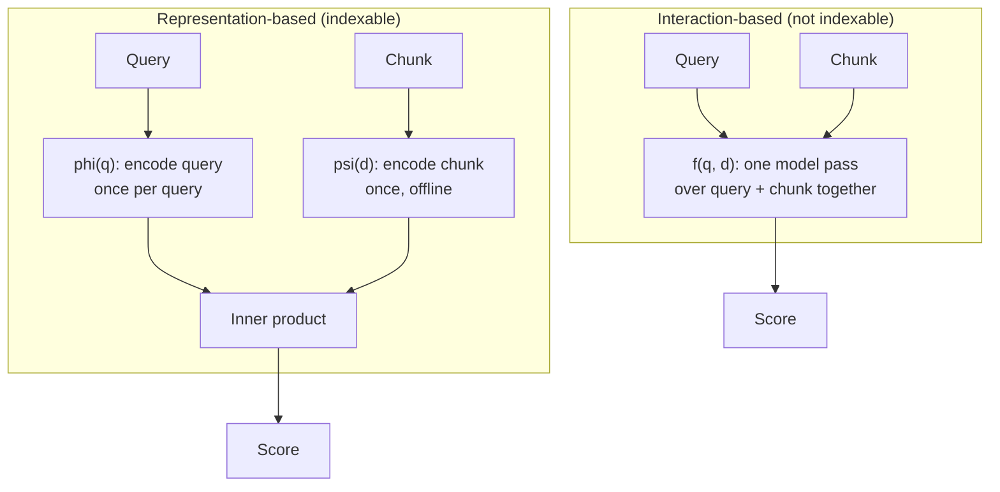

[What is retrieval?](/learn/retrieval-fundamentals/what-is-retrieval) reduced retrieval to a scoring function $s(q, d)$: score, sort, cut. [Query-document matching](/learn/rag-architecture-fundamentals/query-document-matching) showed the two classic answers to "how do you compute it?": count shared words, or compare embedding vectors. This lesson treats the scoring function as an engineering object and asks two questions that decide how a retrieval system is built.

The first is **structural**: which scoring functions can be run against millions of chunks in a few milliseconds, and which cannot? The answer turns on a single property, whether the score splits into a query part and a document part, and it explains why every production search stack has the shape it has. The second is **interpretive**: what does a score of 0.42 actually tell you? Less than most people assume, and you will see a relevant chunk and an irrelevant one receive the same score to within 0.001.

## Learning objectives

- State the decomposability condition for a first-stage scoring function and explain why it makes an index possible.
- Show, by hand and in code, that BM25 and dense cosine similarity are both inner products, one sparse and one dense.
- Contrast representation-based scoring (bi-encoders, BM25) with interaction-based scoring (cross-encoders) in cost and in what each can see.
- Explain why scores are comparable within one query but not across queries, scorers or models, and demonstrate it on real output.
- Apply per-query normalisation and state what it cannot do.

## Prerequisites

- [Query-document matching](/learn/rag-architecture-fundamentals/query-document-matching): lexical and semantic matching, TF-IDF, vocabulary mismatch.
- [Sentence embeddings](/learn/embedding-fundamentals/sentence-embeddings): bi-encoders, and symmetric versus asymmetric use.
- [Cosine similarity](/learn/embedding-mathematics/cosine-similarity) and [Dot product](/learn/embedding-mathematics/dot-product).
- [What is retrieval?](/learn/retrieval-fundamentals/what-is-retrieval): retrieval as ranking by estimated relevance.

## Why this matters

Two kinds of mistake come from not understanding the scoring function.

The first is architectural. A team finds that a cross-encoder ranks far better than their embedding model and decides to "just use the cross-encoder for search". With 2 million chunks, that is 2 million Transformer forward passes per query: over three minutes even at an optimistic 10,000 pairs per second. The idea is not merely slow; it is the wrong shape. Some scoring functions can be indexed and some cannot, and that decides where each belongs.

The second is interpretive. Teams write rules such as "below 0.5, say I don't know" or "merge BM25 and vector results by adding their scores", assuming a score has a fixed meaning. It does not. A cosine of 0.42 may be the right answer for one query and an unrelated chunk for another; a BM25 score of 5 and a cosine of 0.8 are not on the same scale; and upgrading the embedding model moves every score. Rules built on raw scores fail silently and unpredictably.

## The intuition

Imagine a dating agency with a million members, suggesting matches for each newcomer.

**Method one: questionnaires.** Every member fills one in once, on joining, and it is filed. A newcomer fills in the same form and is compared with the filed ones. Comparison is quick, and with clever filing (all the hikers in one drawer) most forms need not be looked at. But a questionnaire is a summary: two people with identical answers can still have nothing to say to each other.

**Method two: blind dates.** Put the newcomer in a room with each candidate for ten minutes and ask how it went. Far more accurate, because it sees how two specific people interact. But nothing can be prepared in advance, and a million dates is not an option.

A sensible agency uses questionnaires to find fifty candidates, then blind dates with those fifty. In retrieval, BM25 and embedding models are questionnaires (each chunk summarised once, offline) and a cross-encoder is a blind date. The agency also learns that "seven matching answers out of ten" is a great match for a newcomer with unusual tastes and a poor one for a newcomer who matches everyone: a score means something only relative to the other candidates for the same newcomer.

## How it works

### Two shapes of scoring function

Every scoring function has one of two shapes.

A **representation-based** (or **decomposable**) function computes a representation of the query and a representation of the document separately, then combines them with a cheap operation, almost always an inner product:

$$
s(q, d) = \langle \phi(q), \psi(d) \rangle
$$

Here $\phi$ maps a query to a vector, $\psi$ maps a document to a vector of the same length, and $\langle \cdot, \cdot \rangle$ is the inner (dot) product. Often $\phi = \psi$ (a symmetric model), but they may differ.

An **interaction-based** function reads the query and the document together and outputs a score: $s(q, d) = f(q, d)$, with no way to split $f$ into a query half and a document half. A cross-encoder is the standard example: it feeds `[query] [SEP] [document]` through a Transformer, and every layer lets each query token attend to each document token.

The decomposable shape has a decisive consequence:

1. $\psi(d)$ does not depend on the query, so it can be computed for every chunk **once, at indexing time**, and stored.
2. At query time, only $\phi(q)$ needs computing: one encoder call or one tokenisation, regardless of collection size.
3. Finding the documents with the largest inner product with $\phi(q)$ is a well-studied search problem with fast index structures: inverted indexes for sparse vectors, [approximate nearest-neighbour indexes](/learn/vector-indexing-algorithms/approximate-nearest-neighbour-search) for dense ones.

An interaction-based function offers none of this. Nothing can be precomputed per document, and no index can find the best $f(q, d)$ without evaluating $f$ on every pair. Its cost per query is $N$ full model evaluations.



> [!KEY]
> A first-stage retriever must use a decomposable scoring function, because only those can be indexed. Interaction-based scoring is reserved for a short candidate list. That single fact explains the two-stage shape of nearly every serious retrieval system.

### BM25 is an inner product too

It is easy to think of lexical and dense retrieval as fundamentally different machines. Structurally they are the same: both are inner products. Take BM25 (introduced properly in [its own lesson](/learn/sparse-retrieval/bm25)). Its score is a sum over the query's terms:

$$
\text{BM25}(q, d) = \sum_{t \in q} \text{idf}(t) \cdot \frac{\text{tf}(t, d)\,(k_1 + 1)}{\text{tf}(t, d) + k_1\left(1 - b + b\,\frac{|d|}{\text{avgdl}}\right)}
$$

Every factor on the right depends only on the term and the document, never on the rest of the query. So define a vector $\psi(d)$ with one entry per vocabulary term, holding that whole fraction multiplied by idf, and a vector $\phi(q)$ holding how many times each term occurs in the query. Then BM25 is exactly $\langle \phi(q), \psi(d) \rangle$. The vectors are as long as the vocabulary (tens of thousands of entries or more) and almost entirely zeros, which is why they are called **sparse**.

An inverted index is simply an efficient way to store the matrix of all $\psi(d)$ column by column: for each term, the list of documents with a non-zero weight. Computing the inner product with a query that has three non-zero terms means reading three such lists and adding. That is why lexical search is fast without any approximation.

Dense retrieval is the same idea with short, fully populated vectors: $\phi = \psi$ is an embedding model, the vectors have a few hundred dimensions, and after [normalisation](/learn/embedding-mathematics/vector-normalisation) the inner product equals the cosine. Learned sparse models (such as SPLADE, covered with [sparse representations](/learn/sparse-retrieval/sparse-representations)) sit in between: a neural model produces $\psi(d)$, but it is sparse over a vocabulary, so it can live in an inverted index.

### What each shape can and cannot see

Decomposability is bought with information. $\psi(d)$ is computed without knowing the query, so it must summarise everything any future query might need in a fixed budget (384 numbers for all-MiniLM-L6-v2). It cannot focus on the one sentence of a chunk this query cares about, or check whether a "not" in the chunk negates what the query asks. A cross-encoder sees both texts at once, so attention relates each query word to each chunk word; that is why it ranks better ([Cross-encoders](/learn/reranking-fundamentals/cross-encoders)), though, as the code shows, it is not omniscient.

**Late interaction** models such as [ColBERT](/learn/reranking-models/colbert) sit in between: one precomputed vector per token, combined at query time by a cheap maximum-similarity sum, recovering some interaction at the cost of much larger indexes.

### Scores are relative to the query

Three facts hold for every scorer you will meet.

**Within one query, scores order the chunks.** That is their job, and all that ranking needs.

**Across queries, the same score means different things**, because the score distribution depends on the query:

- A query of rare, specific words gives high BM25 scores to any chunk containing them; a query of common words gives low scores everywhere. BM25 is unbounded and grows with the number of query terms.
- For dense models, a generic query in a crowded region of embedding space has many chunks at moderate similarity; an unusual query has one. What counts as "high" depends on the neighbourhood ([Similarity distributions](/learn/embedding-mathematics/similarity-distributions)).
- A query with no answer still has a top-scoring chunk, whose score can equal a correct answer's score for another query.

**Across scorers and models, scores are on unrelated scales.** BM25 is unbounded and non-negative; cosine lies in $[-1, 1]$ and, for many models, clusters in a narrow band; cross-encoders such as `ms-marco-MiniLM-L-6-v2` output unbounded logits that can be strongly negative for a chunk ranked first.

### Per-query normalisation

To compare or combine scores, normalise them **within each query's result list**:

- **Min-max**: $\tilde{s} = (s - s_{\min}) / (s_{\max} - s_{\min})$, mapping the list onto $[0, 1]$.
- **Z-score**: $\tilde{s} = (s - \mu) / \sigma$, where $\mu$ and $\sigma$ are the mean and standard deviation of the query's scores, measuring how far a chunk stands above the crowd.

This is useful for [weighted score fusion](/learn/hybrid-search/weighted-score-fusion), where BM25 and dense scores must share a footing before being added. But it only describes a chunk *relative to the other chunks for this query*: min-max gives the top chunk 1.0 whether or not it is relevant, and a z-score says the top chunk stands out, which is also true of the best of a bad bunch. Deciding whether the query has an answer at all requires a calibrated relevance estimate, covered in [Score calibration](/learn/advanced-retrieval-optimisation/score-calibration) and [Retrieval thresholding](/learn/advanced-retrieval-optimisation/retrieval-thresholding).

### Symmetric and asymmetric similarity

RAG retrieval is **asymmetric**: a short question against a longer passage. Some models trained for this expect markers on each side (the E5 family expects `query: ` and `passage: ` prefixes); others, including all-MiniLM-L6-v2, use none. Missing prefixes make $\phi$ and $\psi$ inconsistent and quietly lower quality, so follow the model card identically at indexing and query time ([Sentence embeddings](/learn/embedding-fundamentals/sentence-embeddings) explains why).

## The mathematics

### BM25 as an inner product

**Intuition.** Everything in BM25 that involves the document can be computed before any query arrives, and stored as one weight per term. The query contributes only "which terms, how many times".

**The formula.** For a document $d$ and term $t$, define the precomputed weight

$$
w_d(t) = \text{idf}(t) \cdot \frac{\text{tf}(t, d)\,(k_1 + 1)}{\text{tf}(t, d) + k_1\left(1 - b + b\,\frac{|d|}{\text{avgdl}}\right)}
$$

and let $c_q(t)$ be the number of times $t$ occurs in the query. Then

$$
\text{BM25}(q, d) = \sum_{t} c_q(t)\, w_d(t) = \langle c_q, w_d \rangle
$$

where:

- $\text{tf}(t, d)$ is the count of $t$ in $d$, and $\text{idf}(t)$ the term's inverse document frequency;
- $|d|$ is the document's length in tokens and $\text{avgdl}$ the average length in the collection;
- $k_1$ (typically 1.2 to 2) controls how quickly repeated occurrences stop adding score, and $b$ (typically 0.75) controls length normalisation;
- the sum runs over the whole vocabulary, but only terms present in both query and document contribute.

**By hand.** A document of average length ($|d| = \text{avgdl}$, so the length factor is $k_1(1 - b + b) = k_1$) contains "laptop" twice and "lost" once. Take $k_1 = 1.5$, $b = 0.75$, $\text{idf}(\text{laptop}) = 1.2$, $\text{idf}(\text{lost}) = 1.8$.

- $w_d(\text{laptop}) = 1.2 \times \frac{2 \times 2.5}{2 + 1.5} = 1.2 \times 1.4286 = 1.714$
- $w_d(\text{lost}) = 1.8 \times \frac{1 \times 2.5}{1 + 1.5} = 1.8 \times 1 = 1.8$

For the query "lost laptop", $c_q = (1, 1)$ on those two terms, so the score is $1 \times 1.714 + 1 \times 1.8 = 3.514$.

### Z-score normalisation

**Intuition.** Express each score as "how many standard deviations above this query's average".

$$
z_i = \frac{s_i - \mu}{\sigma}, \qquad \mu = \frac{1}{n}\sum_{j=1}^{n} s_j, \qquad \sigma = \sqrt{\frac{1}{n}\sum_{j=1}^{n} (s_j - \mu)^2}
$$

where $s_i$ is chunk $i$'s raw score for this query, $n$ the number of chunks scored, and $\mu$, $\sigma$ the mean and (population) standard deviation of those scores.

**By hand.** Scores $0.42, 0.31, 0.29, 0.25, 0.23$. The mean is $1.50 / 5 = 0.30$. Deviations: $0.12, 0.01, -0.01, -0.05, -0.07$; squares sum to $0.0220$; divided by 5 gives $0.0044$; the square root is $\sigma = 0.0663$. The top chunk's z-score is $0.12 / 0.0663 = 1.81$.

**In Python:**

```python
import numpy as np

k1, b = 1.5, 0.75
idf = {"laptop": 1.2, "lost": 1.8}
tf = {"laptop": 2, "lost": 1}          # counts in the document
doc_len, avgdl = 12, 12                # an average-length document

norm = k1 * (1 - b + b * doc_len / avgdl)
w_d = {t: idf[t] * tf[t] * (k1 + 1) / (tf[t] + norm) for t in tf}
print("document weights:", {t: round(w, 3) for t, w in w_d.items()})

q = {"lost": 1, "laptop": 1}           # query "lost laptop"
print("BM25 as a dot product:", round(sum(q[t] * w_d[t] for t in q), 3))

scores = np.array([0.42, 0.31, 0.29, 0.25, 0.23])
z = (scores - scores.mean()) / scores.std()
print("mean", round(scores.mean(), 3), "std", round(scores.std(), 4))
print("z-scores:", np.round(z, 2))
```

```output
document weights: {'laptop': 1.714, 'lost': 1.8}
BM25 as a dot product: 3.514
mean 0.3 std 0.0663
z-scores: [ 1.81  0.15 -0.15 -0.75 -1.06]
```

NumPy's `std` uses the population formula (dividing by $n$) by default, matching the hand calculation.

## In code

**The problem.** Run three scorers (BM25, a bi-encoder and a cross-encoder) over the same Meridian chunks; confirm that BM25 is a sparse inner product; and look at what the raw scores do and do not tell you across queries.

**Dependencies.** rank-bm25, NumPy and sentence-transformers. The two models (`all-MiniLM-L6-v2`, about 90 MB, and `cross-encoder/ms-marco-MiniLM-L-6-v2`, a similar size) download on first use. No API key.

```bash
pip install rank-bm25 numpy sentence-transformers
```

```python
import re
import numpy as np
from rank_bm25 import BM25Okapi
from sentence_transformers import SentenceTransformer, CrossEncoder

chunks = {
    "leave-1":  "Annual leave is 25 days per year for full-time staff.",
    "leave-2":  "Up to 5 unused leave days carry over and must be used by 31 March.",
    "remote-1": "Staff may work remotely up to 3 days a week.",
    "remote-2": "The home-office equipment budget is £400. Contractors are not eligible.",
    "exp-1":    "Expenses must be submitted within 30 days of purchase.",
    "exp-2":    "Any expense over £75 needs a receipt.",
    "sec-1":    "Passwords must be rotated every 90 days.",
    "sec-2":    "VPN is required on public Wi-Fi.",
    "it-1":     "The laptop refresh cycle is 3 years.",
    "it-2":     "Report a lost laptop to the support desk at once.",
    "it-3":     "The support desk is open 08:00 to 18:00 UK time.",
    "prod-2":   "Meridian Reports offers SAML single sign-on on the Enterprise plan.",
}
ids, texts = list(chunks), list(chunks.values())
queries = {   # query -> the one chunk a person judged relevant
    "how often must I change my password": "sec-1",
    "when is the support desk open": "it-3",
    "does Reports support SSO": "prod-2",
    "what do I do on café wifi": "sec-2",
}

def tokenise(text):
    return re.findall(r"[a-z0-9£]+", text.lower())

# 1. Lexical: BM25, rewritten as a sparse dot product ----------------------
bm25 = BM25Okapi([tokenise(t) for t in texts])
vocab = sorted(bm25.idf)
col = {term: j for j, term in enumerate(vocab)}
W = np.zeros((len(texts), len(vocab)))           # document-side weights, precomputed
for i, freqs in enumerate(bm25.doc_freqs):
    norm = bm25.k1 * (1 - bm25.b + bm25.b * bm25.doc_len[i] / bm25.avgdl)
    for term, tf in freqs.items():
        W[i, col[term]] = bm25.idf[term] * tf * (bm25.k1 + 1) / (tf + norm)

def bm25_as_dot(query):
    qvec = np.zeros(len(vocab))                    # query side: just term counts
    for term in tokenise(query):
        if term in col:
            qvec[col[term]] += 1
    return W @ qvec

# 2. Dense: bi-encoder, document vectors precomputed -----------------------
encoder = SentenceTransformer("sentence-transformers/all-MiniLM-L6-v2")
D = encoder.encode(texts, normalize_embeddings=True)

def dense(query):
    return D @ encoder.encode([query], normalize_embeddings=True)[0]

# 3. Interaction: cross-encoder, one forward pass per (query, chunk) pair ---
cross = CrossEncoder("cross-encoder/ms-marco-MiniLM-L-6-v2")

def joint(query):
    return cross.predict([(query, t) for t in texts])

q0 = "how often must I change my password"
print("BM25 library == sparse dot product:",
      np.allclose(bm25.get_scores(tokenise(q0)), bm25_as_dot(q0)))

print(f"\n{'scorer':<7}{'query':<38}{'relevant':>9}{'best other':>11}{'rank':>5}")
for name, fn in [("bm25", bm25_as_dot), ("dense", dense), ("cross", joint)]:
    for query, rel in queries.items():
        s = np.asarray(fn(query), dtype=float)
        r = ids.index(rel)
        rank = 1 + int((s > s[r]).sum())
        other = np.delete(s, r).max()
        print(f"{name:<7}{query:<38}{s[r]:>9.3f}{other:>11.3f}{rank:>5}")

print("\nper-query z-scores of the relevant chunk (dense):")
for query, rel in queries.items():
    s = dense(query)
    z = (s - s.mean()) / s.std()
    print(f"  {query:<38} raw {s[ids.index(rel)]:.3f}  z {z[ids.index(rel)]:.2f}")

query = "what is the parental leave policy"           # nothing in the corpus answers it
s = dense(query)
z = (s - s.mean()) / s.std()
top = int(np.argmax(s))
print(f"  {query:<38} top chunk {ids[top]}: raw {s[top]:.3f}  z {z[top]:.2f}")
```

```output
BM25 library == sparse dot product: True

scorer query                                  relevant best other rank
bm25   how often must I change my password       1.144      1.034    1
bm25   when is the support desk open             5.007      3.144    1
bm25   does Reports support SSO                  1.926      1.419    1
bm25   what do I do on café wifi                 1.644      1.969    2
dense  how often must I change my password       0.647      0.272    1
dense  when is the support desk open             0.828      0.355    1
dense  does Reports support SSO                  0.448      0.162    1
dense  what do I do on café wifi                 0.424      0.195    1
cross  how often must I change my password       5.610     -9.554    1
cross  when is the support desk open             9.805     -3.344    1
cross  does Reports support SSO                 -8.806     -8.206    2
cross  what do I do on café wifi                -7.796    -11.281    1

per-query z-scores of the relevant chunk (dense):
  how often must I change my password    raw 0.647  z 2.87
  when is the support desk open          raw 0.828  z 3.00
  does Reports support SSO               raw 0.448  z 3.05
  what do I do on café wifi              raw 0.424  z 2.75
  what is the parental leave policy      top chunk leave-1: raw 0.423  z 2.39
```

**The important lines.**

- `W` is $\psi(d)$ for every chunk (one row per chunk, one column per term), filled once from the library's own IDF values, `k1`, `b` and lengths. `bm25_as_dot` builds $\phi(q)$ as query term counts; the `allclose` check confirms one matrix-vector product reproduces `get_scores`.
- `D` is the dense $\psi(d)$, also computed once; inner products equal cosines because both sides are normalised.
- `joint` has no precomputed part: `cross.predict` runs the model on every (query, chunk) pair, 12 passes here, 2 million for 2 million chunks.
- `rank` counts chunks scoring strictly above the relevant one; "best other" is the top irrelevant score.

**What the output means.**

- **BM25 scores swing with the query.** The relevant chunk scores 5.007 for the desk query but 1.144 for the password query, and the best *irrelevant* chunk for the desk query (3.144) outscores the *relevant* one for the password query. No single BM25 threshold works across queries. The café query also shows vocabulary mismatch: "wifi" is one token, while "Wi-Fi" becomes "wi" and "fi", so the relevant chunk ranks second.
- **Dense scores look tidier, but the margin is illusory.** Every relevant chunk ranks first, with scores from 0.424 to 0.828. Yet for parental leave, which the corpus cannot answer, the top chunk scores 0.423, within 0.001 of the correct café answer. No raw-cosine threshold accepts one and rejects the other.
- **Z-scores stabilise the relevant chunks** (2.75 to 3.05), but the non-answer still stands out at 2.39. Normalisation says the top chunk is unusual for this query, not that it answers it.
- **The cross-encoder is strong but not infallible, and its scale is its own.** It separates relevant from irrelevant by wide margins for the password and desk queries, but ranks the SSO answer second, behind a support-desk chunk that shares surface words with the query, and scores the correct café chunk first at -7.796. Its logits rank; they are not probabilities.

**Common errors.** Reconstructing BM25 with a different IDF variant from the library's (rank-bm25 uses $\ln\frac{N - n + 0.5}{n + 0.5}$, with a small floor for terms in over half the documents) breaks the equality. Forgetting `normalize_embeddings=True` on one side makes the dense inner product length-sensitive.

**Extending it.** Add a thousand unrelated sentences as distractor chunks and watch the "best other" column rise towards the relevant scores: the crowding that makes thresholds fragile in real collections.

## A real-world example

The Platform team added a "no answer" path to AskMeridian: if the top vector score was below 0.45, the assistant said the handbook did not cover the question. The value came from eyeballing a dozen queries whose correct answers scored 0.5 to 0.8.

Two weeks later HR reported that questions about Wi-Fi security and contractor eligibility were being refused although the answers were plainly in the handbook, while a question about parental leave, which the handbook did not cover, got a confident answer built on the annual-leave paragraph, which scored 0.48.

Raw cosines are comparable within a query, not across queries. Short or oddly worded questions ("café wifi rules?") give their correct answers lower similarities than handbook-worded ones, and an unanswerable question still finds a topically close paragraph at a moderate score. The threshold sat in the overlap.

The team removed it. They instructed the generator to say when the retrieved context did not answer the question ([Handling missing information](/learn/prompt-engineering-for-rag/handling-missing-information)), and added a cross-encoder reranker over the top 30 candidates. Any future cut-off would be chosen from a labelled set that included unanswerable questions, measured for the specific model in use. When they later upgraded the embedding model, nothing broke, because no rule depended on its score scale.

## Common mistakes

- **Planning to run an interaction-based model over the whole collection.** Cost grows as one model pass per chunk per query; this is a design error, not a tuning problem.
- **Using a fixed raw-score threshold to detect "no answer".** Relevant and irrelevant score ranges overlap across queries, so the threshold both refuses answerable questions and accepts unanswerable ones.
- **Adding BM25 and cosine scores directly.** They are on unrelated scales; BM25 dominates whenever the query has rare terms. Normalise, or fuse by rank.
- **Reading a cross-encoder logit or a cosine as a probability.** A first-ranked chunk can have a negative logit; a cosine of 0.6 is not "60% relevant".
- **Hard-coding score-based rules to one model.** Changing the embedding model shifts every score and silently breaks each rule.

## Best practices

- Choose the stage before the scorer: decomposable (BM25, bi-encoders, learned sparse) for the first stage, interaction-based for reranking a short list.
- Compare scores only within one query's results. When combining scorers, normalise per query or use rank-based fusion such as [Reciprocal Rank Fusion](/learn/hybrid-search/reciprocal-rank-fusion).
- Log raw scores with the scorer name and model version on every result.
- Before choosing any threshold, plot relevant and irrelevant score distributions on labelled queries, including unanswerable ones.
- Follow the model card for prefixes and normalisation, identically at indexing and query time.

## Performance considerations

The structural difference shows up directly in the arithmetic. Take $N = 1{,}000{,}000$ chunks.

- **BM25** via an inverted index: a three-term query reads three posting lists. If each term occurs in 1% of chunks, that is about 30,000 additions, and no model inference.
- **Dense**: one query encoding plus a nearest-neighbour search: $10^6 \times 384 \approx 3.8 \times 10^8$ multiply-adds exhaustively, a small fraction of that with an approximate index.
- **Cross-encoder** over everything: $10^6$ forward passes of a Transformer over query plus chunk. If your hardware manages, say, 1,000 pairs per second (an assumption; it varies widely with model, sequence length and hardware), that is about 17 minutes per query. Over a candidate list of 50, it is 50 milliseconds under the same assumption.

Storage differs too: a million 384-dimensional float32 vectors take about 1.5 GB, and late-interaction models multiply that by the average chunk length in tokens unless compressed.

## Security considerations

Because $\psi(d)$ is computed from the document alone, whoever inserts a document controls its representation: stuffing it with likely query terms inflates its BM25 weights, and writing it to sit near common questions does the same for dense retrieval. Normalisation does not help; a planted document that outscores everything gets the top normalised score too. Restrict who can write to the indexed collection, record each chunk's source, and treat high similarity as resemblance, not authority. [Retrieval manipulation](/learn/rag-security-fundamentals/retrieval-manipulation) covers defences.

## Summary

- A first-stage scoring function must decompose as $\langle \phi(q), \psi(d) \rangle$ so that document representations can be precomputed and indexed. Interaction-based functions such as cross-encoders cannot be indexed and belong on short candidate lists.
- BM25 is a sparse inner product of query term counts with precomputed document term weights; dense retrieval is a dense inner product of embeddings. Decomposition costs information that interaction recovers at a price.
- Scores order chunks within one query. Across queries, scorers and model versions, they are not comparable; a non-answer can score the same as a correct answer.
- Per-query normalisation (min-max, z-score) puts scores on a common footing for fusion, but cannot tell you whether a query has an answer.

## Exercises

**1.** Classify each scoring function as decomposable or interaction-based, and say where in a pipeline it belongs: (a) TF-IDF cosine; (b) a bi-encoder dot product; (c) a cross-encoder; (d) asking a language model "rate 0 to 10 how well this passage answers the question".

<details><summary>Show solution</summary>

(a) **Decomposable**: a TF-IDF vector per document, precomputed; the query vector is built at query time; the score is an inner product of normalised vectors. First stage.

(b) **Decomposable**: first stage, with a vector index.

(c) **Interaction-based**: reads query and passage together. Reranking a short list.

(d) **Interaction-based**, and far more expensive than a cross-encoder per pair. At most a final reranking or filtering step over a handful of candidates, or an offline evaluation tool.

</details>

**2.** A document of average length contains "vpn" three times and "error" once. With $k_1 = 1.2$, $b = 0.75$, $\text{idf}(\text{vpn}) = 1.0$ and $\text{idf}(\text{error}) = 2.0$, compute the BM25 score for the query "vpn error" and for "vpn vpn error". What does the second result tell you about how query term repetition is treated in this formulation?

<details><summary>Show solution</summary>

At average length, the length factor is $k_1 = 1.2$.

$w(\text{vpn}) = 1.0 \times \frac{3 \times 2.2}{3 + 1.2} = 6.6 / 4.2 = 1.571$.
$w(\text{error}) = 2.0 \times \frac{1 \times 2.2}{1 + 1.2} = 2.0 \times 1.0 = 2.0$.

"vpn error": $1.571 + 2.0 = 3.571$. "vpn vpn error": $2 \times 1.571 + 2.0 = 5.143$.

Because $\phi(q)$ holds raw query term counts, repeating a query term multiplies its contribution linearly. (The original BM25 formulation also has an optional saturating query-term component; rank-bm25 simply loops over query tokens.) So query rewriting that repeats terms shifts BM25 scores in a way it does not shift most dense scores.

</details>

**3.** Using the code above, add three unanswerable queries ("what is the parental leave policy", "how do I book a meeting room", "is there a staff canteen") and print the top dense score and z-score for each. Compare them with the four relevant scores. Could any threshold on raw score or z-score separate answerable from unanswerable queries on this data?

<details><summary>Show solution</summary>

Loop over the new queries as in the last block of the example. The run gives:

```text
what is the parental leave policy   top chunk leave-1:  raw 0.423  z 2.39
how do I book a meeting room        top chunk prod-2:   raw 0.149  z 1.52
is there a staff canteen            top chunk remote-1: raw 0.298  z 1.69
```

Raw score: no. Parental leave (0.423) is level with the correct café answer (0.424). Z-score: on this data a cut-off around 2.5 happens to separate them (relevant 2.75 to 3.05, unanswerable at most 2.39), but with twelve chunks and seven queries that is luck, not evidence. Parental leave shows why it is fragile: a topically close non-answer stands out almost as much as a real answer. Thresholds must come from hundreds of labelled answerable and unanswerable queries, and you should expect overlap.

</details>

**4.** Design decision. AskMeridian must merge BM25 and dense results into one list. Option A adds raw scores; option B adds per-query min-max normalised scores with equal weights; option C uses Reciprocal Rank Fusion on the two rankings. Using the output above, explain what goes wrong with A for the support-desk query, and give one weakness of B.

<details><summary>Show solution</summary>

**A.** For the support-desk query BM25 reaches 5.007 while dense scores are below 1, so the sum is effectively the BM25 ranking. For a query sharing no terms with any chunk, dense would dominate instead. The balance shifts per query for reasons unrelated to relevance.

**B.** Min-max gives each list's top chunk 1.0 however weak it is, so a retriever that found nothing contributes as much as one that found the answer; and one outlier compresses all other scores towards 0. (C ignores score gaps but avoids scales entirely; see [Hybrid search](/learn/hybrid-search).)

</details>

## Check your understanding

```quiz
[
  {
    "q": "Why can a bi-encoder be used for first-stage retrieval over millions of chunks, while a cross-encoder cannot?",
    "options": [
      "Bi-encoders are always more accurate",
      "The bi-encoder's score splits into a query vector and a precomputed chunk vector, so it can be indexed",
      "Cross-encoders only work on short texts",
      "Cross-encoders cannot run on a GPU"
    ],
    "answer": 1,
    "why": "Decomposability lets chunk vectors be computed offline and searched with an index. A cross-encoder needs a full model pass for every query-chunk pair."
  },
  {
    "q": "In what sense is BM25 an inner product?",
    "options": [
      "It is the cosine of two embedding vectors",
      "It multiplies the query length by the document length",
      "It cannot be written as an inner product; it is a sum of logarithms",
      "It is the dot product of a vector of query term counts with a precomputed vector of per-term document weights"
    ],
    "answer": 3,
    "why": "Each term's contribution depends only on the term and the document, so the document side can be precomputed and the query side is just term counts."
  },
  {
    "q": "For query A the correct chunk scores 0.42 (cosine). For query B, which the corpus cannot answer, the top chunk also scores 0.42. What follows?",
    "options": [
      "No raw-score threshold can accept A's answer and reject B's non-answer",
      "The embedding model is broken",
      "Both chunks are equally relevant",
      "A z-score threshold is guaranteed to separate them"
    ],
    "answer": 0,
    "why": "Raw scores are comparable within a query, not across queries. Identical scores for an answer and a non-answer make any raw threshold fail on one of them."
  },
  {
    "q": "What does per-query min-max normalisation guarantee about the top-ranked chunk?",
    "options": [
      "That it is relevant",
      "That its probability of relevance is at least 0.5",
      "That it receives a normalised score of 1.0, whether or not it is relevant",
      "That it will also rank first under a different scorer"
    ],
    "answer": 2,
    "why": "Min-max maps the highest score in the list to 1.0 by construction. It describes position within the list, not relevance."
  },
  {
    "q": "Which statement about late-interaction models such as ColBERT is accurate?",
    "options": [
      "They are interaction-based and cannot precompute anything",
      "They store one vector per token, precompute the document side, and combine with a cheap maximum-similarity step at query time",
      "They are identical to BM25 with learned weights",
      "They require no more storage than a single-vector bi-encoder"
    ],
    "answer": 1,
    "why": "Late interaction keeps token-level vectors to recover some interaction while remaining largely precomputable, at the cost of larger indexes."
  }
]
```

## Further reading

- Stephen Robertson and Hugo Zaragoza (2009), "The Probabilistic Relevance Framework: BM25 and Beyond", *Foundations and Trends in Information Retrieval* 3(4). The derivation of BM25 and its parameters.
- Nils Reimers and Iryna Gurevych (2019), "Sentence-BERT: Sentence Embeddings using Siamese BERT-Networks", [arXiv:1908.10084](https://arxiv.org/abs/1908.10084). Why bi-encoders make semantic search tractable.
- Omar Khattab and Matei Zaharia (2020), "ColBERT: Efficient and Effective Passage Search via Contextualized Late Interaction over BERT", [arXiv:2004.12832](https://arxiv.org/abs/2004.12832). The middle ground between the two shapes.
- Jimmy Lin, Rodrigo Nogueira and Andrew Yates (2021), *Pretrained Transformers for Text Ranking: BERT and Beyond*, [arXiv:2010.06467](https://arxiv.org/abs/2010.06467). Representation-based versus interaction-based ranking in depth.
