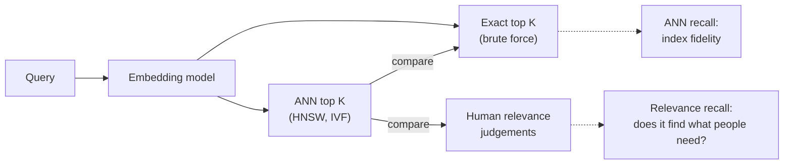

The first job of a retriever is not to rank perfectly. It is to make sure the chunks that answer the question are somewhere in what it hands on. A reranker can fix a bad order; a generator can ignore a weak chunk; nothing downstream can conjure a chunk that was never retrieved. **Recall@K** measures exactly that first job: of the chunks that would have helped, what fraction made it into the top $K$?

This lesson defines Recall@K precisely, works it by hand, and then deals with the things that make a recall number trustworthy or misleading: how to average it over queries, what happens when a query has more relevant chunks than $K$, why two different quantities are both called "recall" in vector search, what incomplete relevance judgements do to it, and how much a number computed on a few dozen queries can be trusted. The [Retrieval evaluation](/learn/retrieval-evaluation) module later builds a full evaluation harness with rank-aware metrics; this lesson gives you the metric that decides whether a first-stage retriever is doing its job.

## Learning objectives

- Define Recall@K for one query and compute it by hand from a ranking and a set of relevant chunks.
- Distinguish macro and micro averaging, capped recall and hit rate, and say when each is appropriate.
- Distinguish relevance recall from approximate-nearest-neighbour recall, and explain why a system can score well on one and badly on the other.
- Explain how incomplete relevance judgements bias recall, and how pooling limits the bias.
- Compute a bootstrap confidence interval for a difference in Recall@K between two retrievers, and interpret its width.

## Prerequisites

- [What is retrieval?](/learn/retrieval-fundamentals/what-is-retrieval): test collections, queries and relevance judgements.
- [Top-K retrieval](/learn/retrieval-fundamentals/top-k-retrieval): the cut, its monotonicity, and the candidate-depth and context-depth roles of $K$.
- Basic NumPy (arrays, `mean`, random number generators).

## Why this matters

Retrieval failures split into two kinds that need completely different fixes. Either the relevant chunk was retrieved but ranked or used badly, or it was never retrieved. The first is a precision or ordering problem, fixable with reranking, better prompts or a smaller context. The second is a recall problem, fixable only at or before the first stage: better chunking, a better embedding model, hybrid search, query rewriting, or a deeper candidate list. Teams that do not measure recall spend weeks tuning prompts and rerankers for failures whose cause is a chunk that never arrived.

Recall is also the metric that tells you how to set `fetch_k`. The candidate stage exists to hand the reranker everything it might need, so its success criterion is recall at the candidate depth: Recall@50, say, should be as close to 1 as the budget allows. Reporting only a final-answer score hides this entirely.

And recall is where intuition is most often fooled by small numbers. A change that lifts Recall@5 from 0.80 to 0.85 on twenty queries may be one query flipping. Without a sense of the uncertainty, teams ship regressions and revert improvements.

## The intuition

You ask a colleague to fetch every email from last month that mentions the Atlas outage. You know there were four. They come back with a stack of ten emails, three of which are about the outage.

Their **recall** is 3 out of 4: they found three quarters of what mattered. Notice what recall does not care about. It ignores the seven irrelevant emails in the stack (that is precision, the [next lesson](/learn/retrieval-fundamentals/precision-k)). It ignores whether the outage emails were on top or at the bottom of the stack. It only asks: of the things you needed, how many did you get?

Now give the colleague a rule: "bring me at most two emails." Even if they are perfect, they can now find at most two of the four, so their recall cannot exceed 0.5. The cap $K$ limits recall, which is why recall is always quoted at a specific $K$, and why a query with many relevant items behaves differently from a query with one.

Finally, notice how you knew the answer was four. You had already read your inbox. In retrieval evaluation, someone has to have labelled which chunks are relevant before recall can be computed at all, and if they missed one, the score is wrong in a way nobody notices.

## How it works

### The definition

For one query $q$, let $R_q$ be its set of relevant chunks (from the relevance judgements) and $\text{Top}_K(q)$ the retriever's top $K$. Then:

$$
\text{Recall@}K(q) = \frac{|\,\text{Top}_K(q) \cap R_q\,|}{|R_q|}
$$

The numerator counts relevant chunks retrieved within the cut; the denominator counts all relevant chunks for the query. The value lies between 0 and 1. Three consequences follow directly from the definition and from the monotonicity of top-$K$:

1. **Recall@K never decreases as $K$ grows.** Plotting it against $K$ gives a staircase that rises to 1 once every relevant chunk is included.
2. **Recall@K is order-blind within the cut.** A relevant chunk at rank 1 and one at rank $K$ count the same. Rank-sensitive metrics such as [MRR](/learn/retrieval-evaluation/mrr) and [NDCG](/learn/retrieval-evaluation/ndcg) exist for that.
3. **Recall@K is undefined when $R_q$ is empty.** A query with no relevant chunk in the collection (an unanswerable question) has no recall. Such queries must be excluded from the recall average and evaluated separately, for instance by checking whether the system declines to answer.

### Averaging over queries

A single query's recall is a noisy anecdote; what you report is an average over a test set $Q$. There are two ways to average, and they answer different questions.

**Macro average** (the standard in IR): compute recall per query, then take the mean.

$$
\text{Recall@}K = \frac{1}{|Q|} \sum_{q \in Q} \text{Recall@}K(q)
$$

Every query counts equally, so this answers "for a typical query, what fraction of its evidence do we retrieve?"

**Micro average**: pool the counts across queries, $\sum_q |\text{Top}_K(q) \cap R_q| \,/\, \sum_q |R_q|$. Queries with many relevant chunks count for more. The [Top-K retrieval](/learn/retrieval-fundamentals/top-k-retrieval) lesson's "relevant found" column was a micro count.

Use macro by default, because users experience queries, not chunks. Report micro alongside it only when queries with many relevant chunks matter more, for example in a compliance search where every relevant document must be found.

### Capped recall and hit rate

When a query has more relevant chunks than $K$, its recall cannot reach 1: with $|R_q| = 4$ and $K = 2$, the best possible value is 0.5. Averaging such queries with single-answer queries mixes "the retriever failed" with "the cut was too small to succeed". Two variants address this.

- **Capped recall** divides by $\min(K, |R_q|)$ instead of $|R_q|$, so a perfect retriever scores 1 at every $K$.
- **Hit rate** (also called success@K) is 1 if *any* relevant chunk is in the top $K$, else 0. It suits question answering where one good chunk is enough. The [Hit rate](/learn/retrieval-evaluation/hit-rate) lesson covers it.

For RAG, the right choice depends on what an answer needs. If questions are typically answered by one chunk, hit rate is honest and simple. If answers usually need several chunks (multi-part questions, policies spread across sections), plain recall is the honest measure, because retrieving one of three needed chunks produces a partial answer. Whichever you choose, name it explicitly: "recall" in one team's dashboard and another's may be different quantities.

### Two different "recalls"

Vector-search documentation uses the word recall for something else, and the confusion causes real mistakes.

- **Relevance recall** (this lesson) compares the retriever's top $K$ with **human relevance judgements**. It measures whether the system finds what people need.
- **ANN recall** compares an approximate index's top $K$ with the **exact** nearest neighbours under the same embedding model: $|\text{ANN}_K \cap \text{Exact}_K| / K$. It measures how faithfully the index reproduces brute-force search, which is what [Recall versus latency](/learn/vector-indexing-algorithms/recall-versus-latency) is about.

These are independent. An HNSW index with ANN recall of 0.99 faithfully returns the exact nearest neighbours of a query, but if the embedding model places the right chunk at rank 40, relevance recall at 5 is still 0. Conversely, a slightly lossy index barely moves relevance recall if the chunks it misses were not relevant anyway. Tuning `ef` to raise ANN recall from 0.95 to 0.99 will not fix a retriever whose problem is vocabulary mismatch. Always say which recall you mean.



### Incomplete judgements

Recall's denominator, $|R_q|$, is only as good as the relevance judgements. In a collection of a few hundred chunks, a person can check every chunk for every test query. In a collection of a million, nobody can, and unjudged chunks are conventionally treated as irrelevant.

That convention creates a bias. If a relevant chunk was never judged, it is missing from $R_q$. A retriever that finds it gets no credit, and a retriever that misses it is not penalised. The bias is worst for a *new* retriever that finds different chunks from the systems used when the judgements were made: its genuine improvements are invisible.

TREC's answer is **pooling**: run several different retrievers, take the union of their top results for each query (say the top 100 of each), and judge everything in the pool. Chunks outside every pool are assumed irrelevant. In practice, for a RAG team, this means: when you compare a new retriever, look at the chunks it retrieves that were never judged, judge them, and add them to the test set. A test set that is never extended slowly turns into a measure of similarity to the original system.

### Small test sets and uncertainty

Most RAG test sets have tens or a few hundred queries, not thousands. A macro average over 20 queries moves by 0.05 when a single query's recall changes from 0 to 1. Before believing a difference, estimate how much it could be noise.

The **bootstrap** is the simplest tool that works:

1. Compute the per-query recall for both retrievers on the same queries, and the per-query difference.
2. Resample the queries with replacement, the same number as the original set, many times (say 10,000).
3. For each resample, compute the mean difference.
4. The middle 95% of those means (the 2.5th to 97.5th percentiles) is an approximate 95% confidence interval.

Resampling *queries* (not chunks) and keeping the two systems' results for each query together (a **paired** bootstrap) matters: queries vary hugely in difficulty, and pairing removes that variation from the comparison. If the interval comfortably excludes zero, the difference is unlikely to be noise; if it straddles zero, you need more queries. The bootstrap is an approximation and is rough for very small samples, but it is far better than no interval at all. [Test set construction](/learn/testing-and-benchmarking/test-set-construction) covers how many queries to collect.

## The mathematics

**By hand: one query.** A query has three relevant chunks, $R_q = \{a, b, c\}$. The retriever's ranking is $x, a, y, b, z, c$.

- $K = 1$: top 1 is $\{x\}$, no relevant chunk: $0/3 = 0$.
- $K = 2$: $\{x, a\}$ contains $a$: $1/3 = 0.333$.
- $K = 4$: $\{x, a, y, b\}$ contains $a, b$: $2/3 = 0.667$.
- $K = 6$: all three: $3/3 = 1$.

Capped recall at $K = 2$ would be $1 / \min(2, 3) = 0.5$, and hit rate at $K = 2$ would be 1.

**By hand: averaging.** Three queries at $K = 5$. Query 1 has 1 relevant chunk and finds it (recall 1.0). Query 2 has 2 and finds 1 (0.5). Query 3 has 2 and finds none (0.0).

- Macro: $(1.0 + 0.5 + 0.0) / 3 = 0.5$.
- Micro: $(1 + 1 + 0) / (1 + 2 + 2) = 2/5 = 0.4$.

Micro is lower because the two queries with more relevant chunks, where the retriever did worse, carry more weight.

**ANN recall** has the same shape with exact search in place of human judgements: $\text{ANN-recall@}K = |\text{ANN}_K(q) \cap \text{Exact}_K(q)| / K$, averaged over queries. If HNSW returns 9 of the exact top 10, its ANN recall is 0.9 for that query, regardless of whether any of the 10 is relevant.

**In Python:**

```python
import numpy as np

def recall_at_k(ranked_ids, relevant, k):
    return len(set(ranked_ids[:k]) & relevant) / len(relevant)

ranking = ["x", "a", "y", "b", "z", "c"]
relevant = {"a", "b", "c"}
for k in (1, 2, 4, 6):
    print(f"Recall@{k} = {recall_at_k(ranking, relevant, k):.3f}")

per_query = np.array([1.0, 0.5, 0.0])        # three queries' Recall@5
print("macro average:", round(per_query.mean(), 3))
print("micro average:", round((1 + 1 + 0) / (1 + 2 + 2), 3))   # found / relevant, pooled
```

```output
Recall@1 = 0.000
Recall@2 = 0.333
Recall@4 = 0.667
Recall@6 = 1.000
macro average: 0.5
micro average: 0.4
```

## In code

**The problem.** Compare a lexical retriever (BM25) and a dense one (all-MiniLM-L6-v2) on a labelled Meridian test set at several $K$, per query and on average, and estimate how much of the difference could be noise.

**Dependencies.** NumPy, rank-bm25, sentence-transformers (the model, about 90 MB, downloads on first use). No API key.

```bash
pip install numpy rank-bm25 sentence-transformers
```

The 12 test queries are written the way employees ask, not the way the handbook is phrased, and three of them need two chunks.

```python
import re
import numpy as np
from rank_bm25 import BM25Okapi
from sentence_transformers import SentenceTransformer

chunks = {
    "leave-1":  "Annual leave is 25 days per year for full-time staff.",
    "leave-2":  "Up to 5 unused leave days carry over and must be used by 31 March.",
    "remote-1": "Staff may work remotely up to 3 days a week.",
    "remote-2": "The home-office equipment budget is £400. Contractors are not eligible.",
    "exp-1":    "Expenses must be submitted within 30 days of purchase.",
    "exp-2":    "Any expense over £75 needs a receipt.",
    "sec-1":    "Passwords must be rotated every 90 days.",
    "sec-2":    "VPN is required on public Wi-Fi.",
    "it-1":     "The laptop refresh cycle is 3 years.",
    "it-2":     "Report a lost laptop to the support desk at once.",
    "it-3":     "The support desk is open 08:00 to 18:00 UK time.",
    "old-1":    "2023 handbook (superseded): the laptop refresh cycle is 4 years.",
    "prod-1":   "Meridian Reports exports reports as PDF or CSV files.",
    "prod-2":   "Meridian Reports offers SAML single sign-on on the Enterprise plan.",
    "err-1":    "Atlas error E-4021: the VPN client is out of date. Update it from the IT portal.",
}
qrels = {
    "How much holiday do I get and can I carry days over?": {"leave-1", "leave-2"},
    "Can I claim back a £120 train ticket?": {"exp-1", "exp-2"},
    "Working from home rules": {"remote-1", "remote-2"},
    "Who do I tell if my computer is stolen?": {"it-2"},
    "Do I need to keep the till slip for a taxi?": {"exp-2"},
    "What's the deadline for using leftover holiday?": {"leave-2"},
    "How long do I have to file a claim?": {"exp-1"},
    "When can I phone IT support?": {"it-3"},
    "Laptop replacement policy": {"it-1"},
    "Does Reports support SSO?": {"prod-2"},
    "What should I do about Atlas error E-4021?": {"err-1"},
    "How often must I change my password?": {"sec-1"},
}
ids = list(chunks)

def recall_at_k(ranked_ids, relevant, k):
    """Fraction of this query's relevant chunks that appear in its top k."""
    return len(set(ranked_ids[:k]) & relevant) / len(relevant)

# Two retrievers, each returning a full ranking of chunk ids per query.
tok = lambda text: re.findall(r"[a-z0-9£]+", text.lower())
bm25 = BM25Okapi([tok(t) for t in chunks.values()])
model = SentenceTransformer("sentence-transformers/all-MiniLM-L6-v2")
D = model.encode(list(chunks.values()), normalize_embeddings=True)

def rank(scores):
    return [ids[i] for i in np.argsort(-np.asarray(scores), kind="stable")]

runs = {
    "bm25":  {q: rank(bm25.get_scores(tok(q))) for q in qrels},
    "dense": {q: rank(D @ model.encode([q], normalize_embeddings=True)[0]) for q in qrels},
}

# Per-query values and the macro average at several k.
per_query = {}
for name, run in runs.items():
    for k in (1, 3, 5):
        values = np.array([recall_at_k(run[q], rel, k) for q, rel in qrels.items()])
        per_query[name, k] = values
        print(f"{name:<6} Recall@{k} = {values.mean():.3f}   per query: {np.round(values, 2).tolist()}")

# How uncertain is the difference at k=3 with only 12 queries? Paired bootstrap.
rng = np.random.default_rng(0)
diff = per_query["dense", 3] - per_query["bm25", 3]
boot = [diff[rng.integers(0, len(diff), len(diff))].mean() for _ in range(10_000)]
low, high = np.percentile(boot, [2.5, 97.5])
print(f"\ndense - bm25 at k=3: {diff.mean():+.3f}  (95% bootstrap interval {low:+.3f} to {high:+.3f})")
```

```output
bm25   Recall@1 = 0.375   per query: [0.5, 0.5, 0.5, 0.0, 0.0, 0.0, 0.0, 0.0, 1.0, 0.0, 1.0, 1.0]
bm25   Recall@3 = 0.542   per query: [0.5, 0.5, 0.5, 0.0, 0.0, 0.0, 0.0, 1.0, 1.0, 1.0, 1.0, 1.0]
bm25   Recall@5 = 0.667   per query: [0.5, 0.5, 1.0, 0.0, 1.0, 0.0, 0.0, 1.0, 1.0, 1.0, 1.0, 1.0]
dense  Recall@1 = 0.792   per query: [0.5, 0.5, 0.5, 1.0, 1.0, 1.0, 1.0, 1.0, 0.0, 1.0, 1.0, 1.0]
dense  Recall@3 = 1.000   per query: [1.0, 1.0, 1.0, 1.0, 1.0, 1.0, 1.0, 1.0, 1.0, 1.0, 1.0, 1.0]
dense  Recall@5 = 1.000   per query: [1.0, 1.0, 1.0, 1.0, 1.0, 1.0, 1.0, 1.0, 1.0, 1.0, 1.0, 1.0]

dense - bm25 at k=3: +0.458  (95% bootstrap interval +0.208 to +0.708)
```

**The important lines.**

- `recall_at_k` is the definition, one line: intersect the top $K$ with the relevant set and divide by the relevant set's size.
- `runs` stores a full ranking per query per retriever. Every $K$ is computed from the same ranking, which keeps the numbers consistent and the evaluation cheap.
- `per_query` keeps per-query values, not only means. You need them to see which queries fail and to bootstrap.
- The bootstrap resamples query indices (`rng.integers(0, len(diff), len(diff))`) and averages the *paired* differences, with a fixed seed so the interval is reproducible.

**What the output means.**

- **Dense retrieval wins clearly here.** Its Recall@3 is 1.000; BM25's is 0.542. The failing BM25 queries are the paraphrased ones: "computer is stolen" (the chunk says "lost laptop"), "till slip" (the chunk says "receipt"), "leftover holiday" ("unused leave"), "file a claim" ("expenses must be submitted"). This is vocabulary mismatch, measured.
- **Dense Recall@1 of 0.792 hides a pattern.** The first three per-query values are 0.5 at $K = 1$: those are the two-chunk queries, which cannot exceed 0.5 at $K = 1$. Capped recall would score them 1.0, showing the retriever was not at fault. And "Laptop replacement policy" scores 0 at $K = 1$ for dense but 1.0 for BM25: dense put the lost-laptop chunk first and the superseded 2023 chunk second. Neither retriever dominates every query.
- **The interval is wide.** The dense-minus-BM25 difference at $K = 3$ is +0.458, with a 95% bootstrap interval from +0.208 to +0.708. With 12 queries the direction is convincing (the interval excludes zero by a margin), but the size is not: the true gap on similar queries could plausibly be anywhere from about a fifth to about three quarters. A claim like "dense improves recall by 46 points" would be over-reading 12 queries.
- **This is a toy collection.** A dense Recall@3 of 1.000 on 15 chunks says little about a collection of 50,000 chunks with many near-duplicates; the method transfers, the numbers do not.

**Common errors.** Dividing by $K$ instead of $|R_q|$ computes precision, not recall. Including queries with no relevant chunks either divides by zero or, if guarded with "recall = 0", drags the average down for reasons unrelated to retrieval. Matching chunk ids that changed when the corpus was re-chunked silently zeroes recall; judgements must reference stable ids (see [Document identifiers](/learn/document-engineering/document-identifiers)).

**Extending it.** Add capped recall and hit rate alongside plain recall and compare the three tables. Then add superseded-handbook distractors for more topics and check whether Recall@1 falls while Recall@5 holds, the signature of a ranking problem rather than a recall problem.

## A real-world example

The Platform team was asked whether to replace AskMeridian's embedding model with a newer, larger one. A vendor benchmark suggested a clear improvement. The team ran both models on their own test set of 150 labelled queries drawn from the assistant's logs.

Recall@10 rose from 0.87 to 0.89. The bootstrap interval for the difference ran from about -0.01 to +0.05: consistent with a small gain, but also with none. The per-query view was more informative than the average. The new model fixed eleven queries, mostly long natural-language questions, and broke seven, almost all of them containing Atlas error codes or product names, where the old model had been better at exact strings.

Two further checks changed the picture. First, they looked at chunks the new model retrieved that had never been judged: nineteen of them, of which six were genuinely relevant. The test set had been built by judging the old model's results, so it was biased towards the old model. After judging the new chunks, the gain grew slightly. Second, someone pointed out that the vector database's own dashboard reported "recall 0.98" for both configurations. That was ANN recall, index fidelity, and irrelevant to the decision.

The team kept the old model for now and added BM25 for identifier-heavy queries instead, which fixed the error-code failures that neither embedding model handled well. The decision rested on per-query recall, a confidence interval and an extended set of judgements, not on a single average or a vendor table.

## Common mistakes

- **Reporting recall without $K$.** "Recall is 0.9" is meaningless; Recall@3 and Recall@100 measure different things.
- **Confusing ANN recall with relevance recall.** A 0.99 from the vector database says the index matches brute force, not that users find what they need.
- **Averaging recall over unanswerable queries.** Recall is undefined when nothing is relevant; evaluate those queries separately.
- **Mixing multi-chunk and single-chunk queries without comment.** Multi-chunk queries cannot reach full recall at small $K$, which drags the average down for reasons unrelated to retrieval quality. Report capped recall or split the set.
- **Never extending the judgements.** Test sets built from one system's results under-credit a new system that finds different relevant chunks.
- **Declaring a winner from a small difference on a small set.** Without an interval, noise looks like progress.

## Best practices

- Report Recall@K at the depths that matter: the candidate depth (`fetch_k`) for the first stage, the context depth for the final list.
- Keep per-query results, not just averages. Read the failures; they tell you what kind of fix is needed.
- Use macro averaging by default, and state whether you report plain recall, capped recall or hit rate.
- Pair every comparison with a bootstrap interval over queries, and treat intervals that straddle zero as "no evidence yet".
- When a new retriever surfaces unjudged chunks, judge them and add them to the test set.
- Store judgements against stable chunk or document ids, and re-map them when re-chunking.

## Performance considerations

Computing recall is cheap: one set intersection per query per $K$. The expensive part is producing the rankings. Rank each query once, to the largest $K$ you will evaluate, and slice; for 500 queries and $K$ up to 100, that is 500 searches, not 500 per $K$.

Evaluation should use the same index configuration as production, including the approximate index and its search effort, otherwise relevance recall measured offline will not match what users get. Measure both: relevance recall against judgements, and, separately, ANN recall against exact search on a sample, so that you know which of the two limits you.

The bootstrap costs $B \times |Q|$ additions; at $B = 10{,}000$ and $|Q| = 500$ that is 5 million, well under a second in NumPy. The real cost of trustworthy recall is human: judging chunks. If judging one query's candidates takes three minutes, a 300-query test set is 15 hours of expert time, which is why [synthetic test data](/learn/testing-and-benchmarking/synthetic-test-data) is popular and why its limitations matter.

## Summary

- Recall@K is the fraction of a query's relevant chunks that appear in its top $K$. It measures whether the retriever's first job, getting the evidence in, is done.
- It is monotone in $K$, blind to order within the cut, and undefined for queries with no relevant chunks.
- Macro averaging weights queries equally; capped recall and hit rate fix the ceiling that multi-chunk queries impose at small $K$. Name the variant you use.
- Relevance recall (against human judgements) and ANN recall (against exact search) measure different things and can disagree completely.
- Incomplete judgements bias recall towards the systems that were judged; small test sets need confidence intervals before differences are believed.

## Exercises

**1.** A query has relevant chunks $\{c_2, c_7\}$. The ranking is $c_4, c_7, c_1, c_9, c_2, c_3$. Compute Recall@1, Recall@3, Recall@5, capped Recall@1 and hit rate at 3.

<details><summary>Show solution</summary>

- Recall@1: top 1 is $\{c_4\}$, none relevant: $0/2 = 0$.
- Recall@3: $\{c_4, c_7, c_1\}$ contains $c_7$: $1/2 = 0.5$.
- Recall@5: adds $c_9, c_2$; contains $c_7, c_2$: $2/2 = 1.0$.
- Capped Recall@1: $0 / \min(1, 2) = 0$.
- Hit rate at 3: at least one relevant in the top 3, so 1.

</details>

**2.** Your vector database reports "recall@10 = 0.97" after an index rebuild, but users say answers got worse. Give two explanations consistent with both facts, and say how you would distinguish them.

<details><summary>Show solution</summary>

The 0.97 is almost certainly ANN recall: the index reproduces 97% of the exact top 10 under the current embedding model. It says nothing about relevance.

1. **The rebuild changed the embeddings** (a new model, a different preprocessing step, missing query prefixes). The index faithfully finds the nearest neighbours of worse vectors. Relevance recall fell; ANN recall is unaffected.
2. **The rebuild changed the content** (re-chunking that split answers across chunks, a dropped document source). The index is accurate over a worse collection.

To distinguish: run the labelled test set and compute relevance Recall@10 before and after (using stable ids). Then check the embedding configuration and compare the chunk counts and sources of the two indexes.

</details>

**3.** Modify the code to also print capped Recall@1 and hit rate at 1 for both retrievers. Which conclusions about dense retrieval at $K = 1$ change?

<details><summary>Show solution</summary>

```python
def capped_recall_at_k(ranked_ids, relevant, k):
    return len(set(ranked_ids[:k]) & relevant) / min(k, len(relevant))

def hit_at_k(ranked_ids, relevant, k):
    return float(bool(set(ranked_ids[:k]) & relevant))
```

From the per-query values, dense recall at 1 was 0.5 for the three two-chunk queries (one of their two chunks was first), 0 for "Laptop replacement policy", and 1 elsewhere. Capped recall and hit rate at 1 both score the two-chunk queries 1.0, so dense rises from 0.792 to $11/12 = 0.917$ on both. The conclusion changes from "dense misses a fifth of the evidence at rank 1" to "dense puts a relevant chunk first for 11 of 12 queries"; the remaining failure is the laptop query. For BM25, the first three per-query values are also 0.5, so its capped Recall@1 and hit rate at 1 rise from 0.375 to $(3 + 3) / 12 = 0.5$.

</details>

**4.** Design decision. The team has 40 labelled queries and two candidate retrievers whose Recall@20 differ by 0.03, with a bootstrap interval of -0.04 to +0.10. The product manager wants a decision this week. What do you recommend, and what would you do to make the next decision easier?

<details><summary>Show solution</summary>

The interval straddles zero comfortably, so the data do not distinguish the retrievers on recall. Decide on other grounds: cost, latency, operational simplicity, and the per-query failures (does one retriever fail on a category the business cares about, such as error codes?). If those are equal, keep the incumbent; switching has its own cost.

To make the next decision easier: grow the test set (interval width shrinks roughly with the square root of the number of queries, so four times as many queries roughly halves it), stratify it by query type so per-category recall can be reported, and judge the unjudged chunks each candidate retrieves so the comparison is not biased towards the system the judgements came from.

</details>

## Check your understanding

```quiz
[
  {
    "q": "A query has 4 relevant chunks. The retriever's top 5 contains 3 of them. What is Recall@5?",
    "options": [
      "0.6",
      "0.75",
      "1.0",
      "0.8"
    ],
    "answer": 1,
    "why": "Recall divides the relevant chunks retrieved (3) by all relevant chunks for the query (4)."
  },
  {
    "q": "Why can a query with 3 relevant chunks never reach Recall@2 = 1?",
    "options": [
      "Because recall is always below 1",
      "Because the top 2 can contain at most 2 of the 3 relevant chunks",
      "Because the retriever is approximate",
      "Because recall ignores order"
    ],
    "answer": 1,
    "why": "With K smaller than the number of relevant chunks, the best possible recall is K divided by the number of relevant chunks. Capped recall corrects for this."
  },
  {
    "q": "An HNSW index has recall 0.99 at k=10 according to the database's benchmark tool. What does this tell you?",
    "options": [
      "The approximate index returns almost the same top 10 as exact search with the same embeddings",
      "99% of user questions retrieve a relevant chunk in the top 10",
      "The embedding model is well suited to the domain",
      "Precision@10 is also about 0.99"
    ],
    "answer": 0,
    "why": "That is ANN recall, measured against brute-force search. It says nothing about relevance to users."
  },
  {
    "q": "Test-set judgements were made by labelling the old retriever's top 20 results. A new retriever finds several relevant chunks the old one never returned. What happens to its measured recall?",
    "options": [
      "It is overestimated",
      "It is computed exactly",
      "It is underestimated, because those chunks are unjudged and treated as irrelevant",
      "It becomes undefined"
    ],
    "answer": 2,
    "why": "Unjudged chunks are conventionally assumed irrelevant, so the new retriever gets no credit for them. Judging them removes the bias."
  },
  {
    "q": "Retriever B beats A by 0.04 in macro Recall@5 on 25 queries, with a paired bootstrap 95% interval of -0.03 to +0.11. What is the best reading?",
    "options": [
      "B is 4 points better and should be deployed",
      "A is better",
      "The bootstrap is invalid for recall",
      "The data are consistent with no difference; more queries are needed to tell"
    ],
    "answer": 3,
    "why": "An interval that straddles zero means the observed gap could plausibly be noise from this small sample."
  }
]
```

## Further reading

- Christopher D. Manning, Prabhakar Raghavan and Hinrich Schütze (2008), *Introduction to Information Retrieval*, chapter 8, "Evaluation in information retrieval" (recall, precision, pooling). Free online at [nlp.stanford.edu/IR-book](https://nlp.stanford.edu/IR-book/).
- Ellen M. Voorhees and Donna K. Harman, editors (2005), *TREC: Experiment and Evaluation in Information Retrieval*, MIT Press. Pooling and the reliability of test collections.
- Mark D. Smucker, James Allan and Ben Carterette (2007), "A Comparison of Statistical Significance Tests for Information Retrieval Evaluation", *CIKM 2007*. Bootstrap, permutation and t-tests compared on IR metrics.
- Nandan Thakur and colleagues (2021), "BEIR: A Heterogeneous Benchmark for Zero-shot Evaluation of Information Retrieval Models", [arXiv:2104.08663](https://arxiv.org/abs/2104.08663). Recall@100 used to compare first-stage retrievers across domains.
