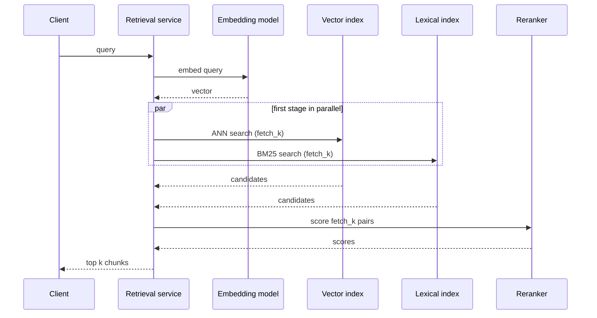

In a RAG system, retrieval runs before the language model writes a single token. Every millisecond it takes is a millisecond the user stares at a spinner, and unlike generation, it cannot be hidden by streaming. A retriever that is accurate but slow forces a bad bargain: either users wait, or the team quietly cuts `fetch_k`, drops the reranker or lowers the search effort until it is fast, and loses the accuracy it had.

This lesson teaches you to reason about retrieval latency as an engineer: what the time is spent on, why averages lie and percentiles do not, how stages combine in series and in parallel, why fanning out to many shards makes the tail worse, why latency explodes as a service approaches full load, and how to measure all of it correctly. You will time the stages of a real local pipeline. Techniques for making things faster (caching, batching, async execution) belong to the [Performance optimisation](/learn/performance-optimisation) module; the index-level trade-off between speed and accuracy is in [Recall versus latency](/learn/vector-indexing-algorithms/recall-versus-latency). This lesson gives you the measurements and the arithmetic those rest on.

## Learning objectives

- Break a retrieval request into its stages and identify which typically dominate.
- Explain why latency is reported as percentiles, and compute p50, p95 and p99 from measurements.
- Combine stage latencies in series and in parallel, and compute how fan-out across shards amplifies tail latency.
- Use the M/M/1 queueing formula and Little's law to explain why latency grows sharply near full utilisation.
- Measure stage latencies correctly (warm-up, clocks, concurrency) and set a per-stage latency budget.

## Prerequisites

- [Retrieval pipeline](/learn/rag-architecture-fundamentals/retrieval-pipeline): the stages between query and results.
- [Top-K retrieval](/learn/retrieval-fundamentals/top-k-retrieval): `fetch_k`, final $k$, shards.
- [Approximate nearest neighbour search](/learn/vector-indexing-algorithms/approximate-nearest-neighbour-search): why ANN indexes are fast.
- Basic statistics: median and percentiles.

## Why this matters

A user's perception of an assistant's speed is dominated by **time to first token**: how long before text starts appearing. For a RAG system that is roughly

$$
\text{TTFT} \approx t_{\text{retrieval}} + t_{\text{prompt processing}} + t_{\text{first token}}
$$

Retrieval is the only part the RAG engineer fully controls, and it is easy to let it grow. Each improvement to quality adds a stage: query rewriting (a model call), hybrid search (a second index), reranking (a cross-encoder over dozens of pairs), permission filtering (a lookup). Each stage is individually reasonable, and the sum is a retriever that takes a second before the model even starts.

Latency also fails unevenly. A system that answers most questions in 300 ms but one in fifty in 3 seconds feels unreliable, and the slow requests are often the ones that matter: complex questions, cold caches, the busiest hour. A team that watches only the average will not see them. And because retrieval is on the critical path of every request, its latency under load determines how many requests a deployment can serve before everything slows down at once.

## The intuition

Picture a sandwich shop. An order passes through stations: take the order, toast the bread, fill it, wrap it. The time you wait is the sum of the stations' times, so the slowest station dominates. If the toaster takes four minutes, speeding up wrapping from 20 seconds to 10 is pointless. Retrieval stages add up the same way, and the first question is always which station is the toaster.

Now suppose a large order needs one item from each of twenty stalls in a food court, and you cannot leave until all twenty are ready. Each stall is usually quick but occasionally has a hiccup: a new batch of chips, a till that jams. With one stall a hiccup is rare. With twenty, it is likely that *some* stall is having one, and you always wait for the slowest. That is fan-out: a query sent to twenty shards waits for the slowest shard.

Finally, picture the shop at lunchtime. When it is half busy, you are served almost at once. When it is nearly full, a queue forms, and the queue, not the cooking, is what you wait for. A small rise in customers near capacity produces a large rise in waiting. That is queueing, and it is why a retriever that is fast in a test can be slow in production.

## How it works

### Where the time goes

A typical retrieval request passes through these stages. Not every system has all of them.

1. **Network and request handling**: client to service, authentication, request parsing.
2. **Query processing**: normalisation, and optionally rewriting or expansion with a language model (often the single most expensive optional stage).
3. **Query embedding**: one forward pass of the embedding model, locally or by a call to a hosted embedding API (adding a network round trip).
4. **First-stage search**: the ANN index lookup and, for hybrid retrieval, a lexical search, ideally in parallel.
5. **Filtering**: metadata and permission predicates, applied during or after search.
6. **Payload fetch**: retrieving chunk text and metadata for the candidates, from the vector database or a separate document store.
7. **Fusion and reranking**: merging result lists; a cross-encoder scoring `fetch_k` pairs.
8. **Context assembly**: de-duplication, ordering, token counting.



In most pipelines the reranker and any language-model call dominate, the embedding is next, and the ANN search itself is small. That ordering surprises people who assume "vector search" is the slow part; the code below shows it on a laptop.

### Percentiles, not averages

Latency is a distribution, not a number. Run the same request a thousand times and you get a spread: most near some typical value, a few much slower because of garbage collection, a cache miss, a busy CPU, a network retransmission. Latency distributions are almost always **right-skewed**: a long tail of slow requests.

The **mean** is pulled up by the tail but hides its shape: a mean of 100 ms can be 100 ms for everyone or 50 ms for most and 2 seconds for a few. **Percentiles** describe the distribution directly. The $p$-th percentile is the value below which $p$% of requests fall:

- **p50** (the median): the typical request.
- **p95**: one request in twenty is slower than this.
- **p99**: one in a hundred is slower.

Service-level objectives are written on percentiles ("p95 retrieval latency below 300 ms"), because users experience the tail. A user who sends twenty questions in a session will, on average, hit the p95 once.

### Series, parallel and the critical path

Stages combine in two ways.

- **In series** (embed, then search, then rerank), latencies **add**. The total's median is roughly the sum of the medians when stages are independent, but percentiles do not add exactly: the p99 of a sum is usually less than the sum of the p99s, because it is unlikely that every stage has its worst moment on the same request.
- **In parallel** (BM25 and vector search at the same time), the request waits for the **slowest** branch: the latency is the maximum, not the sum.

The **critical path** is the chain of stages that determines the total. Optimising a stage off the critical path (a parallel branch that is already faster than its sibling) does nothing. Before optimising, find the critical path; [distributed tracing](/learn/rag-observability/distributed-tracing), which records a timed span for every stage of every request, is how production systems do it.

### Fan-out amplifies the tail

When an index is sharded, a query goes to all $n$ shards in parallel and waits for the slowest. Suppose each shard independently has a 1% chance of being slower than its own p99. The chance that at least one of $n$ shards is that slow is

$$
P(\text{at least one slow}) = 1 - (1 - 0.01)^n
$$

which is about 10% for 10 shards and 63% for 100. What was a rare event on one machine becomes the common case for the whole query. This observation is the subject of Dean and Barroso's "The Tail at Scale" (2013), which also describes mitigations such as **hedged requests**: send a duplicate request to another replica if the first has not answered within, say, the p95, and use whichever answers first.

### Load and queueing

So far, latency has been the time to *do* the work. Under load, requests also *wait* for a free worker. Queueing theory gives the shape of that wait.

Two quantities matter. **Throughput** $\lambda$ is the arrival rate (requests per second). **Utilisation** $\rho$ is the fraction of time the workers are busy: for one worker with mean service time $S$, $\rho = \lambda S$. In the simplest model (the **M/M/1 queue**: random arrivals, random service times, one worker), the mean time in the system is

$$
W = \frac{S}{1 - \rho}
$$

At 50% utilisation, requests take twice their service time on average; at 90%, ten times; as $\rho$ approaches 1, $W$ grows without bound. Real systems are not exactly M/M/1, but the shape (gentle at low load, explosive near capacity) is general. It is why capacity planning targets a utilisation well below 100%, and why a retrieval service that looked fast in a single-user benchmark can collapse at the morning peak. **Little's law**, $L = \lambda W$, links the number of requests in the system $L$ to throughput and latency, and holds for essentially any stable system: if 50 requests per second each spend 0.2 s in the service, 10 are in flight on average, which tells you how many workers or connections you need.

### Measuring correctly

Most latency numbers people quote are wrong in one of a few predictable ways.

1. **No warm-up.** The first calls load models, allocate memory, compile kernels and fill caches. Discard them, or measure them separately as cold-start latency.
2. **The wrong clock.** Use a monotonic high-resolution clock (`time.perf_counter()` in Python), not wall-clock time, which can jump.
3. **Single-user measurement only.** One request at a time measures service time, not latency under load. Measure at realistic concurrency too.
4. **Averages only.** Record every sample, or a histogram, and report percentiles.
5. **Unrealistic inputs.** The same query repeated hits caches; tiny test chunks rerank faster than real ones. Use real queries and real chunk lengths.
6. **Coordinated omission.** A load generator that waits for each response before sending the next request slows down exactly when the system does, so it under-samples the slow periods. Send requests on a fixed schedule instead.

### A latency budget

A **latency budget** allocates the end-to-end target across stages, so each component has a number to meet and a regression is attributable. For example, a p95 retrieval target of 300 ms might be split as: network and handling 30 ms, query embedding 30 ms, first-stage search including filters 40 ms, payload fetch 20 ms, reranking 150 ms, assembly 10 ms, with 20 ms of headroom. The split itself is a design decision. It records, for instance, that reranking is worth half the budget because it buys precision, and that a query-rewriting model call does not fit and must either be cheap or justify a larger budget.

## The mathematics

### Percentiles

**Intuition.** Sort the measurements; the $p$-th percentile sits $p$% of the way along.

One simple definition (the **nearest-rank** method): for $n$ sorted samples $x_{(1)} \leq \dots \leq x_{(n)}$, the $p$-th percentile is $x_{(\lceil p n / 100 \rceil)}$. NumPy's default `np.percentile` interpolates linearly between neighbouring samples instead, so results differ slightly for small $n$. With 200 samples, the p99 rests on the two slowest measurements, so it is noisy; reliable p99 estimates need thousands of samples.

**By hand.** Ten latencies in ms, sorted: 10, 11, 11, 12, 12, 13, 14, 15, 30, 120. Nearest-rank p50: $\lceil 0.5 \times 10 \rceil = 5$th value, 12 ms. p90: 9th value, 30 ms. The mean is $248 / 10 = 24.8$ ms, more than twice the median, dragged up by one 120 ms outlier that no typical user experiences.

### Fan-out

**Intuition.** The query is fast only if every shard is fast.

$$
P(\text{query slow}) = 1 - (1 - p)^n
$$

where $p$ is the probability that one shard is slow (for example, beyond its p99, so $p = 0.01$) and $n$ the number of shards, assumed independent. **By hand:** $n = 10$: $1 - 0.99^{10} = 1 - 0.904 = 0.096$. $n = 50$: $1 - 0.99^{50} = 1 - 0.605 = 0.395$.

### Queueing

**Intuition.** Near full load, waiting dominates working.

$$
W = \frac{S}{1 - \rho}, \qquad \rho = \lambda S, \qquad L = \lambda W
$$

where $S$ is the mean service time, $\lambda$ the arrival rate, $\rho$ the utilisation (must be below 1 for the queue to be stable), $W$ the mean time in the system and $L$ the mean number of requests in it. **By hand:** a reranker with $S = 20$ ms on one worker. At $\lambda = 25$ requests per second, $\rho = 25 \times 0.020 = 0.5$ and $W = 20 / 0.5 = 40$ ms. At $\lambda = 45$, $\rho = 0.9$ and $W = 200$ ms: 80% more traffic, five times the latency. $L = 45 \times 0.2 = 9$ requests in flight.

**In Python**, with the fan-out effect also simulated on a skewed (lognormal) latency distribution:

```python
import numpy as np

# 1. Fan-out: chance that at least one of n shards is slower than its own p99
for n in (1, 10, 50, 100):
    print(f"n={n:>3}: P(at least one shard in its slowest 1%) = {1 - 0.99 ** n:.3f}")

# 2. Simulated shard latencies: median about 5 ms, with a long right tail
rng = np.random.default_rng(0)
shard_ms = rng.lognormal(mean=np.log(5), sigma=0.5, size=(100_000, 20))
one = shard_ms[:, 0]
fan20 = shard_ms.max(axis=1)              # the query waits for the slowest of 20
print("one shard     p50 %.1f  p99 %.1f ms" % tuple(np.percentile(one, [50, 99])))
print("max of 20     p50 %.1f  p99 %.1f ms" % tuple(np.percentile(fan20, [50, 99])))

# 3. Queueing: mean time in an M/M/1 system with a 20 ms service time
S = 20.0
for rho in (0.5, 0.8, 0.9, 0.95):
    print(f"utilisation {rho:.2f}: mean response {S / (1 - rho):6.0f} ms")
```

```output
n=  1: P(at least one shard in its slowest 1%) = 0.010
n= 10: P(at least one shard in its slowest 1%) = 0.096
n= 50: P(at least one shard in its slowest 1%) = 0.395
n=100: P(at least one shard in its slowest 1%) = 0.634
one shard     p50 5.0  p99 16.1 ms
max of 20     p50 12.5  p99 25.8 ms
utilisation 0.50: mean response     40 ms
utilisation 0.80: mean response    100 ms
utilisation 0.90: mean response    200 ms
utilisation 0.95: mean response    400 ms
```

The simulation shows the tail becoming the norm: the *median* of the slowest-of-20 (12.5 ms) is two and a half times a single shard's median (5.0 ms), and the p99 rises from 16.1 to 25.8 ms. Fan-out makes the typical request experience what used to be the tail.

## In code

**The problem.** Measure each stage of a local retrieval pipeline (query embedding, exact and HNSW vector search over 100,000 vectors, cross-encoder reranking of 20 pairs) with proper warm-up and percentiles, and estimate the serial total.

**Dependencies.** NumPy, FAISS (the `faiss-cpu` package) and sentence-transformers. The two models download on first use. No API key, no server.

```bash
pip install numpy faiss-cpu sentence-transformers
```

The vectors are random unit vectors standing in for chunk embeddings. That is fine for timing, because search cost depends on the number and dimension of vectors and the index settings, not on what they mean; it would not be fine for measuring search *accuracy*, since random vectors have no cluster structure.

```python
import time
import numpy as np
import faiss
from sentence_transformers import SentenceTransformer, CrossEncoder

def timed(fn, runs=200, warmup=10):
    """Call fn repeatedly; return per-call latencies in milliseconds."""
    for _ in range(warmup):
        fn()
    out = []
    for _ in range(runs):
        start = time.perf_counter()
        fn()
        out.append((time.perf_counter() - start) * 1000)
    return np.array(out)

def report(name, ms):
    p50, p95, p99 = np.percentile(ms, [50, 95, 99])
    print(f"{name:<26} p50 {p50:7.2f}  p95 {p95:7.2f}  p99 {p99:7.2f}  mean {ms.mean():7.2f} ms")

faiss.omp_set_num_threads(1)                      # one thread, like one request
rng = np.random.default_rng(0)
N, DIM = 100_000, 384
vectors = rng.standard_normal((N, DIM)).astype("float32")
faiss.normalize_L2(vectors)                       # stand-ins for chunk embeddings

flat = faiss.IndexFlatIP(DIM)
flat.add(vectors)
hnsw = faiss.IndexHNSWFlat(DIM, 32, faiss.METRIC_INNER_PRODUCT)
hnsw.hnsw.efConstruction = 64
hnsw.add(vectors)
hnsw.hnsw.efSearch = 64

encoder = SentenceTransformer("sentence-transformers/all-MiniLM-L6-v2")
reranker = CrossEncoder("cross-encoder/ms-marco-MiniLM-L-6-v2")
query = "Can I carry unused leave days over into next year?"
passage = "Up to 5 unused leave days carry over and must be used by 31 March. " * 4
qvec = encoder.encode([query], normalize_embeddings=True).astype("float32")

stages = {
    "embed query":             lambda: encoder.encode([query], normalize_embeddings=True),
    "exact search (100k)":     lambda: flat.search(qvec, 50),
    "HNSW search (100k)":      lambda: hnsw.search(qvec, 50),
    "rerank 20 pairs":         lambda: reranker.predict([(query, passage)] * 20),
}
results = {name: timed(fn, runs=100 if "rerank" in name else 200) for name, fn in stages.items()}
for name, ms in results.items():
    report(name, ms)

# Serial pipeline: embed -> HNSW -> rerank. Add sampled latencies stage by stage.
idx = rng.integers(0, 100, size=(3, 10_000))
total = (results["embed query"][idx[0]] + results["HNSW search (100k)"][idx[1]]
         + results["rerank 20 pairs"][idx[2]])
report("serial total (sampled)", total)
```

Your numbers will differ: these are from one run on a laptop CPU, and depend on hardware, thread settings and library versions. The output of that run was:

```output
embed query                p50    6.21  p95    7.54  p99    7.88  mean    6.38 ms
exact search (100k)        p50    3.94  p95    5.91  p99    7.25  mean    4.15 ms
HNSW search (100k)         p50    0.23  p95    0.34  p99    0.47  mean    0.24 ms
rerank 20 pairs            p50   27.88  p95   29.64  p99   30.94  mean   27.76 ms
serial total (sampled)     p50   34.52  p95   36.74  p99   38.60  mean   34.49 ms
```

**The important lines.**

- `timed` runs `warmup` calls that are thrown away, then records each call with `time.perf_counter()`, a monotonic high-resolution clock. It returns every sample, so any percentile can be computed later.
- `faiss.omp_set_num_threads(1)` makes FAISS use one thread per search, closer to a server handling many concurrent requests than a benchmark that gives one query the whole machine.
- `IndexFlatIP` is exact search (every vector scored); `IndexHNSWFlat` with `efSearch = 64` is approximate. Both return the top 50.
- The reranking stage scores 20 (query, passage) pairs with passages of roughly realistic length; cross-encoder cost grows with both the number of pairs and their token length.
- The last block estimates the serial pipeline by summing randomly sampled stage latencies. It assumes the stages are independent, which is an approximation.

**What the output means.**

- **The reranker dominates.** At a p50 of about 28 ms for 20 pairs, it is roughly four and a half times the query embedding and over a hundred times the HNSW search. Reranking 100 pairs would cost about five times as much (Exercise 3 measures this). `fetch_k` is a latency parameter as much as a quality one.
- **HNSW search is a fraction of a millisecond** at 100,000 vectors, against about 4 ms for exact search. Exact search scales linearly with $N$: at 10 million vectors it would be roughly 100 times slower, while HNSW grows far more slowly. At small $N$, exact search is perfectly adequate, as [Flat indexes](/learn/vector-indexing-algorithms/flat-indexes) argues.
- **Query embedding costs several milliseconds** on a CPU even for a small model. A hosted embedding API replaces this with a network round trip, typically longer and with a heavier tail.
- **The serial total's median is close to the sum of the stage medians** (6.2 + 0.2 + 27.9 ≈ 34.3 ms against 34.5 ms), and its p99 (38.6 ms) is a little below the sum of the stage p99s (7.9 + 0.5 + 30.9 ≈ 39.3 ms), because the worst moments of independent stages rarely coincide. This is single-request service time on an idle machine. Under concurrent load, queueing adds to it.

**Common errors.** Timing the first call includes model loading and makes the stage look ten times slower than it is. Letting PyTorch and FAISS each use every core in a benchmark, then deploying many workers per machine, gives numbers that production cannot reproduce. Timing a GPU model without synchronising the device measures only the time to enqueue the work.

**Extending it.** Run the same stages from several threads at once (for example with `concurrent.futures.ThreadPoolExecutor`) and watch p95 rise as utilisation climbs. Then vary `efSearch` (16, 64, 256) and plot latency against the ANN recall you measure with the exact index as ground truth.

## A real-world example

AskMeridian's p95 retrieval latency crept from about 250 ms at launch to over 900 ms in six months, and staff began to complain that the assistant "thinks for ages" before answering. Nobody had changed the vector database, which was the first suspect.

The Platform team added a timed span for every stage and looked at a day of traces. The vector search on their Qdrant cluster was a small, steady fraction of the total. Three other things had grown. `fetch_k` for the reranker had been raised from 30 to 100 to fix a recall complaint, roughly tripling reranking time. Chunks had grown longer after a change to the chunker, so each cross-encoder pair cost more. And a query-rewriting step, added for vague questions, called a language model on every request, including the majority that were already specific.

The fixes followed the budget. They measured Recall@K at several candidate depths on their labelled set and found that recall stopped improving at about 40, so `fetch_k` went back down to 40. The reranker was given a maximum input length and moved to a machine with a GPU. Query rewriting was made conditional on a cheap check of whether the query was short or vague. They also noticed that at the 09:00 peak the reranker workers ran at over 85% utilisation, so its p95 there was far worse than at noon; they added workers to bring peak utilisation down. Each stage now has a p95 budget on a dashboard, and an alert fires when a stage exceeds it, so the next slow creep is attributed to its cause within a day.

## Common mistakes

- **Reporting the mean.** It hides the tail users complain about; report p50, p95 and p99.
- **Blaming the vector index first.** In most RAG pipelines the reranker, language-model calls and network hops dominate; measure before optimising.
- **Benchmarking one request at a time.** Service time is not latency under load; queueing near capacity can multiply it.
- **Raising `fetch_k` or chunk size without checking latency.** Reranking cost grows with both.
- **Ignoring fan-out.** Adding shards to speed up search can make the tail worse, because the query waits for the slowest shard.
- **Timing without warm-up, or with the wall clock.** Cold-start effects and clock jumps contaminate the numbers.
- **Running independent stages in series.** BM25 and vector search can run in parallel; sequencing them adds the faster one's latency for nothing.

## Best practices

- Instrument every stage with a timed span and record full latency distributions.
- Set a p95 (or p99) budget per stage and alert on breaches.
- Run independent stages in parallel and keep expensive stages (reranking, model calls) conditional where possible.
- Choose `fetch_k` from a recall curve and a latency measurement together.
- Load-test at realistic concurrency with an open-loop generator (fixed request schedule), and keep peak utilisation of each stage well below 1.
- For sharded indexes, measure tail latency as shard count grows, and consider hedged requests for the slowest percentiles.

## Performance considerations

This whole lesson is about performance, so this section collects the arithmetic for quick reuse.

- **Exact vector search** costs about $N \times d$ multiply-adds: $10^5 \times 384 \approx 3.8 \times 10^7$ per query, a few milliseconds on one CPU core as measured above; $10^7$ vectors would be roughly 100 times that.
- **Reranking** costs roughly `fetch_k` model passes over (query + chunk) tokens. Halving chunk length or `fetch_k` roughly halves it.
- **Hosted API calls** (embedding, rewriting) add a network round trip whose tail is outside your control; budget for its p99, not its p50, and set timeouts.
- **Capacity**: if a stage's service time is $S$ and you allow utilisation $\rho_{\max}$, one worker handles $\rho_{\max} / S$ requests per second. With $S = 30$ ms and $\rho_{\max} = 0.6$, that is 20 per second per worker; at a peak of 100 requests per second you need at least 5 workers for that stage.
- **Generation dominates end-to-end time** in most RAG systems, but retrieval sits before the first token, so it affects perceived speed disproportionately. Streaming the answer ([Streaming responses](/learn/generation-strategies/streaming-responses)) hides generation time, not retrieval time.

## Summary

- Retrieval latency is the sum of its serial stages and the maximum of its parallel ones; the reranker and any model calls usually dominate, not the ANN search.
- Latency is a skewed distribution: report p50, p95 and p99, and budget on the tail.
- Fan-out to $n$ shards makes the query wait for the slowest; the chance of hitting a 1-in-100 slow shard is $1 - 0.99^n$.
- Under load, waiting grows as $S / (1 - \rho)$: gentle at low utilisation, explosive near capacity.
- Measure with warm-up, a monotonic clock, realistic inputs and realistic concurrency; give every stage a budget.

## Exercises

**1.** A pipeline runs query embedding (p50 8 ms), then BM25 (p50 15 ms) and vector search (p50 6 ms) in parallel, then reranking (p50 40 ms). Estimate the p50 of the whole pipeline. Which stage would you optimise first, and which optimisation would be wasted?

<details><summary>Show solution</summary>

Serial: $8 + \max(15, 6) + 40 \approx 63$ ms (approximating the median of a max by the max of medians, reasonable when one branch is clearly slower). Optimise the reranker first: it is 40 of the 63 ms. Speeding up the vector search would be wasted while it runs in parallel with a slower BM25 branch: it is off the critical path. If anything in the parallel branch is optimised, it should be BM25.

</details>

**2.** A sharded index serves queries over 40 shards. Each shard's own p99 latency is 30 ms and its median is 8 ms. Roughly what fraction of queries will see at least one shard slower than 30 ms? Name two mitigations.

<details><summary>Show solution</summary>

$1 - 0.99^{40} \approx 1 - 0.669 = 0.331$: about a third of queries. The query's p99 will be well above 30 ms.

Mitigations: **hedged requests** (send a duplicate to another replica of a slow shard after a short delay and take the first answer); **fewer, larger shards** if memory allows, since $n$ drives the effect; reducing per-shard variance (avoiding garbage-collection pauses, isolating noisy neighbours); and returning partial results after a deadline when completeness is less important than speed.

</details>

**3.** Extend the code: time `reranker.predict` for 10, 20, 50 and 100 pairs and print the p50 of each. Fit a straight line to the four points. What does the slope tell you, and how would you use it to choose `fetch_k`?

<details><summary>Show solution</summary>

```python
sizes = [10, 20, 50, 100]
p50s = [np.percentile(timed(lambda n=n: reranker.predict([(query, passage)] * n), runs=30), 50)
        for n in sizes]
slope, intercept = np.polyfit(sizes, p50s, 1)
print([round(float(x), 1) for x in p50s], f"slope {slope:.2f} ms/pair, intercept {intercept:.1f} ms")
```

One run on the same laptop gave p50s of 17.2, 30.4, 69.4 and 135.8 ms, a slope of 1.32 ms per pair and an intercept of 3.9 ms; your numbers will differ. The slope is the marginal cost of one extra candidate; the intercept is fixed overhead per call. Growth is close to linear because the work is proportional to the number of pairs. To choose `fetch_k`: take the reranking budget (say 150 ms at p95), subtract the intercept, divide by the slope (with headroom for the tail), and compare the result with the depth at which Recall@K stops improving on your labelled set. Use the smaller of the two; if the recall-saturating depth is larger, the reranker needs faster hardware or a smaller model.

</details>

**4.** Design decision. A reranking service has mean service time 25 ms per request on one worker. Peak traffic is 120 requests per second, and the team's target is a mean reranking latency below 50 ms at peak. Using the M/M/1 formula per worker (assume traffic is spread evenly), how many workers do you need? What would you check in reality, given that the model is an approximation?

<details><summary>Show solution</summary>

$W = S / (1 - \rho) < 50$ ms with $S = 25$ ms requires $1 - \rho > 0.5$, so $\rho < 0.5$. Per worker, $\rho = \lambda_{\text{worker}} \times 0.025$, so $\lambda_{\text{worker}} < 20$ requests per second. At 120 per second: $120 / 20 = 6$ workers is the boundary, so provision at least 7 for margin.

In reality: service times are not exponential and arrivals are burstier than random, so measure p95 (not just the mean) under an open-loop load test at peak rate; check that load balancing really spreads requests evenly; and consider a shared queue across workers (an M/M/c system), which performs better than independent queues per worker at the same total capacity.

</details>

## Check your understanding

```quiz
[
  {
    "q": "Latencies for ten requests are 10, 11, 11, 12, 12, 13, 14, 15, 30 and 120 ms. Why is the mean (24.8 ms) a poor summary?",
    "options": [
      "It is pulled up by one outlier and describes neither the typical request nor the tail",
      "It should be computed with a geometric average",
      "It is always lower than the median",
      "It is correct; latency should be summarised by the mean"
    ],
    "answer": 0,
    "why": "Latency is right-skewed. The median (12 ms) describes the typical request and high percentiles describe the tail; the mean blurs both."
  },
  {
    "q": "BM25 search (20 ms) and vector search (5 ms) run in parallel. Which change reduces the pipeline's latency?",
    "options": [
      "Making the vector search 4 ms",
      "Making BM25 search 12 ms",
      "Adding a second vector index in parallel",
      "Increasing the embedding dimension"
    ],
    "answer": 1,
    "why": "Parallel stages take the maximum. BM25 is on the critical path; the vector search is not."
  },
  {
    "q": "A query fans out to 100 shards, each with a 1% chance of being slower than its p99. Roughly what fraction of queries hit at least one slow shard?",
    "options": [
      "1%",
      "10%",
      "63%",
      "100%"
    ],
    "answer": 2,
    "why": "1 - 0.99^100 is about 0.63. Fan-out turns a rare per-shard event into a common per-query one."
  },
  {
    "q": "In an M/M/1 queue with a 20 ms service time, what happens to mean latency when utilisation rises from 0.5 to 0.9?",
    "options": [
      "It rises from 20 ms to 36 ms",
      "It stays at 20 ms",
      "It doubles",
      "It rises from 40 ms to 200 ms"
    ],
    "answer": 3,
    "why": "W = S / (1 - rho): 20/0.5 = 40 ms and 20/0.1 = 200 ms."
  },
  {
    "q": "Which measurement practice gives misleadingly low tail latency under load?",
    "options": [
      "Using time.perf_counter",
      "A load generator that waits for each response before sending the next request",
      "Discarding warm-up calls",
      "Recording every sample"
    ],
    "answer": 1,
    "why": "A closed-loop generator slows down when the system does, so it under-samples slow periods (coordinated omission). Use a fixed request schedule."
  }
]
```

## Further reading

- Jeffrey Dean and Luiz André Barroso (2013), "The Tail at Scale", *Communications of the ACM* 56(2). Fan-out, tail amplification and hedged requests.
- Brendan Gregg (2020), *Systems Performance: Enterprise and the Cloud*, 2nd edition, Addison-Wesley. Methodology for measuring latency and utilisation.
- Mor Harchol-Balter (2013), *Performance Modeling and Design of Computer Systems: Queueing Theory in Action*, Cambridge University Press. M/M/1, M/M/c and Little's law in depth.
- FAISS documentation and wiki, [github.com/facebookresearch/faiss/wiki](https://github.com/facebookresearch/faiss/wiki). Index types and their speed and accuracy trade-offs.
