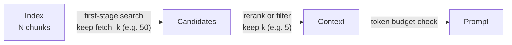

Every retriever ends with the same instruction: keep the best $k$. It looks like the least interesting parameter in the system, a number in a config file, usually 5. In practice it is one of the most consequential. Set $k$ too small and the chunk that answers the question is ranked sixth and never reaches the model. Set it too large and the prompt fills with loosely related text that costs tokens, adds latency and gives the model more opportunities to be distracted or misled.

This lesson is about choosing and implementing that cut. It covers what $k$ trades off, why one $k$ is rarely right for every query or every stage, how adaptive cut-offs work and where they fail, and what it takes to get a correct top $k$ out of a sharded or approximate index. The mechanics of *selecting* the $k$ largest scores efficiently (heaps and partial selection) are covered in [Similarity search](/learn/vector-database-fundamentals/similarity-search); here the question is which $k$, and what the cut does to the rest of the system.

## Learning objectives

- Explain what the top-$k$ cut trades off: the chance of including relevant chunks against noise, tokens and latency.
- Choose $k$ separately for a candidate stage and a final context stage, and justify each from measurements.
- Implement a relative-score adaptive cut-off and identify the queries it harms.
- Prove that a sharded top-$k$ merge is exact only if every shard returns $k$ results, and apply the same reasoning to approximate indexes.
- Size $k$ from a token budget rather than a fixed count.

## Prerequisites

- [What is retrieval?](/learn/retrieval-fundamentals/what-is-retrieval): retrieval as a ranked list, the probability ranking principle.
- [Query-document similarity](/learn/retrieval-fundamentals/query-document-similarity): why scores are comparable only within one query.
- [Similarity search](/learn/vector-database-fundamentals/similarity-search): exact search and efficient top-$k$ selection.
- [Retrieval pipeline](/learn/rag-architecture-fundamentals/retrieval-pipeline): the `fetch_k` and `k` funnel, and filtering before or after the cut.

## Why this matters

The top-$k$ cut is the point at which the retriever commits. Everything above it goes forward; everything below is gone, and no later stage can bring it back. A reranker can reorder the 50 candidates it is given but cannot see the 51st. A generator can reason over the five chunks in its prompt but knows nothing of the sixth.

Two failure modes follow, and they pull in opposite directions.

**Too small.** Ranking is imperfect, so the relevant chunk is often not first. A question with two parts ("how much leave do I get, and can I carry it over?") needs two chunks, and $k = 1$ guarantees half an answer. A system tuned on single-fact questions with $k = 2$ will quietly fail on comparison and multi-part questions.

**Too large.** Every extra chunk adds tokens to every request. Extra chunks are, on average, less relevant than the ones above them, so the proportion of noise in the prompt rises with $k$. Models do not use long contexts uniformly: research on the [lost-in-the-middle problem](/learn/context-engineering/lost-in-the-middle-problem) found that models used information at the start and end of a long context more reliably than information in the middle. And loosely related chunks are where contradictory or outdated statements come from.

## The intuition

Think of a hiring manager with 500 applications and time for a handful of interviews. Shortlist three, and if the CV screen misjudged the best candidate as number four, she is never seen. Shortlist forty, and the week is wasted on people who were never plausible.

So sensible organisations use two numbers. A recruiter skims all 500 CVs and passes on a generous 30, because passing on someone weak is a cheap mistake and dropping someone strong an expensive one. The hiring manager reads those 30 carefully and invites 5. The first number makes sure the right people survive; the second fits the time available for careful attention.

A retrieval pipeline works the same way. A fast first stage keeps a generous `fetch_k`, chosen so that relevant chunks almost always survive. A careful second stage (a reranker, or the generator itself) works with a small final $k$, chosen to fit the context budget and to keep noise down. Asking a single number to do both jobs is the root of most top-$k$ mistakes.

## How it works

### What the cut does

For a query $q$, the retriever produces scores for the candidate chunks and keeps the $k$ highest. Formally the result is the set

$$
\text{Top}_k(q) = \{ d : \text{fewer than } k \text{ chunks score strictly higher than } d \}
$$

with ties broken by some rule, and returned in decreasing score order. Three properties of this operation shape everything else:

1. **It is relative.** Whether a chunk survives depends on the other chunks' scores, not on its own score alone. The same chunk with the same score is kept for one query and dropped for another.
2. **It always returns $k$ items** (if the collection has that many). A query with no relevant chunk still gets $k$ results.
3. **It is monotone in $k$.** $\text{Top}_k(q) \subseteq \text{Top}_{k+1}(q)$. Increasing $k$ never removes a chunk, so the number of relevant chunks found can only rise or stay flat, and the number of irrelevant chunks passed on can only rise or stay flat.

Property 3 is the trade-off in miniature. As $k$ grows, relevant chunks found climbs towards its ceiling and then flattens; irrelevant chunks passed on grows almost linearly once the relevant ones are exhausted.

```playground
top-k
```

### One cut or two

Most production pipelines have two cuts, as in the [retrieval pipeline](/learn/rag-architecture-fundamentals/retrieval-pipeline):



The two numbers have different jobs and should be chosen by different criteria.

- **`fetch_k` (candidate depth)** exists to make sure relevant chunks survive into the careful stage. Choose it by measuring how often relevant chunks appear within the first $n$ positions of the first-stage ranking, and pick the depth at which that stops improving. It is limited by the cost of the next stage: a cross-encoder scoring 50 pairs is affordable; 5,000 usually is not. The [Candidate generation](/learn/retrieval-fundamentals/candidate-generation) lesson develops this.
- **Final `k` (context depth)** exists to give the generator what it needs and little else. Choose it from the kinds of question you serve (how many chunks does a typical answer need?), the chunk size, the token budget, and measurements of answer quality, not only of retrieval.

With no reranker, one $k$ must do both jobs, a compromise that is one of the strongest arguments for a second stage.

### Choosing k from measurements

The disciplined way to set $k$ is to plot what each value buys on a labelled query set, which the code below does:

1. Take test queries with their relevant chunk ids (a test collection, as in [What is retrieval?](/learn/retrieval-fundamentals/what-is-retrieval)).
2. Rank each query once, deep (say 100 results).
3. For each candidate $k$, count the relevant chunks inside the top $k$ and the irrelevant ones passed on, summed over queries.
4. Read off where the relevant count flattens. Beyond that point every extra slot buys almost nothing but noise.
5. Check the answer against cost: tokens per request, latency of the next stage.

The relevant-chunks-found fraction in step 3 is **Recall@K**, the subject of [the next lesson](/learn/retrieval-fundamentals/recall-k); the proportion of the $k$ slots that are relevant is [Precision@K](/learn/retrieval-fundamentals/precision-k). For now, raw counts are enough.

### Adaptive cut-offs

A fixed $k$ treats every query alike. A single-fact question ("when is the support desk open?") needs one chunk; a comparison ("how did the laptop policy change from 2023?") needs two or three. Adaptive cut-offs try to let the score distribution choose $k$ per query. Three common rules, all applied within a maximum $k_{\max}$:

- **Absolute threshold**: keep chunks with score $\geq \tau$. As [Query-document similarity](/learn/retrieval-fundamentals/query-document-similarity) showed, raw scores are not comparable across queries, so a fixed $\tau$ is fragile. [Retrieval thresholding](/learn/advanced-retrieval-optimisation/retrieval-thresholding) covers how to set one responsibly.
- **Relative threshold**: keep chunks with score $\geq \alpha \cdot s_{\text{top}}$, for example $\alpha = 0.75$. This adapts to each query's scale (for scores that are positive), but it is still a heuristic.
- **Largest gap**: sort the scores and cut where the drop between consecutive scores is largest, on the theory that relevant chunks cluster above a cliff.

All three share a weakness that the code makes concrete. A multi-part question usually has one part that matches strongly and another that matches weakly, because the query's embedding (or its terms) leans towards one part. The second chunk falls below the relative threshold or below the gap, and the cut removes exactly the evidence the second half of the answer needs. Adaptive cut-offs suit single-fact traffic and harm multi-part traffic; measure on both before adopting one.

> [!TIP]
> A safe compromise is a **floor and a ceiling**: always keep at least $k_{\min}$ (say 2) chunks, never more than $k_{\max}$ (say 6), and let a relative rule choose in between. The floor protects multi-part questions; the ceiling bounds cost.

### Top-k in a sharded index

Large indexes are split into **shards** (partitions held on different machines, or segments within one machine). A query is sent to every shard, each returns its own top results, and a coordinator merges them. The merge is exact only if each shard returns $k$ results, not $k$ divided by the number of shards. The proof is in the mathematics section; the intuition is that all of the global top $k$ might live on one shard.

The same reasoning extends to approximate nearest-neighbour indexes. An HNSW search, for instance, maintains a candidate list whose size is a search parameter (called `ef` or `efSearch` in most implementations; covered in [HNSW](/learn/vector-indexing-algorithms/hnsw)). The final top $k$ is taken from that list, so the list must hold at least $k$ entries, and in practice several times $k$ for good recall; hnswlib's documentation, for example, states that `ef` should be at least $k$. Asking an approximate index for a larger $k$ without raising its search effort can return a longer but less accurate list.

Filtering interacts with the cut in the same way. If a filter is applied after the top $k$ is taken, a query whose best matches are mostly filtered out returns fewer than $k$ results, possibly none. The [retrieval pipeline](/learn/rag-architecture-fundamentals/retrieval-pipeline) lesson covers pre- and post-filtering.

### Ties and determinism

Scores tie more often than you might expect: duplicated chunks have identical embeddings, BM25 gives identical scores to chunks with identical term statistics, and low-precision storage rounds nearby scores together. If a tie straddles the cut, which chunk survives depends on the sort implementation or which shard answered first, and the same question gets different answers on different replicas. Break ties explicitly, for example by chunk id. Approximate indexes add their own non-determinism, one reason to evaluate against a fixed index snapshot.

### Sizing k from a token budget

Chunks differ in length, so "5 chunks" can mean 600 tokens or 6,000. A more robust rule fills the context by **token budget**: walk down the ranked list, adding chunks while the running total stays within the budget, up to $k_{\max}$. This keeps cost predictable and lets the system include more short chunks or fewer long ones. The budget is what remains of the context window after the fixed parts of the prompt and the space reserved for the answer; the arithmetic is below, and [Token budgets](/learn/cost-engineering/token-budgets) treats it fully.

## The mathematics

### Why a sharded merge needs k from every shard

**Intuition.** If any shard could hide one of the true top $k$ below its own cut, the coordinator would never see it. A shard can only do that if it returns fewer than $k$.

**Claim.** Let the collection be partitioned into shards $P_1, \dots, P_m$. Let $T$ be the global top $k$, and $T_j$ the top $k$ within shard $P_j$. Then $T \subseteq \bigcup_j T_j$, so taking the top $k$ of the union returns exactly $T$ (ties aside).

**Proof.** Take any $d \in T$, and say it lives in shard $P_j$. Fewer than $k$ chunks in the whole collection score higher than $d$, so certainly fewer than $k$ chunks in $P_j$ do. Hence $d$ is in $P_j$'s top $k$, that is, $d \in T_j$. Every member of $T$ is therefore in the union. The union may contain extra chunks, but they all score below the members of $T$ (otherwise they would be in $T$), so the top $k$ of the union is $T$.

If each shard returns only $k' < k$, the argument fails: when all of $T$ sits on one shard, only $k'$ of its members are returned.

**By hand.** Shard A holds scores 0.91, 0.88, 0.86, 0.40; shard B 0.72, 0.30; shard C 0.65, 0.20. The global top 3 is 0.91, 0.88, 0.86, all on A. If each shard returns $k = 3$, the coordinator sees A's three, B's two and C's two, and its top 3 is correct. If each returns $k/m = 1$, it sees 0.91, 0.72, 0.65 and returns two wrong chunks.

**In Python:**

```python
import heapq

shards = {                       # chunk id -> score, already computed on each shard
    "A": {"a1": 0.91, "a2": 0.88, "a3": 0.86, "a4": 0.40},
    "B": {"b1": 0.72, "b2": 0.30},
    "C": {"c1": 0.65, "c2": 0.20},
}
k = 3

def shard_top(scores, n):
    return heapq.nlargest(n, scores.items(), key=lambda kv: (kv[1], kv[0]))

def merged_top_k(per_shard):
    pooled = [hit for name in shards for hit in shard_top(shards[name], per_shard)]
    return [cid for cid, _ in heapq.nlargest(k, pooled, key=lambda kv: (kv[1], kv[0]))]

everything = {cid: s for sh in shards.values() for cid, s in sh.items()}
print("true global top-3:        ", [c for c, _ in heapq.nlargest(k, everything.items(), key=lambda kv: kv[1])])
print("each shard returns k=3:   ", merged_top_k(per_shard=3))
print("each shard returns k/3=1: ", merged_top_k(per_shard=1))
```

```output
true global top-3:         ['a1', 'a2', 'a3']
each shard returns k=3:    ['a1', 'a2', 'a3']
each shard returns k/3=1:  ['a1', 'b1', 'c1']
```

`heapq.nlargest` performs the bounded-heap selection described in [Similarity search](/learn/vector-database-fundamentals/similarity-search); the `(score, id)` key breaks ties by id so the result is deterministic. The network cost of exactness is $m \times k$ results per query instead of $k$: with 16 shards and $k = 50$, the coordinator merges 800 entries, which is trivial, but each shard must also find 50, not about 3.

### Token budget

**Intuition.** The context window is shared by instructions, the question, the retrieved chunks and the answer. Chunks get what is left.

$$
k_{\max} = \left\lfloor \frac{B - P - A}{c} \right\rfloor
$$

where $B$ is the input-plus-output token budget you allow per request (often far smaller than the model's maximum, for cost and latency), $P$ the tokens of system prompt, instructions and question, $A$ the tokens reserved for the answer, $c$ the average chunk length in tokens, and $\lfloor \cdot \rfloor$ rounds down.

**By hand.** Assume a per-request budget of $B = 6{,}000$ tokens, $P = 800$, $A = 1{,}000$ and $c = 350$. Then $k_{\max} = \lfloor 4{,}200 / 350 \rfloor = 12$. Halving the chunk size to 175 tokens doubles $k_{\max}$ to 24, which is why chunk size and $k$ must be tuned together, not separately. (These numbers are illustrative assumptions, not recommendations.) In Python this is simply `(B - P - A) // c`.

## In code

**The problem.** Measure what each value of $k$ buys on a labelled Meridian query set, for a dense and a lexical retriever, and test a relative adaptive cut-off against a fixed $k$.

**Dependencies.** NumPy, rank-bm25 and sentence-transformers (the all-MiniLM-L6-v2 model, about 90 MB, downloads on first use). No API key.

```bash
pip install numpy rank-bm25 sentence-transformers
```

The query set includes two multi-part questions with two relevant chunks each, which matters for the adaptive cut-off.

```python
import re
import numpy as np
from rank_bm25 import BM25Okapi
from sentence_transformers import SentenceTransformer

chunks = {
    "leave-1":  "Annual leave is 25 days per year for full-time staff.",
    "leave-2":  "Up to 5 unused leave days carry over and must be used by 31 March.",
    "remote-1": "Staff may work remotely up to 3 days a week.",
    "remote-2": "The home-office equipment budget is £400. Contractors are not eligible.",
    "exp-1":    "Expenses must be submitted within 30 days of purchase.",
    "exp-2":    "Any expense over £75 needs a receipt.",
    "sec-1":    "Passwords must be rotated every 90 days.",
    "sec-2":    "VPN is required on public Wi-Fi.",
    "it-1":     "The laptop refresh cycle is 3 years.",
    "it-2":     "Report a lost laptop to the support desk at once.",
    "it-3":     "The support desk is open 08:00 to 18:00 UK time.",
    "old-1":    "2023 handbook (superseded): the laptop refresh cycle is 4 years.",
    "prod-1":   "Meridian Reports exports reports as PDF or CSV files.",
    "prod-2":   "Meridian Reports offers SAML single sign-on on the Enterprise plan.",
    "err-1":    "Atlas error E-4021: the VPN client is out of date. Update it from the IT portal.",
}
qrels = {
    "How much holiday do I get and can I carry days over?": {"leave-1", "leave-2"},
    "Can I claim back a £120 train ticket?": {"exp-1", "exp-2"},
    "What do I need to do on café Wi-Fi?": {"sec-2"},
    "When can I phone IT support?": {"it-3"},
    "I left my laptop on the train": {"it-2"},
    "Does Reports support SSO?": {"prod-2"},
    "Working from home rules": {"remote-1", "remote-2"},
    "Can I work from home and what equipment can I buy?": {"remote-1", "remote-2"},
}
ids = np.array(list(chunks))
model = SentenceTransformer("sentence-transformers/all-MiniLM-L6-v2")
D = model.encode(list(chunks.values()), normalize_embeddings=True)
Q = model.encode(list(qrels), normalize_embeddings=True)
S_dense = Q @ D.T                                  # one row of scores per query

tok = lambda text: re.findall(r"[a-z0-9£]+", text.lower())
bm25 = BM25Okapi([tok(t) for t in chunks.values()])
S_bm25 = np.array([bm25.get_scores(tok(q)) for q in qrels])

TOKENS_PER_CHUNK = 300                             # assumption for the cost column
total = sum(len(rel) for rel in qrels.values())
for name, S in [("dense", S_dense), ("bm25", S_bm25)]:
    order = np.argsort(-S, axis=1, kind="stable")  # ranked chunk indices per query
    print(f"{name}:  k  relevant found  irrelevant passed  prompt tokens")
    for k in [1, 2, 3, 5, 8]:
        found = sum(len(set(ids[order[i, :k]]) & rel) for i, rel in enumerate(qrels.values()))
        noise = len(qrels) * k - found
        print(f"      {k:>2}   {found:>2}/{total} ({found/total:>4.0%})  {noise:>8}/{len(qrels)*k:<8} {k*TOKENS_PER_CHUNK:>6}")

def relative_cutoff(scores, ranked, alpha=0.75, k_max=5):
    top = scores[ranked[0]]
    return [i for i in ranked[:k_max] if scores[i] >= alpha * top]

print("\ndense, adaptive cut-off: keep chunks scoring >= 0.75 x the top score (max 5)")
order = np.argsort(-S_dense, axis=1, kind="stable")
kept_total = found_total = 0
for i, (query, rel) in enumerate(qrels.items()):
    kept = relative_cutoff(S_dense[i], order[i])
    hit = len(set(ids[kept]) & rel)
    kept_total, found_total = kept_total + len(kept), found_total + hit
    print(f"  k={len(kept)}  {hit}/{len(rel)} relevant  {query}")
print(f"  total: {kept_total} chunks passed, {found_total}/{total} relevant found")
```

```output
dense:  k  relevant found  irrelevant passed  prompt tokens
       1    8/12 ( 67%)         0/8           300
       2   12/12 (100%)         4/16          600
       3   12/12 (100%)        12/24          900
       5   12/12 (100%)        28/40         1500
       8   12/12 (100%)        52/64         2400
bm25:  k  relevant found  irrelevant passed  prompt tokens
       1    5/12 ( 42%)         3/8           300
       2    6/12 ( 50%)        10/16          600
       3    8/12 ( 67%)        16/24          900
       5   10/12 ( 83%)        30/40         1500
       8   12/12 (100%)        52/64         2400

dense, adaptive cut-off: keep chunks scoring >= 0.75 x the top score (max 5)
  k=2  2/2 relevant  How much holiday do I get and can I carry days over?
  k=1  1/2 relevant  Can I claim back a £120 train ticket?
  k=1  1/1 relevant  What do I need to do on café Wi-Fi?
  k=1  1/1 relevant  When can I phone IT support?
  k=1  1/1 relevant  I left my laptop on the train
  k=2  1/1 relevant  Does Reports support SSO?
  k=2  2/2 relevant  Working from home rules
  k=1  1/2 relevant  Can I work from home and what equipment can I buy?
  total: 11 chunks passed, 10/12 relevant found
```

**The important lines.**

- `S_dense` and `S_bm25` hold one row of scores per query. `np.argsort(-S, axis=1, kind="stable")` ranks each row once; every $k$ is then just a slice `order[i, :k]`, which is property 3 (monotonicity) in code. Ranking once, deeply, and slicing is how you should run any $k$ sweep.
- `found` counts relevant chunks inside each top $k$, summed over queries; `noise` is the remaining slots.
- `TOKENS_PER_CHUNK` is an assumption to show cost; real chunks vary, which is why the token-budget rule exists.
- `relative_cutoff` keeps chunks within 75% of the top score, at most five. It works on cosine scores, which are positive here; on scores that can be negative it would need a different form.

**What the output means.**

- **The dense retriever saturates at $k = 2$**: every relevant chunk is found, and from then on each extra slot adds only noise (4 irrelevant chunks at $k = 2$, 52 at $k = 8$). On this tiny, clean corpus that is the honest result; on a real corpus of thousands of chunks the curve rises more slowly.
- **BM25 needs $k = 8$ to reach the same point**, because vocabulary mismatch pushes some relevant chunks down the ranking. The right $k$ depends on the retriever: a weaker first stage needs a deeper cut, and $k$ tuned for one retriever is wrong for another.
- **The adaptive cut-off passes 11 chunks instead of the 16 that fixed $k = 2$ passes, with only one irrelevant chunk among them, but finds 10 of 12 relevant chunks instead of 12.** The two misses are both two-part questions ("claim back a train ticket", which needs both the deadline and the receipt rules; "work from home and what equipment"), where the second relevant chunk scores well below the first. This is the predicted failure: relative cut-offs drop the weaker half of a multi-part answer.

**Common errors.** Re-running the search for every $k$ instead of slicing one deep ranking wastes time and, on an approximate index, can give inconsistent rankings. Applying a relative threshold to negative scores (cross-encoder logits) inverts its meaning.

**Extending it.** Add a minimum of two chunks to `relative_cutoff` (the floor-and-ceiling rule) and check that it recovers both misses. Then replace the fixed `TOKENS_PER_CHUNK` with real token counts from `tiktoken` and fill a 1,200-token budget instead of a fixed $k$.

## A real-world example

AskMeridian launched with dense retrieval and $k = 3$, a value from the tutorial the team had followed. Three months in, the Platform team reviewed questions that users had marked as unhelpful and found two clusters.

The first cluster was multi-part questions from new starters: "what's the leave allowance and when do I lose unused days?", "can I expense a monitor or does it come out of the home-office budget?". The top 3 usually contained the chunk for the first part and two near-misses, but the chunk for the second part sat at rank 4 to 7. The answers were half-right, which users found worse than a refusal.

The second cluster went the other way: short lookups ("support desk hours") answered correctly but with a distracting extra sentence about the superseded 2023 hours, which had been in the third slot.

The team did not simply raise $k$; they split the cut in two. The vector search keeps `fetch_k = 30`, chosen because on their labelled set of 300 queries relevant chunks stopped appearing below about rank 25. A cross-encoder reranks those 30 and keeps 2 to 6 by a floor-and-ceiling rule, capped at 2,500 tokens. A metadata filter removed superseded documents before the search, fixing the second cluster at its cause rather than by tuning $k$. The labelled set gained forty multi-part questions so the original failure would stay visible.

## Common mistakes

- **Copying $k$ from a tutorial.** The right value depends on your retriever, chunk size, question mix and budget; an unmeasured $k$ is a guess.
- **Using one $k$ for two jobs.** Without a second stage, $k$ must catch low-ranked relevant chunks and keep the prompt clean, and it does neither well.
- **Tuning $k$ on single-fact questions only.** Multi-part and comparison questions need more chunks and are where small or adaptive cut-offs fail.
- **Asking each shard for $k$ divided by the shard count.** The merged result is no longer the true top $k$ whenever the best results cluster on one shard.
- **Raising $k$ on an approximate index without raising its search effort.** The extra results are less accurate.
- **Counting chunks instead of tokens.** Five long chunks can overflow a budget that five short ones barely use.

## Best practices

- Sweep $k$ on a labelled query set: rank once, deeply, then slice. Plot relevant found and irrelevant passed against $k$.
- Use a generous `fetch_k` for candidates and a small final $k$ for context, each chosen by its own criterion.
- Prefer a token budget with a floor and ceiling on the number of chunks over a bare count.
- Make shards return the full $k$, keep HNSW's `ef` comfortably above $k$, and re-check ANN recall when $k$ grows.
- Break score ties deterministically, by chunk id.
- Re-measure $k$ whenever the retriever, the embedding model, the chunk size or the question mix changes.

## Performance considerations

The cost of $k$ falls mostly downstream of retrieval.

- **Generation.** Input tokens grow linearly with $k$. At an assumed 350 tokens per chunk, $k = 5$ adds 1,750 input tokens per request and $k = 10$ adds 3,500. At 100,000 requests a day, the difference is 175 million input tokens a day; multiply by your provider's current per-token price to see what the extra five chunks cost.
- **Reranking.** A cross-encoder's work is linear in `fetch_k`. Doubling `fetch_k` from 50 to 100 doubles reranking time; see [Retrieval latency](/learn/retrieval-fundamentals/retrieval-latency).
- **First-stage search.** Exact search costs the same whatever $k$ is, because every chunk is scored; selection adds about $N \log k$ comparisons, negligible beside scoring. Approximate search cost grows with the search effort needed to return a good top $k$, so very large $k$ on an ANN index is not free.
- **Sharding.** The coordinator receives $m \times k$ results ($16 \times 100 = 1{,}600$ per query), cheap to merge if hits carry ids and scores only; fetch chunk text just for the final top $k$.

## Summary

- The top-$k$ cut is final: nothing below it reaches later stages. It is relative to the other chunks, always returns $k$ results, and is monotone in $k$.
- Larger $k$ finds more relevant chunks up to a ceiling and then adds only noise, tokens and latency. Measure where that ceiling is for your retriever.
- Use two cuts with two jobs: a generous `fetch_k` so relevant chunks survive, and a small final $k$ that fits the context budget.
- Adaptive cut-offs save tokens on single-fact questions and drop evidence on multi-part ones; a floor and ceiling limits the damage.
- Exact sharded top-$k$ requires every shard to return $k$; approximate indexes need search effort above $k$; ties must be broken deterministically.

## Exercises

**1.** Using the dense output above, how many irrelevant chunks per query does $k = 5$ pass to the generator on average, and how many relevant ones? If chunks average 300 tokens, how many of the 1,500 context tokens per query are irrelevant?

<details><summary>Show solution</summary>

At $k = 5$: 28 irrelevant chunks over 8 queries is 3.5 per query; 12 relevant over 8 is 1.5 per query. Irrelevant tokens: $3.5 \times 300 = 1{,}050$ of 1,500, so 70% of the retrieved context is noise. On this corpus $k = 2$ found every relevant chunk with 0.5 irrelevant chunks per query.

</details>

**2.** A collection is split over 4 shards and the application needs the top 20. A colleague sets each shard to return 5 "because 4 × 5 = 20". Construct a small example where this returns the wrong result, and state the correct setting.

<details><summary>Show solution</summary>

Put the six best chunks (scores 0.95 down to 0.90) on shard 1 and spread the rest across all shards. Shard 1 returns only its top 5, so the sixth-best chunk overall (0.90) never reaches the coordinator, and the merged top 20 includes a weaker chunk in its place. More generally, any time more than 5 of the true top 20 live on one shard, the result is wrong. Each shard must return 20.

</details>

**3.** Modify `relative_cutoff` to keep at least `k_min=2` chunks, and re-run. How many chunks are passed in total, and how many relevant chunks are found? Compare with fixed $k = 2$.

<details><summary>Show solution</summary>

```python
def relative_cutoff(scores, ranked, alpha=0.75, k_min=2, k_max=5):
    top = scores[ranked[0]]
    kept = [i for i in ranked[:k_max] if scores[i] >= alpha * top]
    return list(ranked[:max(k_min, len(kept))])
```

Every query now keeps at least two chunks. The five queries that kept one now keep two, and the three that kept two are unchanged, so 16 chunks are passed, exactly as for fixed $k = 2$, and all 12 relevant chunks are found. On this corpus no query had three or more chunks above the threshold, so the rule degenerates to $k = 2$. On a larger corpus with more varied score distributions, the ceiling and the relative rule would make different choices per query. The exercise shows why the floor matters: it is what rescued the two multi-part questions.

</details>

**4.** Design decision. Meridian Reports' documentation search answers customer questions with an average chunk of 450 tokens. The per-request budget is 8,000 tokens; the system prompt and question take 1,200 and the answer is capped at 1,500. There is no reranker. Propose a value or rule for $k$, and say what you would measure to defend it.

<details><summary>Show solution</summary>

$k_{\max} = \lfloor (8{,}000 - 1{,}200 - 1{,}500) / 450 \rfloor = \lfloor 5{,}300 / 450 \rfloor = 11$. That is the ceiling, not the choice. Without a reranker, the single cut must catch relevant chunks the first stage ranks low, so it should be towards the generous end, but noise rises with $k$.

A defensible rule: fill up to 5,300 tokens, with at least 3 and at most 8 chunks, in rank order. To defend it, sweep $k$ from 1 to 15 on labelled customer questions (including multi-part ones), plot relevant chunks found against $k$, and choose where the curve flattens; then compare answer quality there and at a smaller $k$. If the curve is still rising at 8, the first stage is weak, and the better fix is a reranker over a deeper `fetch_k`.

</details>

## Check your understanding

```quiz
[
  {
    "q": "Which property of top-k retrieval explains why increasing k can never reduce the number of relevant chunks found?",
    "options": [
      "Scores are normalised between 0 and 1",
      "The top k is monotone: the top k is always contained in the top k+1",
      "Approximate indexes are exact for large k",
      "Relevant chunks always have the highest scores"
    ],
    "answer": 1,
    "why": "Increasing k only adds chunks below the old cut; it never removes any, so relevant chunks found can only rise or stay flat."
  },
  {
    "q": "A pipeline retrieves fetch_k = 40 candidates and reranks to k = 5. What should fetch_k primarily be chosen for?",
    "options": [
      "To fit the model's context window",
      "To minimise the number of irrelevant chunks in the prompt",
      "To make sure relevant chunks survive into the reranking stage, within the reranker's cost",
      "To match the number of shards"
    ],
    "answer": 2,
    "why": "The candidate depth exists to preserve relevant chunks for the careful stage. The final k handles the context budget and noise."
  },
  {
    "q": "A relative cut-off keeps chunks scoring at least 0.75 times the top score. On which kind of question is it most likely to drop needed evidence?",
    "options": [
      "A multi-part question whose second part matches its chunk more weakly",
      "A single-fact lookup",
      "A question with an exact identifier",
      "A question with no answer in the corpus"
    ],
    "answer": 0,
    "why": "The chunk for the weaker-matching part falls below the relative threshold and is cut, leaving half an answer."
  },
  {
    "q": "An index has 8 shards and the application needs the top 10. What must each shard return for the merged result to be exact?",
    "options": [
      "2 results, rounding 10/8 up",
      "1 result",
      "80 results",
      "10 results"
    ],
    "answer": 3,
    "why": "All of the global top 10 may live on one shard, so each shard must return its own top 10."
  },
  {
    "q": "With a per-request budget of 4,000 tokens, 1,000 tokens of prompt and question, 1,000 reserved for the answer, and 250-token chunks, what is the largest k that fits?",
    "options": [
      "8",
      "16",
      "12",
      "4"
    ],
    "answer": 0,
    "why": "(4,000 - 1,000 - 1,000) / 250 = 8."
  }
]
```

## Further reading

- Christopher D. Manning, Prabhakar Raghavan and Hinrich Schütze (2008), *Introduction to Information Retrieval*, chapter 7, "Computing scores in a complete search system" (inexact top-$k$ retrieval and tiered indexes). Free online at [nlp.stanford.edu/IR-book](https://nlp.stanford.edu/IR-book/).
- Nelson F. Liu and colleagues (2023), "Lost in the Middle: How Language Models Use Long Contexts", [arXiv:2307.03172](https://arxiv.org/abs/2307.03172). Why more context is not automatically better.
- Yu. A. Malkov and D. A. Yashunin (2016), "Efficient and robust approximate nearest neighbor search using Hierarchical Navigable Small World graphs", [arXiv:1603.09320](https://arxiv.org/abs/1603.09320). The search-effort parameter and its relation to $k$.
