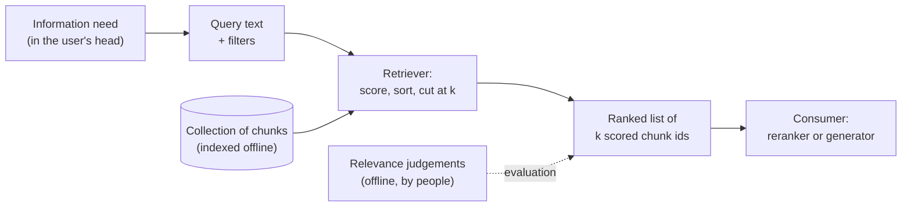

Every RAG system rests on one operation: given a question, find the few pieces of text, out of thousands or millions, that help answer it. That operation is **retrieval**, and it is older than RAG by about seventy years. Library catalogues, web search engines and e-commerce product search all solve versions of the same problem, and the field that studies it, **information retrieval** (IR), has worked out the vocabulary, the guiding principle and the evaluation method that RAG engineers now rely on.

This lesson opens Phase 7 by stating the retrieval problem precisely. You will see why retrieval is a ranking problem rather than a lookup, what "relevant" actually means, why sorting by estimated relevance is the right thing to do, and how a retriever is judged. Everything else in this module, from [Top-K retrieval](/learn/retrieval-fundamentals/top-k-retrieval) to [Candidate generation](/learn/retrieval-fundamentals/candidate-generation), builds on these definitions.

## Learning objectives

- Define retrieval as ranking a collection by estimated relevance to an information need, and distinguish it from a database lookup.
- Distinguish an information need from a query, and topical relevance from usefulness and from correctness.
- State the probability ranking principle, show by hand why it maximises the expected number of relevant results, and name the assumption under which it breaks.
- Build a minimal ranked retriever and check it against relevance judgements.
- Place lexical, dense, hybrid and metadata retrieval in the families of retriever, and say what each is good at.

## Prerequisites

- [Retrieval pipeline](/learn/rag-architecture-fundamentals/retrieval-pipeline): the stages between query in and results out.
- [Query-document matching](/learn/rag-architecture-fundamentals/query-document-matching): scoring functions, lexical and semantic matching.
- [What is a vector database?](/learn/vector-database-fundamentals/what-is-a-vector-database): where dense retrieval stores its vectors.

## Why this matters

A language model in a RAG system can only use what it is shown. If the answering chunk is not in the prompt, the model either refuses or answers from its own parametric memory, precisely what RAG was introduced to avoid. No prompt, larger model or citation format can repair a context that lacks the answer. Retrieval sets the ceiling on answer quality.

Retrieval is also where engineers from conventional backend work carry over the wrong instincts. A database query has a correct answer: the rows that satisfy the predicate. Expecting the same of search leads to code that treats results as a set, applies a fixed score cut-off as if it were a `WHERE` clause, and is tested with a handful of hand-picked questions that "work". Retrieval produces an estimate, ranked by confidence, and has to be measured statistically, over many queries, against human judgements.

## The intuition

Picture the reference desk at a large library. A visitor says, "I need something on whether I can take my holiday next year." That sentence is a clumsy translation of what they want, which is perhaps the rule on carrying unused leave into the next year, because they have eight days left and it is November.

A good librarian interprets the need behind the words, searches the whole collection rather than the shelf labelled "holiday", and, crucially, does not hand over every book that mentions holidays in no particular order. They hand over a short stack, **best first**: the staff handbook's leave section on top, a general HR guide beneath it, a travel book on public holidays at the bottom, in case.

That ordered stack is the output of retrieval. The librarian is never certain which book will help, so the most promising goes where the visitor looks first. If a panel of experts later listed the books that genuinely answer the question, you could check how many made it into the stack and how near the top. That check is retrieval evaluation, and the panel's list is the **relevance judgements**.

## How it works

### The retrieval problem, stated precisely

A retrieval problem has four ingredients:

1. A **collection** $D = \{d_1, \dots, d_N\}$ of retrievable units. In RAG these are usually [chunks](/learn/chunking-fundamentals/why-chunking-matters), though they can be whole documents, table rows or images.
2. A **query** $q$: the text (sometimes with filters) that the system receives.
3. A notion of **relevance**: whether, or how much, a unit $d$ helps satisfy the need behind $q$.
4. A **budget** $k$: how many units the consumer of the results can use.

The retriever's job is to return an ordered list of $k$ units $(d_{(1)}, \dots, d_{(k)})$ that puts as many relevant units as possible as high as possible. Almost every practical retriever does this with a **scoring function** $s(q, d)$, as you saw in [Query-document matching](/learn/rag-architecture-fundamentals/query-document-matching): score every unit (or a cleverly chosen subset), sort, and cut at $k$.

The contract between the retriever and the rest of the system is therefore a **ranked list of scored identifiers**, not a set of correct answers:

```json
[
  {"chunk_id": "leave-2", "score": 2.094, "rank": 1},
  {"chunk_id": "leave-1", "score": 0.914, "rank": 2},
  {"chunk_id": "remote-1", "score": 0.0, "rank": 3}
]
```

The third entry scores zero and is irrelevant, yet it is there because the caller asked for three; [Top-K retrieval](/learn/retrieval-fundamentals/top-k-retrieval) discusses this.

### Retrieval is not lookup

It helps to set retrieval beside the operation it is most often confused with.

| | Database lookup | Retrieval |
| --- | --- | --- |
| Question form | A precise predicate: `WHERE employee_id = 4411` | Natural language: "can I carry leave over?" |
| Answer | A set: every row satisfying the predicate, no more | A ranking: units ordered by estimated relevance |
| Correctness | Defined by the predicate; verifiable | Defined by human judgement; estimated |
| Empty result | Meaningful: nothing matches | Rare: something always scores highest |
| Order | Irrelevant unless you sort | The whole point |
| Testing | Unit tests with exact expected rows | Statistics over a labelled query set |

The two meet in practice: a RAG retriever often applies database-style predicates as **filters** (only the current handbook, only documents this user may read) and then ranks what survives.

The **Boolean model** is the historical bridge between the two. Early retrieval systems treated a query as a logical expression over words ("leave AND carry AND over") and returned the set of documents satisfying it. The model is exact and predictable, but it fails in both directions: a strict AND returns nothing as soon as one query word is missing from the right document, and a loose OR returns hundreds of documents with no indication of which to read first. Ranked retrieval, which scores and orders, replaced it for exactly this reason. You will watch the Boolean model fail in the code below.

### Information need, query and relevance

Three words need careful definitions, because sloppy use of them causes real design mistakes.

An **information need** is what the person actually wants to know. A **query** is their attempt to express it, constrained by their vocabulary and their guess about how the system works. The query "holiday next year" and the need "may I carry my eight unused leave days into next year, and until when?" are different objects. The retriever sees only the query. Techniques covered later, such as [query rewriting](/learn/advanced-retrieval/query-rewriting) and [multi-query retrieval](/learn/advanced-retrieval/multi-query-retrieval), try to recover more of the need from the query.

**Relevance** is a judgement about a unit relative to the need. IR research distinguishes several kinds, and three matter to a RAG engineer:

- **Topical relevance**: the unit is about the subject of the need. The leave-carry-over paragraph is topically relevant; so is a paragraph saying "leave policy is described in section 4".
- **Usefulness** (sometimes called utility or situational relevance): the unit helps this particular consumer answer this particular need. For RAG the consumer is a language model writing an answer, so a useful chunk is one that contains the facts the answer needs, stated clearly enough to quote. The "see section 4" paragraph is topically relevant and useless.
- **Correctness**: the unit's content is true and current. Meridian's superseded 2023 handbook said the laptop refresh cycle was 4 years; a chunk from it is topically relevant and useful-looking for "how often do I get a new laptop?", and it is wrong. No scoring function based on similarity can detect this. Version metadata and filtering can.

Relevance can be **binary** (relevant or not) or **graded** (for example 0 = irrelevant, 1 = partially relevant, 2 = fully answers). Binary judgements are cheaper to collect and are what [Recall@K](/learn/retrieval-fundamentals/recall-k) and [Precision@K](/learn/retrieval-fundamentals/precision-k) use. Graded judgements feed rank-sensitive metrics such as [NDCG](/learn/retrieval-evaluation/ndcg).

> [!KEY]
> A retriever estimates topical relevance. A RAG system needs useful, correct context. The gap between the two is closed by other components: chunking that keeps answers self-contained, metadata filters for currency and permissions, and reranking for fine-grained usefulness.

### Why rank? The probability ranking principle

Why should a retriever sort by score at all, rather than, say, return a balanced mix? The classical answer is the **probability ranking principle** (PRP), formulated by Stephen Robertson in 1977. Informally:

> If a system ranks documents in decreasing order of their probability of relevance to the request, estimated as accurately as possible from the available data, then the overall effectiveness of the system will be the best obtainable on the basis of those data.

Two qualifications are built in. The probabilities are *estimates*, so the principle says nothing about how good your scoring function is; it says that, given your estimates, sorting is the best use of them. And the proof (in the mathematics section below) assumes that the relevance of each document is **independent** of the others: seeing document A does not change how useful document B is.

That independence assumption fails in RAG in an important way. If the top two chunks are near-duplicates (the same paragraph from two copies of the handbook), the second adds nothing once the first is in the prompt. Pure probability ranking would happily fill the context with five copies of the best paragraph. This is why diversity-aware methods such as [MMR](/learn/advanced-retrieval-optimisation/mmr) and [duplicate removal](/learn/advanced-retrieval-optimisation/duplicate-removal) exist: they deliberately depart from the PRP where its assumption does not hold.

### The shape of a retriever

Putting the pieces together, a retrieval system looks like this:



The solid path runs at query time. The dashed line runs offline, comparing ranked lists with relevance judgements. Teams most often skip the second half.

### The families of retriever

Retrievers differ in how they compute $s(q, d)$ and what index makes that fast. Later modules cover each family; here is the map.

| Family | Scores by | Strong at | Weak at | Covered in |
| --- | --- | --- | --- | --- |
| Lexical (sparse) | Weighted overlap of terms, e.g. BM25 | Exact identifiers, names, rare terms | Synonyms and paraphrase | [Sparse retrieval](/learn/sparse-retrieval) |
| Dense | Similarity of embedding vectors | Paraphrase, meaning | Exact strings, unfamiliar jargon | [Dense retrieval](/learn/dense-retrieval) |
| Hybrid | Fusion of lexical and dense rankings | Mixed query traffic | Extra cost and tuning | [Hybrid search](/learn/hybrid-search) |
| Metadata / structured | Predicates on fields (date, owner, type) | Constraints: "current", "HR only" | Anything unstructured | [Metadata-aware retrieval](/learn/advanced-retrieval/metadata-aware-retrieval) |
| Graph | Traversal of entity relationships | Multi-hop, relational questions | Building and maintaining the graph | [Graph RAG](/learn/graph-rag) |

These are not exclusive: production retrievers commonly filter by metadata, search lexically and densely, merge, and rerank, as [Candidate generation](/learn/retrieval-fundamentals/candidate-generation) shows.

### How retrieval is judged: test collections

Because relevance is a human judgement, a retriever is evaluated against a **test collection** with three parts:

1. The collection of units being searched.
2. A set of **test queries**, ideally sampled from real traffic.
3. **Relevance judgements** (often called **qrels**, from "query relevance"): for each query, which units are relevant, and possibly how relevant.

You run each test query through the retriever, compare the ranked list with the judgements, compute a metric per query and average over queries. This method is known as the **Cranfield paradigm**, after experiments run at the Cranfield College of Aeronautics in the 1960s, and it remains the basis of TREC (the Text REtrieval Conference, run by the US National Institute of Standards and Technology since 1992) and of every serious RAG evaluation.

The method has known limits: judges disagree, unjudged units are usually assumed irrelevant, and twenty hand-written queries say little about thousands of real ones. The [Recall@K](/learn/retrieval-fundamentals/recall-k) lesson returns to these limits.

## The mathematics

The probability ranking principle has a short proof for the simplest case, and working through it shows exactly where the independence assumption enters.

**Intuition.** If each chunk has some chance of being relevant, and you can show only $k$ of them, you want the $k$ with the biggest chances. Swapping a high-chance chunk out of the top $k$ for a low-chance one can only lower the number of relevant chunks you expect to show.

**The formula.** Let $p_i = P(\text{relevant} \mid q, d_i)$ be the probability that chunk $d_i$ is relevant to query $q$. Let $R_i$ be 1 if $d_i$ is relevant and 0 otherwise, so the expected value of $R_i$ is $p_i$. For a ranking that places chunks $d_{(1)}, \dots, d_{(N)}$ in that order, the expected number of relevant chunks in the top $k$ is:

$$
\mathbb{E}\left[\sum_{j=1}^{k} R_{(j)}\right] = \sum_{j=1}^{k} p_{(j)}
$$

where:

- $k$ is the number of positions shown;
- $d_{(j)}$ is the chunk at position $j$, and $p_{(j)}$ its probability of relevance;
- the equality uses linearity of expectation, and it treats $p_{(j)}$ as a fixed number for each chunk, regardless of which other chunks are shown. That is the independence assumption.

A sum of $k$ numbers chosen from $\{p_1, \dots, p_N\}$ is largest when you choose the $k$ largest. So sorting by $p_i$ in decreasing order maximises the expected number of relevant results in the top $k$, simultaneously for every $k$. That last part matters: one sorted list is optimal whatever cut-off the consumer chooses.

**By hand.** Four chunks with estimated probabilities $p_A = 0.9$, $p_B = 0.2$, $p_C = 0.6$, $p_D = 0.4$, and $k = 2$.

- In the original order (A, B, C, D), the top 2 is A and B: expected relevant $= 0.9 + 0.2 = 1.1$.
- Sorted by probability (A, C, D, B), the top 2 is A and C: $0.9 + 0.6 = 1.5$.
- No other pair beats 1.5, because 0.9 and 0.6 are the two largest values.

**In Python**, checking every one of the $4! = 24$ orders by brute force:

```python
from itertools import permutations

p = {"A": 0.9, "B": 0.2, "C": 0.6, "D": 0.4}   # estimated P(relevant) per chunk
k = 2

def expected_relevant(order):
    return sum(p[d] for d in order[:k])

by_score = sorted(p, key=p.get, reverse=True)
best = max(permutations(p), key=expected_relevant)
print("sorted by probability, top 2:", by_score[:k], round(expected_relevant(by_score), 2))
print("best of all 24 orders, top 2:", list(best[:k]), round(expected_relevant(best), 2))
print("original order, top 2       :", list(p)[:k], round(expected_relevant(list(p)), 2))
```

```output
sorted by probability, top 2: ['A', 'C'] 1.5
best of all 24 orders, top 2: ['A', 'C'] 1.5
original order, top 2       : ['A', 'B'] 1.1
```

**Where it breaks.** Suppose C is a near-copy of A. Once A is shown, C adds almost nothing: the probability that C contributes *new* relevant information, given A, is close to zero, not 0.6. The sum formula no longer applies because $p_C$ depends on what else is shown. The best pair is then probably A and D. This is the formal reason that diversity-aware ranking is needed when a collection contains duplicates.

**Scores are not probabilities.** BM25 and cosine similarity do not output $p_i$, but the PRP still applies if the score is **monotonic** in the probability (higher score, higher probability), because sorting by either gives the same order. How close your scores come to that is what evaluation measures.

## In code

**The problem.** Show, on a small Meridian corpus, how a Boolean lookup behaves compared with a ranked retriever, and check the ranked results against relevance judgements.

**Dependencies.** The `rank-bm25` package, a small pure-Python implementation of BM25. No API key, no model download.

```bash
pip install rank-bm25
```

BM25 is the standard lexical scoring function; [its own lesson](/learn/sparse-retrieval/bm25) explains the formula. Here you only need to know that it gives each chunk a score that grows with how many query terms it contains and how rare those terms are.

```python
import re
from rank_bm25 import BM25Okapi

chunks = {
    "leave-1":  "Annual leave is 25 days per year for full-time staff.",
    "leave-2":  "Up to 5 unused leave days carry over and must be used by 31 March.",
    "remote-1": "Staff may work remotely up to 3 days a week.",
    "remote-2": "The home-office equipment budget is £400. Contractors are not eligible.",
    "exp-1":    "Expenses must be submitted within 30 days of purchase.",
    "exp-2":    "Any expense over £75 needs a receipt.",
    "it-1":     "The laptop refresh cycle is 3 years.",
    "it-2":     "Report a lost laptop to the support desk at once.",
}
ids = list(chunks)

def tokenise(text):
    return re.findall(r"[a-z0-9£]+", text.lower())

# --- 1. Lookup: Boolean AND, the database mindset --------------------------
def boolean_and(query):
    terms = set(tokenise(query))
    return [cid for cid in ids if terms <= set(tokenise(chunks[cid]))]

# --- 2. Retrieval: score every chunk, sort, keep the top k ------------------
bm25 = BM25Okapi([tokenise(chunks[cid]) for cid in ids])

def retrieve(query, k=3):
    scores = bm25.get_scores(tokenise(query))
    ranked = sorted(zip(ids, scores), key=lambda pair: -pair[1])
    return [(cid, round(float(s), 3)) for cid, s in ranked[:k]]

# --- 3. Relevance judgements: which chunks a person marked as answering -----
qrels = {
    "how many leave days do I get": {"leave-1"},
    "unused leave days": {"leave-2"},
    "expense receipt": {"exp-2"},
    "lost laptop": {"it-2"},
}

for query, relevant in qrels.items():
    results = retrieve(query)
    hits = [cid for cid, _ in results if cid in relevant]
    print(f"query: {query!r}")
    print(f"  boolean AND -> {boolean_and(query)}")
    print(f"  ranked top 3 -> {results}")
    print(f"  relevant {sorted(relevant)} found in top 3: {bool(hits)}")
```

```output
query: 'how many leave days do I get'
  boolean AND -> []
  ranked top 3 -> [('leave-1', 0.914), ('leave-2', 0.78), ('remote-1', 0.0)]
  relevant ['leave-1'] found in top 3: True
query: 'unused leave days'
  boolean AND -> ['leave-2']
  ranked top 3 -> [('leave-2', 2.094), ('leave-1', 0.914), ('remote-1', 0.0)]
  relevant ['leave-2'] found in top 3: True
query: 'expense receipt'
  boolean AND -> ['exp-2']
  ranked top 3 -> [('exp-2', 3.721), ('leave-1', 0.0), ('leave-2', 0.0)]
  relevant ['exp-2'] found in top 3: True
query: 'lost laptop'
  boolean AND -> ['it-2']
  ranked top 3 -> [('it-2', 2.565), ('it-1', 1.105), ('leave-1', 0.0)]
  relevant ['it-2'] found in top 3: True
```

**The important lines.**

- `boolean_and` keeps a chunk only if every query term appears in it (`terms <= set(...)` is a subset test). It is exactly a `WHERE` clause over words.
- `bm25.get_scores` returns one score per chunk, in corpus order. `retrieve` sorts by score and keeps the first `k`, which is the whole of ranked retrieval in two lines.
- `qrels` is a miniature test collection: for each query, the chunk a person judged to answer it. The loop checks whether that chunk appears in the top 3.

**What the output means.**

- The natural question "how many leave days do I get" defeats the Boolean model completely: no chunk contains all of "how", "many", "do", "i" and "get", so the result is empty. The ranked retriever does not need every word; partial overlap ("leave", "days") is enough to put leave-1 first.
- When the Boolean model does work ("unused leave days"), it returns a set with no order and no indication of confidence. The ranked list returns the same chunk first, then a weaker but related one.
- Every ranked list has exactly three entries, even when the third scores 0.0. In the "expense receipt" query, two of the three results are padding with no evidence of relevance at all. A consumer that trusts all $k$ results blindly will put irrelevant text into the prompt.
- remote-1 scores exactly 0.0 although it contains "days". In this eight-chunk corpus "days" appears in half the chunks, and this BM25 implementation gives such a term an IDF of zero, so it contributes nothing. Common words carry little evidence; that is the point of IDF.

**Common errors.** Tokenising the query differently from the chunks silently zeroes scores. Passing raw strings rather than token lists to `BM25Okapi` makes it treat each character as a token. And confusing `get_scores` (one score per chunk, in corpus order) with a ranking (sorted ids) is the most common bug of all.

**Extending it.** Swap BM25 for an embedding model and compare the two on the same qrels, which is what the [Recall@K](/learn/retrieval-fundamentals/recall-k) lesson does.

## A real-world example

Meridian's Platform team built the first prototype of AskMeridian in a week. To save time, the retrieval step was a SQL query against the table of handbook paragraphs: `WHERE text ILIKE '%' || word || '%'` for each keyword extracted from the question, joined with AND. Every paragraph satisfying the predicate went into the prompt.

The demo went well, because the people demonstrating it asked questions in the handbook's own words. In the first week of the internal pilot, two failure patterns dominated the feedback. Natural questions ("what happens to holiday I don't use?") returned nothing, because one or more words never appeared in the right paragraph, and the assistant replied that it could not find the information. Short questions ("laptop") matched a dozen paragraphs, all of which went into the prompt in table order, and the superseded 2023 paragraph about the 4-year laptop cycle happened to come first, so the model quoted it.

The fix had three parts, one per section of this lesson. Ranked retrieval with a budget of five chunks handled partial matches and put the strongest evidence first. A metadata filter excluded superseded documents before ranking, because no relevance score can detect that a document is out of date. And forty real pilot questions, each with the paragraph that answers it, became a small test collection, so the next change could be measured rather than demonstrated. It paid off at once: the ranked retriever missed every question phrased with "holiday" instead of "leave", pointing straight at vocabulary mismatch and at adding dense retrieval.

## Common mistakes

- **Treating retrieval as lookup.** Expecting an exact set of correct results leads to Boolean predicates, fixed score cut-offs used as filters, and surprise when natural questions return nothing.
- **Trusting every one of the $k$ results.** The retriever pads its list to $k$ with whatever scores highest, relevant or not. Treating rank 5 as evidence produces confident answers built on unrelated text.
- **Confusing relevance with correctness.** A superseded or wrong document can be the most relevant one. Without currency and permission filters, retrieval faithfully surfaces outdated policy.
- **Testing with demonstration queries.** Queries written by people who know the documents reuse their words and hide vocabulary mismatch.
- **Evaluating with no judgements.** Judging retrieval by "the answers look fine" mixes retrieval quality with generation quality and lets a weak retriever hide behind a strong model.

## Best practices

- Write down the retriever's contract: input (query text, filters, $k$), output (ranked chunk ids with scores and the scorer's name), and the meaning of an empty list.
- Build a test collection before tuning: a few dozen real queries, sampled from logs where possible, each with its relevant chunk ids.
- Separate the questions "is it about the topic?" (ranking), "is it current and permitted?" (filters) and "does it actually answer?" (reranking or generation), and assign each to the component that can answer it.
- Keep scores on the results and log them; they are the first thing to inspect when an answer is bad.
- Measure a simple baseline (BM25 or one embedding model) before adding stages.
- Remove duplicate chunks at indexing time so ranking does not spend the budget on copies.

## Performance considerations

Scoring dominates the cost of ranked retrieval, and scoring every unit is linear in the collection: at $N = 1{,}000{,}000$ chunks and 1 microsecond per chunk, a query takes a full second. Real retrievers avoid touching most of the collection: a lexical retriever reads only the posting lists of an [inverted index](/learn/sparse-retrieval/inverted-indexes), and a dense retriever uses an [approximate nearest-neighbour index](/learn/vector-indexing-algorithms/approximate-nearest-neighbour-search).

The budget $k$ costs most further down the pipeline. Each extra chunk passed to the generator adds its tokens to every request: five chunks of about 300 tokens each is 1,500 input tokens, and doubling $k$ doubles that. [Retrieval latency](/learn/retrieval-fundamentals/retrieval-latency) and [Top-K retrieval](/learn/retrieval-fundamentals/top-k-retrieval) take these costs apart.

## Security considerations

Retrieval decides what the model reads, and therefore what it can be manipulated by. Anyone who can add a document can write text designed to rank highly, or containing instructions aimed at the model. A high retrieval score is evidence of resemblance to the query, never of trustworthiness. Treat every retrieved chunk as untrusted input, as described in [Retrieval manipulation](/learn/rag-security-fundamentals/retrieval-manipulation).

Retrieval is also not access control. A scoring function ranks a confidential document as readily as a public one. Permissions must be enforced as a filter inside the retriever, before results leave it, and never by asking the model to ignore what it should not have seen. [Document-level permissions](/learn/access-control-and-privacy/document-level-permissions) covers the patterns.

## Summary

- Retrieval returns a ranked list of $k$ scored units, ordered by estimated relevance to the need behind a query. It is an estimate, not a lookup with a correct answer.
- An information need differs from the query that expresses it; topical relevance differs from usefulness to the generator and from correctness.
- The probability ranking principle justifies sorting by estimated relevance: it maximises the expected number of relevant results at every cut-off, provided results are judged independently. Duplicates break that assumption.
- Retriever families (lexical, dense, hybrid, metadata, graph) differ in how they score and what they are good at, and production systems combine them.
- A retriever is judged against a test collection of queries and relevance judgements, metric by metric, averaged over queries.

## Exercises

**1.** For each of the following, say whether it is better treated as a database lookup or as retrieval, and why: (a) "the expense claims submitted by employee 4411 in March"; (b) "what is the policy on claiming for a train ticket?"; (c) "all runbooks owned by the Platform team".

<details><summary>Show solution</summary>

(a) **Lookup.** The question is a precise predicate over structured fields (employee id, date, record type). There is a correct set of rows and order does not depend on relevance.

(b) **Retrieval.** The question is natural language, the answer lives in prose, and which paragraph helps most is a matter of judgement. A ranked list is the right output.

(c) **Lookup**, and in a RAG system typically used as a **filter**: "owner = Platform" is metadata. If the user then asks something about those runbooks, retrieval ranks within the filtered set.

</details>

**2.** Using the probability ranking principle, four chunks have estimated relevance probabilities 0.3, 0.8, 0.5 and 0.7. What is the expected number of relevant chunks in the top 2 of the optimal ranking, and in the worst possible top 2? Now suppose the 0.8 and 0.7 chunks are copies of the same paragraph. Which two would you show, and why does the PRP not tell you that?

<details><summary>Show solution</summary>

Optimal: show 0.8 and 0.7, expected $0.8 + 0.7 = 1.5$. Worst: 0.3 and 0.5, expected $0.8$.

If 0.8 and 0.7 are copies, showing both adds almost nothing over showing one: the second copy contributes no new information once the first is present. Show 0.8 and 0.5 instead. The PRP cannot tell you this because its proof assumes each chunk's relevance is independent of the others shown; with duplicates, the value of the second chunk depends on the first. Diversity-aware ranking (MMR) or de-duplication handles this case.

</details>

**3.** Extend the code example: add the chunk `"old-1": "2023 handbook (superseded): the laptop refresh cycle is 4 years."` and the query `"how often is the laptop refresh"`, with qrels `{"it-1"}`. Run it. What do you see, and what component should fix it?

<details><summary>Show solution</summary>

Add the entry to `chunks` and the query to `qrels`. The ranked top 3 is `[('it-1', 2.45), ('old-1', 2.119), ('it-2', 0.82)]`. Both it-1 and old-1 contain "laptop" and "refresh"; old-1 is longer, so BM25's length normalisation scores it a little lower. It is still second, ahead of everything else, and goes into the prompt beside it-1, so the model sees two contradictory cycles (3 and 4 years).

Ranking cannot fix this: old-1 is genuinely relevant to the topic. The fix is metadata. Store a `status` field (current or superseded) at indexing time and filter out superseded documents before ranking, or delete them from the index when the new handbook is published.

</details>

**4.** Design decision. A colleague proposes evaluating AskMeridian's retriever by asking ten questions, reading the answers, and giving the system a thumbs-up if they look right. List three ways this evaluation can mislead, and propose a replacement that would take less than a day to set up.

<details><summary>Show solution</summary>

Ways it misleads:

1. **It measures the whole system, not retrieval.** A strong model can produce a plausible answer from its own knowledge, or from a partially relevant chunk, hiding a retrieval miss.
2. **Ten questions is too few** and they were probably chosen by someone who knows the documents, so they reuse the documents' vocabulary and avoid the hard cases.
3. **"Looks right" is not a repeatable judgement.** Next week's change cannot be compared with this week's.

Replacement: sample 40 to 50 real questions from pilot logs, record for each the chunk ids that answer it, and run the retriever alone on them. Report, per query and on average, whether a relevant chunk appears in the top $k$ (the metrics are defined in [Recall@K](/learn/retrieval-fundamentals/recall-k)). Keep the set in version control so every future change is measured on it.

</details>

## Check your understanding

```quiz
[
  {
    "q": "Which statement best describes the output of a retriever in a RAG system?",
    "options": [
      "The set of all chunks that satisfy the query",
      "The single chunk that answers the question",
      "A ranked list of k chunk identifiers with scores, ordered by estimated relevance",
      "A generated answer with citations"
    ],
    "answer": 2,
    "why": "Retrieval ranks units by estimated relevance and returns the top k. It is not a set, not a single answer and not generation."
  },
  {
    "q": "A user types \"holiday rollover\". The handbook paragraph says \"Up to 5 unused leave days carry over\". What is \"may I carry my unused leave into next year?\" in this situation?",
    "options": [
      "The query",
      "The information need",
      "The relevance judgement",
      "The scoring function"
    ],
    "answer": 1,
    "why": "The information need is what the person wants to know. The query is the words they typed to express it."
  },
  {
    "q": "The probability ranking principle says ranking by decreasing probability of relevance is optimal. Which assumption does it rely on that often fails in RAG?",
    "options": [
      "That each document's relevance is independent of the other documents shown",
      "That scores are between 0 and 1",
      "That the collection fits in memory",
      "That queries are shorter than documents"
    ],
    "answer": 0,
    "why": "The proof sums each document's probability separately. Near-duplicates violate this, because a second copy adds little once the first is shown."
  },
  {
    "q": "A chunk from a superseded 2023 handbook ranks first for a question about laptop refresh. What kind of problem is this?",
    "options": [
      "Low topical relevance",
      "Vocabulary mismatch",
      "A Boolean retrieval failure",
      "Relevance without correctness, best fixed with metadata filtering"
    ],
    "answer": 3,
    "why": "The chunk is genuinely about the topic, so similarity cannot reject it. Its problem is currency, which version metadata and filters can handle."
  },
  {
    "q": "What are the three parts of a test collection in the Cranfield paradigm?",
    "options": [
      "An embedding model, a vector index and a reranker",
      "A collection, a set of test queries and relevance judgements",
      "Training data, validation data and test data",
      "Queries, answers and a language model judge"
    ],
    "answer": 1,
    "why": "A test collection pairs the searched collection and test queries with human judgements of which units are relevant to each query."
  }
]
```

## Further reading

- Christopher D. Manning, Prabhakar Raghavan and Hinrich Schütze (2008), *Introduction to Information Retrieval*, Cambridge University Press, chapters 1 (Boolean retrieval), 6 (scoring and ranking) and 8 (evaluation). Free online: [nlp.stanford.edu/IR-book](https://nlp.stanford.edu/IR-book/).
- S. E. Robertson (1977), "The probability ranking principle in IR", *Journal of Documentation* 33(4). The original statement and argument.
- Ellen M. Voorhees (2002), "The philosophy of information retrieval evaluation", in *Evaluation of Cross-Language Information Retrieval Systems* (CLEF 2001), Springer. A clear account of the Cranfield paradigm and its limits.
- Patrick Lewis and colleagues (2020), "Retrieval-Augmented Generation for Knowledge-Intensive NLP Tasks", [arXiv:2005.11401](https://arxiv.org/abs/2005.11401). Where retrieval meets generation.
