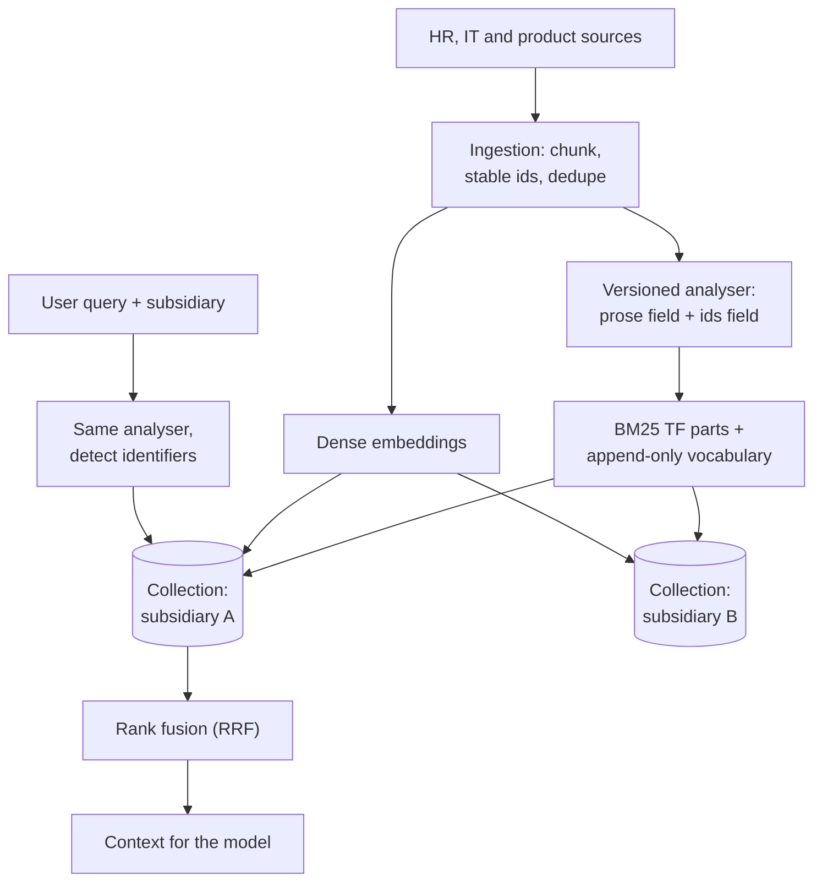

This assessment covers the whole Sparse Retrieval module: inverted indexes, TF-IDF, BM25, keyword matching and text analysis, term frequency, inverse document frequency and sparse representations, including learned sparse models. It mixes recall with hand calculations, code-reading and production scenarios. Aim for at least 70% on the quiz (13 of 18) before moving on, and write your answer to each open question before opening the model answer. The coding exercises use only the Python standard library and NLTK's Porter stemmer; no API key or model download is needed.

```quiz
[
  {
    "q": "What does an inverted index map?",
    "options": [
      "Each document to the list of terms it contains",
      "Each term to a list of the documents that contain it, sorted by document id",
      "Each query to its top-k documents",
      "Each document to its dense embedding"
    ],
    "answer": 1,
    "why": "The forward direction is document to terms; the inverted index flips it to term to posting list, which is what lets a query read only its own terms' lists."
  },
  {
    "q": "A query has three terms whose posting lists hold 2,000, 6,000 and 400,000 entries in a 1,000,000-chunk index. Without dynamic pruning, roughly how many postings does a ranked OR query read?",
    "options": [
      "1,000,000",
      "2,000",
      "408,000",
      "3"
    ],
    "answer": 2,
    "why": "Query cost is the total length of the posting lists read: 2,000 + 6,000 + 400,000. Pruning methods such as WAND exist to skip most of the long list."
  },
  {
    "q": "Why are posting lists stored as gaps between consecutive document ids?",
    "options": [
      "Gaps are small numbers that compress into few bytes or bits",
      "Gaps make the list sorted by relevance",
      "Gaps allow documents to be deleted in place",
      "Gaps are required for phrase queries"
    ],
    "answer": 0,
    "why": "Sorted ids can be large, but the differences between them are small, especially for common terms, so gap encoding plus variable-length integers shrinks lists considerably."
  },
  {
    "q": "In a Lucene-based engine, a chunk is deleted. Which statement is correct immediately afterwards?",
    "options": [
      "Its postings are removed from every posting list",
      "It is marked deleted in a bitmap, still counts towards document frequencies, and is physically removed when its segment is merged",
      "It remains searchable until the next full re-index",
      "Its terms' IDF values increase at once"
    ],
    "answer": 1,
    "why": "Segments are immutable. Deletes are bitmap marks that queries skip; the data and its contribution to statistics disappear only at merge time."
  },
  {
    "q": "What does this print?\n```python\nimport re\nprint(re.findall(r\"\\b\\w\\w+\\b\", \"Up to 3 days on Wi-Fi\".lower()))\n```",
    "options": [
      "`['up', 'to', '3', 'days', 'on', 'wi-fi']`",
      "`['up', 'to', 'days', 'on', 'wifi']`",
      "`['up', 'to', '3', 'days', 'on', 'wi', 'fi']`",
      "`['up', 'to', 'days', 'on', 'wi', 'fi']`"
    ],
    "answer": 3,
    "why": "The pattern (scikit-learn's default) keeps runs of two or more word characters, so the single digit 3 is dropped and the hyphen splits Wi-Fi into two tokens."
  },
  {
    "q": "scikit-learn's default TF-IDF uses idf = ln((1 + N)/(1 + df)) + 1. For N = 6, what is the IDF of a term that appears in every document?",
    "options": [
      "0",
      "1",
      "ln 6",
      "It is negative"
    ],
    "answer": 1,
    "why": "ln(7/7) = 0, plus 1 gives 1. The outer +1 keeps even ubiquitous terms at a non-zero weight."
  },
  {
    "q": "Why must a query be encoded with a fitted vectoriser's `transform` rather than `fit_transform`?",
    "options": [
      "So it uses the collection's vocabulary and IDF, making its columns line up with the chunk vectors",
      "Because `fit_transform` does not lower-case",
      "Because `transform` is faster",
      "Because `fit_transform` cannot handle one document"
    ],
    "answer": 0,
    "why": "Fitting on the query builds a different vocabulary and meaningless IDF values, so the query vector no longer corresponds to the chunk matrix."
  },
  {
    "q": "In BM25 at average document length, what is the TF part of a term that occurs once, for any k1?",
    "options": [
      "k1",
      "k1 + 1",
      "0.5",
      "1"
    ],
    "answer": 3,
    "why": "With length factor 1, the TF part is f(k1 + 1)/(f + k1); at f = 1 it is (k1 + 1)/(1 + k1) = 1."
  },
  {
    "q": "Which change makes BM25 ignore document length entirely?",
    "options": [
      "k1 = 0",
      "b = 1",
      "b = 0",
      "Using Lucene's IDF"
    ],
    "answer": 2,
    "why": "With b = 0 the length factor is always 1. k1 = 0 makes term frequency irrelevant; b = 1 normalises fully by length."
  },
  {
    "q": "`BM25Okapi([\"vpn client\", \"annual leave\"])` is called with raw strings. What happens?",
    "options": [
      "Each string is iterated as characters, so the index and scores are over single characters",
      "The library splits on whitespace",
      "It raises a TypeError",
      "It tokenises with NLTK automatically"
    ],
    "answer": 0,
    "why": "rank-bm25 iterates over whatever each document is. A string yields characters, so the results look numeric but are meaningless."
  },
  {
    "q": "Under the Robertson/Spärck Jones IDF, ln((N − n + 0.5)/(n + 0.5)), what is the IDF of a term in 700 of 1,000 documents?",
    "options": [
      "About +0.85",
      "Exactly 0",
      "About −0.85",
      "About +0.36"
    ],
    "answer": 2,
    "why": "ln(300.5/700.5) = ln(0.429), about −0.85. RSJ goes negative above half the collection; Lucene adds 1 inside the logarithm to prevent this."
  },
  {
    "q": "Which TF transform is completely unaffected by repeating a term many times?",
    "options": [
      "Raw",
      "Binary",
      "Logarithmic",
      "BM25 saturating"
    ],
    "answer": 1,
    "why": "Binary TF records presence only. Saturating and logarithmic forms reduce the reward for repetition but do not remove it."
  },
  {
    "q": "The scope hypothesis says that some documents are long because they cover more ground. What does it imply about length normalisation?",
    "options": [
      "Normalise fully by length",
      "Length normalisation should only apply to queries",
      "Use binary TF",
      "Normalise only partially, because long documents may genuinely be more likely to contain relevant material"
    ],
    "answer": 3,
    "why": "Full normalisation follows the verbosity hypothesis alone; the scope hypothesis argues against penalising length fully, which motivates BM25's b < 1."
  },
  {
    "q": "A search cluster routes HR documents to one shard and IT documents to another and scores with shard-local statistics. What is the most likely ranking problem?",
    "options": [
      "Queries are slower",
      "A term common on one shard and rare on the other gets very different IDF values, so the shard where it is rare wins",
      "Phrase queries stop working",
      "Deleted documents become visible again"
    ],
    "answer": 1,
    "why": "Uneven routing concentrates vocabulary. Global statistics (for example dfs_query_then_fetch) or random routing remove the inconsistency."
  },
  {
    "q": "Why is fuzzy matching dangerous on an error-code field?",
    "options": [
      "Codes like E-4012 and E-4021 are within one or two edits of each other, so a fuzzy query returns the wrong code's documents",
      "Fuzzy queries ignore digits",
      "Fuzzy matching only works on stemmed text",
      "Fuzzy matching disables BM25 scoring"
    ],
    "answer": 0,
    "why": "4012 and 4021 differ by one transposition. Exactness on identifiers is keyword search's main advantage, and fuzziness gives it away."
  },
  {
    "q": "In a vector database, BM25 sparse vectors are stored with only the TF part and the database applies IDF at query time. What still requires re-encoding all documents if changed?",
    "options": [
      "Adding new documents",
      "The IDF formula",
      "The values of k1 and b",
      "The number of results requested"
    ],
    "answer": 2,
    "why": "k1, b and the average length are baked into the stored TF part. IDF is computed at query time from current statistics, so adding documents needs no re-encoding."
  },
  {
    "q": "Approximately how many colliding pairs arise when 40,000 terms are hashed into 2^20 (1,048,576) dimensions?",
    "options": [
      "About 760",
      "About 40",
      "About 38,000",
      "None"
    ],
    "answer": 0,
    "why": "The birthday approximation n(n − 1)/(2m) gives 40,000 × 39,999 / 2,097,152, about 763."
  },
  {
    "q": "What lets a SPLADE model give weight to a term that does not appear in the text?",
    "options": [
      "A synonym dictionary applied after encoding",
      "Fuzzy matching on WordPiece tokens",
      "A dense embedding stored alongside",
      "Its masked-language-model head scores every vocabulary term, and pooling keeps related terms with positive weight"
    ],
    "answer": 3,
    "why": "SPLADE projects each token onto the full vocabulary through the MLM head, applies log(1 + ReLU) and pools, so related terms can receive weight (expansion)."
  }
]
```

## Conceptual questions

**1.** Explain why lexical retrieval with an inverted index can be fast without any approximation, while dense retrieval at scale usually needs approximate nearest-neighbour search. Under what query conditions does the inverted index lose its advantage, and what do engines do about it?

<details><summary>Show model answer</summary>

A lexical score is a sum over query terms, and a chunk that contains none of them scores exactly zero. The inverted index stores, for each term, the chunks that contain it, so a query reads only its own terms' posting lists and every chunk it does not touch is correctly scored zero. The result is exact, and the work is proportional to the total length of those lists, not to the collection size.

A dense vector has a value in every dimension for every chunk, so there is no equivalent of "only chunks containing this term": every chunk has some similarity to every query. Exact search therefore compares against all vectors, and at scale engines use approximate indexes such as HNSW that visit only a neighbourhood of the graph and may miss some true neighbours.

The inverted index loses its advantage when a query contains very common terms, whose posting lists approach the collection size, or when learned sparse models produce many non-zero query dimensions with moderate document frequencies. Engines respond with dynamic pruning: document-at-a-time evaluation with per-term or per-block upper bounds (WAND, block-max WAND), which skips documents that cannot enter the current top k. Stop-word handling and query-term limits also help.

</details>

**2.** Compare TF-IDF cosine and BM25 as ranking functions for a RAG keyword retriever. Name two specific weaknesses of TF-IDF cosine that BM25 addresses, and one task for which TF-IDF is the better tool.

<details><summary>Show model answer</summary>

Both weight terms by frequency in the chunk and rarity in the collection, and both are sums over shared terms. The differences:

- **Term frequency.** TF-IDF uses raw (or logarithmic) counts that grow without limit, so repetition and boilerplate are rewarded heavily. BM25 saturates: a single occurrence gives 1 at average length, and no number of repetitions exceeds $k_1 + 1$.
- **Length normalisation.** TF-IDF's cosine divides by the vector's Euclidean length, which depends on how many distinct and rare terms a chunk has and tends to over-penalise long chunks. BM25's length factor, $1 - b + b|d|/\text{avgdl}$, is explicit, partial and tunable.

TF-IDF is the better tool when you need comparable vectors for every text, for example for document-to-document similarity, clustering, near-duplicate detection or extracting characteristic terms of a group of chunks. BM25 is defined as a query-to-document score and does not produce such vectors.

</details>

**3.** IDF is a collection statistic. List four distinct ways in which an ordinary RAG ingestion pipeline can change IDF values without any change to the content users care about, and say what each does to retrieval.

<details><summary>Show model answer</summary>

- **Duplicates and superseded versions.** Indexing the 2023 handbook alongside the current one, or the same page from several locations, raises the document frequency of their terms, lowering IDF and letting stale copies compete with current ones.
- **Boilerplate.** Repeated headers, footers or disclaimers in every chunk push their terms towards df = N, where RSJ-based IDF goes negative or is floored, and add noise matches.
- **Chunking granularity.** IDF counts chunks. Smaller chunks of a long document repeat its characteristic terms across many chunks, making them look common; changing chunk size changes every IDF.
- **Deletions that have not been merged.** Deleted chunks still count until segment merges, so statistics lag reality after large deletions.

A fifth: prepended contextual headers add the same terms to every chunk of a section. Each of these shifts rankings, and any threshold based on raw scores, without a single relevant document changing.

</details>

**4.** A team wants to replace BM25 with a learned sparse model such as SPLADE in AskMeridian. Describe what the change would gain, what it would cost, and the specific risks for Meridian's corpus.

<details><summary>Show model answer</summary>

**Gains.** Learned term weights instead of a formula, and expansion terms that partially bridge vocabulary mismatch ("holiday" for annual leave), while keeping sparse vectors that run on inverted indexes and remain interpretable. On public benchmarks SPLADE-family models often retrieve considerably better than BM25.

**Costs.** A transformer forward pass per chunk at indexing time and, for most variants, per query, which adds latency and compute comparable to dense embedding; more non-zeros per vector, so larger indexes and longer posting lists than BM25; and a model artefact to version and serve.

**Risks for Meridian.** The model's WordPiece vocabulary splits identifiers such as "E-4021" into fragments, which can weaken the exact matching that is the sparse retriever's main job in a hybrid system. Expansions learned from web search data may be unhelpful for internal jargon and product names such as Meridian Relay. Some published checkpoints have non-commercial licences. The right process is to evaluate on labelled Meridian queries split by type, including identifier queries, and to consider adding learned sparse as a third retriever rather than replacing BM25.

</details>

## Coding exercises

**1.** Implement BM25 retrieval on an inverted index. Build a term-to-postings index (document id and term frequency) for the Meridian chunks below, precompute each chunk's length factor, and score queries term-at-a-time with an accumulator dictionary, returning the top 3 with `heapq.nlargest`. Use Lucene's IDF, $k_1 = 1.2$, $b = 0.75$. Verify that your scores equal a brute-force BM25 over all chunks, and report how many postings each query reads.

```python
chunks = [
    "Annual leave is 25 days. Up to 5 unused days carry over and must be used by 31 March.",
    "Staff may work remotely up to 3 days a week. The home-office equipment budget is £400.",
    "Expenses must be submitted within 30 days. Anything over £75 needs a receipt.",
    "Passwords must be rotated every 90 days. VPN is required on public Wi-Fi.",
    "Error E-4021: the VPN client is out of date. Update it from the IT portal.",
    "Error E-4012: the VPN certificate has expired. Reinstall it from the IT portal.",
    "The laptop refresh cycle is 3 years. Report a lost laptop to the support desk at once.",
    "The support desk is open 08:00 to 18:00 UK time.",
]
```

<details><summary>Show solution</summary>

```python
import heapq
import math
import re
from collections import defaultdict

# chunks as given above
tok = lambda s: re.findall(r"[a-z0-9£]+", s.lower())
docs = [tok(c) for c in chunks]
N, k1, b = len(docs), 1.2, 0.75
avgdl = sum(map(len, docs)) / N

# Inverted index: term -> list of (doc_id, tf), sorted by doc_id
index = defaultdict(list)
for d, toks in enumerate(docs):
    counts = defaultdict(int)
    for t in toks:
        counts[t] += 1
    for t, f in counts.items():
        index[t].append((d, f))
idf = {t: math.log(1 + (N - len(p) + 0.5) / (len(p) + 0.5)) for t, p in index.items()}
norm = [k1 * (1 - b + b * len(t) / avgdl) for t in docs]   # precomputed per document

def search(query, k=3):
    acc = defaultdict(float)
    touched = 0
    for t in set(tok(query)):
        for d, f in index.get(t, []):
            acc[d] += idf[t] * f * (k1 + 1) / (f + norm[d])
            touched += 1
    return heapq.nlargest(k, acc.items(), key=lambda x: x[1]), touched

def brute(query):
    return [sum(idf.get(t, 0) * docs[d].count(t) * (k1 + 1) / (docs[d].count(t) + norm[d])
                for t in set(tok(query))) for d in range(N)]

for q in ["what does error 4021 mean", "when is the support desk open"]:
    top, touched = search(q)
    ref = brute(q)
    ok = all(abs(s - ref[d]) < 1e-12 for d, s in top)
    print(f"{q!r}: top={[(d, round(s, 3)) for d, s in top]} postings read={touched} "
          f"of {sum(map(len, index.values()))}; matches brute force: {ok}")
```

```output
'what does error 4021 mean': top=[(4, 3.012), (5, 1.325)] postings read=3 of 114; matches brute force: True
'when is the support desk open': top=[(7, 5.665), (6, 3.414), (4, 0.987)] postings read=16 of 114; matches brute force: True
```

The error-code query reads 3 of 114 postings ("error" in two chunks, "4021" in one; "what", "does" and "mean" are not in the index) and returns only two chunks, because only two share a term with it. The support-desk query reads more because "the" and "is" have long lists. Precomputing `norm` per document means each posting costs one multiply-add and a division.

</details>

**2.** Measure the effect of analysis on retrieval. Using the same chunks, write two analysers: `default` (scikit-learn's token pattern on lower-cased text) and `custom` (accent folding, a rule mapping "wi-fi" to "wifi", codes like "e-4021" kept whole, Porter stemming for everything else). Score with BM25 and report recall@1 on the labelled queries below, printing each miss.

```python
labelled = [("E-4012 meaning", 5), ("error E-4021", 4), ("rotating my password", 3),
            ("wifi in a café", 3), ("working remotely 3 days", 1), ("expense receipts", 2),
            ("lost laptop", 6), ("carrying over unused leave", 0)]
```

<details><summary>Show solution</summary>

```python
import math
import re
import unicodedata
from collections import Counter
from nltk.stem import PorterStemmer

# chunks and labelled as given above
stem = PorterStemmer().stem
def default(text):
    return re.findall(r"\b\w\w+\b", text.lower())

def custom(text):
    text = unicodedata.normalize("NFKD", text)
    text = "".join(c for c in text if not unicodedata.combining(c)).lower()
    text = re.sub(r"\bwi-?fi\b", "wifi", text)
    return [t if re.fullmatch(r"[a-z]+-\d+", t) else stem(t)
            for t in re.findall(r"[a-z]+-\d+|[a-z0-9£]+", text)]

def bm25_rank(analyse, query, k1=1.2, b=0.75):
    docs = [analyse(c) for c in chunks]
    N, avgdl = len(docs), sum(map(len, docs)) / len(docs)
    df = Counter(t for d in docs for t in set(d))
    scores = []
    for d in docs:
        tf, L = Counter(d), 1 - b + b * len(d) / avgdl
        scores.append(sum(math.log(1 + (N - df[t] + 0.5) / (df[t] + 0.5)) * tf[t] * (k1 + 1) / (tf[t] + k1 * L)
                          for t in set(analyse(query)) if tf[t]))
    return sorted(range(N), key=lambda i: -scores[i])[0], max(scores)

for name, analyse in [("default", default), ("custom", custom)]:
    hits = 0
    for q, gold in labelled:
        top, best = bm25_rank(analyse, q)
        hit = top == gold and best > 0
        hits += hit
        if not hit:
            print(f"  {name} misses {q!r}: top={top} (score {best:.2f}), expected {gold}")
    print(f"{name}: recall@1 = {hits}/{len(labelled)}")
```

```output
  default misses 'rotating my password': top=0 (score 0.00), expected 3
  default misses 'wifi in a café': top=0 (score 0.00), expected 3
  default misses 'expense receipts': top=0 (score 0.00), expected 2
default: recall@1 = 5/8
custom: recall@1 = 8/8
```

The three misses all score zero: no query term survives analysis in a form the right chunk contains ("rotating" against "rotated", "wifi" against "wi" and "fi", "expense" and "receipts" against "expenses" and "receipt"). A zero-score "top result" is chunk 0 only because it is first; counting it as a miss (`best > 0`) is essential. The default analyser does find both error codes here, because each code's number appears in only one chunk; the custom analyser's advantage on codes appears when numbers recur elsewhere. Eight queries are far too few for a real decision; the point is the method.

</details>

## Architecture design challenge

Meridian wants AskMeridian's sparse retrieval redesigned before it is offered to the company's three subsidiaries. Requirements:

- Corpora: the employee handbook, IT runbooks (with Atlas error codes such as E-4021) and product documentation for Meridian Sync, Meridian Relay and Meridian Reports. Each subsidiary has its own documents (a few thousand chunks each) plus shared group policies.
- Questions include exact identifiers (error codes, product versions), ordinary policy questions and typos.
- Corrections published by HR or IT must be searchable within a minute, and deleted documents must stop appearing at once and be purged within a day.
- Subsidiaries must not see each other's documents, and their rankings should not be affected by each other's content.
- The existing dense retriever runs on Qdrant; the team would like to avoid running a second search cluster if it is reasonable to do so.

Design the sparse side: where the index lives, how text is analysed, how identifiers and typos are handled, how statistics are kept correct, how updates and deletions work, and how results reach the fusion step. State the trade-offs.

<details><summary>Show reference design</summary>

**Storage and isolation.** One Qdrant collection per subsidiary, each holding that subsidiary's chunks plus a copy of the shared group-policy chunks, with a dense vector field and a sparse vector field per point. Per-subsidiary collections isolate both access and statistics, so IDF reflects only that subsidiary's vocabulary and no tenant's documents influence another's scores. Copying the shared policies (a modest number of chunks) into each collection is cheaper than querying a shared collection and fusing across collections with different statistics.

**Sparse encoding.** BM25 TF parts as sparse vector values, with the collection's IDF modifier enabled so IDF is computed at query time from current statistics. An append-only vocabulary, shared across collections and stored as a versioned artefact, maps terms to dimensions; new terms are appended, so existing vectors never need re-encoding when vocabulary grows. The encoding configuration (analyser version, vocabulary version, $k_1 = 1.2$, $b = 0.75$, average length used) is stored with each collection; changing any of it triggers a re-encode, which takes minutes at this size.

**Analysis.** Two sparse fields per point: `prose` (Unicode normalisation, accent folding, a small tested rule list such as "wi-fi" to "wifi", light stemming, no generic stop-word list) and `ids` (codes and version strings extracted by patterns derived from the Atlas catalogue and product naming, kept whole, unstemmed). Headings and document titles go into a separate low-weight field, not into the body, to avoid inflating TF.

**Query handling.** The query is analysed with the same versioned analyser. If it contains an identifier pattern, the `ids` field is queried as well and its results are given a strong position in fusion (or, for a pure code lookup, answered by an exact payload filter first). Typos are handled by the dense retriever and by a spelling-suggestion step on prose terms only; there is no fuzzy matching on identifiers.

**Updates and deletions.** Each chunk's point id is derived deterministically from document id and section, so re-ingesting a document upserts its chunks in place and deletes ids no longer present, in one batch, within seconds of publication. Deletions remove points immediately from search; the team verifies Qdrant's storage optimisation and snapshot retention policies to meet the one-day purge requirement, including backups.

**Fusion.** Sparse and dense results are fused by rank (Reciprocal Rank Fusion), never by raw score.



**Trade-offs.**

- *Qdrant sparse versus a search engine.* One system to operate and no cross-system consistency problems; but $k_1$, $b$ and average length are baked into stored vectors, phrase and positional queries are unavailable, and per-term score explanations must be built by the team. If phrase search or rich analysers become essential, OpenSearch is the better sparse home.
- *Collection per subsidiary versus shared with filters.* Isolated statistics and simpler deletion and backup per tenant, at the cost of duplicating shared policies and managing several collections. A shared collection would be simpler but would share IDF across tenants.
- *Append-only vocabulary versus hashing.* Exact and interpretable, but a shared artefact both services must load; hashing would remove the artefact at the cost of collisions and opacity.
- *No fuzziness on identifiers.* Some typo'd codes will fail to match exactly; that is preferable to confidently returning a neighbouring code's runbook.

</details>

## Troubleshooting scenarios

**1.** After switching the sparse side of AskMeridian to Qdrant sparse vectors, staff report that questions about the newly launched "Meridian Sync" offline mode return only older, general Sync chunks, never the new release notes. The new chunks are present in the collection, and dense search finds them. BM25 explanations from the team's own tooling show that the query term "offline" contributes nothing to any chunk.

<details><summary>Show diagnosis and fix</summary>

**Diagnosis.** "offline" is not in the vocabulary the query encoder uses. Either the vocabulary was built before the release notes were ingested and the query service still loads the old version, or the ingestion job appended new terms to its own copy without publishing it. The query encoder drops unknown terms silently, so "offline" contributes nothing, and the documents, if encoded with a newer vocabulary, may even carry a dimension that the query never uses.

**Fix.** Make the vocabulary a single versioned artefact: ingestion appends new terms and publishes the new version; the query service reloads it (or reads it from shared storage) before serving queries encoded against chunks that use it. Record the vocabulary version on each point and alert if the query service's version is older than the newest indexed point's. Add a check in ingestion that every term in newly indexed chunks resolves in the published vocabulary. Alternatively, hash terms into a large space so no vocabulary needs to be shared, accepting collisions.

</details>

**2.** A data scientist prototyping keyword retrieval reports that BM25 "does not work": on a 10-chunk test set built from the handbook, the query "laptop refresh" ranks a chunk about expenses above the laptop chunk, and the scores look random. The code is:

```python
from rank_bm25 import BM25Okapi
bm25 = BM25Okapi(chunk_texts)            # chunk_texts is a list of strings
print(bm25.get_scores("laptop refresh"))
```

<details><summary>Show diagnosis and fix</summary>

**Diagnosis.** Both the corpus and the query are strings. rank-bm25 iterates over each document, so every chunk is indexed as a sequence of characters, and `get_scores` iterates over the query string, scoring the characters "l", "a", "p" and so on. The scores reflect letter frequencies, which is why they look random. A second, smaller issue may follow once that is fixed: with only 10 chunks, a term in exactly half of them gets an IDF of 0 in `BM25Okapi`, and terms in more than half get a floor, so moderately common words can count for nothing.

**Fix.** Tokenise both sides with the same function: `BM25Okapi([tokenise(t) for t in chunk_texts])` and `get_scores(tokenise("laptop refresh"))`. Evaluate on a realistically sized corpus, or use an implementation with Lucene's always-positive IDF, before drawing conclusions about BM25 from a toy set.

</details>

**3.** AskMeridian's keyword retriever runs on an OpenSearch index with one primary shard and one replica. Users notice that asking the same question twice sometimes gives a different order of the top results, which in turn changes the model's answer. Nothing was re-indexed between the two requests.

<details><summary>Show diagnosis and fix</summary>

**Diagnosis.** Successive requests are served by different copies of the shard (the primary or the replica). Each copy has its own segments and merges independently, so they can hold different numbers of deleted-but-not-yet-merged documents. Since deleted documents still count in term statistics until a merge, document frequencies and average lengths differ slightly between the copies, and near-tied results swap order depending on which copy answered. Elasticsearch and OpenSearch document this effect.

**Fix.** Route a given user's or session's requests consistently to the same shard copies with the search `preference` parameter (for example, a session id), so results are stable within a session. Reduce near-ties by adding a deterministic tie-break (such as chunk id) after fusion. If statistics differences are large because of heavy update traffic, review the merge policy or force-merge during quiet periods. For RAG, also consider making the final context order deterministic, so that tiny score differences do not change which chunks the model sees.

</details>
