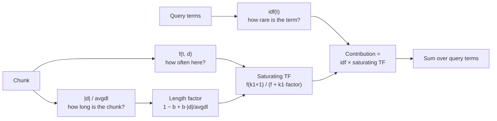

**BM25** is the ranking function behind nearly every keyword search engine in production: it is the default in Lucene, and therefore in Elasticsearch, OpenSearch and Solr, and it is the sparse half of most hybrid RAG retrievers. Thirty years after it was introduced it remains the baseline that new retrieval models are measured against, and on many collections it is hard to beat by much without in-domain training data.

This lesson explains where BM25 comes from, what each part of the formula does, how its two parameters $k_1$ and $b$ change rankings, how implementations differ, and how to tune it. You will implement it in a few lines, take one score apart term by term, and check it against the `rank-bm25` library. The ingredients (term frequency and inverse document frequency) have their own lessons, which explore their variants in more depth; here they are put together.

## Learning objectives

- Write down the BM25 formula and explain the role of each component: IDF, saturating term frequency and length normalisation.
- Compute a BM25 score by hand for a given term, document and collection.
- Predict how changing $k_1$ and $b$ will change a ranking, and choose sensible values for a chunked RAG corpus.
- Explain the differences between common BM25 implementations (Lucene, `rank-bm25`) and why scores from two implementations are not interchangeable.
- Describe BM25F and the BM25L and BM25+ variants and when each is relevant.

## Prerequisites

- [TF-IDF](/learn/sparse-retrieval/tf-idf): term weighting, the vector space model and its weaknesses.
- [Inverted indexes](/learn/sparse-retrieval/inverted-indexes): how a sum over query terms is evaluated efficiently.
- [Query-document similarity](/learn/retrieval-fundamentals/query-document-similarity), which shows that BM25 is a sparse inner product.

## Why this matters

Dense retrievers have well-known blind spots: exact identifiers, rare names, product codes, and text unlike anything in the embedding model's training data. BM25 handles all of these well, needs no training, no GPU and no model download, explains every score, and runs on mature, horizontally scalable infrastructure. That is why the [hybrid](/learn/hybrid-search) retrievers that most production RAG systems use pair an embedding model with BM25 rather than with anything more exotic.

Using BM25 well requires understanding it, because its behaviour is set by choices that are easy to make blindly: how text is tokenised, what $k_1$ and $b$ are, which IDF variant the library uses, and how long the chunks are. A team that indexes 200-token chunks next to 3,000-token PDF pages, keeps the defaults and never looks at the scores will see long documents crowd out precise answers, or the reverse, without knowing why.

## The intuition

Imagine judging which of Meridian's handbook chunks best answers "laptop refresh cycle". You would reason roughly like this:

- **Rare words count more.** "Refresh" and "cycle" appear in one chunk only; "laptop" appears in several. A chunk containing "refresh" is much more likely to be the one wanted. That is IDF.
- **Repetition helps, but with diminishing returns.** A chunk mentioning "laptop" twice is somewhat more about laptops than one mentioning it once. One mentioning it ten times is not ten times as relevant; after a few mentions, more add almost nothing. That is **saturation**.
- **Allow for length.** A 2,000-word IT overview will mention "laptop" several times simply because it is long. Four mentions in 2,000 words is less telling than one mention in ten words. That is **length normalisation**.

BM25 is a formula that does exactly these three things, with two knobs: $k_1$ says how quickly repetition stops helping, and $b$ says how much to allow for length.

## How it works

### The formula

For a query $q$ with terms $t_1, \ldots, t_n$ and a document (in RAG, a chunk) $d$:

$$
\text{BM25}(q, d) = \sum_{t \in q} \text{idf}(t) \cdot \frac{f(t, d)\,(k_1 + 1)}{f(t, d) + k_1 \left(1 - b + b \cdot \frac{|d|}{\text{avgdl}}\right)}
$$

where $f(t, d)$ is the number of times $t$ occurs in $d$, $|d|$ is the length of $d$ in terms, and $\text{avgdl}$ is the average length across the collection. The score is a sum of independent per-term contributions; a term absent from the chunk contributes zero.

Scoring a chunk works like this:

1. Analyse the query with the same analyser used at indexing time.
2. For each query term, look up its IDF (computed from collection statistics) and, from the inverted index, each chunk that contains it and the term's frequency there.
3. Compute the chunk's **length factor** $1 - b + b \cdot |d| / \text{avgdl}$: 1 for an average-length chunk, below 1 for shorter ones, above 1 for longer ones.
4. Compute the term's contribution: IDF times a saturating function of its frequency, where the saturation point is scaled by the length factor.
5. Sum the contributions over the query terms. Rank chunks by the sum.



### Where it comes from

BM25 grew out of the **probabilistic relevance framework** developed by Stephen Robertson, Karen Spärck Jones and colleagues from the 1970s. Its starting point is to rank documents by the probability that they are relevant to the query. Under simplifying assumptions (terms independent, relevance information unavailable), that leads to a sum of per-term weights, and the weight for a term's mere presence is the **Robertson/Spärck Jones weight**, which reduces to an IDF-like quantity $\log\frac{N - n_t + 0.5}{n_t + 0.5}$ when nothing is known about which documents are relevant.

To account for how often a term occurs, Robertson and Walker (1994) used a model in which each term is either **elite** in a document (the document is genuinely about that concept) or not, with occurrence counts following a different Poisson distribution in each case. The full model has parameters that cannot be estimated in practice, but its shape is clear: the evidence from term frequency rises quickly at first and then levels off towards a maximum. They approximated that shape with the simple saturating function $f / (f + k_1)$, and added length normalisation on the reasoning that longer documents have more occurrences for reasons unrelated to eliteness. The resulting formula, numbered 25 in a series of "best match" functions tried by the Okapi system at City University London, performed strongly at the TREC evaluations in the mid-1990s and has been the standard since.

The practical consequence: BM25 is a principled approximation, not a fitted curve, and its parameters have meanings. That is why sensible defaults transfer reasonably well between collections.

### The three components

**IDF.** Terms that occur in fewer documents get more weight. BM25's probabilistic IDF, $\ln\frac{N - n_t + 0.5}{n_t + 0.5}$, goes **negative** for terms in more than half the documents, which would make matching a common word *lower* a document's score. Implementations deal with this differently, as described below. [Inverse document frequency](/learn/sparse-retrieval/inverse-document-frequency) covers the variants and their engineering consequences in depth.

**Saturating term frequency.** With an average-length chunk the length factor is 1 and the TF part becomes

$$
\frac{f\,(k_1 + 1)}{f + k_1}
$$

At $f = 0$ it is 0; at $f = 1$ it is exactly 1; as $f$ grows it approaches $k_1 + 1$ but never exceeds it. So $k_1$ sets the **ceiling** on how much repetition can multiply a term's contribution, and how slowly the curve flattens. With $k_1 = 0$ the TF part is 1 whenever the term is present: pure binary matching. With very large $k_1$ it approaches raw term frequency, as in TF-IDF. Typical values lie between 1.2 and 2.0.

**Length normalisation.** The length factor $1 - b + b \cdot |d| / \text{avgdl}$ multiplies $k_1$ in the denominator. A longer chunk has a larger factor, so it needs more occurrences to reach the same TF value. The parameter $b \in [0, 1]$ sets how strongly: $b = 0$ ignores length completely; $b = 1$ scales fully in proportion to length; the usual default $b = 0.75$ sits between. [Term frequency](/learn/sparse-retrieval/term-frequency) discusses why full normalisation is usually wrong: some documents are long because they are verbose, but others because they cover more ground.

### Query term frequency

If a term occurs twice in the query, the formula above (as most implementations apply it) counts its contribution twice. The original BM25 also had a saturating factor for query term frequency with a third parameter, $k_3$, but for short queries it matters little, and most libraries simply loop over query tokens. Be aware that query rewriting which repeats terms therefore shifts BM25 weight towards them.

### Implementations differ

"BM25" names a family, and libraries make different choices:

| Implementation | Default $k_1$, $b$ | IDF | Notes |
| --- | --- | --- | --- |
| Lucene (Elasticsearch, OpenSearch, Solr) | 1.2, 0.75 | $\ln\left(1 + \frac{N - n + 0.5}{n + 0.5}\right)$, always positive | Recent versions omit the constant $(k_1 + 1)$ factor, which does not change rankings; document lengths are stored in a lossy compressed form |
| `rank-bm25` `BM25Okapi` | 1.5, 0.75 | $\ln\frac{N - n + 0.5}{n + 0.5}$, with negative values replaced by $\epsilon$ times the mean IDF ($\epsilon = 0.25$) | Scores every document for every query; no inverted index |

Two consequences matter. First, **scores from different implementations are not comparable** and can even rank differently, mainly through the IDF of common terms. Second, in `rank-bm25` a term that occurs in exactly half the documents has an IDF of exactly zero, and terms in more than half get a small positive floor, so on a small corpus a moderately common word can count for nothing while a more common one counts for something. The code below shows this happening.

### Variants worth knowing

- **BM25F** (Robertson, Zaragoza and Taylor, 2004) handles documents with several fields, such as title and body. Rather than scoring each field separately and adding the scores (which double-counts saturation), it combines weighted field frequencies first and saturates once. For RAG chunks with a heading field and a body field, BM25F-style weighting is the principled way to make heading matches count more. Search engines expose field weighting in different ways; check what yours actually computes.
- **BM25L** and **BM25+** (Lv and Zhai, 2011) address a finding that BM25 can over-penalise very long documents, so that a long document containing a query term may score barely above one that lacks it. BM25+ adds a small constant $\delta$ to the TF part whenever the term is present. For collections of similar-sized chunks this rarely matters; for collections mixing short chunks with very long documents it can.

Experiment with the term frequency, document length and both parameters in the visualiser.

```playground
bm25
```

## The mathematics

### One term's contribution, by hand

**Intuition.** Multiply "how rare" by "how much present, allowing for length", where "how much present" saturates.

$$
s(t, d) = \text{idf}(t) \cdot \frac{f(t, d)\,(k_1 + 1)}{f(t, d) + k_1 \left(1 - b + b \frac{|d|}{\text{avgdl}}\right)}, \qquad \text{idf}(t) = \ln\left(1 + \frac{N - n_t + 0.5}{n_t + 0.5}\right)
$$

- $N$: number of chunks; $n_t$: number of chunks containing $t$.
- $f(t, d)$: occurrences of $t$ in $d$; $|d|$: length of $d$ in terms; $\text{avgdl}$: mean chunk length.
- $k_1$: saturation parameter; $b$: length-normalisation strength.
- The IDF shown is Lucene's form, which the code below uses.

**Example 1: a rare term in a short chunk.** The collection in the code has $N = 6$ chunks with $\text{avgdl} = 17.33$. The chunk "The laptop refresh cycle is 3 years." has $|d| = 7$. "refresh" occurs once there and in no other chunk ($n = 1$). With $k_1 = 1.2$, $b = 0.75$:

- IDF: $\ln(1 + 5.5 / 1.5) = \ln 4.6667 = 1.5404$.
- Length factor: $1 - 0.75 + 0.75 \times 7 / 17.33 = 0.25 + 0.3029 = 0.5529$.
- Denominator: $1 + 1.2 \times 0.5529 = 1 + 0.6635 = 1.6635$.
- Numerator: $1 \times 2.2 = 2.2$.
- Contribution: $1.5404 \times 2.2 / 1.6635 = 1.5404 \times 1.3225 = 2.037$.

Because the chunk is shorter than average, one occurrence earns a TF part of 1.32, more than the 1.0 it would earn at average length.

**Example 2: a common term repeated in a long chunk.** The IT overview chunk has $|d| = 46$ and mentions "laptop" 4 times; "laptop" is in 3 of the 6 chunks.

- IDF: $\ln(1 + 3.5 / 3.5) = \ln 2 = 0.6931$.
- Length factor: $0.25 + 0.75 \times 46 / 17.33 = 0.25 + 1.9904 = 2.2404$.
- Denominator: $4 + 1.2 \times 2.2404 = 4 + 2.6885 = 6.6885$.
- Contribution: $0.6931 \times 4 \times 2.2 / 6.6885 = 0.6931 \times 1.3157 = 0.912$.

Four mentions in a long chunk earn a TF part of 1.32, about the same as one mention in a very short chunk. That is saturation and length normalisation working together.

### The saturation curve

At average length the TF part is $f(k_1 + 1)/(f + k_1)$. Its values for a few frequencies make $k_1$'s role concrete:

```python
for k1 in [0.5, 1.2, 2.0]:
    row = [f * (k1 + 1) / (f + k1) for f in [1, 2, 3, 5, 10]]
    print(f"k1={k1:<4}", "  ".join(f"f={f}:{v:.2f}" for f, v in zip([1, 2, 3, 5, 10], row)),
          f"  ceiling={k1 + 1:.1f}")
```

```output
k1=0.5  f=1:1.00  f=2:1.20  f=3:1.29  f=5:1.36  f=10:1.43   ceiling=1.5
k1=1.2  f=1:1.00  f=2:1.38  f=3:1.57  f=5:1.77  f=10:1.96   ceiling=2.2
k1=2.0  f=1:1.00  f=2:1.50  f=3:1.80  f=5:2.14  f=10:2.50   ceiling=3.0
```

At $k_1 = 1.2$, the second occurrence adds 38% and the tenth adds almost nothing. A single occurrence always gives exactly 1, whatever $k_1$.

## In code

**The problem.** Implement BM25 transparently, break a score into per-term contributions, watch how $k_1$ and $b$ reorder results, and confirm the implementation against `rank-bm25`, noting where the library's IDF differs.

**Dependencies.** NumPy and rank-bm25. No API key or model.

```bash
pip install numpy rank-bm25
```

```python
import math
import re
import numpy as np
from rank_bm25 import BM25Okapi

chunks = {
    "refresh":  "The laptop refresh cycle is 3 years.",
    "lost":     "Report a lost laptop to the support desk at once.",
    "overview": ("IT overview: your laptop is set up on day one. Keep the laptop updated, "
                 "lock the laptop when away, use the VPN on public Wi-Fi, and bring the laptop "
                 "to the support desk for repairs. The support desk is open 08:00 to 18:00."),
    "vpn":      "Error E-4021: the VPN client is out of date. Update it from the IT portal.",
    "leave":    "Annual leave is 25 days. Up to 5 unused days carry over to 31 March.",
    "remote":   "Staff may work remotely up to 3 days a week.",
}
ids = list(chunks)

def tokenise(text):
    return re.findall(r"[a-z0-9]+", text.lower())

docs = [tokenise(t) for t in chunks.values()]

class BM25:
    """Okapi BM25 over an in-memory corpus, written out term by term."""
    def __init__(self, docs, k1=1.2, b=0.75):
        self.k1, self.b = k1, b
        self.N = len(docs)
        self.len = np.array([len(d) for d in docs], dtype=float)
        self.avgdl = self.len.mean()
        self.tf = [{} for _ in docs]
        df = {}
        for i, d in enumerate(docs):
            for t in d:
                self.tf[i][t] = self.tf[i].get(t, 0) + 1
            for t in set(d):
                df[t] = df.get(t, 0) + 1
        # Lucene-style IDF: always positive
        self.idf = {t: math.log(1 + (self.N - n + 0.5) / (n + 0.5)) for t, n in df.items()}

    def term_score(self, t, i):
        f = self.tf[i].get(t, 0)
        if f == 0:
            return 0.0
        norm = self.k1 * (1 - self.b + self.b * self.len[i] / self.avgdl)
        return self.idf[t] * f * (self.k1 + 1) / (f + norm)

    def scores(self, query):
        return np.array([sum(self.term_score(t, i) for t in query) for i in range(self.N)])

query = tokenise("laptop refresh cycle")
print("doc lengths:", dict(zip(ids, map(int, BM25(docs).len))), " avgdl:", round(BM25(docs).avgdl, 2))

# 1. One score, broken down term by term
bm = BM25(docs)
for name in ["refresh", "overview"]:
    i = ids.index(name)
    parts = {t: round(float(bm.term_score(t, i)), 3) for t in query}
    print(f"{name:<9} tf(laptop)={bm.tf[i].get('laptop', 0)}  parts={parts}  total={sum(parts.values()):.3f}")

# 2. How k1 and b change the ranking
print()
for k1, b in [(1.2, 0.75), (1.2, 0.0), (1.2, 1.0), (0.0, 0.75), (3.0, 0.0)]:
    s = BM25(docs, k1=k1, b=b).scores(query)
    top = [f"{ids[i]}={s[i]:.2f}" for i in np.argsort(-s, kind="stable")[:3]]
    print(f"k1={k1:<4} b={b:<5}", "  ".join(top))

# 3. Cross-check against rank_bm25 (same k1 and b; its IDF differs)
lib = BM25Okapi(docs, k1=1.2, b=0.75)
print("\nrank_bm25 idf('laptop') =", round(lib.idf["laptop"], 4), " ours =", round(bm.idf["laptop"], 4))
print("rank_bm25 idf('to')     =", round(lib.idf["to"], 4), " ours =", round(bm.idf["to"], 4))
ours_with_lib_idf = BM25(docs)
ours_with_lib_idf.idf = lib.idf
print("same scores with the library's IDF:",
      np.allclose(ours_with_lib_idf.scores(query), lib.get_scores(query)))
```

```output
doc lengths: {'refresh': 7, 'lost': 10, 'overview': 46, 'vpn': 16, 'leave': 15, 'remote': 10}  avgdl: 17.33
refresh   tf(laptop)=1  parts={'laptop': 0.917, 'refresh': 2.037, 'cycle': 2.037}  total=4.991
overview  tf(laptop)=4  parts={'laptop': 0.912, 'refresh': 0.0, 'cycle': 0.0}  total=0.912

k1=1.2  b=0.75  refresh=4.99  overview=0.91  lost=0.84
k1=1.2  b=0.0   refresh=3.77  overview=1.17  lost=0.69
k1=1.2  b=1.0   refresh=5.59  lost=0.90  overview=0.85
k1=0.0  b=0.75  refresh=3.77  lost=0.69  overview=0.69
k1=3.0  b=0.0   refresh=3.77  overview=1.58  lost=0.69

rank_bm25 idf('laptop') = 0.0  ours = 0.6931
rank_bm25 idf('to')     = 0.2747  ours = 0.4418
same scores with the library's IDF: True
```

**The important lines.**

- `self.tf[i]` is a per-chunk dictionary of term counts, and `df` counts each term once per chunk via `set(d)`. These are exactly the statistics an inverted index stores.
- `norm = self.k1 * (1 - self.b + self.b * self.len[i] / self.avgdl)` is the length-scaled saturation point. Everything else in `term_score` is the formula as written.
- `scores` loops over every chunk, like `rank-bm25`. A search engine would instead walk the posting lists of the query terms only, as in [Inverted indexes](/learn/sparse-retrieval/inverted-indexes).
- Section 3 swaps in the library's IDF table and gets identical scores, which proves the two implementations differ **only** in IDF.

**What the output means.**

- The per-term parts match the hand calculations: 2.037 for "refresh" and 0.912 for four mentions of "laptop" in the long overview. The short chunk wins on its rare terms, as it should.
- **The ranking of the laptop-only chunks depends on the parameters.** At the defaults, the overview (four mentions, long) narrowly beats the "lost laptop" chunk (one mention, short). With $b = 1$, full length normalisation reverses that. With $k_1 = 0$, frequency is ignored and so is length, and the two tie. With $b = 0$ and $k_1 = 3$, repetition is rewarded generously and length ignored, so the overview pulls well ahead. Neither chunk answers "laptop refresh cycle", but in a real top-5 the second and third places are often exactly where the parameter choice decides what the model sees.
- **`rank-bm25` gives "laptop" an IDF of 0.0** because it appears in exactly half the chunks ($\ln(3.5/3.5) = 0$), while "to", which appears in four chunks, has a negative IDF that the library replaces with a floor of 0.2747. On this small corpus the library thinks "to" is a better discriminator than "laptop". On a corpus of thousands of chunks the effect is much smaller, but it is a real difference from Lucene, whose IDF is always positive and decreases smoothly.

**Common errors.**

- Passing untokenised strings: `BM25Okapi(["some text", ...])` treats each string as a sequence of **characters**, because it iterates over whatever it is given. Pass lists of tokens.
- Tokenising the query differently from the corpus, so terms silently miss.
- Passing a `tokenizer` function to the `BM25Okapi` constructor: the library then tokenises using a multiprocessing pool, which can fail or hang in some environments (notebooks, some macOS set-ups). Tokenising yourself first is simpler.
- Expecting `get_top_n` to drop non-matching chunks. It returns `n` documents regardless; filter on score greater than zero yourself.

**Extending it.** Add BM25+ by adding $\delta$ to the TF part when $f > 0$. Weight a heading field by indexing heading tokens twice and observe the double-counting problem BM25F avoids. Try the default `rank-bm25` parameters (`k1=1.5`) and see whether the order changes.

## A real-world example

Meridian's Platform team indexed two kinds of content into AskMeridian's keyword index: handbook chunks of about 200 tokens, and IT runbooks that the ingestion pipeline had failed to chunk, so each runbook was a single document of 3,000 to 8,000 tokens. The average length was dominated by the runbooks. Two symptoms followed.

For handbook questions, the handbook chunks were all far shorter than average, so their length factor was well below 1 and a single matching term produced a near-maximal TF part. Any chunk that happened to contain one rare query word jumped to the top, regardless of whether it was on topic. For IT questions, the runbooks were penalised heavily for length, and a short handbook chunk mentioning "VPN" once outranked the runbook that described the entire VPN set-up procedure.

The team's first idea was to tune $b$ down. It helped one symptom and worsened the other, because the problem was not the parameter but the mixture: BM25 normalises against a single average length, and this collection had two populations with very different lengths. The fix was to chunk the runbooks by section, giving the whole collection a similar length profile, after which the default $k_1 = 1.2$ and $b = 0.75$ worked well. They then built a set of 60 labelled queries and ran a small grid over $k_1 \in \{0.9, 1.2, 1.5, 2.0\}$ and $b \in \{0.4, 0.6, 0.75, 0.9\}$. The differences between settings were within the noise of 60 queries, so they kept the defaults. That is a common and useful outcome: once chunking is consistent, BM25 is not very sensitive to its parameters.

## Common mistakes

- **Mixing very different document lengths in one index.** BM25 normalises against one average, so short chunks and whole documents distort each other's scores. Chunk consistently.
- **Comparing BM25 scores across indexes, implementations or queries.** The scale depends on IDF values, query length and the implementation's choices. Use ranks or per-query normalisation when fusing with dense scores.
- **Tuning $k_1$ and $b$ without a labelled query set.** Changes that look better on three hand-picked queries are noise. Without evaluation, keep the defaults.
- **Feeding `rank-bm25` raw strings.** It scores characters, not words, and still returns plausible-looking numbers.
- **Assuming common terms are harmless.** Depending on the IDF variant, a term in more than half the chunks may contribute nothing, a floor, or a small positive weight. Know which your library uses.
- **Expecting BM25 to handle synonyms.** It is lexical. "Holiday" will never match "annual leave" without [query expansion](/learn/hybrid-search/query-expansion) or a dense retriever.

## Best practices

- Start with $k_1 \approx 1.2$ and $b = 0.75$ and change them only on evidence from labelled queries.
- Keep chunk lengths reasonably uniform; if some content is inherently much longer, consider a separate index or field.
- Give headings and titles their own field and weight them, rather than prepending them to the body text.
- Log per-term contributions (Elasticsearch and OpenSearch expose an `explain` option) when debugging a ranking.
- Drop zero-score results before passing candidates downstream.
- Fuse BM25 with dense retrieval by rank, for example with [Reciprocal Rank Fusion](/learn/hybrid-search/reciprocal-rank-fusion), rather than by adding raw scores.

## Performance considerations

The per-posting cost of BM25 is a handful of arithmetic operations: a lookup of the document's length (or a precomputed length factor), one division and one multiplication. Search engines precompute $k_1(1 - b + b|d|/\text{avgdl})$ per document, or per bucket of quantised lengths, so scoring adds negligible cost over reading postings. Query cost is dominated, as for any inverted-index retrieval, by the number of postings read.

In-memory libraries are different. `rank-bm25` computes, for each query term, a NumPy array over **all** documents. For 100,000 chunks and a 6-term query, that is 600,000 dictionary lookups in Python per query, typically tens to hundreds of milliseconds. It is fine for prototypes and evaluation scripts, and the wrong choice for a production service with a large corpus. Storage for BM25 is that of the inverted index, plus one length value per document.

Changing $k_1$ or $b$ requires no re-indexing in engines that compute the length factor at query time, which makes tuning cheap. Changing the analyser does require re-indexing.

## Security considerations

BM25 rewards term frequency and short documents, which makes it easy to game: a short chunk consisting of a target phrase repeated a few times, inserted into an indexed source, will rank highly for queries containing that phrase. Saturation limits the reward from repetition, but a short, keyword-dense chunk still scores very well. Restrict who can write to indexed sources, record each chunk's provenance, and consider demoting or reviewing chunks with extreme term-repetition ratios. [Retrieval manipulation](/learn/rag-security-fundamentals/retrieval-manipulation) covers this class of attack.

## Summary

- BM25 scores a chunk as a sum over query terms of IDF times a saturating, length-normalised term frequency.
- $k_1$ sets how quickly repeated occurrences stop adding score (ceiling $k_1 + 1$); $b$ sets how strongly long chunks are penalised (0 none, 1 fully proportional). Defaults of about 1.2 and 0.75 are sensible.
- It derives from the probabilistic relevance framework: the IDF from the Robertson/Spärck Jones weight, the saturation from an approximation to the 2-Poisson eliteness model.
- Implementations differ, mainly in IDF and its treatment of common terms, so scores are not portable between them.
- Consistent chunk lengths and a good analyser matter more than parameter tuning; tune only with labelled queries.

## Exercises

**1.** With $k_1 = 1.2$, $b = 0.75$, $N = 1{,}000$ chunks, $\text{avgdl} = 150$: "receipt" appears in 20 chunks. Compute its BM25 contribution (Lucene IDF) for a chunk of 75 terms that contains it twice.

<details><summary>Show solution</summary>

IDF $= \ln(1 + 980.5 / 20.5) = \ln(48.83) = 3.888$. Length factor $= 0.25 + 0.75 \times 75/150 = 0.625$; denominator $= 2 + 1.2 \times 0.625 = 2.75$; TF part $= 2 \times 2.2 / 2.75 = 1.6$. Contribution $= 3.888 \times 1.6 = 6.22$.

</details>

**2.** Using the code, find the smallest $b$ (in steps of 0.05, with $k_1 = 1.2$) at which the "lost" chunk overtakes the "overview" chunk for the query "laptop refresh cycle". Explain why such a crossover exists.

<details><summary>Show solution</summary>

```python
for b in np.arange(0, 1.0001, 0.05):
    s = BM25(docs, k1=1.2, b=b).scores(query)
    if s[ids.index("lost")] > s[ids.index("overview")]:
        print(f"lost overtakes overview at b={b:.2f}")
        break
```

```output
lost overtakes overview at b=0.90
```

Both chunks match only "laptop", with the same IDF. The overview has four occurrences but is 2.65 times average length; "lost" has one occurrence and is shorter than average. As $b$ rises, the overview's length factor grows and the short chunk's shrinks, until the short chunk's single occurrence is worth more.

</details>

**3.** Explain why BM25F scores a two-field document differently from computing BM25 on each field and adding the results, using a document whose title and body both contain the query term once.

<details><summary>Show solution</summary>

Scoring fields separately applies saturation twice: each field's single occurrence earns a full TF part of about 1, so the sum is about 2, as if the term were maximally present twice. BM25F first combines weighted frequencies (for example title weight 2 plus body weight 1 gives a pseudo-frequency of 3) and then saturates once, giving a TF part of about $3 \times 2.2 / (3 + 1.2) = 1.57$ at average length. The term's total contribution is still bounded by the single ceiling $k_1 + 1$, as the probabilistic model intends.

</details>

**4.** Design decision. AskMeridian is adding 1,200 product-documentation pages that vary from 50 to 6,000 tokens. Should the team keep one BM25 index and tune $b$, or do something else? Justify your answer.

<details><summary>Show solution</summary>

Do something else first: chunk the pages by section to a similar size as the existing handbook chunks, so that one average length is meaningful. Tuning $b$ on a mixed-length collection trades one failure for another (short chunks over-rewarded or long documents over-penalised). Keep page title and section heading as a separate weighted field, and store the page id on each chunk so results can be grouped by page if needed. Then evaluate with labelled product queries and tune only if the evidence supports it.

</details>

## Check your understanding

```quiz
[
  {
    "q": "In BM25 with b = 0.75, what is the TF part for a term that occurs once in a chunk of exactly average length?",
    "options": [
      "0.75",
      "k1 + 1",
      "1",
      "It depends on the IDF"
    ],
    "answer": 2,
    "why": "At average length the factor is 1, so the TF part is 1 × (k1 + 1) / (1 + k1) = 1, whatever k1 is."
  },
  {
    "q": "What does setting b = 0 do?",
    "options": [
      "Ignores document length entirely",
      "Ignores term frequency entirely",
      "Makes BM25 identical to TF-IDF cosine",
      "Makes the IDF of common terms zero"
    ],
    "answer": 0,
    "why": "With b = 0 the length factor is always 1, so long and short chunks are treated alike. k1 = 0 is the setting that ignores frequency."
  },
  {
    "q": "A colleague's script uses `BM25Okapi(chunk_texts)` where `chunk_texts` is a list of strings. What happens?",
    "options": [
      "The library tokenises on whitespace automatically",
      "It raises a TypeError",
      "Each string is treated as a sequence of characters, so it scores single characters and still returns numbers",
      "It builds an inverted index over words"
    ],
    "answer": 2,
    "why": "The library iterates over each document as given; iterating over a string yields characters. The result looks plausible but is meaningless."
  },
  {
    "q": "Why can two systems that both use \"BM25 with k1 = 1.2 and b = 0.75\" rank the same chunks differently?",
    "options": [
      "BM25 is non-deterministic",
      "They may use different IDF formulas and analysers, which change term weights and which terms match",
      "Only Lucene implements real BM25",
      "The order of query terms changes the sum"
    ],
    "answer": 1,
    "why": "IDF variants differ chiefly for common terms, and tokenisation decides what the terms are. Addition is order-independent and the formula is deterministic."
  },
  {
    "q": "Which problem does BM25F address?",
    "options": [
      "Negative IDF for common terms",
      "Vocabulary mismatch between query and document",
      "Very long documents being over-penalised",
      "Double-counting saturation when a term appears in several fields of the same document"
    ],
    "answer": 3,
    "why": "BM25F combines weighted field frequencies before saturating once. BM25L and BM25+ address over-penalising long documents."
  }
]
```

## Further reading

- Stephen Robertson and Hugo Zaragoza, "The Probabilistic Relevance Framework: BM25 and Beyond", *Foundations and Trends in Information Retrieval*, 2009. The authoritative account of BM25's derivation, BM25F and parameter choices.
- S. E. Robertson and S. Walker, "Some simple effective approximations to the 2-Poisson model for probabilistic weighted retrieval", SIGIR 1994.
- Yuanhua Lv and ChengXiang Zhai, "Lower-bounding term frequency normalization", CIKM 2011 (BM25+).
- Stephen Robertson, Hugo Zaragoza and Michael Taylor, "Simple BM25 extension to multiple weighted fields", CIKM 2004 (BM25F).
- [rank-bm25 on GitHub](https://github.com/dorianbrown/rank_bm25), the Python library used above, whose source is short enough to read in full.
