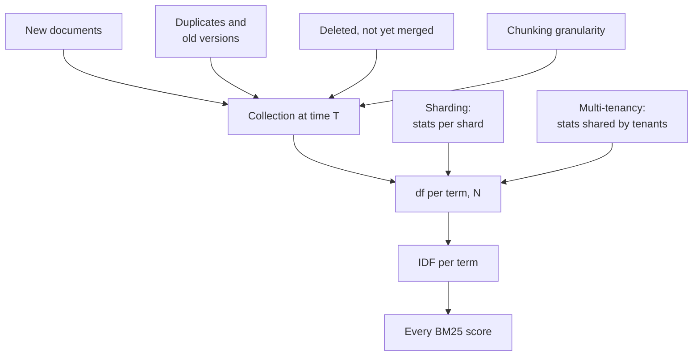

**Inverse document frequency** (IDF) is the part of a lexical score that knows a word like "E-4021" is worth more than a word like "days". It is computed from one number per term, the count of chunks that contain it, and it is the single most important ingredient in TF-IDF and BM25: with short chunks, where most terms occur once, the ranking is largely a matter of which query terms match and what their IDF is.

IDF is also the part of sparse retrieval that most often surprises engineers in production, because it is a property of the **collection**, not of the chunk. Add documents and every score changes. Split the index across shards and each shard may disagree about how rare a word is. Put several customers in one index and one customer's documents change another's rankings. Index four copies of an old handbook and the words in it become "common". This lesson covers the theory of IDF and its variants briefly, and then concentrates on those engineering consequences.

## Learning objectives

- Explain why rarity indicates usefulness for retrieval, from both the information-theoretic and the probabilistic point of view.
- Compute and compare the common IDF variants (plain, smoothed, Robertson/Spärck Jones and Lucene) and identify where each goes negative, zero or flat.
- Predict how collection changes (growth, duplicates, deletions and chunking granularity) shift IDF values and rankings.
- Diagnose ranking differences caused by shard-local statistics and by shared statistics in multi-tenant indexes, and choose a remedy.

## Prerequisites

- [TF-IDF](/learn/sparse-retrieval/tf-idf) and [BM25](/learn/sparse-retrieval/bm25): where IDF enters each formula.
- [Inverted indexes](/learn/sparse-retrieval/inverted-indexes): document frequencies, segments and deletions.
- [Sharding](/learn/advanced-vector-database-engineering/sharding): how an index is split across machines.

## Why this matters

Consider the query "what does error E-4021 mean?" Six terms survive analysis, and four of them ("what", "does", "error", "mean") appear in many chunks. Without IDF, a chunk that happens to contain "what", "does" and "mean" outranks the one containing "4021". IDF makes the rare term dominate, which is almost always what the user meant.

Because IDF is computed from the collection, it is also a source of instability:

- **Scores drift as the corpus grows.** A RAG system that indexes new documents daily has slowly changing IDF values. Any threshold on raw scores ("ignore chunks below 5.0") drifts with them.
- **Distributed indexes compute it locally.** By default, search engines score each shard with that shard's statistics. If similar documents are routed to the same shard, a term can be rare on one shard and common on another, and identical chunks get different scores depending on where they live.
- **Shared indexes leak.** In a multi-tenant index, one tenant's documents change the IDF used for everyone, which both skews ranking and reveals information.
- **Pipeline choices change it.** Duplicates, old versions, boilerplate and chunk size all change document frequencies, often more than the content does.

## The intuition

Imagine a library where you can ask the librarian only yes-or-no questions about a book's words to find the one you want. "Does it contain *the*?" is useless: every book does, so the answer tells you nothing. "Does it contain *days*?" splits the library a little. "Does it contain *4021*?" picks out one book in a thousand: one answer and you are nearly done.

The value of a word for finding things is how much it narrows the search. A word in every document narrows nothing; a word in half of them halves the candidates; a word in one document in a thousand cuts them a thousandfold. Measured on a logarithmic scale, so that halving twice counts twice as much as halving once, that is IDF.

Notice what this does not depend on: the word's meaning, or the query. It depends only on how many documents contain the word. Change the library and you change the value of every question.

## How it works

### Where IDF comes from

Karen Spärck Jones introduced the idea in 1972, in a paper on "term specificity": a term used in fewer documents is more specific, and matches on specific terms should count more. She proposed weighting by a logarithm of the inverse of the term's document frequency, and showed experimentally that it improved retrieval. Two later lines of theory explain why it works.

**The information-theoretic view.** If you pick a document at random, the probability that it contains term $t$ is $\text{df}_t / N$. The **self-information** of observing an event with probability $p$ is $-\log p$, so observing the term carries $\log(N / \text{df}_t)$ units of information: exactly the plain IDF. Rare events are surprising and therefore informative.

**The probabilistic view.** In the probabilistic relevance framework behind BM25, the weight of a term is the log-odds ratio of it appearing in relevant against non-relevant documents. With no relevance information, and assuming relevant documents are a tiny fraction of the collection, this reduces to

$$
w_t = \log\frac{N - n_t + 0.5}{n_t + 0.5}
$$

where $n_t$ is the document frequency. The 0.5s are a correction that keeps the estimate finite at the extremes. This is the **Robertson/Spärck Jones (RSJ) weight** without relevance information, and it is the IDF in the original BM25.

Stephen Robertson's 2004 paper "Understanding inverse document frequency" discusses both arguments and their limits; neither is a full proof, but together they explain why such a simple statistic has lasted.

### The variants

Implementations differ, and the differences show up at the extremes:

| Variant | Formula | At $\text{df} = N$ | Over half the documents |
| --- | --- | --- | --- |
| Plain | $\ln\frac{N}{\text{df}}$ | 0 | small positive |
| scikit-learn (smoothed) | $\ln\frac{1 + N}{1 + \text{df}} + 1$ | 1 | above 1; range compressed |
| RSJ / original BM25 | $\ln\frac{N - \text{df} + 0.5}{\text{df} + 0.5}$ | strongly negative | **negative** |
| Lucene BM25 | $\ln\left(1 + \frac{N - \text{df} + 0.5}{\text{df} + 0.5}\right)$ | close to 0 | small positive |
| `rank-bm25` `BM25Okapi` | RSJ, negative values replaced by $0.25 \times$ mean IDF | floor | floor |

The negative RSJ value has a real meaning in the probabilistic model (a document containing a term that nearly every non-relevant document contains is slightly *less* likely to be relevant), but in practice it makes matching a common word lower a chunk's score, which users find baffling. Lucene adds 1 inside the logarithm to keep IDF positive; note that $\ln(1 + \frac{N - n + 0.5}{n + 0.5}) = \ln\frac{N + 1}{n + 0.5}$, so Lucene's IDF is almost exactly the plain $\ln(N/n)$. `rank-bm25` floors negative values instead, which creates the discontinuity seen in the [BM25 lesson](/learn/sparse-retrieval/bm25): a term in exactly half the documents gets zero, while a more common one gets the floor.

For ranking within one index the choice matters mainly for common terms. With chunked corpora and BM25, the Lucene form is a sensible default because it is positive, smooth and close to the textbook definition.

### IDF is a collection statistic

The engineering consequences all follow from one fact: $\text{df}_t$ and $N$ describe the whole index at a moment in time.



**Growth and drift.** As documents are added, $N$ grows and each term's df grows by however many new documents contain it. A term that gains documents faster than the collection becomes less valuable. After a large ingestion of IT runbooks, "vpn" goes from rare to common and handbook chunks that mention it lose ranking power. Rankings among existing chunks can change even though none of them changed.

**Duplicates and versions.** Every copy of a chunk adds 1 to the df of every term in it. If the ingestion pipeline indexes the 2023 handbook alongside the current one, or the same policy page from three different intranet locations, the terms in that content become artificially common and their IDF falls. The code below shows four copies of an old chunk halving a term's IDF. [Duplicate detection](/learn/data-processing/duplicate-detection) before indexing protects IDF as well as context quality.

**Deletions.** In segment-based engines, a deleted chunk keeps counting towards df until its segment is merged, as described in [Inverted indexes](/learn/sparse-retrieval/inverted-indexes). After a large deletion, statistics lag reality until merges catch up.

**Chunking granularity.** IDF counts chunks, not source documents. A term that recurs throughout one long document (its product name, say) appears in every one of that document's chunks, so its df reflects the document's length rather than how many documents discuss it. Smaller chunks make document-specific terms look more common. Boilerplate repeated in every chunk does the same, more severely.

**Unseen terms.** A query term absent from the index has no df and contributes nothing; a term that appears in one chunk has the maximum IDF. Misspellings in the corpus can therefore become extremely "valuable" terms that match only matching misspellings in queries.

### Sharded indexes

A search engine splits a large index into **shards**, each a complete inverted index over a subset of the documents, and runs each query on every shard before merging the top results. By default, Elasticsearch and OpenSearch score each shard using **that shard's own** document frequencies (the `query_then_fetch` search type). This is fast, and when documents are distributed randomly and shards are large, local df values are close to global ones, so it rarely matters.

It matters when shards are small or when routing groups similar documents. If AskMeridian routes HR handbook chunks to one shard and IT runbooks to another, "vpn" is rare on the handbook shard and common on the runbook shard. A handbook chunk that mentions VPN in passing then receives a far higher IDF than the runbooks that are entirely about VPNs, and wins after the merge. The `dfs_query_then_fetch` search type first collects document frequencies from all shards and scores with the global values, at the cost of an extra round trip per query.

### Multi-tenant indexes

When several tenants (customers, departments or permission groups) share one index and are separated by a filter, the filter decides which chunks are returned but **not** which statistics are used: df counts every chunk in the index. Two problems follow.

- **Skew.** If one large tenant's documents all mention "invoice", the term is common index-wide and its IDF is low for a small tenant whose documents rarely mention it. The small tenant's rankings are shaped by someone else's data.
- **Leakage.** Scores depend on statistics that include other tenants' documents. A user who can issue queries and see scores (or merely rankings) can, in principle, probe whether a rare term exists elsewhere in the index by observing changes as documents are added. This is a side channel; its practical severity depends on what scores are exposed, but in high-sensitivity settings it is a reason not to share statistics.

The remedies are to use separate indexes per tenant (statistics are naturally isolated), or, where that is impractical, to keep tenants with very different content in separate indexes and avoid exposing raw scores. See [Tenant isolation](/learn/access-control-and-privacy/tenant-isolation).

## The mathematics

### Comparing the variants

**Intuition.** All variants decrease as df grows; they differ in offset, in compression and in whether they go below zero.

$$
\text{idf}_{\text{plain}} = \ln\frac{N}{n}, \quad
\text{idf}_{\text{sk}} = \ln\frac{1 + N}{1 + n} + 1, \quad
\text{idf}_{\text{RSJ}} = \ln\frac{N - n + 0.5}{n + 0.5}, \quad
\text{idf}_{\text{Lucene}} = \ln\frac{N + 1}{n + 0.5}
$$

where $N$ is the number of chunks and $n$ the number containing the term.

**By hand.** Take $N = 1{,}000$.

- A term in 10 chunks: plain $\ln 100 = 4.605$; RSJ $\ln(990.5 / 10.5) = \ln 94.33 = 4.547$; Lucene $\ln(1001 / 10.5) = \ln 95.33 = 4.557$. All close.
- A term in 500 chunks: plain $\ln 2 = 0.693$; RSJ $\ln(500.5/500.5) = 0$; Lucene $\ln(1001 / 500.5) = \ln 2 = 0.693$.
- A term in 900 chunks: plain $\ln(1.111) = 0.105$; RSJ $\ln(100.5 / 900.5) = \ln 0.1116 = -2.193$, strongly negative; Lucene $0.106$.

The variants agree for rare terms, which carry most of the ranking, and disagree sharply for common ones.

### Sensitivity to growth

**Intuition.** IDF depends on the ratio $N / n$. If a term's df grows in proportion to the collection, its IDF is stable; if it grows faster or slower, IDF moves.

For plain IDF, if $N$ grows by a factor $g_N$ and $n$ by a factor $g_n$:

$$
\Delta\,\text{idf} = \ln\frac{g_N N}{g_n n} - \ln\frac{N}{n} = \ln\frac{g_N}{g_n}
$$

**By hand.** The collection doubles ($g_N = 2$) by adding IT runbooks, and "vpn" goes from 20 chunks to 200 ($g_n = 10$). Its IDF changes by $\ln(2/10) = -1.609$: from $\ln(1000/20) = 3.912$ to $\ln(2000/200) = 2.303$. Meanwhile "annual", which gains no new chunks ($g_n = 1$), rises by $\ln 2 = 0.693$. Handbook chunks about leave now rank higher, relative to those about VPN, than before, though neither changed.

## In code

**The problem.** Tabulate the IDF variants across the range of document frequencies; show how shard-local statistics change which chunks win; and show how duplicate copies of old content lower a term's IDF.

**Dependencies.** Python's standard library only.

```python
import math
import re

def tok(s):
    return re.findall(r"[a-z0-9]+", s.lower())

# --- 1. IDF variants across the range of document frequencies ---------------
N = 1000
variants = {
    "ln(N/df)":         lambda n: math.log(N / n),
    "sklearn smooth":   lambda n: math.log((1 + N) / (1 + n)) + 1,
    "RSJ (BM25 orig.)": lambda n: math.log((N - n + 0.5) / (n + 0.5)),
    "Lucene BM25":      lambda n: math.log(1 + (N - n + 0.5) / (n + 0.5)),
}
dfs = [1, 10, 100, 500, 600, 900, 1000]
print(f"N = {N}")
print(f"{'df':>6}" + "".join(f"{name:>18}" for name in variants))
for n in dfs:
    print(f"{n:>6}" + "".join(f"{fn(n):>18.3f}" for fn in variants.values()))

# --- 2. Shard-local versus global IDF ----------------------------------------
handbook = [   # shard A
    "Annual leave is 25 days and up to 5 days carry over.",
    "Staff may work remotely up to 3 days a week.",
    "Expenses must be submitted within 30 days.",
    "Passwords must be rotated every 90 days and VPN is required on public Wi-Fi.",
    "The laptop refresh cycle is 3 years.",
    "Report a lost laptop to the support desk at once.",
]
runbooks = [   # shard B
    "VPN set-up on a new laptop: install the VPN client and sign in.",
    "VPN error E-4021: update the VPN client from the IT portal.",
    "VPN error E-4012: reinstall the VPN certificate.",
    "VPN is slow: switch to the nearest VPN gateway.",
    "Printer queue stuck: restart the print service.",
    "Laptop battery drains fast: check power settings.",
]

def bm25_scores(query, docs, idf, k1=1.2, b=0.75):
    toks = [tok(d) for d in docs]
    avgdl = sum(map(len, toks)) / len(toks)
    out = []
    for t_doc in toks:
        s = 0.0
        for t in tok(query):
            f = t_doc.count(t)
            if f:
                s += idf[t] * f * (k1 + 1) / (f + k1 * (1 - b + b * len(t_doc) / avgdl))
        out.append(s)
    return out

def lucene_idf(docs):
    toks = [set(tok(d)) for d in docs]
    vocab = set().union(*toks)
    n = len(docs)
    return {t: math.log(1 + (n - sum(t in d for d in toks) + 0.5) / (sum(t in d for d in toks) + 0.5))
            for t in vocab}

query = "vpn"
idf_a, idf_b = lucene_idf(handbook), lucene_idf(runbooks)
idf_global = lucene_idf(handbook + runbooks)
print(f"\nidf('vpn'):    shard A={idf_a['vpn']:.3f}  shard B={idf_b['vpn']:.3f}  global={idf_global['vpn']:.3f}")
print(f"idf('laptop'): shard A={idf_a['laptop']:.3f}  shard B={idf_b['laptop']:.3f}  global={idf_global['laptop']:.3f}")

# Each shard scores with its own statistics (but the same avgdl handling), then results are merged
local = ([(s, "A", d) for s, d in zip(bm25_scores(query, handbook, idf_a), handbook)] +
         [(s, "B", d) for s, d in zip(bm25_scores(query, runbooks, idf_b), runbooks)])
globl = ([(s, "A", d) for s, d in zip(bm25_scores(query, handbook, idf_global), handbook)] +
         [(s, "B", d) for s, d in zip(bm25_scores(query, runbooks, idf_global), runbooks)])
for name, results in [("shard-local IDF", local), ("global IDF", globl)]:
    print(f"\ntop 3 with {name}:")
    for s, shard, d in sorted(results, reverse=True)[:3]:
        print(f"  {s:.3f}  [{shard}] {d[:55]}")

# --- 3. Duplicates lower IDF ------------------------------------------------
old_versions = ["The laptop refresh cycle is 4 years (2023 handbook)."] * 4
idf_dup = lucene_idf(handbook + runbooks + old_versions)
print(f"\nidf('refresh') without old versions={idf_global['refresh']:.3f}, "
      f"with 4 copies of the 2023 text={idf_dup['refresh']:.3f}")
```

```output
N = 1000
    df          ln(N/df)    sklearn smooth  RSJ (BM25 orig.)       Lucene BM25
     1             6.908             7.216             6.502             6.503
    10             4.605             5.511             4.547             4.557
   100             2.303             3.294             2.193             2.299
   500             0.693             1.692             0.000             0.693
   600             0.511             1.510            -0.405             0.511
   900             0.105             1.105            -2.193             0.106
  1000             0.000             1.000            -7.601             0.000

idf('vpn'):    shard A=1.540  shard B=0.442  global=0.860
idf('laptop'): shard A=1.030  shard B=1.030  global=1.061

top 3 with shard-local IDF:
  1.290  [A] Passwords must be rotated every 90 days and VPN is requ
  0.636  [B] VPN error E-4012: reinstall the VPN certificate.
  0.617  [B] VPN is slow: switch to the nearest VPN gateway.

top 3 with global IDF:
  1.238  [B] VPN error E-4012: reinstall the VPN certificate.
  1.201  [B] VPN is slow: switch to the nearest VPN gateway.
  1.101  [B] VPN error E-4021: update the VPN client from the IT por

idf('refresh') without old versions=2.159, with 4 copies of the 2023 text=1.128
```

**The important lines.**

- The `variants` dictionary holds the four formulas from the mathematics section, evaluated at the same $N$ so they can be compared directly.
- `lucene_idf(docs)` computes document frequency by counting how many token sets contain each term; it is called on each shard alone and on the union, which is the only difference between "local" and "global".
- `bm25_scores` is ordinary BM25 with the IDF table passed in, so the effect of the statistics can be isolated. Length statistics (`avgdl`) are per shard in both runs, as they would be in a real engine without global statistics, so only IDF varies here.
- Part 3 appends four identical old-version chunks and recomputes IDF.

**What the output means.**

- **The variants agree for rare terms and diverge for common ones.** At df = 10 all four lie between 4.5 and 5.5. At df = 900 the RSJ form gives $-2.19$ while Lucene gives $+0.106$. scikit-learn's smoothing lifts everything by about 1, so common terms keep considerable weight. Lucene and plain IDF are nearly identical throughout, as the algebra predicted.
- **Shard-local IDF changes the winner.** On the handbook shard, "vpn" occurs in one chunk of six and gets IDF 1.540; on the runbook shard, it occurs in four of six and gets 0.442. The handbook's password chunk, which mentions VPN in passing, therefore tops the merged list, ahead of three runbooks entirely about VPNs. With global IDF (0.860 everywhere), the runbooks, which mention VPN twice each, take the top three places. "laptop", which is spread evenly across the two shards, has the same IDF on both, so statistics only matter when content is unevenly distributed.
- **Four duplicates nearly halve an IDF.** "refresh" goes from 2.159 to 1.128 because five chunks now contain it instead of one. Any query about the laptop refresh cycle loses most of the weight of its most specific word, and four out-of-date chunks now compete with the current one.

**Common errors.**

- Computing df by counting occurrences rather than documents: `sum(t in d for d in toks)` counts a document once however often it contains the term. Counting tokens gives collection frequency, a different statistic.
- Building IDF from a sample (for example, the first 1,000 chunks) and applying it to the whole index: rare terms in the rest have no IDF at all.
- Assuming that a filter restricts statistics as well as results. It does not, in any mainstream engine's default configuration.

**Extending it.** Route documents to shards randomly instead of by source and repeat the comparison: the local and global results converge. Add a third shard with a single chunk and observe how extreme its IDF values become. Implement a `global_stats` step that sums df across shards before scoring, which is what `dfs_query_then_fetch` does.

## A real-world example

Meridian's Platform team split AskMeridian's OpenSearch index into two shards when the corpus grew, using custom routing by source so that each source's re-index job touched only one shard: the HR handbook on one, IT runbooks on the other. Shortly afterwards, the support desk noticed that IT questions often returned handbook chunks first. "VPN keeps disconnecting" returned the handbook's security policy chunk, which mentions VPN once, above three runbooks about VPN connection problems.

The output of OpenSearch's `explain` option showed the cause immediately: the IDF of "vpn" was more than three times as high in the handbook chunk's explanation as in the runbooks'. Each shard was scoring with its own statistics, and routing by source meant the shards had very different vocabularies.

The team evaluated three fixes. Switching the search type to `dfs_query_then_fetch` fixed the ranking at the cost of an extra round trip per query, measurable but acceptable at their query volume. Routing randomly would also have fixed it, but would have made each re-index job touch both shards. Splitting into two indexes and querying both would have made the problem worse, because each index would have fully separate statistics. They chose `dfs_query_then_fetch`, added the "VPN keeps disconnecting" query and five similar ones to their regression set, and wrote a note in the index design document: "Custom routing concentrates vocabulary; any routing change must be tested with global and local statistics."

## Common mistakes

- **Treating BM25 scores as stable over time.** IDF changes with every ingestion; thresholds and dashboards built on raw scores drift.
- **Routing similar documents to the same shard without global statistics.** Terms common in one shard and rare in another get inconsistent weights, and the merged ranking favours chunks from the shard where a term is rare.
- **Indexing duplicates and superseded versions.** Their terms become common and lose IDF, and the stale copies compete for retrieval.
- **Sharing one index across tenants with very different vocabularies.** Rankings for small tenants are shaped by large ones, and statistics are a potential side channel.
- **Assuming all "BM25" IDFs agree.** RSJ, floored RSJ and Lucene's form disagree for common terms, which can reorder results.
- **Letting boilerplate into every chunk.** Its terms approach df = N, and in RSJ-based implementations can acquire negative or floored weights that behave unpredictably.

## Best practices

- Prefer an IDF that is positive and smooth (Lucene's form) unless you have a reason to use another.
- Deduplicate and remove superseded versions before indexing; keep only the current version of each document in the main index.
- Route documents to shards randomly unless there is a strong operational reason not to; if you route by source or tenant, use global statistics or separate indexes deliberately.
- Isolate tenants with different content and sensitivity in separate indexes.
- Never threshold on raw BM25 scores across time or across indexes; use ranks, per-query normalisation, or a calibrated reranker.
- Re-run a labelled query set after large ingestions or deletions to catch ranking shifts caused by statistics.

## Performance considerations

Document frequency is stored once per term in the dictionary, so IDF costs nothing extra at query time on a single index: one lookup per query term. The statistics are maintained incrementally as segments are written and merged.

Global statistics across shards cost one extra round trip: the coordinating node asks every shard for the df of the query's terms, sums them, and sends them back with the query. For a three-term query on ten shards that is a small message per shard, but it adds a network hop to every query, typically a few milliseconds within one data centre. Whether that matters depends on your latency budget; for RAG, where generation takes seconds, it rarely does.

Re-indexing to fix statistics (for example, after deduplication) is a full rebuild; for a few million chunks it is minutes to hours. Because statistics only change ranking and never correctness of matching, it is reasonable to batch such rebuilds rather than doing them continuously.

## Security considerations

Collection statistics in a shared index are computed over every document, including those a user is not permitted to see. Even when access filters correctly hide restricted chunks, the IDF of each term reflects them. In multi-tenant or mixed-sensitivity deployments, avoid exposing raw scores to users, and keep tenants or sensitivity tiers in separate indexes so that statistics are isolated. Also consider that an attacker who can insert documents can deliberately lower the IDF of a term (by adding many documents containing it) to weaken legitimate chunks, or create rare-term "magnets". Restrict and audit write access to indexed sources; see [Data poisoning](/learn/rag-security-fundamentals/data-poisoning).

## Summary

- IDF weights a term by how few chunks contain it: $\log(N/\text{df})$ in its plain form, justified as self-information and as the RSJ weight without relevance information.
- Variants agree for rare terms and differ for common ones: RSJ goes negative above half the collection, `rank-bm25` floors it, Lucene keeps it positive and close to plain IDF, and scikit-learn's smoothing compresses the range.
- IDF is a collection statistic: growth, duplicates, deletions, chunk granularity and boilerplate all change it, and with it every score.
- Sharded indexes score with shard-local statistics by default; uneven routing then produces inconsistent rankings, fixed by global statistics or random routing.
- Shared multi-tenant indexes share statistics, which skews ranking and can leak information; separate indexes isolate them.

## Exercises

**1.** In a collection of $N = 5{,}000$ chunks, compute plain, RSJ and Lucene IDF for a term in 2,600 chunks. What does each imply for a chunk that matches this term?

<details><summary>Show solution</summary>

Plain: $\ln(5000/2600) = \ln 1.923 = 0.654$. RSJ: $\ln(2400.5 / 2600.5) = \ln 0.9231 = -0.080$. Lucene: $\ln(5001 / 2600.5) = \ln 1.923 = 0.654$. Under plain and Lucene, matching adds a small positive amount; under RSJ, matching slightly *lowers* the score; under `rank-bm25`, the negative value is replaced with 0.25 times the mean IDF, which could be larger than either of the others.

</details>

**2.** The corpus grows from 10,000 to 15,000 chunks. "atlas" goes from 150 to 1,500 chunks and "carry" stays at 40. Compute the change in plain IDF for each and explain the effect on a query "atlas carry over".

<details><summary>Show solution</summary>

"atlas": $\ln(15000/1500) - \ln(10000/150) = \ln 10 - \ln 66.67 = 2.303 - 4.200 = -1.897$. "carry": $\ln(15000/40) - \ln(10000/40) = \ln 1.5 = +0.405$. Chunks matching "carry" gain relative weight and chunks matching only "atlas" lose a great deal, so the ranking shifts towards the leave chunks even though they did not change.

</details>

**3.** Modify the code to put a single, VPN-free chunk on a third shard and query "printer". Compare the IDF of "printer" on each shard and globally, and explain why tiny shards are a problem.

<details><summary>Show solution</summary>

```python
shard_c = ["Printer toner is ordered through the IT portal."]
for name, docs in [("A", handbook), ("B", runbooks), ("C", shard_c),
                   ("global", handbook + runbooks + shard_c)]:
    idf = lucene_idf(docs)
    print(name, round(idf.get("printer", 0.0), 3))
```

```output
A 0.0
B 1.54
C 0.288
global 1.723
```

On shard C, "printer" is in every chunk ($N = 1$, $n = 1$), so its IDF is $\ln(2/1.5) = 0.288$; on shard B, it is in one of six; globally in two of thirteen. On a shard with one chunk every term is "common", so the chunk's scores are deflated relative to other shards. Small shards give noisy, extreme statistics. (Shard A has no "printer", so the term contributes nothing there.)

</details>

**4.** Design decision. Meridian plans to offer AskMeridian to three subsidiaries with different products, each with a few thousand chunks, and must keep their data separate. Choose between one shared index with a tenant filter and one index per subsidiary, considering ranking quality, statistics leakage and operations.

<details><summary>Show solution</summary>

One index per subsidiary. Ranking: each subsidiary's IDF reflects its own vocabulary, so product names common in one do not depress their weight in another. Leakage: statistics are isolated, so no subsidiary's documents influence another's scores. Operations: a few thousand chunks per index is small, so the overhead of three indexes is modest, and per-tenant deletion, re-indexing and backup become simpler. A shared index with filters is reasonable only when tenants have similar content, there are very many small tenants, and scores are not exposed.

</details>

## Check your understanding

```quiz
[
  {
    "q": "Which IDF variant can be negative for terms that appear in more than half the collection?",
    "options": [
      "Lucene's ln(1 + (N − n + 0.5)/(n + 0.5))",
      "The Robertson/Spärck Jones form ln((N − n + 0.5)/(n + 0.5))",
      "scikit-learn's smoothed IDF",
      "Plain ln(N/n)"
    ],
    "answer": 1,
    "why": "When n exceeds N/2, the numerator is smaller than the denominator and the logarithm is negative. Lucene adds 1 inside the logarithm to prevent this."
  },
  {
    "q": "A search cluster routes HR documents to shard 1 and IT documents to shard 2. Why might a handbook chunk mentioning \"vpn\" once outrank IT runbooks about VPNs?",
    "options": [
      "Handbook chunks are shorter",
      "BM25 penalises repeated terms",
      "Each shard computes IDF from its own documents, so \"vpn\" is rare and highly weighted on shard 1 but common on shard 2",
      "The runbooks are stored in a different index"
    ],
    "answer": 2,
    "why": "With shard-local statistics, the same term has different IDF values on each shard. Global statistics (for example dfs_query_then_fetch) remove the inconsistency."
  },
  {
    "q": "The ingestion pipeline accidentally indexes five copies of the 2023 handbook alongside the current one. What happens to the IDF of terms in that handbook?",
    "options": [
      "It falls, because each copy adds to their document frequency",
      "It rises, because the terms appear more often",
      "It is unchanged, because IDF ignores duplicates",
      "It becomes negative in every implementation"
    ],
    "answer": 0,
    "why": "Document frequency counts every chunk containing the term, including copies, so the terms appear more common and their IDF falls."
  },
  {
    "q": "In a shared multi-tenant index with a tenant filter on every query, which statement is true?",
    "options": [
      "The filter also restricts the statistics, so IDF is per tenant",
      "Filtered queries do not use IDF",
      "Statistics are recomputed per query from the filtered documents",
      "The filter restricts which chunks are returned, but IDF is computed over all tenants' documents"
    ],
    "answer": 3,
    "why": "Filters select results; document frequencies come from the whole index. Separate indexes are needed to isolate statistics."
  },
  {
    "q": "Why does IDF matter even more for chunked RAG corpora than for long documents?",
    "options": [
      "Chunks have no term frequencies",
      "In short chunks most matching terms occur once, so the ranking depends largely on which terms match and their IDF",
      "Chunks are always stored on separate shards",
      "Embedding models compute IDF internally"
    ],
    "answer": 1,
    "why": "When term frequency is mostly 1, the TF component varies little, leaving IDF (and length) to decide the order."
  }
]
```

## Further reading

- Karen Spärck Jones, "A statistical interpretation of term specificity and its application in retrieval", *Journal of Documentation*, 1972. The origin of IDF.
- Stephen Robertson, "Understanding inverse document frequency: on theoretical arguments for IDF", *Journal of Documentation*, 2004.
- S. E. Robertson and K. Spärck Jones, "Relevance weighting of search terms", *Journal of the American Society for Information Science*, 1976. The RSJ weight.
- [Elasticsearch documentation](https://www.elastic.co/guide/index.html): the search API's `search_type` parameter (`query_then_fetch` and `dfs_query_then_fetch`) and the `explain` option.
- Christopher D. Manning, Prabhakar Raghavan and Hinrich Schütze, *Introduction to Information Retrieval* (2008), sections 6.2 and 11.3. Free at [nlp.stanford.edu/IR-book](https://nlp.stanford.edu/IR-book/).
