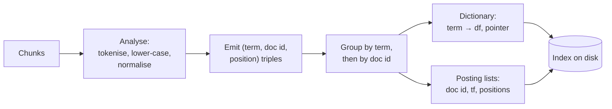
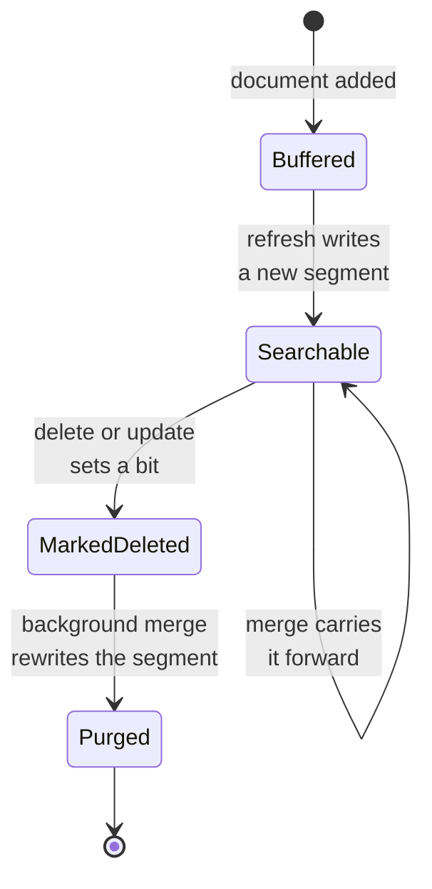

Every keyword search engine you have used, from a library catalogue to Elasticsearch to the full-text search in PostgreSQL, rests on one data structure: the **inverted index**. It is a map from each word to the list of documents that contain it, and it is the reason a search over millions of chunks can answer in milliseconds without looking at most of them. This lesson builds one from scratch, shows how boolean, phrase and ranked queries run against it, and explains the engineering that makes it practical at scale: sorted posting lists, compression, and immutable segments that are merged over time.

The scoring functions that run on the index (TF-IDF and BM25) have their own lessons. Here the focus is the structure, because sparse retrieval's speed, update behaviour and failure modes all follow from how it is laid out.

## Learning objectives

- Build a positional inverted index from a set of chunks and explain each of its parts: dictionary, posting lists, document frequencies and positions.
- Execute boolean AND, phrase and ranked OR queries against an inverted index, and explain why each touches only a small fraction of the collection.
- Compute the cost of intersecting two posting lists and the size of a gap-encoded posting list by hand.
- Explain how production engines handle additions, deletions and updates with immutable segments, and what that means for freshness in a RAG system.

## Prerequisites

- [Query-document matching](/learn/rag-architecture-fundamentals/query-document-matching): lexical matching, terms and a first look at TF-IDF.
- [Dense representations](/learn/embedding-fundamentals/dense-representations): sparse versus dense vectors and why each needs a different storage structure.
- [Query-document similarity](/learn/retrieval-fundamentals/query-document-similarity): scoring functions as inner products.

## Why this matters

A lexical scoring function such as BM25 gives every chunk a score for a query. The naive way to use it is to score every chunk and sort. For a few thousand chunks that is tolerable. For ten million it means ten million score computations per query, almost all for chunks that share no word with the query and so score exactly zero.

The inverted index removes that waste. Because a lexical score is a sum over the query's terms, and a chunk that contains none of them scores zero, the only chunks worth looking at are those that contain at least one query term. The index stores exactly that information, precomputed: for each term, which chunks contain it. A query with three terms reads three lists and ignores everything else.

The structure also explains behaviour that surprises teams: why a newly uploaded page is not searchable for a second, why a deleted chunk lingers on disk, why a query containing a very common word is slower than one without it, and why a chunk you expected is missing (the term is not in the index in the form the query uses).

## The intuition

Open a printed textbook at the back. The **index** there lists words alphabetically, and next to each word, the pages where it appears: "leave, annual: 12, 47, 103". To find every page about annual leave you do not read the book; you look up one word and go straight to three pages.

That book index is an inverted index. The book itself is organised by page, and each page lists its words: that is the **forward** direction (document to words). The index at the back flips it: word to pages. Hence "inverted".

For pages mentioning both "leave" and "carry", you look up both entries and run a finger down each sorted list in step: whichever finger points at the smaller number moves on; when both point at the same number, you write it down. One pass, never going back.

If you want the exact phrase "annual leave", the page numbers are not enough: a page might mention "annual" in one paragraph and "leave" in another. A more detailed index records not just the page but the word position on that page. Then "annual leave" means "annual at position $p$ and leave at position $p + 1$ on the same page".

The rest of this lesson is about doing that for millions of documents, keeping it small, and keeping it up to date.

## How it works

### The parts of an inverted index

An inverted index has two parts.

1. **The dictionary** (also called the **lexicon** or **term dictionary**): the set of distinct terms in the collection. For each term it stores the **document frequency** $\text{df}_t$, the number of documents containing the term, and a pointer to the term's posting list. The dictionary must support fast lookup of a term, so it is held in a hash table, a sorted array searched by binary search, a B-tree, or a compact automaton (Lucene uses a finite-state transducer, which also supports prefix lookups).
2. **The posting lists**: one per term. A **posting** is one entry recording that a term occurs in a document. At its simplest it is just the document id. Most indexes store more:
   - the **term frequency** $\text{tf}_{t,d}$, how many times the term occurs in that document, which scoring functions need;
   - the **positions**, the word offsets at which it occurs, which phrase and proximity queries need;
   - sometimes character offsets, for highlighting matches in results.

Posting lists are **sorted by document id**. Almost everything that makes the index efficient (merging, intersecting, compressing) depends on that ordering.

The engine also keeps each document's length in terms, which BM25 uses for [length normalisation](/learn/sparse-retrieval/term-frequency), and collection statistics such as the document count $N$ and the average length.

### Building the index

Indexing a collection is a pipeline:

1. **Collect** the documents (in RAG, the chunks) and assign each a document id: a dense integer, assigned in order. Your own chunk identifiers (UUIDs, `handbook-v3#leave-2`) are stored as a field and mapped to these internal ids.
2. **Analyse** each document's text into terms: tokenise, lower-case, perhaps remove stop words or reduce words to stems. This step decides what counts as "the same term" and is the subject of [Keyword matching](/learn/sparse-retrieval/keyword-matching). Whatever analysis is applied at indexing time must be applied identically to queries.
3. **Emit** a (term, document id, position) triple for every token.
4. **Group** the triples by term, and within each term by document id, accumulating term frequencies and position lists.
5. **Write** the dictionary and the sorted, compressed posting lists to disk.

A collection too large for memory is indexed in blocks whose partial indexes are merged at the end, much as an external merge sort works. The same block-and-merge pattern reappears below in how engines handle updates.



### Running queries

Three kinds of query cover most of what a RAG system asks of an inverted index.

**Boolean AND** ("documents containing all of these terms"):

1. Look up each query term in the dictionary. If any term is missing, the answer is empty.
2. Order the terms by document frequency, rarest first.
3. Start with the rarest term's posting list as the candidate set.
4. Intersect the candidates with each further list in turn, using the two-finger walk from the intuition.

The candidate set can only shrink, so starting small keeps every later intersection cheap.

**Phrase query** ("these terms, adjacent, in this order"): run the AND first to find documents containing every term, then, within each surviving document, check the positions. A document matches "support desk" if some position $p$ of "support" has "desk" at $p + 1$. This is why phrase search needs a **positional index**, which is typically two to four times larger than one that records only document ids and frequencies, because a posting now carries a list of positions rather than a single count.

**Ranked OR** ("score every document containing any query term, return the top $k$"): this is what a RAG retriever actually runs. Two strategies exist:

- **Term-at-a-time.** Keep an **accumulator** (a running score) per document. Process one query term at a time: walk its posting list, and for each posting add that term's contribution to the document's accumulator. When all terms are done, select the top $k$ accumulators. Simple, but the accumulators can number in the millions for queries with common terms.
- **Document-at-a-time.** Open all the query terms' posting lists at once and advance them together in document-id order, like a multi-way merge. For each document, sum the contributions from the lists currently pointing at it, then offer the total to a size-$k$ heap. Memory stays small, and this form allows **dynamic pruning**: algorithms such as WAND (Broder and colleagues, 2003) and its block-max refinement store, for each term or block of postings, the largest score contribution it could possibly make. If the sum of those upper bounds for a document cannot beat the current $k$-th best score, the document is skipped without being scored. Lucene, and therefore Elasticsearch and OpenSearch, use a block-max form of this for top-$k$ queries.


### Keeping posting lists small

Posting lists dominate an index's size and query time, so they are compressed. A sorted list of ids such as 3, 17, 18, 40 holds large numbers, but the **gaps** between them (3, 14, 1, 22) are small, especially for common terms. Storing gaps, each in as few bytes or bits as it needs, shrinks lists considerably.

The classic scheme is **variable-byte encoding**: each byte holds seven bits of the number, and the eighth bit marks the last byte of a number. Gaps under 128 take one byte, gaps under 16,384 take two. Modern engines use faster bit-packing schemes that encode blocks of, for example, 128 gaps with a fixed bit width chosen per block, which suits CPUs that decode many integers at once. The principle is the same: sorted ids, gaps, compact integers.

Compression trades a little CPU for much less I/O, which is why every serious engine compresses by default. To jump forward through a long compressed list without decoding every gap (needed when intersecting a long list with a short one), engines add **skip pointers**: every so often the list records "document id $x$ starts at byte offset $y$". The intersection can then leap over runs of postings that cannot match.

### Updates: segments, deletes and merges

A compressed, sorted, gap-encoded posting list is very hard to edit in place: inserting one document id in the middle means rewriting everything after it. So production engines never edit an index. Lucene, which underlies Elasticsearch, OpenSearch and Solr, works like this:

1. New documents are buffered in memory.
2. Periodically the buffer is written out as a new, small, **immutable segment**: a complete miniature inverted index of its own.
3. A query is run against every segment and the results combined.
4. A **deletion** does not remove anything. It sets a bit in a per-segment "live documents" bitmap, and queries skip documents whose bit is cleared.
5. An **update** is a deletion of the old version plus an addition of the new one in a new segment.
6. In the background, a **merge policy** combines small segments into larger ones, and only then are deleted documents physically dropped.



Two consequences matter for RAG:

- **Freshness has a delay.** Elasticsearch and OpenSearch make new documents searchable at each **refresh**, by default about once a second. A pipeline that indexes a chunk and immediately searches for it may not find it. Bulk indexing jobs often lengthen or disable refresh while loading and restore it afterwards.
- **Deleted text lingers.** Until a merge rewrites the segment, a deleted chunk's terms still sit on disk and still count in collection statistics such as document frequency (which nudges scores slightly). For deletions with legal force, check how your engine purges and, if necessary, force a merge. [Index updates](/learn/advanced-vector-database-engineering/index-updates) covers this for vector stores; the same pattern applies here.

### Where you meet inverted indexes in a RAG stack

- **Search engines**: Elasticsearch, OpenSearch and Solr are Lucene underneath. See [OpenSearch](/learn/vector-database-ecosystem/opensearch).
- **PostgreSQL**: full-text search stores documents as `tsvector` values and indexes them with a **GIN** (Generalized Inverted Index).
- **Vector databases**: several, including Qdrant, store [sparse vectors](/learn/sparse-retrieval/sparse-representations) in an inverted index so that BM25-style and learned sparse vectors can sit beside dense ones.
- **In-process libraries**: `rank-bm25` does *not* build an inverted index; it scores every document for every query, which is fine for a few thousand chunks only.

## The mathematics

### Why the lists are short: Zipf's law

**Intuition.** A handful of words are very common and most words are rare. So most posting lists are tiny, and a few are enormous.

Zipf's law states that the $r$-th most frequent term has a collection frequency roughly proportional to $1/r$:

$$
\text{cf}_r \approx \frac{c}{r}
$$

where $\text{cf}_r$ is how many times the term of rank $r$ occurs in the collection and $c$ is a constant for that collection (roughly the frequency of the most common term). It is an empirical regularity, not an exact law.

**By hand.** If the most common term occurs 1,000,000 times, Zipf predicts about 100,000 for the 10th most common and about 1,000 for the 1,000th: ordinary content words have posting lists a thousand times shorter than "the".

### The cost of an intersection

**Intuition.** The two-finger walk moves one finger every step and never moves backwards, so it takes at most as many steps as there are entries in the two lists together.

$$
\text{steps}(p_1 \cap p_2) \le |p_1| + |p_2|
$$

where $|p_1|$ and $|p_2|$ are the list lengths. Binary-searching (or skipping through) the long list for each entry of a much shorter one costs about $|p_1| \log_2 |p_2|$ instead.

**By hand.** Suppose AskMeridian indexed 2,000,000 chunks, "vpn" occurs in 4,000 and "the" in 1,800,000. A linear merge of the two takes up to $4{,}000 + 1{,}800{,}000 = 1{,}804{,}000$ steps. Binary-searching the long list for each of the 4,000 short-list entries takes about $4{,}000 \times \log_2 1{,}800{,}000 \approx 4{,}000 \times 20.8 = 83{,}000$ steps, more than twenty times fewer. This is why the processing order and skipping matter far more than raw speed.

### The size of a gap-encoded list

**Intuition.** A gap of $g$ needs about $\log_2 g$ bits. Variable-byte encoding rounds that up to whole 7-bit groups.

$$
\text{bytes}(g) = \left\lceil \frac{\lfloor \log_2 g \rfloor + 1}{7} \right\rceil \quad (g \ge 1)
$$

The numerator is the number of bits needed to write $g$ in binary; each byte holds 7 of them.

**By hand.** The ids 3, 17, 18, 40, 41, 300, 302, 70000 have gaps 3, 14, 1, 22, 1, 259, 2, 69698. Every gap below 128 takes one byte (six of them). 259 needs 9 bits, so 2 bytes. 69698 needs 17 bits, so 3 bytes. Total $6 + 2 + 3 = 11$ bytes, against $8 \times 4 = 32$ bytes as plain 32-bit integers. The code below confirms it.

```python
import math

gaps = [3, 14, 1, 22, 1, 259, 2, 69698]
vb = [math.ceil((g.bit_length()) / 7) for g in gaps]   # bit_length() = floor(log2 g) + 1
print("bytes per gap:", vb, "total:", sum(vb))
print("linear merge steps:", 4_000 + 1_800_000)
print("binary-search steps:", round(4_000 * math.log2(1_800_000)))
```

```output
bytes per gap: [1, 1, 1, 1, 1, 2, 1, 3] total: 11
linear merge steps: 1804000
binary-search steps: 83043
```

## In code

**The problem.** Build a positional inverted index over a few Meridian chunks and run the three query types against it: boolean AND, phrase, and ranked OR. Then compress a posting list. Writing it by hand once makes every production engine's behaviour easier to predict.

**Dependencies.** Python's standard library only. Nothing to install.

```python
import math
import re
from collections import defaultdict

chunks = [
    "Annual leave is 25 days per year. Up to 5 unused days carry over to next year.",
    "Unused annual leave must be used by 31 March or it is lost.",
    "Staff may work remotely up to 3 days a week. The home-office equipment budget is £400.",
    "Passwords must be rotated every 90 days. VPN is required on public Wi-Fi.",
    "Error E-4021: the VPN client is out of date. Update it from the IT portal.",
    "Report a lost laptop to the support desk at once. The support desk is open 08:00 to 18:00 UK time.",
]

def tokenise(text):
    """Lower-case and split on anything that is not a letter, digit or £."""
    return re.findall(r"[a-z0-9£]+", text.lower())

# ---- Build: term -> {doc_id: [positions]} ------------------------------------
index = defaultdict(dict)
doc_len = []
for doc_id, text in enumerate(chunks):
    tokens = tokenise(text)
    doc_len.append(len(tokens))
    for pos, term in enumerate(tokens):
        index[term].setdefault(doc_id, []).append(pos)

def postings(term):
    return sorted(index.get(term, {}))          # doc ids, ascending

print(f"{len(chunks)} chunks, {sum(doc_len)} tokens, {len(index)} distinct terms")
for term in ["leave", "days", "vpn", "4021", "support"]:
    print(f"  {term:<8} df={len(index[term])}  postings={dict(index[term])}")

# ---- Boolean AND: walk two sorted lists in step ------------------------------
def intersect(p1, p2):
    i = j = 0
    out = []
    while i < len(p1) and j < len(p2):
        if p1[i] == p2[j]:
            out.append(p1[i]); i += 1; j += 1
        elif p1[i] < p2[j]:
            i += 1
        else:
            j += 1
    return out

def boolean_and(query):
    terms = sorted(set(tokenise(query)), key=lambda t: len(index.get(t, {})))
    result = postings(terms[0])                  # start from the rarest term
    for t in terms[1:]:
        result = intersect(result, postings(t))
    return result

print("\nAND 'unused leave':", boolean_and("unused leave"))
print("AND 'vpn days':    ", boolean_and("vpn days"))

# ---- Phrase query: same documents, adjacent positions ------------------------
def phrase(query):
    terms = tokenise(query)
    hits = []
    for d in boolean_and(query):
        starts = set(index[terms[0]][d])
        for k, t in enumerate(terms[1:], start=1):
            starts &= {p - k for p in index[t][d]}
        if starts:
            hits.append(d)
    return hits

print("\nPHRASE 'annual leave':", phrase("annual leave"))
print("PHRASE 'support desk':", phrase("support desk"))
print("PHRASE 'desk support':", phrase("desk support"))

# ---- Ranked OR: term-at-a-time with an accumulator per document --------------
N = len(chunks)
def ranked(query, k=3):
    acc = defaultdict(float)                     # only documents that match something
    for t in set(tokenise(query)):
        plist = index.get(t)
        if not plist:
            continue
        idf = math.log(N / len(plist))
        for d, positions in plist.items():
            acc[d] += len(positions) * idf       # tf x idf, summed over query terms
    return sorted(acc.items(), key=lambda x: -x[1])[:k], len(acc)

top, touched = ranked("what does vpn error 4021 mean")
print("\nRANKED 'what does vpn error 4021 mean':")
for d, s in top:
    print(f"  doc {d}  score={s:.3f}  {chunks[d][:45]}...")
print(f"  documents scored: {touched} of {N}")

# ---- Compression: gaps + variable-byte encoding ------------------------------
def vbyte(n):
    out = []
    while True:
        out.insert(0, n % 128)
        if n < 128:
            break
        n //= 128
    out[-1] += 128                               # high bit marks the last byte
    return bytes(out)

doc_ids = [3, 17, 18, 40, 41, 300, 302, 70000]
gaps = [doc_ids[0]] + [b - a for a, b in zip(doc_ids, doc_ids[1:])]
encoded = b"".join(vbyte(g) for g in gaps)
print("\ndoc ids:", doc_ids)
print("gaps:   ", gaps)
print(f"bytes as 4-byte ints: {4 * len(doc_ids)}, as vbyte gaps: {len(encoded)}")
```

```output
6 chunks, 99 tokens, 68 distinct terms
  leave    df=2  postings={0: [1], 1: [2]}
  days     df=3  postings={0: [4, 11], 2: [7], 3: [6]}
  vpn      df=2  postings={3: [7], 4: [4]}
  4021     df=1  postings={4: [2]}
  support  df=1  postings={5: [6, 11]}

AND 'unused leave': [0, 1]
AND 'vpn days':     [3]

PHRASE 'annual leave': [0, 1]
PHRASE 'support desk': [5]
PHRASE 'desk support': []

RANKED 'what does vpn error 4021 mean':
  doc 4  score=4.682  Error E-4021: the VPN client is out of date. ...
  doc 3  score=1.099  Passwords must be rotated every 90 days. VPN ...
  documents scored: 2 of 6

doc ids: [3, 17, 18, 40, 41, 300, 302, 70000]
gaps:    [3, 14, 1, 22, 1, 259, 2, 69698]
bytes as 4-byte ints: 32, as vbyte gaps: 11
```

**The important lines.**

- `index[term].setdefault(doc_id, []).append(pos)` is the whole indexing step: each token appends its position to the posting for (term, document). Because documents are processed in id order, the posting lists come out sorted for free. Term frequency is simply the length of the position list.
- `boolean_and` sorts terms by `len(index[t])`, the document frequency, and intersects rarest first.
- `intersect` is the two-finger walk. Each comparison advances at least one index and nothing moves backwards.
- `phrase` shifts each later term's positions back by its offset in the phrase (`p - k`) and intersects with the first term's positions. A non-empty result means the terms appear consecutively.
- `ranked` is term-at-a-time scoring with a dictionary of accumulators. The scoring rule here is a bare TF times IDF so the mechanism stays visible; a real system would use [BM25](/learn/sparse-retrieval/bm25).
- `vbyte` writes seven bits per byte, most significant group first, and sets the high bit on the final byte so a decoder knows where each number ends.

**What the output means.** The index of six chunks has 68 distinct terms, most occurring in a single chunk: Zipf's law in miniature. "desk support" finds nothing although both words occur in chunk 5, because the positions show they never appear in that order. The ranked query has six terms, but "what", "does" and "mean" are not in the index, so only three posting lists are read and only two of the six documents ever receive an accumulator. At scale, that ratio is the whole performance story. The compressed list is about a third of its plain size.

**Common errors.** Tokenising the query differently from the documents (an unlowered "VPN" is not found); adding documents out of id order, which leaves lists unsorted; and calling `boolean_and` with an empty query, which raises an `IndexError` on `terms[0]`.

**Extending it.** Replace the TF-IDF contribution with BM25 using `doc_len`, or implement document-at-a-time scoring with `heapq`.

## A real-world example

Meridian's Platform team added keyword search to AskMeridian by indexing every chunk into an OpenSearch cluster alongside the existing Qdrant collection. A week after launch, the HR team published a corrected handbook section and a member of staff asked, a few minutes later, about the new equipment budget wording. AskMeridian answered from the old chunk.

The cause was the update path. The ingestion job **appended** corrected chunks under new ids and deleted the old ones in a separate hourly batch, so for up to an hour both versions were live, and the old chunk, which used the query's words more often, ranked higher. The job's own check ("search for the new chunk straight after indexing it") had also been failing intermittently and been retried until it passed: that was the refresh interval, not a bug.

The fixes followed from the index model rather than from tuning. Chunks now have a stable id derived from source document and section, and each re-ingest replaces old versions and deletes stale ids in one bulk request. The post-indexing check requests a refresh before searching. And the promise to the HR team became "searchable within a few seconds of publishing", which is true, instead of "immediately", which was not.

## Common mistakes

- **Treating an in-memory scorer as an index.** `rank-bm25` scores every document for every query, so latency grows linearly with the collection.
- **Indexing and querying with different analysis.** A stemmed index queried with unstemmed terms, or a lower-cased index queried in mixed case, silently returns nothing for the affected terms.
- **Assuming deletes are immediate and physical.** Deleted documents can remain on disk and in collection statistics until a merge. If a deletion is for compliance, verify the purge.
- **Searching straight after indexing.** In near-real-time engines a document is not visible until the next refresh, so tests and ingestion checks become flaky.
- **Dropping positions to save space and then needing phrases.** Phrase and proximity queries need a positional index; adding positions means re-indexing everything.

## Best practices

- Give every chunk a stable, deterministic id derived from its source, and update by replacing that id, so a re-ingest never leaves two live versions.
- Use one analyser definition for indexing and querying, kept in version control, and re-index when it changes.
- Decide up front whether you need positions (phrases, proximity, highlighting) and index accordingly.
- For bulk loads, follow your engine's guidance on lengthening the refresh interval during the load, then restore it and refresh once.
- Monitor segment count and the proportion of deleted documents; a steadily growing deleted fraction means merges are not keeping up.

## Performance considerations

Query cost is roughly proportional to the total length of the posting lists a query reads, not to collection size. Take 2,000,000 chunks and a three-term query whose terms each appear in 0.5% of chunks: about $3 \times 10{,}000 = 30{,}000$ postings. At a few nanoseconds to decode and score each, that is well under a millisecond of CPU. Add a term that appears in 40% of chunks and the query reads $800{,}000$ more postings, nearly 27 times as many; this is exactly the case that dynamic pruning exists to rescue, because that term's maximum contribution is small.

Index size: suppose those 2,000,000 chunks average 200 tokens and 120 distinct terms each. That is 240 million postings. At roughly one byte per compressed document-id gap and one for the frequency, about 480 MB; positions for 400 million tokens add a similar amount or more. The dictionary (perhaps a few million distinct terms) is small by comparison. Compare a 384-dimension float32 dense vector per chunk: $2{,}000{,}000 \times 384 \times 4 \approx 3$ GB before any graph index. Sparse indexes are usually the cheaper half of a [hybrid](/learn/hybrid-search) system.

Writes: each refresh creates a segment and each query searches every segment, so very frequent refreshes during heavy ingestion add query overhead until merges catch up.

## Security considerations

An inverted index contains the text of every chunk in a recoverable form: posting lists with positions are enough to reconstruct documents. Protect index files and snapshots as you would the source documents.

Apply access control as a filter inside the query, not after retrieving the top $k$: post-filtering returns fewer than $k$ results and can reveal that restricted documents exist. Engines intersect posting lists with a filter (for example a field of allowed groups), which is cheap for the reasons this lesson describes. See [Document-level permissions](/learn/access-control-and-privacy/document-level-permissions).

Collection statistics are shared too: in a multi-tenant index, one tenant's documents shift the scores another sees. See [Inverse document frequency](/learn/sparse-retrieval/inverse-document-frequency) and [Tenant isolation](/learn/access-control-and-privacy/tenant-isolation).

## Summary

- An inverted index maps each term to a posting list of the documents containing it, sorted by document id, with term frequencies and optionally positions. A dictionary maps terms to their lists and document frequencies.
- Queries read only the posting lists of their own terms, so cost depends on how common the query terms are, not on collection size.
- Boolean AND intersects sorted lists rarest first; phrases additionally check positions; ranked retrieval sums per-term contributions, term-at-a-time or document-at-a-time, with pruning skipping documents that cannot reach the top $k$.
- Posting lists are stored as compressed gaps between document ids, trading a little CPU for much less I/O.
- Production engines never edit an index in place: new documents go into immutable segments, deletes are bitmap marks, and merges reclaim space. Freshness has a refresh delay and deletions are not physical until a merge.

## Exercises

**1.** A posting list contains document ids 5, 130, 131, 20,000. Compute the gaps and the variable-byte size, and compare with 32-bit integers.

<details><summary>Show solution</summary>

Gaps: 5, 125, 1, 19,869. The first three are below 128, one byte each. 19,869 needs 15 bits ($2^{14} = 16{,}384 \le 19{,}869 < 32{,}768$), so $\lceil 15/7 \rceil = 3$ bytes. Total 6 bytes against 16 bytes.

</details>

**2.** Extend the code with a `proximity(query, window)` function that returns documents where all query terms occur within `window` positions of one another. Test it on "support open" with windows 3 and 6.

<details><summary>Show solution</summary>

```python
def proximity(query, window):
    terms = tokenise(query)
    hits = []
    for d in boolean_and(query):
        lists = [index[t][d] for t in terms]
        # For each position of the first term, check every other term has a position nearby.
        for p in lists[0]:
            if all(any(abs(q - p) <= window for q in lst) for lst in lists[1:]):
                hits.append(d)
                break
    return hits

print(proximity("support open", 3), proximity("support open", 6))
```

In chunk 5, "support" is at positions 6 and 11 and "open" at 14, so the gap is 3: both windows return `[5]`, while a window of 2 returns `[]`. A production version should check that all terms fall in one window together, not just pairwise with the first term.

</details>

**3.** Design decision. AskMeridian's ingestion job re-indexes the whole handbook (about 3,000 chunks) every night by deleting everything and re-adding it. The HR team now wants corrections live within a minute. Describe an update design based on segments and stable ids, and say what happens to index size and query latency during a day with 200 small edits.

<details><summary>Show solution</summary>

Derive each chunk's id from source document and section. On each edit, re-chunk only the changed document and send one bulk request that upserts its chunks by id and deletes ids no longer present. Old versions are marked deleted and new ones land in a new segment at the next refresh, searchable within seconds. Over 200 edits the deleted fraction and segment count grow slightly, adding small query overhead until background merges consolidate them; at 3,000 chunks this is negligible. Keep an occasional full rebuild as a consistency check.

</details>

## Check your understanding

```quiz
[
  {
    "q": "Why are posting lists kept sorted by document id?",
    "options": [
      "So that the most relevant documents appear first",
      "So that lists can be intersected in one forward pass and stored as small gaps",
      "Because the dictionary requires it for hashing",
      "So that deleted documents can be removed in place"
    ],
    "answer": 1,
    "why": "Sorted order lets two lists be merged with a single forward walk and lets ids be encoded as small differences. Relevance order is a separate concern handled at query time."
  },
  {
    "q": "A query has four terms. Three appear in about 1,000 chunks each and one appears in 900,000 of a million chunks. Without pruning, what dominates the cost of a ranked OR query?",
    "options": [
      "The total number of chunks in the index",
      "The dictionary lookups for the four terms",
      "Reading and scoring the 900,000 postings of the common term",
      "Sorting the final top-k list"
    ],
    "answer": 2,
    "why": "Cost is proportional to the postings read. The common term's list is 300 times longer than the other three combined; pruning methods such as WAND exist to skip most of it."
  },
  {
    "q": "What does a phrase query need that a boolean AND does not?",
    "options": [
      "Term positions within each document",
      "Document lengths",
      "Inverse document frequencies",
      "A dense embedding of the phrase"
    ],
    "answer": 0,
    "why": "AND only needs to know which documents contain each term. A phrase also requires the terms to be adjacent and in order, which can only be checked with positions."
  },
  {
    "q": "In a Lucene-based engine, a chunk is updated with corrected text. Immediately afterwards, which statement is most accurate?",
    "options": [
      "The old postings are rewritten in place and the new text is searchable at once",
      "The old version is marked deleted, the new one is searchable after the next refresh, and the old postings are physically removed by a later merge",
      "Both versions remain searchable until the index is rebuilt",
      "The update is rejected because segments are immutable"
    ],
    "answer": 1,
    "why": "Updates are a delete mark plus an add into a new segment. Visibility waits for a refresh, and physical removal waits for a merge."
  },
  {
    "q": "Why does `rank_bm25.BM25Okapi.get_scores` become slow on a ten-million-chunk collection when an inverted-index engine does not?",
    "options": [
      "It uses a less accurate BM25 formula",
      "It is written in Python rather than Java",
      "It computes a score for every document, including those sharing no term with the query",
      "It recomputes IDF on every query"
    ],
    "answer": 2,
    "why": "The library loops over every document for every query term. An inverted index touches only documents in the query terms' posting lists, so most of the collection is never visited."
  }
]
```

## Further reading

- Christopher D. Manning, Prabhakar Raghavan and Hinrich Schütze, *Introduction to Information Retrieval* (Cambridge University Press, 2008), chapters 1, 2, 4 and 5 on the inverted index, postings, index construction and compression. Free online at [nlp.stanford.edu/IR-book](https://nlp.stanford.edu/IR-book/).
- Justin Zobel and Alistair Moffat, "Inverted Files for Text Search Engines", *ACM Computing Surveys*, 2006. A thorough survey of index organisation, compression and query evaluation.
- Andrei Z. Broder, David Carmel, Michael Herscovici, Aya Soffer and Jason Zien, "Efficient Query Evaluation Using a Two-Level Retrieval Process", CIKM 2003. The original WAND paper.
- [Apache Lucene documentation](https://lucene.apache.org/core/): the index format, segments and merge policies used by Elasticsearch, OpenSearch and Solr.
- [PostgreSQL documentation: GIN indexes](https://www.postgresql.org/docs/current/gin.html), the inverted index behind PostgreSQL full-text search.
