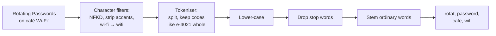

BM25 and TF-IDF decide how much a matching term is worth. They say nothing about a prior question: **what counts as a match?** Is "Passwords" the same term as "passwords"? Is "rotating" the same as "rotated"? Is "E-4021:" with a trailing colon the same as "E-4021"? Is "pasword" close enough to "password"? Every one of those decisions is made before scoring, by the text-analysis chain and the query type, and together they determine whether the right chunk is even a candidate.

This lesson is about that layer: how keyword matching turns text into comparable terms, the matching modes a search engine offers (term, boolean, phrase, fuzzy, prefix and n-gram), and how to design matching for the text RAG systems actually index, which is full of error codes, product names, version numbers and typos. Query expansion with synonyms belongs to the [hybrid search](/learn/hybrid-search/query-expansion) module and is not covered here.

## Learning objectives

- Describe the stages of a text-analysis chain (character normalisation, tokenisation, token filters) and predict the terms it produces for a given input.
- Choose between stemming, lemmatisation and exact forms for a corpus, and explain the precision and recall consequences of each.
- Design an analyser that keeps identifiers such as error codes intact while normalising ordinary words.
- Select the right matching mode (boolean, phrase, fuzzy, prefix or n-gram) for a query type, and explain the risk fuzzy matching poses for identifiers.
- Compute an edit distance by hand and in code.

## Prerequisites

- [Inverted indexes](/learn/sparse-retrieval/inverted-indexes): terms, posting lists and positions.
- [TF-IDF](/learn/sparse-retrieval/tf-idf): how analysis choices change a vectoriser's vocabulary.
- [Normalisation](/learn/document-preprocessing/normalisation): cleaning text before indexing.

## Why this matters

An inverted index can only find a chunk under a term the chunk was indexed with. If the analyser turned "Wi-Fi" into "wi" and "fi" and the user types "wifi", there is no posting list for "wifi" that contains the chunk, and no scoring function can recover it. Analysis failures are therefore **recall** failures: the right chunk is never a candidate. They are also silent, because the engine returns other chunks that did match.

RAG makes this more important, not less. Questions to AskMeridian contain exactly the strings that dense retrievers handle worst: "E-4021", "Meridian Relay 2.3", "SAML", "£75". These are the queries for which keyword matching is the safety net in a [hybrid](/learn/hybrid-search) system, and the net only works if the analyser keeps those strings intact. Conversely, matching ordinary words too literally ("rotating" never meeting "rotated") gives up recall that a simple stemmer would have recovered.

## The intuition

Think of a librarian filing index cards. Before filing a word, she tidies it: capital letters become lower-case, "rotated" and "rotating" are filed under "rotat", accents are dropped so "café" and "cafe" share a card, and words like "the" are not filed at all because every book has them. When you ask a question, she tidies your words in exactly the same way before looking them up.

That tidying is the analysis chain. Tidy too little and your "Rotating" never finds her "rotated". Tidy too much and things that should stay distinct collapse together: if she strips the digits from "E-4021" or files "university" and "universe" under the same stem, you get cards you did not ask for.

Then there is how you ask. "Find cards with *all* of these words" is stricter than "*any* of these words". "These words *in this order*" is stricter still. "Words *like* this one, allowing a typo" is looser. Those are the matching modes.

## How it works

### The analysis chain

Search engines describe analysis as a pipeline of three stages, and Lucene's terminology (used by Elasticsearch, OpenSearch and Solr) is a good general model:

1. **Character filters** operate on the raw string before tokenising: Unicode normalisation, stripping HTML, mapping characters ("&" to "and"), or rewriting known variants ("Wi-Fi" to "wifi").
2. A **tokeniser** splits the string into tokens. Choices include splitting on whitespace, splitting on non-alphanumeric characters, following the Unicode word-boundary rules, or a custom pattern. This is where "E-4021" either stays whole or breaks apart.
3. **Token filters** transform the stream of tokens: lower-casing, removing stop words, stemming, folding accented characters to ASCII, adding synonyms, or producing n-grams.

The same chain runs on documents at index time and on queries at search time. If they differ, matches are lost. (A few deliberate asymmetries exist, such as adding synonyms only at query time, but they are designed, not accidental.)



### Case, accents and Unicode

Lower-casing is nearly always right for retrieval. The exceptions are rare enough to handle with a separate field (for example a case-sensitive field for code identifiers).

Accents and look-alike characters are subtler. "café" can be stored as one code point (é) or as "e" followed by a combining accent; they look identical but are different strings. Unicode normalisation (NFC or NFKC to compose, NFKD to decompose so that combining marks can be removed) makes them comparable. ASCII folding goes further and maps "é" to "e", which helps English-speaking users who type without accents and can hurt in languages where accents distinguish words. Full-width digits, ligatures and non-breaking spaces from PDFs are handled by the same step; [Normalisation](/learn/document-preprocessing/normalisation) covers it for ingestion.

### Tokenisation and identifiers

Splitting on anything that is not a letter or digit works well for prose and badly for identifiers:

- "E-4021" becomes "e" and "4021". The bare number then matches page numbers, ticket numbers and other codes, and the "e" is either dropped (too short) or matches every "e" in the index.
- "Wi-Fi" becomes "wi" and "fi", which a query for "wifi" never meets.
- "v2.3" becomes "v2" and "3"; "user@meridian.example" becomes three tokens; "£75" may lose its symbol.

Two techniques fix this. The first is a **tokeniser pattern that recognises identifiers** and emits them whole before applying the general rule, as in the code below. The second is **multi-field indexing**: index the same text twice, once with a prose analyser and once with an identifier-preserving one (or as an exact keyword), and query both. Search engines support this directly through multiple sub-fields per source field.

Languages without spaces between words (Chinese, Japanese, Thai) need dedicated tokenisers based on dictionaries or character n-grams; a whitespace or punctuation tokeniser will index whole sentences as single tokens.

### Stop words

**Stop words** are very frequent words ("the", "is", "of") removed to shrink the index and stop them matching incidentally. With BM25, their IDF is already low, so removal matters less than it once did, and it has costs: phrase queries lose precision ("to be or not to be" consists entirely of common stop words), and generic lists include words that matter in policy text, such as "not", "no" and "off". Modern practice is to keep stop words or use a short, corpus-specific list.

### Stemming and lemmatisation

**Stemming** strips suffixes by rule, so that inflected forms share a term: "rotated", "rotating" and "rotation" all become "rotat" with the Porter stemmer (Porter, 1980), the classic English algorithm. Snowball, a later framework by the same author, provides stemmers for many languages. Stems are not always words ("everi" for "every") and that does not matter: they are only compared with other stems.

**Lemmatisation** maps a word to its dictionary form ("passwords" to "password", "was" to "be") using vocabulary and, ideally, part of speech. It is more precise and slower, and requires language resources.

The trade-off is recall against precision:

- Stemming **raises recall**: "rotating my password" now finds "passwords must be rotated".
- It can **lower precision** by conflating unrelated words: the Porter stemmer maps both "university" and "universe" to "univers".
- It **breaks exactness**: if "expenses" and "expense" are one term, a user searching for a document title cannot match exactly. Multi-field indexing (one stemmed field, one unstemmed) gives both, with the exact field weighted higher.

### Matching modes

Once text is terms, a query can combine them in several ways. Using Elasticsearch and OpenSearch names, since they are widely used:

| Mode | Matches a chunk when | RAG use |
| --- | --- | --- |
| OR (default `match`) | any query term is present; more terms score higher | general questions, the usual BM25 retrieval |
| AND (`operator: and`) | every term is present | short, specific queries; very high precision, poor recall for long questions |
| Minimum should match | at least a given number or percentage of terms are present | a compromise for longer queries, such as "75%" |
| Phrase (`match_phrase`) | terms appear adjacent and in order, optionally within a `slop` of positions | product names, quoted strings, multi-word identifiers |
| Prefix and wildcard | a term starts with or fits a pattern | type-ahead, partial codes; slow on large vocabularies |
| Fuzzy | a term is within a small edit distance of a query term | typos in ordinary words |
| n-gram fields | substrings of a term match | partial matches inside long tokens, some languages |

For RAG, the default OR query scored by BM25 is right for most questions, because users ask in full sentences and a strict AND would fail whenever one word is absent. Phrase and exact matching are best used as **boosts** (extra score when present) or as targeted queries triggered by recognisable patterns, such as an error code in the question.

### Fuzzy matching and why identifiers are different

**Fuzzy matching** finds terms within a small **edit distance** of the query term: the minimum number of single-character insertions, deletions or substitutions (and, in the Damerau variant, transpositions of adjacent characters) needed to turn one into the other. "pasword" is one edit from "password". Lucene limits fuzzy queries to at most two edits and counts an adjacent transposition as one edit by default; Elasticsearch's `fuzziness: "AUTO"` allows zero edits for terms of one or two characters, one for three to five, and two for longer terms.

Fuzzy matching is helpful for prose and **dangerous for identifiers**. "E-4012" is one transposition away from "E-4021", and "E-4022" is one substitution away. A fuzzy query for an error code will happily return the wrong error's runbook with a score close to the right one's. Since dense retrievers make the same mistake (they place similar codes close together), the keyword side is the only part of a hybrid system that can tell them apart, and fuzziness throws that advantage away. Disable fuzziness for identifier fields, or for any query token that looks like an identifier.

Two related techniques serve partial matching. **Edge n-grams** index the prefixes of each term ("pa", "pas", "pass", ...) so that type-ahead is a cheap exact lookup. **Character n-grams** (all substrings of length 3, say) let a query match inside long compound tokens and tolerate some misspellings, at the cost of a much larger index and many spurious matches.

### Putting it into a RAG retriever

A practical pattern for AskMeridian-style systems:

1. Index chunk text into a **prose field** (lower-case, accent folding, light stemming, few or no stop words) and an **identifier field** (codes and version strings kept whole, no stemming, no fuzziness).
2. At query time, run BM25 over the prose field as the main keyword query.
3. If the query contains an identifier pattern, add a term or phrase clause on the identifier field with a strong boost, or route it to an exact-match lookup first.
4. Fuse the keyword results with dense results by rank.

## The mathematics

### Edit distance

**Intuition.** Build the cheapest way to turn one string into another one character at a time, reusing the best answers for shorter prefixes.

Let $D(i, j)$ be the distance between the first $i$ characters of $a$ and the first $j$ characters of $b$. Then $D(i, 0) = i$, $D(0, j) = j$, and

$$
D(i, j) = \min\begin{cases}
D(i-1, j) + 1 & \text{delete } a_i \\
D(i, j-1) + 1 & \text{insert } b_j \\
D(i-1, j-1) + [a_i \ne b_j] & \text{substitute (free if equal)} \\
D(i-2, j-2) + 1 & \text{if } a_i = b_{j-1} \text{ and } a_{i-1} = b_j \text{ (transpose)}
\end{cases}
$$

where $[a_i \ne b_j]$ is 1 if the characters differ and 0 otherwise. The last line is the transposition rule, giving the "optimal string alignment" form of Damerau-Levenshtein distance. The answer is $D(|a|, |b|)$.

**By hand.** "4012" to "4021": the first two characters agree, so $D(2, 2) = 0$. Then $a_3 = 1, a_4 = 2$ and $b_3 = 2, b_4 = 1$: the last two characters are swapped, so the transposition rule gives $D(4, 4) = D(2, 2) + 1 = 1$. Without transpositions, two substitutions are needed and the distance is 2. Either way it is within Lucene's limit of two edits, which is why fuzzy matching cannot be trusted on codes.

"pasword" to "password": every character of "pasword" lines up with "password" if one "s" is inserted, so the distance is 1.

```python
def osa(a, b):
    d = [[i + j if i * j == 0 else 0 for j in range(len(b) + 1)] for i in range(len(a) + 1)]
    for i in range(1, len(a) + 1):
        for j in range(1, len(b) + 1):
            d[i][j] = min(d[i-1][j] + 1, d[i][j-1] + 1, d[i-1][j-1] + (a[i-1] != b[j-1]))
            if i > 1 and j > 1 and a[i-1] == b[j-2] and a[i-2] == b[j-1]:
                d[i][j] = min(d[i][j], d[i-2][j-2] + 1)
    return d[-1][-1]

print(osa("4012", "4021"), osa("pasword", "password"), osa("expenes", "expense"))
```

```output
1 1 1
```

## In code

**The problem.** Compare three analysers on query and chunk pairs taken from AskMeridian's real failure modes, then see what fuzzy matching does with typos and with error codes.

**Dependencies.** NLTK for the Porter stemmer (the stemmer needs no extra data download). The rest is the standard library.

```bash
pip install nltk
```

```python
import re
import unicodedata
from nltk.stem import PorterStemmer

stem = PorterStemmer().stem
STOP = {"a", "an", "the", "is", "are", "to", "of", "on", "in", "for", "my", "i", "do", "be", "it"}
CODE = re.compile(r"[a-z]+-\d+")                      # error codes such as e-4021

def naive(text):                                       # split on spaces only
    return text.split()

def default_like(text):                                # like scikit-learn's default
    return re.findall(r"\b\w\w+\b", text.lower())

def custom(text):
    text = unicodedata.normalize("NFKD", text)         # split accented letters
    text = "".join(c for c in text if not unicodedata.combining(c)).lower()
    text = re.sub(r"\bwi-?fi\b", "wifi", text)         # one domain-specific rule
    tokens = []
    for tok in re.findall(r"[a-z]+-\d+|[a-z0-9£]+", text):
        if CODE.fullmatch(tok):
            tokens.append(tok)                         # identifiers stay whole and unstemmed
        elif tok not in STOP:
            tokens.append(stem(tok))
    return tokens

analysers = {"naive": naive, "default": default_like, "custom": custom}

pairs = [   # (query, the chunk that should match)
    ("E-4021",                "Error E-4021: the VPN client is out of date."),
    ("rotating passwords",    "Passwords must be rotated every 90 days."),
    ("café wifi",             "VPN is required on public Wi-Fi, for example in a cafe."),
    ("Expenses",              "expenses must be submitted within 30 days."),
    ("3 days",                "Staff may work remotely up to 3 days a week."),
]

print(f"{'query':<22}" + "".join(f"{name:>22}" for name in analysers))
for query, chunk in pairs:
    row = f"{query:<22}"
    for name, analyse in analysers.items():
        q, d = set(analyse(query)), set(analyse(chunk))
        row += f"{f'{len(q & d)}/{len(q)} ' + ','.join(sorted(q & d)):>22}"
    print(row)

print("\ncustom analyser on a chunk:", custom("Passwords must be rotated every 90 days. VPN on Wi-Fi; error E-4021."))

# --- Fuzzy matching: edit distance with adjacent transpositions --------------
def edit_distance(a, b):
    """Damerau-Levenshtein (optimal string alignment) distance."""
    d = [[0] * (len(b) + 1) for _ in range(len(a) + 1)]
    for i in range(len(a) + 1):
        d[i][0] = i
    for j in range(len(b) + 1):
        d[0][j] = j
    for i in range(1, len(a) + 1):
        for j in range(1, len(b) + 1):
            cost = a[i - 1] != b[j - 1]
            d[i][j] = min(d[i - 1][j] + 1, d[i][j - 1] + 1, d[i - 1][j - 1] + cost)
            if i > 1 and j > 1 and a[i - 1] == b[j - 2] and a[i - 2] == b[j - 1]:
                d[i][j] = min(d[i][j], d[i - 2][j - 2] + 1)
    return d[len(a)][len(b)]

vocabulary = ["password", "passport", "e-4021", "e-4012", "e-4022", "expenses", "expense"]
print()
for typo in ["pasword", "e-4021", "expenes"]:
    near = [(w, edit_distance(typo, w)) for w in vocabulary if edit_distance(typo, w) <= 2]
    print(f"{typo:<9} within 2 edits: {near}")
```

```output
query                                  naive               default                custom
E-4021                                  0/1               1/1 4021            1/1 e-4021
rotating passwords                      0/2          1/2 passwords    2/2 password,rotat
café wifi                               0/2                   0/2          2/2 cafe,wifi
Expenses                                0/1           1/1 expenses            1/1 expens
3 days                            2/2 3,days              1/1 days             2/2 3,day

custom analyser on a chunk: ['password', 'must', 'rotat', 'everi', '90', 'day', 'vpn', 'wifi', 'error', 'e-4021']

pasword   within 2 edits: [('password', 1)]
e-4021    within 2 edits: [('e-4021', 0), ('e-4012', 1), ('e-4022', 1)]
expenes   within 2 edits: [('expenses', 1), ('expense', 1)]
```

Each cell shows how many of the query's terms matched the chunk, and which.

**The important lines.**

- `unicodedata.normalize("NFKD", text)` decomposes "é" into "e" plus a combining accent, and the next line drops combining characters. That is accent folding in two lines.
- `re.sub(r"\bwi-?fi\b", "wifi", text)` is a character-filter rule for one known variant. Real systems keep such rules in a small, tested list.
- `re.findall(r"[a-z]+-\d+|[a-z0-9£]+", text)` tries the identifier pattern first, so "e-4021" is captured whole before the general pattern could split it.
- Codes bypass the stemmer and the stop-word list; every other token is stemmed.
- `edit_distance` is the recurrence from the previous section, with the transposition case.

**What the output means.**

- **Naive splitting fails almost everywhere.** "E-4021" does not match "E-4021:" because of the colon, and "Expenses" does not match "expenses" because of case. Splitting on whitespace is never adequate for retrieval.
- **The default-style analyser** (scikit-learn's pattern) recovers case and punctuation, but matches "4021" only as a bare number, drops the single digit "3", and cannot connect "rotating" with "rotated", "café" with "cafe", or "wifi" with "wi" plus "fi".
- **The custom analyser matches every pair completely.** Its output for the sample chunk shows the price: stems such as "rotat" and "everi" are not words, and "must" survives because it is not on this short stop list. Neither matters for matching.
- **Fuzzy matching** correctly rescues "pasword" and "expenes", but for "e-4021" it also returns "e-4012" and "e-4022" at distance 1. A fuzzy query on an error code would retrieve the wrong error's documentation.

**Common errors.**

- Applying a new analyser to queries without re-indexing the documents. The index still holds the old terms.
- Stemming identifiers. Some stemmers alter tokens that end in letters ("v2s" style product names); keep identifiers out of the stemmer as the code does.
- Forgetting that regular expressions are greedy and ordered: placing the general pattern first in the alternation would split codes before the identifier pattern is tried.

**Extending it.** Add a pattern for version strings such as "2.3" and product names such as "Relay 2.3". Replace the hand-made stop list with one derived from document frequencies in your own corpus. Implement a `match_identifier` step that extracts codes from a query with `CODE.findall` and looks them up exactly before BM25 runs.

In a search engine, the same design is a field with a custom analyser plus a sub-field for identifiers. The following Elasticsearch-style query was not executed here (it needs a running cluster); it shows how an exact identifier clause boosts, but does not replace, the normal BM25 match:

```json
{
  "query": {
    "bool": {
      "should": [
        { "match": { "text": { "query": "what does error E-4021 mean" } } },
        { "term":  { "text.ids": { "value": "e-4021", "boost": 5 } } }
      ]
    }
  }
}
```

Here `text` uses the prose analyser and `text.ids` is a sub-field indexed with an identifier-preserving analyser. Field names and the boost value are illustrative.

## A real-world example

The Meridian support desk logged a recurring complaint: AskMeridian answered questions about error E-4012 (an expired VPN certificate) with instructions for E-4021 (an outdated VPN client), and vice versa. The Platform team's hybrid retriever ran dense search on Qdrant and BM25 on OpenSearch, fused by rank.

Investigation found two causes, both in matching. On the dense side, the two runbook chunks were nearly identical in wording apart from the code and the fix, so their embeddings were very close, as expected. On the keyword side, the field used OpenSearch's standard analyser, which split "E-4012" into "e" and "4012", and the query used `fuzziness: "AUTO"`, added months earlier to cope with typos. With a four-digit token, AUTO allows one edit, and "4021" is one transposition from "4012". The keyword retriever, which should have been the component that told the codes apart, was treating them as the same.

The fix had three parts. A sub-field `text.ids` with a pattern tokeniser kept codes whole; a query-side regular expression detected codes and added a boosted exact `term` clause on that field; and fuzziness was restricted to the prose field and to tokens of five or more letters. They added the E-4012 and E-4021 pair, and ten other near-identical code pairs from the Atlas error-code catalogue, to their retrieval regression tests, so a future analyser change cannot quietly reintroduce the problem.

## Common mistakes

- **Using different analysers for indexing and querying.** Terms that do not match exactly are never compared, so recall drops with no error.
- **Letting the tokeniser split identifiers.** Error codes, version strings and SKUs lose the exactness that is keyword search's main advantage over dense retrieval.
- **Turning on fuzziness globally.** It rescues typos in words and confuses near-identical codes.
- **Using a generic stop-word list on policy or runbook text.** "Not", "no" and "off" change meaning.
- **Aggressive stemming without checking collisions.** Unrelated words sharing a stem pull in irrelevant chunks; test on your vocabulary.
- **Requiring all terms (AND) for natural-language questions.** One absent word ("please", "currently") removes the right chunk.

## Best practices

- Inspect analyser output for real chunks and real queries; most engines have an "analyse" endpoint for exactly this.
- Index important text twice: a normalised prose field and an exact or identifier field, weighted differently.
- Detect identifiers in queries with patterns from your own corpus and give them exact, boosted clauses.
- Prefer light stemming or lemmatisation for English prose and none for identifiers.
- Use minimum-should-match or BM25's natural OR behaviour for questions; reserve AND and phrase matching for short, specific queries or boosts.
- Keep a regression set of tricky query and chunk pairs (codes, product names, typos, accents) and run it after every analyser change.

## Performance considerations

Analysis runs once per document at indexing time and once per query. A Porter stemmer processes words quickly in compiled implementations; in pure Python, analysing a million 200-token chunks means 200 million token operations, which takes minutes rather than seconds, so batch and parallelise ingestion.

Matching modes differ sharply in query cost. Term and phrase queries look up a few dictionary entries. Fuzzy, prefix and wildcard queries must first **enumerate dictionary terms** that fit the pattern, then read all their posting lists. Lucene uses automata to keep fuzzy enumeration efficient, but a leading wildcard such as `*021` cannot use the sorted dictionary and may scan all terms. With a vocabulary of a few million terms that is measurable on every query.

N-gram fields multiply index size: a 10-character term yields 8 trigrams, so a trigram field can be several times the size of the word-level field, with correspondingly longer posting lists. Use them only where partial matching is a real requirement.

## Security considerations

Query strings reach the search engine, so treat them as untrusted input. Do not pass user text into a query-string syntax that interprets operators (Lucene's `query_string` parses AND, OR, wildcards and field names), because a user can craft expensive queries, such as leading wildcards or deeply nested clauses, or target fields you did not intend to expose. Use `match`-style queries that treat input as plain text, cap query length, and apply access-control filters inside every query rather than relying on what the user typed.

## Summary

- Keyword matching decides what counts as the same term before any scoring: character normalisation, tokenisation and token filters must be identical at index and query time.
- Stemming and lemmatisation raise recall for inflected words at some cost in precision and exactness; stop-word removal saves little under BM25 and can remove meaning.
- Identifiers need special handling: keep them whole with a dedicated pattern or field, never stem them and never fuzzy-match them.
- Matching modes range from strict (AND, phrase, exact term) to loose (OR, fuzzy, n-gram); natural-language RAG questions suit BM25's OR behaviour, with exact matches as boosts.
- Fuzzy matching uses edit distance; it rescues typos and confuses codes that differ by a transposition or one digit.

## Exercises

**1.** Compute by hand the edit distance, with and without transpositions, between "recieve" and "receive".

<details><summary>Show solution</summary>

The strings differ only in the order of "ie" and "ei" at positions 4 and 5. With transpositions that is one edit. Without, two substitutions are needed, so the distance is 2.

</details>

**2.** Extend the custom analyser so that version strings such as "2.3" and "v2.3" become a single token "2.3", and test it on "Meridian Relay v2.3 release notes".

<details><summary>Show solution</summary>

```python
def custom_v(text):
    text = unicodedata.normalize("NFKD", text)
    text = "".join(c for c in text if not unicodedata.combining(c)).lower()
    text = re.sub(r"\bv(\d+\.\d+)\b", r"\1", text)      # v2.3 -> 2.3
    tokens = []
    for tok in re.findall(r"[a-z]+-\d+|\d+\.\d+|[a-z0-9£]+", text):
        if CODE.fullmatch(tok) or re.fullmatch(r"\d+\.\d+", tok):
            tokens.append(tok)
        elif tok not in STOP:
            tokens.append(stem(tok))
    return tokens

print(custom_v("Meridian Relay v2.3 release notes"))
```

```output
['meridian', 'relay', '2.3', 'releas', 'note']
```

The version pattern sits before the general one in the alternation so it is captured whole, and versions bypass the stemmer like codes.

</details>

**3.** A user reports that searching for "SSO" finds nothing, while the Meridian Reports chunk says "SAML single sign-on". Is this a keyword-matching problem the analyser should solve? Explain what would and would not help.

<details><summary>Show solution</summary>

No analyser change makes "SSO" match "single sign-on": they share no characters, so stemming, folding and fuzzy matching cannot help. It is vocabulary mismatch. The options are an explicit synonym or abbreviation mapping (query expansion, covered in [Query expansion](/learn/hybrid-search/query-expansion)), adding the abbreviation to the chunk at ingestion, or relying on dense retrieval in a hybrid set-up. A synonym list for a few hundred known company abbreviations is a common, maintainable fix.

</details>

**4.** Design decision. AskMeridian is adding a search box for staff to look up Atlas error codes and runbook titles directly, with type-ahead. Choose matching modes and fields for (a) the error-code lookup and (b) the runbook-title type-ahead, and say which you would *not* use.

<details><summary>Show solution</summary>

(a) An exact keyword field holding normalised codes ("e-4021"), queried with a term lookup after normalising the user's input (upper or lower case, optional hyphen). No fuzziness: a near miss should return "no such code", not a neighbouring code. (b) An edge-n-gram field on titles for type-ahead, with an ordinary analysed title field for ranking full-word matches; light fuzziness is acceptable on the full-word field for titles of five or more letters. Avoid leading wildcards, which scan the dictionary, and avoid character n-grams on the code field, which would match "4021" inside "14021".

</details>

## Check your understanding

```quiz
[
  {
    "q": "Which change makes a query for \"rotating\" match a chunk containing \"rotated\"?",
    "options": [
      "Lower-casing",
      "Stemming applied at both index and query time",
      "Removing stop words",
      "Switching from OR to AND matching"
    ],
    "answer": 1,
    "why": "A stemmer maps both forms to the same stem (\"rotat\" with Porter). It must run on both sides so the terms meet in the index."
  },
  {
    "q": "Why is fuzzy matching risky on a field containing error codes such as E-4021?",
    "options": [
      "Fuzzy queries cannot handle digits",
      "Edit distance is undefined for strings with hyphens",
      "Fuzzy matching is slower than term matching",
      "Codes that differ by one substitution or transposition, such as E-4012, fall within the allowed edits and match the wrong document"
    ],
    "answer": 3,
    "why": "4012 and 4021 are one transposition apart. A fuzzy query returns both, removing the exactness that makes keyword search valuable for identifiers."
  },
  {
    "q": "What does this print?\n```python\nimport re\nprint(re.findall(r\"\\b\\w\\w+\\b\", \"Error E-4021 on Wi-Fi\".lower()))\n```",
    "options": [
      "`['error', 'e-4021', 'on', 'wi-fi']`",
      "`['error', '4021', 'on', 'wi', 'fi']`",
      "`['error', 'e', '4021', 'on', 'wi', 'fi']`",
      "`['error', '4021', 'on', 'wifi']`"
    ],
    "answer": 1,
    "why": "The pattern keeps runs of two or more word characters. Hyphens split tokens, and the single character \"e\" is too short to match."
  },
  {
    "q": "A team indexes chunks with a stemming analyser, then changes the query analyser to also fold accents, without re-indexing. What is the likely effect?",
    "options": [
      "Queries containing accented words stop matching chunks that still hold the unfolded forms",
      "Nothing, because analysis is applied only at query time",
      "All queries return empty results",
      "Scores change but results do not"
    ],
    "answer": 0,
    "why": "The query now produces \"cafe\" while the index still holds \"café\", so those terms no longer meet. Unaffected terms still match."
  },
  {
    "q": "For natural-language questions to a RAG assistant, why is requiring every query term (AND) usually a poor default?",
    "options": [
      "AND queries cannot be scored with BM25",
      "AND queries are slower than OR queries",
      "Questions contain words the right chunk does not, so requiring all of them excludes it",
      "AND disables stemming"
    ],
    "answer": 2,
    "why": "Words like \"how\", \"please\" or \"currently\" rarely appear in the answer chunk. OR matching with BM25 scoring, or a minimum-should-match threshold, tolerates them."
  }
]
```

## Further reading

- M. F. Porter, "An algorithm for suffix stripping", *Program*, 1980. The original Porter stemmer.
- Christopher D. Manning, Prabhakar Raghavan and Hinrich Schütze, *Introduction to Information Retrieval* (2008), chapter 2 (tokenisation, stop words, stemming and lemmatisation) and chapter 3 (tolerant retrieval: wildcards, edit distance, k-grams). Free at [nlp.stanford.edu/IR-book](https://nlp.stanford.edu/IR-book/).
- [Elasticsearch documentation](https://www.elastic.co/guide/index.html): the text-analysis section (analysers, tokenisers, token filters) and the `match`, `match_phrase` and fuzzy query references.
- [NLTK documentation](https://www.nltk.org/): stemmers and lemmatisers in Python.
- [Unicode Standard Annex #15: Unicode Normalization Forms](https://unicode.org/reports/tr15/).
