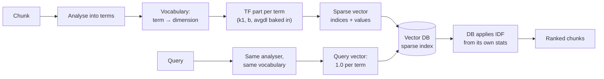

The previous lessons treated TF-IDF and BM25 as scoring formulas. This one treats their output as what it really is: a **sparse vector**, one dimension per vocabulary term, almost all zeros. Seeing lexical retrieval this way has practical pay-offs. It explains how BM25 can live inside a vector database next to dense embeddings, how to store and multiply millions of such vectors efficiently, what to do when the vocabulary cannot be fixed in advance, and how **learned sparse** models such as SPLADE keep the inverted-index machinery while borrowing some of the semantic reach of neural networks.

[Dense representations](/learn/embedding-fundamentals/dense-representations) introduced the sparse/dense contrast and [Query-document similarity](/learn/retrieval-fundamentals/query-document-similarity) showed BM25 to be an inner product. This lesson builds on both: the storage formats, the vocabulary problem, BM25 as stored sparse vectors in Qdrant, and the family of neural sparse models.

## Learning objectives

- Represent a chunk as a sparse vector of (dimension, weight) pairs and compute the memory and the inner-product cost of sparse vectors.
- Store BM25-weighted sparse vectors in a vector database and reproduce reference BM25 scores from it.
- Explain the hashing trick, estimate its collision rate, and decide when a fixed vocabulary or hashing is appropriate.
- Describe how learned sparse models (document expansion, term reweighting and SPLADE) produce sparse vectors, and weigh their benefits against cost, licensing and domain risk.

## Prerequisites

- [Dense representations](/learn/embedding-fundamentals/dense-representations): sparse and dense vectors and where each is stored.
- [BM25](/learn/sparse-retrieval/bm25) and [Inverse document frequency](/learn/sparse-retrieval/inverse-document-frequency).
- [Inverted indexes](/learn/sparse-retrieval/inverted-indexes): how sparse vectors are searched.

## Why this matters

Most production RAG retrievers are hybrid: a dense retriever and a sparse one, fused. Teams then face a practical question: run a search engine (Elasticsearch, OpenSearch) alongside the vector database, or store both kinds of vector in one system? Several vector databases, Qdrant and Milvus among them, now store and search sparse vectors natively, and others such as Weaviate build BM25 in, which makes the second option attractive. Using it correctly requires knowing what to put in the sparse vector, who computes IDF, how the vocabulary maps to dimensions, and what happens to a term the vocabulary has never seen.

The same view is the entry point to **learned sparse retrieval**, which has become a practical option in the last few years: models that output sparse vectors over a vocabulary, indexable with the same inverted-index infrastructure, that often retrieve better than BM25 on general benchmarks. Knowing what they are, what they cost and where they can go wrong lets you decide whether they belong in your system rather than adopting or dismissing them on reputation.

## The intuition

Picture a huge spreadsheet with one column for every word in Meridian's documents (tens of thousands of columns) and one row per chunk. Each cell holds the weight of that word in that chunk. Almost every cell is empty: a chunk uses a few dozen words. Writing out the whole spreadsheet would waste almost all the paper, so instead each row is written as a short list: "column 4: 0.9, column 12: 1.28, column 14: 0.9". That list is a **sparse vector**.

To compare a question with a chunk, you write the question as a list too and multiply the weights of the columns they share, then add. Columns only one of them uses contribute nothing, so you never look at them.

Two questions remain. Who decides which word gets which column? Usually a vocabulary built from the documents; but if new words keep arriving, you can instead compute the column number from the word itself, accepting that two words will occasionally land in the same column. And who decides the weights? Classically, a formula such as BM25. A learned sparse model replaces the formula with a neural network, which can also put weight in columns for words the chunk never used but means, such as "holiday" for a chunk about annual leave.

## How it works

### Sparse vectors as data

A sparse vector of dimension $V$ is stored as two parallel arrays: the **indices** of its non-zero entries and their **values**. A collection of sparse vectors is a sparse matrix, stored in one of a few standard layouts:

- **COO** (coordinate): three arrays of (row, column, value) triples. Easy to build incrementally.
- **CSR** (compressed sparse row): all rows' column indices and values concatenated, plus an array of row start offsets. Efficient for reading a row and for matrix-vector products; this is what scikit-learn's vectorisers return.
- **CSC** (compressed sparse column): the same by column. A CSC matrix is, in effect, an inverted index: for each term (column), the documents (rows) that contain it and their weights.

The inner product of two sparse vectors only involves dimensions where both are non-zero. With sorted indices, it is a merge of two short lists, the same two-finger walk used to intersect posting lists. Against a whole collection, the efficient route is the column-wise one: for each non-zero query dimension, walk that column's postings and accumulate. That is exactly inverted-index retrieval, which is why "sparse vector search" and "keyword search" share an engine.

### Who computes which part of BM25

BM25 is a sum over query terms of $\text{idf}(t) \times \text{TF part}(t, d)$. When BM25 is stored as sparse vectors, the two factors can be placed in three ways:

1. **Everything in the document vector.** Store $\text{idf}(t) \times \text{TF part}(t, d)$ as the value, and use a query vector of 1s (or query term counts). Simple, but IDF is frozen at indexing time: as the collection changes, stored values go stale and must be recomputed for every document.
2. **IDF in the query vector.** Store only the TF part per document; put $\text{idf}(t)$ in the query vector, computed from statistics you maintain. IDF stays current, but you must keep df counts yourself.
3. **IDF computed by the database.** Store the TF part per document and let the database apply IDF from its own statistics at query time. Qdrant offers this with the `IDF` modifier on a sparse vector field. The code below uses this option and reproduces reference BM25 scores exactly.

In every case, the document-side TF part embeds $k_1$, $b$ and the average length at indexing time. Changing $k_1$ or $b$, or a large shift in average length, means re-encoding the documents, unlike a search engine that applies them at query time.



### The vocabulary problem

A sparse vector needs a mapping from terms to dimensions, shared by every document and every query. There are two approaches.

**A stored vocabulary.** Build a dictionary from the corpus (term to integer). Exact, interpretable, and compact. Its weaknesses: the dictionary must be stored and shared between the indexing and query services, and a term first seen after the vocabulary was built has no dimension. In a growing RAG corpus that means a new product name, a new error code or a new colleague's name is invisible to sparse search until the vocabulary is rebuilt and documents re-encoded.

**The hashing trick.** Compute the dimension directly from the term: $\text{dim}(t) = h(t) \bmod m$, for a hash function $h$ and a chosen number of dimensions $m$. No dictionary is stored, any new term immediately gets a dimension, and indexing can be distributed with no shared state. Weinberger and colleagues (2009) analysed the approach for machine learning. The price is **collisions**: different terms that hash to the same dimension become indistinguishable, so a query for one matches documents containing the other. With $m = 2^{20}$ (about a million) and a vocabulary in the tens of thousands, collisions affect a small fraction of terms; with a small $m$, they are ruinous. scikit-learn's `HashingVectorizer` implements this, and some vector-database client libraries hash terms in a similar way when building sparse vectors.

Hashing also removes interpretability: you cannot invert a dimension back to its term without keeping your own record.

### Learned sparse representations

BM25 weights are a formula applied to counts. A **learned sparse** model replaces the formula with a neural network trained on relevance data, while keeping the output sparse over a vocabulary so that inverted indexes still work. Three families are worth knowing; all are active research areas, with varying levels of production adoption.

1. **Document expansion.** Before indexing, generate extra text for each document and append it, then use plain BM25. doc2query (Nogueira and colleagues, 2019) trained a sequence-to-sequence model to predict queries that a passage would answer and appended them, so that a chunk about annual leave gains words like "holiday" and "vacation". Query-time cost is unchanged; indexing cost rises considerably.
2. **Term reweighting.** Replace BM25's TF part with a learned importance for each term in context. DeepCT (Dai and Callan) predicted term weights from BERT's contextual representations; DeepImpact and uniCOIL combined learned impacts with expansion. The vocabulary is still the document's own words (plus any expansion).
3. **SPLADE** (Formal and colleagues, 2021, with later versions). The model passes the text through a BERT-style encoder and, for every input token, uses the masked-language-model head to produce a score for **every** term in the model's vocabulary (about 30,000 WordPiece tokens). Scores are passed through $\log(1 + \text{ReLU}(\cdot))$ and pooled over the input tokens (max pooling in SPLADE v2), giving one weight per vocabulary term. A sparsity regulariser during training pushes most weights to exactly zero, so each text keeps tens to a few hundred non-zero terms, including **expansion terms** the text never contained. Both documents and queries are encoded this way (some variants skip the encoder on the query side to save latency).

The appeal is that learned sparse vectors address vocabulary mismatch partially while remaining exact-match capable, interpretable (each dimension is a word piece) and indexable with mature infrastructure. Published results on benchmarks such as MS MARCO and BEIR show SPLADE-family models well ahead of BM25 on many datasets. Three cautions apply:

- **Cost.** Every chunk must pass through a transformer at indexing time, and in most variants every query too. Learned sparse vectors also have more non-zeros and flatter weight distributions than BM25, so posting lists are longer and query evaluation is slower than BM25 on the same engine.
- **Domain shift.** The model learns which expansions and weights matter from its training data (largely web search queries). On specialised text such as internal error codes or product names, its WordPiece vocabulary may split identifiers into fragments and its expansions may be unhelpful. Measure on your own queries before relying on benchmark results.
- **Licensing.** Check the licence of any checkpoint before production use; some published SPLADE checkpoints carry non-commercial licences.

Elastic's ELSER is an example of a learned sparse model packaged into a search product; Qdrant and others can store any model's sparse output.

## The mathematics

### Storage and inner-product cost

**Intuition.** A sparse vector costs memory and compute in proportion to its non-zeros, not its dimension.

For a collection of $N$ chunks with an average of $\bar{z}$ non-zeros each, CSR storage needs

$$
\text{bytes} \approx N\,\bar{z}\,(s_i + s_v) + (N + 1)\,s_p
$$

where $s_i$ is the size of a column index (4 bytes for int32), $s_v$ of a value (4 for float32, 8 for float64) and $s_p$ of a row pointer. The inner product of a query with $z_q$ non-zeros against the collection reads, for each query dimension $t$, the $\text{df}_t$ entries in that column:

$$
\text{work} = \sum_{t \in q} \text{df}_t
$$

**By hand.** 1,000,000 chunks with 120 non-zeros each, int32 indices and float32 values: $10^6 \times 120 \times 8 = 960$ MB, plus 4 MB of row pointers. A dense 384-dimension float32 matrix for the same chunks is $10^6 \times 384 \times 4 = 1{,}536$ MB. A SPLADE representation with, say, 250 non-zeros per chunk would need about 2,000 MB, more than the dense one; sparse does not automatically mean small. For a query with three terms of df 2,000, 5,000 and 40,000, the inner product touches 47,000 entries, under 5% of the collection.

### Hash collisions

**Intuition.** Hashing $n$ terms into $m$ buckets is the birthday problem: collisions appear much sooner than intuition suggests.

The expected number of colliding pairs is approximately

$$
\mathbb{E}[\text{pairs}] \approx \frac{n(n-1)}{2m}
$$

and the expected number of distinct buckets used is $m\left(1 - (1 - 1/m)^n\right)$, so about $n - \mathbb{E}[\text{used}]$ terms are absorbed into an already occupied bucket.

**By hand.** A vocabulary of $n = 50{,}000$ terms hashed into $m = 2^{20} = 1{,}048{,}576$ dimensions gives about $50{,}000 \times 49{,}999 / 2{,}097{,}152 \approx 1{,}192$ colliding pairs, and about 1,170 terms (2.3%) land in a dimension already taken by another. Into $m = 2^{18} = 262{,}144$ dimensions, about 4,768 pairs and about 9% of terms. Whether a collision matters depends on which terms collide; a collision between a common word and a rare error code is the damaging kind.

```python
n = 50_000
for m in [2**18, 2**20, 2**24]:
    pairs = n * (n - 1) / (2 * m)
    used = m * (1 - (1 - 1 / m) ** n)
    print(f"m=2^{m.bit_length() - 1}: ~{pairs:,.0f} colliding pairs, ~{n - used:,.0f} terms share a bucket")
```

```output
m=2^18: ~4,768 colliding pairs, ~4,479 terms share a bucket
m=2^20: ~1,192 colliding pairs, ~1,173 terms share a bucket
m=2^24: ~75 colliding pairs, ~74 terms share a bucket
```

## In code

**The problem.** Encode Meridian chunks as BM25 sparse vectors, store them in Qdrant with the database computing IDF, confirm the scores match a reference BM25, and see what the hashing trick does to a vocabulary.

**Dependencies.** qdrant-client (its in-memory mode needs no server), scikit-learn and NumPy. No API key, no model download.

```bash
pip install qdrant-client scikit-learn numpy
```

```python
import math
import re
from collections import Counter

import numpy as np
from qdrant_client import QdrantClient, models
from sklearn.feature_extraction.text import HashingVectorizer

chunks = [
    "Annual leave is 25 days. Up to 5 unused days carry over to 31 March.",
    "Staff may work remotely up to 3 days a week.",
    "Expenses must be submitted within 30 days. Anything over £75 needs a receipt.",
    "Passwords must be rotated every 90 days. VPN is required on public Wi-Fi.",
    "Error E-4021: the VPN client is out of date. Update the VPN client from the IT portal.",
    "The laptop refresh cycle is 3 years. Report a lost laptop to the support desk.",
]
tok = lambda s: re.findall(r"[a-z0-9£]+", s.lower())
docs = [tok(c) for c in chunks]

# --- 1. A vocabulary maps each term to a dimension -----------------------------
vocab = {t: i for i, t in enumerate(sorted({t for d in docs for t in d}))}
k1, b = 1.2, 0.75
avgdl = sum(map(len, docs)) / len(docs)

def doc_vector(tokens):
    """BM25 term-frequency part per term; IDF is left to the database."""
    L = 1 - b + b * len(tokens) / avgdl
    tf = Counter(tokens)
    idx = sorted(vocab[t] for t in tf)
    inv = {i: t for t, i in vocab.items()}
    vals = [tf[inv[i]] * (k1 + 1) / (tf[inv[i]] + k1 * L) for i in idx]
    return models.SparseVector(indices=idx, values=vals)

def query_vector(text):
    terms = sorted({vocab[t] for t in tok(text) if t in vocab})   # unknown terms are dropped
    return models.SparseVector(indices=terms, values=[1.0] * len(terms))

v = doc_vector(docs[4])
print(f"vocabulary size: {len(vocab)}; chunk 4 has {len(v.indices)} non-zero dimensions")
print("chunk 4 as (dimension, value) pairs:",
      [(i, round(x, 3)) for i, x in zip(v.indices[:5], v.values[:5])], "...")

# --- 2. Store and search the sparse vectors in Qdrant (in-memory mode) --------
client = QdrantClient(":memory:")
client.create_collection(
    collection_name="handbook",
    vectors_config={},
    sparse_vectors_config={"bm25": models.SparseVectorParams(modifier=models.Modifier.IDF)},
)
client.upsert(
    collection_name="handbook",
    points=[models.PointStruct(id=i, vector={"bm25": doc_vector(d)}, payload={"text": chunks[i]})
            for i, d in enumerate(docs)],
)

N = len(docs)
df = Counter(t for d in docs for t in set(d))
def bm25(query, d):                       # reference BM25 with Lucene-style IDF
    L = 1 - b + b * len(d) / avgdl
    return sum(math.log(1 + (N - df[t] + 0.5) / (df[t] + 0.5)) * d.count(t) * (k1 + 1) / (d.count(t) + k1 * L)
               for t in set(tok(query)) if t in df)

for q in ["vpn client error", "how many days of leave carry over"]:
    hits = client.query_points("handbook", query=query_vector(q), using="bm25", limit=3).points
    print(f"\nquery: {q!r}")
    for h in hits:
        print(f"  qdrant={h.score:.3f}  reference={bm25(q, docs[h.id]):.3f}  {h.payload['text'][:50]}")

# --- 3. No stored vocabulary: the hashing trick --------------------------------
for n_features in [2**4, 2**20]:
    hv = HashingVectorizer(n_features=n_features, alternate_sign=False, norm=None)
    X = hv.transform(chunks)
    distinct_terms = len({t for c in chunks for t in hv.build_analyzer()(c)})
    used_columns = len(set(X.indices))
    print(f"\nHashingVectorizer n_features={n_features:>7}: {distinct_terms} terms -> "
          f"{used_columns} columns ({distinct_terms - used_columns} lost to collisions)")
```

```output
vocabulary size: 60; chunk 4 has 14 non-zero dimensions
chunk 4 as (dimension, value) pairs: [(4, 0.9), (12, 1.278), (14, 0.9), (17, 0.9), (18, 0.9)] ...

query: 'vpn client error'
  qdrant=4.671  reference=4.671  Error E-4021: the VPN client is out of date. Updat
  qdrant=1.035  reference=1.035  Passwords must be rotated every 90 days. VPN is re

query: 'how many days of leave carry over'
  qdrant=4.612  reference=4.612  Annual leave is 25 days. Up to 5 unused days carry
  qdrant=1.523  reference=1.523  Expenses must be submitted within 30 days. Anythin
  qdrant=1.387  reference=1.387  Error E-4021: the VPN client is out of date. Updat

HashingVectorizer n_features=     16: 56 terms -> 15 columns (41 lost to collisions)

HashingVectorizer n_features=1048576: 56 terms -> 56 columns (0 lost to collisions)
```

**The important lines.**

- `vocab` assigns each distinct term a dimension. In production this mapping is an artefact you version and share between the indexing and query services.
- `doc_vector` stores only BM25's TF part, with $k_1$, $b$ and `avgdl` baked in. The IDF is deliberately absent.
- `models.SparseVectorParams(modifier=models.Modifier.IDF)` tells Qdrant to apply IDF at query time from its own count of how many points contain each dimension.
- `query_vector` gives each known query term a value of 1.0 and silently drops unknown terms, the vocabulary problem in one line.
- `client.query_points(..., using="bm25")` runs a sparse inner product against the named sparse vector field.
- `HashingVectorizer(alternate_sign=False, norm=None)` returns raw hashed counts so the number of occupied columns can be compared with the number of distinct terms.

**What the output means.**

- **Qdrant's scores equal the reference BM25 to three decimals**, which shows that its IDF modifier uses the same Lucene-style formula, $\ln\left(1 + \frac{N - n + 0.5}{n + 0.5}\right)$, as the reference. That is an observation from this run with this client version; if you depend on it, check your version's documentation.
- Chunk 4 has 14 non-zero dimensions out of 60, and a value of 1.278 at dimension 12: that term ("client") occurs twice in the chunk, while the 0.9s are single occurrences in a slightly longer than average chunk.
- The VPN query returns only two hits although `limit=3`: a sparse search returns only points sharing at least one dimension with the query. That is a useful difference from dense search, which always returns `limit` points.
- With 16 hashed dimensions, 56 terms collapse into 15 columns, so almost every term is confused with others. With $2^{20}$ dimensions, all 56 have their own column. Real vocabularies are in the tens of thousands, where the arithmetic in the previous section applies.

**Common errors.**

- Creating the collection without `sparse_vectors_config`, or querying with `using` set to a name that does not exist, raises an error about a missing vector name.
- Passing unsorted or duplicate indices in a `SparseVector`: keep indices unique; sorting them is good practice.
- Rebuilding the vocabulary (for example after adding documents) without re-encoding stored vectors: dimension numbers shift and old vectors refer to the wrong terms.

**Extending it.** Store the full BM25 weight (IDF times TF) without the modifier and observe the scores drift as documents are added. Add a dense vector field to the same collection and run both searches, which is the basis of a single-database hybrid retriever. Replace the vocabulary with a hash (for example `zlib.crc32(term.encode()) % 2**20`) so new terms need no dictionary update.

### Encoding text with SPLADE (not executed here)

The following sketch shows how a SPLADE model turns text into a sparse vector using Hugging Face Transformers. It was **not run** for this lesson, because the model is not available in the sandbox. It follows the published SPLADE recipe: masked-language-model logits, $\log(1 + \text{ReLU})$, max pooling over tokens.

```python
import torch
from transformers import AutoModelForMaskedLM, AutoTokenizer

name = "naver/splade-cocondenser-ensembledistil"   # check the model card and licence first
tokenizer = AutoTokenizer.from_pretrained(name)
model = AutoModelForMaskedLM.from_pretrained(name)
model.eval()

def splade_vector(text):
    inputs = tokenizer(text, return_tensors="pt", truncation=True)
    with torch.no_grad():
        logits = model(**inputs).logits                      # (1, tokens, vocabulary)
    weights = torch.log1p(torch.relu(logits))                # non-negative, dampened
    weights = weights * inputs["attention_mask"].unsqueeze(-1)
    vec = weights.max(dim=1).values.squeeze(0)               # max-pool over tokens
    idx = torch.nonzero(vec).squeeze(1)
    return {tokenizer.convert_ids_to_tokens(int(i)): round(float(vec[i]), 2) for i in idx}

terms = splade_vector("Annual leave is 25 days; up to 5 unused days carry over.")
print(sorted(terms.items(), key=lambda kv: -kv[1])[:15])
```

The result is a dictionary of WordPiece tokens and weights. Expect to see the text's own important words with the highest weights, plus some expansion terms that do not occur in the text (related words such as synonyms), and to see stop words largely absent. The exact terms and weights depend on the checkpoint. To store the output in Qdrant, convert tokens to ids with `tokenizer.convert_tokens_to_ids` and use them as the sparse vector's indices, without the IDF modifier, because SPLADE weights already encode term importance.

## A real-world example

Meridian's Platform team wanted to retire the separate OpenSearch cluster that served AskMeridian's keyword search and run hybrid retrieval entirely in Qdrant. Their first attempt computed full BM25 weights (IDF included) with a Python library at ingestion time and stored them as sparse vectors.

Two problems surfaced within weeks. First, IDF values were frozen at ingestion: chunks indexed before a large batch of IT runbooks still carried the old, high IDF for "vpn", while new chunks carried the lower value, so older chunks won VPN queries regardless of content. Second, the vocabulary was rebuilt with each ingestion run, so dimension numbers for existing terms changed, and queries encoded with the new vocabulary matched the wrong dimensions in old vectors. Neither produced an error; retrieval quality simply decayed.

The redesign stored only the TF part per chunk and enabled Qdrant's IDF modifier so IDF was always computed from current statistics; replaced the rebuilt vocabulary with a stable mapping (a persisted dictionary that only ever appends new terms); and kept the analyser, $k_1$, $b$ and the average length used for encoding in a versioned configuration. Changing any of these now triggers a re-encode of the collection, which takes a few minutes for their size. The team also trialled a SPLADE model on their labelled queries and found it helped paraphrased handbook questions but split Atlas error codes into WordPiece fragments; they kept BM25 for the sparse side and noted learned sparse as a candidate to re-evaluate.

## Common mistakes

- **Baking IDF into stored document vectors in a growing corpus.** The values go stale and older documents are scored with different statistics from newer ones.
- **Rebuilding the vocabulary without re-encoding.** Dimension numbers move and old vectors silently refer to the wrong terms.
- **Hashing into too few dimensions.** Collisions make unrelated terms match; use $2^{20}$ or more for real vocabularies.
- **Assuming sparse means small.** Learned sparse vectors with hundreds of non-zeros can exceed a dense vector's storage.
- **Adopting a learned sparse model on benchmark evidence alone.** Domain vocabulary, identifiers and licences decide whether it works for you.
- **Changing $k_1$ or $b$ in configuration without re-encoding.** When the TF part is stored, those parameters are part of the data.

## Best practices

- Store only the TF part and let the database (or your query encoder) apply current IDF.
- Treat the analyser, vocabulary (or hash function), $k_1$, $b$ and average length as one versioned encoding configuration.
- Use an append-only vocabulary or a large hash space so new terms never invalidate existing vectors.
- Keep a way to map dimensions back to terms for debugging, even when hashing.
- Evaluate learned sparse models on your own labelled queries, including identifier-heavy ones, before adopting them.
- When combining sparse and dense results, fuse by rank; their scores are on unrelated scales.

## Performance considerations

Memory scales with total non-zeros. BM25 vectors for 200-token chunks typically hold around 100 to 150 non-zeros; at 8 bytes per non-zero (int32 index, float32 value) that is about 1 KB per chunk, 1 GB per million chunks, before index overhead. Learned sparse models typically produce more non-zeros per document, and engines may store extra data for pruning.

Query cost is the sum of the document frequencies of the query's dimensions. BM25 queries are short and their common terms have small IDF, so pruning works well. Learned sparse queries contain more dimensions, including expansion terms with moderate df, so they read more postings; expect them to be slower than BM25 on the same engine, though usually still fast compared with model inference.

Encoding cost: BM25 vectors cost a tokenisation pass. SPLADE costs a transformer forward pass per chunk at indexing time and, in most variants, per query, which on CPU is tens of milliseconds for a short query and dominates sparse retrieval latency. Budget for it like dense embedding.

## Security considerations

A stored vocabulary is a list of every term in your corpus, including names, codes and confidential project terms; treat it with the same access controls as the documents. Hashing hides terms from casual inspection but is not protection: anyone can hash candidate words and check which dimensions are occupied. If sparse vectors are stored in a shared collection, the IDF statistics the database computes span all tenants, with the skew and leakage risks described in [Inverse document frequency](/learn/sparse-retrieval/inverse-document-frequency); use separate collections for tenants that must be isolated.

## Summary

- BM25 and TF-IDF outputs are sparse vectors: (dimension, weight) pairs over a vocabulary, stored in CSR or CSC formats; a CSC matrix is an inverted index.
- In a vector database, store BM25's TF part per document and apply IDF at query time (Qdrant's IDF modifier does this), so statistics stay current; $k_1$, $b$ and the average length are baked into stored vectors.
- The vocabulary maps terms to dimensions: a stored, append-only vocabulary is exact; the hashing trick needs no dictionary but causes collisions that grow with the square of the vocabulary size.
- Learned sparse models (document expansion, term reweighting, SPLADE) produce sparse vectors with learned weights and expansion terms, often outperforming BM25 on benchmarks, at higher encoding and query cost and with domain-shift and licensing risks.
- Sparse is not automatically small or fast; cost scales with non-zeros and the document frequencies of query dimensions.

## Exercises

**1.** A collection of 2,000,000 chunks has an average of 140 non-zeros per BM25 vector. Compute the CSR storage with int32 indices and float32 values, and compare it with 768-dimension float32 dense vectors.

<details><summary>Show solution</summary>

Sparse: $2{,}000{,}000 \times 140 \times 8 = 2{,}240$ MB, plus about 8 MB of row pointers. Dense: $2{,}000{,}000 \times 768 \times 4 = 6{,}144$ MB. The sparse matrix is about 36% of the dense one here; with 400 non-zeros per chunk (plausible for a learned sparse model) it would be 6,400 MB, larger than the dense matrix.

</details>

**2.** Using the birthday approximation, how large must $m$ be for the expected number of colliding pairs among 200,000 terms to be below 100?

<details><summary>Show solution</summary>

$n(n-1)/(2m) < 100$ gives $m > 199{,}999 \times 200{,}000 / 200 \approx 2.0 \times 10^8$. The next power of two is $2^{28} \approx 2.7 \times 10^8$. Hash spaces that large are fine for sparse vectors, since only non-zeros are stored, but some systems limit index sizes, so check yours.

</details>

**3.** Modify the code so the stored vectors contain the full BM25 weight (IDF times TF part), remove the IDF modifier, then add two new chunks that both mention "VPN". Without re-encoding the original six, compare the stored weights for "vpn" in an old chunk and a new one.

<details><summary>Show solution</summary>

Compute IDF from the original six chunks when encoding them, and from all eight when encoding the two new ones. "vpn" was in 2 of 6 chunks (Lucene IDF $\ln(7/2.5) = 1.030$) and is in 4 of 8 afterwards ($\ln(9/4.5) = 0.693$). Old chunks keep the higher value, so for a VPN query an old chunk outscores a new chunk with identical wording by about 1.5 times. This is the staleness the IDF modifier avoids.

</details>

**4.** Design decision. AskMeridian must add sparse retrieval to Qdrant. Option A: BM25 TF vectors with the IDF modifier. Option B: SPLADE vectors. List the questions you would answer with measurements before choosing, and say which option you would ship first.

<details><summary>Show solution</summary>

Measure: retrieval quality on labelled queries split by type (paraphrased questions, identifier queries such as error codes, product names); indexing time and cost for the full corpus and for daily updates; query latency including SPLADE query encoding; storage per chunk; and whether the checkpoint's licence permits internal commercial use. Ship A first: it is cheap, interpretable, handles identifiers well and complements dense retrieval directly. Evaluate B as an addition or replacement only if measurements show gains on the query types that matter without losses on identifiers, and the licence and cost are acceptable.

</details>

## Check your understanding

```quiz
[
  {
    "q": "Why is a CSC (compressed sparse column) matrix of document vectors effectively an inverted index?",
    "options": [
      "It stores each document's terms in sorted order",
      "It stores dense vectors more efficiently",
      "For each term (column) it lists the documents (rows) that contain it and their weights",
      "It compresses document ids with variable-byte encoding"
    ],
    "answer": 2,
    "why": "A column of the document-term matrix is a posting list: the documents with a non-zero weight for that term."
  },
  {
    "q": "In the lesson's Qdrant set-up, what does `Modifier.IDF` change?",
    "options": [
      "Qdrant multiplies each query dimension by an IDF it computes from the current collection, so stored vectors need only the TF part",
      "Qdrant converts sparse vectors to dense ones",
      "Qdrant removes stop words",
      "Qdrant normalises vectors to unit length"
    ],
    "answer": 0,
    "why": "IDF is applied at query time from the database's own document-frequency statistics, keeping it current as points are added."
  },
  {
    "q": "A team hashes terms into 2^16 = 65,536 dimensions for a 60,000-term vocabulary. What is the main risk?",
    "options": [
      "Queries will be too slow",
      "Many terms will share a dimension, so queries match documents containing unrelated colliding terms",
      "New terms cannot be added",
      "Scores will become negative"
    ],
    "answer": 1,
    "why": "The birthday approximation gives about 60,000 × 59,999 / 131,072, roughly 27,000 colliding pairs. Collisions make different terms indistinguishable."
  },
  {
    "q": "What lets SPLADE match a query about \"holiday\" to a chunk that only says \"annual leave\"?",
    "options": [
      "It stores a dense embedding alongside the sparse vector",
      "It uses fuzzy matching on WordPiece tokens",
      "It applies a synonym dictionary at query time",
      "Its masked-language-model head can assign weight to vocabulary terms the text does not contain (expansion)"
    ],
    "answer": 3,
    "why": "SPLADE scores every vocabulary term for each input token and pools them, so related terms can receive non-zero weight. Whether a specific expansion appears depends on the model."
  },
  {
    "q": "Sparse vectors with the TF part baked in were indexed with k1 = 1.2. The team changes k1 to 1.5 in the query configuration only. What happens?",
    "options": [
      "Scores immediately reflect k1 = 1.5",
      "Nothing changes, because k1 lives in the stored vectors; the collection must be re-encoded",
      "The query fails",
      "Only IDF changes"
    ],
    "answer": 1,
    "why": "When the document-side TF part is stored, k1, b and the average length are part of the data. Search engines that compute BM25 at query time do not have this limitation."
  }
]
```

## Further reading

- Thibault Formal, Benjamin Piwowarski and Stéphane Clinchant, "SPLADE: Sparse Lexical and Expansion Model for First Stage Ranking", SIGIR 2021.
- Rodrigo Nogueira, Wei Yang, Jimmy Lin and Kyunghyun Cho, "Document Expansion by Query Prediction", 2019 ([arXiv:1904.08375](https://arxiv.org/abs/1904.08375)).
- Kilian Weinberger, Anirban Dasgupta, John Langford, Alex Smola and Josh Attenberg, "Feature Hashing for Large Scale Multitask Learning", ICML 2009.
- Jimmy Lin and Xueguang Ma, "A Few Brief Notes on DeepImpact, COIL, and a Conceptual Framework for Information Retrieval Techniques", 2021, which places dense, sparse and learned sparse models in one framework.
- [Qdrant documentation](https://qdrant.tech/documentation/): sparse vectors and the IDF modifier.
- [SciPy sparse matrices](https://docs.scipy.org/doc/scipy/reference/sparse.html): the CSR, CSC and COO formats.
