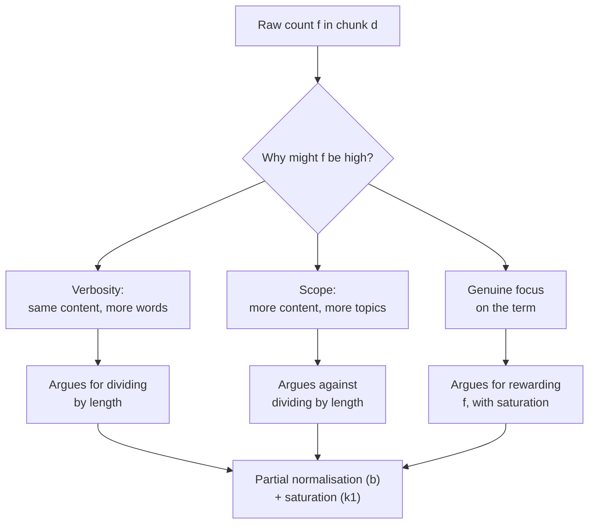

**Term frequency** is the simplest signal in retrieval: how many times does a query term occur in a chunk? A chunk that mentions "expenses" three times is probably more about expenses than one that mentions it once. That idea is sound, but turning a raw count into a useful score raises two hard questions. How much should the third, fifth or twentieth occurrence add? And how do you compare counts between a 15-word chunk and a 400-word one?

This lesson is about those two questions: the family of **TF transforms** (raw, binary, logarithmic, augmented and saturating) and the theory and practice of **document-length normalisation**. It also looks at something specific to RAG: because chunks are short, most term frequencies are 1, which changes how much the TF component matters and what can distort it. The companion lessons take the other factor, [Inverse document frequency](/learn/sparse-retrieval/inverse-document-frequency), and the full formulas, [TF-IDF](/learn/sparse-retrieval/tf-idf) and [BM25](/learn/sparse-retrieval/bm25).

## Learning objectives

- Compute raw, binary, logarithmic, augmented and BM25-style TF values for a given count, and explain the assumption behind each.
- Explain the verbosity and scope hypotheses and how they justify partial rather than full length normalisation.
- Predict how a keyword-stuffed chunk, a verbose chunk and a broad overview chunk rank under each TF scheme.
- Measure the distribution of term frequencies in a chunked corpus and explain why chunk size changes the weight the TF signal carries.

## Prerequisites

- [TF-IDF](/learn/sparse-retrieval/tf-idf): how TF combines with IDF and normalisation in the vector space model.
- [BM25](/learn/sparse-retrieval/bm25): the formula whose TF component this lesson examines in detail.
- [Chunk size](/learn/chunking-fundamentals/chunk-size): how chunk boundaries are chosen.

## Why this matters

The TF component is the part of a lexical score most easily manipulated, by accident or deliberately. A boilerplate footer repeated in every chunk, a heading prepended to each chunk of a section, a FAQ page that repeats the product name in every answer, a document written by someone who likes the word "important": each inflates term counts for reasons unrelated to relevance. The TF transform decides how much of that leaks into the ranking.

Length normalisation decides whether long chunks are over-rewarded (they contain more of everything) or over-penalised (they are divided by a large number). Both errors are common. Get either wrong and the retriever systematically prefers one size of chunk over another, which in a RAG system means systematically feeding the model either fragments or walls of text.

Finally, the importance of TF is not fixed. In a corpus of whole documents, counts vary widely and TF carries real information. In a corpus of 200-token chunks, most query terms occur once or not at all, so the retriever behaves much more like binary matching weighted by IDF. Knowing that tells you where to spend tuning effort.

## The intuition

Imagine two reviewers summarising what a page is about. The first counts words: a page that says "expenses" seven times is seven times as much about expenses as a page that says it once. The second is more sceptical. She notices that the first mention tells her a lot, the second confirms it, and after that each extra mention tells her very little. She also notices that a long, rambling page mentions everything more often, so she makes allowances for length, though not complete allowances, because some long pages are long because they cover a lot.

Now give both reviewers this test: a short, clear paragraph that states the expenses deadline once; a spam-like line that repeats "expenses" seven times; a rambling reminder that mentions expenses three times in sixty words; and a broad finance policy that mentions expenses twice among many other topics. The first reviewer picks the spam line. The second is harder to fool, but even she finds the spam line hard to dismiss completely. The code in this lesson runs exactly this test.

## How it works

### Why repetition is evidence at all

The idea that a word's frequency within a document signals what the document is about goes back to Hans Peter Luhn's work at IBM in the late 1950s on automatic indexing and abstracting. The probabilistic view (developed into BM25) makes it precise: a document either is or is not "about" a concept (the term is **elite** for it), and documents that are about it tend to use the term more. A count is evidence about that hidden "aboutness", and like most evidence, the first observations are the most informative.

So a TF transform is an answer to: given a count $f$, how strongly should we believe this chunk is about the term?

### The main TF transforms

1. **Raw**: $\text{tf} = f$. Each occurrence adds the same amount. Assumes aboutness is proportional to count, which is false beyond the first few occurrences and easy to exploit.
2. **Binary**: $\text{tf} = 1$ if $f > 0$, else 0. Presence is all that matters. Robust to repetition, and throws away genuine evidence that a chunk focuses on the term.
3. **Logarithmic** (sublinear): $\text{tf} = 1 + \ln f$ for $f > 0$. Each doubling adds a constant. Grows without limit, but slowly. This is scikit-learn's `sublinear_tf=True`.
4. **Augmented** (max-normalised): $\text{tf} = 0.5 + 0.5 \cdot f / \max_{t'} f_{t'}$, relative to the most frequent term in the same document. Corrects for documents that repeat everything, but a document whose most frequent term is the query term always gets the maximum.
5. **Saturating** (BM25): $\text{tf} = f(k_1 + 1) / (f + k_1 \cdot L)$, where $L$ is a length factor. Rises quickly, then flattens towards a ceiling of $k_1 + 1$. This is the transform the probabilistic model motivates.

The transform matters most where counts are large. All five agree that $f = 0$ means nothing. Most give $f = 1$ the value 1 (augmented gives between 0.5 and 1). They disagree about $f = 7$: raw says 7, log says 2.95, BM25 at average length about 1.88, binary 1.

### Length normalisation: two hypotheses

Why is a long chunk likely to have higher counts? Robertson and Walker (1994) gave two reasons, which pull in different directions.

- **The verbosity hypothesis.** Some authors use more words to say the same thing. A verbose document's counts are inflated in proportion to its length without it being any more about the topic. If this were the only reason, counts should be divided by length: full normalisation.
- **The scope hypothesis.** Some documents are long because they cover more topics, or cover one topic more thoroughly. A long document that mentions a term three times among many topics is less focused on it than a short one, but it may be *more* likely to contain a relevant passage. If this were the only reason, length normalisation would be unnecessary or even harmful.

Real collections contain both. The practical answer is **partial normalisation**: divide by a length factor that grows with length, but less than proportionally:

$$
L(d) = 1 - b + b \cdot \frac{|d|}{\text{avgdl}}
$$

With $b = 0$ there is no normalisation; with $b = 1$ it is fully proportional. Singhal, Buckley and Mitra (1996) arrived at the same shape empirically as **pivoted length normalisation**: they observed that cosine normalisation retrieved long documents less often than long documents were actually relevant, and "tilted" the normalisation around a pivot (the average) to correct it. BM25's $b$ plays the role of their slope.



### Where length normalisation is applied

There are two places to normalise, and they behave differently:

- **Inside the TF transform**, as BM25 does: the length factor scales the saturation point, so a long chunk needs more occurrences to reach the same TF value, and the ceiling is unchanged.
- **On the whole vector**, as TF-IDF cosine does: every weight in the chunk is divided by the vector's length. This depends not only on how long the chunk is but on how many distinct terms it has and how rare they are, so a chunk with many rare terms is penalised more than one of the same length with common terms.

The first is easier to reason about and to tune, which is one reason BM25 displaced TF-IDF cosine for ranking.

### Term frequency in chunked RAG corpora

Classic retrieval research used whole documents: news articles, web pages, reports of hundreds or thousands of words. RAG corpora are made of chunks, often 100 to 500 tokens. That changes TF in three ways.

1. **Most counts are 1.** In a short chunk, a content word usually appears once if at all. The code below measures this on real text: as chunks shrink, the share of term occurrences with $f = 1$ rises. When almost every match has $f = 1$, the TF transform barely affects ranking, and BM25 behaves like IDF-weighted matching with a length adjustment.
2. **Length variation comes from the chunker, not the author.** Chunk lengths cluster around the target size, with a tail of short final chunks of sections. Those short chunks have small length factors and score highly on any single match. Chunkers that produce many tiny fragments (a heading on its own, a one-line list item) create a population of chunks that BM25 systematically favours.
3. **Pipeline artefacts inflate counts.** Contextual chunk headers, which prepend a document title or section path to each chunk (and the related [Contextual retrieval](/learn/advanced-retrieval/contextual-retrieval) technique, which prepends generated context), add the same terms to every chunk of a document; repeated page headers and footers that survive cleaning do the same. A term in a prepended heading gains one occurrence in every chunk of the section, which changes both its TF in each chunk and its document frequency.

None of this means TF is unimportant in RAG; it means the TF signal is weaker and more easily distorted, so the cleanliness of chunks matters as much as the choice of formula.

### Query term frequency

Term frequency also exists on the query side. "Expenses for expenses claims" mentions "expenses" twice. Most BM25 implementations simply loop over query tokens, so a repeated query term counts twice. That is usually harmless for hand-typed queries and matters for generated ones: a query rewriter or a [multi-query](/learn/advanced-retrieval/multi-query-retrieval) step that concatenates variants will repeat key terms and weight them more heavily. If that is not intended, deduplicate query terms or cap their count.

## The mathematics

### The transforms side by side

**Intuition.** Each transform maps a count to "strength of evidence". They differ in how fast evidence accumulates and whether it has a ceiling.

$$
\text{raw} = f, \quad
\text{log} = 1 + \ln f, \quad
\text{aug} = 0.5 + 0.5\frac{f}{f_{\max}}, \quad
\text{bm25} = \frac{f\,(k_1 + 1)}{f + k_1 \left(1 - b + b\frac{|d|}{\text{avgdl}}\right)}
$$

- $f$: occurrences of the term in the chunk ($f > 0$; every transform gives 0 when $f = 0$).
- $f_{\max}$: count of the most frequent term in the same chunk.
- $|d|$: chunk length in terms; $\text{avgdl}$: average chunk length; $k_1$, $b$: BM25's parameters.

**By hand.** Take the "stuffed" chunk from the code below: 11 terms, of which 7 are "expenses" (so $f_{\max} = 7$), with an average chunk length of 33.75 and $k_1 = 1.2$, $b = 0.75$.

- Raw: 7.
- Log: $1 + \ln 7 = 1 + 1.9459 = 2.946$.
- Augmented: $0.5 + 0.5 \times 7/7 = 1$, the maximum possible.
- BM25: length factor $0.25 + 0.75 \times 11/33.75 = 0.25 + 0.2444 = 0.4944$; denominator $7 + 1.2 \times 0.4944 = 7.5933$; numerator $7 \times 2.2 = 15.4$; TF $= 15.4 / 7.5933 = 2.028$.

And the "precise" chunk, 13 terms with "expenses" once:

- BM25: length factor $0.25 + 0.75 \times 13 / 33.75 = 0.5389$; TF $= 2.2 / (1 + 1.2 \times 0.5389) = 2.2 / 1.6467 = 1.336$.

Under BM25, seven repetitions earn about 1.5 times what one clean mention earns. Under raw counts, seven times.

### Diminishing returns, quantified

**Intuition.** Saturation means each extra occurrence is worth less than the one before. The size of that shrinking gain can be written down exactly.

At average length ($L = 1$), the gain from the $f$-th occurrence is the difference between consecutive TF values:

$$
\Delta(f) = \frac{f(k_1+1)}{f + k_1} - \frac{(f-1)(k_1+1)}{f - 1 + k_1} = \frac{k_1(k_1+1)}{(f + k_1)(f - 1 + k_1)}
$$

The numerator comes from subtracting the fractions: $f(f - 1 + k_1) - (f - 1)(f + k_1) = k_1$, multiplied by $(k_1 + 1)$.

**By hand.** With $k_1 = 1.2$ the numerator is $1.2 \times 2.2 = 2.64$.

- $\Delta(1) = 2.64 / (2.2 \times 1.2) = 2.64 / 2.64 = 1$.
- $\Delta(2) = 2.64 / (3.2 \times 2.2) = 2.64 / 7.04 = 0.375$.
- $\Delta(5) = 2.64 / (6.2 \times 5.2) = 2.64 / 32.24 = 0.082$.

The fifth occurrence is worth about 8% of the first; the gain falls roughly with the square of $f$.

```python
k1 = 1.2
tf = lambda f: f * (k1 + 1) / (f + k1)
for f in [1, 2, 3, 5, 10]:
    print(f"f={f:<3} bm25 tf={tf(f):.3f}  gain from occurrence {f}={tf(f) - tf(f - 1):.3f}")
```

```output
f=1   bm25 tf=1.000  gain from occurrence 1=1.000
f=2   bm25 tf=1.375  gain from occurrence 2=0.375
f=3   bm25 tf=1.571  gain from occurrence 3=0.196
f=5   bm25 tf=1.774  gain from occurrence 5=0.082
f=10  bm25 tf=1.964  gain from occurrence 10=0.023
```

## In code

**The problem.** Score four chunks for the term "expenses" under six TF schemes and see which chunk each scheme puts first. The chunks are designed to separate the schemes: a precise statement, a keyword-stuffed line, a verbose reminder and a broad policy overview. Then measure how often $f = 1$ occurs at different chunk sizes in real text.

**Dependencies.** Python's standard library only.

```python
import math
import re

chunks = {
    "precise":  "Expenses must be submitted within 30 days. Anything over £75 needs a receipt.",
    "stuffed":  "Expenses expenses expenses: expenses help, expenses form, expenses portal, expenses FAQ.",
    "verbose":  ("Finance would like to remind everyone that it is important, when you have incurred "
                 "costs on behalf of the company, to think about the expenses process and to make sure "
                 "that you do not leave it too long, because expenses that are left for a long time "
                 "become difficult for the finance department to reconcile, and so expenses should be "
                 "sent in promptly."),
    "scope":    ("Finance policies. Expenses must be submitted within 30 days with receipts over £75. "
                 "Corporate cards must be reconciled monthly. Travel must be booked through the portal. "
                 "Per diems apply to overnight trips. Mileage is reimbursed at the published rate. "
                 "Expenses for client entertainment need prior approval from finance."),
}
ids = list(chunks)
tok = lambda s: re.findall(r"[a-z0-9£]+", s.lower())
docs = {k: tok(v) for k, v in chunks.items()}
lengths = {k: len(v) for k, v in docs.items()}
avg = sum(lengths.values()) / len(lengths)
term = "expenses"

# --- TF transforms: how much is each count worth? ---------------------------
def raw(f, d):  return f
def binary(f, d):  return 1.0 if f else 0.0
def log_tf(f, d):  return 1 + math.log(f) if f else 0.0
def augmented(f, d):  return 0.5 + 0.5 * f / max(docs[d].count(t) for t in set(docs[d])) if f else 0.0
def bm25_tf(f, d, k1=1.2, b=0.75):
    return f * (k1 + 1) / (f + k1 * (1 - b + b * lengths[d] / avg)) if f else 0.0
def raw_per_length(f, d):  return f / lengths[d]          # full length normalisation

schemes = {"raw": raw, "binary": binary, "log": log_tf, "augmented": augmented,
           "raw/len": raw_per_length, "bm25": bm25_tf}

print(f"term = {term!r}, average length = {avg:.1f}")
print(f"{'chunk':<9}{'len':>4}{'tf':>4}" + "".join(f"{s:>11}" for s in schemes))
for d in ids:
    f = docs[d].count(term)
    print(f"{d:<9}{lengths[d]:>4}{f:>4}" + "".join(f"{fn(f, d):>11.3f}" for fn in schemes.values()))

print()
for name, fn in schemes.items():
    scored = sorted(((round(fn(docs[d].count(term), d), 3), d) for d in ids), reverse=True)
    print(f"{name:<10}", "  ".join(f"{d}={v:g}" for v, d in scored))
```

```output
term = 'expenses', average length = 33.8
chunk     len  tf        raw     binary        log  augmented    raw/len       bm25
precise    13   1      1.000      1.000      1.000      1.000      0.077      1.336
stuffed    11   7      7.000      1.000      2.946      1.000      0.636      2.028
verbose    63   3      3.000      1.000      2.099      0.875      0.048      1.325
scope      48   2      2.000      1.000      1.693      0.833      0.042      1.229

raw        stuffed=7  verbose=3  scope=2  precise=1
binary     verbose=1  stuffed=1  scope=1  precise=1
log        stuffed=2.946  verbose=2.099  scope=1.693  precise=1
augmented  stuffed=1  precise=1  verbose=0.875  scope=0.833
raw/len    stuffed=0.636  precise=0.077  verbose=0.048  scope=0.042
bm25       stuffed=2.028  precise=1.336  verbose=1.325  scope=1.229
```

**The important lines.**

- Each scheme is a function of the count `f` and the chunk `d`, so the schemes that need chunk-level information (augmented needs the chunk's maximum count, BM25 and raw/len need its length) can look it up.
- `augmented` computes `max(docs[d].count(t) for t in set(docs[d]))`, the count of the chunk's most frequent term.
- `bm25_tf` is BM25's TF component alone, without IDF. Since all four chunks are scored for the same term, IDF would multiply them all equally and not change the order.
- The ranking loop sorts by score and prints ties in arbitrary order; the binary row is a four-way tie.

**What the output means.**

- **Every scheme except binary puts the stuffed chunk first, or level first.** Raw TF rewards it sevenfold; log TF nearly threefold; augmented gives it the maximum because "expenses" is its own most frequent term; full length normalisation rewards it most of all, because it is short *and* repetitive. BM25 limits the reward to about 1.5 times a clean mention but does not remove it. **No TF transform can distinguish deliberate repetition from genuine focus**; that requires something else (cleaning, provenance, a reranker).
- **Binary ignores repetition completely**, which defeats stuffing and also discards the real signal that the verbose and scope chunks mention the term several times.
- **Full length normalisation (raw/len) crushes the long chunks**: the verbose and scope chunks score about 0.05 against 0.64. This is the scope hypothesis being ignored; the policy overview, which might well be the best source, comes last.
- **Under BM25, the precise chunk edges out the verbose one** (1.336 against 1.325): three mentions in 63 words are worth about the same as one in 13. That near-tie is partial normalisation doing what it was designed to do.

To see how much TF matters in a chunked corpus, measure how often $f > 1$. This snippet takes any text file, cuts it into fixed-size chunks and reports the share of (term, chunk) pairs with $f = 1$:

```python
import re
import sys
from collections import Counter

def tf_profile(text, sizes=(50, 200, 800)):
    words = re.findall(r"[a-z0-9]+", text.lower())
    print(f"{len(words):,} words, {len(set(words)):,} distinct")
    for size in sizes:
        pieces = [words[i:i + size] for i in range(0, len(words), size)]
        tfs = [f for p in pieces for f in Counter(p).values()]   # one tf per (term, chunk)
        ones = sum(1 for f in tfs if f == 1) / len(tfs)
        print(f"chunks of {size:>3} words: {len(pieces):>3} chunks, "
              f"tf = 1 for {ones:.0%} of (term, chunk) pairs, max tf = {max(tfs)}")

tf_profile(open(sys.argv[1], encoding="utf-8").read())
```

Run on the Markdown source of one of this course's earlier lessons (about 6,000 words), it printed:

```output
6,195 words, 1,279 distinct
chunks of  50 words: 124 chunks, tf = 1 for 83% of (term, chunk) pairs, max tf = 29
chunks of 200 words:  31 chunks, tf = 1 for 72% of (term, chunk) pairs, max tf = 57
chunks of 800 words:   8 chunks, tf = 1 for 62% of (term, chunk) pairs, max tf = 95
```

Your numbers will differ with your text, but the pattern is general: the smaller the chunks, the more term occurrences are singletons. The large maximum counts come from words like "the" and from repeated code tokens; content words in small chunks rarely exceed 2 or 3. At 200-word chunks, nearly three quarters of all (term, chunk) pairs have $f = 1$, and for those, every transform gives the same value up to the length factor.

**Common errors.**

- Measuring TF after stop-word removal in one place and before it in another, which makes profiles incomparable.
- Forgetting that `augmented` depends on the whole chunk: adding an unrelated repeated word lowers every other term's TF.
- Treating `math.log(0)` as zero: it raises `ValueError`. Every log-based transform needs the `if f` guard.

**Extending it.** Add pivoted normalisation (divide raw TF by $1 - b + b|d|/\text{avgdl}$) and compare with BM25 at several values of $b$. Run `tf_profile` on your own corpus at your production chunk size; if more than about 80% of pairs have $f = 1$, tuning $k_1$ will have little effect and your effort is better spent on analysis and chunk quality.

## A real-world example

AskMeridian's product-documentation index started returning the Meridian Reports FAQ page for almost every Reports question, even when a specific how-to chunk answered it directly. The Platform team looked at BM25 explanations and found that the FAQ chunks scored highly on "reports" and "meridian" in every case.

The cause was a combination of pipeline artefacts. The ingestion job prepended "Meridian Reports > FAQ" to each FAQ chunk as a contextual header, and the FAQ's own question lines also began "In Meridian Reports, how do I...". So "reports" appeared three or four times in each short FAQ chunk, against once in a typical how-to chunk. BM25's saturation limited the advantage, but the FAQ chunks were also short (one question and answer each), so their length factor was small and they reached high TF values quickly.

The team considered lowering $k_1$ but tested a simpler change first: the contextual header was moved from the chunk body into a separate, lower-weighted title field, so it still helped when the query named the section but no longer added occurrences to the body. They also merged FAQ entries shorter than 40 tokens with their neighbours. On their labelled query set, the share of Reports questions with the correct chunk in the top three rose, and the default $k_1$ and $b$ stayed. The lesson they recorded: before tuning a TF parameter, look at where the term counts came from.

## Common mistakes

- **Using raw TF for ranking.** Repetition, boilerplate and stuffing translate directly into score.
- **Applying full length normalisation.** It systematically buries broad, thorough chunks; use partial normalisation ($b < 1$).
- **Prepending headings or titles into chunk text without accounting for TF.** Every chunk of a section gains occurrences of the heading terms; put them in a separate field instead.
- **Leaving repeated headers and footers in chunks.** They inflate TF and distort document frequencies.
- **Tuning $k_1$ on a corpus where almost all TFs are 1.** The parameter has little to act on, so apparent improvements are noise.
- **Letting query rewriting repeat terms unintentionally.** Duplicated query terms double their BM25 contribution.

## Best practices

- Use a saturating TF with partial length normalisation (BM25 defaults) unless you have measured a reason not to.
- Profile term frequencies at your production chunk size before deciding where to spend tuning effort.
- Keep structural text (titles, section paths, breadcrumbs) in separate fields with their own weights.
- Remove boilerplate during [preprocessing](/learn/document-preprocessing/header-and-footer-removal) rather than relying on TF saturation to tolerate it.
- Avoid extreme chunk-length variation; merge tiny fragments so short chunks do not gain a systematic advantage.
- Deduplicate query terms produced by automatic rewriting unless emphasis is intended.

## Performance considerations

Term frequencies are stored in each posting, typically as a small integer, compressed alongside the document-id gaps; in short chunks most are 1 and compress to almost nothing. Engines that do not need TF (pure boolean filtering) can index without frequencies to save space, but then cannot rank with BM25.

The TF transform costs a few arithmetic operations per posting at query time. BM25's length factor can be precomputed per chunk, so the per-posting cost is one addition, one multiplication and one division. Choosing a different transform has no meaningful performance consequence; the choice is purely about ranking quality.

Profiling term frequencies, as in the code, is a single pass over the corpus: for a million chunks of 200 words it touches 200 million tokens, which takes minutes in Python and is worth doing once per corpus and chunking configuration.

## Security considerations

Term frequency is the most direct lever for anyone who can write indexed content. A planted chunk that repeats a target phrase gains score under every transform except binary, and short, repetitive chunks gain the most under BM25 because of length normalisation. Restrict write access to indexed sources, record provenance on every chunk, and consider flagging chunks whose term distribution is extreme (for example, one term making up more than a third of the tokens) for review. [Retrieval manipulation](/learn/rag-security-fundamentals/retrieval-manipulation) covers this attack in detail.

## Summary

- Term frequency is evidence that a chunk is about a term, with sharply diminishing returns after the first occurrence.
- TF transforms range from raw (proportional, easily exploited) through logarithmic and augmented to BM25's saturating form (bounded by $k_1 + 1$) and binary (presence only).
- Long chunks have higher counts both because of verbosity (argues for normalising) and scope (argues against); partial normalisation, $1 - b + b|d|/\text{avgdl}$, balances the two.
- No TF transform distinguishes repetition from genuine focus; cleaning, field separation and provenance do that.
- In chunked RAG corpora most term frequencies are 1, so TF carries less signal than in whole-document retrieval and is more easily distorted by pipeline artefacts.

## Exercises

**1.** Compute raw, log, augmented and BM25 TF (with $k_1 = 1.2$, $b = 0.75$) for a term occurring 3 times in a chunk of 40 terms whose most frequent term occurs 4 times, in a collection with average length 40.

<details><summary>Show solution</summary>

Raw 3. Log $1 + \ln 3 = 2.099$. Augmented $0.5 + 0.5 \times 3/4 = 0.875$. BM25: the chunk is average length, so $L = 1$ and TF $= 3 \times 2.2 / (3 + 1.2) = 6.6 / 4.2 = 1.571$.

</details>

**2.** In the code, find the value of $b$ (with $k_1 = 1.2$) at which the verbose chunk's BM25 TF equals the precise chunk's. Explain what that value means.

<details><summary>Show solution</summary>

```python
for b in [x / 100 for x in range(0, 101)]:
    if bm25_tf(3, "verbose", b=b) <= bm25_tf(1, "precise", b=b):
        print(f"verbose falls to or below precise at b={b:.2f}")
        break
```

```output
verbose falls to or below precise at b=0.74
```

Below about $b = 0.74$, three mentions in a 63-word chunk outweigh one in a 13-word chunk; above it, length normalisation is strong enough that the short chunk wins. The BM25 default of 0.75 sits right at the crossover, which is why the two scored almost equally.

</details>

**3.** A team prepends "Employee Handbook > Leave > Carry-over" to every chunk in that section. Explain the effect on TF and on document frequency for "leave", and propose a fix.

<details><summary>Show solution</summary>

Every chunk in the section gains one occurrence of "leave" (and "handbook", "carry", "over"), raising their TF and making short chunks in the section score higher for any query with those words. The document frequency of "leave" also rises, because chunks that did not mention it now do, which lowers its IDF everywhere. Fix: store the path in a separate title or breadcrumb field with its own, lower weight, or keep it only in the text sent to the embedding model, not in the BM25 body field.

</details>

**4.** Design decision. You are choosing chunk sizes for a new policy corpus and want BM25's TF component to carry useful signal. Use the `tf_profile` idea to describe an experiment, and say what result would make you prefer larger chunks for the sparse index than for the dense index.

<details><summary>Show solution</summary>

Run `tf_profile` on the corpus at several sizes (for example 100, 300 and 800 words), but restrict it to content words (drop stop words) and to terms that appear in real queries. Then evaluate BM25 retrieval on labelled queries at each size. If small chunks show nearly all $f = 1$ and BM25 quality improves noticeably at larger sizes while dense retrieval is better at small sizes, index the sparse side with larger chunks (or at section level) and map hits back to the dense chunks. The two retrievers do not have to share chunk boundaries, though fusing their results is simpler when they do.

</details>

## Check your understanding

```quiz
[
  {
    "q": "Under BM25 with k1 = 1.2 at average length, roughly how much does the fifth occurrence of a term add, relative to the first?",
    "options": [
      "The same amount",
      "About half",
      "About 8%",
      "Nothing"
    ],
    "answer": 2,
    "why": "The gain from the f-th occurrence is k1(k1+1)/((f+k1)(f-1+k1)). For f = 5 this is 2.64/32.24, about 0.082, against 1 for the first."
  },
  {
    "q": "Which hypothesis argues that long documents should NOT be heavily penalised for length?",
    "options": [
      "The verbosity hypothesis",
      "The scope hypothesis",
      "The independence assumption",
      "Zipf's law"
    ],
    "answer": 1,
    "why": "The scope hypothesis says long documents often cover more content, so they may contain relevant material; full normalisation would bury them."
  },
  {
    "q": "In the lesson's output, why does the augmented TF give the keyword-stuffed chunk the maximum value of 1?",
    "options": [
      "Because \"expenses\" is the most frequent term in that chunk, so f equals the chunk's maximum count",
      "Because the chunk is the shortest",
      "Because augmented TF ignores the count",
      "Because of IDF"
    ],
    "answer": 0,
    "why": "Augmented TF is 0.5 + 0.5 × f / max count in the chunk. When the query term is the chunk's most frequent term, the ratio is 1."
  },
  {
    "q": "A corpus of 150-word chunks has tf = 1 for 85% of (term, chunk) pairs. What follows?",
    "options": [
      "BM25 cannot be used",
      "The IDF component becomes irrelevant",
      "Length normalisation stops working",
      "Changing k1 will have a small effect on most rankings, which depend mainly on which terms match and their IDF"
    ],
    "answer": 3,
    "why": "When almost every match has f = 1, the TF transform yields nearly the same value for every match, up to the length factor, so k1 has little to act on."
  },
  {
    "q": "Which TF transform is completely immune to keyword stuffing?",
    "options": [
      "Logarithmic",
      "BM25",
      "Binary",
      "Augmented"
    ],
    "answer": 2,
    "why": "Binary TF counts only presence, so repetition adds nothing. The price is ignoring genuine repetition as well."
  }
]
```

## Further reading

- S. E. Robertson and S. Walker, "Some simple effective approximations to the 2-Poisson model for probabilistic weighted retrieval", SIGIR 1994, which introduces saturation and the verbosity and scope hypotheses.
- Amit Singhal, Chris Buckley and Mandar Mitra, "Pivoted document length normalization", SIGIR 1996.
- Gerard Salton and Christopher Buckley, "Term-weighting approaches in automatic text retrieval", *Information Processing and Management*, 1988.
- H. P. Luhn, "A statistical approach to mechanized encoding and searching of literary information", *IBM Journal of Research and Development*, 1957.
- Christopher D. Manning, Prabhakar Raghavan and Hinrich Schütze, *Introduction to Information Retrieval* (2008), section 6.4 on variant TF functions and pivoted normalisation. Free at [nlp.stanford.edu/IR-book](https://nlp.stanford.edu/IR-book/).
