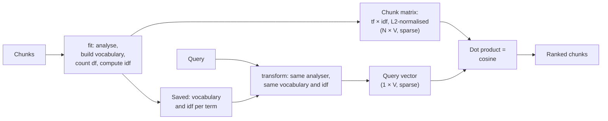

**TF-IDF** (term frequency times inverse document frequency) turns a piece of text into a vector of term weights: each term in the vocabulary gets a number that is high when the term is frequent in this text and rare in the collection. Put the query and every chunk into that form, compare the vectors with a cosine, and you have a complete retrieval model, the **vector space model**, that needs no training, runs on a laptop and explains every score it gives.

You met the TF-IDF weight briefly in [Query-document matching](/learn/rag-architecture-fundamentals/query-document-matching). This lesson takes the whole model apart: how the weights become vectors, how scikit-learn's `TfidfVectorizer` computes them (precisely enough to reproduce its numbers by hand), what each option changes, and where the model falls short in a way that motivates [BM25](/learn/sparse-retrieval/bm25). The two ingredients each have their own lesson, [Term frequency](/learn/sparse-retrieval/term-frequency) and [Inverse document frequency](/learn/sparse-retrieval/inverse-document-frequency), which cover their many variants; here the focus is on how they combine.

## Learning objectives

- Construct the TF-IDF vector of a short text by hand, including normalisation, and reproduce scikit-learn's output exactly.
- Explain how the vector space model ranks chunks with a cosine between TF-IDF vectors, and why normalisation is needed.
- Configure `TfidfVectorizer` (token pattern, stop words, n-grams, document-frequency limits, sublinear TF) and predict the effect of each option on retrieval.
- Identify the weaknesses of TF-IDF ranking that BM25 addresses.

## Prerequisites

- [Query-document matching](/learn/rag-architecture-fundamentals/query-document-matching): lexical matching, cosine similarity and a first TF-IDF weight.
- [Inverted indexes](/learn/sparse-retrieval/inverted-indexes): how sparse vectors are stored and searched.
- [Query-document similarity](/learn/retrieval-fundamentals/query-document-similarity): scoring functions as inner products.

## Why this matters

TF-IDF is the simplest retrieval model that works. It is the baseline against which every other retriever should be measured, because a dense model that cannot beat TF-IDF on your own queries is not worth its infrastructure. It is also more than a baseline in a RAG system:

- **A lexical retriever for small corpora.** For a few thousand chunks, a TF-IDF matrix held in memory is a perfectly serviceable keyword search with no extra infrastructure.
- **The sparse half of a hybrid retriever** in prototypes, before a search engine with BM25 is introduced.
- **A text-analysis tool.** Finding near-duplicate chunks, extracting the characteristic terms of a cluster, labelling topics and spotting chunks that are mostly boilerplate all use TF-IDF vectors.

It is also easy to misuse. The default settings of the most popular implementation silently drop single-character tokens, keep every stop word, and split identifiers on hyphens, so "3 days", "E-4021" and "Wi-Fi" are not indexed the way you might assume. Every one of these affects which chunk reaches the model, and none produces an error.

## The intuition

Suppose you want to describe each page of Meridian's handbook to someone in a few words. For the page on annual leave you would not say "the, is, days": "the" and "is" appear on every page, and "days" appears on most of them (leave days, expense deadlines, password rotation). You would say "annual leave, carry over, unused". Those words are frequent *on this page* and uncommon *elsewhere*. That is exactly what TF-IDF measures.

Now give each page a scorecard with one column per word in the whole handbook, and write each word's importance to that page in its column. Most columns are blank, because a page uses only a few dozen of the handbook's words. A question gets a scorecard too. To find the best page for a question, compare scorecards: pages whose high-scoring words match the question's high-scoring words win.

One subtlety: a long page has more words, so its scorecard has more and larger entries, and it would match more questions just by being long. So before comparing, each scorecard is rescaled to the same total "size". Then only the *mix* of words matters, not how many there are.

## How it works

### From text to a weighted vector

Building TF-IDF vectors for a collection takes five steps.

1. **Analyse** every chunk into terms: lower-case, tokenise, optionally drop stop words or form n-grams. The set of all distinct terms is the **vocabulary**, of size $V$. Each term gets a column number.
2. **Count** term frequencies: $\text{tf}_{t,d}$, the number of times term $t$ occurs in chunk $d$.
3. **Compute document frequencies**: $\text{df}_t$, the number of chunks containing $t$, and from it one IDF value per term.
4. **Weight**: each non-zero entry becomes $\text{tf}_{t,d} \times \text{idf}_t$ (or a transformed TF times IDF).
5. **Normalise** each chunk's vector to length 1.

Steps 3 and the vocabulary are learned from the collection once, at indexing time. A query is then put through steps 1, 2, 4 and 5 **using the collection's vocabulary and IDF values**: terms in the query that are not in the vocabulary are simply dropped, and the query's own term counts provide its TF.



### The vector space model

The model behind this, introduced by Gerard Salton and colleagues in the SMART retrieval system in the 1960s and 1970s, treats every text as a point in a $V$-dimensional space with one axis per term. Relevance is approximated by closeness of direction: the cosine of the angle between the query vector and the chunk vector.

Because both vectors are normalised to length 1, the cosine is simply their dot product, and because the query has only a handful of non-zero entries, that dot product is a sum over the query's terms only. That is what lets TF-IDF run on an [inverted index](/learn/sparse-retrieval/inverted-indexes): each query term contributes "query weight times chunk weight" for each chunk in its posting list.

The model has three moving parts, and each was the subject of decades of experiment:

- **How to transform the raw count** (raw, logarithmic, binary and others), covered in [Term frequency](/learn/sparse-retrieval/term-frequency).
- **How to compute IDF** (plain logarithm, smoothed, probabilistic), covered in [Inverse document frequency](/learn/sparse-retrieval/inverse-document-frequency).
- **How to normalise length** (cosine normalisation, pivoted normalisation, none).

The classic SMART notation names a scheme with three letters for documents and three for queries, one for each part. The widely cited `lnc.ltc` scheme means: documents use logarithmic TF, no IDF and cosine normalisation; queries use logarithmic TF, IDF and cosine normalisation. You do not need the notation to use TF-IDF, but it is a reminder that "TF-IDF" names a family, not a formula. Two systems both described as "TF-IDF" can rank differently.

### What scikit-learn computes

`TfidfVectorizer` is the implementation most Python engineers meet. With its default settings it computes, for each chunk:

1. Tokens from the regular expression `(?u)\b\w\w+\b`: runs of **two or more** word characters, after lower-casing. Single characters, including single digits, are discarded. Hyphens and colons separate tokens, so "E-4021" yields only "4021" (the lone "e" is too short) and "Wi-Fi" yields "wi" and "fi".
2. Raw counts as TF.
3. A **smoothed** IDF: $\ln\frac{1 + N}{1 + \text{df}_t} + 1$. The $+1$ inside behaves as if one extra document contained every term, which prevents division by zero; the $+1$ outside means a term in every chunk still gets weight 1 rather than 0.
4. L2 normalisation of each row.

The important options, and what they do to retrieval:

| Option | Default | Effect when changed |
| --- | --- | --- |
| `token_pattern` | two or more word characters | `r"(?u)\b\w+\b"` keeps single characters such as "3"; a custom pattern can keep "e-4021" whole |
| `stop_words` | `None` | `"english"` drops a built-in list of common words; check it does not contain terms you need ("not", "off") |
| `ngram_range` | `(1, 1)` | `(1, 2)` adds two-word terms such as "annual leave", which rewards phrase matches but enlarges the vocabulary |
| `min_df`, `max_df` | `1`, `1.0` | drop terms in too few or too many chunks; `max_df=0.9` acts as a corpus-specific stop-word list |
| `sublinear_tf` | `False` | uses $1 + \ln \text{tf}$ instead of raw counts, so ten repetitions do not count ten times |
| `smooth_idf` | `True` | `False` gives $\ln\frac{N}{\text{df}_t} + 1$ |
| `norm` | `"l2"` | `None` disables normalisation, so long chunks score higher simply for being long |

Anything changed must be identical at indexing and query time, which is automatic if you `fit` once and reuse the same fitted object for `transform`.

### Where TF-IDF ranking falls short

TF-IDF works, but three weaknesses show up quickly on real collections:

- **Term frequency grows without limit.** With raw counts, a chunk that says "laptop" eight times outweighs one that says it twice by a factor of four, although the second is probably just as much about laptops. `sublinear_tf` dampens this but never stops it.
- **Cosine normalisation over-corrects for length.** Dividing by the vector length penalises long chunks heavily, even when they are long because they cover a topic thoroughly. Experiments in the 1990s (Singhal, Buckley and Mitra's pivoted length normalisation) showed that long relevant documents were retrieved less often than their share of the relevant set would predict.
- **The query is treated as a document.** The query's own TF and normalisation are an awkward fit for a three-word question.

BM25 addresses the first two with a saturating TF function and a tunable, partial length normalisation. That is why production search engines rank with BM25 rather than TF-IDF cosine, and why the [next lesson](/learn/sparse-retrieval/bm25) exists. TF-IDF remains the right tool when you want a quick, dependency-free baseline, a feature matrix for analysis, or vectors you can compare with each other (BM25 scores a query against a document; it does not produce comparable document vectors).

Try changing the query and the documents in the visualiser to see which terms carry each score.

```playground
tf-idf
```

## The mathematics

### The TF-IDF weight and the normalised vector

**Intuition.** A term's weight in a chunk is "how much it is used here" times "how unusual it is anywhere". The vector is then scaled to length 1 so that only proportions matter.

$$
w_{t,d} = \text{tf}_{t,d} \cdot \text{idf}_t, \qquad \text{idf}_t = \ln\frac{1 + N}{1 + \text{df}_t} + 1
$$

$$
\hat{w}_{t,d} = \frac{w_{t,d}}{\sqrt{\sum_{t'} w_{t',d}^2}}
$$

- $\text{tf}_{t,d}$: occurrences of term $t$ in chunk $d$ (after analysis).
- $N$: number of chunks in the collection; $\text{df}_t$: number of chunks containing $t$.
- $\text{idf}_t$: scikit-learn's default smoothed IDF.
- $\hat{w}_{t,d}$: the normalised weight; the denominator is the vector's Euclidean (L2) length, summed over every term $t'$ in the chunk.

The score of chunk $d$ for query $q$ is the cosine, which for unit vectors is a dot product over shared terms:

$$
\text{score}(q, d) = \sum_{t \in q \cap d} \hat{w}_{t,q} \, \hat{w}_{t,d}
$$

**By hand.** The code below uses six Meridian chunks ($N = 6$). Take chunk 3, "Passwords must be rotated every 90 days. VPN is required on public Wi-Fi."

- "passwords" appears in 1 chunk: $\text{idf} = \ln(7/2) + 1 = 1.2528 + 1 = 2.2528$. With $\text{tf} = 1$, $w = 2.2528$.
- "days" appears in 4 chunks: $\text{idf} = \ln(7/5) + 1 = 0.3365 + 1 = 1.3365$, so $w = 1.3365$.
- "vpn" appears in 2 chunks: $\text{idf} = \ln(7/3) + 1 = 0.8473 + 1 = 1.8473$.

The chunk has 14 terms after analysis; squaring and summing all 14 weights gives a length of 7.5545. So the normalised weight of "passwords" is $2.2528 / 7.5545 = 0.2982$ and of "days" is $1.3365 / 7.5545 = 0.1769$. The rare term carries 1.7 times the weight of the common one, purely through IDF, since both occur once.

Note what the smoothing does to contrast. Unsmoothed, $\ln(6/1) = 1.79$ against $\ln(6/4) = 0.41$: a ratio above 4. The $+1$ added outside the logarithm compresses the range of IDF values, so scikit-learn's default gives common terms more influence than the textbook formula would.

```python
import numpy as np

N = 6
for term, df in [("passwords", 1), ("vpn", 2), ("days", 4)]:
    smooth = np.log((1 + N) / (1 + df)) + 1
    plain = np.log(N / df)
    print(f"{term:<10} df={df}  sklearn idf={smooth:.4f}  textbook idf={plain:.4f}")
print("normalised 'passwords':", round(2.2528 / 7.5545, 4), " 'days':", round(1.3365 / 7.5545, 4))
```

```output
passwords  df=1  sklearn idf=2.2528  textbook idf=1.7918
vpn        df=2  sklearn idf=1.8473  textbook idf=1.0986
days       df=4  sklearn idf=1.3365  textbook idf=0.4055
normalised 'passwords': 0.2982  'days': 0.1769
```

The textbook ratio between "passwords" and "days" is $1.79 / 0.41 \approx 4.4$; scikit-learn's is $2.25 / 1.34 \approx 1.7$.

## In code

**The problem.** Build a TF-IDF retriever over Meridian chunks with scikit-learn, prove that you understand its arithmetic by reproducing one row exactly, and run queries that expose the defaults' behaviour.

**Dependencies.** scikit-learn and NumPy. No API key, no model download.

```bash
pip install scikit-learn numpy
```

```python
import numpy as np
from sklearn.feature_extraction.text import TfidfVectorizer

chunks = [
    "Annual leave is 25 days. Up to 5 unused days carry over and must be used by 31 March.",
    "Staff may work remotely up to 3 days a week. The home-office equipment budget is £400.",
    "Expenses must be submitted within 30 days. Anything over £75 needs a receipt.",
    "Passwords must be rotated every 90 days. VPN is required on public Wi-Fi.",
    "Error E-4021: the VPN client is out of date. Update it from the IT portal.",
    "The laptop refresh cycle is 3 years. Report a lost laptop to the support desk at once.",
]

# 1. Fit the vectoriser: learns the vocabulary and one IDF per term
vec = TfidfVectorizer()                       # defaults: smooth_idf=True, norm="l2", sublinear_tf=False
X = vec.fit_transform(chunks)                 # sparse matrix, one row per chunk
vocab = vec.get_feature_names_out()
print("matrix shape:", X.shape, " stored non-zeros:", X.nnz,
      f" density: {X.nnz / (X.shape[0] * X.shape[1]):.1%}")
print("is '3' in the vocabulary?", "3" in vec.vocabulary_, "| is '4021'?", "4021" in vec.vocabulary_)

# 2. Reproduce one row by hand: raw count x smoothed idf, then divide by L2 length
N = len(chunks)
row = 3                                         # the password chunk
analyse = vec.build_analyzer()                  # the exact tokeniser the vectoriser used
counts = {}
for tok in analyse(chunks[row]):
    counts[tok] = counts.get(tok, 0) + 1
df = (X > 0).sum(axis=0).A1                     # document frequency of every term
manual = {}
for tok, tf in counts.items():
    j = vec.vocabulary_[tok]
    idf = np.log((1 + N) / (1 + df[j])) + 1
    manual[tok] = tf * idf
length = np.sqrt(sum(w * w for w in manual.values()))
print(f"\nchunk {row} by hand (before normalising, length={length:.4f}):")
for tok in ["passwords", "days", "vpn", "must", "fi"]:
    j = vec.vocabulary_[tok]
    print(f"  {tok:<10} tf={counts[tok]} df={df[j]} idf={vec.idf_[j]:.4f} "
          f"weight={manual[tok]:.4f} normalised={manual[tok] / length:.4f} sklearn={X[row, j]:.4f}")

# 3. Rank chunks for queries: rows are unit length, so a dot product is the cosine
def search(query, k=3):
    q = vec.transform([query])
    scores = (X @ q.T).toarray().ravel()
    order = np.argsort(-scores, kind="stable")[:k]
    print(f"\nquery: {query!r}   query terms kept: {[vocab[j] for j in q.indices]}")
    for i in order:
        print(f"  {scores[i]:.3f}  {chunks[i][:58]}")

search("how many days of annual leave do I get")
search("VPN error 4021")
search("is a 3 year laptop cycle normal")
```

```output
matrix shape: (6, 66)  stored non-zeros: 84  density: 21.2%
is '3' in the vocabulary? False | is '4021'? True

chunk 3 by hand (before normalising, length=7.5545):
  passwords  tf=1 df=1 idf=2.2528 weight=2.2528 normalised=0.2982 sklearn=0.2982
  days       tf=1 df=4 idf=1.3365 weight=1.3365 normalised=0.1769 sklearn=0.1769
  vpn        tf=1 df=2 idf=1.8473 weight=1.8473 normalised=0.2445 sklearn=0.2445
  must       tf=1 df=3 idf=1.5596 weight=1.5596 normalised=0.2064 sklearn=0.2064
  fi         tf=1 df=1 idf=2.2528 weight=2.2528 normalised=0.2982 sklearn=0.2982

query: 'how many days of annual leave do I get'   query terms kept: ['annual', 'days', 'leave', 'of']
  0.388  Annual leave is 25 days. Up to 5 unused days carry over an
  0.137  Error E-4021: the VPN client is out of date. Update it fro
  0.061  Expenses must be submitted within 30 days. Anything over £

query: 'VPN error 4021'   query terms kept: ['4021', 'error', 'vpn']
  0.411  Error E-4021: the VPN client is out of date. Update it fro
  0.123  Passwords must be rotated every 90 days. VPN is required o
  0.000  Annual leave is 25 days. Up to 5 unused days carry over an

query: 'is a 3 year laptop cycle normal'   query terms kept: ['cycle', 'is', 'laptop']
  0.548  The laptop refresh cycle is 3 years. Report a lost laptop 
  0.052  Passwords must be rotated every 90 days. VPN is required o
  0.050  Staff may work remotely up to 3 days a week. The home-offi
```

**The important lines.**

- `vec.fit_transform(chunks)` performs the whole indexing step and returns a SciPy sparse matrix. `vec.idf_` holds the learned IDF per column and `vec.vocabulary_` maps each term to its column.
- `vec.build_analyzer()` returns the exact function used to turn text into terms. Use it whenever you need to know what the vectoriser "sees"; it is the quickest way to debug a missing match.
- `(X > 0).sum(axis=0).A1` counts, for each column, how many rows are non-zero: the document frequency.
- `vec.transform([query])` reuses the fitted vocabulary and IDF. Never call `fit_transform` on the query, which would learn a one-document vocabulary and meaningless IDF.
- `X @ q.T` multiplies the chunk matrix by the query vector. Because both are L2-normalised, every entry is a cosine.

**What the output means.**

- The hand-computed column matches scikit-learn to four decimal places, so the formula in the previous section is exactly what the library does.
- The matrix is 21% dense with six short chunks; with thousands of chunks and a vocabulary of tens of thousands, density falls well below 1%, which is why it is stored sparsely.
- **"3" is not in the vocabulary.** The default token pattern drops single characters, so "a 3 year laptop cycle" loses its number entirely, and the chunk about remote work ("up to 3 days") cannot be told apart from others by its "3". "Year" also fails to match "years", because there is no stemming.
- **"of" matched the error chunk** ("out of date") strongly enough to put it second for a question about leave. With only six chunks, "of" has a high IDF. Stop-word removal, or a larger collection where "of" is everywhere, removes this.
- **The third result for "VPN error 4021" scores 0.000.** Top-$k$ always returns $k$ items. A zero means "shares no term", and your code should drop such results rather than pass them to the model.

**Common errors.**

- `ValueError: empty vocabulary; perhaps the documents only contain stop words` when fitting on texts that contain no tokens matching the pattern (for example, only numbers of one digit) or with an aggressive stop-word list.
- Refitting the vectoriser after adding chunks but forgetting to re-transform the old ones: column indices change, and old rows no longer line up with the new vocabulary.
- Comparing scores across differently fitted vectorisers. IDF depends on the collection, so a score of 0.4 from one index means nothing in another.

**Extending it.** Set `token_pattern=r"(?u)\b\w+\b"` and see "3" enter the vocabulary; add `stop_words="english"` and watch the error chunk drop out of the leave query; try `ngram_range=(1, 2)` and compare the vocabulary size. [Keyword matching](/learn/sparse-retrieval/keyword-matching) shows how to keep identifiers like "E-4021" whole.

## A real-world example

Meridian's IT team built a quick "find the runbook" tool for the support desk: a `TfidfVectorizer` over about 900 runbook chunks, kept in memory in a small FastAPI service. It worked well for a month, until support staff noticed that searches such as "error 7" or "step 3 of the VPN setup" returned the wrong runbooks, and that a search for "E-4021" ranked chunks that merely listed 4021 among related codes almost level with the chunk that explained it.

The cause was the default analyser. Single-digit tokens were discarded, so "7" and "3" vanished from both chunks and queries. Error codes were split on the hyphen into "e" (discarded) and a bare number, which also matched page numbers, version strings and lists of related codes, so a shared number was not decisive.

The team changed two things. They replaced the token pattern with one that keeps single characters and treats a letter-hyphen-digits sequence as one token, so "e-4021" is a term of its own with a very high IDF. And they added a short, curated stop-word list instead of the built-in one, after finding that the built-in English list removes words such as "not" and "off", which mattered in runbook text ("do not restart"). They re-fitted, re-ran a set of 40 saved support-desk queries, and checked that the number of queries with the correct runbook in the top three went up rather than down. The lesson they wrote in their runbook for the tool: the analyser is part of the model, and its defaults were designed for general English prose, not for IT identifiers.

## Common mistakes

- **Fitting on the query.** `fit_transform([query])` builds a separate vocabulary and IDF; scores are meaningless. Fit once on the chunks, `transform` the query.
- **Trusting the default token pattern for technical text.** Single-digit numbers vanish and hyphenated identifiers split, so exact-match queries fail quietly.
- **Using the built-in English stop-word list without reading it.** It removes words like "not", "no" and "off" that can carry meaning in policy and runbook text.
- **Passing zero-score results to the model.** A cosine of 0 means no shared terms; returning it as "top-3" adds irrelevant context.
- **Comparing TF-IDF scores across indexes or as absolute thresholds.** IDF depends on the collection and changes whenever chunks are added.
- **Choosing TF-IDF cosine over BM25 for a production keyword retriever** without measuring: BM25's saturation and length handling usually rank better on passage collections.

## Best practices

- Inspect `build_analyzer()` output for a sample of chunks and real queries before trusting any results.
- Write a token pattern that matches your corpus's identifiers (error codes, product names with digits, version numbers) and test it on known examples.
- Use `sublinear_tf=True` when chunks vary in how often they repeat key terms.
- Use `max_df` or a corpus-specific stop-word list derived from document frequencies rather than a generic list.
- Keep the fitted vectoriser as a versioned artefact (vocabulary and IDF) alongside the chunk matrix, and refit both together.
- Measure against a small labelled query set before and after every analyser change.

## Performance considerations

A TF-IDF matrix for $N$ chunks stores one value per (chunk, distinct term) pair. With 50,000 chunks of 150 distinct terms each, that is 7.5 million non-zeros. In SciPy's CSR format each costs a 4-byte column index plus an 8-byte float64 value (12 bytes), about 90 MB; using `dtype=np.float32` in the vectoriser reduces it to about 60 MB.

Query cost with `X @ q.T` is proportional to the number of non-zeros in the columns the query touches, because the CSR product skips zero entries. A query sharing a common term with 40% of chunks touches 20,000 rows, still well under a millisecond in compiled code. The full-matrix approach stops scaling around the point where the matrix no longer fits comfortably in memory, at which point an [inverted index](/learn/sparse-retrieval/inverted-indexes) in a search engine is the right tool.

Fitting is a linear pass over all tokens. Refitting after every new chunk is wasteful; for a slowly changing corpus, refit on a schedule and accept slightly stale IDF values, or move to an engine that maintains statistics incrementally.

## Summary

- TF-IDF represents each text as a sparse vector with one weight per vocabulary term: term frequency times inverse document frequency, then normalised to unit length.
- The vector space model ranks chunks by the cosine between query and chunk vectors, which for unit vectors is a sum over shared terms and runs efficiently on an inverted index.
- "TF-IDF" is a family: TF transform, IDF formula and normalisation each have variants, and scikit-learn's defaults (raw TF, smoothed IDF with $+1$, L2) are one specific choice.
- The analyser is part of the model: default tokenisation drops single characters and splits hyphenated identifiers, which changes retrieval results silently.
- Unbounded TF and cosine length normalisation are TF-IDF's main ranking weaknesses; BM25 fixes both, which is why production keyword search uses it.

## Exercises

**1.** A collection has $N = 9$ chunks. "receipt" appears in 1 chunk and "must" in 6. A chunk contains "receipt" once and "must" twice and no other terms. Compute both terms' scikit-learn IDF, the unnormalised weights and the normalised weights.

<details><summary>Show solution</summary>

IDF("receipt") $= \ln(10/2) + 1 = 1.6094 + 1 = 2.6094$; IDF("must") $= \ln(10/7) + 1 = 0.3567 + 1 = 1.3567$. Weights: receipt $1 \times 2.6094 = 2.6094$, must $2 \times 1.3567 = 2.7134$. Length $= \sqrt{2.6094^2 + 2.7134^2} = \sqrt{6.8090 + 7.3625} = \sqrt{14.1715} = 3.7645$. Normalised: receipt $0.6932$, must $0.7208$. Two occurrences of a common word slightly outweigh one of a rare word.

</details>

**2.** Modify the code to use `TfidfVectorizer(token_pattern=r"(?u)\b\w+\b", stop_words="english")` and rerun the three queries. Which results change and why?

<details><summary>Show solution</summary>

The query terms kept become `['annual', 'days', 'leave']`, `['4021', 'error', 'vpn']` and `['3', 'cycle', 'laptop']`. The leave query's top score rises from 0.388 to 0.547 and the error chunk disappears from its results, because "of" is now a stop word; the expenses and password chunks (which share "days") take second and third place. The laptop query keeps "3", so the remote-work chunk ("up to 3 days") rises to second with 0.130, while "is" no longer matches anything. Each change alters which chunks appear at all, not only their order.

</details>

**3.** Write a token pattern that keeps codes such as "E-4021" as single lower-cased tokens while still splitting ordinary hyphenated words like "home-office". Test it with `vec.build_analyzer()`.

<details><summary>Show solution</summary>

```python
pattern = r"(?u)\b[a-z]+-\d+\b|\b\w+\b"
v = TfidfVectorizer(token_pattern=pattern)
print(v.build_analyzer()("Error E-4021 on home-office Wi-Fi, step 3"))
```

```output
['error', 'e-4021', 'on', 'home', 'office', 'wi', 'fi', 'step', '3']
```

The first alternative matches letters, a hyphen and digits; regular expressions try alternatives left to right, so codes are captured before the generic word pattern. The pattern is applied after lower-casing, which is why `[a-z]` is enough.

</details>

**4.** Design decision. A teammate proposes TF-IDF cosine instead of BM25 for AskMeridian's keyword retriever "because it is simpler and gives scores between 0 and 1, so we can threshold at 0.2". Give two arguments against, and one case where TF-IDF is the better choice.

<details><summary>Show solution</summary>

Against: the 0-to-1 range is not a calibrated scale, since the score depends on the collection's IDF values and on query length, so a fixed 0.2 threshold behaves differently for different queries and drifts as the corpus grows; and BM25's saturating TF and tunable length normalisation usually rank passages better, while being just as simple to run in any search engine. For TF-IDF: when you need document-to-document similarity, for example clustering chunks or finding near-duplicates, because TF-IDF produces comparable vectors for every text, while BM25 is defined as a query-to-document score.

</details>

## Check your understanding

```quiz
[
  {
    "q": "With scikit-learn's defaults, what happens to the text \"E-4021\" during analysis?",
    "options": [
      "It becomes the single token \"e-4021\"",
      "It becomes \"e\" and \"4021\"",
      "It becomes \"4021\" only, because \"e\" is a single character",
      "It is dropped entirely because it contains a hyphen"
    ],
    "answer": 2,
    "why": "The default token pattern matches runs of two or more word characters. The hyphen separates \"e\" from \"4021\", and \"e\" is too short to be kept."
  },
  {
    "q": "Why must the query be processed with `transform` rather than `fit_transform`?",
    "options": [
      "`fit_transform` is slower",
      "The query must use the collection's vocabulary and IDF values so that its columns and weights line up with the chunk vectors",
      "`fit_transform` does not normalise",
      "`transform` applies stemming and `fit_transform` does not"
    ],
    "answer": 1,
    "why": "Fitting on the query would build a new vocabulary from one document, so its columns would not correspond to the chunk matrix and its IDF values would be meaningless."
  },
  {
    "q": "In scikit-learn's default IDF, what is the effect of the +1 added outside the logarithm?",
    "options": [
      "It makes rare terms count more than in the textbook formula",
      "It prevents division by zero for unseen terms",
      "It turns the cosine into a probability",
      "It guarantees a term present in every chunk keeps a non-zero weight, and compresses the range between rare and common terms"
    ],
    "answer": 3,
    "why": "With the +1, the smallest possible IDF is 1 rather than 0, so common terms keep some weight and the ratio between rare and common terms shrinks. Division by zero is prevented by the +1 inside the fraction."
  },
  {
    "q": "A chunk says \"laptop\" eight times and another says it twice; both are equally about laptops and equally long. Which TF-IDF setting reduces the eight-mention chunk's advantage?",
    "options": [
      "`sublinear_tf=True`",
      "`smooth_idf=False`",
      "`norm=None`",
      "`ngram_range=(1, 2)`"
    ],
    "answer": 0,
    "why": "Sublinear TF replaces the raw count with 1 + ln(tf), so eight mentions give about 3.08 rather than 8, against 1.69 for two mentions."
  },
  {
    "q": "Which weakness of TF-IDF cosine ranking does BM25 address?",
    "options": [
      "It cannot match synonyms",
      "Its term-frequency component grows without limit and its length normalisation is not tunable",
      "It cannot be stored in an inverted index",
      "It requires a trained model"
    ],
    "answer": 1,
    "why": "BM25 saturates term frequency and makes length normalisation partial and tunable. It does not solve vocabulary mismatch; both are lexical models."
  }
]
```

## Further reading

- Gerard Salton and Christopher Buckley, "Term-weighting approaches in automatic text retrieval", *Information Processing and Management*, 1988. The classic comparison of TF, IDF and normalisation choices.
- Christopher D. Manning, Prabhakar Raghavan and Hinrich Schütze, *Introduction to Information Retrieval* (2008), chapter 6, "Scoring, term weighting and the vector space model", including SMART notation. Free at [nlp.stanford.edu/IR-book](https://nlp.stanford.edu/IR-book/).
- Amit Singhal, Chris Buckley and Mandar Mitra, "Pivoted document length normalization", SIGIR 1996.
- [scikit-learn user guide: text feature extraction](https://scikit-learn.org/stable/modules/feature_extraction.html#text-feature-extraction), which documents `TfidfVectorizer` and its IDF formula.
