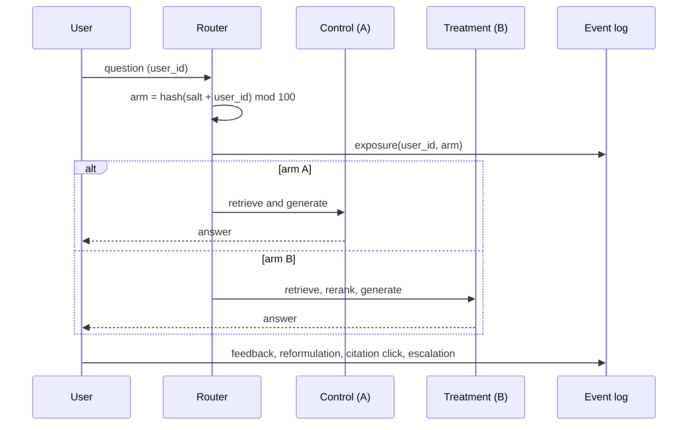

Everything so far in this module happens **offline**: a fixed set of questions, run before release. Offline evaluation tells you whether a change answers your test questions better. It cannot tell you whether real users, asking real questions in their own words, get more done. An **A/B test** (also called an online controlled experiment) answers that: send a random half of users to the current system (A, the control) and half to the candidate (B, the treatment), measure what they do, and compare.

The idea is simple; doing it so the result can be trusted is not. This lesson covers how to randomise, what to measure in a RAG system where users rarely click "thumbs up", how many users you need, and the classic ways A/B tests mislead: peeking, broken randomisation and interference between arms.

## Learning objectives

- Design an A/B test for a RAG change: hypothesis, randomisation unit, primary and guardrail metrics, and duration.
- Choose online metrics for a RAG assistant, including implicit signals and judge-scored samples, and explain their biases.
- Compute the sample size per arm for a difference in proportions and analyse the result with a two-proportion z-test.
- Detect sample ratio mismatch and explain why it invalidates a result.
- Explain why repeatedly checking a running test inflates false positives, and what to do instead.

## Prerequisites

- [Regression testing](/learn/testing-and-benchmarking/regression-testing): the offline gate a change passes before it is tested online.
- [Test set construction](/learn/testing-and-benchmarking/test-set-construction): standard errors and sample sizes for pass rates.
- [Answer relevance](/learn/generation-evaluation/answer-relevance): one of the qualities online metrics try to capture.
- [Logging](/learn/rag-observability/logging): the events an experiment's metrics are computed from.

## Why this matters

Offline and online results disagree more often than teams expect. A new reranker raises recall@5 on the golden set but adds 400 milliseconds, and users abandon slow answers. A prompt that makes answers more complete makes them longer, and staff on phones stop reading. A refusal policy that scores well on unanswerable test items also refuses some questions users needed answered, and they escalate to the support desk instead. The golden set measures correctness on known questions; users experience correctness, speed, length, tone and coverage of questions nobody put in the set.

An A/B test measures the whole effect on the real population, with randomisation ensuring that the only systematic difference between the groups is the change. Without randomisation, "before and after" comparisons are confounded: the week after a release may also be the week of the annual expenses deadline, and the change gets credit or blame for the calendar.

## The intuition

A pharmaceutical trial does not give a new drug to the patients who ask for it and compare them with those who do not; the volunteers would differ in health, motivation and age. It assigns patients at random, so that the two groups are alike in everything except the drug, and decides in advance what outcome it will measure and for how long. It does not stop the trial on the first day the new drug looks better, because early differences are mostly luck. And it checks that the randomisation worked: if the treatment group somehow has 20 per cent more patients than planned, something went wrong in assignment, and the comparison may be biased.

An A/B test of AskMeridian is that trial, with users as patients, a reranker or prompt as the drug, and reformulations, escalations and judge scores as outcomes.

## How it works

### The design, decided before launch

1. **Hypothesis.** "The cross-encoder reranker reduces the share of users who rephrase their question within two minutes."
2. **Randomisation unit.** Usually the **user**, not the request. If each request were assigned independently, one person would see both systems within a conversation, which is confusing, contaminates their behaviour, and breaks multi-turn context. Per-user assignment also makes observations within an arm closer to independent, which the statistics assume.
3. **Assignment.** Hash the user ID with an experiment-specific salt and take the result modulo 100. This is deterministic (a user always lands in the same arm), needs no stored table, and different salts make experiments independent of each other.
4. **Primary metric.** One metric, chosen in advance, that the decision rests on.
5. **Guardrail metrics.** Metrics that must not get worse: latency (95th percentile), cost per answer, error rate, refusal rate. A change can win on the primary metric and still be rejected on a guardrail.
6. **Sample size and duration.** Computed from the smallest effect worth detecting (the maths below), rounded up to whole weeks so that every weekday is represented equally.
7. **Analysis plan.** The test, the significance level and the stopping rule, written down before data arrives.



Log the **exposure** (the moment a user is actually served by an arm) before anything that can fail differently between arms, and analyse only exposed users.

### What to measure in a RAG assistant

Explicit feedback is the obvious metric and the weakest. Thumbs-up and thumbs-down buttons are used by a small and unrepresentative minority (mostly people who are annoyed), so rates are noisy and biased. Use them, but rarely as the primary metric. Better candidates:

| Signal | What it suggests | Caveat |
| --- | --- | --- |
| **Reformulation**: the user asks a similar question again within a short window | The answer did not satisfy | Also happens with follow-ups; define "similar" carefully |
| **Escalation**: a support desk ticket on the same topic within 24 hours | The assistant failed to resolve the need | Needs joining with ticket data |
| **Citation click-through** | The user wanted to verify or read more | Could mean interest or distrust |
| **Abandonment**: the user leaves before the answer finishes streaming | Too slow or unhelpful start | Sensitive to latency more than quality |
| **Judge-scored sample** | Correctness and faithfulness on live traffic | Costs judge calls; only as good as the judge |
| Latency, cost, error rate, refusal rate | Guardrails | Usually not the goal themselves |

The **judge-scored sample** deserves emphasis. Take a random sample of each arm's question-answer pairs (with the retrieved context) and score them with the same [LLM judge](/learn/testing-and-benchmarking/llm-as-a-judge) used offline, for example for [faithfulness](/learn/generation-evaluation/faithfulness). This gives a quality metric on real traffic that does not depend on users clicking anything. Its weakness is the judge's own error, which the LLM-as-a-judge lesson shows how to measure.

### Interleaving: a sensitive alternative for rankings

When the thing being compared is a ranked list that users see and click, such as a search page or a list of cited sources, **interleaving** can detect differences with far fewer users than an A/B test. Each user sees one merged list containing results from both rankers, alternating in a randomised way (team-draft interleaving, studied by Radlinski, Kurup and Joachims, 2008), and each click is credited to the ranker that contributed the clicked result. Every user compares both systems directly, which removes between-user variation. It applies only where a visible ranked list exists; for a RAG answer built from hidden retrieved context, the user cannot click on what the retriever chose, so A/B testing on answer-level outcomes remains the standard.

### How A/B tests mislead

**Peeking.** Checking the result every day and stopping as soon as it is significant raises the false-positive rate far above the nominal 5 per cent, because each look is another chance for noise to cross the threshold. The code below measures this by simulation. Either fix the sample size in advance and look once, or use a method designed for continuous monitoring (sequential tests, or "always valid" p-values; Johari and colleagues, 2017, describe one used in industry).

**Sample ratio mismatch (SRM).** If the design says 50/50 and the data says 51/49 with thousands of users, the split is not what you think. Common causes: one arm crashes or times out before the exposure is logged; bots are filtered differently; a cache serves one arm's users without logging them. When SRM is present, the arms differ by more than the treatment, and the result cannot be trusted however significant it is. Check it first, with a chi-squared test of the observed counts against the planned split.

**Interference.** The arms must not affect each other. In RAG systems, a shared [semantic cache](/learn/performance-optimisation/semantic-caching) is the classic leak: arm B's answers are cached and served to arm A's users for similar questions, so A partly receives the treatment. Key caches by arm during experiments.

**Novelty and learning effects.** Users react to a visible change at first (clicking new citation chips out of curiosity) and settle later. Run for at least two full weeks, and compare the first week with the second.

**Too many metrics.** With twenty metrics each tested at 5 per cent, about one will be "significant" by chance. The primary metric decides; the rest are guardrails or exploration, labelled as such.

## The mathematics

### Two-proportion z-test

**Intuition.** Each arm's metric is a proportion (the share of users who reformulated). If the arms were truly identical, the observed difference would be roughly normally distributed around zero with a standard error that depends on the overall rate and the arm sizes. The z-statistic says how many standard errors the observed difference is from zero.

$$
z = \frac{\hat{p}_B - \hat{p}_A}{\sqrt{\bar{p}(1 - \bar{p})\left(\frac{1}{n_A} + \frac{1}{n_B}\right)}}, \qquad \bar{p} = \frac{x_A + x_B}{n_A + n_B}
$$

- $x_A, x_B$: users in each arm with the outcome (reformulated); $n_A, n_B$: users in each arm.
- $\hat{p}_A = x_A/n_A$, $\hat{p}_B = x_B/n_B$: the observed rates.
- $\bar{p}$: the pooled rate, the best estimate of the common rate if the arms do not differ.
- The two-sided p-value is $2\,(1 - \Phi(|z|))$, where $\Phi$ is the standard normal cumulative distribution.

**Worked example.** A: 1,240 of 6,100 reformulated ($\hat{p}_A = 0.2033$). B: 1,060 of 5,800 ($\hat{p}_B = 0.1828$). Pooled: $2300/11900 = 0.1933$. Standard error: $\sqrt{0.1933 \times 0.8067 \times (1/6100 + 1/5800)} = \sqrt{0.15593 \times 0.00033636} = \sqrt{0.00005245} \approx 0.007242$. $z = (0.1828 - 0.2033)/0.007242 \approx -2.83$, two-sided $p \approx 0.005$.

### Sample size per arm

**Intuition.** To detect a small difference you need enough users that the standard error is small compared with the difference. Fix the significance level $\alpha$ (false-positive rate) and the **power** $1 - \beta$ (the probability of detecting the effect if it is real), then solve for $n$.

$$
n = \frac{(z_{1-\alpha/2} + z_{1-\beta})^2 \left[p_1(1-p_1) + p_2(1-p_2)\right]}{(p_1 - p_2)^2}
$$

- $p_1$: the control rate; $p_2$: the rate you want to be able to detect; $p_1 - p_2$ is the **minimum detectable effect**.
- $z_{1-\alpha/2} = 1.96$ for $\alpha = 0.05$ two-sided; $z_{1-\beta} = 0.8416$ for 80 per cent power.

**Worked example.** Reformulation is 20 per cent; detect a fall to 18 per cent. $(1.96 + 0.8416)^2 = 2.8016^2 = 7.849$. Variance term: $0.20 \times 0.80 + 0.18 \times 0.82 = 0.160 + 0.1476 = 0.3076$. Difference squared: $0.02^2 = 0.0004$. $n = 7.849 \times 0.3076 / 0.0004 \approx 6{,}036$ users per arm, about 12,000 in total.

Meridian has 400 staff. AskMeridian could never detect a two-point change in reformulation with a user-level A/B test; it would need thirty times more users. That is not a failure of the method, it is information: at small scale, rely on offline evaluation, judge-scored samples (which can score many questions per user, though questions from the same user are correlated), and qualitative review, and reserve A/B tests for large effects or larger products, such as the customer-facing Meridian Reports assistant.

## In code

**The problem.** Implement the pieces of an A/B analysis: deterministic assignment, sample-size planning, the z-test, an SRM check, and a simulation showing what daily peeking does to the false-positive rate.

**Dependencies.** NumPy and SciPy.

```bash
pip install numpy scipy
```

```python
import hashlib
import math

import numpy as np
from scipy.stats import chisquare, norm

# 1. Deterministic assignment: hash the user ID with an experiment-specific salt.
def arm(user_id: str, experiment: str = "reranker-v2") -> str:
    h = int(hashlib.sha256(f"{experiment}:{user_id}".encode()).hexdigest(), 16)
    return "B" if h % 100 < 50 else "A"

print("user-17 ->", arm("user-17"), "| again ->", arm("user-17"), "| other experiment ->", arm("user-17", "prompt-v9"))

# 2. Sample size per arm to detect a drop in reformulation rate from 20% to 18%.
def n_per_arm(p1, p2, alpha=0.05, power=0.80):
    z_a, z_b = norm.ppf(1 - alpha / 2), norm.ppf(power)
    return math.ceil((z_a + z_b) ** 2 * (p1 * (1 - p1) + p2 * (1 - p2)) / (p1 - p2) ** 2)

print("users per arm:", n_per_arm(0.20, 0.18))

# 3. Two-proportion z-test on the final counts.
def z_test(x_a, n_a, x_b, n_b):
    p_a, p_b = x_a / n_a, x_b / n_b
    pooled = (x_a + x_b) / (n_a + n_b)
    se = math.sqrt(pooled * (1 - pooled) * (1 / n_a + 1 / n_b))
    z = (p_b - p_a) / se
    return p_a, p_b, z, 2 * norm.sf(abs(z))

p_a, p_b, z, p = z_test(x_a=1240, n_a=6100, x_b=1060, n_b=5800)
print(f"reformulation A={p_a:.4f} B={p_b:.4f}  z={z:.2f}  p={p:.4f}")

# 4. Sample ratio mismatch: was a 50/50 split really 50/50?
stat, p_srm = chisquare([6100, 5800])
print(f"SRM check: chi2={stat:.2f}  p={p_srm:.4f}")

# 5. Peeking: simulate A/A tests (no real difference) analysed daily vs once.
rng = np.random.default_rng(7)
experiments, days, users_per_day, rate = 2000, 14, 400, 0.20
daily_a = rng.binomial(users_per_day, rate, size=(experiments, days))
daily_b = rng.binomial(users_per_day, rate, size=(experiments, days))
cum_a, cum_b = daily_a.cumsum(axis=1), daily_b.cumsum(axis=1)
n = users_per_day * np.arange(1, days + 1)
pooled = (cum_a + cum_b) / (2 * n)
z_daily = (cum_b - cum_a) / n / np.sqrt(pooled * (1 - pooled) * 2 / n)
significant = np.abs(z_daily) > 1.96
print(f"A/A false positives, one look at day 14: {significant[:, -1].mean():.3f}")
print(f"A/A false positives, stop at first significant daily look: {significant.any(axis=1).mean():.3f}")
```

```output
user-17 -> A | again -> A | other experiment -> B
users per arm: 6036
reformulation A=0.2033 B=0.1828  z=-2.83  p=0.0046
SRM check: chi2=7.56  p=0.0060
A/A false positives, one look at day 14: 0.040
A/A false positives, stop at first significant daily look: 0.215
```

**The important lines.**

- `arm()` hashes `experiment:user_id` with SHA-256. The same user gets the same arm on every request; a different experiment name reshuffles users, so experiments running at the same time are not correlated. Python's built-in `hash()` would be wrong here, because it is randomised per process for strings.
- `n_per_arm` is the sample-size formula; `norm.ppf` gives the $z$ values.
- `z_test` is the two-proportion test with the pooled standard error.
- `chisquare([6100, 5800])` compares the observed arm sizes with equal expected counts (the default), which is the SRM check for a 50/50 design.
- The simulation runs 2,000 **A/A tests** (both arms identical, true rate 20 per cent) for 14 days and applies the z-test to cumulative data every day.

**What the output means.** Assignment is stable and experiment-specific. The planned size, 6,036 users per arm, matches the hand calculation. The z-test says B's reformulation rate is lower with $p = 0.0046$, which looks like a clear win. But the SRM check fails ($p = 0.006$): with a 50/50 design, 6,100 versus 5,800 is very unlikely by chance. Something removed about 300 users from arm B, perhaps users whose first request timed out under the slower reranker before exposure was logged. Those are exactly the users likely to reformulate, so B's rate is biased downwards. The correct conclusion is "investigate the assignment pipeline", not "ship B".

The simulation shows the peeking problem directly. With one analysis at day 14, about 4 per cent of A/A tests are falsely significant, close to the nominal 5 per cent (the difference is simulation noise). Stopping at the first significant daily look raises it to about 21 per cent: one in five experiments with no real effect would be declared a winner.

**Common errors.** Analysing requests instead of users when the randomisation unit was the user overstates precision, because one user's requests are correlated; aggregate per user first (for example, "did this user reformulate at least once"), or use methods that account for clustering. Computing metrics over all users, including those never exposed, dilutes the effect. Forgetting that the SRM check needs the *planned* split (for a 90/10 design, pass `f_exp` with the planned counts).

**Extending it.** Add a guardrail check (95th-percentile latency per arm, compared with a bootstrap interval), a per-day breakdown to spot novelty effects, and a sequential-testing method if the team insists on watching results daily.

## A real-world example

Meridian's product team ran an A/B test of a new citation display in the customer-facing Meridian Reports assistant: arm B showed each cited source as a clickable chip under the answer. The primary metric was escalation to a human support agent within 24 hours; guardrails were latency and the thumbs-down rate. Sample size was planned for four weeks.

After six days the dashboard showed B reducing escalations with $p = 0.03$, and a manager asked to ship it. The engineer running the test declined, citing the stopping rule, and also noticed that B had 3 per cent fewer exposed users than A. The SRM check failed. Investigation found that the chip component threw an error on answers with no citations (refusals), and the error handler logged the request without the exposure event. B was therefore missing a slice of users who had received refusals, the users most likely to escalate. After the fix, the test restarted. At four weeks, B's escalation rate was slightly lower but not significantly so; citation clicks were high in week one and fell by half in week two, a novelty effect. The team shipped B on the judge-scored faithfulness sample and user research instead, and documented that the escalation benefit was unproven.

## Common mistakes

- **Randomising per request.** Users see both systems, multi-turn conversations break, and observations are not independent.
- **Peeking and stopping early.** False positives multiply; "winners" regress after launch.
- **Skipping the SRM check.** Broken assignment produces biased, often impressive-looking results.
- **Thumbs-up rate as the primary metric.** A small, unhappy minority provides the data; the metric is noisy and biased.
- **Shared caches between arms.** Treatment answers leak into control, shrinking the measured effect.
- **Running for a few days.** Weekly cycles and novelty effects dominate.
- **Testing twenty metrics and reporting the significant one.** Chance alone produces it.
- **A/B testing at a scale that cannot detect the effect.** Weeks of traffic produce an inconclusive result that is then over-interpreted.

## Best practices

- Write the hypothesis, primary metric, guardrails, sample size, duration and analysis plan before launch.
- Randomise by user with a salted hash; log exposure before anything that can fail differently between arms.
- Check SRM first; do not interpret results until it passes.
- Use implicit signals and judge-scored samples of live traffic, not only explicit feedback.
- Isolate caches and other shared state by arm.
- Run for whole weeks, at least two; compare early and late periods for novelty effects.
- Gate the experiment behind offline evaluation: only changes that pass the [regression suite](/learn/testing-and-benchmarking/regression-testing) reach users.
- If scale is too small for the effect, say so, and decide on offline and qualitative evidence.

## Performance considerations

- **Traffic is the scarce resource.** Halving the minimum detectable effect quadruples the sample size, because $n$ scales with $1/(p_1 - p_2)^2$. Detecting a 1-point change instead of 2 points needs about 25,000 users per arm instead of about 6,000.
- **Latency of the treatment.** Rerankers and extra retrieval rounds add latency that users feel; measure 95th-percentile latency per arm as a guardrail, because averages hide the slow tail that drives abandonment.
- **Judge cost.** Scoring a 5 per cent sample of 20,000 daily questions is 1,000 judge calls a day per arm; at an assumed 3,500 input tokens each, about 3.5 million input tokens per arm per day. Sample less or use a smaller judge model if this is too costly, after checking the cheaper judge's agreement with humans.
- **Logging volume.** Exposure, answer and feedback events per request; store them with the arm and experiment ID so analysis is a query, not an archaeology project.

## Security considerations

An A/B test serves an untested variant to real users, so the variant must pass the same security checks as production: access-control filters, prompt-injection defences and output validation. Exposure logs link users to arms and behaviour; treat them as personal data, restrict access, and set a retention period. Judge-scored samples send real questions, answers and context to the judge model, which must be permitted under the same data-handling rules as the production model. Finally, make every experiment killable in one step (a configuration flag), in case the treatment turns out to leak data or misbehave.

## Summary

- An A/B test randomly assigns users to control and treatment and compares outcomes, measuring what offline evaluation cannot: real users, real questions, latency and behaviour together.
- Decide the hypothesis, randomisation unit (usually the user), primary metric, guardrails, sample size and analysis plan before launch.
- RAG assistants need implicit signals (reformulation, escalation, abandonment) and judge-scored samples, because explicit feedback is sparse and biased.
- Sample size scales with the inverse square of the effect; small organisations often cannot detect small effects and should say so.
- Check sample ratio mismatch first, do not peek and stop early, and isolate shared state such as caches between arms.

## Exercises

**1.** The control's escalation rate is 8 per cent. How many users per arm are needed to detect a fall to 6 per cent with 80 per cent power at a two-sided 5 per cent level? Compute by hand.

<details><summary>Show solution</summary>

$(1.96 + 0.8416)^2 = 7.849$. Variance term: $0.08 \times 0.92 + 0.06 \times 0.94 = 0.0736 + 0.0564 = 0.1300$. Difference squared: $0.02^2 = 0.0004$. $n = 7.849 \times 0.1300/0.0004 \approx 2{,}551$ users per arm. Lower base rates need fewer users for the same absolute difference, because the variance $p(1-p)$ is smaller.

</details>

**2.** A 90/10 experiment (10 per cent to treatment) ends with 45,600 control users and 5,400 treatment users. Run the SRM check in Python. Is the split acceptable?

<details><summary>Show solution</summary>

```python
from scipy.stats import chisquare
total = 45_600 + 5_400
print(chisquare([45_600, 5_400], f_exp=[0.9 * total, 0.1 * total]))
```

The expected counts are 45,900 and 5,100. $\chi^2 = 300^2/45900 + 300^2/5100 \approx 1.96 + 17.65 = 19.61$, with $p \approx 0.00001$. The split is not acceptable: treatment has about 6 per cent more users than planned. Look for a cause such as control-arm errors before exposure logging, or users re-assigned on login.

</details>

**3.** A colleague proposes randomising AskMeridian's experiment per question rather than per user, "to get more data points out of 400 staff". Explain the problems and propose a better design for a prompt change at Meridian's scale.

<details><summary>Show solution</summary>

Per-question randomisation shows each user both versions, sometimes within one conversation, which breaks multi-turn context and lets one version's answers shape behaviour in the other. Questions from the same user are correlated, so treating them as independent overstates precision and produces false positives. At 400 users, a user-level test cannot detect small effects anyway.

Better: decide on the offline development and held-out sets; then run a **judge-scored shadow comparison**: for a sample of live questions, generate both versions' answers in the background, show users only the current version, and have the judge (validated against human labels) compare them pairwise with order randomised. This uses many questions without exposing users to the candidate, and its statistics are paired. Follow with a short staged rollout watching guardrails.

</details>

**4.** Explain why a shared semantic cache biases an A/B test of a new reranker towards "no difference", and how to fix it without disabling caching.

<details><summary>Show solution</summary>

When a user in arm A asks a question similar to one asked earlier in arm B, the cache returns B's answer, so some control users receive the treatment (and vice versa). Both arms become mixtures, and the measured difference shrinks towards zero: the test underestimates the effect and may miss it. Fix: include the arm (or the experiment configuration hash) in the cache key, so each arm has its own cache. Both arms then keep the latency benefit of caching, and the cache hit rates are comparable as long as traffic per arm is similar.

</details>

## Check your understanding

```quiz
[
  {
    "q": "Why is the user, rather than the individual request, usually the randomisation unit in an A/B test of a RAG assistant?",
    "options": [
      "Users generate fewer events",
      "Requests cannot be hashed",
      "So each user sees one consistent system, conversations are not mixed, and observations are closer to independent",
      "Because regulations require it"
    ],
    "answer": 2,
    "why": "Per-request assignment mixes systems within a user's experience and creates correlated observations that overstate precision."
  },
  {
    "q": "A 50/50 test ends with 10,400 users in A and 9,600 in B. What should you do first?",
    "options": [
      "Treat it as a sample ratio mismatch and investigate assignment and exposure logging before interpreting results",
      "Ship whichever arm has the better primary metric",
      "Weight B's users by 10,400/9,600",
      "Ignore it; the difference is small"
    ],
    "answer": 0,
    "why": "A chi-squared test gives a tiny p-value for this split; SRM means the arms differ in more than the treatment."
  },
  {
    "q": "What happens to the false-positive rate if you check a test daily and stop the first time p < 0.05?",
    "options": [
      "It stays at 5%",
      "It falls below 5%",
      "It becomes exactly 0",
      "It rises well above 5%, because each look is another chance for noise to cross the threshold"
    ],
    "answer": 3,
    "why": "The simulation in this lesson found about 21% over 14 daily looks with no real difference."
  },
  {
    "q": "Halving the minimum detectable effect multiplies the required sample size by about:",
    "options": ["2", "4", "1.4", "8"],
    "answer": 1,
    "why": "Sample size is proportional to one over the squared difference."
  },
  {
    "q": "Which online metric gives a quality signal for a RAG assistant without depending on users clicking anything?",
    "options": [
      "Thumbs-up rate",
      "Citation click-through rate",
      "A judge-scored random sample of each arm's question-answer-context triples",
      "Number of sessions"
    ],
    "answer": 2,
    "why": "Scoring a random sample with a validated judge measures correctness or faithfulness on live traffic directly."
  }
]
```

## Further reading

- Ron Kohavi, Diane Tang and Ya Xu, *Trustworthy Online Controlled Experiments: A Practical Guide to A/B Testing*, Cambridge University Press, 2020.
- Ramesh Johari, Pete Koomen, Leonid Pekelis and David Walsh, "Peeking at A/B Tests: Why it matters, and what to do about it", KDD 2017.
- Aleksander Fabijan and colleagues, "Diagnosing Sample Ratio Mismatch in Online Controlled Experiments", KDD 2019.
- Filip Radlinski, Madhu Kurup and Thorsten Joachims, "How Does Clickthrough Data Reflect Retrieval Quality?", CIKM 2008.
- SciPy documentation for `scipy.stats.chisquare` and `scipy.stats.norm`. [docs.scipy.org](https://docs.scipy.org/doc/scipy/)
