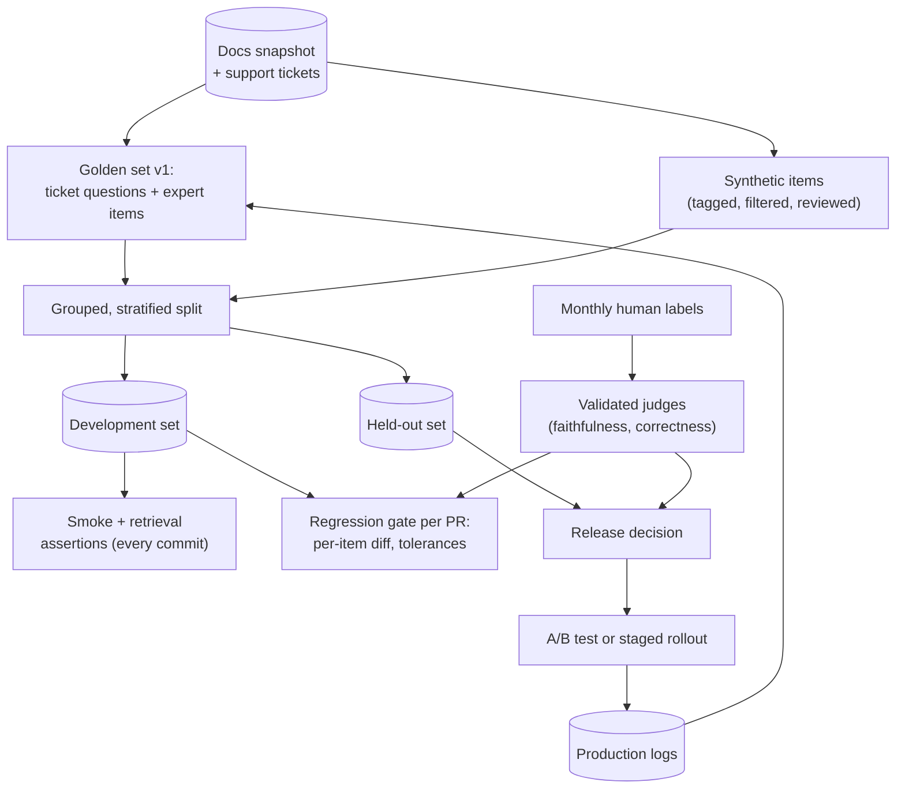

This assessment covers the whole of the Testing and Benchmarking module: [golden datasets](/learn/testing-and-benchmarking/golden-datasets), [synthetic test data](/learn/testing-and-benchmarking/synthetic-test-data), [test set construction](/learn/testing-and-benchmarking/test-set-construction), [regression testing](/learn/testing-and-benchmarking/regression-testing), [A/B testing](/learn/testing-and-benchmarking/a-b-testing), [human evaluation](/learn/testing-and-benchmarking/human-evaluation), [LLM-as-a-judge](/learn/testing-and-benchmarking/llm-as-a-judge) and [benchmark design](/learn/testing-and-benchmarking/benchmark-design). Answer the 18 multiple-choice questions first; 13 or more correct (about 70 per cent) is a pass. Then work through the conceptual questions, coding exercises, design challenge and troubleshooting scenarios on paper or in an editor before opening the model answers.

```quiz
[
  {
    "q": "Why should golden items label documents with a verbatim evidence quote rather than chunk IDs?",
    "options": [
      "Quotes are shorter",
      "Chunk IDs change whenever chunking changes, while a quote can be mapped to whichever chunk contains it",
      "Retrievers return quotes, not IDs",
      "Quotes make NDCG faster to compute"
    ],
    "answer": 1,
    "why": "Document-level labels with evidence survive re-chunking and make staleness detectable."
  },
  {
    "q": "A golden set is 70% HR items, but HR is 30% of production traffic. Which summary estimates the user-facing pass rate?",
    "options": [
      "The traffic-weighted average of per-slice pass rates",
      "The micro average over items",
      "The macro average over slices",
      "The HR slice's pass rate"
    ],
    "answer": 0,
    "why": "Weighting each slice by its traffic share corrects for the set's unrepresentative mix."
  },
  {
    "q": "What does this print?\n```python\nq = {'days', 'annual', 'leave', 'carry'}\nd = {'annual', 'leave', 'days', 'unused', 'march'}\nprint(round(len(q & d) / len(q), 2))\n```",
    "options": ["0.6", "1.0", "0.75", "0.5"],
    "answer": 2,
    "why": "Three of the four question words appear in the document: 3/4 = 0.75, a high lexical overlap."
  },
  {
    "q": "A synthetic question fails a BM25 round-trip check. What should happen to it?",
    "options": [
      "Drop it",
      "Regenerate it until BM25 finds the source",
      "Keep it with no review",
      "Send it to human review, because it may be a valid hard question"
    ],
    "answer": 3,
    "why": "Dropping round-trip failures removes exactly the vocabulary-mismatch questions a test set most needs."
  },
  {
    "q": "Why is grouped splitting needed when building development and test sets from logs?",
    "options": [
      "Near-duplicate questions would otherwise land on both sides, so the test set rewards memorising the development set",
      "Logs are too large to split randomly",
      "Grouping makes the test set larger",
      "Stratification is impossible otherwise"
    ],
    "answer": 0,
    "why": "Users ask the same thing in many forms; siblings must share a split."
  },
  {
    "q": "A team tries 50 prompts on the same 150 items and reports the best one's score. What bias affects that score?",
    "options": [
      "Position bias",
      "Pooling bias",
      "Adaptive overfitting: selecting the maximum of many noisy comparisons inflates it",
      "Verbosity bias"
    ],
    "answer": 2,
    "why": "The winner's score should be confirmed once on a held-out set."
  },
  {
    "q": "Neyman allocation gives more items to strata that are:",
    "options": [
      "Small and stable",
      "Large and variable",
      "Already well tested",
      "Synthetic"
    ],
    "answer": 1,
    "why": "Sample size per stratum proportional to stratum size times its standard deviation minimises overall error."
  },
  {
    "q": "A candidate has 4 regressions and 0 fixes. One-sided McNemar exact p is:",
    "options": ["0.0625", "0.25", "0.004", "0.5"],
    "answer": 0,
    "why": "Under the null each discordant item is a fair coin: (1/2) to the power 4 = 1/16."
  },
  {
    "q": "Why should a regression gate not block only when a drop is statistically significant?",
    "options": [
      "Significance tests are too slow",
      "Significance is only defined for A/B tests",
      "Gates should never block",
      "With few discordant items significance is unreachable, so clear regressions would pass"
    ],
    "answer": 3,
    "why": "Gates use critical items and tolerances; p-values are information for reviewers."
  },
  {
    "q": "Which is the best way to test generation in a regression suite, given that answers vary between runs?",
    "options": [
      "Compare answer strings exactly",
      "Test properties: required facts, refusals, citation validity and judge verdicts, with caching",
      "Skip generation tests",
      "Run every item 20 times"
    ],
    "answer": 1,
    "why": "Property checks are stable across paraphrases; caching makes unchanged items reproducible."
  },
  {
    "q": "In an A/B test of AskMeridian, why randomise per user rather than per request?",
    "options": [
      "Users see one consistent system, conversations are not mixed, and observations are closer to independent",
      "Requests cannot be logged",
      "It doubles the sample size",
      "It removes the need for a primary metric"
    ],
    "answer": 0,
    "why": "Per-request assignment contaminates behaviour and creates correlated observations."
  },
  {
    "q": "A 50/50 test ends with 6,100 users in A and 5,800 in B, and B looks significantly better. What first?",
    "options": [
      "Ship B",
      "Extend the test",
      "Check for sample ratio mismatch; this split is very unlikely by chance, so investigate assignment and exposure logging",
      "Reweight the arms"
    ],
    "answer": 2,
    "why": "SRM means the arms differ in more than the treatment; the result cannot be trusted until it is explained."
  },
  {
    "q": "To detect a fall in a rate from 20% to 18% with 80% power at 5% two-sided, about how many users per arm are needed?",
    "options": ["600", "60,000", "1,500", "6,000"],
    "answer": 3,
    "why": "7.849 times (0.16 + 0.1476) divided by 0.0004 is about 6,036."
  },
  {
    "q": "Two annotators agree on 90% of items, but each marks 95% as pass. Which statement is right?",
    "options": [
      "Agreement is excellent",
      "Chance agreement is about 0.905, so kappa is near zero; check agreement on failures",
      "Kappa must be 0.90",
      "Kappa cannot be computed"
    ],
    "answer": 1,
    "why": "Expected agreement is 0.95 squared plus 0.05 squared; observed agreement barely exceeds it."
  },
  {
    "q": "Which judge design is most appropriate for checking answer correctness on organisation-specific policies?",
    "options": [
      "Reference-guided grading with the golden item's required facts",
      "Pairwise comparison only",
      "An overall 1-to-10 quality score",
      "Grading without any reference"
    ],
    "answer": 0,
    "why": "The judge does not know Meridian's policies; a reference turns the task into checking."
  },
  {
    "q": "A judge has sensitivity 0.90 and specificity 0.80 and reports a pass rate of 0.83. What is the Rogan–Gladen corrected rate?",
    "options": ["0.83", "0.76", "0.93", "About 0.90"],
    "answer": 3,
    "why": "(0.83 + 0.80 - 1) / (0.90 + 0.80 - 1) = 0.63 / 0.70 = 0.90."
  },
  {
    "q": "A benchmark's relevance judgements were pooled from BM25's top 10 only. What happens to a dense retriever evaluated on it?",
    "options": [
      "Nothing; pooling is unbiased",
      "It is favoured",
      "Relevant documents it finds outside the pool are unjudged, count as non-relevant, and understate its score",
      "BM25 is penalised"
    ],
    "answer": 2,
    "why": "In the SciFact demonstration this made two equal systems look 0.078 NDCG@10 apart."
  },
  {
    "q": "Per-query differences between two systems have standard deviation 0.333. About how small a difference can 300 queries detect with 80% power at 5%?",
    "options": ["0.005", "0.054", "0.20", "0.0011"],
    "answer": 1,
    "why": "2.8016 times 0.333 divided by the square root of 300 is about 0.054."
  }
]
```

## Conceptual questions

**1.** Explain why a golden set built entirely by the engineers who built the system tends to overstate quality, and describe three changes that make it more trustworthy.

<details><summary>Show model answer</summary>

Engineers write questions in the documents' own vocabulary (they have read them), avoid failures they already know about, and favour the topics they worked on. Their questions are therefore easier, more lexical and less diverse than real ones, and every retriever does well on them. Three changes: sample questions from production logs (with personal data removed) so that vocabulary and difficulty match users; have document owners label gold documents and evidence by searching the whole corpus, with a second reviewer on a sample; and add targeted slices for what the engineers would not write, such as unanswerable questions, identifier lookups and questions that depend on the user's role. Tag every item's source so that easier sources can be reported separately.

</details>

**2.** Contrast the roles of the development set, the held-out test set and the smoke suite. What goes wrong if a team merges them into one set?

<details><summary>Show model answer</summary>

The development set is for tuning and error analysis: looked at constantly, every failure read. The held-out test set gives an unbiased estimate of the chosen configuration: run rarely, at decision points, with restricted access, and refreshed with fresh labelled logs. The smoke suite is a small fixed subset with unambiguous expectations, run on every commit to catch gross breakage in minutes. Merging them causes adaptive overfitting (the reported score is the score of the configuration selected on the same items, so it is biased upwards), makes full evaluation too slow or expensive to run per commit, and removes any unbiased number the team could report.

</details>

**3.** Why is McNemar's test appropriate for comparing two pipeline versions on the same items, and why is it nevertheless a poor sole criterion for a regression gate?

<details><summary>Show model answer</summary>

Both versions are run on the same items, so results are paired; items where both pass or both fail carry no information about which is better. McNemar's test uses only discordant items and asks whether regressions and fixes are equally likely, which is exactly the right question, and it is much more sensitive than comparing two independent proportions. But with the small numbers of discordant items typical of a regression suite, even a one-sided pattern (4 regressions, 0 fixes, p = 0.0625) cannot reach significance. A gate that blocks only on significant drops would let such changes through. Gates should combine critical items that must pass, per-slice tolerances on net change, and a human reading of every newly failing item; the p-value informs that review and becomes decisive only for large suites.

</details>

**4.** A manager proposes replacing all human evaluation with an LLM judge "because it agrees with humans 93% of the time". Write the response.

<details><summary>Show model answer</summary>

Agreement of 93 per cent is dominated by the majority class: if most answers pass, a judge that passes almost everything agrees often while missing failures. The relevant numbers are specificity (the share of human-failed answers the judge also fails), sensitivity and kappa, per slice. If specificity is, say, 0.70, the judge lets three in ten failures through, and its pass rate overstates reality; the Rogan–Gladen correction quantifies this. Further, the judge's accuracy was measured against adjudicated human labels, and remains valid only while the judge model, prompt and answer style are unchanged; re-validation needs fresh human labels. So the judge can replace routine human scoring, but not human evaluation: a smaller, regular human-labelled sample is what keeps the judge honest.

</details>

**5.** Explain construct validity for a retrieval benchmark, and give two ways an internal benchmark for AskMeridian could lack it.

<details><summary>Show model answer</summary>

Construct validity is whether the benchmark measures the property the decision depends on: if system A beats system B on the benchmark, would A serve the real users better? AskMeridian examples: (1) queries written as tidy, complete questions by annotators, whereas users type terse fragments with error codes and slang, so a model that excels on tidy questions may not help users; (2) a metric computed at a depth that does not match the pipeline, such as NDCG@10 when only the top 5 chunks reach the model, so differences at ranks 6 to 10 are rewarded but never used. Others: a corpus snapshot without superseded documents, so the benchmark never tests whether systems avoid them; judgements pooled only from BM25, so the benchmark measures closeness to BM25.

</details>

## Coding exercises

**1.** Write `regression_report(baseline, candidate, slices)` that takes per-item pass/fail dictionaries and a slice for each item, and returns the newly failing and newly passing items per slice, plus the counts and McNemar's one-sided exact p-value. Run it on the data below.

```python
baseline  = {"q1": 1, "q2": 1, "q3": 0, "q4": 1, "q5": 1, "q6": 1, "q7": 0, "q8": 1, "q9": 1, "q10": 1}
candidate = {"q1": 1, "q2": 0, "q3": 1, "q4": 0, "q5": 1, "q6": 0, "q7": 1, "q8": 1, "q9": 0, "q10": 1}
slices = {"q1": "hr", "q2": "it", "q3": "hr", "q4": "it", "q5": "hr",
          "q6": "it", "q7": "hr", "q8": "finance", "q9": "it", "q10": "finance"}
```

<details><summary>Show solution</summary>

```python
from collections import defaultdict

from scipy.stats import binomtest

baseline  = {"q1": 1, "q2": 1, "q3": 0, "q4": 1, "q5": 1, "q6": 1, "q7": 0, "q8": 1, "q9": 1, "q10": 1}
candidate = {"q1": 1, "q2": 0, "q3": 1, "q4": 0, "q5": 1, "q6": 0, "q7": 1, "q8": 1, "q9": 0, "q10": 1}
slices = {"q1": "hr", "q2": "it", "q3": "hr", "q4": "it", "q5": "hr",
          "q6": "it", "q7": "hr", "q8": "finance", "q9": "it", "q10": "finance"}

def regression_report(baseline, candidate, slices):
    by_slice = defaultdict(lambda: {"broke": [], "fixed": []})
    for qid in baseline:
        if baseline[qid] and not candidate[qid]:
            by_slice[slices[qid]]["broke"].append(qid)
        elif candidate[qid] and not baseline[qid]:
            by_slice[slices[qid]]["fixed"].append(qid)
    b = sum(len(v["broke"]) for v in by_slice.values())
    c = sum(len(v["fixed"]) for v in by_slice.values())
    p = binomtest(b, b + c, 0.5, alternative="greater").pvalue if b + c else 1.0
    return dict(by_slice), b, c, p

report, b, c, p = regression_report(baseline, candidate, slices)
for s, v in sorted(report.items()):
    print(f"{s:<8} newly failing {v['broke']}  newly passing {v['fixed']}")
print(f"b={b} c={c} one-sided McNemar p={p:.3f}")
```

```output
hr       newly failing []  newly passing ['q3', 'q7']
it       newly failing ['q2', 'q4', 'q6', 'q9']  newly passing []
b=4 c=2 one-sided McNemar p=0.344
```

The p-value of 0.344 says nothing significant, but the report says a great deal: every IT item that was passing now fails, and the gains are all in HR. Net change is $-2$ out of 10 overall, and the IT slice has collapsed from 4 of 4 passing to 0 of 4. A per-slice tolerance blocks this change, and the four IT items are what to read first.

</details>

**2.** Write `judge_report(human, judge, new_rate)` that returns the judge's sensitivity, specificity and kappa against human labels, and the Rogan–Gladen corrected estimate (clipped to between 0 and 1) for a new run where the judge's pass rate is `new_rate`. Run it on the labels below with `new_rate=0.80`.

```python
human = np.array([1, 1, 1, 0, 1, 1, 0, 1, 1, 1, 0, 1, 1, 1, 0, 1, 1, 1, 1, 0])
judge = np.array([1, 1, 1, 1, 1, 1, 0, 1, 1, 1, 0, 1, 1, 1, 1, 1, 1, 0, 1, 0])
```

<details><summary>Show solution</summary>

```python
import numpy as np
from sklearn.metrics import cohen_kappa_score, confusion_matrix

human = np.array([1, 1, 1, 0, 1, 1, 0, 1, 1, 1, 0, 1, 1, 1, 0, 1, 1, 1, 1, 0])
judge = np.array([1, 1, 1, 1, 1, 1, 0, 1, 1, 1, 0, 1, 1, 1, 1, 1, 1, 0, 1, 0])

def judge_report(human, judge, new_rate):
    tn, fp, fn, tp = confusion_matrix(human, judge, labels=[0, 1]).ravel()
    se, sp = tp / (tp + fn), tn / (tn + fp)
    corrected = (new_rate + sp - 1) / (se + sp - 1)
    return se, sp, cohen_kappa_score(human, judge), float(np.clip(corrected, 0, 1))

se, sp, kappa, corrected = judge_report(human, judge, new_rate=0.80)
print(f"sensitivity {se:.3f}  specificity {sp:.3f}  kappa {kappa:.3f}  corrected {corrected:.3f}")
```

```output
sensitivity 0.933  specificity 0.600  kappa 0.571  corrected 0.750
```

The judge misses 2 of 5 human failures (specificity 0.60), so its 0.80 overstates the true pass rate, estimated at 0.75. With only 5 failures in the validation set, the specificity estimate is very uncertain; the next human-labelling round should oversample failures.

</details>

**3.** Write `analyse(n_a, x_a, n_b, x_b, split)` for an A/B test of a binary outcome: first a sample-ratio-mismatch check against the planned split (refuse to interpret if $p < 0.001$), then a two-proportion z-test. Run it on three experiments: (8,000 users, 640 escalations) versus (8,050, 580); (8,000, 640) versus (7,400, 520); and a 90/10 test with (18,000, 1,440) versus (2,050, 150).

<details><summary>Show solution</summary>

```python
import math

from scipy.stats import chisquare, norm

def analyse(n_a, x_a, n_b, x_b, split=(0.5, 0.5)):
    total = n_a + n_b
    srm_p = chisquare([n_a, n_b], f_exp=[split[0] * total, split[1] * total]).pvalue
    if srm_p < 0.001:
        return f"SRM detected (p={srm_p:.2g}); do not interpret the result"
    pa, pb = x_a / n_a, x_b / n_b
    pooled = (x_a + x_b) / total
    z = (pb - pa) / math.sqrt(pooled * (1 - pooled) * (1 / n_a + 1 / n_b))
    return f"SRM ok (p={srm_p:.2f}); A={pa:.4f} B={pb:.4f} z={z:.2f} p={2 * norm.sf(abs(z)):.4f}"

print(analyse(8000, 640, 8050, 580))
print(analyse(8000, 640, 7400, 520))
print(analyse(18000, 1440, 2050, 150, split=(0.9, 0.1)))
```

```output
SRM ok (p=0.69); A=0.0800 B=0.0720 z=-1.90 p=0.0574
SRM detected (p=1.3e-06); do not interpret the result
SRM ok (p=0.29); A=0.0800 B=0.0732 z=-1.08 p=0.2783
```

The first experiment has a healthy split and a borderline result ($p = 0.057$): not significant at the planned 5 per cent level, and it must not be "rescued" by running a few more days and checking again. The second has a severe sample ratio mismatch: about 7.5 per cent of B's users are missing, and its lower escalation rate cannot be trusted. The third, a 90/10 design, passes the SRM check because the expected counts use the planned split; its difference is not significant. Note that the SRM threshold of 0.001 is deliberately strict, because the check runs on every experiment and false alarms are costly to investigate.

</details>

## Architecture design challenge

Meridian is launching an assistant for customers of Meridian Reports, answering questions from the product documentation (including PDF/CSV export and SAML single sign-on on the Enterprise plan). You are asked to design the complete testing and benchmarking system for its first six months: what evaluation data exists before launch and after, how changes are tested before merging, how releases are decided, how the system is evaluated online, and how the evaluation itself is kept trustworthy. The product team expects about 30,000 customer questions a month after launch. Budget: one part-time technical writer for labelling, plus model calls.

<details><summary>Show reference design</summary>



**Before launch.** Build golden set v1 from about 200 real questions taken from Meridian Reports support tickets (customer wording), labelled by the technical writer with document-level evidence quotes, required facts and slices (export, SSO, billing, troubleshooting, out-of-scope), including 30 unanswerable and plan-dependent items (SSO only on Enterprise, with the customer's plan as user context). Add about 300 synthetic items for documentation coverage, generated with personas and real ticket examples, filtered for overlap, leakage and duplicates, with round-trip failures reviewed rather than dropped. Synthetic items go mainly to development.

**Splits.** Group by near-duplicate cluster and source document, stratified split into development (about 60 per cent) and held-out (40 per cent, access restricted). Smoke suite of 30 items with hard expectations, plus must-not-retrieve assertions for internal Atlas documentation, which customers must never see.

**Pre-merge.** Component tests and retrieval assertions on every commit; retrieval metrics against the stored baseline on every pull request, with per-slice tolerances and a list of newly failing items; generation checks (required facts, refusals, citation validity, judges) on pull requests touching generation and nightly, with caching keyed on versions and hashes. Model identifiers pinned; one change per pull request.

**Judges.** Faithfulness and correctness judges with claim-level evidence, validated on 150 human-labelled items (development and held-out halves), oversampling failures. Report corrected rates alongside raw ones. Re-validate when the judge model or prompt changes.

**Release.** Held-out run once per release candidate, compared item by item with production, with intervals. Then online evaluation.

**Online.** At 30,000 questions a month (perhaps 10,000 distinct users, an assumption), a user-level A/B test can detect only fairly large differences in rare outcomes; compute the minimum detectable effect before each test. Primary metric: escalation to human support within 24 hours. Guardrails: 95th-percentile latency, cost per answer, refusal rate. Judge-scored 5 per cent sample per arm. SRM check first; fixed duration of whole weeks; caches keyed by arm. For small changes, a staged rollout with guardrails plus judge-scored shadow comparisons instead.

**Keeping evaluation trustworthy.** Each month: label 60 new log questions (rotated into held-out, oldest held-out to development), run staleness checks after every documentation re-ingestion, label 50 answers by humans to monitor judge accuracy, and review the coverage matrix for new slices (a new feature launch creates one).

**Trade-offs.** The labelling budget is the binding constraint, so synthetic data buys coverage early and is phased out of reported numbers as real questions arrive. Online A/B tests are reserved for large changes because traffic cannot detect small ones; offline evaluation and judges carry most decisions, which makes judge validation essential rather than optional.

</details>

## Troubleshooting scenarios

**1.** Answer correctness on the AskMeridian development set has risen steadily for three months, from 0.74 to 0.88. A fresh sample of 100 labelled questions from last month's logs scores 0.76. What is happening, and what do you change?

<details><summary>Show diagnosis and fix</summary>

**Diagnosis.** Adaptive overfitting, probably compounded by leakage and drift. Three months of changes were each accepted because they improved the same development items; some fixed those items specifically without generalising. If the set was split from logs without grouping, near-twins also inflate it. And three-month-old questions may no longer resemble current traffic (new documents, new topics).

**Fix.** Treat the fresh sample's 0.76 as the honest number. Establish a held-out set with restricted access, built with grouped, stratified splitting, run once per release candidate. Rotate fresh labelled logs into it every quarter. Audit recent changes for item-specific rules (prompt clauses that mention particular cases) and remove those that do not help on fresh data. Check the development set for near-duplicate leakage and for stale labels.

</details>

**2.** The nightly LLM-judge faithfulness score dropped from 0.93 to 0.81 overnight, but no pull request was merged and retrieval metrics are unchanged. What do you check?

<details><summary>Show diagnosis and fix</summary>

**Diagnosis.** Something changed that the pull-request process does not cover. Candidates, in order: (1) the judge model or generator model changed behind a floating alias, so either answers or verdicts differ; (2) a re-ingestion changed source documents, so answers changed or golden evidence went stale; (3) a cached verdict store was cleared and fresh verdicts differ from cached ones (judge nondeterminism or a changed judge prompt version); (4) an upstream outage caused fallback answers.

**How to tell.** Compare per-item results with the previous night: are the newly failing items concentrated in one slice or document? Check the logged model identifiers and judge version for both runs. Run the staleness check against the current corpus. Re-judge a sample of last night's answers with today's judge: if verdicts change on identical answers, the judge changed; if answers changed, the generator or the context did.

**Fix.** Pin model identifiers with versions, store them with every score, alert when they change, and include judge version and corpus hash in the nightly report so that the next such drop is attributed immediately.

</details>

**3.** A vendor bake-off for embedding models shows the incumbent model 0.06 NDCG@10 ahead of two newer ones on 60 internal queries. The newer models score better on public benchmarks. Before anyone decides, what do you investigate?

<details><summary>Show diagnosis and fix</summary>

**Diagnosis candidates.** (1) **Pooling bias**: if relevance judgements were collected from the incumbent's (or BM25's) results, the new models' relevant results are unjudged and count against them. Compute Judged@10 per system. (2) **Too few queries**: with 60 queries and a typical $\sigma_d$ around 0.3, the smallest detectable difference is about $2.8 \times 0.3/\sqrt{60} \approx 0.11$, so 0.06 may be noise; compute a paired bootstrap interval. (3) **Protocol differences**: different chunking, prefixes (some models expect query and passage prefixes), truncation lengths or normalisation for the new models. (4) **Construct validity**: public benchmarks may not resemble the IT runbooks.

**Fix.** Judge every system's unjudged top-10 results (or rebuild the pool from all candidates), apply each model's documented input conventions, enlarge the query set to the size $\sigma_d$ says is needed, report paired intervals and per-slice results, and only then decide, including cost and latency in the comparison.

</details>
