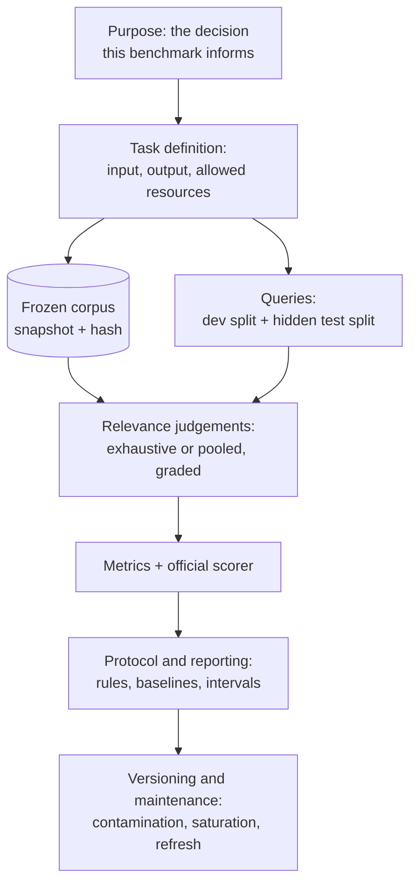

A **benchmark** is an evaluation that other people, or your future self, can run again and compare against: a frozen corpus, a fixed set of queries, relevance judgements, metric definitions, an official scoring script and rules for what a system may and may not do. A [golden dataset](/learn/testing-and-benchmarking/golden-datasets) answers "is our system good?"; a benchmark answers "which of these systems is better, under conditions everyone agrees on?". Public benchmarks such as BEIR are the subject of [retrieval benchmarks](/learn/retrieval-evaluation/retrieval-benchmarks). This lesson is about designing one, whether it is an internal benchmark used to choose between embedding vendors or a public one meant to last for years.

Most of the design decisions are invisible in the leaderboard, and most benchmark failures come from them: judgements collected from one kind of system that penalise every other kind, too few queries to separate the systems being compared, rules loose enough that the test set becomes training data. You will run two retrievers on BEIR SciFact and see one of these failures change the result.

## Learning objectives

- List the components of a benchmark and the decision each component must fix in advance.
- Explain construct validity and check whether a benchmark measures the property a decision depends on.
- Explain pooled relevance judgements and demonstrate how pooling from one system type biases results against others.
- Compute how many queries a benchmark needs to detect a given difference between systems, using paired differences.
- Write benchmark rules that prevent test-set leakage, contamination and saturation.

## Prerequisites

- [Retrieval benchmarks](/learn/retrieval-evaluation/retrieval-benchmarks): BEIR, MS MARCO and other public benchmarks.
- [NDCG](/learn/retrieval-evaluation/ndcg): the metric used in the code.
- [Test set construction](/learn/testing-and-benchmarking/test-set-construction): held-out sets and adaptive overfitting.
- [Chunk quality evaluation](/learn/chunking-optimisation/chunk-quality-evaluation): the paired bootstrap used for confidence intervals.

## Why this matters

Benchmarks drive decisions out of proportion to their size. A team picks an embedding model because it ranks higher on a leaderboard; a vendor is chosen because it wins the internal bake-off; a research direction is abandoned because it does not move a benchmark number. If the benchmark is flawed, every one of those decisions inherits the flaw, often for years, because a benchmark's value comes from not changing it.

The flaws are specific and recurring. A benchmark whose queries are easy measures nothing once every system passes them (**saturation**). A benchmark whose test answers have leaked onto the web may reward models that memorised them (**contamination**). A benchmark whose relevance judgements came from one family of retrievers can make every other family look worse than it is (**pooling bias**). A benchmark with 50 queries cannot tell apart systems that differ by a few points, so its rankings are mostly noise. None of these show in the leaderboard.

## The intuition

A wine competition that wants fair results fixes far more than "taste the wines and pick the best". It decides the category (dry whites under a price limit), blinds the bottles, sets the scoring sheet, uses several judges and averages them, and publishes the rules in advance so that no producer can send a specially made bottle. A competition where judges only taste wines from one region cannot fairly rank wines from another. A competition so easy that every entry gets gold medals tells buyers nothing.

A benchmark is that competition's rulebook for retrieval or RAG systems: the category is the task, the bottles are the systems' outputs, the scoring sheet is the metric and the judges are the relevance judgements.

## How it works

### The components



1. **Purpose.** Write down the decision the benchmark informs: "choose an embedding model for AskMeridian's IT runbooks". Every later choice is checked against it.
2. **Task definition.** What the system receives (a query, optionally a user role), what it returns (a ranked list of document IDs, or an answer with citations), and what it may use (only the corpus; no web; a stated compute or latency budget).
3. **Corpus.** A frozen snapshot with a content hash, so "the corpus" means the same bytes for everyone. Include realistic distractors: near-duplicate documents, superseded versions, documents about neighbouring topics. A corpus of only relevant documents makes retrieval trivially easy.
4. **Queries.** Drawn from the real use the purpose describes, diverse in type and difficulty, split into a development set (published, for tuning) and a test set (labels hidden or, for an internal benchmark, access-restricted), as in [test set construction](/learn/testing-and-benchmarking/test-set-construction).
5. **Relevance judgements** (often called **qrels**, from TREC's term for query relevance judgements). Graded if the metric uses grades. Exhaustive judging (every document for every query) is possible only for small corpora; larger benchmarks use pooling, described below.
6. **Metrics and an official scorer.** Precise definitions (NDCG at which cut-off, which gain function, how ties are broken, how a query with no results scores) and one scoring script everyone uses. Tools such as `trec_eval`, `pytrec_eval` and `ir_measures` exist precisely so that "NDCG@10" means the same computation in every paper.
7. **Protocol.** What tuning is allowed (development set only), whether systems may train on anything derived from the test queries, what must be reported (latency, cost, model size), and how many submissions to the hidden test set are allowed.
8. **Baselines.** Always include simple, strong baselines, BM25 above all. A new method that does not beat BM25 on a benchmark has not shown much, and a benchmark on which BM25 already scores near the ceiling is too easy.
9. **Reporting.** Per-query results, confidence intervals, paired significance tests and per-slice results, not one number.
10. **Versioning and maintenance.** A version identifier on every component; a changelog; a policy for fixing label errors (new version, never silent edits); periodic checks for saturation and contamination.

### Construct validity: does it measure the right thing?

**Construct validity** asks whether the benchmark measures the property the decision depends on. Many failures are here, not in the statistics:

- A benchmark of well-formed questions written by annotators measures performance on well-formed questions. AskMeridian's users type "vpn 4012 again??".
- A retrieval benchmark that scores the top 10 measures something different from a RAG pipeline that passes the top 5 to a model.
- A benchmark built on scientific abstracts says little about IT runbooks full of error codes.
- An answer-quality benchmark scored by an unvalidated [LLM judge](/learn/testing-and-benchmarking/llm-as-a-judge) measures agreement with that judge.

The practical test: if system A beats system B on the benchmark, would you expect A to serve your users better? If you cannot say yes with a straight face, the benchmark is measuring something else.

### Pooled judgements and their bias

For a corpus of millions of documents, nobody can judge every document for every query. The standard solution, developed in the TREC evaluations, is **pooling**:

1. Run a set of diverse systems on every query.
2. Take the union of each system's top $k$ results (the **pool**, often $k$ between 10 and 100).
3. Have assessors judge every pooled document. Documents outside the pool are **unjudged**, and by convention are treated as non-relevant.

Pooling works well when the pool is built from many diverse systems, because a relevant document that none of them retrieves is probably hard to find for any system. It breaks when a new system retrieves relevant documents that the pooled systems missed: those documents are unjudged, counted as non-relevant, and the new system is penalised for finding them. This is the classic problem of **incomplete judgements** studied by Buckley and Voorhees (2004). It matters especially now, because many older test collections were pooled from lexical systems, and dense retrievers find relevant documents that share few words with the query. The BEIR authors (Thakur and colleagues, 2021) note this kind of lexical bias in the annotation of some of their datasets.

Mitigations: pool from diverse system types (lexical, dense, hybrid, reranked); report the share of each system's top-$k$ that is unjudged (often called **Judged@k**); when a new system has many unjudged documents in its top results, judge them before trusting its score.

### Contamination and saturation

**Contamination** is when test items, or their answers, have been seen by the system in training. For LLM-based RAG this has a specific form: a public benchmark's questions and answers may be in the generator's pretraining data, so a RAG system can "answer" correctly without retrieving anything. A simple check is a **closed-book baseline**: run the generator with no retrieved context. If it scores well, the benchmark is measuring the model's memory, not the RAG pipeline. Internal benchmarks built from private documents largely avoid this, which is one of their advantages.

**Saturation** is when the best systems approach the metric's ceiling, or the remaining errors are mostly label errors. The benchmark can no longer separate systems. Remedies are a new version with harder queries, or retiring it.

### Internal benchmarks

An internal benchmark for a decision such as choosing an embedding model follows the same pattern at small scale: freeze a corpus snapshot of the relevant documents, take queries from logs and experts, pool from several candidate systems plus BM25, have document owners judge the pool, write the scoring script once, and run every candidate under the same protocol, including latency and cost. Publish the protocol to the decision-makers before the results, so nobody can suspect it was chosen to favour a winner.

## The mathematics

### How many queries a benchmark needs

**Intuition.** Two systems are run on the same queries, so the right comparison is paired: for each query, the difference in scores. Queries vary enormously in difficulty, but much of that variation is shared by both systems and cancels in the difference. What decides the number of queries is how much the per-query *differences* vary.

$$
n \approx \frac{(z_{1-\alpha/2} + z_{1-\beta})^2\, \sigma_d^2}{\delta^2}, \qquad
\delta_{\min} \approx \frac{(z_{1-\alpha/2} + z_{1-\beta})\,\sigma_d}{\sqrt{n}}
$$

- $\sigma_d$: the standard deviation of per-query score differences between the two systems.
- $\delta$: the difference in mean score you want to detect; $\delta_{\min}$ is the smallest difference detectable with $n$ queries.
- $z_{1-\alpha/2} = 1.96$ (5 per cent two-sided significance), $z_{1-\beta} = 0.8416$ (80 per cent power).

This is the normal approximation to the paired t-test; with a few hundred queries the difference is negligible.

**Worked example.** On SciFact, the per-query NDCG@10 differences between BM25 and a MiniLM dense retriever (computed in the code below) have $\sigma_d \approx 0.333$. To detect $\delta = 0.05$: $(2.8016)^2 \times 0.333^2 / 0.05^2 = 7.849 \times 0.1109 / 0.0025 \approx 348$ queries (the code, without intermediate rounding, gives 349). To detect $\delta = 0.02$: about 2,176 queries. With SciFact's 300 test queries, $\delta_{\min} = 2.8016 \times 0.333/\sqrt{300} \approx 0.054$.

So SciFact can reliably separate these two systems only if they differ by about 0.05 NDCG@10 or more. Many leaderboard gaps are smaller than that. An unpaired comparison would be worse still: the per-query scores of each system have a standard deviation around 0.40, so the variance of an unpaired difference would be about $0.40^2 + 0.40^2 = 0.32$, roughly three times the paired $0.111$.

```python
import math

z = 1.96 + 0.8416          # two-sided 5% significance, 80% power
sd_d = 0.333               # std dev of per-query NDCG@10 differences (measured below)
for delta in (0.05, 0.02):
    print(f"detect a difference of {delta}: about {math.ceil(z**2 * sd_d**2 / delta**2)} queries")
print(f"smallest detectable difference with 300 queries: {z * sd_d / math.sqrt(300):.3f}")
```

```output
detect a difference of 0.05: about 349 queries
detect a difference of 0.02: about 2176 queries
smallest detectable difference with 300 queries: 0.054
```

$\sigma_d$ depends on the pair of systems: two similar systems (a model and its fine-tuned variant) have smaller $\sigma_d$ and can be separated with fewer queries. Measure it on the development set before deciding the size of the test set.

## In code

**The problem.** Evaluate BM25 and a MiniLM dense retriever on BEIR SciFact under the benchmark's full judgements, with a paired confidence interval, then re-score both as if the judgements had been pooled only from BM25's top 10, to see pooling bias directly.

**Dependencies.** The Hugging Face `datasets` library (downloads SciFact, a few megabytes, on first use), rank-bm25, sentence-transformers with MiniLM, and NumPy. The run takes under a minute on a laptop CPU, most of it embedding 5,183 abstracts.

```bash
pip install datasets rank-bm25 sentence-transformers numpy
```

```python
import re
from collections import defaultdict

import numpy as np
from datasets import load_dataset
from rank_bm25 import BM25Okapi
from sentence_transformers import SentenceTransformer

# 1. A fixed, published benchmark: BEIR SciFact (corpus, test queries, relevance judgements).
corpus = load_dataset("BeIR/scifact", "corpus", split="corpus")
queries = {str(r["_id"]): r["text"] for r in load_dataset("BeIR/scifact", "queries", split="queries")}
qrels = defaultdict(set)
for r in load_dataset("BeIR/scifact-qrels", split="test"):
    if r["score"] > 0:
        qrels[str(r["query-id"])].add(str(r["corpus-id"]))
doc_ids = [str(d) for d in corpus["_id"]]
texts = [f"{t}. {x}" for t, x in zip(corpus["title"], corpus["text"])]
test_q = sorted(q for q in qrels if q in queries)

def ndcg10(ranked, relevant):
    dcg = sum(1 / np.log2(i + 2) for i, d in enumerate(ranked[:10]) if d in relevant)
    ideal = sum(1 / np.log2(i + 2) for i in range(min(len(relevant), 10)))
    return dcg / ideal

# 2. Two systems under test.
tok = lambda t: re.findall(r"[a-z0-9]+", t.lower())
bm25 = BM25Okapi([tok(t) for t in texts])
run_bm25 = {q: [doc_ids[j] for j in np.argsort(-bm25.get_scores(tok(queries[q])))[:100]] for q in test_q}

model = SentenceTransformer("sentence-transformers/all-MiniLM-L6-v2")
D = model.encode(texts, normalize_embeddings=True, batch_size=64)
Q = model.encode([queries[q] for q in test_q], normalize_embeddings=True)
top = np.argsort(-(Q @ D.T), axis=1)[:, :100]
run_dense = {q: [doc_ids[j] for j in top[i]] for i, q in enumerate(test_q)}

# 3. Score with the full judgements, per query, then a paired bootstrap on the difference.
s_bm25 = np.array([ndcg10(run_bm25[q], qrels[q]) for q in test_q])
s_dense = np.array([ndcg10(run_dense[q], qrels[q]) for q in test_q])
diff = s_dense - s_bm25
rng = np.random.default_rng(0)
boot = [diff[rng.integers(0, len(diff), len(diff))].mean() for _ in range(5000)]
lo, hi = np.percentile(boot, [2.5, 97.5])
print(f"{len(test_q)} queries, {len(doc_ids)} documents")
print(f"full judgements:   BM25 {s_bm25.mean():.3f}   dense {s_dense.mean():.3f}   "
      f"dense - BM25 = {diff.mean():+.3f}  95% CI [{lo:+.3f}, {hi:+.3f}]")
print(f"per query: dense better {np.sum(diff > 0)}, BM25 better {np.sum(diff < 0)}, tied {np.sum(diff == 0)}")

# 4. Pooling bias: pretend the judgements had come only from judging BM25's top 10.
pool = {q: set(run_bm25[q][:10]) for q in test_q}
pooled = {q: qrels[q] & pool[q] for q in test_q}
kept = [q for q in test_q if pooled[q]]            # queries with no judged relevant doc drop out
p_bm25 = np.mean([ndcg10(run_bm25[q], pooled[q]) for q in kept])
p_dense = np.mean([ndcg10(run_dense[q], pooled[q]) for q in kept])
unjudged = np.mean([len(set(run_dense[q][:10]) - pool[q]) / 10 for q in kept])
print(f"BM25-pooled judgements ({len(kept)} queries keep a relevant doc): "
      f"BM25 {p_bm25:.3f}   dense {p_dense:.3f}   dense - BM25 = {p_dense - p_bm25:+.3f}")
print(f"share of dense top-10 that is unjudged under that pool: {unjudged:.2f}")
```

```output
300 queries, 5183 documents
full judgements:   BM25 0.652   dense 0.648   dense - BM25 = -0.004  95% CI [-0.042, +0.034]
per query: dense better 72, BM25 better 71, tied 157
BM25-pooled judgements (239 queries keep a relevant doc): BM25 0.831   dense 0.752   dense - BM25 = -0.078
share of dense top-10 that is unjudged under that pool: 0.65
```

**The important lines.**

- `load_dataset("BeIR/scifact", ...)` loads the frozen benchmark: corpus, queries and test qrels. Using the published files rather than a private copy is what makes the result comparable with others.
- `ndcg10` uses binary gains, matching SciFact's binary judgements; the ideal DCG is computed from the number of relevant documents, capped at 10.
- Both runs keep the top 100 per query, the same depth for both systems, as a protocol would require.
- The paired bootstrap resamples *queries* (with replacement) and recomputes the mean difference, as in [chunk quality evaluation](/learn/chunking-optimisation/chunk-quality-evaluation).
- `pooled = qrels & pool` simulates a benchmark whose assessors only saw BM25's top 10: relevant documents outside that pool become unjudged and therefore count as non-relevant. Queries left with no judged relevant document are dropped, as scorers normally do.

**What the output means.** Under the full judgements, the two systems are statistically indistinguishable: a mean difference of $-0.004$ with a 95 per cent interval from $-0.042$ to $+0.034$, and each wins on about 70 queries (157 ties, mostly queries where both rank the single relevant abstract first, or both miss it). Any leaderboard ordering between them would be noise, which the sample-size calculation predicted.

Under BM25-pooled judgements, BM25 appears 0.078 better. Nothing about the systems changed; only the judgements did. Sixty-five per cent of the dense retriever's top 10 is unjudged under that pool, and every relevant document among those counts against it. Both scores also rise (to 0.831 and 0.752), because the 61 queries whose relevant documents BM25 missed entirely have dropped out of the benchmark: pooling bias also removes the queries that are hard for the pooled system. A benchmark built this way would systematically tell its users that dense retrieval is worse.

**Common errors.** Scoring with a home-made metric that differs subtly from the official one (log base, cut-off, treatment of queries with no relevant documents), so numbers are not comparable with published results. Comparing a system's score from one run with a published score computed on a different version of the dataset. Treating the mean difference as the result without an interval.

**Extending it.** Add a hybrid system and pool from all three, then compute Judged@10 for each system under the union pool. Compute per-query results by question type to see where each system wins. Replace the bootstrap with `scipy.stats.ttest_rel` and compare the p-values.

## A real-world example

The Platform team was asked to choose between three embedding providers for a planned re-index of the IT runbooks and Atlas documentation. The first attempt was quick: 80 queries from the support desk, judged by taking BM25's top 10 for each and asking two runbook owners to mark the relevant documents. Two of the three providers scored well below BM25, and one manager proposed dropping dense retrieval altogether.

An engineer noticed what this lesson's code shows: the dense systems' top results were mostly unjudged. Judging the unjudged documents in each system's top 10 for a sample of 20 queries found that many were relevant, including runbook pages that describe a fault in different words from the user ("cannot connect from the hotel" for a captive-portal issue).

The team rebuilt the bake-off as a proper internal benchmark. The protocol was written and shared first: a frozen snapshot of the runbooks and Atlas documentation with its hash; 240 queries from support tickets and logs, stratified by slice (error codes, how-to, troubleshooting), split into 80 for development and 160 for test; pools from BM25, all three dense candidates and a hybrid, at depth 10; graded judgements by the runbook owners with a written guideline; NDCG@10 and Recall@20 computed by one script; and latency and cost per thousand queries reported alongside. With $\sigma_d$ measured on the development set, 160 test queries could detect differences of about 0.07, which the team stated up front. The final result: two providers indistinguishable, one clearly behind, hybrid ahead of all single systems. The decision was made on cost between the two tied providers, and the benchmark now runs, versioned, for every proposed model change.

## Common mistakes

- **No stated purpose.** The benchmark measures something convenient rather than the property the decision needs.
- **Judgements pooled from one system type.** Systems unlike the pooled ones are penalised for finding unjudged relevant documents.
- **Too few queries for the differences of interest.** Rankings between close systems are noise presented as results.
- **No official scorer.** Small differences in metric implementation produce incomparable numbers.
- **Test labels available for tuning.** The test set becomes training data and the leaderboard measures adaptive overfitting.
- **No simple baselines.** Without BM25 on the board, nobody can tell whether the benchmark is easy or the methods are good.
- **Ignoring contamination.** A generator that memorised a public benchmark's answers scores well without retrieving.
- **Silent edits.** Fixing labels without a new version makes old and new results incomparable.

## Best practices

- Write the purpose, task, protocol and metrics down before collecting results.
- Freeze and hash the corpus; include realistic distractors and superseded versions.
- Draw queries from real use; split into development and hidden test sets.
- Pool judgements from diverse systems, report Judged@k, and judge new systems' unjudged top results before trusting large differences.
- Provide one official scoring script and simple baselines.
- Size the test set from $\sigma_d$ measured on the development set, and report paired intervals and per-query results.
- Run a closed-book baseline for RAG benchmarks to detect contamination.
- Version every component, keep a changelog, and refresh or retire the benchmark when it saturates.

## Performance considerations

- **Judging cost dominates.** Pool size per query is at most the number of systems times the pool depth, less overlap. Five systems at depth 10 give up to 50 documents per query; with overlap perhaps 25 to 35. At an assumed 30 seconds per judgement, 160 queries times 30 documents is 4,800 judgements, about 40 hours of expert time. Depth and system count are the levers; judging new systems' unjudged documents later is cheaper than judging deep pools up front.
- **Running systems.** Dense systems must embed the corpus once per model: 5,183 abstracts took tens of seconds on a laptop CPU with MiniLM; millions of documents need GPUs or batch APIs and are a real cost per candidate.
- **Scoring** is negligible; bootstrap intervals with thousands of resamples take seconds.
- **Reporting efficiency.** Include latency per query and cost per thousand queries for each system in the protocol, so that a system that wins by 0.01 NDCG at ten times the cost is visible as such.

## Security considerations

Internal benchmarks are built from internal documents and real queries, so they inherit their access restrictions and personal-data obligations: remove personal data from queries, restrict access to the corpus snapshot, and do not send it to external providers for evaluation unless the data agreement covers it (for vendor bake-offs this needs explicit approval). Publishing a benchmark derived from internal data requires a review that nothing confidential remains, including in documents used as distractors. Hidden test labels for a shared benchmark must actually be hidden: store them outside repositories that participants can read.

## Summary

- A benchmark fixes the corpus, queries, judgements, metrics, scorer and rules so that systems can be compared reproducibly; each component is a design decision.
- Construct validity comes first: the benchmark must measure the property the decision depends on.
- Pooled judgements treat unjudged documents as non-relevant; pools from one system type bias results against others, as the SciFact simulation showed.
- The number of queries needed scales with the variance of paired per-query differences; many benchmarks cannot separate systems a few points apart.
- Guard against leakage, contamination and saturation with hidden test sets, closed-book baselines, versioning and refreshes.

## Exercises

**1.** Two rerankers on your internal benchmark have per-query NDCG@10 differences with standard deviation 0.15. How many test queries are needed to detect a difference of 0.02 with 80 per cent power at the 5 per cent level? What is the smallest detectable difference with 200 queries?

<details><summary>Show solution</summary>

$n = 7.849 \times 0.15^2 / 0.02^2 = 7.849 \times 0.0225/0.0004 \approx 442$ queries. With 200: $\delta_{\min} = 2.8016 \times 0.15/\sqrt{200} = 0.42024/14.142 \approx 0.030$. Similar systems (two rerankers over the same candidates) have small $\sigma_d$, so they can be separated with far fewer queries than BM25 versus dense needed.

</details>

**2.** Extend the code to build the pool from the union of BM25's and the dense retriever's top 10, re-score both systems, and report Judged@10 for each. What do you expect, and why?

<details><summary>Show solution</summary>

```python
pool2 = {q: set(run_bm25[q][:10]) | set(run_dense[q][:10]) for q in test_q}
pooled2 = {q: qrels[q] & pool2[q] for q in test_q}
kept2 = [q for q in test_q if pooled2[q]]
for name, run in [("BM25", run_bm25), ("dense", run_dense)]:
    score = np.mean([ndcg10(run[q], pooled2[q]) for q in kept2])
    print(name, round(score, 3))
```

Running it keeps 262 queries and gives BM25 0.749 and dense 0.745. Judged@10 is 1.0 for both, since each system's top 10 is entirely in the pool. The difference between the systems moves back close to the full-judgement result, because each system's relevant top-10 documents are now judged; scores stay somewhat higher than with full judgements because queries where neither system found a relevant document in its top 10 drop out. This is why pools are built from diverse systems.

</details>

**3.** A public RAG benchmark built from Wikipedia questions shows your generator answering 70 per cent correctly with retrieval and 62 per cent with no retrieval at all. What does this tell you, and how would you change the evaluation?

<details><summary>Show solution</summary>

The closed-book score shows that most correct answers do not need retrieval: the generator already knows them, very possibly from pretraining on Wikipedia or on the benchmark itself. The benchmark therefore measures the model's memory far more than the RAG pipeline, and an 8-point gain is the only part attributable to retrieval. Changes: report closed-book and open-book scores together; evaluate on the subset the closed-book model gets wrong; prefer a benchmark built on documents the model cannot have seen (private documents, or documents published after its training cutoff); and add questions about counterfactual or recently changed facts, where answering from memory gives the wrong answer.

</details>

**4.** Write the one-page protocol for an internal benchmark that will choose AskMeridian's reranker. List the decisions it must fix.

<details><summary>Show solution</summary>

- **Purpose:** choose a reranker for AskMeridian's handbook and runbook retrieval, subject to a latency budget.
- **Task:** input a query and the first stage's top 50 candidates (fixed, identical for all systems); output a ranking of those 50.
- **Corpus:** snapshot of the handbook and IT runbooks, with hash; superseded 2023 handbook included as distractors.
- **Queries:** 300 from logs and support tickets, stratified by slice; 100 development (shared), 200 test (restricted to two people).
- **Judgements:** pooled from the top 10 of each candidate reranker plus the first stage, graded 0 to 2 by document owners using a written guideline; Judged@10 reported per system.
- **Metrics:** NDCG@5 (the RAG system passes 5 chunks) and Recall@5, from one official script; paired bootstrap intervals; per-slice results.
- **Rules:** tuning on development only; no training on test queries; one test run per candidate; report 95th-percentile latency per query on stated hardware and cost per thousand queries.
- **Baselines:** no reranking; BM25 over the candidates.
- **Decision rule:** among candidates within the latency budget, choose the highest NDCG@5 unless the interval of its difference from the next includes zero, in which case choose the cheaper.
- **Versioning:** benchmark version 1.0; label fixes create 1.1 with a changelog.

</details>

## Check your understanding

```quiz
[
  {
    "q": "What does pooling mean in benchmark construction?",
    "options": [
      "Averaging scores across systems",
      "Judging only the union of several systems' top-k results, treating unjudged documents as non-relevant",
      "Combining several benchmarks into one",
      "Sharing GPU resources between systems"
    ],
    "answer": 1,
    "why": "Pooling makes judging large corpora affordable, at the cost of unjudged documents being assumed non-relevant."
  },
  {
    "q": "A benchmark's judgements were pooled only from BM25. A new dense retriever has 60% unjudged documents in its top 10. What is the most likely effect?",
    "options": [
      "Its score is unaffected",
      "Its score is inflated",
      "Its score is understated, because relevant documents it found outside the pool count as non-relevant",
      "BM25's score is understated"
    ],
    "answer": 2,
    "why": "In the SciFact simulation, BM25-only pooling made two equal systems look 0.078 NDCG@10 apart."
  },
  {
    "q": "Per-query differences between two systems have standard deviation 0.3. Roughly how many queries are needed to detect a difference of 0.03 with 80% power at the 5% level?",
    "options": ["About 80", "About 300", "About 7,800", "About 785"],
    "answer": 3,
    "why": "7.849 times 0.09 divided by 0.0009 is about 785."
  },
  {
    "q": "A RAG system scores almost as well with no retrieval as with retrieval on a public benchmark. What is the most likely issue?",
    "options": [
      "The generator already knows the answers, possibly through contamination, so the benchmark measures memory, not RAG",
      "The retriever is excellent",
      "The metric is too strict",
      "The benchmark is too small"
    ],
    "answer": 0,
    "why": "A closed-book baseline exposes benchmarks whose answers the model has memorised."
  },
  {
    "q": "Why should a benchmark ship with a single official scoring script?",
    "options": [
      "To hide the metric definition",
      "Because metric implementations differ subtly (cut-offs, log base, empty results), making numbers incomparable",
      "To make scoring faster",
      "Because NDCG cannot be computed otherwise"
    ],
    "answer": 1,
    "why": "Tools such as trec_eval exist so that a named metric means the same computation everywhere."
  }
]
```

## Further reading

- Nandan Thakur, Nils Reimers, Andreas Rücklé, Abhishek Srivastava and Iryna Gurevych, "BEIR: A Heterogeneous Benchmark for Zero-shot Evaluation of Information Retrieval Models", NeurIPS 2021 Datasets and Benchmarks track. [arxiv.org/abs/2104.08663](https://arxiv.org/abs/2104.08663)
- Niklas Muennighoff, Nouamane Tazi, Loïc Magne and Nils Reimers, "MTEB: Massive Text Embedding Benchmark", 2022. [arxiv.org/abs/2210.07316](https://arxiv.org/abs/2210.07316)
- Chris Buckley and Ellen M. Voorhees, "Retrieval Evaluation with Incomplete Information", SIGIR 2004.
- Mark Sanderson, "Test Collection Based Evaluation of Information Retrieval Systems", *Foundations and Trends in Information Retrieval*, 2010.
- Fabio Petroni and colleagues, "KILT: a Benchmark for Knowledge Intensive Language Tasks", NAACL 2021.
