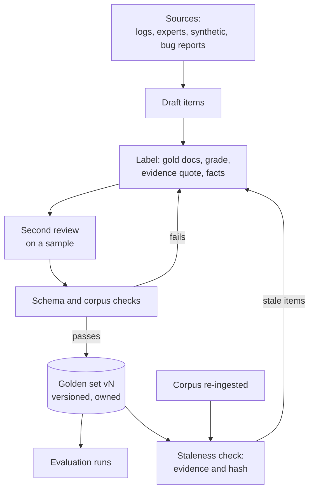

Every metric in the previous three modules, from [Recall@K](/learn/retrieval-evaluation/recall-k) to [faithfulness](/learn/generation-evaluation/faithfulness), needs something to compare against: the questions to ask, the documents that should come back, and what a correct answer says. That reference set is the **golden dataset**. It is the most valuable and the most neglected artefact in a RAG project. A good one lets a team change a chunker, a prompt or a model on Monday and know by Monday afternoon whether the change helped. A bad one produces confident numbers that measure nothing.

This lesson covers what goes into a golden item, where the questions come from, how labels are made and checked, and how the set is kept true as the documents underneath it change. Generating questions automatically, sampling a test suite from the pool and running it in CI each have their own lesson later in this module.

## Learning objectives

- Define a golden item and list the fields a RAG golden item needs for retrieval and generation evaluation.
- Design a schema that rejects inconsistent items, and validate a golden set against the current corpus.
- Explain why labels go stale when documents change, and detect stale items automatically.
- Compute micro, macro and traffic-weighted scores from per-slice results and say which one answers which question.
- Plan a labelling process with named owners, review and versioning.

## Prerequisites

- [Recall@K](/learn/retrieval-evaluation/recall-k): the retrieval metric that most golden sets feed first.
- [Answer correctness](/learn/generation-evaluation/answer-correctness): comparing a generated answer with a reference.
- [Dataclasses and Pydantic](/learn/python-for-rag-engineering/dataclasses-and-pydantic): the validation library used in the code.
- [Refusal behaviour](/learn/prompt-engineering-for-rag/refusal-behaviour): why a RAG system must sometimes say "I don't know".

## Why this matters

Without a golden dataset, every change to a RAG system is judged by someone typing five questions into the chat window and deciding the answers "look better". That method has three faults. The five questions are the ones the engineer remembers, which are the ones the system already handles. "Looks better" is not repeatable: the same person on a different day, or a different person, reaches a different verdict. And nothing is recorded, so when quality drops three releases later nobody can say which release did it.

A golden dataset fixes all three: deliberately chosen questions, written-down expected outputs, and the same set run against every version. The danger is that its numbers look authoritative whatever their quality. A golden set built from questions the team invented, labelled with the wrong document, or never updated after the handbook changed will report a precise-looking 0.87 that has nothing to do with what users experience. Most of this lesson is about avoiding that.

> [!KEY]
> A golden dataset is a measuring instrument. Before trusting what it says about the system, you must trust the instrument: what it samples, how it was labelled, and whether its labels are still true.

## The intuition

Think of a driving examiner's route. The route is planned to include a roundabout, a hill start, a school zone and a junction with poor visibility, because those are where drivers fail. Each manoeuvre has a written standard for a pass. The route is the same for every candidate, so two candidates can be compared fairly. And when the council moves a junction, the route sheet is updated; otherwise the examiner would mark a candidate down for not turning where there is no longer a road.

A golden dataset is that route sheet for AskMeridian. Each question is a manoeuvre; the gold document and reference answer are the written standard; the slice tags ("identifier lookup", "unanswerable") say which hazard it tests; and when HR rewrites the handbook, the sheet must change with it.

## How it works

### What a golden item contains

A **golden item** is one test case: a question plus everything needed to judge the system's response to it. For RAG, the fields fall into four groups.

| Group | Field | Used by |
| --- | --- | --- |
| Input | `question`, optionally conversation history or user attributes (department, role) | Running the system |
| Retrieval labels | `gold`: document or chunk IDs with a relevance grade | Recall@K, [NDCG](/learn/retrieval-evaluation/ndcg), MRR |
| Answer labels | `reference_answer`, `required_facts`, `answerable` | Correctness, refusal checks, judges |
| Provenance | `evidence` quote, `doc_hash`, `slices`, `source`, labeller, date | Maintenance and analysis |

A few of these deserve a closer look.

**Relevance grades.** Binary labels ("relevant or not") are enough for recall. Graded labels (2 for "answers the question", 1 for "related but incomplete", 0 implied for everything else) are needed for NDCG and also make labels more honest: many questions have one document that answers them and two that help.

**Label at document level, map to chunks.** Chunk IDs change every time you re-chunk. If gold labels point at chunk IDs, a chunking experiment invalidates the labels it needs. Label the document, or better, a verbatim **evidence quote** inside it, and compute which chunks contain the quote at evaluation time. A chunk counts as a hit if it contains the evidence. This keeps the golden set valid across [chunk size experiments](/learn/chunking-optimisation/chunk-size-experiments).

**Required facts, not just a reference answer.** A reference answer ("25 days a year") is one acceptable phrasing out of many. A list of required facts ("25 days") can be checked by string match for simple cases and gives an LLM judge a precise checklist for harder ones. Keep both: the facts for scoring, the reference for humans reading the results.

**Unanswerable items.** Some questions should produce a refusal: the handbook says nothing about contractors' parental leave, so AskMeridian should say it does not know. These items have `answerable = false` and no gold documents. Without them, a system that always answers confidently scores perfectly, and the [hallucination](/learn/generation-evaluation/hallucination-detection) problem is invisible. SQuAD 2.0 (Rajpurkar, Jia and Liang, 2018) added unanswerable questions for this reason.

**Slices.** Tags that group items by what they test: the topic (HR, IT, finance), the query type (factoid, paraphrase, identifier, multi-part, reasoning), the difficulty, the source. An overall score hides failures; per-slice scores show them. A drop from 0.82 to 0.80 overall can be a collapse from 0.90 to 0.40 on the twenty identifier questions.

### Where questions come from

The questions decide what the dataset measures, so their origin matters more than any other choice.

1. **Production logs.** The best source once the system has users, because these are the questions people really ask, in the words they really use: misspelt, terse, full of internal shorthand. Sample them (not the top 50 most frequent, which are all variants of five questions), remove personal data, and label them. The [test set construction](/learn/testing-and-benchmarking/test-set-construction) lesson covers sampling.
2. **Subject-matter experts.** Before launch there are no logs. Ask the document owners (HR for the handbook, the Platform team for runbooks) to write the questions they get asked by email or in the support queue, and the ones they consider tricky. Experts are also the only reliable source of hard negatives: questions that sound answerable but are not.
3. **Synthetic generation.** An LLM writes questions from documents. Fast and cheap, but its questions mirror the document's wording and miss what users actually wonder about. Useful for coverage of documents nobody asks about yet; covered in [synthetic test data](/learn/testing-and-benchmarking/synthetic-test-data).
4. **Failure reports.** Every bug report ("AskMeridian told me the laptop cycle is 4 years") becomes a golden item, once fixed, so the bug cannot quietly return. This is how a golden set grows teeth over time.

Record each item's source. Synthetic and expert questions are systematically easier and cleaner than logged ones; if the set is 80 per cent synthetic, its scores will flatter the system.

### The labelling process

The labels are where a golden set most often goes wrong, because labelling looks easy. A careful process:

1. **Write guidelines first.** One page: what counts as grade 2 versus grade 1, how to choose the evidence quote, when a question is unanswerable, how to phrase required facts (short, checkable, no paraphrase). Include two or three worked examples.
2. **Search, do not recall.** The labeller searches the whole corpus for every document that answers the question, using keyword search and the system itself. Labelling only the first good document found is the commonest error, and it makes a retriever that finds a different, equally good document look wrong.
3. **Record evidence.** Copy the exact sentence that answers the question. This proves the label, lets reviewers check it in seconds, and makes staleness detectable.
4. **Review a sample twice.** Have a second person label a sample independently and compare. Disagreement shows where guidelines are vague. Measuring that agreement properly is covered in [human evaluation](/learn/testing-and-benchmarking/human-evaluation).
5. **Name an owner per slice.** HR owns the HR items, the Platform team owns the IT runbook items. When a document changes, its owner reviews the affected items.

### Keeping labels true: staleness

Documents change; golden items do not change by themselves. When Meridian replaced its 2023 handbook on 1 January 2025, the laptop refresh cycle went from 4 years to 3. A golden item written in 2023 still says "Every 4 years". Now a system that correctly answers "3 years" fails the test, and a system that serves stale chunks from the old handbook passes it. The golden set is rewarding the wrong behaviour.

Two cheap checks catch this:

- **Evidence check.** Does the evidence quote still appear verbatim in the current version of its document? If not, the label is definitely stale.
- **Hash check.** Store a hash of the document when the item was labelled. If the hash differs but the quote is still present, the document changed somewhere else; the label may still be right, but a human should look.

Run both whenever the corpus is re-ingested, and block evaluation runs until stale items are fixed or retired.



### Versioning

Treat the golden set like code. Keep it in a repository as JSON Lines (one item per line, so diffs are readable), give each release a version, and record the version alongside every evaluation result. A score is only comparable with another score computed on the same version. When items are added or fixed, either re-run the baseline on the new version or report both versions' scores during the transition. Never silently edit items: "recall went up" means nothing if the questions changed underneath it.

Retire items rather than deleting them, with a reason ("policy removed", "duplicate of g-001"), so jumps in long-running charts stay explainable.

### How big?

Big enough to detect the differences you care about, which the [chunk size experiments](/learn/chunking-optimisation/chunk-size-experiments) lesson worked through: a few dozen items reveal a collapse, a few hundred are needed to separate two configurations a few points apart. Per slice, the same arithmetic applies to each slice separately, so a slice with 12 items can only show large effects. A practical starting point is 100 to 200 items with at least 20 per important slice, grown from bug reports and logs. Quality beats size: 150 carefully labelled items from real traffic are worth more than 2,000 generated ones nobody checked.

## The mathematics

### Micro, macro and traffic-weighted scores

**Intuition.** A golden set rarely has the same mix of questions as production. If IT questions are 40 per cent of the set but 70 per cent of real traffic, the plain average over items describes the set, not the users. Which average you report depends on the question you are asking.

Let slice $s$ have $n_s$ items and pass rate $p_s$, and let $w_s$ be its share of production traffic (with $\sum_s w_s = 1$).

$$
\text{micro} = \frac{\sum_s n_s\, p_s}{\sum_s n_s}, \qquad
\text{macro} = \frac{1}{S} \sum_{s=1}^{S} p_s, \qquad
\text{weighted} = \sum_s w_s\, p_s
$$

- $S$: the number of slices.
- **Micro** averages over items: what fraction of this set passes.
- **Macro** averages over slices: every slice counts equally, so a small, failing slice is not drowned out.
- **Traffic-weighted** estimates what fraction of real questions would pass.

**Worked example.** The set has 60 HR items passing at 0.90 and 40 IT items passing at 0.60. Production traffic is 30 per cent HR and 70 per cent IT.

- Micro: $(60 \times 0.90 + 40 \times 0.60) / 100 = (54 + 24)/100 = 0.78$.
- Macro: $(0.90 + 0.60)/2 = 0.75$.
- Weighted: $0.30 \times 0.90 + 0.70 \times 0.60 = 0.27 + 0.42 = 0.69$.

The set says 78 per cent; users experience something nearer 69 per cent. Report the per-slice numbers always, and choose the summary deliberately.

```python
n = {"hr": 60, "it": 40}            # items per slice in the golden set
p = {"hr": 0.90, "it": 0.60}        # pass rate per slice
traffic = {"hr": 0.30, "it": 0.70}  # share of production questions

micro = sum(n[s] * p[s] for s in n) / sum(n.values())
macro = sum(p.values()) / len(p)
weighted = sum(traffic[s] * p[s] for s in p)
print(f"micro (as sampled):   {micro:.2f}")
print(f"macro (equal slices): {macro:.2f}")
print(f"traffic-weighted:     {weighted:.2f}")
```

```output
micro (as sampled):   0.78
macro (equal slices): 0.75
traffic-weighted:     0.69
```

Traffic weights need a sample of real questions tagged by slice, which also reveals slices the golden set is missing.

## In code

**The problem.** A golden set is data written by people, and people make mistakes: an answerable item with no gold document, a quote copied from the old handbook, the same question entered twice. Catch these mechanically before any evaluation runs, and re-run the checks whenever the corpus changes.

**Dependencies.** Pydantic v2. No API key, no model.

```bash
pip install "pydantic>=2"
```

The script defines the schema, loads eight items (some deliberately broken) against a five-document Meridian corpus, and reports every problem.

```python
import hashlib
from collections import Counter
from typing import Literal

from pydantic import BaseModel, Field, ValidationError, model_validator


class GoldChunk(BaseModel):
    doc_id: str
    grade: Literal[1, 2] = 2          # 2 = answers the question, 1 = partially relevant


class GoldenItem(BaseModel):
    id: str
    question: str = Field(min_length=5)
    answerable: bool
    gold: list[GoldChunk] = []
    reference_answer: str
    required_facts: list[str] = []    # short strings a correct answer must state
    evidence: str = ""                # verbatim quote from a grade-2 gold document
    slices: list[str] = Field(min_length=1)
    source: Literal["logs", "sme", "synthetic"]
    doc_hash: str = ""                # hash of the evidence document when labelled

    @model_validator(mode="after")
    def consistent(self):
        if self.answerable and not any(g.grade == 2 for g in self.gold):
            raise ValueError("answerable item needs at least one grade-2 gold document")
        if not self.answerable and (self.gold or self.required_facts):
            raise ValueError("unanswerable item must have no gold documents or facts")
        return self


def sha(text: str) -> str:
    return hashlib.sha256(text.encode()).hexdigest()[:12]


corpus = {
    "hb-leave":    "Annual leave is 25 days. Up to 5 unused days carry over and must be used by 31 March.",
    "hb-remote":   "Staff may work remotely up to 3 days a week. The home-office equipment budget is £400.",
    "hb-expenses": "Expenses must be submitted within 30 days. Anything over £75 needs a receipt. "
                   "Expenses belong to the finance department.",
    "it-laptop":   "Laptops are refreshed every 3 years. Report a lost laptop to the support desk at once.",
    "it-e4021":    "Error E-4021: the VPN client is out of date. Update it from the IT portal.",
}
# Two documents as they read when their items were labelled.
old_laptop = "Laptops are refreshed every 4 years. Report a lost laptop to the support desk at once."
old_expenses = "Expenses must be submitted within 30 days. Anything over £75 needs a receipt."

raw_items = [
    dict(id="g-001", question="How many days of annual leave do I get?", answerable=True,
         gold=[{"doc_id": "hb-leave"}], reference_answer="25 days a year.",
         required_facts=["25 days"], evidence="Annual leave is 25 days.",
         slices=["hr", "factoid"], source="logs", doc_hash=sha(corpus["hb-leave"])),
    dict(id="g-002", question="Can I carry holiday over into next year, and until when?", answerable=True,
         gold=[{"doc_id": "hb-leave"}], reference_answer="Up to 5 days, used by 31 March.",
         required_facts=["5", "31 March"], evidence="Up to 5 unused days carry over",
         slices=["hr", "paraphrase"], source="logs", doc_hash=sha(corpus["hb-leave"])),
    dict(id="g-003", question="What does E-4021 mean?", answerable=True,
         gold=[{"doc_id": "it-e4021"}], reference_answer="The VPN client is out of date; update it from the IT portal.",
         required_facts=["out of date", "IT portal"], evidence="the VPN client is out of date",
         slices=["it", "identifier"], source="sme", doc_hash=sha(corpus["it-e4021"])),
    dict(id="g-004", question="How often are laptops replaced?", answerable=True,
         gold=[{"doc_id": "it-laptop"}], reference_answer="Every 4 years.",
         required_facts=["4 years"], evidence="Laptops are refreshed every 4 years.",
         slices=["it", "factoid"], source="sme", doc_hash=sha(old_laptop)),
    dict(id="g-005", question="What is the parental leave policy for contractors?", answerable=False,
         reference_answer="The handbook does not say; AskMeridian should decline.",
         slices=["hr", "unanswerable"], source="sme"),
    dict(id="g-006", question="Do I need a receipt for a £60 taxi?", answerable=True,
         gold=[{"doc_id": "hb-expenses", "grade": 2}, {"doc_id": "hb-remote", "grade": 1}],
         reference_answer="No; receipts are needed only above £75.", required_facts=["£75"],
         evidence="Anything over £75 needs a receipt.",
         slices=["finance", "reasoning"], source="logs", doc_hash=sha(old_expenses)),
    dict(id="g-007", question="How many annual leave days do I get?", answerable=True,
         gold=[{"doc_id": "hb-leave"}], reference_answer="25 days.", required_facts=["25 days"],
         evidence="Annual leave is 25 days.", slices=["hr", "factoid"], source="synthetic",
         doc_hash=sha(corpus["hb-leave"])),
    dict(id="g-008", question="Who approves VPN exceptions?", answerable=True,
         gold=[], reference_answer="The Platform team.", slices=["it"], source="sme"),
]


def norm(q: str) -> str:
    return " ".join("".join(c for c in q.lower() if c.isalnum() or c == " ").split())


items, problems = [], []
for raw in raw_items:
    try:
        items.append(GoldenItem(**raw))
    except ValidationError as e:
        problems.append((raw["id"], "schema", e.errors()[0]["msg"]))

seen = []                             # (word set, id) of items checked so far
for it in items:
    for g in it.gold:
        if g.doc_id not in corpus:
            problems.append((it.id, "missing-doc", g.doc_id))
    if it.answerable:
        doc = corpus.get(next(g.doc_id for g in it.gold if g.grade == 2), "")
        if it.evidence not in doc:
            problems.append((it.id, "stale-evidence", repr(it.evidence)))
        elif it.doc_hash != sha(doc):
            problems.append((it.id, "doc-changed", "re-review the label"))
    words = set(norm(it.question).split())
    for other_words, other_id in seen:
        jaccard = len(words & other_words) / len(words | other_words)
        if jaccard >= 0.8:
            problems.append((it.id, "near-duplicate", f"of {other_id} (Jaccard {jaccard:.2f})"))
    seen.append((words, it.id))

print(f"{len(items)} of {len(raw_items)} items pass the schema")
for p in problems:
    print("  PROBLEM", *p)

slice_counts = Counter(s for it in items for s in it.slices)
print("slice coverage:", dict(sorted(slice_counts.items())))
print("sources:", dict(Counter(it.source for it in items)))
```

```output
7 of 8 items pass the schema
  PROBLEM g-008 schema Value error, answerable item needs at least one grade-2 gold document
  PROBLEM g-004 stale-evidence 'Laptops are refreshed every 4 years.'
  PROBLEM g-006 doc-changed re-review the label
  PROBLEM g-007 near-duplicate of g-001 (Jaccard 0.89)
slice coverage: {'factoid': 3, 'finance': 1, 'hr': 4, 'identifier': 1, 'it': 2, 'paraphrase': 1, 'reasoning': 1, 'unanswerable': 1}
sources: {'logs': 3, 'sme': 3, 'synthetic': 1}
```

**The important lines.**

- `GoldChunk.grade` uses `Literal[1, 2]`, so a typo such as `grade=3` fails at load time instead of silently distorting NDCG.
- The `model_validator(mode="after")` runs once all fields are parsed and enforces rules that span fields: an answerable item must have a grade-2 document; an unanswerable one must have none. Item g-008 was written by someone who knew the answer ("the Platform team") but never found where it is written down. That is not a labelling slip to wave through: if no document says it, the system cannot be expected to answer it, and the item is either unanswerable or a sign that a document is missing.
- The evidence check (`it.evidence not in doc`) caught g-004, labelled against the 2023 handbook's 4-year laptop cycle. Run against the current corpus, this item would have failed every correct system.
- The hash check caught g-006: the expenses document gained a sentence after labelling. The quote is still there, so the label is probably fine, but the owner should confirm.
- The Jaccard similarity of the two questions' word sets flagged g-007, a synthetic paraphrase of g-001. Near-duplicates over-weight one fact in every average; keep one, or keep both only if the paraphrase is deliberately testing wording.

**What the output means.** Four of the eight items need human attention, and none would have raised an error during an evaluation run; they would simply have produced wrong scores. The coverage report also shows what is missing: one finance item, one identifier item and one unanswerable item are far too few to say anything about those slices.

**Common errors.** Matching evidence with `in` is exact, so normalisation differences (curly versus straight quotes, non-breaking spaces, a PDF extractor's line breaks) cause false "stale" reports. Normalise both sides the way your ingestion pipeline does. Word-set Jaccard misses paraphrases with different words ("holiday" versus "annual leave"); for those, compare question embeddings, as the [test set construction](/learn/testing-and-benchmarking/test-set-construction) lesson does.

**Extending it.** Load items from a JSONL file, read the corpus from the store the pipeline indexes, and run the script after every ingestion. Exercise 2 adds a required-facts check.

## A real-world example

The Platform team that runs AskMeridian built its first golden set in a week before launch: 120 questions written by two engineers, each labelled with the chunk ID they saw at the top of the results. For three months it reported recall@5 between 0.91 and 0.94, and every proposed change was judged against it.

Then the support desk began forwarding complaints. Staff asking about "WFH kit" or "the laptop thing" got poor answers; staff asking about Atlas error codes often got the description of a neighbouring code. Neither showed in the golden set. The engineers had written questions in the handbook's own vocabulary ("home-office equipment budget"), so lexical and semantic retrieval both found them easily. Only four questions involved error codes. And because labels pointed at chunk IDs, a re-chunking in the second month had quietly turned eleven labels into IDs that no longer existed; the evaluation script skipped them without a warning, so the denominator shrank and the score held up.

The rebuild followed this lesson. The team sampled 300 questions from two months of logs (personal data removed), had HR and the IT runbook owners label them with evidence quotes at document level, added 40 unanswerable questions supplied by HR, and tagged every item with topic and query-type slices. Recall@5 on the new set was 0.78, and 0.52 on the identifier slice. The lower number was not a regression; it was the first accurate measurement. The identifier slice's result is what justified adding [hybrid search](/learn/hybrid-search), and the validator now runs after every ingestion.

## Common mistakes

- **Questions written by the people who built the system.** They use the documents' vocabulary and avoid known failures, so scores are inflated and the hard cases are missing.
- **Labelling only the first relevant document found.** Retrievers that find another valid document are marked wrong, and recall is underestimated in a way that varies by retriever.
- **Gold labels as chunk IDs.** Any change to chunking breaks the labels, often silently.
- **No unanswerable questions.** A system that never refuses looks perfect, and over-answering cannot be measured.
- **Never re-checking labels after documents change.** The set begins to reward stale answers and penalise correct ones.
- **Editing items without versioning.** Score changes can no longer be attributed to the system rather than to the test.
- **Reporting one overall number.** Small slices with severe failures disappear into the average.
- **Copying production questions without removing personal data.** The golden set is shared widely and lives for years; names, employee numbers and health details in it are a privacy breach.

## Best practices

- Prefer real questions from logs; use experts before launch and generation only to fill coverage gaps, and tag every item with its source.
- Label documents and evidence quotes, not chunks; map evidence to chunks at evaluation time.
- Use graded relevance and search the whole corpus for every relevant document.
- Include unanswerable and out-of-scope questions, roughly in the proportion users send them.
- Validate the schema and the corpus links mechanically, and run the staleness check after every ingestion.
- Version the set in a repository, record its version with every result, and retire rather than delete items.
- Report per-slice results, and state whether a summary is micro, macro or traffic-weighted.
- Turn every confirmed production failure into a golden item once it is fixed.

## Performance considerations

The golden set itself is small; the cost is in labelling and in running it.

- **Labelling.** If a careful label (search, choose grades, copy evidence, write facts) takes about 5 minutes, 300 items take 25 hours of expert time, plus perhaps a quarter of that again for second review. This is the real budget item, and it is why reusing labels across chunking and model changes matters.
- **Retrieval evaluation** is cheap: 300 queries against a local index take seconds, so it can run on every commit.
- **Generation evaluation** costs model calls. With 300 items, an assumed 3,000 input tokens per RAG call and the same again for an LLM judge, one run is about 1.8 million input tokens. Check current prices on the provider's pricing page and multiply; it is usually affordable per release but adds up if run on every commit. A common split is retrieval metrics on every change and the full generation run before release.
- **Validation** is cheap; only the pairwise duplicate check grows quadratically (300 items is 44,850 pairs, trivial).

## Security considerations

Golden sets built from logs contain what employees typed, which can include names, health conditions, grievances and credentials pasted by mistake. Run [PII detection](/learn/access-control-and-privacy/pii-detection) and a manual review before an item enters the set, and restrict access to the raw logs used for sampling. Questions about restricted documents (salary bands, investigations) must be labelled by someone allowed to read them, and their items should carry the user role they assume, so that evaluation runs with the right permissions instead of with an all-seeing service account that hides access-control bugs. Finally, never put golden items into the corpus or into few-shot prompts: the system will then be tested on answers it has been shown.

## Summary

- A golden dataset is a versioned set of questions with gold documents, evidence, reference answers, required facts, an answerable flag and slice tags; it is the instrument every metric depends on.
- Real questions from logs measure what users experience; expert and synthetic questions are cleaner and easier and should be tagged as such.
- Label documents and verbatim evidence, not chunk IDs, so that labels survive re-chunking and staleness can be detected.
- Validate items mechanically and re-check evidence and document hashes whenever the corpus changes.
- Report per-slice scores, and choose micro, macro or traffic-weighted summaries deliberately.

## Exercises

**1.** A golden set has 80 HR items passing at 0.85, 15 finance items at 0.60 and 5 identifier items at 0.20. Traffic is 50 per cent HR, 20 per cent finance and 30 per cent identifier lookups. Compute the micro, macro and traffic-weighted scores. Which one should the team quote to its director, and what else should accompany it?

<details><summary>Show solution</summary>

Micro: $(80 \times 0.85 + 15 \times 0.60 + 5 \times 0.20)/100 = (68 + 9 + 1)/100 = 0.78$. Macro: $(0.85 + 0.60 + 0.20)/3 = 0.55$. Weighted: $0.5 \times 0.85 + 0.2 \times 0.60 + 0.3 \times 0.20 = 0.425 + 0.12 + 0.06 = 0.605$.

The traffic-weighted 0.61 best estimates what users experience. It must be accompanied by the per-slice numbers and a warning that the identifier slice has only 5 items: its 0.20 is very uncertain, and the first action is to label more identifier questions.

</details>

**2.** Extend the validator so that every required fact of an answerable item appears (case-insensitively) in at least one of its grade-2 gold documents. Which item in the example would fail, and is that a labelling error?

<details><summary>Show solution</summary>

Add inside the `if it.answerable:` branch:

```python
golds = " ".join(corpus.get(g.doc_id, "") for g in it.gold if g.grade == 2).lower()
for fact in it.required_facts:
    if fact.lower() not in golds:
        problems.append((it.id, "fact-not-in-gold", fact))
```

g-004's fact "4 years" fails, for the same reason as its evidence: it is stale. The others pass ("5" appears in "Up to 5", "IT portal" in the E-4021 document). A fact that appears nowhere in the gold documents is either stale, mis-typed, or a reasoning result (for example "No" for the £60 taxi), which is why facts should be things the document states, and derived conclusions belong in the reference answer.

</details>

**3.** Some AskMeridian answers depend on who is asking: contractors are not eligible for the home-office equipment budget. Change the schema so the golden set can test this, and describe two items that would catch a system ignoring the user's role.

<details><summary>Show solution</summary>

Add an optional `user_context` field, for example `user_context: dict[str, str] = {}` holding `{"employment": "contractor"}`, and pass it to the system exactly as production does. Then write a pair of items with the same question, "Can I claim the home-office equipment budget?": one with `employment = employee` (answerable, gold `hb-remote`, required fact "£400"), and one with `employment = contractor` (answerable, gold the contractor-eligibility document, required fact that contractors are not eligible). A system that ignores the role gives the same answer to both and fails one. Tag both items with a `user-context` slice so the pair's results are read together.

</details>

**4.** HR announces a new handbook taking effect next quarter that changes about a third of all policies. Design the process for updating the golden set, including what happens to evaluation results during the transition.

<details><summary>Show solution</summary>

1. Before the switch, ingest the new handbook into a staging index and run the staleness check against it; this lists every item whose evidence disappears or whose document hash changes.
2. Assign the flagged items to HR, the handbook owner, to re-label against the new text: new evidence, facts and reference answers. Add items for new policies, and mark items for removed policies as unanswerable or retire them with a reason.
3. Release the result as a new golden-set version. Run the current production system against both versions with the matching index to establish the new baseline, so that later comparisons are like for like.
4. During the transition, report scores with the version attached and do not plot old and new versions on one line without a marker. Keep the old version for any audit of past answers.

</details>

## Check your understanding

```quiz
[
  {
    "q": "Why should gold labels point at documents plus an evidence quote rather than at chunk IDs?",
    "options": [
      "Chunk IDs are too long to store",
      "Re-chunking changes chunk IDs, which would invalidate the labels needed to evaluate the re-chunking",
      "Retrievers cannot return chunk IDs",
      "Evidence quotes make retrieval faster"
    ],
    "answer": 1,
    "why": "Document-level labels with a quote survive chunking changes; the matching chunk is computed at evaluation time."
  },
  {
    "q": "A golden item's evidence quote no longer appears in the current version of its document. What is the most likely situation?",
    "options": [
      "The retriever is broken",
      "The item is a near-duplicate",
      "The document changed after labelling and the item's label may now be wrong",
      "The question is unanswerable"
    ],
    "answer": 2,
    "why": "A missing quote means the text the label relied on has gone; the item must be re-labelled before it is used again."
  },
  {
    "q": "Why must a golden set include unanswerable questions?",
    "options": [
      "Without them, a system that always answers confidently is never penalised for answering when it should refuse",
      "They make the set larger at no cost",
      "They are needed to compute NDCG",
      "They test retrieval latency"
    ],
    "answer": 0,
    "why": "Refusal behaviour, and hallucination on unanswerable questions, can only be measured if such questions are in the set."
  },
  {
    "q": "The golden set is 40% IT questions; production traffic is 70% IT. Which summary estimates the share of real questions answered well?",
    "options": [
      "The micro average over items",
      "The macro average over slices",
      "The best slice's score",
      "The traffic-weighted average of per-slice scores"
    ],
    "answer": 3,
    "why": "Weighting each slice's score by its share of traffic re-balances the set's mix to match production."
  },
  {
    "q": "Which source of questions best reflects what users actually ask, once a system is live?",
    "options": [
      "Questions generated by an LLM from each document",
      "Questions written by the engineers who built the retriever",
      "A sample of production logs with personal data removed",
      "The 50 most frequent production questions"
    ],
    "answer": 2,
    "why": "A sample of real logs keeps users' vocabulary and difficulty mix; the most frequent questions are near-duplicates of a few topics."
  }
]
```

## Further reading

- Christopher D. Manning, Prabhakar Raghavan and Hinrich Schütze, *Introduction to Information Retrieval*, Cambridge University Press, 2008, chapter 8, "Evaluation in information retrieval". [nlp.stanford.edu/IR-book](https://nlp.stanford.edu/IR-book/)
- Ellen M. Voorhees and Donna K. Harman (editors), *TREC: Experiment and Evaluation in Information Retrieval*, MIT Press, 2005: how test collections with relevance judgements are built.
- Pranav Rajpurkar, Robin Jia and Percy Liang, "Know What You Don't Know: Unanswerable Questions for SQuAD", ACL 2018. [arxiv.org/abs/1806.03822](https://arxiv.org/abs/1806.03822)
- Tom Kwiatkowski and colleagues, "Natural Questions: A Benchmark for Question Answering Research", TACL 2019: a dataset built from real search queries rather than written questions.
- Pydantic documentation on validators. [docs.pydantic.dev](https://docs.pydantic.dev/)
