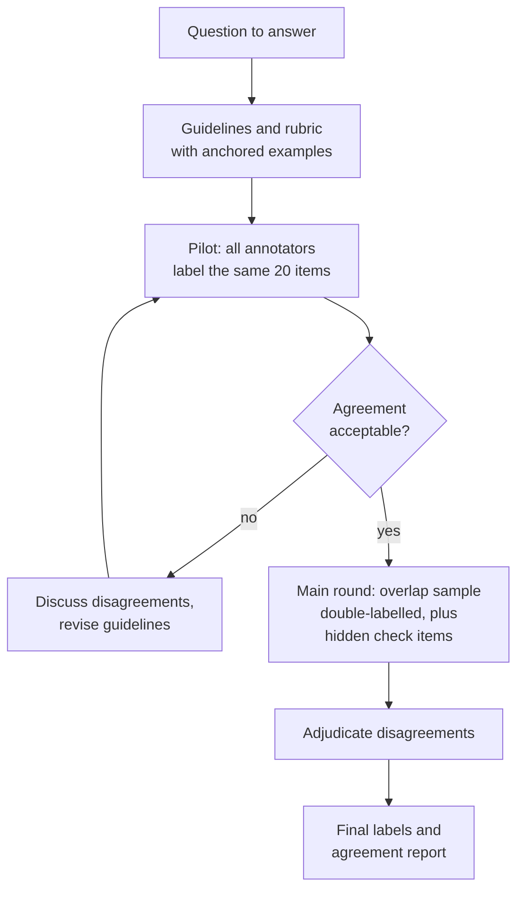

Automatic metrics and LLM judges are cheap and repeatable, but every one of them is a proxy for a human judgement: would a knowledgeable person consider this answer correct, complete, supported by its sources and useful? **Human evaluation** is that judgement made directly, by people following a written procedure. It is slow and expensive, so it is used sparingly, but it is the reference against which everything automatic is calibrated. A judge prompt that "seems to work" means nothing until its verdicts have been compared with careful human ones.

This lesson covers when human evaluation is worth its cost, how to design rubrics and annotation tasks for RAG answers, how to run an annotation round, and how to measure whether annotators agree with each other well enough for their labels to be trusted, including the statistic most often misread, Cohen's kappa.

## Learning objectives

- Decide when human evaluation is needed and which questions it should answer.
- Design an annotation task for RAG answers: criteria, scale, anchored rubric, what annotators see and what is hidden.
- Run an annotation round with guidelines, a calibration pilot, quality checks and adjudication.
- Compute percent agreement and Cohen's kappa by hand and in code, and explain the kappa paradox.
- Choose between absolute ratings and pairwise preferences for a given decision.

## Prerequisites

- [Golden datasets](/learn/testing-and-benchmarking/golden-datasets): the labelling process for questions and gold documents.
- [Faithfulness](/learn/generation-evaluation/faithfulness) and [answer correctness](/learn/generation-evaluation/answer-correctness): the qualities annotators are usually asked to judge.
- [Regression testing](/learn/testing-and-benchmarking/regression-testing): where human-validated labels are eventually used.

## Why this matters

Three jobs cannot be done without people.

**Calibrating automatic evaluation.** An [LLM judge](/learn/testing-and-benchmarking/llm-as-a-judge) that says 87 per cent of answers are faithful is useful only if its verdicts agree with careful humans. The only way to know is to have humans label a sample and compare. Without that, a judge with a systematic blind spot (it accepts answers that cite the right document but state the wrong number, say) silently shapes every decision made with it.

**Judging qualities no metric captures.** Whether an answer is helpful to a stressed employee, whether its tone suits a sensitive HR question, whether a refusal was reasonable or obstructive: these are judgements of people about people.

**High-stakes decisions.** Before AskMeridian answers questions about disciplinary procedures or pay, the HR team will want to see, with their own eyes, a sample of answers rated by HR experts. A metric will not persuade them, and should not.

Done badly, human evaluation is worse than none, because its numbers carry the authority of "humans checked". Vague instructions ("rate the quality from 1 to 5"), annotators who can see which system produced which answer, no agreement measurement: each produces labels that reflect the annotator's mood, preferences or expectations rather than the answer.

## The intuition

Two examiners marking the same essay can disagree by a whole grade. Exam boards therefore give examiners a **mark scheme** with example essays at each grade, run a **standardisation meeting** where everyone marks the same scripts and discusses differences, then **double-mark a sample** to check examiners stay consistent, and send disagreements to a **senior examiner**. Scripts are anonymous so that examiners cannot be swayed by the school.

Every element has a counterpart in annotating RAG answers: the rubric with anchored examples, the calibration round, the agreement measurement, adjudication, and blinding to which system wrote the answer.

## How it works

### When to use humans, and for what

| Purpose | Typical size | Who |
| --- | --- | --- |
| Validate an LLM judge or metric | 100 to 300 items | Domain-aware annotators |
| Release decision on a high-stakes domain | 50 to 200 items per system | Domain experts |
| Pairwise comparison of two systems | 100 to 300 pairs | Trained annotators or target users |
| Error analysis: why do answers fail? | 50 to 100 failures | Engineers plus an expert |
| Labelling golden items | Ongoing | Document owners |

Human evaluation answers questions; it should not be a ritual. Write down the question first ("Does the new prompt reduce unsupported claims on HR questions?") and design the task to answer it.

### Designing the task

**Decompose quality into criteria.** "Rate the answer from 1 to 5" asks the annotator to combine correctness, completeness, support and style with private weights, and different annotators weight differently. Ask about each criterion separately:

1. **Correct**: does the answer agree with the reference facts?
2. **Complete**: does it include everything the question needs?
3. **Supported**: is every claim backed by the provided sources? (This is [faithfulness](/learn/generation-evaluation/faithfulness); it requires showing the sources.)
4. **Citations**: do the cited sources contain what they are cited for?
5. **Refusal appropriate**: if it refused, should it have?

**Prefer small scales with anchors.** Binary (yes/no) or three-point scales (no, partly, yes) give higher agreement than five- or seven-point scales, because fewer boundaries means fewer arguments about where they lie. Every scale point gets an **anchored description** and an example: "Partly correct: states the 25-day allowance but omits the carry-over rule the question asked about."

**Decide what annotators see.** For correctness, show the question, the answer and the reference facts. For support, show the retrieved sources too. Never show which system produced the answer. When comparing systems, randomise the order of items and, in pairwise tasks, the left-right position.

**Absolute versus pairwise.** An **absolute rating** grades one answer against the rubric; a **pairwise preference** asks which of two answers to the same question is better. Pairwise judgements are often easier and more consistent for subtle quality differences ("both are correct, but which would you rather receive?"), and are the basis of public leaderboards such as Chatbot Arena. But they only rank systems relative to each other and say nothing about whether either is good enough. Use absolute criteria for "can we ship this?" and pairwise for "which of these two is better?".

### Running a round



1. **Guidelines.** Two or three pages at most: the purpose, each criterion with anchored examples, and a list of tricky cases with the decision for each (Is "around 25 days" correct? Is a correct answer from a superseded document "supported"?).
2. **Pilot and calibration.** Every annotator labels the same 20 items. Compute agreement, then meet and go through every disagreement. Most reveal ambiguity in the guidelines, not carelessness. Revise and repeat until agreement is acceptable.
3. **Main round with overlap.** Split items among annotators, but have a sample (say 20 to 30 per cent) labelled by two people, so that agreement can be monitored throughout. Plant a few **check items** with known answers to detect drifting or careless annotators.
4. **Adjudication.** Disagreements on overlap items go to an expert, whose decision is final. Record which guideline it implies and add it to the tricky-cases list.
5. **Report.** Labels, agreement statistics per criterion, and the guidelines version. Labels without agreement numbers cannot be trusted by anyone downstream.

**Fatigue matters.** Annotation quality falls over long sessions. Keep sessions to an hour or so, and shuffle items so that fatigue does not line up with one system's answers.

### Who should annotate

For RAG over internal documents, domain knowledge matters more than annotation experience. A crowd worker cannot tell that "contractors get the equipment budget" is wrong; an HR partner can. For criteria that only need the sources shown on screen (is this claim supported by this passage?), trained non-experts can do well with good guidelines. Engineers who built the system make biased annotators of its output; use them for error analysis, not for scoring.

Annotation tools such as Label Studio and Argilla (both open source) provide interfaces for rating and pairwise tasks, assignment, overlap and export; a spreadsheet works for a first round of 100 items.

## The mathematics

### Cohen's kappa

**Intuition.** Two annotators who both mark 90 per cent of answers "pass" will agree often just by chance, even if they choose at random with those proportions. **Cohen's kappa** (Cohen, 1960) measures agreement *beyond* what chance alone would produce.

$$
\kappa = \frac{p_o - p_e}{1 - p_e}, \qquad p_e = \sum_{k} p_{A,k}\, p_{B,k}
$$

- $p_o$: observed agreement, the fraction of items both annotators labelled the same.
- $p_{A,k}$, $p_{B,k}$: the fraction of items annotator A (respectively B) put in category $k$.
- $p_e$: the agreement expected if both labelled independently at random with their own category frequencies.
- $\kappa = 1$ is perfect agreement; $\kappa = 0$ is no better than chance; negative values are worse than chance.

**Worked example.** 50 answers, pass or fail. Both say pass on 30, both fail on 10; A pass and B fail on 5; A fail and B pass on 5.

- $p_o = (30 + 10)/50 = 0.80$.
- A says pass on $35/50 = 0.70$; B says pass on $35/50 = 0.70$.
- $p_e = 0.70 \times 0.70 + 0.30 \times 0.30 = 0.49 + 0.09 = 0.58$.
- $\kappa = (0.80 - 0.58)/(1 - 0.58) = 0.22/0.42 \approx 0.52$.

80 per cent raw agreement is only moderate agreement beyond chance.

**The kappa paradox.** When one category dominates, $p_e$ is high and kappa can be low or negative despite high raw agreement. 100 answers: both pass 90; A passes and B fails 5; A fails and B passes 5; they never agree on a failure. $p_o = 0.90$; each passes 95 per cent, so $p_e = 0.95^2 + 0.05^2 = 0.9025 + 0.0025 = 0.905$; $\kappa = (0.90 - 0.905)/0.095 \approx -0.05$. The annotators agree on 90 per cent of items but never on which answers fail, which is the only thing a failure-finding evaluation needs. Kappa is right to be unimpressed. Report raw agreement, kappa and the confusion matrix together, and look at agreement on the rare category specifically.

**Ordinal scales.** On a three-point scale (wrong, partly, correct), a disagreement between "partly" and "correct" is milder than between "wrong" and "correct". **Weighted kappa** gives partial credit by distance; quadratic weights penalise a disagreement by the square of the distance between grades. For more than two annotators, or when not every annotator labels every item, **Krippendorff's alpha** generalises the same idea.

Kappa values are often described with the bands of Landis and Koch (1977), where 0.41 to 0.60 is "moderate", 0.61 to 0.80 "substantial" and above 0.80 "almost perfect". Those authors called their bands arbitrary, and the right threshold depends on the use: labels for a release decision on HR answers need more agreement than labels for exploratory error analysis.

## In code

**The problem.** Two annotators have graded the same 40 AskMeridian answers on a three-point correctness scale. Measure their agreement properly, find what to adjudicate, and demonstrate the kappa paradox.

**Dependencies.** NumPy and scikit-learn.

```bash
pip install numpy scikit-learn
```

The labels are simulated with a fixed seed so the example runs anywhere: a hidden "true" grade per answer, a careful annotator (Ana, who moves a grade 15 per cent of the time) and a less certain one (Ben, 35 per cent).

```python
import numpy as np
from sklearn.metrics import cohen_kappa_score, confusion_matrix

# Two annotators grade the same 40 AskMeridian answers for correctness:
# 0 = wrong, 1 = partially correct, 2 = fully correct.
rng = np.random.default_rng(42)
truth = rng.choice([0, 1, 2], size=40, p=[0.2, 0.3, 0.5])

def annotate(truth, slip):
    """An annotator who usually agrees with the truth but sometimes moves one grade."""
    noisy = truth + rng.choice([-1, 0, 1], size=truth.size, p=[slip / 2, 1 - slip, slip / 2])
    return np.clip(noisy, 0, 2)

ana = annotate(truth, slip=0.15)    # HR policy expert
ben = annotate(truth, slip=0.35)    # newer annotator, less sure about "partial"

agreement = np.mean(ana == ben)
kappa = cohen_kappa_score(ana, ben)
weighted = cohen_kappa_score(ana, ben, weights="quadratic")
print(f"percent agreement:       {agreement:.3f}")
print(f"Cohen's kappa:           {kappa:.3f}")
print(f"quadratic-weighted kappa: {weighted:.3f}")
print("confusion matrix (rows = Ana, columns = Ben):")
print(confusion_matrix(ana, ben, labels=[0, 1, 2]))

disagree = np.where(ana != ben)[0]
two_apart = disagree[np.abs(ana[disagree] - ben[disagree]) == 2]
print(f"{disagree.size} items to adjudicate; {two_apart.size} differ by two grades: {two_apart.tolist()}")

# The kappa paradox: high agreement on a rare-failure task, yet kappa near zero.
a = np.array([1] * 90 + [1] * 5 + [0] * 5)
b = np.array([1] * 90 + [0] * 5 + [1] * 5)
print(f"\nrare failures: agreement {np.mean(a == b):.2f}, kappa {cohen_kappa_score(a, b):.3f}")
```

```output
percent agreement:       0.825
Cohen's kappa:           0.727
quadratic-weighted kappa: 0.856
confusion matrix (rows = Ana, columns = Ben):
[[ 7  2  0]
 [ 1 10  1]
 [ 0  3 16]]
7 items to adjudicate; 0 differ by two grades: []

rare failures: agreement 0.90, kappa -0.053
```

**The important lines.**

- `cohen_kappa_score(ana, ben)` computes unweighted kappa; `weights="quadratic"` gives the weighted version for ordinal grades.
- `confusion_matrix(ana, ben, labels=[0, 1, 2])` puts Ana's grades on rows and Ben's on columns; the diagonal is agreement.
- `disagree` lists the items to adjudicate; items two grades apart are the most urgent, because they usually mean someone misread the question or the rubric.

**What the output means.** The annotators agree on 82.5 per cent of items, kappa is 0.73 and quadratic-weighted kappa is 0.86. The weighted value is higher because every disagreement is between adjacent grades: the matrix has zeros in its "wrong versus fully correct" corners. All seven disagreements involve the middle grade, "partially correct" (the off-diagonal cells in row 1 and column 1). That pattern points to the rubric, not to the annotators: the boundary of "partial" needs sharper anchors, such as "states the main fact but omits a condition the question asked about". The paradox example reproduces the hand calculation: 90 per cent agreement and kappa of $-0.053$.

**Common errors.** Computing kappa on categories one annotator never uses can give misleading values; pass `labels=` explicitly. Averaging kappa across criteria hides a criterion with poor agreement; report each. And kappa between annotators says nothing about whether either is *right*: two annotators who share a misunderstanding agree perfectly. That is what check items with known answers and expert adjudication are for.

**Extending it.** Compute agreement per criterion and per slice (HR versus IT questions), track it per annotation batch to spot drift, and use the same functions to compare an LLM judge with the adjudicated human labels, which is the subject of the next lesson.

## A real-world example

Before allowing AskMeridian to answer questions about the expenses policy, the finance department asked for evidence that its answers were reliable. The Platform team sampled 150 expenses questions from logs, generated answers with the release candidate, and asked three finance staff to rate each answer on one criterion, "quality, from 1 to 5".

The first round produced a mean of 3.9 and a kappa of 0.21 between pairs of raters. In the calibration meeting the reasons were obvious. One rater marked down any answer that did not mention the 30-day submission deadline, even when the question was only about receipts. Another gave 5 to any answer with the right number, even if it cited the wrong document. The third penalised long answers.

The second round split quality into four binary criteria: correct, complete for the question asked, supported by the shown sources, and appropriate length. The guidelines gave two anchored examples per criterion and a tricky-cases list ("a correct answer citing the superseded 2023 handbook is *correct* but *not supported*"). After a 20-item pilot and one revision, pairwise kappa was 0.78 for correctness, 0.71 for support and 0.45 for length. The team reported correctness and support to finance (94 and 89 per cent, with intervals), dropped length as too subjective to gate on, and used the 150 adjudicated labels to validate the LLM judge that now scores expenses answers nightly.

## Common mistakes

- **One holistic score.** Annotators combine criteria with private weights, and agreement collapses.
- **Long scales without anchors.** Five- and seven-point scales with no examples invite inconsistent boundaries.
- **Showing which system produced the answer.** Annotators' expectations leak into the labels.
- **No calibration round.** Disagreements caused by vague guidelines are discovered after the budget is spent.
- **Reporting labels without agreement statistics.** Nobody can tell whether the labels are signal or noise.
- **Reading high percent agreement as reliability.** With a dominant category, chance agreement is high; check kappa and agreement on the rare category.
- **Treating agreement as correctness.** Annotators can agree on a shared misunderstanding; check items and expert adjudication catch it.
- **Engineers rating their own system.** Their knowledge of what the system is supposed to do colours their judgement.

## Best practices

- Start from a written question the evaluation must answer, and size the sample for it.
- Decompose quality into separate criteria with small, anchored scales.
- Blind annotators to the system and randomise item and position order.
- Run a calibration pilot, revise guidelines until agreement is acceptable, and keep a tricky-cases list.
- Double-label an overlap sample throughout, plant check items, and adjudicate disagreements with an expert.
- Report raw agreement, kappa (weighted for ordinal scales), and the confusion matrix per criterion.
- Use domain experts where judging requires knowledge the screen does not show.
- Reuse adjudicated labels to validate LLM judges and to extend the golden set.

## Performance considerations

- **Time per item.** Judging four criteria with sources shown takes perhaps 2 to 4 minutes per answer (an assumption; time your pilot). 200 items at 3 minutes is 10 hours of annotation, plus 25 per cent overlap (2.5 hours) plus adjudication. Expert time is the binding constraint.
- **Pairwise tasks** need two answers read per item, but the decision is often quicker; time the pilot rather than assuming.
- **Sample size for agreement.** Kappa estimated from 20 items is very uncertain; 50 to 100 overlap items give a usable estimate. For a pass rate, the standard error arithmetic from [test set construction](/learn/testing-and-benchmarking/test-set-construction) applies: 150 items give roughly plus or minus 5 to 7 points at 95 per cent confidence.
- **Reuse.** Adjudicated labels are an asset: they validate every future judge prompt and model change at no new annotation cost, as long as the questions and sources stay current.

## Security considerations

Annotators see real questions, answers and source documents, which may include personal data and restricted policies. Remove personal data from questions before annotation, limit each annotator to documents they are entitled to read (HR casework only to HR staff), and do not send internal material to external crowd platforms unless the data agreement allows it. Annotation exports should be stored with the same access controls as the source documents, and deleted or anonymised according to the retention policy.

## Summary

- Human evaluation is the reference for calibrating metrics and judges, judging qualities no metric captures, and supporting high-stakes decisions.
- Decompose quality into criteria with small, anchored scales; blind annotators to the system and randomise order.
- Run a calibration pilot, double-label an overlap sample, plant check items and adjudicate disagreements.
- Cohen's kappa corrects agreement for chance; with skewed categories it can be low despite high raw agreement, so report it with raw agreement and the confusion matrix.
- Use weighted kappa for ordinal scales and Krippendorff's alpha for many annotators or missing labels.

## Exercises

**1.** Two annotators label 80 answers as supported or not. Both say supported on 50, both say not on 14, A yes and B no on 10, A no and B yes on 6. Compute percent agreement and Cohen's kappa by hand.

<details><summary>Show solution</summary>

$p_o = (50 + 14)/80 = 0.80$. A says yes on $60/80 = 0.75$; B says yes on $56/80 = 0.70$. $p_e = 0.75 \times 0.70 + 0.25 \times 0.30 = 0.525 + 0.075 = 0.60$. $\kappa = (0.80 - 0.60)/(1 - 0.60) = 0.50$. Moderate agreement; A is more lenient than B (10 items versus 6), which the calibration meeting should discuss.

</details>

**2.** Using scikit-learn, compute kappa for each of three criteria where annotators A and B produced the label arrays below, and say which criterion's guidelines need work first.

```python
correct_a = [1,1,1,0,1,1,0,1,1,1,0,1,1,1,1,0,1,1,1,1]
correct_b = [1,1,1,0,1,1,0,1,1,1,0,1,1,0,1,0,1,1,1,1]
support_a = [1,0,1,0,1,1,0,1,0,1,0,1,1,1,0,0,1,1,1,1]
support_b = [1,1,1,0,0,1,0,1,1,1,0,0,1,1,0,1,1,1,0,1]
refuse_a  = [0,0,0,0,0,0,0,0,0,0,0,0,0,0,0,0,0,1,0,0]
refuse_b  = [0,0,0,0,0,0,0,0,0,0,0,0,0,0,0,1,0,0,0,0]
```

<details><summary>Show solution</summary>

```python
from sklearn.metrics import cohen_kappa_score
for name, a, b in [("correct", correct_a, correct_b),
                   ("support", support_a, support_b),
                   ("refusal", refuse_a, refuse_b)]:
    agree = sum(x == y for x, y in zip(a, b)) / len(a)
    print(f"{name:<8} agreement {agree:.2f}  kappa {cohen_kappa_score(a, b):.3f}")
```

```output
correct  agreement 0.95  kappa 0.857
support  agreement 0.70  kappa 0.341
refusal  agreement 0.90  kappa -0.053
```

Support has the lowest agreement among the criteria with enough positive and negative cases, and needs anchored examples first. Refusal shows the paradox: 90 per cent agreement, but the annotators never agree on which answer should have been a refusal, so its guidelines need work too. With only one or two refusals each, 20 items cannot measure it; the next round needs a targeted sample of refusal cases.

</details>

**3.** You must decide whether a new prompt is better than the current one for HR questions. Design the human evaluation: task type, criteria, sample, annotators and blinding.

<details><summary>Show solution</summary>

- **Question:** is the new prompt's answer better, and is it at least as correct and supported?
- **Sample:** 120 HR questions from the held-out set (stratified by sub-topic), both prompts' answers generated with identical retrieved sources.
- **Task:** for each question, a pairwise preference (A better, B better, tie) with left-right order randomised, plus binary *correct* and *supported* for each answer separately, because a preference alone could favour a fluent but wrong answer.
- **Annotators:** two HR partners, blinded to which prompt wrote which answer; 30 items double-labelled for agreement; five check items with an obviously wrong answer.
- **Analysis:** preference rate with ties reported separately and an interval from the bootstrap; per-answer correctness and support compared item by item (paired). Ship only if preference favours the new prompt and neither correctness nor support falls.

</details>

**4.** An LLM judge and an adjudicated human label set agree on 92 per cent of 200 items. Your manager concludes the judge is reliable. What else do you check before agreeing?

<details><summary>Show solution</summary>

1. **Base rate and kappa.** If 90 per cent of answers pass, a judge that always says pass agrees 90 per cent of the time. Compute kappa and the confusion matrix.
2. **Agreement on failures.** What share of human-labelled failures does the judge catch (its recall on the fail class), and how many of its fails are real (precision)? A failure-finding judge must find failures.
3. **Slices.** Agreement per topic and question type; the judge may be reliable on HR and poor on identifier questions.
4. **Human reliability.** What was inter-annotator kappa? A judge cannot be validated more precisely than the humans agree with each other.
5. **Freshness.** Were the 200 items drawn from the same distribution as the answers the judge will score?

</details>

## Check your understanding

```quiz
[
  {
    "q": "Why should a quality rubric be split into separate criteria instead of one overall score?",
    "options": [
      "Annotators otherwise combine correctness, support and style with their own private weights, and agreement falls",
      "Separate criteria are faster to label",
      "Overall scores cannot be averaged",
      "Kappa cannot be computed on overall scores"
    ],
    "answer": 0,
    "why": "Separate, anchored criteria make each judgement narrower and more consistent across annotators."
  },
  {
    "q": "Two annotators agree on 80% of items; each labels 70% as pass. What is Cohen's kappa?",
    "options": ["0.80", "0.58", "0.52", "0.22"],
    "answer": 2,
    "why": "Chance agreement is 0.7 times 0.7 plus 0.3 times 0.3, which is 0.58, so kappa is (0.80 minus 0.58) divided by 0.42, about 0.52."
  },
  {
    "q": "Annotators agree on 90% of items but kappa is about zero. What is the most likely explanation?",
    "options": [
      "A calculation error",
      "The annotators were blinded",
      "The scale is ordinal",
      "One category dominates, so chance agreement is high and they rarely agree on the rare category"
    ],
    "answer": 3,
    "why": "This is the kappa paradox: high prevalence of one label inflates expected agreement."
  },
  {
    "q": "When is a pairwise preference task a better choice than absolute ratings?",
    "options": [
      "When deciding whether a single system is good enough to ship",
      "When comparing two systems whose answers differ subtly in quality",
      "When there is only one system",
      "When annotators lack domain knowledge"
    ],
    "answer": 1,
    "why": "Pairwise judgements are easier for subtle differences, but they only rank systems relative to each other."
  },
  {
    "q": "What do check items with known answers detect that inter-annotator agreement cannot?",
    "options": [
      "Annotators who agree with each other on a shared misunderstanding, or who drift over time",
      "Fatigue in pairwise tasks only",
      "The kappa paradox",
      "Duplicate questions"
    ],
    "answer": 0,
    "why": "Agreement measures consistency between annotators, not correctness; known-answer items test correctness."
  }
]
```

## Further reading

- Jacob Cohen, "A Coefficient of Agreement for Nominal Scales", *Educational and Psychological Measurement*, 1960.
- J. Richard Landis and Gary G. Koch, "The Measurement of Observer Agreement for Categorical Data", *Biometrics*, 1977.
- Klaus Krippendorff, *Content Analysis: An Introduction to Its Methodology*, Sage (4th edition, 2018), the chapter on reliability and Krippendorff's alpha.
- Wei-Lin Chiang and colleagues, "Chatbot Arena: An Open Platform for Evaluating LLMs by Human Preference", 2024.
- scikit-learn documentation for `cohen_kappa_score`. [scikit-learn.org](https://scikit-learn.org/stable/modules/generated/sklearn.metrics.cohen_kappa_score.html)
