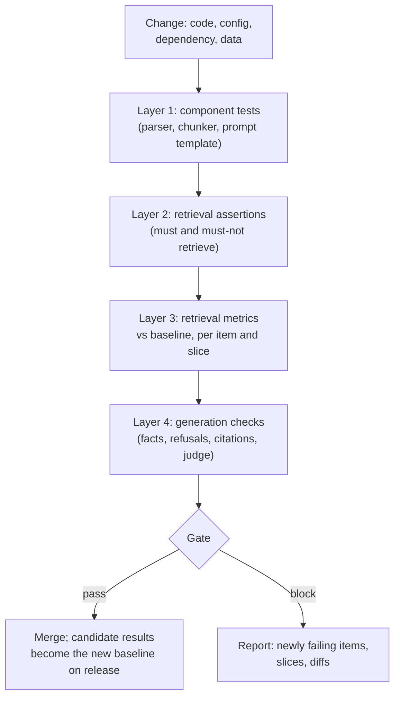

A **regression** is a change that makes something worse that used to work. In ordinary software, regressions are caught by automated tests that run on every change. RAG systems need the same discipline, but with two complications: much of their behaviour is statistical rather than right-or-wrong, and many of the changes that cause regressions are not code changes at all. A re-ingested document, an upgraded embedding library or a new model version can break answers without a single line of your code changing.

This lesson builds a regression-testing practice for a RAG pipeline: what triggers a run, the layers of tests from fast assertions to statistical gates, how to compare a candidate with a baseline item by item, and how to decide automatically whether a change may ship. You will build a harness that catches a realistic regression which the aggregate score alone would make look modest.

## Learning objectives

- List the kinds of change that can cause regressions in a RAG system, including those that involve no code change.
- Design layered regression tests: component assertions, retrieval assertions, metric gates and generation checks.
- Compare a candidate with a stored baseline item by item and report newly failing and newly passing items per slice.
- Apply McNemar's exact test to paired pass/fail results and explain why significance alone is the wrong gate.
- Handle nondeterministic generation in tests without making them flaky.

## Prerequisites

- [Test set construction](/learn/testing-and-benchmarking/test-set-construction): the smoke, development and held-out suites.
- [Golden datasets](/learn/testing-and-benchmarking/golden-datasets): items with gold documents, slices and required facts.
- [Hit rate](/learn/retrieval-evaluation/hit-rate): the retrieval metric used in the harness.
- [Reciprocal rank fusion](/learn/hybrid-search/reciprocal-rank-fusion): how the example retriever combines BM25 and dense rankings.

## Why this matters

A RAG pipeline has many moving parts, and each can degrade quality independently:

| Change | Typical regression |
| --- | --- |
| Prompt edit | Refuses answerable questions, drops citations |
| Chunker or parser change | Tables split from headers, evidence spread across chunks |
| Text normalisation | Identifiers mangled, so exact matches stop working |
| Embedding model or library upgrade | Query and document vectors no longer comparable; ranking shifts |
| Re-indexing | Superseded documents re-appear, filters lost |
| Model version change | Different length, tone, refusal rate, citation format |
| Document edits | Correct answers change; old golden labels go stale |

None of these raises an exception. The pipeline returns an answer, and the answer is plausible. Without a regression suite, the first sign is a user complaint weeks later, by which time several changes have shipped and nobody can tell which one did it.

The second reason is confidence. A team without regression tests becomes afraid to change things, because every change is a gamble. A team with good regression tests changes things freely, because a bad change is caught within minutes and attributed precisely.

## The intuition

A car manufacturer that changes the brake supplier does not test the new car by driving it round the block and asking whether it "feels fine". It reruns a fixed battery of tests (stopping distance from 100 km/h, wet and dry, loaded and unloaded) and compares each number with the previous model's. It looks at each test separately, because a better dry stopping distance does not excuse a worse wet one. Some failures are disqualifying on their own: if the handbrake fails, the average of the other tests is irrelevant.

Regression testing a RAG system works the same way: a fixed battery, compared test by test against the last approved version, with a few tests that block release on their own.

## How it works

### What triggers a run

Run the regression suites on every change to anything that affects answers, not only code:

- Code: prompts, retrieval logic, chunking, parsing, normalisation.
- Configuration: top-k, thresholds, fusion weights, model names.
- Dependencies: embedding models, tokenisers, vector-database clients, the LLM version.
- Data: re-ingestion and re-indexing, which should run a smaller suite against the new index before it is swapped in (see [index versioning](/learn/ci-cd-and-mlops/index-versioning)).
- Time: a scheduled nightly run catches drift from changes nobody announced, such as a hosted model updated behind an alias.

Pin versions (model identifiers with dates or versions rather than floating aliases, library versions in a lock file), so that a change is something you make deliberately and test, not something that happens to you.

### Layers of tests



1. **Component tests.** Ordinary unit tests, deterministic and fast: the parser keeps table headers, the chunker never splits inside an error code, the prompt template contains the grounding rule, normalisation leaves "E-4021" intact. These run on every commit in seconds.
2. **Retrieval assertions.** For a small set of critical queries, hard expectations: "E-4021" must return the E-4021 runbook in the top 3; no query may return a document marked superseded (the 2023 handbook); a contractor's query must not return HR-only documents. Any failure blocks. This is the smoke suite in its strictest form.
3. **Retrieval metrics against a baseline.** The development suite (or a large part of it) run through retrieval only, which is cheap and deterministic, scored per item and compared with the stored baseline.
4. **Generation checks.** The expensive layer: full answers, checked for required facts, refusals on unanswerable items, valid citations, and judged by an [LLM judge](/learn/testing-and-benchmarking/llm-as-a-judge) for correctness and [faithfulness](/learn/generation-evaluation/faithfulness). Run on pull requests that touch generation, and nightly.

Ordering the layers from cheapest to most expensive means most broken changes fail in the first minute.

### Baselines and per-item comparison

A **baseline** is the stored per-item result of the currently approved version: for each item, whether it passed, its retrieved IDs, its answer and its scores. A candidate is compared with the baseline **on the same items**, producing four groups:

- passed before, passes now (stable);
- failed before, fails now (known failures);
- passed before, fails now (**newly failing**, the regressions);
- failed before, passes now (**newly passing**, the fixes).

The aggregate score is just (fixes minus regressions) over the total, and it hides the content. A change that fixes eight paraphrase questions and breaks eight identifier questions has a net change of zero and is probably unacceptable. The newly failing list, grouped by slice, is the most useful thing a regression report contains: it points at the exact questions to read.

When a release ships, its results become the new baseline. Store baselines with the golden-set version, pipeline version and date, so a comparison is always between two known things.

### Gate policy

A **gate** turns the comparison into a decision. A practical policy combines three rules:

1. **Critical items must pass.** A short list of items that block on their own, regardless of everything else.
2. **Net change must not fall below a tolerance.** For example, the pass rate may not drop by more than 2 points overall or 5 points in any reported slice.
3. **Every newly failing item is shown to a human.** Even a passing gate prints them, so the reviewer can see what was traded.

Notice what is *not* in the list: "block only if the drop is statistically significant." The next section explains why that rule is backwards for a gate.

### Nondeterminism

Retrieval with a fixed index is usually deterministic (approximate nearest-neighbour search can vary slightly between index builds, so compare against a baseline from the same index where possible). Generation is not: the same prompt can give differently worded answers on different calls, and current Claude models do not accept a temperature setting to suppress this. Tests that compare answer strings will therefore be flaky. Instead:

- **Test properties, not strings.** Required facts present, refusal or not, citations valid, judge verdict pass.
- **Repeat where it matters.** Run each generation item two or three times and use the majority verdict, or require all runs to pass for critical items. This multiplies cost, so do it for small suites.
- **Cache.** Key generation results on (prompt version, model, retrieved context hash, question) and judge results on (judge version, question, answer hash). Unchanged items then cost nothing to re-evaluate and give identical verdicts.
- **Quarantine flaky items.** An item that flips between pass and fail with no change is not testing the change. Move it to a "flaky" list, investigate its labels, and keep it out of the gate until fixed.

## The mathematics

### McNemar's exact test for paired results

**Intuition.** Baseline and candidate are run on the same items. Items where both pass or both fail tell you nothing about which is better. Only the **discordant** items do: those that one version passes and the other fails. If the two versions were equally good, each discordant item would be equally likely to go either way, like a fair coin.

Let $b$ be the number of items the baseline passes and the candidate fails (regressions) and $c$ the number the candidate passes and the baseline fails (fixes). Under the hypothesis that neither version is better, $b$ follows a binomial distribution with $n = b + c$ trials and probability $\tfrac{1}{2}$. The one-sided p-value for "the candidate is worse" is the chance of at least $b$ regressions:

$$
p = \sum_{i=b}^{b+c} \binom{b+c}{i} \left(\tfrac{1}{2}\right)^{b+c}
$$

- $\binom{b+c}{i}$: the number of ways to choose which $i$ of the discordant items are regressions.
- $\left(\tfrac{1}{2}\right)^{b+c}$: the probability of any one particular pattern of $b + c$ fair coin flips.

**Worked example 1.** $b = 4$ regressions, $c = 0$ fixes: $p = \binom{4}{4}(1/2)^4 = 1/16 = 0.0625$.

**Worked example 2.** $b = 9$, $c = 2$: $n = 11$, $2^{11} = 2048$. $p = \left[\binom{11}{9} + \binom{11}{10} + \binom{11}{11}\right]/2048 = (55 + 11 + 1)/2048 = 67/2048 \approx 0.033$.

Example 1 is the trap. Four regressions and no fixes is an unambiguous signal to an engineer, especially when all four are identifier questions broken by the same change, yet $p > 0.05$. With few discordant items, the test cannot reach significance however one-sided the evidence. A gate that blocks only on significant regressions lets small suites pass almost anything. Significance tests answer "is there evidence of a difference?"; a gate needs "is there evidence that nothing important broke?". That is why the gate policy uses critical items and tolerances, and uses McNemar's p-value as information for the reviewer and for larger suites, where it becomes informative.

(The classic McNemar test uses the chi-squared approximation $(b - c)^2 / (b + c)$, which is reasonable when $b + c$ is at least about 25; for the small counts typical of regression suites, use the exact binomial form.)

```python
from scipy.stats import binomtest

for b, c in [(4, 0), (9, 2)]:
    p = binomtest(b, b + c, 0.5, alternative="greater").pvalue
    print(f"b={b}, c={c}: one-sided p = {p:.4f}")
```

```output
b=4, c=0: one-sided p = 0.0625
b=9, c=2: one-sided p = 0.0327
```

## In code

**The problem.** An engineer adds a "noise-removal" step that strips digits and punctuation from every text before indexing and before querying, to "clean up" scraped documents. Does it pass the regression gate?

**Dependencies.** rank-bm25, sentence-transformers (MiniLM), SciPy and NumPy.

```bash
pip install rank-bm25 sentence-transformers scipy numpy
```

The harness defines a hybrid retriever (BM25 plus MiniLM, fused with reciprocal rank fusion), a 16-item suite with slices and critical flags, runs baseline and candidate, and applies the gate. In a real CI job the baseline results would be loaded from storage rather than recomputed.

```python
import re

import numpy as np
from rank_bm25 import BM25Okapi
from scipy.stats import binomtest
from sentence_transformers import SentenceTransformer

corpus = {
    "hb-leave":    "Annual leave is 25 days. Up to 5 unused days carry over and must be used by 31 March.",
    "hb-remote":   "Staff may work remotely up to 3 days a week. The home-office equipment budget is £400.",
    "hb-contract": "Contractors are not eligible for the home-office equipment budget.",
    "hb-expenses": "Expenses must be submitted within 30 days. Anything over £75 needs a receipt.",
    "it-password": "Passwords must be rotated every 90 days. VPN is required on public Wi-Fi.",
    "it-laptop":   "Laptops are refreshed every 3 years. Report a lost laptop to the support desk at once.",
    "it-desk":     "The support desk is open 08:00 to 18:00 UK time.",
    "it-e4021":    "Error E-4021: the VPN client is out of date. Update it from the IT portal.",
    "it-e4012":    "Error E-4012: the VPN certificate has expired. Request a new one from the IT portal.",
    "it-e4100":    "Error E-4100: too many simultaneous VPN sessions. Disconnect another device.",
}
# (id, question, gold doc, slice, critical?)
suite = [
    ("q01", "How much holiday do I get?",                  "hb-leave",    "paraphrase", False),
    ("q02", "can i roll over unused days off",             "hb-leave",    "paraphrase", False),
    ("q03", "Can I work from home on Fridays?",            "hb-remote",   "paraphrase", False),
    ("q04", "Do contractors get money for a home desk?",   "hb-contract", "paraphrase", False),
    ("q05", "Do I need a receipt for a £90 hotel?",        "hb-expenses", "paraphrase", False),
    ("q06", "how often do I change my login password",     "it-password", "paraphrase", False),
    ("q07", "My laptop is really old, can I get a new one?", "it-laptop", "paraphrase", False),
    ("q08", "When can I phone IT for help?",               "it-desk",     "paraphrase", False),
    ("q09", "E-4021",                                      "it-e4021",    "identifier", True),
    ("q10", "what does E-4012 mean",                       "it-e4012",    "identifier", True),
    ("q11", "E-4100 error",                                "it-e4100",    "identifier", True),
    ("q12", "VPN error 4021 on my laptop",                 "it-e4021",    "identifier", False),
    ("q13", "VPN error 4012",                              "it-e4012",    "identifier", False),
    ("q14", "annual leave carry over 31 March",            "hb-leave",    "keyword",    False),
    ("q15", "expenses receipt £75",                        "hb-expenses", "keyword",    False),
    ("q16", "equipment budget contractors",                "hb-contract", "keyword",    False),
]
ids = list(corpus)
model = SentenceTransformer("sentence-transformers/all-MiniLM-L6-v2")
tok = lambda t: re.findall(r"[a-z0-9£]+", t.lower())

class HybridRetriever:
    """BM25 and MiniLM, fused with reciprocal rank fusion. `clean` preprocesses every text."""
    def __init__(self, clean=lambda t: t):
        self.clean = clean
        self.bm25 = BM25Okapi([tok(clean(corpus[i])) for i in ids])
        self.D = model.encode([clean(corpus[i]) for i in ids], normalize_embeddings=True)

    def __call__(self, q, k=60):
        q = self.clean(q)
        fused = np.zeros(len(ids))
        for scores in (self.bm25.get_scores(tok(q)), self.D @ model.encode(q, normalize_embeddings=True)):
            order = np.argsort(-scores, kind="stable")
            fused[order] += 1 / (k + np.arange(1, len(ids) + 1))
        return np.argsort(-fused, kind="stable")

def run(retrieve, k=1):
    return {qid: gold in [ids[j] for j in retrieve(q)[:k]] for qid, q, gold, _, _ in suite}

# The change under test: a "noise-removal" step that keeps only letters and spaces.
strip_noise = lambda t: re.sub(r"[^A-Za-z ]+", " ", t)

baseline = run(HybridRetriever())                  # in CI: loaded from stored production results
candidate = run(HybridRetriever(clean=strip_noise))

# Per-item diff, slice report and McNemar's exact test on the discordant items.
broke = [qid for qid in baseline if baseline[qid] and not candidate[qid]]
fixed = [qid for qid in baseline if candidate[qid] and not baseline[qid]]
print(f"hit@1  baseline {np.mean(list(baseline.values())):.2f}   candidate {np.mean(list(candidate.values())):.2f}")
for s in ("paraphrase", "identifier", "keyword"):
    members = [qid for qid, _, _, sl, _ in suite if sl == s]
    print(f"  {s:<11} {np.mean([baseline[m] for m in members]):.2f} -> {np.mean([candidate[m] for m in members]):.2f}")
print("newly failing:", broke)
print("newly passing:", fixed)
b, c = len(broke), len(fixed)
if b + c:
    p = binomtest(b, b + c, 0.5, alternative="greater").pvalue
    print(f"McNemar exact, one-sided (more breaks than fixes): b={b}, c={c}, p={p:.3f}")

critical_broken = [qid for qid, _, _, _, crit in suite if crit and not candidate[qid]]
net = (sum(candidate.values()) - sum(baseline.values())) / len(suite)
TOLERANCE = 0.02                          # allowed net drop, as a fraction of items
reasons = []
if critical_broken:
    reasons.append(f"critical items failing: {critical_broken}")
if net < -TOLERANCE:
    reasons.append(f"net change {net:+.3f} is below -{TOLERANCE}")
print("GATE:", "BLOCK - " + "; ".join(reasons) if reasons else "PASS")
```

```output
hit@1  baseline 0.88   candidate 0.62
  paraphrase  0.75 -> 0.75
  identifier  1.00 -> 0.20
  keyword     1.00 -> 1.00
newly failing: ['q09', 'q10', 'q12', 'q13']
newly passing: []
McNemar exact, one-sided (more breaks than fixes): b=4, c=0, p=0.062
GATE: BLOCK - critical items failing: ['q09', 'q10']; net change -0.250 is below -0.02
```

**The important lines.**

- `HybridRetriever(clean=...)` applies the preprocessing to documents *and* queries, as a real pipeline would; the candidate differs from the baseline only in `strip_noise`.
- `run` records a pass/fail per item (hit@1 here), keyed by item ID, which is the shape a stored baseline should have.
- `broke` and `fixed` are the discordant items; the slice loop shows where the change landed.
- `binomtest(b, b + c, 0.5, alternative="greater")` is McNemar's exact one-sided test.
- The gate checks critical items first, then the net change against a tolerance.

**What the output means.** The overall hit@1 fell from 0.88 to 0.62, but the slice report is what explains it: paraphrase and keyword questions are untouched and identifier questions collapsed from 1.00 to 0.20. With digits removed, "E-4021" becomes "E", and every error-code runbook looks the same. The one identifier item still passing (q11, "E-4100 error") passes by accident: after stripping, the candidate returns the E-4100 runbook first for *any* error-code query, as you can confirm by querying "E-4012 error". McNemar's p is 0.062, not significant at the conventional 0.05, which is exactly the trap from the mathematics section. The gate blocks anyway, for the right reasons: two critical items fail, and the net drop exceeds the tolerance.

**Common errors.** Comparing against a baseline computed on a different golden-set version makes every relabelled item look like a regression or a fix; check versions match before diffing. Computing the baseline fresh in every CI run doubles the cost and, for generation, adds noise; store it. And a tolerance on the overall rate alone would let a slice collapse if the slice is small, so apply tolerances per slice too.

**Extending it.** Write results as JSON Lines with the item ID, retrieved IDs and scores, and have the CI job print a Markdown table of newly failing items with their questions, gold documents and what was retrieved instead. Add per-slice tolerances, and a `known_failures` list so that items failing in the baseline do not clutter the report.

### Retrieval assertions as ordinary tests

Layer 2 needs no statistics and fits ordinary test tooling. With the pipeline above saved as `pipeline.py`, a pytest file of hard expectations looks like this:

```python
import pytest

from pipeline import HybridRetriever, ids

retriever = HybridRetriever()

def top(q, k):
    return [ids[j] for j in retriever(q)[:k]]

@pytest.mark.parametrize("question, must_retrieve", [
    ("E-4021", "it-e4021"),
    ("what does E-4012 mean", "it-e4012"),
    ("Do contractors get the home-office budget?", "hb-contract"),
])
def test_must_retrieve(question, must_retrieve):
    assert must_retrieve in top(question, 3)

def test_identifier_beats_its_neighbour():
    # E-4021 and E-4012 are the classic confusion; the right one must rank first.
    assert top("E-4021", 1) == ["it-e4021"]
```

```bash
pytest -q -p no:warnings test_smoke.py
```

The run ends with this summary line:

```output
4 passed in 3.65s
```

Had the noise-removal step been applied, `test_identifier_beats_its_neighbour` would have failed with an assertion message naming the retrieved document, in seconds and before any metric was computed.

## A real-world example

The Platform team upgraded the sentence-transformers library and, in the same pull request, switched AskMeridian's embedding model to a newer version from the same family. The overall answer-correctness score on the development suite moved from 0.81 to 0.82, and the pull request was approved. Two weeks later, the HR team reported that questions about carry-over were being answered from the superseded 2023 handbook.

The post-mortem found three gaps. The suite had no must-not-retrieve assertion for superseded documents, so nothing checked that the 2023 handbook stayed out of results; the new model happened to rank those chunks higher for some phrasings, and the metadata filter that should have excluded them had been dropped in the re-indexing script. The report showed only the aggregate, so the six newly failing HR items were hidden behind seven newly passing product items. And two changes in one pull request meant no one could say which caused what.

The fixes were the layers in this lesson: a must-not-retrieve test for every superseded document, run against every new index before it is swapped in; per-item and per-slice diffs in every report, with newly failing items listed first; per-slice tolerances; and a rule that dependency upgrades and model changes ship in separate pull requests, so each gets its own comparison.

## Common mistakes

- **Testing only code changes.** Re-indexing, model upgrades and document edits cause regressions too, and are untested.
- **Reporting only the aggregate.** Regressions in one slice are hidden by improvements in another.
- **Gating on statistical significance of the drop.** Small suites can never reach significance, so real regressions pass.
- **Comparing exact answer strings.** Nondeterministic generation makes tests flaky, and teams learn to ignore red builds.
- **Recomputing the baseline from a different golden-set version.** Relabelled items look like regressions or fixes.
- **Floating model aliases and unpinned libraries.** The system changes without a pull request, and nothing is tested.
- **Bundling unrelated changes.** When the gate fails or a regression slips through, nobody can attribute it.

## Best practices

- Run component tests and retrieval assertions on every commit; retrieval metrics on every pull request; generation checks on pull requests that touch generation and nightly.
- Store per-item baseline results with versions of the golden set, pipeline, index and model.
- Report newly failing and newly passing items per slice, newly failing first.
- Gate on critical items and per-slice tolerances; show McNemar's p-value as information.
- Test properties of answers (facts, refusals, citations, judge verdicts), cache results, and quarantine flaky items.
- Include must-not-retrieve assertions for superseded and restricted documents.
- Pin model versions and library versions; change one thing per pull request.

## Performance considerations

- **Layer costs.** Component tests: seconds. Retrieval over a 300-item suite against a local index: seconds to a minute (embedding 300 queries plus 300 searches). Generation: 300 RAG calls plus 300 judge calls. At an assumed 5 to 10 seconds per call pair, sequential execution takes 25 to 50 minutes; with 10 concurrent requests, 3 to 5 minutes, subject to rate limits.
- **Caching.** If a pull request changes only the prompt, retrieval results are unchanged and can be reused from the baseline; if it changes only retrieval, items whose retrieved context hash is unchanged need no new generation. On typical pull requests this removes most calls.
- **Repeats.** Three runs per generation item triple the cost; reserve them for the critical and flaky-prone items.
- **Token spend.** 300 items at about 3,000 input tokens for the RAG call and 3,500 for the judge is roughly 2 million input tokens per full run. Check current prices; it is usually acceptable nightly and per release, and the caching above makes per-pull-request runs much cheaper.

## Security considerations

Regression suites are the natural home of security tests, because security properties regress silently like any other: include must-not-retrieve assertions for restricted documents run as low-privilege users, refusal checks for prompt-injection attempts in questions and in planted test documents, and output checks that no answer contains secrets or personal data from the test corpus. Run the suites with the same permission model as production, never with an administrator account that sees everything. CI jobs that call a hosted model need an API key: store it in the CI system's secret store, scope it to evaluation, and make sure logs and reports never print it.

## Summary

- RAG regressions come from code, configuration, dependencies, data and model changes, and none of them raises an error.
- Layer the tests from cheap and deterministic (components, retrieval assertions) to expensive and statistical (metrics, generation checks).
- Compare candidates with a stored baseline item by item; the newly failing list per slice is the most useful output.
- McNemar's exact test measures whether paired results differ, but gates should use critical items and tolerances, because small suites cannot show significance.
- Handle nondeterminism by testing properties, caching, repeating critical items and quarantining flaky ones.

## Exercises

**1.** A candidate has 7 regressions and 3 fixes on a 200-item suite. Compute McNemar's exact one-sided p-value by hand. Would the gate in the code block it (tolerance 0.02)?

<details><summary>Show solution</summary>

$n = 10$, $2^{10} = 1024$. $p = [\binom{10}{7} + \binom{10}{8} + \binom{10}{9} + \binom{10}{10}]/1024 = (120 + 45 + 10 + 1)/1024 = 176/1024 \approx 0.172$. Not significant. Net change $= (3 - 7)/200 = -0.02$, which is not *below* $-0.02$, so the tolerance rule passes; the gate would block only if one of the 7 regressions is a critical item. A reviewer should still read all 7: if they share a cause, it is a real regression the suite is too small to prove.

</details>

**2.** Add a must-not-retrieve check to the harness: add a document `hb-2023-laptop` ("Laptops are refreshed every 4 years.") with metadata `superseded=True`, and make the gate block if any suite query returns a superseded document in its top 3. Which retriever change would this catch that hit@1 would not?

<details><summary>Show solution</summary>

```python
superseded = {"hb-2023-laptop"}
corpus["hb-2023-laptop"] = "Laptops are refreshed every 4 years."
# ...build retrievers after adding it, then:
leaks = [qid for qid, q, *_ in suite
         if superseded & {ids[j] for j in candidate_retriever(q)[:3]}]
if leaks:
    reasons.append(f"superseded documents retrieved for: {leaks}")
```

The correct fix is a filter in the retriever that excludes superseded documents. This check catches a re-indexing that drops that filter: the current laptop document may still rank first, so hit@1 is unchanged, but the superseded chunk enters the top 3, reaches the prompt, and can make the model mention "4 years" or hedge between two answers.

</details>

**3.** Generation checks on a 40-item suite flip on 3 items between two runs of the *same* version. Design a policy so that the gate is neither flaky nor blind.

<details><summary>Show solution</summary>

1. Cache generation by (prompt version, model, context hash, question) and judging by (judge version, question, answer hash), so unchanged items reuse verdicts and cannot flip.
2. For changed items, run each 3 times; an item passes if at least 2 of 3 pass, and critical items must pass 3 of 3.
3. Investigate the 3 flipping items: often the label is ambiguous (the required fact can be phrased several ways) or the judge rubric is vague. Fix the label or rubric; meanwhile quarantine them out of the gate but keep reporting them.
4. Track each item's historical flip rate; anything above a threshold is quarantined automatically and assigned to its owner.

</details>

**4.** Your team wants one number per pull request in a chat notification. Design what the notification should contain so that it cannot hide a slice regression.

<details><summary>Show solution</summary>

A single number is acceptable only alongside its structure: "Gate: BLOCK. Hit@1 0.88 → 0.62 (−4 regressions, +0 fixes; McNemar p=0.06). Slices below tolerance: identifier 1.00 → 0.20. Critical failures: q09, q10." The rule is that the notification always names any slice beyond its tolerance and any critical failure, and links to the full per-item report. A pass notification still states the counts of regressions and fixes, so that "+0.01 overall" with 8 regressions and 10 fixes is visible as a trade, not a free improvement.

</details>

## Check your understanding

```quiz
[
  {
    "q": "Which of these changes should trigger a regression run even though no application code changed?",
    "options": [
      "Re-indexing the document collection",
      "Renaming a test file",
      "Editing the README",
      "Adding a code comment"
    ],
    "answer": 0,
    "why": "Re-indexing can drop filters, change chunking or re-admit superseded documents; data changes regress quality like code changes."
  },
  {
    "q": "In a paired comparison, which items does McNemar's test use?",
    "options": [
      "All items",
      "Only items both versions pass",
      "Only discordant items, where one version passes and the other fails",
      "Only items both versions fail"
    ],
    "answer": 2,
    "why": "Concordant items carry no information about which version is better; the test asks whether discordant items split evenly."
  },
  {
    "q": "A candidate has 4 regressions and 0 fixes; McNemar's one-sided p is 0.0625. What should the gate do?",
    "options": [
      "Pass, because the drop is not significant",
      "Rerun until p falls below 0.05",
      "Ignore the regressions because the suite is small",
      "Decide using critical items and tolerances; small suites cannot reach significance, so p is information, not the gate"
    ],
    "answer": 3,
    "why": "With few discordant items significance is unreachable, so a significance-only gate would pass clear regressions."
  },
  {
    "q": "Why is comparing generated answers as exact strings a poor regression test?",
    "options": [
      "Strings are expensive to compare",
      "Generation is nondeterministic, so identical versions produce different strings and the test is flaky",
      "Answers are too short",
      "Exact matching ignores citations"
    ],
    "answer": 1,
    "why": "Test properties such as required facts, refusals, citation validity and judge verdicts instead."
  },
  {
    "q": "A change fixes 8 paraphrase items and breaks 8 identifier items. What does a good regression report show?",
    "options": [
      "No change, so nothing to report",
      "The aggregate score only",
      "The 8 newly failing items grouped by slice, alongside the 8 newly passing ones",
      "Only the improvements"
    ],
    "answer": 2,
    "why": "The net change is zero, but the per-item, per-slice diff shows a trade that is likely unacceptable."
  }
]
```

## Further reading

- Quinn McNemar, "Note on the sampling error of the difference between correlated proportions or percentages", *Psychometrika*, 1947.
- Thomas G. Dietterich, "Approximate Statistical Tests for Comparing Supervised Classification Learning Algorithms", *Neural Computation*, 1998: discusses McNemar's test for comparing two classifiers on one test set.
- pytest documentation, parametrising tests. [docs.pytest.org](https://docs.pytest.org/)
- SciPy documentation for `scipy.stats.binomtest`. [docs.scipy.org](https://docs.scipy.org/doc/scipy/)
