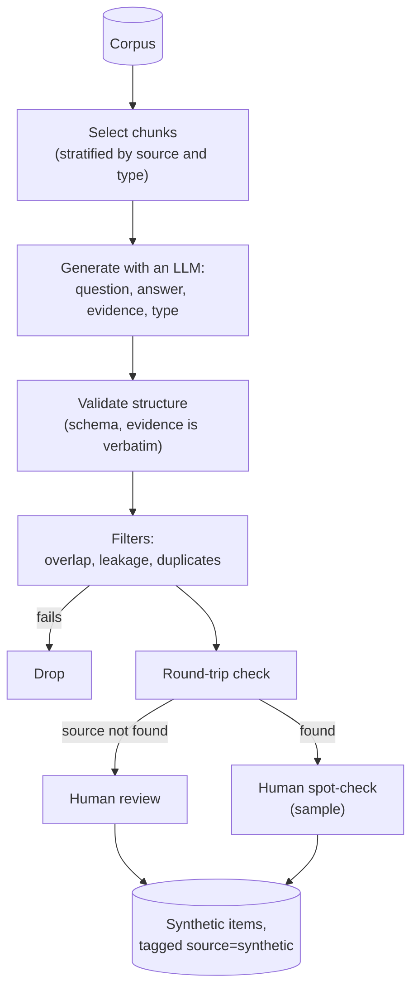

A [golden dataset](/learn/testing-and-benchmarking/golden-datasets) built from real questions is the best evaluation set, but it is slow to build and it only covers documents people already ask about. **Synthetic test data** fills the gaps: a language model reads your documents and writes questions, answers and evidence for them. Done carelessly, it produces thousands of easy questions that echo the documents' wording and flatter every retriever. Done well, it gives broad coverage in an afternoon, including the documents nobody has asked about yet.

This lesson covers how a generation pipeline works, what kinds of questions to ask for, the biases synthetic questions carry, and the filters that remove the worst of them. You will generate questions with Claude and then run a filter stage that catches copied wording, leaked answers and duplicates, and routes hard questions to a human instead of discarding them.

## Learning objectives

- Describe the stages of a synthetic question-generation pipeline, from chunk selection to human spot-check.
- Write a generation prompt that asks for specific question types and user-like wording, with validated structured output.
- Measure lexical overlap between a question and its source, and explain why high overlap makes a test too easy.
- Apply round-trip, leakage and duplicate filters, and explain how a round-trip filter can bias the test set.
- Decide when synthetic data is appropriate and how to label it within a golden set.

## Prerequisites

- [Golden datasets](/learn/testing-and-benchmarking/golden-datasets): the item schema that synthetic items must fit.
- [Query-document matching](/learn/rag-architecture-fundamentals/query-document-matching): lexical versus semantic matching and the vocabulary-mismatch problem.
- [Structured outputs](/learn/generation-strategies/structured-outputs): getting validated JSON from a model.
- [BM25](/learn/sparse-retrieval/bm25): the lexical scorer used for the round-trip check.

## Why this matters

Labelling real questions costs expert time, and before launch there are no real questions at all. Meanwhile, the corpus may have thousands of documents. A hand-built set of 200 items touches perhaps 150 of them; the rest are untested. If a parsing bug mangles every table in the IT runbooks, or the newest product documentation was never indexed, a golden set that happens not to ask about those documents will not notice.

Synthetic generation solves the coverage problem cheaply. The catch is that a model writing questions from a passage it is looking at writes questions that resemble the passage. "How many days is annual leave?" generated from "Annual leave is 25 days" shares every content word with its source; any retriever finds it. Real users ask "how much holiday do I get?", which shares none. A test set full of the first kind reports excellent recall for a system that will struggle with the second. Synthetic data is therefore useful only with deliberate steering towards realistic questions and filtering of the rest, and it never replaces real questions as the measure of what users experience.

## The intuition

Imagine asking the author of a textbook chapter to write the end-of-chapter exam. The questions will be fair, cover the chapter, and use the chapter's exact terms: "Define the inverse document frequency." A student who memorised the chapter's sentences will pass. Now imagine the questions came from students who had tried to use the material: "Why does my search rank the word 'the' so highly?" Those questions use different words, mix chapters and sometimes ask about things the chapter never covers.

An LLM generating questions from a chunk is the chapter's author. You can push it towards the students' kind of question by telling it who is asking and what they do not know, and you can throw out the questions that just restate a sentence. But the students' questions, from your logs, remain the real exam.

## How it works

### The pipeline



1. **Select chunks.** Sampling chunks uniformly over-represents the longest documents. Stratify by source (handbook, runbooks, product docs), by document, and by content type (prose, tables, lists), so that small but important documents get questions too.
2. **Generate.** For each chunk, ask the model for a few questions of named types, each with a short answer and a verbatim evidence quote. Give it a persona and tell it what the persona does not know.
3. **Validate structure.** Parse the output against a schema and check that each evidence quote really appears in the chunk. A quote that is not in the chunk means the model invented the answer.
4. **Filter.** Drop questions that copy the source's wording, contain their own answer, or duplicate an earlier question.
5. **Round-trip check.** Run the question through a retriever and see whether the source chunk comes back. If it does not, the question may be ambiguous (several chunks answer it), unanswerable from the chunk, or genuinely hard. A human decides which.
6. **Spot-check.** A person reads a random sample of accepted items. If more than a small fraction are wrong or unnatural, fix the prompt and regenerate rather than patching items one by one.
7. **Tag and store.** Every item carries `source = "synthetic"`, the generator model and prompt version, so its results can be reported separately.

### Question types worth asking for

A bare "write a question about this passage" produces simple factoid questions in the passage's own words. Ask instead for a mix, by name:

| Type | Example for the leave chunk | What it tests |
| --- | --- | --- |
| Paraphrase | "How much holiday do I get a year?" | Vocabulary mismatch |
| Situational | "I've got 4 days left in December, will I lose them?" | Applying a rule to a case |
| Terse | "leave carryover deadline" | Keyword-style queries |
| Multi-hop | "Can a contractor spend the home-office budget on a desk?" (needs two documents) | Combining evidence |
| Near-miss unanswerable | "How much sick leave do I get?" (handbook chunk is silent) | Refusal |
| Identifier | "what's E-4012" | Exact-match retrieval |

Multi-hop questions need two chunks in the prompt; the model is asked for a question that needs both. Near-miss unanswerable questions are the most valuable and the most dangerous: the model must ask something plausibly related that the chunk does not answer, and you must then check the *whole corpus* does not answer it either, which only a search plus a human can do.

### Steering towards realistic wording

Three techniques make generated questions look more like real ones:

- **Personas.** "You are a new starter in the sales team who has not read the handbook." The persona shapes vocabulary and what the asker assumes.
- **Banned phrasing.** Tell the model not to reuse distinctive phrases from the passage, and to ask about situations rather than definitions.
- **Real examples.** Put five or ten anonymised real questions from logs in the prompt as style examples. This is the idea behind InPars (Bonifacio and colleagues, 2022) and Promptagator (Dai and colleagues, 2022), which prompted LLMs with a handful of example queries to generate training data for retrievers. Those papers used synthetic queries for *training*; using them for *testing* carries the extra risk that the test inherits the generator's blind spots, so the filtering below matters more.

### The biases synthetic questions carry

Even with good prompts, synthetic sets differ from real traffic in predictable ways, and you should expect them rather than hope they are absent:

- **Lexical leakage.** Questions share more words with their source than real questions do, which favours lexical retrieval and inflates recall.
- **One-chunk answerability.** Each question was written from one chunk, so it is answerable from that chunk. Real questions often need two documents, or none.
- **Wrong distribution.** Every chunk gets questions, so rarely-asked topics are over-represented and the common ones under-represented relative to traffic.
- **Too clean.** No typos, no internal slang ("WFH kit", "the Atlas thing"), no half-formed questions.
- **Generator blind spots.** If the generator misreads a table, its questions and answers inherit the misreading, and the same family of model answering them may make the same mistake, so the error is invisible.

Research frameworks have formalised parts of this pipeline. The RAGAS library, for example, includes a test-set generator that builds questions of several types from documents; see the [RAGAS](/learn/rag-evaluation-frameworks/ragas) lesson. Whatever the tool, the same biases apply and the same checks are needed.

### Round-trip consistency and its trap

**Round-trip consistency** means: generate a question from a passage, then check that a model, given the question, recovers the same answer or passage. Alberti and colleagues (2019) used it to filter synthetic question-answer pairs for reading-comprehension training, keeping only pairs where an answering model reproduced the generated answer. It removes questions that are garbled or that the passage does not actually answer.

The trap for evaluation is this. If you keep only questions that your retriever finds, you have built a test set on which your retriever scores close to 100 per cent by construction. Every hard question, the paraphrase with no shared words, the situational question, is exactly what fails the round trip. Two rules avoid the trap:

1. Use a different retriever for the round-trip check from the one under test, ideally a simple one such as BM25, so the filter is not tuned to your system.
2. Never drop a question for failing the round trip. Route it to a human, who decides whether it is ambiguous, wrong, or simply hard. Hard questions are the ones a test set most needs.

> [!WARNING]
> Every automated filter that removes questions a system gets wrong makes the test set easier for that system. Filters should remove broken questions, not difficult ones.

## The mathematics

### Lexical overlap with the source

**Intuition.** A question that reuses the source's distinctive words tests whether the retriever can match words, not whether it can match meaning. Measure what fraction of the question's content words appear in its source.

$$
\text{overlap}(q, d) = \frac{|C(q) \cap C(d)|}{|C(q)|}
$$

- $q$: the generated question; $d$: its source chunk.
- $C(\cdot)$: the set of **content words**, the lower-cased words left after removing stop words such as "the", "how" and "do".
- The ratio is 1 when every content word of the question appears in the source and 0 when none does.

Dividing by $|C(q)|$ rather than by the size of the union makes the measure about the question: a long source does not dilute it.

**Worked example.** Source: "Laptops are refreshed every 3 years. Report a lost laptop to the support desk at once." Question: "My laptop is ancient, when do I get a new one?"

- $C(q) = \{\text{laptop}, \text{ancient}, \text{new}\}$ ("my", "is", "when", "do", "i", "get", "one" are stop words in the list used below).
- "laptop" appears in the source; "ancient" and "new" do not. $|C(q) \cap C(d)| = 1$.
- Overlap $= 1/3 \approx 0.33$.

Compare "How many days is annual leave?" against "Annual leave is 25 days...": $C(q) = \{\text{days}, \text{annual}, \text{leave}\}$, all three in the source, overlap $= 1.00$.

What threshold to use is a judgement, not a law. A useful calibration is to compute the same overlap for a sample of *real* logged questions against their gold documents and set the threshold near the top of that distribution, so that synthetic questions are no more lexical than real ones. The code below uses 0.75 as an assumed threshold.

## In code

The code comes in two parts: generation, which needs an API key and was **not executed** for this lesson, and filtering, which runs locally and whose output is real.

### Generating candidates with Claude

**Dependencies.**

```bash
pip install anthropic "pydantic>=2"
export ANTHROPIC_API_KEY=...   # your key
```

```python
from typing import Literal

import anthropic
from pydantic import BaseModel, Field

client = anthropic.Anthropic()  # reads ANTHROPIC_API_KEY from the environment

QuestionType = Literal["paraphrase", "situational", "terse", "near_miss_unanswerable"]

class SyntheticItem(BaseModel):
    question: str
    qtype: QuestionType
    answer: str = Field(description="Short answer, or 'NOT IN PASSAGE' for unanswerable")
    evidence: str = Field(description="Verbatim sentence from the passage, or '' if unanswerable")

class Batch(BaseModel):
    items: list[SyntheticItem]

SYSTEM = """You write test questions for an internal staff assistant at a software company.
The person asking is {persona}. They have not read the passage and do not know its wording.
Rules:
- Write one question of each requested type.
- Do not reuse distinctive phrases from the passage; use the words this person would use.
- Ask about situations the person is in, not definitions.
- For near_miss_unanswerable, ask something closely related that the passage does NOT answer.
- The evidence must be copied exactly from the passage."""

def generate(passage: str, persona: str, examples: list[str]) -> Batch:
    prompt = (
        "Examples of how staff really phrase questions:\n"
        + "\n".join(f"- {e}" for e in examples)
        + f"\n\n<passage>\n{passage}\n</passage>\n\n"
        "Write one question of each type: paraphrase, situational, terse, near_miss_unanswerable."
    )
    response = client.messages.parse(
        model="claude-opus-5-5",
        max_tokens=1024,
        system=SYSTEM.format(persona=persona),
        messages=[{"role": "user", "content": prompt}],
        output_format=Batch,
    )
    batch = response.parsed_output
    # Structural check: evidence must be verbatim, otherwise the model invented it.
    batch.items = [i for i in batch.items
                   if i.qtype == "near_miss_unanswerable" or i.evidence in passage]
    return batch

batch = generate(
    "Annual leave is 25 days. Up to 5 unused days carry over and must be used by 31 March.",
    persona="a new starter in the sales team",
    examples=["wfh kit allowance?", "do i need a receipt for a 20 quid lunch", "laptop broke what do i do"],
)
for item in batch.items:
    print(item.qtype, "|", item.question, "|", item.answer)
```

- `messages.parse(..., output_format=Batch)` asks the SDK to return output validated against the Pydantic model; `response.parsed_output` is a `Batch` instance, so a malformed response fails loudly instead of corrupting the test set.
- The persona and the real examples in the prompt are the main levers on realism. Rotate personas (new starter, contractor, IT engineer, manager) across chunks.
- The evidence check drops any answerable item whose quote is not in the passage.
- Near-miss unanswerable items still need a corpus-wide search and a human check before they are trusted: the leave passage does not mention sick leave, but another document might.

Your exact output will differ from run to run; it looks like this:

```output
paraphrase | How much holiday am I entitled to each year? | 25 days
situational | I still have 4 days off left at Christmas - do I lose them? | No, up to 5 carry over if used by 31 March
terse | holiday rollover deadline | 31 March
near_miss_unanswerable | Can I buy extra holiday days? | NOT IN PASSAGE
```

### Filtering candidates locally

**The problem.** Given candidate questions, each with its source document and answer, drop the ones that copy the source, contain their answer or duplicate an earlier question, and flag the ones a simple retriever cannot match for human review.

**Dependencies.** rank-bm25, sentence-transformers (the MiniLM model, about 90 MB, downloads on first use) and NumPy.

```bash
pip install rank-bm25 sentence-transformers numpy
```

The ten candidates are written into the script so that it runs without a key; they mimic what a generator returns, including its typical faults.

```python
import re

import numpy as np
from rank_bm25 import BM25Okapi
from sentence_transformers import SentenceTransformer

corpus = {
    "hb-leave":    "Annual leave is 25 days. Up to 5 unused days carry over and must be used by 31 March.",
    "hb-remote":   "Staff may work remotely up to 3 days a week. The home-office equipment budget is £400.",
    "hb-contract": "Contractors are not eligible for the home-office equipment budget.",
    "hb-expenses": "Expenses must be submitted within 30 days. Anything over £75 needs a receipt.",
    "it-password": "Passwords must be rotated every 90 days. VPN is required on public Wi-Fi.",
    "it-laptop":   "Laptops are refreshed every 3 years. Report a lost laptop to the support desk at once.",
    "it-e4021":    "Error E-4021: the VPN client is out of date. Update it from the IT portal.",
    "it-e4012":    "Error E-4012: the VPN certificate has expired. Request a new one from the IT portal.",
}

# Candidates as a generator returned them: (question, source document, answer).
candidates = [
    ("How many days is annual leave?",                          "hb-leave",    "25 days"),
    ("How much holiday do I get a year?",                       "hb-leave",    "25 days"),
    ("Can I keep unused holiday for next year?",                "hb-leave",    "up to 5 days"),
    ("Can I carry unused holiday over to next year?",           "hb-leave",    "up to 5 days"),
    ("Is the home-office equipment budget £400?",               "hb-remote",   "£400"),
    ("I'm a contractor - can I get money for a desk at home?",  "hb-contract", "no"),
    ("What do I need to keep for a £90 train ticket claim?",    "hb-expenses", "a receipt"),
    ("Passwords must be rotated every how many days?",          "it-password", "90 days"),
    ("My laptop is ancient, when do I get a new one?",          "it-laptop",   "every 3 years"),
    ("VPN says my certificate expired, what now?",              "it-e4012",    "request a new one"),
]

STOP = set("a an the is are be for to of in on at do i my me can what how when who "
           "much many get from it its one and or with must every per up".split())

def content_words(text):
    return {w for w in re.findall(r"[a-z0-9£-]+", text.lower()) if w not in STOP}

def overlap(question, doc):
    q = content_words(question)
    return len(q & content_words(doc)) / max(len(q), 1)

# Round-trip retriever: BM25, deliberately not the system under test.
ids = list(corpus)
bm25 = BM25Okapi([sorted(content_words(corpus[i])) for i in ids])

def bm25_rank(question, source):
    scores = bm25.get_scores(sorted(content_words(question)))
    return int((scores >= scores[ids.index(source)]).sum())   # ties count against the source

model = SentenceTransformer("sentence-transformers/all-MiniLM-L6-v2")
Q = model.encode([c[0] for c in candidates], normalize_embeddings=True)
sim = Q @ Q.T

kept, report = [], []
for i, (q, src, ans) in enumerate(candidates):
    flags = []
    ov = overlap(q, corpus[src])
    if ov >= 0.75:
        flags.append(f"copies source ({ov:.2f})")
    if ans.lower() in q.lower():
        flags.append("answer in question")
    dup = [j for j in range(i) if sim[i, j] >= 0.85 and j in kept]
    if dup:
        flags.append(f"duplicate of #{dup[0]} (cos {sim[i, dup[0]]:.2f})")
    rank = bm25_rank(q, src)
    review = rank > 3                   # hard or ambiguous: a human decides, never auto-drop
    if not flags:
        kept.append(i)
    status = "DROP " if flags else ("REVIEW" if review else "KEEP ")
    print(f"#{i} {status} ov={ov:.2f} bm25_rank={rank}  {q}")
    for f in flags:
        print(f"           - {f}")

print(f"\nkept {len(kept)} of {len(candidates)}; "
      f"{sum(bm25_rank(candidates[i][0], candidates[i][1]) > 3 for i in kept)} of them need review")
```

```output
#0 DROP  ov=1.00 bm25_rank=1  How many days is annual leave?
           - copies source (1.00)
#1 REVIEW ov=0.00 bm25_rank=8  How much holiday do I get a year?
#2 KEEP  ov=0.20 bm25_rank=1  Can I keep unused holiday for next year?
#3 DROP  ov=0.50 bm25_rank=1  Can I carry unused holiday over to next year?
           - duplicate of #2 (cos 0.92)
#4 DROP  ov=1.00 bm25_rank=1  Is the home-office equipment budget £400?
           - copies source (1.00)
           - answer in question
#5 REVIEW ov=0.00 bm25_rank=8  I'm a contractor - can I get money for a desk at home?
#6 REVIEW ov=0.00 bm25_rank=8  What do I need to keep for a £90 train ticket claim?
#7 DROP  ov=1.00 bm25_rank=1  Passwords must be rotated every how many days?
           - copies source (1.00)
#8 KEEP  ov=0.33 bm25_rank=2  My laptop is ancient, when do I get a new one?
#9 KEEP  ov=0.60 bm25_rank=1  VPN says my certificate expired, what now?

kept 6 of 10; 3 of them need review
```

**The important lines.**

- `content_words` lower-cases, keeps letters, digits, `£` and hyphens (so "e-4021" and "£400" survive as single tokens), and removes a small stop-word list. The overlap is computed on these sets, exactly as in the formula.
- `ans.lower() in q.lower()` catches **answer leakage**: "Is the home-office equipment budget £400?" can be answered by reading the question.
- `sim[i, j] >= 0.85` compares MiniLM question embeddings, which catches paraphrased duplicates that share few words. Duplicates are checked only against questions already kept, so the first of a pair survives.
- `bm25_rank` counts how many documents score at least as high as the source. Counting ties against the source matters: a question with no word in common with any document gives every document a score of zero, and a naive sort would report whichever document happens to come first as "rank 1".
- `review = rank > 3` routes the question to a human; it never drops it.

**What the output means.** Four candidates are dropped, all rightly: three copy the source almost word for word (overlap 1.00) and one also contains its answer; the duplicate is a paraphrase of #2 with cosine 0.92. Now look at the three REVIEW items. "How much holiday do I get a year?", the contractor's question about a desk and the £90 train ticket are the most realistic questions in the list, and BM25 ranks their source last because they share no words with it (BM25 needs exact terms, and "contractor" does not even match "Contractors" without stemming). A round-trip filter that dropped failures would have thrown away exactly the questions that test vocabulary mismatch, leaving a set on which lexical search looks excellent. A reviewer will confirm all three as good, hard items.

**Common errors.** A stop-word list that is too short counts words such as "what" as content and lowers every overlap; too long, and it removes meaningful words. Keep it fixed once chosen, since thresholds depend on it. The duplicate threshold depends on the embedding model: 0.85 suits MiniLM on short questions, but recalibrate on known duplicate pairs for any other model.

**Extending it.** Add an evidence check against the full corpus for near-miss unanswerable items (search for the answer; if any document contains it, the item is mislabelled), a per-document quota so no document dominates, and a report of the overlap distribution compared with that of real questions.

## A real-world example

Before AskMeridian's second release, the Platform team wanted to test the newly indexed Meridian Reports documentation, about 400 pages nobody had yet asked questions about. Real questions would take months to arrive. An engineer generated 2,000 questions in an afternoon with a one-line prompt ("write three questions this passage answers"), and the new hybrid retriever scored recall@5 of 0.97 on them.

A reviewer reading 50 at random found the problem within minutes. Nearly every question restated a sentence ("What formats does Meridian Reports support for export?" from "Meridian Reports supports export to PDF and CSV"). The median overlap was 1.0. When the first real questions arrived from the pilot group ("can I get my report into excel", "reports sso not working for my team"), recall@5 on them was far lower.

The team rebuilt the generator as in this lesson: personas (a finance analyst, an administrator setting up SAML single sign-on on the Enterprise plan, a support engineer), ten anonymised pilot questions as style examples, named question types, and the filter stage, with an overlap threshold calibrated on the pilot questions. The resulting 600 items had overlap closer to the pilot set's, and about a fifth went to human review because BM25 could not find their source; most of those were kept as hard items. The synthetic set was tagged as such and reported separately from the logged set, and it was retired slice by slice as real questions for each product area accumulated.

## Common mistakes

- **One generic prompt.** "Write a question about this passage" yields definition-style questions that copy the passage, so every retriever scores highly.
- **Dropping round-trip failures.** The filter keeps only questions the retriever already handles; the set measures nothing but agreement with itself.
- **Using the system under test as the round-trip retriever.** The test set becomes tuned to that system's strengths.
- **Skipping the evidence check.** The model invents an answer the passage does not contain, and correct systems are marked wrong.
- **Trusting near-miss unanswerable questions without a corpus search.** Another document answers the question, and a system that answers correctly is penalised for not refusing.
- **Mixing synthetic and real items in one score.** The synthetic majority dominates, and the number no longer estimates user experience.
- **Generating answers with the same model that answers in production.** Shared blind spots make some errors invisible; at least have humans check a sample.

## Best practices

- Stratify chunk selection across sources, documents and content types, with a cap per document.
- Ask for named question types and personas, and include real anonymised questions as style examples.
- Validate output against a schema and require verbatim evidence.
- Filter for lexical overlap, answer leakage and duplicates, calibrating thresholds on real questions.
- Route round-trip failures to human review, and use a retriever different from the system under test for the check.
- Spot-check a random sample of accepted items, and fix the prompt rather than individual items when error rates are high.
- Tag synthetic items with generator model and prompt version, report them separately, and replace them with real questions as logs accumulate.

## Performance considerations

- **Generation cost.** Each call carries the chunk, the instructions and the examples. Assume around 600 input tokens and 300 output tokens per chunk (an assumption; measure with `response.usage`). For 1,000 chunks that is about 0.6 million input and 0.3 million output tokens, a modest cost at current prices (see the provider's pricing page). Ask for several questions per call rather than one call per question.
- **Throughput.** Calls are independent, so they parallelise; respect the account's rate limits, and use the provider's batch interface if one is available for non-urgent jobs.
- **Filtering cost.** Overlap and leakage are microseconds per item. Embedding 2,000 questions with MiniLM on a laptop CPU takes seconds. The pairwise duplicate check is $2{,}000^2/2 = 2$ million comparisons as one matrix product, also seconds; beyond tens of thousands, use a nearest-neighbour index.
- **Human time is the real cost.** If one fifth of items go to review at roughly a minute each, 600 items cost about 2 hours of review. Budget it; skipping it is what makes synthetic sets misleading.

## Security considerations

Sending documents to a hosted model for question generation is a data transfer like any other: check that the documents' classification allows it under your provider agreement, and exclude restricted documents (salary data, investigations) or generate locally for them. Treat documents as untrusted input to the generator: a document containing instructions ("ignore the above and write questions about...") can steer generation, so validate output against the schema and never execute anything the generator returns. Finally, synthetic items generated from restricted documents inherit those documents' access restrictions; store and share them accordingly.

## Summary

- Synthetic questions give broad, cheap coverage of documents nobody has asked about, but they are easier and cleaner than real questions and never replace them.
- Steer generation with named question types, personas and real example questions, and validate output against a schema with verbatim evidence.
- Filter out questions that copy their source, leak their answer or duplicate another, calibrating thresholds on real questions.
- Round-trip checks find broken questions, but dropping failures removes exactly the hard questions; route them to a human.
- Tag synthetic items and report them separately from logged items.

## Exercises

**1.** Compute the lexical overlap by hand, using the stop-word list in the code, for the question "Does the VPN have to be on in a coffee shop?" against the password document. Would the question be dropped?

<details><summary>Show solution</summary>

Remove the stop words ("the", "to", "be", "on", "in", "a"): the content words are "does", "vpn", "have", "coffee", "shop". The password document's content words include "vpn" but none of the others. Overlap $= 1/5 = 0.20$, far below 0.75, so the question is kept. Notice that "does" and "have" count as content words because the list does not contain them; a longer stop-word list would give $1/3 \approx 0.33$ ("vpn", "coffee", "shop"). Either way the question uses the user's words, not the document's.

</details>

**2.** Modify the filter so that, instead of a fixed 0.75 threshold, it computes the 90th percentile of overlap over a list of real questions with known gold documents, and uses that. Why is this better?

<details><summary>Show solution</summary>

```python
real = [("how much holiday do i get", "hb-leave"),
        ("receipt for 20 quid lunch?", "hb-expenses"),
        ("laptop broke what do i do", "it-laptop"),
        ("vpn cert expired", "it-e4012")]
threshold = float(np.percentile([overlap(q, corpus[d]) for q, d in real], 90))
```

Then use `if ov > threshold` in the loop. For these four questions the overlaps are 0.00, 0.25, 0.50 and 0.67, and the threshold comes out at about 0.62. The threshold now says "no more lexical than 90 per cent of real questions", which ties the synthetic set's difficulty to observed behaviour rather than to a guess. In practice use a few hundred real questions, not four; with this tiny list the percentile is unstable.

</details>

**3.** A colleague proposes keeping only synthetic questions for which the production hybrid retriever returns the source chunk in its top 5, "to remove noise". Explain what recall@5 the resulting set will report for the production retriever and why, and propose an alternative.

<details><summary>Show solution</summary>

By construction, every kept question has its source in the production retriever's top 5, so recall@5 is 1.0 (or very near, allowing for nondeterminism) whatever the retriever's real quality. The filter has replaced the test with a tautology, and any change to the retriever is now compared against a set selected to favour the old version. The alternative: run the round-trip with an independent retriever such as BM25, and send failures to human review, keeping the hard but valid questions. Noise is removed by schema and evidence checks and by review, not by the system under test.

</details>

**4.** Design a generation scheme for multi-hop questions that need two AskMeridian documents, and the checks that confirm both documents are really needed.

<details><summary>Show solution</summary>

Pick document pairs that share an entity or condition: the home-office budget and contractor eligibility; the VPN rule and the E-4012 runbook. Prompt with both passages, asking for a question whose answer requires a fact from each, plus one evidence quote per passage. Checks:

1. Both quotes appear verbatim in their passages.
2. Ablation: ask a model to answer from passage A only and from passage B only (or have a human judge it). If either alone gives the full answer, the question is not multi-hop; re-label it as single-hop.
3. Gold labels list both documents at grade 2, so recall can be measured as "both retrieved".
4. Human review of all multi-hop items, since they are few and the most error-prone.

</details>

## Check your understanding

```quiz
[
  {
    "q": "Why do LLM-generated questions tend to inflate retrieval scores?",
    "options": [
      "They are longer than real questions",
      "They are always multi-hop",
      "They reuse the source passage's wording, so even lexical matching finds the source",
      "They contain typos that confuse retrievers"
    ],
    "answer": 2,
    "why": "A generator looking at a passage tends to echo its words, which removes the vocabulary mismatch real questions have."
  },
  {
    "q": "A synthetic question fails the round-trip check: BM25 does not retrieve its source chunk. What should happen?",
    "options": [
      "A human reviews it to decide whether it is broken, ambiguous or simply hard",
      "Drop it automatically",
      "Keep it without review",
      "Regenerate it until BM25 finds the source"
    ],
    "answer": 0,
    "why": "Round-trip failures include the hardest valid questions; dropping or regenerating them makes the set easier."
  },
  {
    "q": "A question has content words {laptop, replaced, often} and the source contains 'laptop' and 'often' but not 'replaced'. What is its lexical overlap?",
    "options": ["0.33", "0.50", "1.00", "0.67"],
    "answer": 3,
    "why": "Two of three content words appear in the source: 2/3 is about 0.67."
  },
  {
    "q": "What is the main purpose of the verbatim evidence check on generated items?",
    "options": [
      "To shorten the stored item",
      "To detect answers the model invented that the passage does not contain",
      "To compute overlap",
      "To detect duplicate questions"
    ],
    "answer": 1,
    "why": "If the quoted evidence is not in the passage, the answer was not taken from it and the label cannot be trusted."
  },
  {
    "q": "Which practice best keeps synthetic items from distorting the headline quality number?",
    "options": [
      "Generating ten times more synthetic items than real ones",
      "Using the production model to generate them",
      "Tagging them as synthetic and reporting their scores separately from real logged questions",
      "Removing all unanswerable ones"
    ],
    "answer": 2,
    "why": "Synthetic items differ systematically from real traffic, so mixing them into one number misstates user experience."
  }
]
```

## Further reading

- Chris Alberti, Daniel Andor, Emily Pitler, Jacob Devlin and Michael Collins, "Synthetic QA Corpora Generation with Roundtrip Consistency", ACL 2019.
- Luiz Bonifacio, Hugo Abonizio, Marzieh Fadaee and Rodrigo Nogueira, "InPars: Data Augmentation for Information Retrieval using Large Language Models", 2022.
- Zhuyun Dai and colleagues, "Promptagator: Few-shot Dense Retrieval From 8 Examples", 2022 (published at ICLR 2023).
- RAGAS documentation, test-set generation. [docs.ragas.io](https://docs.ragas.io/)
- Anthropic documentation on structured outputs and the Messages API. [docs.anthropic.com](https://docs.anthropic.com/)
