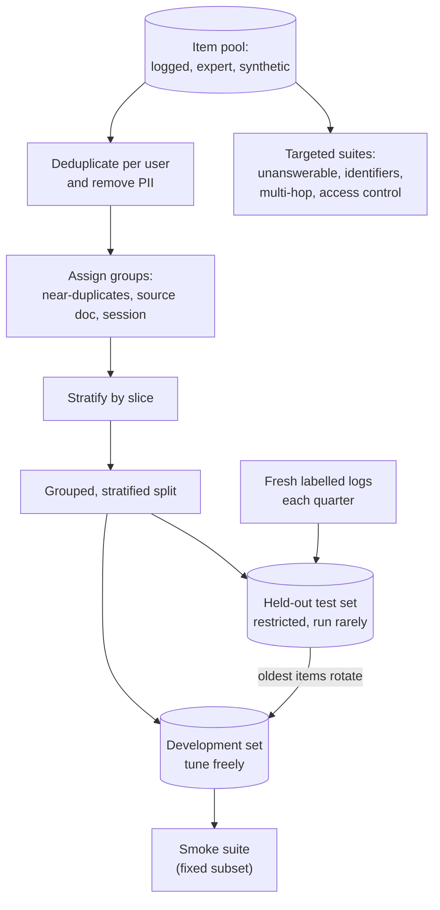

The previous two lessons produced a pool of evaluation items: [golden items](/learn/testing-and-benchmarking/golden-datasets) labelled from logs and by experts, and [synthetic items](/learn/testing-and-benchmarking/synthetic-test-data) generated to fill coverage gaps. A pool is not yet a test. This lesson is about turning it into **test sets**: deciding which items go into which suite, how many from each slice, which ones the team may look at while tuning and which ones it must not, and how to stop near-copies of the same question from sitting on both sides of that line.

These decisions are invisible in a results table, which is why they go wrong. A test set that over-represents easy questions, that the team has tuned against forty times, or whose test items have twins in the tuning set, produces numbers that are precise, repeatable and wrong.

## Learning objectives

- Organise evaluation items into suites (smoke, development, held-out test, targeted) and say what each is for.
- Explain adaptive overfitting to a test set and design a split and rotation policy that limits it.
- Detect near-duplicate leakage between splits and remove it with grouped, stratified splitting.
- Compute the standard error of a stratified estimate and compare proportional and Neyman allocation.
- Build a coverage matrix and decide the minimum number of items per slice.

## Prerequisites

- [Golden datasets](/learn/testing-and-benchmarking/golden-datasets): item fields, slices and the micro, macro and traffic-weighted averages.
- [Synthetic test data](/learn/testing-and-benchmarking/synthetic-test-data): where generated items come from and how they are tagged.
- [Chunk size experiments](/learn/chunking-optimisation/chunk-size-experiments): the standard error of a hit rate and how many questions a comparison needs.
- [Embeddings](/learn/understanding-large-language-models/embeddings): question embeddings are used to find near-duplicates.

## Why this matters

Three failures recur in teams that evaluate RAG systems seriously and still make bad decisions.

**The test set is unrepresentative.** Items were taken in whatever order they arrived: 200 HR questions labelled in the first week, 20 IT questions after. The overall score is mostly an HR score, and an IT regression barely moves it.

**The test set has been tuned on.** Every prompt tweak, every top-k change, every reranker threshold is tried against the same 150 items, and the best one is kept. After forty rounds the configuration fits those 150 items, including their quirks. On fresh questions the gain shrinks or vanishes. This is **adaptive overfitting**: no single comparison is wrong, but choosing the winner of many comparisons on the same data biases the winner's score upwards.

**The splits leak.** Users ask the same thing many ways, so logs contain clusters of near-identical questions. If "how many days annual leave do i get" is in the tuning set and "How many days of annual leave do I get?" is in the test set, tuning on one improves the other, and the test set partly measures memory of the tuning set.

Each failure inflates confidence in a change that does not generalise. Each is prevented by construction rules applied before any evaluation is run.

## The intuition

An exam board writes a large bank of questions. Teachers get past papers and practice questions to prepare students with; the board keeps the real paper locked away until exam day and writes a new one each year. It also makes sure the real paper is not just a practice question with the numbers changed, and that it covers the syllabus in the right proportions rather than whichever topics the setters liked.

Map this onto a RAG team. The question bank is the item pool. The practice questions are the **development set**: look at them as often as you like, tune against them. The real paper is the **held-out test set**: run it rarely, at decision points, and never use it to choose between variants. The syllabus proportions are **stratification**. And the rule against reusing practice questions with new numbers is **grouped splitting**.

## How it works

### Suites and what each is for

One pool feeds several suites, each with a different job and a different run frequency.

| Suite | Size (typical) | Run when | Used for |
| --- | --- | --- | --- |
| Smoke | 20 to 50 | Every commit | Catching gross breakage in minutes |
| Development | 100 to several hundred | Constantly, during tuning | Comparing variants, error analysis |
| Held-out test | 200 to several hundred | Before a release decision | An unbiased estimate of the chosen configuration |
| Targeted suites | 20 to 100 each | When the relevant component changes | Unanswerable questions, identifiers, multi-hop, access control, adversarial inputs |
| Fresh sample | 50 to 100 per period | Periodically | Checking that the held-out set still resembles traffic |

The smoke suite is a small, fixed subset with very clear expectations (the E-4021 question must retrieve the E-4021 runbook). It belongs in [regression testing](/learn/testing-and-benchmarking/regression-testing). Targeted suites exist because some behaviours are too rare in traffic to be measured by a representative sample: if 2 per cent of questions are unanswerable, a 300-item representative set has about 6, which says nothing.

### Sampling from logs

For the representative suites, the starting point is a sample of production questions:

1. **Pick a time window** long enough to cover monthly cycles (expenses deadlines, payroll), and recent enough to reflect current documents.
2. **Deduplicate per user and session** before sampling, so one person asking the same thing five times does not get five chances of selection.
3. **Stratify** by slice: topic, query type, and anything else you will report separately. Within each stratum, sample at random.
4. **Sample the tail deliberately.** Random sampling returns mostly head queries (the frequent ones). Rare queries matter too; draw a separate sample from questions that occurred only once.
5. **Include what users really send**: off-topic questions, greetings, questions about things the system should not answer. These become the out-of-scope slice.

### Development versus held-out test

The core rule: **decisions are made on the development set; the held-out set only confirms them.** Concretely:

- Tune prompts, top-k, thresholds and model choices on the development set. Look at its failures in detail; that is what it is for.
- When a candidate is ready, run it once on the held-out set and report that number. If the held-out result disappoints, do not tune against the held-out failures; go back to the development set, and accept that the next held-out run is now slightly less trustworthy.
- Limit who sees held-out items. Engineers who read the held-out failures will, without meaning to, fix them.
- **Rotate.** Each quarter, add a fresh sample of labelled logs to the held-out set and move the oldest held-out items into development. A held-out set that is regularly refreshed cannot be overfitted for long, and stays representative of current traffic.

Adaptive overfitting is a well-studied problem in statistics and machine learning. Dwork and colleagues (2015, "The reusable holdout") showed formally that reusing one holdout set for many adaptive decisions invalidates its estimates, and proposed mechanisms that limit what each query reveals. In practice, most teams rely on the simpler measures above: few held-out runs, restricted access and rotation.

### Leakage: near-duplicates across splits

Random splitting assumes items are independent. Logged questions are not: several users ask the same question in slightly different words, and synthetic generators produce several questions from one chunk. If such siblings land on both sides of the split, the test set rewards memorising the development set.

The fix is **grouped splitting**: assign every item a group ID so that items in the same group always land in the same split. Useful groupings:

- **Near-duplicate questions**, found by clustering question embeddings with a similarity threshold.
- **Source document**, for synthetic items generated from the same chunk or document.
- **Conversation**, for multi-turn items from the same session.
- **Time**, when the question is whether the system handles *future* questions: put everything before a date in development and everything after it in test (a temporal split).

Grouping and stratification combine: scikit-learn's `StratifiedGroupKFold` keeps groups intact while trying to balance slices across folds.



### The coverage matrix

Lay the slices out as a grid, for example topic down the side and query type across the top, and count items in each cell. Empty and near-empty cells are where the system is untested. Not every cell needs to be full (there may be no identifier questions about annual leave), but every cell that occurs in traffic needs some items, and each slice you intend to report on needs enough items to say something. As a rule of thumb from the standard-error arithmetic in [chunk size experiments](/learn/chunking-optimisation/chunk-size-experiments): with 30 items and a pass rate around 0.8, the 95 per cent interval is about plus or minus 0.14. That detects a collapse, not a drift. Decide per slice what size of change you need to see, and size it accordingly.

## The mathematics

### The stratified estimate and its standard error

**Intuition.** If you sample each slice separately and know each slice's share of traffic, you can estimate the overall pass rate as a weighted average of slice pass rates. Its uncertainty comes only from within-slice variation, not from the luck of how many items of each slice happened to be drawn.

$$
\hat{p}_{\text{st}} = \sum_{h=1}^{H} W_h\, \hat{p}_h, \qquad
\text{SE}(\hat{p}_{\text{st}}) = \sqrt{\sum_{h=1}^{H} W_h^2\, \frac{p_h(1-p_h)}{n_h}}
$$

- $H$: the number of strata (slices); $h$ indexes them.
- $W_h = N_h / N$: stratum $h$'s share of the population (traffic), with $N_h$ its size and $N$ the total.
- $\hat{p}_h$: the observed pass rate in stratum $h$; $p_h$ its true value (use the observed or expected value in planning).
- $n_h$: the number of test items drawn from stratum $h$.

(This ignores the finite-population correction, which is negligible when $n_h$ is small relative to $N_h$.)

### Allocating items to strata

With a fixed labelling budget of $n$ items, how many should each stratum get?

$$
\text{proportional: } n_h = n\,\frac{N_h}{N}, \qquad
\text{Neyman: } n_h = n\,\frac{N_h S_h}{\sum_k N_k S_k}, \quad S_h = \sqrt{p_h(1-p_h)}
$$

Proportional allocation mirrors traffic. **Neyman allocation** (Neyman, 1934) gives more items to strata that are both large and variable, and minimises the standard error of the overall estimate for a given $n$. A pass rate near 0.5 is the most variable; one near 0 or 1 the least.

**Worked example.** Meridian's monthly traffic: 5,000 HR, 3,000 IT and 2,000 product questions ($N = 10{,}000$). Expected pass rates 0.90, 0.70, 0.50. Budget $n = 300$.

- $S$: $\sqrt{0.09} = 0.300$, $\sqrt{0.21} = 0.458$, $\sqrt{0.25} = 0.500$.
- Proportional: $300 \times 0.5 = 150$ HR, $90$ IT, $60$ product.
- Neyman: $N_h S_h$ is 1,500, 1,375 and 1,000, summing to 3,875. HR $= 300 \times 1500/3875 \approx 116$, IT $\approx 106$, product $\approx 77$.
- SE, proportional: $0.25 \times 0.09/150 + 0.09 \times 0.21/90 + 0.04 \times 0.25/60 = 0.000150 + 0.000210 + 0.000167 = 0.000527$; $\sqrt{0.000527} \approx 0.0229$.

```python
import math

N = {"hr": 5000, "it": 3000, "product": 2000}   # monthly questions per slice
p = {"hr": 0.90, "it": 0.70, "product": 0.50}   # expected pass rate per slice
n = 300                                         # items we can afford to label

S = {h: math.sqrt(p[h] * (1 - p[h])) for h in N}
total = sum(N.values())

def stderr(alloc):
    var = sum((N[h] / total) ** 2 * S[h] ** 2 / alloc[h] for h in N)
    return math.sqrt(var)

proportional = {h: n * N[h] / total for h in N}
neyman = {h: n * N[h] * S[h] / sum(N[k] * S[k] for k in N) for h in N}
for name, alloc in [("proportional", proportional), ("Neyman", neyman)]:
    sizes = ", ".join(f"{h}={alloc[h]:.0f}" for h in N)
    print(f"{name:<12} {sizes}   SE of overall rate = {stderr(alloc):.4f}")
```

```output
proportional hr=150, it=90, product=60   SE of overall rate = 0.0229
Neyman       hr=116, it=106, product=77   SE of overall rate = 0.0224
```

The overall precision barely changes: Neyman allocation helps most when strata differ a lot in variability. The larger effect is on the slices. Under proportional allocation the product slice, the one with the worst pass rate and the most uncertainty, gets only 60 items; Neyman gives it 77. In practice teams usually start from proportional allocation, then raise small or important slices to a floor (say 30 to 50 items), and report the overall figure with traffic weights $W_h$, which corrects for the over-sampling.

## In code

**The problem.** Split a pool of logged questions into development and test sets so that (a) near-duplicate questions never straddle the split and (b) every slice appears on both sides, then measure how much a naive random split would have leaked.

**Dependencies.** scikit-learn, NumPy and sentence-transformers with the MiniLM model.

```bash
pip install scikit-learn numpy sentence-transformers
```

```python
import numpy as np
from sentence_transformers import SentenceTransformer
from sklearn.cluster import AgglomerativeClustering
from sklearn.model_selection import GroupShuffleSplit, ShuffleSplit, StratifiedGroupKFold

# A pool of logged questions, tagged with a topic slice. Several users ask the
# same thing in slightly different words, as real logs do.
pool = [
    ("hr", "How many days of annual leave do I get?"),
    ("hr", "how many days annual leave do i get"),
    ("hr", "How many annual leave days do I get per year?"),
    ("hr", "Can I carry over unused leave?"),
    ("hr", "can i carry over my unused leave days"),
    ("hr", "What's the deadline for using carried-over leave?"),
    ("hr", "How many days a week can I work from home?"),
    ("hr", "how many days can i work from home each week"),
    ("hr", "Is there a budget for home office equipment?"),
    ("hr", "what is the home office equipment budget"),
    ("hr", "Are contractors eligible for the equipment budget?"),
    ("finance", "How long do I have to submit expenses?"),
    ("finance", "how long have i got to submit my expenses"),
    ("finance", "Do I need a receipt for a £20 lunch?"),
    ("finance", "Do I need a receipt for a £90 hotel?"),
    ("finance", "Who handles expense queries?"),
    ("it", "How often do I need to change my password?"),
    ("it", "how often must i change my password"),
    ("it", "Do I need the VPN on hotel Wi-Fi?"),
    ("it", "do i need vpn on public wifi"),
    ("it", "What does error E-4021 mean?"),
    ("it", "what does E-4021 mean"),
    ("it", "What does E-4012 mean?"),
    ("it", "When will my laptop be replaced?"),
    ("it", "I lost my laptop, what do I do?"),
    ("it", "What are the support desk hours?"),
    ("it", "what time does the support desk open"),
    ("product", "Can Meridian Reports export to CSV?"),
    ("product", "can meridian reports export csv"),
    ("product", "Does Meridian Reports support SAML single sign-on?"),
    ("product", "Which plan includes SSO for Meridian Reports?"),
    ("product", "How do I export a report as a PDF?"),
]
slices = np.array([s for s, _ in pool])
questions = [q for _, q in pool]

model = SentenceTransformer("sentence-transformers/all-MiniLM-L6-v2")
E = model.encode(questions, normalize_embeddings=True)

# Group near-duplicates: complete linkage means every pair in a group has cosine >= 0.75.
groups = AgglomerativeClustering(
    n_clusters=None, metric="cosine", linkage="complete", distance_threshold=0.25
).fit_predict(E)
print(f"{len(pool)} questions in {groups.max() + 1} groups")
for g in np.unique(groups):
    members = [questions[i] for i in np.where(groups == g)[0]]
    if len(members) > 1:
        print("  group:", " | ".join(members))

def leakage(test_idx, dev_idx):
    """Share of test questions with a near-duplicate (cosine >= 0.75) in dev."""
    nearest = (E[test_idx] @ E[dev_idx].T).max(axis=1)
    return (nearest >= 0.75).mean()

random_splits = ShuffleSplit(n_splits=20, test_size=0.4, random_state=0).split(questions)
grouped_splits = GroupShuffleSplit(n_splits=20, test_size=0.4, random_state=0).split(questions, groups=groups)
for name, splits in [("random split ", random_splits), ("grouped split", grouped_splits)]:
    leaks = [leakage(test, dev) for dev, test in splits]
    print(f"{name}: mean leakage {np.mean(leaks):.2f} (max {np.max(leaks):.2f}) over 20 splits")

# Grouped AND stratified by slice: one fold of three becomes the test set.
sgkf = StratifiedGroupKFold(n_splits=3, shuffle=True, random_state=0)
dev, test = next(sgkf.split(questions, slices, groups))
print(f"stratified grouped split: leakage {leakage(test, dev):.2f}")
for s in np.unique(slices):
    print(f"  {s:<8} dev={np.sum(slices[dev] == s):>2}  test={np.sum(slices[test] == s):>2}")
```

```output
32 questions in 21 groups
  group: What does error E-4021 mean? | what does E-4021 mean
  group: What are the support desk hours? | what time does the support desk open
  group: How long do I have to submit expenses? | how long have i got to submit my expenses
  group: Can I carry over unused leave? | can i carry over my unused leave days
  group: Do I need the VPN on hotel Wi-Fi? | do i need vpn on public wifi
  group: How often do I need to change my password? | how often must i change my password
  group: How many days a week can I work from home? | how many days can i work from home each week
  group: Is there a budget for home office equipment? | what is the home office equipment budget
  group: How many days of annual leave do I get? | how many days annual leave do i get | How many annual leave days do I get per year?
  group: Can Meridian Reports export to CSV? | can meridian reports export csv
random split : mean leakage 0.41 (max 0.69) over 20 splits
grouped split: mean leakage 0.00 (max 0.00) over 20 splits
stratified grouped split: leakage 0.00
  finance  dev= 3  test= 2
  hr       dev= 8  test= 3
  it       dev= 7  test= 4
  product  dev= 3  test= 2
```

**The important lines.**

- `AgglomerativeClustering(..., metric="cosine", linkage="complete", distance_threshold=0.25)` merges questions bottom-up and stops when merging would create a group containing a pair with cosine distance above 0.25, that is, cosine similarity below 0.75. **Complete linkage** is the conservative choice: every pair inside a group is similar, so one chain of loosely related questions cannot sweep half the pool into one group. (Single linkage would allow such chains.)
- `leakage` measures, for each test question, its most similar development question, and counts how many are near-duplicates at the same 0.75 threshold.
- `ShuffleSplit` is the naive split; `GroupShuffleSplit` keeps groups together; `StratifiedGroupKFold` keeps groups together *and* balances slices, and with `n_splits=3` one fold (about a third) becomes the test set.

**What the output means.** Clustering found 10 groups of near-duplicates covering 21 of the 32 questions. With random splitting, on average 41 per cent of test questions had a near-twin in development, and in the worst of 20 splits 69 per cent. Grouped splitting reduces leakage to zero by construction. The stratified grouped split also keeps every slice on both sides; with only 32 items it cannot be exactly proportional, because whole groups have to move together.

Notice what the threshold decides. "What does error E-4021 mean?" and "What does E-4012 mean?" have a cosine of about 0.53 under MiniLM, so they stay separate, which is right: they are different questions with different answers. The E-4021 pair itself scores about 0.79, so a stricter 0.85 threshold would have left those twins ungrouped and able to leak. Calibrate the threshold by inspecting pairs just above and just below it.

**Common errors.** Passing `groups` to `ShuffleSplit` does nothing (scikit-learn warns that the parameter is ignored), which can give false confidence. Clustering thousands of questions with complete linkage builds a full pairwise distance matrix, which is quadratic in memory; beyond roughly 20,000 items, find near-duplicates with a nearest-neighbour index and connect pairs above the threshold instead. And grouping only by question text misses synthetic siblings generated from the same chunk with different wording: add the source document as a second grouping key.

**Extending it.** Combine several grouping keys by taking connected components over "same near-duplicate cluster or same source document or same session". Write the split assignment back into each item (`"split": "dev"`), so that the split is fixed and versioned with the golden set rather than recomputed with a seed that someone might change.

## A real-world example

Over two months, the Platform team improved AskMeridian's answer correctness on its 180-item evaluation set from 0.71 to 0.84, through dozens of small changes: prompt wording, top-k, a reranker threshold, citation formatting. Each change was kept only if it raised the score on those 180 items. Then the team labelled 120 fresh questions from the latest month of logs. On those, the new configuration scored 0.75.

Two causes explained most of the gap. First, adaptive overfitting: several changes had helped a handful of specific items and hurt nothing else in the set, but did nothing for new questions; one prompt rule ("if the question mentions a date, restate the 31 March deadline") existed only because three items asked about carry-over. Second, leakage: the 180 items had been sampled from logs without grouping, and on inspection 38 of them had a near-twin elsewhere in the set, so fixing one fixed its twin and counted twice.

The rebuilt process followed this lesson. The team pooled all 300 labelled items, grouped near-duplicates and synthetic siblings, and made a stratified grouped split: 180 development items for tuning, 120 held-out items readable only by two named people. Held-out runs happen once per release candidate. Each quarter, 60 newly labelled log questions join the held-out set and the oldest 60 move to development. The score on the held-out set is now the one reported to management, and it has stayed within a few points of each fresh sample since.

## Common mistakes

- **One set for everything.** Tuning and reporting on the same items inflates the reported score through adaptive overfitting.
- **Random splits over logged questions.** Near-duplicates straddle the split and the test set partly measures memorisation.
- **Sampling only the most frequent questions.** The set covers a few topics many times and misses the long tail where failures concentrate.
- **Tiny slices reported as if precise.** Five identifier questions at 0.40 are compatible with almost any true rate.
- **Fixing held-out failures directly.** The held-out set turns into a second development set and no unbiased number remains.
- **Never refreshing the held-out set.** Documents and questions drift, and the set measures last year's traffic.
- **Recomputing splits with a random seed at every run.** A library upgrade or seed change silently reshuffles items between development and test.

## Best practices

- Keep separate suites: smoke, development, held-out test and targeted suites, each with a stated purpose and run frequency.
- Deduplicate per user and session, then stratify by slice and sample at random within slices, plus a deliberate tail sample.
- Group near-duplicates, synthetic siblings and conversations, and split by group; stratify across slices at the same time.
- Store each item's split in the dataset and version it.
- Restrict access to held-out items, run them only at decision points, and rotate fresh labelled logs in each period.
- Maintain a coverage matrix and a minimum item count for every slice you report.
- Report traffic-weighted overall scores when strata were over- or under-sampled.

## Performance considerations

- **Embedding the pool.** MiniLM encodes a few thousand short questions in seconds on a CPU; even 100,000 takes minutes. This is a one-off per pool version.
- **Clustering.** Agglomerative clustering on $n$ items stores about $n^2/2$ distances: at 10,000 items that is 50 million floats, roughly 400 MB in 64-bit floats, at the edge of comfortable. Above that, use approximate nearest-neighbour search (FAISS, for example) to find pairs above the threshold, then connected components.
- **Running suites.** Cost scales with suite size times per-item cost. If one item costs one RAG call and one judge call, the smoke suite (30 items) is cheap enough for every commit, the development set for every experiment, and the held-out set for release candidates only, which is also what its statistical role requires.
- **Labelling budget.** Allocation decides where expert hours go; Neyman-style reasoning says spend them where results are both common and uncertain.

## Security considerations

Test sets sampled from logs carry the same personal-data risk as any copy of logs; remove personal data before items enter the pool, and treat the held-out set as restricted. Include an access-control suite: items asked as specific roles (an employee, a contractor, an HR partner) whose correct behaviour depends on permissions, run with those roles' real credentials, so that a change that leaks restricted documents fails a test instead of reaching users. Adversarial items (prompt-injection attempts in questions, questions designed to extract other users' data) belong in their own targeted suite, run on every change to prompts, retrieval filters or models.

## Summary

- A pool of items becomes several suites: smoke, development, held-out test, targeted suites and fresh samples, each with its own job.
- Tune on the development set; run the held-out set rarely, restrict access to it, and rotate fresh items in to prevent adaptive overfitting.
- Split by groups (near-duplicates, source documents, sessions, time) so that siblings never straddle the split.
- Stratify by slice and size each reported slice for the precision you need; Neyman allocation minimises overall error for a fixed budget.
- Fix and version the split assignment instead of recomputing it.

## Exercises

**1.** A held-out set of 200 items is 70 per cent HR, but HR is 40 per cent of traffic, IT 40 per cent and product 20 per cent. Slice pass rates are HR 0.90 (140 items), IT 0.70 (40 items), product 0.60 (20 items). Compute the plain average and the traffic-weighted estimate, and the standard error of the weighted estimate.

<details><summary>Show solution</summary>

Plain average: $(140 \times 0.90 + 40 \times 0.70 + 20 \times 0.60)/200 = (126 + 28 + 12)/200 = 0.83$.

Weighted: $0.4 \times 0.90 + 0.4 \times 0.70 + 0.2 \times 0.60 = 0.36 + 0.28 + 0.12 = 0.76$.

SE: $0.16 \times 0.09/140 + 0.16 \times 0.21/40 + 0.04 \times 0.24/20 = 0.000103 + 0.000840 + 0.000480 = 0.001423$; $\sqrt{0.001423} \approx 0.038$. The IT slice contributes most of the uncertainty, because it carries a large weight with few items: the next labelling effort should go there.

</details>

**2.** Extend the code so that synthetic items generated from the same source document share a group with each other, even when their questions are not similar. Describe how you would combine this with the near-duplicate clusters.

<details><summary>Show solution</summary>

Treat items as nodes in a graph and add an edge for every relation that must keep two items together, then take connected components as groups:

```python
import networkx as nx

G = nx.Graph()
G.add_nodes_from(range(len(items)))
for i in range(len(items)):
    for j in range(i + 1, len(items)):
        same_cluster = clusters[i] == clusters[j]
        same_source = items[i]["source"] == "synthetic" and items[i]["doc_id"] == items[j]["doc_id"]
        if same_cluster or same_source:
            G.add_edge(i, j)
groups = np.empty(len(items), dtype=int)
for g, component in enumerate(nx.connected_components(G)):
    groups[list(component)] = g
```

Pass `groups` to `StratifiedGroupKFold` as before. Watch for one giant component (for example, if one document generated 200 questions): it cannot be split and may dominate one side; cap questions per document at generation time.

</details>

**3.** Your team runs 60 prompt variants against a 150-item development set and the best scores 0.86 against the baseline's 0.80. A manager wants to announce "+6 points". What do you say, and what do you do before anything is announced?

<details><summary>Show solution</summary>

The best of 60 variants on the same 150 items is biased upwards: even if all 60 were truly identical to the baseline, random variation across items would make the maximum look better (the standard error of a pass rate near 0.8 on 150 items is about 0.033, so a +0.06 maximum among 60 tries is unremarkable). Before announcing, run the chosen variant and the baseline once on the held-out set, compared per item (paired), and report that difference with its confidence interval. If it holds up, announce the held-out number. If not, the gain was mostly selection.

</details>

**4.** Design the suites for a new AskMeridian feature that answers questions about Meridian Relay for external customers, where only 300 labelled items can be afforded in the first month and there are no logs yet.

<details><summary>Show solution</summary>

- **Pool.** About 150 expert-written questions from the support team (from support tickets, which are real customer wording), about 100 synthetic questions for documentation coverage (tagged), and 50 targeted items.
- **Targeted suites (50).** Unanswerable and out-of-scope questions (pricing negotiations, other products); questions that must not reveal internal-only Atlas runbooks (access control); prompt-injection attempts.
- **Split.** Group by near-duplicate cluster and source document; stratified grouped split into about 150 development and 100 held-out, with the synthetic items mostly in development (they are for coverage, not for the headline number).
- **Smoke.** 25 items from development with unambiguous expectations.
- **After launch.** Label 50 to 100 real customer questions per month, add them to the held-out set, and rotate expert and synthetic items into development until the held-out set is mostly real traffic.

</details>

## Check your understanding

```quiz
[
  {
    "q": "What is adaptive overfitting to a test set?",
    "options": [
      "A model that memorises its training data",
      "Choosing among many variants by their score on the same items, so the winner's score is biased upwards",
      "A test set that is too small",
      "Overfitting caused by synthetic data"
    ],
    "answer": 1,
    "why": "Each comparison may be fair, but selecting the best of many on one set inflates the selected score; fresh items reveal the gap."
  },
  {
    "q": "Why does a random split of logged questions into development and test sets leak?",
    "options": [
      "Users ask the same question in many similar ways, so near-twins land on both sides",
      "Random splits are not reproducible",
      "Logs are sorted by time",
      "Random splits cannot be stratified"
    ],
    "answer": 0,
    "why": "Near-duplicates are not independent; grouping them and splitting by group removes the leak."
  },
  {
    "q": "Why use complete linkage rather than single linkage to cluster near-duplicate questions?",
    "options": [
      "It is faster",
      "It needs no threshold",
      "It produces exactly two clusters",
      "Every pair within a group must be similar, so chains of loosely related questions do not merge into one huge group"
    ],
    "answer": 3,
    "why": "Single linkage merges through chains of neighbours; complete linkage bounds the dissimilarity of every pair in the group."
  },
  {
    "q": "Neyman allocation assigns more test items to strata that are:",
    "options": [
      "Smallest in traffic",
      "Newest",
      "Large in traffic and high in variability (pass rates near 0.5)",
      "Already performing best"
    ],
    "answer": 2,
    "why": "Neyman allocation sets each stratum's sample proportional to its size times its standard deviation, minimising overall error."
  },
  {
    "q": "A held-out result is disappointing. What should the team do next?",
    "options": [
      "Return to the development set to diagnose and tune, and treat the next held-out run as slightly less trustworthy",
      "Read the held-out failures and fix them directly",
      "Move the failing held-out items to the smoke suite",
      "Delete the held-out failures"
    ],
    "answer": 0,
    "why": "Fixing held-out failures directly turns the held-out set into a development set and destroys its unbiased role."
  }
]
```

## Further reading

- William G. Cochran, *Sampling Techniques*, 3rd edition, Wiley, 1977, chapter 5 on stratified random sampling and optimum allocation.
- Jerzy Neyman, "On the Two Different Aspects of the Representative Method", *Journal of the Royal Statistical Society*, 1934.
- Cynthia Dwork, Vitaly Feldman, Moritz Hardt, Toniann Pitassi, Omer Reingold and Aaron Roth, "The reusable holdout: Preserving validity in adaptive data analysis", *Science*, 2015.
- scikit-learn user guide, cross-validation iterators for grouped data (`GroupShuffleSplit`, `StratifiedGroupKFold`). [scikit-learn.org](https://scikit-learn.org/stable/modules/cross_validation.html)
