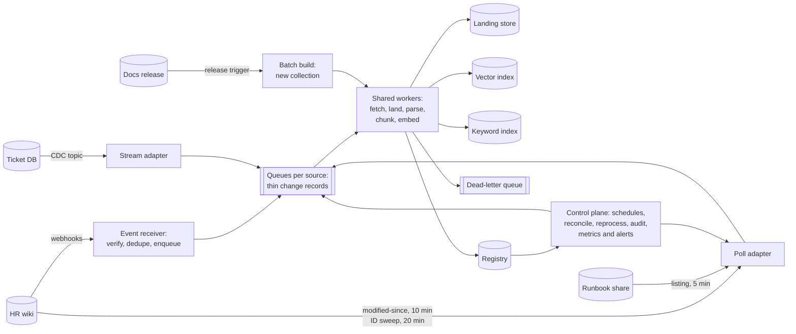

This assessment covers all six lessons of **Understanding Document Ingestion**: what ingestion is and the guarantees it owes the index, batch jobs, streaming from a log, incremental syncs, event-driven ingestion and the architecture that combines them. Answer the 20 multiple-choice questions first; the pass mark is 70% (14 of 20). Then work through the conceptual questions, the coding exercises, the design challenge and the troubleshooting scenarios, writing your own answer before opening each model answer. The written parts are not scored, but they test whether you can apply the ideas, not just recognise them.

```quiz
[
  {
    "q": "Which statement best describes where ingestion ends and the rest of the indexing pipeline begins?",
    "options": [
      "Ingestion ends once text has been chunked",
      "Ingestion ends once vectors are stored",
      "Ingestion ends with a source document record (raw bytes plus identity, version and permissions) that later stages can process without contacting the source again",
      "Ingestion and indexing are the same thing"
    ],
    "answer": 2,
    "why": "Ingestion discovers, fetches and records documents with their metadata. Parsing, cleaning, chunking and embedding operate on what it delivered."
  },
  {
    "q": "A connector cannot read the access restrictions of one wiki space. What is the correct behaviour?",
    "options": [
      "Quarantine those pages, count them in the run report and alert",
      "Index them as visible to all staff",
      "Index them as visible to the connector's service account only",
      "Skip them silently"
    ],
    "answer": 0,
    "why": "Unknown permissions must never become public by default. Quarantine keeps them out of the index; the count and alert make sure the gap gets fixed."
  },
  {
    "q": "A run reports seen 5,000, ingested 4,700, skipped 120, quarantined 30, failed 50. What should you conclude?",
    "options": [
      "The run is healthy",
      "100 items are unaccounted for, so the run has lost track of some items",
      "The skipped items should be retried",
      "Failed items should have been counted as skipped"
    ],
    "answer": 1,
    "why": "4,700 + 120 + 30 + 50 = 4,900, not 5,000. Seen must equal the sum of all terminal states."
  },
  {
    "q": "A batch job checkpoints each batch after writing it to the index, with idempotent upserts. It crashes between the write and the checkpoint. What happens on resume?",
    "options": [
      "The batch is lost",
      "The batch is duplicated in the index",
      "The job must restart from the beginning",
      "The batch is processed again and the upserts overwrite identical records, so the index is correct"
    ],
    "answer": 3,
    "why": "Write-then-checkpoint gives at-least-once processing; idempotent writes make the repeat harmless."
  },
  {
    "q": "A source allows 15 requests per second. Each fetch takes 0.4 s. What is the smallest number of concurrent workers that reaches the rate limit?",
    "options": ["4", "15", "6", "38"],
    "answer": 2,
    "why": "Workers achieve c / t fetches per second. c / 0.4 >= 15 requires c >= 6. More workers only produce rate-limit errors."
  },
  {
    "q": "Which of these responses should a batch fetch retry with backoff?",
    "options": [
      "HTTP 429 Too Many Requests",
      "HTTP 404 Not Found",
      "HTTP 401 Unauthorized",
      "A file the parser reports as corrupt"
    ],
    "answer": 0,
    "why": "429 is transient: waiting (ideally as long as Retry-After says) should succeed. The others will fail the same way every time."
  },
  {
    "q": "Why does a full rebuild build into a new collection and then move an alias, instead of writing into the live collection?",
    "options": [
      "Vector databases cannot overwrite points",
      "Users never see a half-built index, and a failed or rejected build leaves the previous one live",
      "Aliases make queries faster",
      "It halves the storage needed"
    ],
    "answer": 1,
    "why": "Build-then-swap isolates users from an in-progress or bad build; it costs extra storage during the switch."
  },
  {
    "q": "In a partitioned log such as a Kafka topic, which ordering guarantee holds?",
    "options": [
      "All records in the topic are totally ordered",
      "No ordering is guaranteed at all",
      "Records are ordered by timestamp across partitions",
      "Records within one partition are ordered, so records with the same key are processed in production order"
    ],
    "answer": 3,
    "why": "Order holds per partition; keying by document ID places all of a document's changes in one partition."
  },
  {
    "q": "What does this print?\n```python\nversions = {}\ndef apply(doc, v):\n    if v <= versions.get(doc, 0):\n        return \"skip\"\n    versions[doc] = v\n    return \"apply\"\nprint([apply(\"HR-1\", v) for v in [2, 1, 3, 3, 2]])\n```",
    "options": [
      "`['apply', 'apply', 'apply', 'apply', 'apply']`",
      "`['apply', 'skip', 'apply', 'skip', 'skip']`",
      "`['apply', 'skip', 'apply', 'apply', 'skip']`",
      "`['skip', 'skip', 'apply', 'skip', 'skip']`"
    ],
    "answer": 1,
    "why": "Version 2 applies; 1 is older; 3 applies; the second 3 is a duplicate; the final 2 is older than 3. A version-checked sink ignores duplicates and late arrivals."
  },
  {
    "q": "A streaming consumer commits offsets before writing records to the index. What delivery guarantee results?",
    "options": [
      "At-most-once: a crash between commit and write loses those records",
      "At-least-once",
      "Exactly-once",
      "Effectively-once"
    ],
    "answer": 0,
    "why": "The commit says the records are done, so a restarted consumer starts after them even though they were never written."
  },
  {
    "q": "Records arrive at 0.5 per second. A micro-batch closes at 50 records or after 4 seconds. About how many records does a typical batch hold?",
    "options": ["50", "25", "2", "0.5"],
    "answer": 2,
    "why": "Filling 50 records would take 100 s, so the 4-second timer closes the batch first, with about 0.5 x 4 = 2 records."
  },
  {
    "q": "A backlog of 24,000 records has built up. Consumers process 70 per second and new records arrive at 10 per second. How long until the backlog is cleared?",
    "options": ["About 343 s", "2,400 s", "400 s", "It never clears"],
    "answer": 2,
    "why": "The backlog shrinks at mu - lambda = 60 per second, so 24,000 / 60 = 400 s."
  },
  {
    "q": "A sync asks for `updated_at > last_watermark`, page size 100. A bulk job stamps 250 tickets with the same second. What happens?",
    "options": [
      "100 are indexed; the next request skips the other 150 because their timestamp is not greater than the watermark",
      "All 250 are indexed",
      "None are indexed",
      "They are indexed twice"
    ],
    "answer": 0,
    "why": "This is the tie bug. A compound (updated_at, id) cursor pages through equal timestamps correctly."
  },
  {
    "q": "What problem does a lookback window in an incremental sync solve?",
    "options": [
      "Ties between equal timestamps on a page boundary",
      "Rows whose timestamps fall behind the watermark before they become visible, through late commits, replica lag or clock skew",
      "Deleted rows",
      "Rate limits on the source"
    ],
    "answer": 1,
    "why": "Re-reading a window behind the watermark catches late-visible rows; version checks make the re-read harmless."
  },
  {
    "q": "What does this print?\n```python\nindexed = {\"A\", \"B\", \"C\", \"D\", \"E\"}\nlisted = {\"A\", \"C\", \"E\", \"F\"}\nprint(sorted(indexed - listed), sorted(listed - indexed))\n```",
    "options": [
      "`['F'] ['B', 'D']`",
      "`['A', 'C', 'E'] ['F']`",
      "`['B', 'D'] []`",
      "`['B', 'D'] ['F']`"
    ],
    "answer": 3,
    "why": "Indexed minus listed gives deletion candidates (B, D); listed minus indexed gives new documents (F). Deleting B and D is safe only if the listing was complete."
  },
  {
    "q": "A mark-and-sweep run would delete 38% of a source's documents from the index. The listing reported no errors. What should the system do?",
    "options": [
      "Delete them all; the listing was complete",
      "Delete half and wait for the next run",
      "Refuse, alert and let a human confirm, because a listing that silently returned less is far likelier than a genuine mass deletion",
      "Re-embed all documents"
    ],
    "answer": 2,
    "why": "A deletion-fraction guard protects against broken or permission-limited listings; a real mass deletion can then be applied deliberately."
  },
  {
    "q": "Why should an embedding cache be keyed by a hash of the model identifier and the text, not the text alone?",
    "options": [
      "So that after a model change, old-model vectors are not reused and mixed into the index",
      "To make the cache smaller",
      "Because identical texts never occur",
      "Because embedding APIs require it"
    ],
    "answer": 0,
    "why": "Vectors from different models are not comparable. Including the model makes a model change miss the cache everywhere."
  },
  {
    "q": "A webhook handler parses the JSON body, re-serialises it and checks the HMAC signature on the result. Genuine requests from the provider are rejected. Why?",
    "options": [
      "HMAC cannot be computed over JSON",
      "The secret has expired",
      "The provider uses a different hash function for every request",
      "The signature was computed over the exact raw bytes sent; re-serialising changes whitespace, key order or escaping"
    ],
    "answer": 3,
    "why": "Always verify against the raw request body, before parsing."
  },
  {
    "q": "Why does event-driven ingestion fetch the document's current state rather than indexing the event's payload?",
    "options": [
      "Payloads are always empty",
      "Events can arrive duplicated and out of order; fetching current state with a version check makes arrival order irrelevant and confirms deletions",
      "Fetching is cheaper than reading the payload",
      "Webhooks cannot carry JSON"
    ],
    "answer": 1,
    "why": "Notify-then-fetch treats events as hints, so a delayed older event cannot overwrite newer content and a mistaken deletion event cannot remove a live page."
  },
  {
    "q": "At peak, 8 documents per second reach the embedding stage, and each takes 0.375 s of embedding work. By Little's law, how many embedding workers are busy on average?",
    "options": ["3", "21", "0.05", "8"],
    "answer": 0,
    "why": "L = lambda x W = 8 x 0.375 = 3. Provision more than that for headroom, for example 5 at 70% utilisation."
  }
]
```

## Conceptual questions

**1.** Name the four guarantees an ingestion system owes the index and, for each, give one concrete failure that violates it and the mechanism from this module that prevents it.

<details><summary>Show model answer</summary>

**Completeness**: every in-scope document is indexed. Violated when a connector reads only the first page of a paginated listing. Prevented by following pagination to the end and by per-run accounting (seen equals ingested plus skipped plus quarantined plus failed), with a comparison against source-reported counts.

**Freshness**: changes reach the index within an agreed time. Violated when a watermark sync misses late-committing rows, or when a webhook subscription expires unnoticed. Prevented by compound cursors with a lookback window, events backed by a scheduled pull sync, and lag and silence monitoring.

**Fidelity**: the index reflects the source's content and metadata, especially permissions. Violated when unknown permissions are treated as public, or when an older version overwrites a newer one after a redelivery. Prevented by quarantining records with unknown permissions and by version-checked, idempotent writes.

**Deletion**: removed documents leave the index. Violated by add-only scripts and by modified-since syncs that cannot see deletes. Prevented by tombstones in streams, deletion events confirmed by fetching, and guarded mark-and-sweep against complete listings.

</details>

**2.** Batch versus streaming, incremental versus full, and event-driven versus scheduled are often presented as one choice. Explain why they are three independent choices, and give an example system for two different combinations.

<details><summary>Show model answer</summary>

They answer different questions. **Batch versus streaming** is about the shape of the input: a bounded snapshot processed as a job, or an unbounded, ordered sequence consumed continuously. **Incremental versus full** is about how much is processed: only what changed, or everything. **Event-driven versus scheduled** is about what starts the work: a notification from the source, or a timetable.

Examples: a nightly job that runs a modified-since query and processes only changed pages is **batch, incremental and scheduled**. The weekly full rebuild into a new collection is **batch, full and scheduled**, or event-driven if the documentation release pipeline triggers it. A CDC consumer reading the ticket database's change stream is **streaming and incremental**; its trigger is effectively continuous. A webhook receiver that writes events onto a Kafka topic consumed by an indexer is **event-driven at the edge and streaming in the core**, and incremental throughout.

</details>

**3.** Explain at-most-once, at-least-once and effectively-once processing in terms of the order of "write to the index" and "record progress", and explain why effectively-once is achieved at the sink rather than by the transport.

<details><summary>Show model answer</summary>

If a consumer **records progress first** (commits an offset, saves a cursor or token, marks a checkpoint) and then writes, a crash between the two loses the work: **at-most-once**. If it **writes first** and then records progress, a crash between them causes the work to be repeated: **at-least-once**. Loss cannot be repaired, so at-least-once is the standard choice.

**Effectively-once** means the final state of the index is as if each change had been applied exactly once, even though some were delivered more than once. It requires the write itself to be idempotent and order-aware: stable IDs, upserts, delete-then-write per document, and a version check that rejects anything not newer than what is stored. The transport cannot provide this on its own because the index is a separate system: even a log with transactional exactly-once guarantees internally cannot make "write to the vector database" and "commit the offset" a single atomic operation. Only the sink can make a repeated write harmless.

</details>

**4.** Why must an event-driven ingestion path always be backed by a pull-based path, and how do you choose the pull path's interval?

<details><summary>Show model answer</summary>

Webhook and notification delivery is best-effort. Events are lost when your endpoint is down longer than the provider's retry window, when retries are exhausted, when a subscription expires without renewal, or occasionally through provider faults. A lost event leaves no trace: the document is simply stale until it next changes, which may be never. Only a mechanism that asks the source for its state (a modified-since sync, a change feed, a listing and compare) can discover the miss.

The pull path's interval is the worst-case staleness for any change whose event was lost, so it is chosen from the freshness requirement for such changes. If deletions must propagate within an hour regardless of events, the deletion sweep must run comfortably more often than hourly (allowing for a refused sweep). The expected number of stale documents at any time is roughly the lost-change rate times half the interval, which helps judge whether a cheaper, longer interval is acceptable. Monitoring (subscription status, unusual silence) shortens the time to notice a systematic loss.

</details>

**5.** The ingestion architecture lesson recommends that every adapter emit a thin change record and that one shared worker pipeline process them all. What concrete capabilities does this buy, compared with one complete pipeline per source?

<details><summary>Show model answer</summary>

**One place to change processing.** A new parser, chunker or embedding model is one change applied to every source, rather than several changes that drift apart.

**Safe overlap between paths.** Because a webhook, a poll and a reconciliation all produce the same record and the worker deduplicates by version against the registry, a slow but complete path can back up a fast but lossy one without double-indexing.

**Cheap reprocessing.** With a registry that records each document's version and pipeline version and a landing store that holds raw content, reprocessing after a pipeline change is a query plus a replay that contacts no source.

**Uniform operations.** One set of metrics (freshness lag, queue age, outcomes by path, dead-letter depth, drift), one dead-letter queue and one set of alerts covers every source; the `via` field shows which path produced each outcome.

**Consistent security.** Permissions handling, deletion handling and tenant isolation are implemented once, so a fix applies everywhere. The cost is a queue hop and a fetch per change, which is small next to embedding.

</details>

## Coding exercises

**1. A version-checked, coalescing sink.** Write `apply_changes(index, versions, changes)` where each change is `(doc_id, version, text)` and `text` of `None` means the document was deleted. Within a batch, keep only the newest change per document; apply a change only if its version is newer than the stored one; remember versions of deleted documents. Return counts of received, coalesced-away, stale, upserted and deleted changes. Test it with a batch that contains a superseded edit, an out-of-date redelivery and a create-then-delete, then a second batch of redeliveries.

<details><summary>Show solution</summary>

```python
def apply_changes(index: dict, versions: dict, changes: list[tuple]) -> dict:
    """changes: (doc_id, version, text_or_None). Returns counts; mutates index and versions."""
    latest = {}
    for doc_id, version, text in changes:                  # coalesce: newest per document
        if doc_id not in latest or version > latest[doc_id][0]:
            latest[doc_id] = (version, text)
    counts = {"received": len(changes), "coalesced_away": len(changes) - len(latest),
              "stale": 0, "upserted": 0, "deleted": 0}
    for doc_id, (version, text) in sorted(latest.items()):
        if version <= versions.get(doc_id, 0):
            counts["stale"] += 1
            continue
        versions[doc_id] = version                           # remembered even after deletion
        if text is None:
            index.pop(doc_id, None)
            counts["deleted"] += 1
        else:
            index[doc_id] = text
            counts["upserted"] += 1
    return counts


index, versions = {"leave": "Annual leave is 25 days."}, {"leave": 3}
batch_1 = [
    ("budget", 1, "Equipment budget is £250."),
    ("budget", 2, "Equipment budget is £400."),
    ("leave", 2, "Annual leave is 20 days."),        # older than what we hold
    ("hours", 1, "Support desk 09:00 to 17:00."),
    ("hours", 2, "Support desk 08:00 to 18:00 UK time."),
    ("proxy", 1, "Use the legacy proxy."),
    ("proxy", 2, None),                               # deleted
]
print(apply_changes(index, versions, batch_1))
batch_2 = [("proxy", 1, "Use the legacy proxy."), ("budget", 2, "Equipment budget is £400.")]  # redelivered
print(apply_changes(index, versions, batch_2))
for k in sorted(index):
    print(f"  {k:<7} v{versions[k]}  {index[k]}")
```

```output
{'received': 7, 'coalesced_away': 3, 'stale': 1, 'upserted': 2, 'deleted': 1}
{'received': 2, 'coalesced_away': 0, 'stale': 2, 'upserted': 0, 'deleted': 0}
  budget  v2  Equipment budget is £400.
  hours   v2  Support desk 08:00 to 18:00 UK time.
  leave   v3  Annual leave is 25 days.
```

The first batch's seven changes coalesce to four (`budget` v2, `hours` v2, `leave` v2, `proxy` v2). `leave` v2 is stale against the stored v3, so the 25-day policy survives an out-of-date redelivery. `proxy` was created and deleted within the batch, so only the tombstone is applied, and because `versions` keeps `proxy` at 2, the redelivered `proxy` v1 in the second batch cannot resurrect it. Both redeliveries in the second batch are stale; nothing is written. Results are processed in sorted order only to make the output repeatable.

</details>

**2. Keyset pagination with a lookback, in SQL.** Using SQLite, implement `sync(cursor, lookback, page_size, seen)` over a `tickets(id, updated_at, title)` table. It must page with a compound `(updated_at, id)` cursor, start each run `lookback` seconds behind the saved cursor, skip rows whose version it has already seen, never move the saved cursor backwards, and return the new cursor and the IDs it actually processed. Show that four tickets sharing one timestamp are all processed with a page size of two, that a row committed late behind the cursor is caught, and that a third run with no changes processes nothing.

<details><summary>Show solution</summary>

```python
import sqlite3

db = sqlite3.connect(":memory:")
db.execute("CREATE TABLE tickets (id TEXT PRIMARY KEY, updated_at INTEGER, title TEXT)")
db.executemany("INSERT INTO tickets VALUES (?, ?, ?)", [
    ("T-1", 100, "VPN drops on hotel Wi-Fi"), ("T-2", 100, "Password reset loop"),
    ("T-3", 100, "Laptop will not boot"), ("T-4", 100, "Reports export fails"),
    ("T-5", 130, "SAML login error"),
])


def sync(cursor: tuple[int, str], lookback: int, page_size: int, seen: dict) -> tuple[tuple, list]:
    ts, last_id = cursor
    start = (ts - lookback, "") if lookback else (ts, last_id)
    fetched = []
    while True:
        rows = db.execute(
            "SELECT id, updated_at, title FROM tickets WHERE (updated_at, id) > (?, ?) "
            "ORDER BY updated_at, id LIMIT ?", (*start, page_size)).fetchall()
        if not rows:
            break
        for tid, upd, title in rows:
            if seen.get(tid) != upd:                     # version check makes re-reads harmless
                seen[tid] = upd
                fetched.append(tid)
            start = (upd, tid)
        cursor = max(cursor, start)
    return cursor, fetched


seen: dict[str, int] = {}
cursor, got = sync((0, ""), lookback=60, page_size=2, seen=seen)
print("run 1:", got, "cursor", cursor)
db.execute("INSERT INTO tickets VALUES ('T-6', 110, 'Committed late')")       # behind the cursor
db.execute("UPDATE tickets SET updated_at = 140, title = 'VPN fixed' WHERE id = 'T-1'")
cursor, got = sync(cursor, lookback=60, page_size=2, seen=seen)
print("run 2:", got, "cursor", cursor)
cursor, got = sync(cursor, lookback=60, page_size=2, seen=seen)
print("run 3:", got, "cursor", cursor)
```

```output
run 1: ['T-1', 'T-2', 'T-3', 'T-4', 'T-5'] cursor (130, 'T-5')
run 2: ['T-6', 'T-1'] cursor (140, 'T-1')
run 3: [] cursor (140, 'T-1')
```

`WHERE (updated_at, id) > (?, ?)` is a row-value comparison (supported by SQLite since 3.15 and by PostgreSQL), so pages continue exactly after the last row seen even when timestamps tie: run 1 processed T-1 to T-4 through two pages that both had `updated_at = 100`. In run 2, T-6 was inserted with `updated_at = 110`, behind the saved cursor of 130; starting 60 seconds back (at 70) caught it, alongside the edited T-1. The rows re-read inside the window (T-2 to T-5) were skipped by the version check, and run 3 re-read the window again and processed nothing. `max(cursor, start)` stops the lookback from rewinding the saved cursor.

</details>

**3. Webhook verification with secret rotation.** Write `verify(body, timestamp, signature, secrets, now, tolerance=300)` for a provider that signs `timestamp + "." + body` with HMAC-SHA256 and sends `sha256=<hex>`. It must accept a signature made with any of the current secrets (so that a secret can be rotated without downtime), compare in constant time, reject timestamps outside the tolerance, and reject malformed timestamps. Test six cases: new secret, old secret, a re-serialised body, an altered timestamp, a replay ten minutes later and a non-numeric timestamp.

<details><summary>Show solution</summary>

```python
import hashlib
import hmac


def verify(body: bytes, timestamp: str, signature: str, secrets: list[bytes],
           now: int, tolerance: int = 300) -> str:
    """Return 'ok' or the reason for rejection. Accepts any current secret (for rotation)."""
    try:
        ts = int(timestamp)
    except ValueError:
        return "rejected: malformed timestamp"
    signed = timestamp.encode() + b"." + body
    if not any(hmac.compare_digest("sha256=" + hmac.new(s, signed, hashlib.sha256).hexdigest(), signature)
               for s in secrets):
        return "rejected: bad signature"
    if abs(now - ts) > tolerance:
        return "rejected: outside tolerance"
    return "ok"


old, new = b"secret-2026-q3", b"secret-2026-q4"
body = b'{"event_id":"e42","type":"page_updated","page_id":"HR-1"}'
now = 1_800_000_000


def sig(secret, ts, payload):
    return "sha256=" + hmac.new(secret, ts.encode() + b"." + payload, hashlib.sha256).hexdigest()


ts = str(now)
cases = {
    "signed with new secret": (body, ts, sig(new, ts, body)),
    "signed with old secret": (body, ts, sig(old, ts, body)),
    "body re-serialised":     (body.replace(b",", b", "), ts, sig(new, ts, body)),
    "timestamp altered":      (body, str(now + 1), sig(new, ts, body)),
    "replayed 10 min later":  (body, str(now - 600), sig(new, str(now - 600), body)),
    "garbage timestamp":      (body, "yesterday", sig(new, ts, body)),
}
for name, (b, t, s) in cases.items():
    print(f"{name:<24} {verify(b, t, s, [new, old], now)}")
```

```output
signed with new secret   ok
signed with old secret   ok
body re-serialised       rejected: bad signature
timestamp altered        rejected: bad signature
replayed 10 min later    rejected: outside tolerance
garbage timestamp        rejected: malformed timestamp
```

The re-serialised body (spaces added after commas) and the altered timestamp both fail the signature check, because the HMAC covers the exact bytes of both. The replay carries a valid signature over its own old timestamp, so it passes the signature check and is rejected by the tolerance check; that is why the timestamp must be inside the signed string. Accepting a list of secrets lets you deploy the new secret to the receiver first, then switch the provider to it, then remove the old one. `hmac.compare_digest` is used for every comparison so response time does not reveal how much of a forged signature was correct.

</details>

## Architecture design challenge

**Brief.** Design the ingestion system for a second version of AskMeridian. Sources: (1) the HR wiki holding the employee handbook, about 4,000 pages, edited a few dozen times a day, which offers webhooks and a modified-since API but no change feed; (2) the IT runbooks, about 1,500 Markdown and PDF files on a file share with no notifications; (3) the support ticket database (PostgreSQL), changing all day, which the analytics team already streams to Kafka through change data capture; (4) product documentation, published in releases every two weeks. Requirements: handbook edits searchable within 5 minutes; runbook edits within 15 minutes; tickets within 2 minutes; deleted or permission-restricted content removed within 1 hour, even if events are lost; the chunker and embedding model will change at least twice a year; the vector and keyword indexes must agree; and the on-call engineer must be able to tell, at any time, how fresh each source is and what has failed.

<details><summary>Show reference design</summary>



**How each requirement is met.**

- **Handbook within 5 minutes.** Webhooks into a verifying receiver; the worker debounces per page (quiet 30 s, maximum wait 2 min) and fetches current state. Backstop: a modified-since sync every 10 minutes with a compound cursor and a lookback window, so a lost event costs at most about 10 minutes plus processing. That slightly exceeds 5 minutes in the rare lost-event case; state this to HR, or poll every 4 minutes if the guarantee must be strict.
- **Runbooks within 15 minutes.** No events, and 1,500 files is small: list the share every 5 minutes with modification times as version markers, fetch only changed files. The same complete listing detects deletions, under the completeness and fraction guards.
- **Tickets within 2 minutes.** A consumer group of the existing CDC topic, keyed by ticket ID, using the database log position as the version, micro-batching with a short maximum wait, and committing offsets after the write. Lag in seconds is alerted at 90 seconds.
- **Deletions and permission changes within 1 hour.** Wiki: deletion webhooks confirmed by fetching, plus a guarded mark-and-sweep of page IDs every 20 minutes, and a permissions re-read in the same sweep, since many wikis do not bump a page's modification time on permission changes. Runbooks: covered by the 5-minute listing. Tickets: CDC delete events and permission columns arrive in the stream. Documentation: each release build is complete, so withdrawn pages vanish at the alias swap; an urgent withdrawal between releases is handled by a manual delete record.
- **Pipeline changes.** The registry records version and pipeline version per document; raw content sits in the landing store. A chunker or model change bumps the pipeline version and replays from the landing store into a new collection, evaluated and then published by moving an alias, without contacting any source.
- **Vector and keyword agreement.** Idempotent delete-then-write to both indexes, registry written last, and an hourly audit comparing chunk counts and orphans, with automatic re-enqueue for disagreements.
- **Visibility.** Per-source dashboards for freshness lag (median and 95th percentile), queue age, outcomes by `via`, dead-letter depth and age, reconciliation drift, and silence alerts for sources whose event or change rate drops to zero.

**Trade-offs.**

- Four trigger mechanisms add operational surface, but each source uses the cheapest one that meets its target, and all of them end at one queue and one pipeline.
- Thin records mean a fetch per change. For the wiki that costs API quota; debouncing keeps it to roughly one fetch per edited page per few minutes.
- The landing store duplicates every source's content and must be secured and included in deletion processing; the alternative is re-fetching everything for every pipeline change, which the documentation platform's rate limit makes impractical.
- Per-source queues add components but stop a large backfill or a ticket storm from delaying handbook updates.
- Building into a new collection for model changes doubles vector storage during the switch, which is the price of atomic rollback.

</details>

## Troubleshooting scenarios

**1.** After the IT department reorganised the runbook share over a weekend, AskMeridian answers "I don't know" to most networking questions on Monday morning. The nightly ingestion report says "completed: 1,512 seen, 1,329 ingested, 183 failed". Nobody was paged. What happened, and what do you change?

<details><summary>Show diagnosis and fix</summary>

**Diagnosis.** The service account most likely lost read access to the networking folder during the reorganisation. Those 183 runbooks failed to fetch (probably with 403), and something then removed them from the index: either the nightly job rebuilt in place, deleting and rewriting as it went, or the deletion step treated unreadable files as absent. The report recorded failures but there was no error budget and no alert, so the run counted as "completed".

**Confirm.** Look at the failed-item report: the errors should be 403s clustered under one path. Check the service account's permissions on that folder. Check the index for any chunk from that folder.

**Fix.** Immediately: restore the account's access and re-run the job; restore the previous collection if one was kept. Structurally: build full runs into a new collection and publish by moving an alias only if the failure rate is within budget (say 2%) and the document count is within a few per cent of the last good build; run deletion detection only after a listing that completed with no permission errors; treat more than a handful of 401 or 403 responses as a reason to stop and page, not as ordinary per-item failures.

</details>

**2.** Support staff report that some resolved tickets show their old "open" status in AskMeridian's answers, days after resolution. The streaming consumer's lag is near zero and its error rate is zero. What could cause this, and how do you find out?

<details><summary>Show diagnosis and fix</summary>

**Candidates.** (a) The sink upserts unconditionally, and an older record overwrote a newer one: a redelivery after a consumer restart or rebalance, or a second writer (an old backfill script, a manual re-run) writing stale snapshots directly to the index. (b) The version used is the consumer's receive time rather than a source-assigned version, so ordering is meaningless. (c) Records for one ticket are keyed inconsistently by two producers, so its updates land in different partitions and are processed out of order.

**How to find out.** For an affected ticket, compare the version stored with its chunks against the ticket's current state and its change history on the topic; find which write set the stale value (if writes carry a `via` field, it names the path). Check consumer logs for rebalances or restarts around that time, and search for other processes with write access to the index. Inspect the producer configuration for the record key.

**Fix.** Use the source-assigned version (the database log position or a revision number) on every write and reject anything not newer than the stored version, keeping versions after deletion. Make all writers go through the same topic and sink, so there is one ordering. Key every record by ticket ID. Add a scheduled reconciliation comparing ticket statuses in the index with the database; its drift count shows whether the fix worked.

</details>

**3.** The HR wiki's webhook integration worked for months. Over the last nine days, handbook edits have taken between 10 and 15 minutes to appear, instead of under a minute, and some HR staff noticed. No errors are logged anywhere. What is the likely cause, and what monitoring would have caught it on day one?

<details><summary>Show diagnosis and fix</summary>

**Diagnosis.** The latency now matches the backstop: a modified-since sync every 10 to 15 minutes. The event path has stopped delivering, silently. The most likely causes are an expired webhook subscription (many platforms require periodic renewal, or disable a subscription after repeated delivery failures), a rotated webhook secret that now makes every request fail verification with a 401 the receiver does not alert on, or a network or certificate change that stops the provider reaching the endpoint. Edits still arrive because the poll catches them, which is exactly what the backstop is for, and why nothing looked broken.

**Confirm.** Check the subscription's status in the wiki's admin interface or API, the receiver's request log for the last nine days (none, or all 401), and the `via` breakdown of recent handbook updates (all `poll`, no `event`).

**Fix.** Renew or recreate the subscription, or fix the secret, and verify that events arrive. Add the monitoring that should have caught it: an alert when a source that normally sends events has sent none for a few hours during working hours; an alert on any rise in rejected signatures; a scheduled job that renews subscriptions before they expire and alerts when renewal fails; and a dashboard of updates by `via` per source, where a sudden switch from `event` to `poll` is obvious.

</details>
