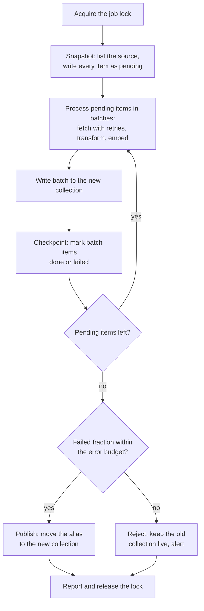

**Batch ingestion** processes a bounded set of documents as a single job: list what is there, process every item, publish the result, stop. It is the oldest and plainest way to fill an index, and it never goes away. Even a system that is otherwise updated within seconds needs a batch job for its first load, for every rebuild after a chunker or embedding-model change, and for the periodic full pass that catches whatever the faster paths missed.

The [indexing pipeline lesson](/learn/rag-architecture-fundamentals/indexing-pipeline) made a pipeline correct: stable IDs, upserts, idempotency. This lesson makes a batch job *operable*: able to process tens of thousands of documents against rate-limited sources, survive a crash two hours in without starting again, tell a temporary failure from a permanent one, and refuse to publish a build that is missing too much.

## Learning objectives

- Describe the phases of a batch ingestion job (snapshot, process, validate, publish) and the state each phase must record.
- Implement checkpointing so that a crashed job resumes where it stopped instead of starting again.
- Classify errors as transient or permanent and apply exponential backoff with jitter to the transient ones.
- Estimate a job's run time from concurrency, per-item latency and the source's rate limit, and identify the bottleneck.
- Publish a rebuilt index atomically with a collection alias, guarded by an error budget.

## Prerequisites

- [What is ingestion?](/learn/understanding-document-ingestion/what-is-ingestion): connectors, listing versus fetching, and the four guarantees.
- [Indexing pipeline](/learn/rag-architecture-fundamentals/indexing-pipeline): stable IDs, upserts and idempotency.
- [Offline and online processing](/learn/rag-architecture-fundamentals/offline-and-online-processing): the offline path and the staleness formula.

## Why this matters

A batch job that works on 50 documents on a laptop meets a different world in production.

The source rate-limits you, so the first version that fires 200 requests at once gets a wall of HTTP 429 responses and records half the corpus as failed. The job takes three hours, and at two hours forty a deployment restarts the machine; the naive job starts again from the beginning, re-fetching and re-embedding everything it had already done, and paying for the embeddings twice. A wiki is briefly unavailable and one folder returns errors; the job writes what it has into the live index, and users lose access to a third of the runbooks until the next night. Two copies of the job start because the previous night's run overran into the next schedule, and they race each other.

Each of these is routine. A batch job is a long-running process talking to unreliable systems, and the engineering is in making its failures cheap: resumable rather than restartable, isolated per item rather than all-or-nothing, and invisible to users until the result is known to be good.

## The intuition

Imagine moving a library to a new building over a weekend.

You would not carry books across at random. First you make an **inventory**: a list of every shelf and every book on it, as of Friday evening. That list defines the job; books donated on Saturday wait for next time. Then you move books in **boxes**, and you tick each box off the inventory once it is unpacked in the new building. If the van breaks down on Saturday afternoon, you do not go back and move everything again; you look at the ticks and carry on from the first unticked box.

Some books cannot be moved straight away. If a shelf is blocked because a cleaner is mopping, you come back to it in ten minutes (a **transient** problem). If a book has fallen apart, coming back will not help; you note it on a list for the conservator (a **permanent** problem). And while you are moving, the old library stays open. Only when the new building is complete, and you have checked that not too much is missing, do you change the sign on the street to point to the new address. Readers never see a half-filled building.

The inventory is the **snapshot**. The ticks are the **checkpoint**. Coming back later is a **retry**. The conservator's list is the **failed-item report**. Changing the sign is the **atomic publish**.

## How it works

### Bounded input and the snapshot

What makes ingestion "batch" is that the input is **bounded**: the job knows, near its start, exactly which items it will process. It gets that list by taking a **snapshot** of the source's listing and writing it down before processing anything.

Writing the snapshot down is not bureaucracy. It is what makes three later steps possible:

1. **Resumption.** After a crash, the job knows what "everything" was and can compute what is left.
2. **Accounting.** At the end, every snapshot item has a terminal status, so the [completeness check](/learn/understanding-document-ingestion/what-is-ingestion) is a simple query.
3. **Deletion detection.** A complete snapshot compared with the last one tells you what disappeared.

Sources keep changing while the job runs. A document edited after the snapshot is processed at whichever version the fetch happens to see, and a document created after the snapshot is not processed at all. This is acceptable as long as the *next* run picks those changes up, which it will if each run takes its own snapshot. The snapshot gives each run a consistent definition of its work, not a consistent view of the world.

### The four phases of a job



1. **Snapshot.** List the source and record each item as `pending` in a durable state store, together with the run's identifier and the target collection.
2. **Process.** Take pending items in batches. Fetch each one (retrying transient errors), run the downstream stages, embed the batch in one call, and write the results to the target.
3. **Checkpoint.** After each batch is written, mark its items `done` or `failed` in the state store, in one transaction.
4. **Validate and publish.** When nothing is pending, compute the failure rate. If it is within the agreed **error budget**, make the new data live in one atomic step. Otherwise leave the old data live and alert.

The order inside steps 2 and 3 is the crux. The checkpoint is written *after* the index write, never before. If the process dies between the two, the batch is processed again on resume, which is harmless because writes are idempotent upserts keyed by stable IDs. If the checkpoint came first and the process died before the write, the items would be marked done but never written: a silent hole in the index. Doing the work and then recording it, with an idempotent write, gives **at-least-once** processing, and idempotency turns "at least once" into "effectively once".

### Retries: transient and permanent errors

Every fetch can fail, and the right response depends on why.

- **Transient errors** are expected to go away if you wait: timeouts, connection resets, HTTP 429 (too many requests), HTTP 502, 503 and 504. Retry them.
- **Permanent errors** will happen again however often you try: HTTP 400, 401, 403 and 404, a file the parser cannot read, a document that fails validation. Record them and move on. Retrying wastes time and, for 401 and 403, can trigger account lockouts.

Retries need spacing. If 100 workers all hit a 503 at the same moment and all retry after exactly one second, they hit the recovering server together again. **Exponential backoff** doubles the wait after each failure (1 s, 2 s, 4 s, ...) up to a cap, and **jitter** randomises each wait so that clients spread out. The "full jitter" form draws the delay uniformly between zero and the exponential value:

$$
\text{delay}_n = \text{uniform}\big(0,\ \min(\text{cap},\ \text{base} \times 2^{n})\big)
$$

where $n$ is the attempt number. Many APIs that rate-limit send a `Retry-After` header with a 429 or 503 response; when present, honour it in preference to your own calculation. Finally, cap the number of attempts. An item that has failed four times is reported as failed, so that one bad document cannot hold the job hostage.

> [!WARNING]
> Never retry inside a retry. If your HTTP client retries three times and your job retries each fetch four times, one unreachable document produces twelve requests, and a source outage multiplies your load on the source exactly when it can least take it. Decide which layer owns retries.

### Concurrency and rate limits

Fetching one document at a time leaves the job idle while it waits on the network. A pool of workers fetching in parallel hides that latency. But parallelism has a ceiling that is not yours to choose: the source's **rate limit**, the number of requests it will accept per second from your credentials. Above that, extra workers only produce more 429s.

So set concurrency from the rate limit, not from the number of CPU cores, and treat a burst of 429s as a sign to slow down rather than to retry harder. A **bounded** pool (a fixed number of workers, as with `ThreadPoolExecutor(max_workers=4)` below) is the simplest control. The mathematics section shows how to size it.

The embedding step has its own batching. An embedding API or a local model processes a list of texts per call far more efficiently than one text per call, so the job collects the fetched items of a batch and embeds them together. That is why the code below has two different kinds of batch: a batch of fetches spread across workers, and one embedding call per batch.

### Publishing atomically: build, then swap

A full rebuild should never write into the collection that users are querying. Halfway through, that collection would be a mixture of old and new, and if the job then failed, it would stay that way. Instead:

1. Build into a **new collection**, named for the run (for example `handbook_2026-11-14`).
2. Validate it: error budget, document counts compared with the last run, and ideally a few evaluation questions.
3. Point an **alias** at it. An alias is a stable name (`handbook`) that the query service uses, which the database resolves to whichever real collection it currently points to. Qdrant, Elasticsearch and OpenSearch all support aliases, and Qdrant documents alias changes as atomic, so a query either sees the old collection or the new one, never a mix.
4. Keep the previous collection for a while, so rollback is moving the alias back.

This is the batch-job form of the blue-green pattern that [Blue-green deployments](/learn/ci-cd-and-mlops/blue-green-deployments) and [Index versioning](/learn/ci-cd-and-mlops/index-versioning) develop in Phase 14. It costs double the storage during the switch-over, which is almost always worth paying.

Not every batch run is a full rebuild. A nightly run that updates only changed documents writes into the live collection with the delete-then-upsert discipline from the indexing pipeline lesson; that is the subject of [Incremental ingestion](/learn/understanding-document-ingestion/incremental-ingestion). Full rebuilds are for first loads, pipeline-version changes and periodic reconciliation.

### The error budget

How many failures may a build contain and still be published? Zero is unrealistic: in any large corpus a few files are corrupt or forbidden. Unlimited is dangerous: a build missing a whole folder because of a permissions change looks like success if nobody counts. An **error budget** makes the rule explicit, for example "publish only if fewer than 2% of items failed and the document count is within 5% of the last published build". Set it from your corpus's normal failure rate, observed over a few weeks, and make breaches page someone.

### Scheduling, locks and backfills

A batch job is started by something: `cron`, a Kubernetes CronJob, or a workflow orchestrator such as Apache Airflow, Dagster or Prefect. Whatever the scheduler, three rules apply.

- **One run at a time per target.** Take a lock at the start (a row in the state store, or the scheduler's own setting; Kubernetes CronJobs, for example, have a `concurrencyPolicy` that can forbid overlap). If last night's run is still going, tonight's waits or is skipped, and that event is an alert, because it means runs are taking longer than the schedule allows.
- **Runs have identities.** A run ID (here the date) is what a resume attaches to. Re-running "the 14 November build" must resume that build, not start a new one.
- **Backfills are just runs.** A **backfill** processes a historical range or a newly added source in bulk, for example ingesting five years of resolved support tickets. Design the job so that its scope (which source, which date range) is a parameter, and backfills need no special code.

## The mathematics

### How long will the job take?

**Intuition.** A job's speed is set by its slowest constraint. Workers can only fetch as fast as the network lets each one, and all of them together can only go as fast as the source allows.

With $c$ concurrent workers, each taking $t$ seconds per fetch, the workers could achieve $c / t$ fetches per second. The source allows at most $r$ requests per second. The achieved throughput $X$ and the run time $T$ for $N$ items are:

$$
X = \min\!\left(\frac{c}{t},\ r\right), \qquad T = \frac{N}{X}
$$

- $c$: the number of concurrent workers.
- $t$: the time one fetch takes, in seconds, including network round-trip.
- $r$: the source's rate limit, in requests per second.
- $N$: the number of items (requests) to process.

**By hand.** The HR wiki has $N = 4{,}000$ pages. Each fetch takes $t = 0.25$ s. With $c = 8$ workers, the workers could manage $8 / 0.25 = 32$ fetches per second, but assume the API allows $r = 10$ requests per second (an assumption; check your vendor's documentation). Then $X = \min(32, 10) = 10$ per second and $T = 4{,}000 / 10 = 400$ s, under seven minutes. The rate limit is the bottleneck: adding workers changes nothing, and in fact $c = 3$ would suffice ($3 / 0.25 = 12 \geq 10$). The smallest concurrency that reaches the limit is $c = \lceil r \times t \rceil = \lceil 2.5 \rceil = 3$.

### How much do retries cost?

**Intuition.** If each attempt fails independently with probability $p$, most items succeed first time, a few need a second try, and very few exhaust all attempts.

With at most $m$ attempts, the probability that an item fails every attempt, and the expected number of attempts per item, are:

$$
P_{\text{fail}} = p^{m}, \qquad E[\text{attempts}] = \sum_{k=0}^{m-1} p^{k} = \frac{1 - p^{m}}{1 - p}
$$

- $p$: the probability that a single attempt fails transiently.
- $m$: the maximum number of attempts.

The expected-attempts formula holds because attempt $k + 1$ happens only if the first $k$ all failed, which has probability $p^k$.

**By hand.** With $p = 0.2$ and $m = 4$: $P_{\text{fail}} = 0.2^4 = 0.0016$, so about 16 in 10,000 items would be reported failed purely from bad luck. Expected attempts $= (1 - 0.0016) / 0.8 = 1.248$, so retries add about 25% to the request count, which feeds straight back into $T$ when the rate limit is the bottleneck. Real failures are rarely independent (an outage fails everything at once), which is why the error budget, not this formula, is the final safeguard.

```python
import math

N, t, c, r = 4000, 0.25, 8, 10
X = min(c / t, r)
print(f"throughput = min({c / t:.0f}, {r}) = {X:.0f} items/s; run time = {N / X:.0f} s")
print("smallest concurrency that reaches the limit:", math.ceil(r * t))

p, m = 0.2, 4
print(f"P(all {m} attempts fail) = {p ** m:.4f}")
print(f"expected attempts = {(1 - p ** m) / (1 - p):.4f}")
```

```output
throughput = min(32, 10) = 10 items/s; run time = 400 s
smallest concurrency that reaches the limit: 3
P(all 4 attempts fail) = 0.0016
expected attempts = 1.2480
```

## In code

**The problem.** Rebuild the handbook collection from a source of 40 documents in which about a fifth of fetch attempts fail transiently and one document is permanently missing. The job must use bounded concurrency, retry with backoff, embed in batches, survive a crash partway through, and publish atomically only if the failure rate is within budget.

**Dependencies.** The standard library plus the Qdrant client, which runs an in-process collection with `":memory:"`, so no server is needed.

```bash
pip install qdrant-client
```

The source and the embedding model are simulated so that the example runs anywhere and its output is repeatable. Transient failures are decided by a seeded generator per document and attempt, so threads do not change the outcome. The "embedding" is eight bytes of a SHA-256 hash: meaningless as semantics, but it has the right shape and lets us count calls.

```python
import hashlib
import random
import sqlite3
import time
import uuid
from concurrent.futures import ThreadPoolExecutor

from qdrant_client import QdrantClient, models

# --- A simulated source: 40 documents, some flaky, one permanently broken ---
TOPICS = ["annual leave", "remote work", "expenses", "password rotation",
          "VPN on public Wi-Fi", "laptop refresh", "support desk hours", "lost laptops"]
SOURCE = {f"doc-{i:03d}": f"Handbook section {i} on {TOPICS[i % len(TOPICS)]}." for i in range(40)}


class TransientError(Exception):
    """Worth retrying: timeouts, HTTP 429 and 503."""


class PermanentError(Exception):
    """Not worth retrying: HTTP 404, a file the parser cannot read."""


def fetch(doc_id: str, attempt: int) -> str:
    if doc_id == "doc-017":
        raise PermanentError("404 Not Found")
    # Deterministic "randomness" per (document, attempt) so threads do not change the result.
    if random.Random(f"{doc_id}:{attempt}").random() < 0.2:
        raise TransientError("503 Service Unavailable")
    return SOURCE[doc_id]


_jitter = random.Random(42)   # seeded for the lesson; use the unseeded random module in production


def backoff_delay(attempt: int, base: float = 0.001, cap: float = 0.05) -> float:
    """Exponential backoff with full jitter: uniform(0, min(cap, base * 2**attempt)).
    Real values would be seconds (base 1 s, cap 60 s); tiny here so the demo is fast."""
    return _jitter.uniform(0, min(cap, base * 2 ** attempt))


def fetch_with_retry(doc_id: str, max_attempts: int = 4):
    for attempt in range(1, max_attempts + 1):
        try:
            return doc_id, fetch(doc_id, attempt), attempt, None
        except PermanentError as exc:
            return doc_id, None, attempt, f"permanent: {exc}"
        except TransientError as exc:
            if attempt == max_attempts:
                return doc_id, None, attempt, f"gave up: {exc}"
            time.sleep(backoff_delay(attempt))


EMBED_CALLS = 0


def embed_batch(texts: list[str]) -> list[list[float]]:
    """Stand-in for a batched embedding call: one call per batch, 8-dim vectors."""
    global EMBED_CALLS
    EMBED_CALLS += 1
    out = []
    for t in texts:
        h = hashlib.sha256(t.encode()).digest()
        out.append([b / 255 for b in h[:8]])
    return out


# --- Job state in SQLite: the checkpoint ------------------------------------
db = sqlite3.connect(":memory:", check_same_thread=False)
db.executescript("""
CREATE TABLE runs  (run_id TEXT PRIMARY KEY, collection TEXT, status TEXT);
CREATE TABLE items (run_id TEXT, doc_id TEXT, status TEXT, attempts INT, error TEXT,
                    PRIMARY KEY (run_id, doc_id));
""")


class Crash(Exception):
    pass


def run_job(run_id: str, client: QdrantClient, batch_size=8, workers=4, crash_after_batches=None,
            error_budget=0.05):
    row = db.execute("SELECT collection FROM runs WHERE run_id = ?", (run_id,)).fetchone()
    if row is None:                                     # first start: snapshot the listing
        collection = f"handbook_{run_id}"
        client.create_collection(collection, vectors_config=models.VectorParams(
            size=8, distance=models.Distance.COSINE))
        db.execute("INSERT INTO runs VALUES (?, ?, 'running')", (run_id, collection))
        db.executemany("INSERT INTO items VALUES (?, ?, 'pending', 0, NULL)",
                       [(run_id, d) for d in sorted(SOURCE)])
        db.commit()
        print(f"[{run_id}] new run, snapshot of {len(SOURCE)} documents")
    else:
        collection = row[0]
        print(f"[{run_id}] resuming")

    pending = [r[0] for r in db.execute(
        "SELECT doc_id FROM items WHERE run_id = ? AND status = 'pending' ORDER BY doc_id", (run_id,))]
    print(f"[{run_id}] {len(pending)} pending")

    with ThreadPoolExecutor(max_workers=workers) as pool:
        for b, start in enumerate(range(0, len(pending), batch_size), 1):
            batch = pending[start:start + batch_size]
            results = list(pool.map(fetch_with_retry, batch))     # bounded concurrency
            ok = [(d, text) for d, text, _, err in results if err is None]
            if ok:
                vectors = embed_batch([text for _, text in ok])
                client.upsert(collection, points=[
                    models.PointStruct(id=str(uuid.uuid5(uuid.NAMESPACE_URL, d)), vector=v,
                                       payload={"doc_id": d, "text": text})
                    for (d, text), v in zip(ok, vectors)])
            # Checkpoint only after the batch is durably written to the index.
            db.executemany("UPDATE items SET status = ?, attempts = ?, error = ? WHERE run_id = ? AND doc_id = ?",
                           [("done" if err is None else "failed", n, err, run_id, d)
                            for d, _, n, err in results])
            db.commit()
            if crash_after_batches and b == crash_after_batches:
                raise Crash(f"worker killed after batch {b}")

    counts = dict(db.execute("SELECT status, COUNT(*) FROM items WHERE run_id = ? GROUP BY status",
                             (run_id,)).fetchall())
    retried = db.execute("SELECT COUNT(*) FROM items WHERE run_id = ? AND attempts > 1",
                         (run_id,)).fetchone()[0]
    failed_fraction = counts.get("failed", 0) / len(SOURCE)
    print(f"[{run_id}] counts {counts}, needed a retry: {retried}, failed fraction {failed_fraction:.1%}")

    if failed_fraction > error_budget:                   # do not publish a bad build
        db.execute("UPDATE runs SET status = 'rejected' WHERE run_id = ?", (run_id,))
        db.commit()
        print(f"[{run_id}] over the error budget; alias left unchanged")
        return
    # Atomic publish: move the alias in one operation.
    ops = []
    if any(a.alias_name == "handbook" for a in client.get_aliases().aliases):
        ops.append(models.DeleteAliasOperation(delete_alias=models.DeleteAlias(alias_name="handbook")))
    ops.append(models.CreateAliasOperation(create_alias=models.CreateAlias(
        collection_name=collection, alias_name="handbook")))
    client.update_collection_aliases(change_aliases_operations=ops)
    db.execute("UPDATE runs SET status = 'published' WHERE run_id = ?", (run_id,))
    db.commit()
    for f in db.execute("SELECT doc_id, attempts, error FROM items WHERE run_id = ? AND status = 'failed'",
                        (run_id,)):
        print(f"[{run_id}] failed item: {f}")
    print(f"[{run_id}] published {collection} as 'handbook'; "
          f"points = {client.count('handbook').count}")


client = QdrantClient(":memory:")
try:
    run_job("2026-11-14", client, crash_after_batches=3)
except Crash as exc:
    print("CRASH:", exc)
print("embedding calls so far:", EMBED_CALLS)
run_job("2026-11-14", client)
print("embedding calls in total:", EMBED_CALLS)
```

```output
[2026-11-14] new run, snapshot of 40 documents
[2026-11-14] 40 pending
CRASH: worker killed after batch 3
embedding calls so far: 3
[2026-11-14] resuming
[2026-11-14] 16 pending
[2026-11-14] counts {'done': 39, 'failed': 1}, needed a retry: 7, failed fraction 2.5%
[2026-11-14] failed item: ('doc-017', 1, 'permanent: 404 Not Found')
[2026-11-14] published handbook_2026-11-14 as 'handbook'; points = 39
embedding calls in total: 5
```

**The important lines.**

- The `runs` and `items` tables are the job's memory. The first call to `run_job` writes the snapshot: all 40 documents as `pending`. A second call with the same `run_id` finds the run and goes straight to the pending items.
- `fetch_with_retry` separates the two error classes. A `PermanentError` returns at once with `attempts = 1`; a `TransientError` sleeps for a jittered, exponentially growing delay and tries again, up to four attempts.
- `pool.map(fetch_with_retry, batch)` runs at most `workers` fetches at once. That number is the concurrency knob from the mathematics section.
- `embed_batch` is called once per batch of successful fetches, not once per document.
- The `UPDATE items` checkpoint comes after `client.upsert`. A crash between the two causes a batch to be redone, which is safe because point IDs are UUIDs derived deterministically from document IDs with `uuid.uuid5`, so the upsert overwrites rather than duplicates. (Qdrant point IDs must be unsigned integers or UUIDs, which is why the document ID is not used directly.)
- The publish step builds one list of alias operations and applies it with a single `update_collection_aliases` call, so the query service never sees a moment with no `handbook` alias.

**What the output means.** The first attempt processed three batches of eight (24 documents), checkpointed each, and then "crashed". The resume found 16 pending documents, not 40, and needed only two more embedding calls: five in total rather than eight, and nothing was embedded twice. Seven documents needed at least one retry, close to what a 20% failure rate per attempt predicts for 39 healthy documents. The one permanent failure was reported with its error and its single attempt, and since 2.5% is within the 5% budget the new collection was published. The alias now resolves to a collection of 39 points.

**Errors you will commonly hit.**

- `sqlite3.ProgrammingError: SQLite objects created in a thread can only be used in that same thread`: the connection was created without `check_same_thread=False`, or, better, your workers should return results to the main thread (as here) and only the main thread writes to the database.
- A Qdrant error about an invalid point ID: you passed a string that is not a UUID. Derive a UUID from the document ID as above.
- A resume that processes everything again: the run ID is generated afresh on each start (for example from the current time), so the resume never finds the previous run's state.
- Every item failing with 429 after you raise `workers`: you passed the source's rate limit. Lower concurrency, or add a client-side rate limiter.

**How to extend it.** Store the state in a real database file (or PostgreSQL) instead of `":memory:"` so it survives a process restart. Add a document-count check to the publish gate, comparing with the last published run. Honour `Retry-After` when a source sends it. Then work through exercise 2, which makes the error budget refuse a build.

## A real-world example

Meridian's Platform team rebuilds the AskMeridian collection every Sunday night as a safety net behind its daily incremental runs. The first version of the rebuild job wrote straight into the live collection, deleting each document's old chunks and writing new ones as it went.

One Sunday the IT department reorganised the runbook share and, for about an hour, the ingestion service account lost read access to the `networking` folder. The job recorded 180 runbooks as failed with HTTP 403, finished, and reported "completed with errors". Because it had been deleting and rewriting in place, and because the deletion-detection step treated the unreadable runbooks as gone, those 180 runbooks were no longer in the index. On Monday morning the support desk asked AskMeridian about VPN errors during a minor outage and was told, repeatedly, that it did not know.

Kofi, on call, restored service by re-running the job once access was fixed. The redesign that followed is the one this lesson describes. The weekly rebuild now builds into a fresh collection named for the run. A publish gate compares the build with the last published one: the failure rate must be under 2%, and the document count must be within 5% of the previous build. Deletion detection runs only after a listing that completed with no permission errors. If the gate fails, the alias stays where it is and the on-call engineer is paged with the failed-item report. The next time the share's permissions changed, the build was rejected, users saw the previous Sunday's index with nothing missing, and the problem was fixed during working hours.

## Common mistakes

- **Checkpointing before the work is written.** A crash after the checkpoint and before the write leaves items marked done that are not in the index, a gap no later run will fill.
- **Restarting from scratch after a failure.** Without per-item state, a crash late in a long run repeats all the work and all the embedding cost.
- **Retrying everything.** Retrying 403s and 404s wastes time, delays the run and can lock out the service account; not retrying 429s and 503s turns brief blips into failed documents.
- **Retrying without jitter.** Many workers retrying on the same schedule hit a recovering source in synchronised waves and knock it over again.
- **Rebuilding in place.** Users query a half-built collection during the run, and a failed run leaves it half-built.
- **Publishing without a gate.** A build missing a large fraction of the corpus goes live because the job "completed".
- **Allowing overlapping runs.** Two runs write to the same target and update the same state, producing inconsistent checkpoints and doubled load on the source.

## Best practices

- Snapshot the listing into durable state at the start of every run, and give each run a stable identifier so it can be resumed.
- Write results, then checkpoint, and make the writes idempotent so that a redone batch is harmless.
- Classify errors explicitly; retry transient ones with capped exponential backoff and jitter, honour `Retry-After`, and report permanent ones with their reason.
- Size concurrency from the source's rate limit, and batch embedding calls separately from fetches.
- For full rebuilds, build into a new collection and switch an alias atomically; keep the previous collection for rollback.
- Gate publication on an error budget and a count comparison with the last good build.
- Hold a lock per target, and alert when a run is skipped because the previous one is still going.

## Performance considerations

Work out the bottleneck before tuning anything. For the 4,000-page wiki in the mathematics section, the source's rate limit caps fetching at about 400 seconds. Suppose each page yields 8 chunks, giving 32,000 chunks, and the embedding service accepts 64 texts per call at about 0.5 s per call (assumptions for the arithmetic). Embedding then takes $32{,}000 / 64 = 500$ calls, or 250 seconds if done one call at a time, and less with a few concurrent calls. Fetching is the bottleneck; optimising the embedder would not shorten the job.

Pipelining helps when stages have similar costs: fetch batch $k+1$ while embedding batch $k$. With a 400-second fetch phase and a 250-second embed phase run back to back, the job takes 650 seconds; overlapped, it takes roughly as long as the slower stage, about 400 seconds.

Checkpoint granularity is a trade-off. Checkpointing every item costs one database transaction per item; checkpointing every 1,000 items means a crash can repeat up to 1,000 items of work. A batch of a few dozen to a few hundred items is a reasonable middle, and aligning it with the embedding batch keeps the logic simple.

Full rebuilds cost the whole corpus every time. At 32,000 chunks per rebuild, a weekly rebuild embeds about 1.7 million chunks a year, while daily incremental runs touching 1% of documents embed about 117,000. That gap is why full rebuilds are kept for safety nets and pipeline changes, and [incremental ingestion](/learn/understanding-document-ingestion/incremental-ingestion) carries the daily load.

## Security considerations

- **Service-account changes are an availability risk.** As the example shows, a permissions change can make a whole folder look failed or deleted. Treat 401 and 403 responses as a signal to stop and alert, not as ordinary per-item failures, when more than a handful occur.
- **Error reports can leak content.** Failed-item logs often include document titles, paths and exception messages containing text. Keep them in a store with the same access controls as the source.
- **Old collections still contain data.** A collection kept for rollback still holds documents that may since have been deleted at the source, including content subject to an erasure request. Give retained collections an expiry, and include them in deletion processing.
- **Rate limits protect the source.** Hammering a shared system such as the company wiki with an aggressive batch job can degrade it for every employee. Agree limits with the system's owners and stay within them.

## Summary

- Batch ingestion processes a bounded snapshot as one job; it is needed for first loads, rebuilds and periodic reconciliation even in otherwise real-time systems.
- Record the snapshot and per-item status durably, write results before checkpointing, and rely on idempotent writes so that resuming after a crash is safe and cheap.
- Retry transient errors with capped exponential backoff and jitter, record permanent errors, and decide which layer owns retries.
- Throughput is the minimum of what the workers can do and what the source allows: $X = \min(c/t, r)$. Size concurrency to the rate limit.
- Build full rebuilds into a new collection and publish by moving an alias atomically, only if an error budget and count checks pass.

## Exercises

**1.** A runbook share holds 9,000 files. Each fetch takes 0.4 s, the share's API allows 25 requests per second, and you run 6 workers. How long does the fetch phase take? What is the smallest worker count that reaches the rate limit, and how long does the phase take then?

<details><summary>Show solution</summary>

With 6 workers: $c / t = 6 / 0.4 = 15$ per second, below the limit, so $X = 15$ and $T = 9{,}000 / 15 = 600$ s (10 minutes). The workers are the bottleneck. The smallest concurrency reaching the limit is $\lceil r \times t \rceil = \lceil 25 \times 0.4 \rceil = 10$ workers, giving $X = 25$ and $T = 9{,}000 / 25 = 360$ s (6 minutes). More than 10 workers would only generate 429 responses.

</details>

**2.** Using the lesson's code, simulate the next night's run (`run_id = "2026-11-15"`) during which every document whose ID ends in `3` returns a permanent 403 error. Show that the build is rejected and that the alias still points to the previous night's collection.

<details><summary>Show solution</summary>

Run this after the lesson's code, in the same session:

```python
_original_fetch = fetch


def fetch(doc_id: str, attempt: int) -> str:          # the next night, a folder is unreadable
    if doc_id.endswith("3"):
        raise PermanentError("403 Forbidden")
    return _original_fetch(doc_id, attempt)


run_job("2026-11-15", client)
alias = client.get_aliases().aliases[0]
print("alias 'handbook' ->", alias.collection_name, "| points:", client.count("handbook").count)
```

```output
[2026-11-15] new run, snapshot of 40 documents
[2026-11-15] 40 pending
[2026-11-15] counts {'done': 35, 'failed': 5}, needed a retry: 6, failed fraction 12.5%
[2026-11-15] over the error budget; alias left unchanged
alias 'handbook' -> handbook_2026-11-14 | points: 39
```

Five documents failed: the four whose IDs end in 3 plus `doc-017`. At 12.5% the build exceeds the 5% budget, so `handbook` keeps pointing at the 14 November collection and users see a complete index. Because `fetch_with_retry` looks `fetch` up by name at call time, redefining it in the same module is enough to inject the fault. In production you would also want 403s specifically to raise an alert, since they usually mean a permissions change rather than bad documents.

</details>

**3.** A colleague moves the checkpoint `UPDATE` so that it runs before `client.upsert`, "so that progress is saved as early as possible". Describe precisely what can now go wrong, and why the original order is safe even though it may process a batch twice.

<details><summary>Show solution</summary>

With the checkpoint first, a crash after the commit and before (or during) the upsert leaves the batch marked `done` in the state store but absent from the collection. The resume skips those items because they are not pending, the run completes, the counts say everything is done, and the build is published with a hole that nothing will detect except a user. In the original order, a crash between upsert and checkpoint leaves the items pending although they were written; the resume processes them again and upserts the same IDs with the same content, which overwrites rather than duplicates. The cost is some repeated fetching and embedding for one batch, which is bounded by the batch size. Doing work then recording it, with idempotent writes, gives at-least-once processing with an effectively-once result.

</details>

**4.** Design decision: Meridian's product documentation is 60,000 pages, and a full rebuild takes nine hours because of the documentation platform's rate limit. The team wants a full rebuild every night as a safety net. Propose a design that keeps a full-corpus safety net without a nine-hour nightly job.

<details><summary>Show solution</summary>

Spread the safety net over the week. Partition the corpus deterministically, for example by `hash(doc_id) mod 7`, and on each night re-fetch and re-verify one partition (about 8,600 pages, roughly 1 hour 20 minutes at the same rate) alongside the normal incremental run. Every page is fully re-checked once a week, and the nightly cost is a seventh of a full rebuild. Because these runs write into the live collection, use the incremental discipline (delete-then-upsert per document, deletion detection only on complete partition listings) rather than an alias swap. Keep true full rebuilds into a new collection for pipeline-version changes, scheduled at a weekend with a gate. Also ask whether the platform offers a bulk export or a change feed: a single export file is often far cheaper than 60,000 API calls, and a change feed would make the nightly incremental run much more trustworthy.

</details>

## Check your understanding

```quiz
[
  {
    "q": "Why does a batch job write its snapshot of the listing to durable state before processing anything?",
    "options": [
      "So that a resumed run knows what remains, the end-of-run accounting is possible, and deletions can be detected",
      "Because sources forbid listing more than once a day",
      "To guarantee the job sees a consistent view of the source while it runs",
      "Because embedding models need the full list before they start"
    ],
    "answer": 0,
    "why": "The recorded snapshot defines the run's work. It does not freeze the source, which keeps changing; it gives the job a fixed list to resume, account for and compare."
  },
  {
    "q": "Which of these errors should a batch fetch retry?",
    "options": [
      "HTTP 404 Not Found",
      "HTTP 403 Forbidden",
      "A PDF the parser reports as corrupt",
      "HTTP 503 Service Unavailable"
    ],
    "answer": 3,
    "why": "503 indicates a temporary condition that may clear. 404, 403 and corrupt files will fail the same way on every attempt."
  },
  {
    "q": "A source allows 20 requests per second and each fetch takes 0.5 s. You run 50 workers. What throughput do you get, and what happens?",
    "options": [
      "100 per second: the job is five times faster than with 10 workers",
      "About 20 per second at best; the extra workers mostly produce rate-limit errors and retries",
      "50 per second: one per worker",
      "2.5 per second: the workers contend for the network"
    ],
    "answer": 1,
    "why": "Throughput is min(c / t, r) = min(100, 20) = 20. Only ceil(20 x 0.5) = 10 workers are needed to reach the limit; beyond that, requests are rejected."
  },
  {
    "q": "What is the purpose of jitter in retry backoff?",
    "options": [
      "To make retries happen faster than without backoff",
      "To ensure every client retries at exactly the same moment",
      "To spread retries from many clients over time so they do not hit a recovering service in synchronised waves",
      "To encrypt the retry requests"
    ],
    "answer": 2,
    "why": "Without jitter, clients that failed together retry together. Randomising each delay de-synchronises them and smooths the load on the source."
  },
  {
    "q": "A full rebuild finishes with 14% of documents failed because of a permissions change. With the build-then-swap design, what do users see?",
    "options": [
      "The previous published collection, unchanged, because the gate refuses to move the alias",
      "A collection missing 14% of documents",
      "An empty collection until the next run",
      "A mixture of old and new documents"
    ],
    "answer": 0,
    "why": "The new collection is built separately and the alias moves only if the error budget passes. When it fails, the alias stays on the last good build."
  }
]
```

## Further reading

- Kleppmann, M. (2017). *Designing Data-Intensive Applications*, chapter 10, "Batch Processing". O'Reilly.
- Brooker, M. (2015). "Exponential Backoff And Jitter". AWS Architecture Blog.
- Qdrant documentation, "Collections", section on collection aliases: [qdrant.tech/documentation/concepts/collections](https://qdrant.tech/documentation/concepts/collections/)
- Python documentation: [`concurrent.futures`](https://docs.python.org/3/library/concurrent.futures.html) and [`sqlite3`](https://docs.python.org/3/library/sqlite3.html).
- Kubernetes documentation, "CronJob": [kubernetes.io/docs/concepts/workloads/controllers/cron-jobs](https://kubernetes.io/docs/concepts/workloads/controllers/cron-jobs/)
