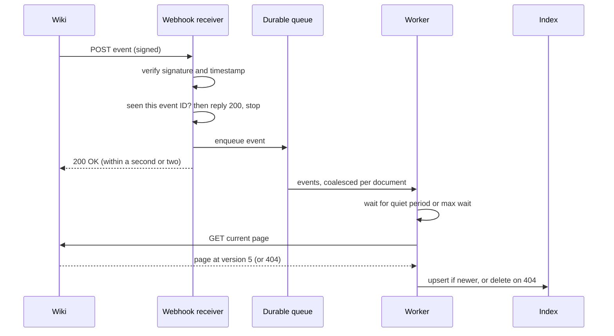

Every mechanism so far has the ingestion system asking: list the source, query for changes, read the next records from a log. **Event-driven ingestion** reverses the direction. The source *tells* you that something happened, usually by calling a URL you registered (a **webhook**) or by publishing a notification to a queue, and your system reacts by updating the index for that one document. Done well, a page edited in the wiki is searchable within a minute, and nothing runs when nothing changes.

Done naively, it is the least reliable mechanism in this module. Notifications arrive twice, arrive out of order, arrive in bursts of twenty for one document, arrive forged, or never arrive at all. This lesson builds an event-driven path that survives all of those: a receiver that verifies, deduplicates and acknowledges quickly; a worker that coalesces bursts and always fetches current state instead of trusting the event; and the reconciliation that catches the events that were lost.

## Learning objectives

- Describe the delivery behaviour of webhooks and storage notifications (at-least-once, unordered, lossy) and its consequences for an index.
- Build a webhook receiver that verifies an HMAC signature over the raw body, rejects replays, deduplicates by event ID and acknowledges before doing slow work.
- Implement per-document debouncing with a quiet period and a maximum wait, and the "notify, then fetch current state" pattern.
- Explain why an event-driven path needs a reconciliation path behind it, and size the reconciliation interval from a freshness target.
- Distinguish event-driven ingestion from streaming ingestion and combine them where it helps.

## Prerequisites

- [What is ingestion?](/learn/understanding-document-ingestion/what-is-ingestion): pull versus push, and the change-capability table.
- [Streaming ingestion](/learn/understanding-document-ingestion/streaming-ingestion): at-least-once delivery, idempotent sinks and dead-letter queues.
- [Incremental ingestion](/learn/understanding-document-ingestion/incremental-ingestion): versions, deletion detection and reconciliation.

## Why this matters

Scheduled syncs have a floor on staleness: the period between runs. Pushing that period down to a minute costs a query per minute per source, almost all of which find nothing. Events remove the floor and the waste together: work happens exactly when, and only where, something changed. For content where minutes matter, such as incident runbooks during an outage, a policy correction that must stop being quoted, or a document that was shared by mistake and must disappear from search immediately, that is decisive.

The catch is that the source now controls delivery, and webhook delivery is typically best-effort. Providers retry when your endpoint fails, so you receive duplicates. They send events from many machines in parallel, so order is not guaranteed. They give up after some number of retries, so events are lost during your outages, and occasionally during theirs. Subscriptions expire. And a public URL that changes your index is an attack surface: anyone who can call it can, unless you verify, inject or delete content. An event-driven path that ignores these properties works in the demo and diverges from its sources in production, one lost event at a time.

## The intuition

Think of a doorbell. Instead of checking the porch for parcels every hour, you wait for the bell.

But a doorbell is not a delivery log. Sometimes it rings twice for one parcel. Sometimes the courier rings and leaves a note saying a parcel is at the depot, and by the time you collect it there is a newer one. Sometimes a child rings it for fun. And sometimes it does not ring at all, because the battery died while you were out.

So a sensible household does three things. When the bell rings, it goes to the door promptly, but it does not unpack in the hallway; it brings the parcel in and deals with it later. It checks the label against the household's own order list, ignoring rings from strangers. And it still checks the porch once a day, in case the bell failed. The bell gives speed; the daily check gives certainty. Event-driven ingestion is the same arrangement.

## How it works

### Where events come from

- **Webhooks.** The source system makes an HTTP `POST` to a URL you registered, with a JSON body describing what happened. Wikis, code hosts, ticket systems and document platforms commonly offer them.
- **Object-storage notifications.** Cloud object stores can emit an event when an object is created or deleted. Amazon S3, for example, can send event notifications to SQS queues, SNS topics, Lambda functions or EventBridge; other clouds have equivalents.
- **Platform subscriptions.** Some APIs require you to create a **subscription** for a resource, after which they call your endpoint. Microsoft Graph change notifications work this way, with subscriptions that expire and must be renewed, and a validation handshake when one is created.

### The delivery contract you actually get

Read each provider's documentation for specifics, but design for this baseline:

| Property | What to expect | Consequence |
| --- | --- | --- |
| Duplicates | Retries after timeouts or non-2xx responses deliver the same event again | Deduplicate, and make processing idempotent anyway |
| Order | Not guaranteed, especially across documents and under retries | Never apply an event's payload blindly; fetch current state |
| Loss | Retries eventually stop; endpoints go down; subscriptions lapse | A reconciliation path is mandatory |
| Bursts | One save can emit several events; an editing session emits dozens | Coalesce per document before doing expensive work |
| Latency budget | The sender expects a quick response and treats slowness as failure | Acknowledge fast, process asynchronously |
| Authenticity | Anyone can send a request to a public URL | Verify signatures and reject replays |

### Thin events and "notify, then fetch"

Events usually come in one of two shapes. A **thin event** carries an identifier and an event type: "page HR-2 was updated". A **fat event** carries the content or the changes. It is tempting to index straight from a fat event, but doing so ties the index to the order in which events happen to arrive. If an older event is delayed and arrives second, its payload overwrites the newer content.

The robust pattern is **notify, then fetch**: treat every event, thin or fat, as a hint that a document *may* have changed, and respond by fetching the document's **current** state from the source, then applying it with a version check. Ordering then stops mattering. Whether events for HR-2 arrive as 1, 2, 3 or 3, 1, 2, the fetch returns the latest version. Deletions are confirmed the same way: a fetch that returns "not found" means delete, whatever the event said. A forged or mistaken "page removed" event cannot delete a page that still exists.

The cost is a fetch per processed event, which is why the next idea matters.

### Debouncing and coalescing

Editors save often. A wiki page edited for ten minutes may emit twenty "updated" events. Re-parsing and re-embedding the page twenty times is waste, and the intermediate versions are of no interest.

**Coalescing** collapses many events for one document into a single pending entry. **Debouncing** waits until a document has been quiet for a period (say 30 seconds since its last event) before processing it. Together, a burst of twenty events becomes one fetch and one re-index, of the final version.

A pure quiet period has a flaw: a page edited continuously, or a bot updating it every few seconds, is never quiet and so never processed. Add a **maximum wait**: process a document when it has been quiet for the quiet period *or* when its first unprocessed event is older than the maximum wait, whichever comes first.

### The receiver and the worker

Event-driven ingestion splits naturally into two components with very different jobs.



The **receiver** must be fast and must never lose an accepted event:

1. Read the **raw** request body. Signatures are computed over exact bytes; parsing and re-serialising JSON changes them.
2. Verify the signature, comparing in constant time.
3. Check the timestamp is recent, to reject **replays** (a captured genuine request sent again later).
4. If the event ID has been seen, return success without doing anything. Returning an error would make the sender retry forever.
5. Write the event to a **durable queue** (SQS, Pub/Sub, a Kafka topic, a database table).
6. Respond with a 2xx status. Only now has the event been safely accepted.

The **worker** reads from the queue at its own pace, coalesces and debounces, fetches current state, applies version-checked writes, and sends repeatedly failing items to a **dead-letter queue**. Because the queue sits between them, a burst of events or a slow embedding service never makes the receiver slow, and a worker crash loses nothing.

### Verifying signatures

Most providers sign webhook requests with **HMAC**: a keyed hash computed over the body (and often a timestamp) with a secret shared between you and the provider. GitHub, for example, sends an HMAC-SHA256 of the body in an `X-Hub-Signature-256` header. The exact header names and the string that is signed differ by provider, so follow each one's documentation precisely. The principles do not differ:

- Compute the expected signature over the **raw bytes**, with the shared secret, and compare with `hmac.compare_digest`, which takes the same time whether the first byte or the last differs, so an attacker cannot learn the signature byte by byte from response times.
- Include a **timestamp** in what is signed where the provider supports it, and reject requests outside a tolerance window (five minutes is common).
- Store the secret in a secrets manager, and support two secrets during rotation.

### Reconciliation: events are hints, not truth

Because events can be lost, an event-driven path must be backed by one of the pull mechanisms from [Incremental ingestion](/learn/understanding-document-ingestion/incremental-ingestion): a periodic modified-since sync, a change-feed read, or a full listing and compare. Events give low latency; the pull path gives completeness. The pull path's interval sets the worst-case staleness for any change whose event was lost, so it is chosen from the freshness requirement, not from convenience.

Two operational duties come with it. **Renew subscriptions** before they expire, and alert if renewal fails, since an expired subscription looks exactly like a quiet source. And **monitor event volume**: a source that normally sends hundreds of events a day and has sent none since midnight probably has a broken subscription, not idle editors.

### Event-driven versus streaming

Both react to change, so they are often confused. [Streaming ingestion](/learn/understanding-document-ingestion/streaming-ingestion) consumes a durable, ordered, replayable log; the consumer controls its position and can re-read history. Event-driven ingestion receives pushed notifications that are usually unordered, unreplayable and lossy; the sender controls delivery. A common and sound combination is for the webhook receiver to write events onto a log topic, and for the indexer to be a streaming consumer of that topic: the edge is event-driven, the core is a stream.

### The event-driven path, step by step

1. Register the webhook or subscription, with a secret, for the event types you need (created, updated, deleted, moved, permissions changed).
2. On each request: verify signature and timestamp, deduplicate by event ID, enqueue durably, respond 2xx.
3. In the worker: coalesce events per document; process a document when it has been quiet for the quiet period or waited for the maximum wait.
4. Fetch the document's current state and permissions from the source; on "not found", delete it from the index.
5. Apply a version-checked upsert through the normal parse, chunk and embed stages.
6. Route items that keep failing to a dead-letter queue and alert.
7. Behind it all, run a scheduled pull sync and a subscription-renewal job, and alert on silence.

## The mathematics

### Freshness with debouncing

**Intuition.** A debounced document is processed once things go quiet, but never later than the maximum wait, plus however long processing takes.

For a document whose last event arrived at time $t$, with quiet period $q$, maximum wait $m$ measured from the first unprocessed event, and processing time $D$:

$$
S \leq \min(q,\ m) + D \quad \text{(edits stop after one save)}, \qquad S \leq m + D \quad \text{(continuous edits)}
$$

- $S$: staleness, the delay before the index reflects the latest saved version.
- $q$: the quiet period.
- $m$: the maximum wait.
- $D$: fetch, parse, chunk, embed and write time.

**By hand.** With $q = 30$ s, $m = 300$ s and $D = 5$ s: a single save is searchable within $30 + 5 = 35$ s. A page edited without pause is indexed at least every $300 + 5 = 305$ s, about five minutes, rather than never.

### The cost of lost events

**Intuition.** Lost events are rare, but each one leaves a document stale until the reconciliation next runs. The reconciliation interval sets both the worst case and the average.

If $c$ changes happen per day, a fraction $\ell$ of their events are lost, and reconciliation runs every $R$ days, then about $c\ell$ changes per day are missed by the event path, each staying stale for at most $R$ days and on average $R/2$. The expected number of stale documents at any moment is

$$
\bar{N}_{\text{stale}} \approx c\,\ell \cdot \frac{R}{2}
$$

**By hand.** Meridian's wiki sees $c = 300$ changes a day. Assume $\ell = 0.001$, one event in a thousand lost (an assumption for illustration; real rates depend on the provider and on your endpoint's availability). That is $0.3$ missed changes a day. With daily reconciliation ($R = 1$), on average $0.3 \times 0.5 = 0.15$ pages are stale at any moment, and none for more than a day. With weekly reconciliation, $1.05$ pages on average, each for up to a week.

```python
quiet, max_wait, processing = 30, 300, 5
print("edits stop after one save:  ", min(quiet, max_wait) + processing, "s")
print("page edited non-stop:       ", max_wait + processing, "s")

changes_per_day, loss_rate = 300, 0.001
lost_per_day = changes_per_day * loss_rate
for R_days in (1, 7):
    print(f"reconcile every {R_days} d: {lost_per_day:.1f} lost/day, "
          f"on average {lost_per_day * R_days / 2:.2f} pages stale at any moment, worst case {R_days} d")
```

```output
edits stop after one save:   35 s
page edited non-stop:        305 s
reconcile every 1 d: 0.3 lost/day, on average 0.15 pages stale at any moment, worst case 1 d
reconcile every 7 d: 0.3 lost/day, on average 1.05 pages stale at any moment, worst case 7 d
```

## In code

**The problem.** Receive webhook events from the HR wiki: verify their signatures and timestamps, reject a forged and a replayed request, deduplicate a retried delivery, coalesce a burst of updates to one page, and confirm a deletion by fetching from the source, so that four accepted events cost two fetches.

**Dependencies.** FastAPI, and httpx for FastAPI's in-process `TestClient`, which sends real HTTP requests to the app without starting a server.

```bash
pip install fastapi httpx
```

The signature scheme here is a generic one of the kind many providers use: HMAC-SHA256 over `timestamp + "." + body`, sent in an `X-Wiki-Signature` header with the timestamp in `X-Wiki-Timestamp`. Real providers each define their own headers and signed string. A controllable clock replaces the system time so the run is repeatable, and an in-memory `deque` stands in for the durable queue.

```python
import hashlib
import hmac
import json
import os
from collections import deque

from fastapi import FastAPI, Header, HTTPException, Request
from fastapi.testclient import TestClient

SECRET = os.environ.get("WIKI_WEBHOOK_SECRET", "dev-only-secret").encode()
TOLERANCE_S = 300
NOW = {"t": 1_800_000_000}            # a controllable clock, so the demo is repeatable


def now() -> int:
    return NOW["t"]


def sign(timestamp: str, body: bytes) -> str:
    mac = hmac.new(SECRET, timestamp.encode() + b"." + body, hashlib.sha256)
    return "sha256=" + mac.hexdigest()


# --- Receiver: verify, deduplicate, enqueue, acknowledge -------------------
app = FastAPI()
queue: deque = deque()                 # stands in for a durable queue (SQS, Pub/Sub, a Kafka topic)
seen_event_ids: set[str] = set()       # in production: a store with a time-to-live


@app.post("/webhooks/wiki")
async def wiki_webhook(request: Request,
                       x_wiki_timestamp: str = Header(),
                       x_wiki_signature: str = Header()):
    body = await request.body()                                   # the raw bytes, as signed
    if not hmac.compare_digest(sign(x_wiki_timestamp, body), x_wiki_signature):
        raise HTTPException(status_code=401, detail="bad signature")
    if abs(now() - int(x_wiki_timestamp)) > TOLERANCE_S:
        raise HTTPException(status_code=401, detail="stale timestamp")
    event = json.loads(body)
    if event["event_id"] in seen_event_ids:
        return {"status": "duplicate"}                            # still 2xx: stop the retries
    queue.append((now(), event))                                  # durable enqueue first,
    seen_event_ids.add(event["event_id"])                         # then remember the ID
    return {"status": "queued"}


# --- Worker: debounce per document, then fetch current state ---------------
WIKI = {"HR-2": (5, "The home-office equipment budget is £400."),
        "HR-3": (12, "Submit expenses within 30 days.")}          # HR-9 has been deleted
INDEX = {"HR-2": (4, "The home-office equipment budget is £250."),
         "HR-9": (1, "Old travel policy.")}
FETCHES = {"n": 0}


def fetch_page(page_id):
    FETCHES["n"] += 1
    return WIKI.get(page_id)                                      # None means 404


pending: dict[str, int] = {}           # page_id -> time of the latest event for it


def drain_queue():
    while queue:
        received_at, event = queue.popleft()
        pending[event["page_id"]] = received_at                   # coalesce by page


def flush(quiet_s: int = 30) -> list[str]:
    actions = []
    for page_id, last in sorted(pending.items()):
        if now() - last < quiet_s:
            continue                                              # still being edited: wait
        del pending[page_id]
        current = fetch_page(page_id)                             # never trust the event body
        if current is None:
            INDEX.pop(page_id, None)
            actions.append(f"{page_id}: deleted (source returns 404)")
        elif INDEX.get(page_id, (0,))[0] < current[0]:
            INDEX[page_id] = current
            actions.append(f"{page_id}: re-indexed at version {current[0]}")
        else:
            actions.append(f"{page_id}: already current")
    return actions


client = TestClient(app)


def deliver(event: dict, *, secret_ok=True, ts_offset=0):
    ts = str(now() + ts_offset)
    body = json.dumps(event).encode()
    sig = sign(ts, body) if secret_ok else "sha256=" + "0" * 64
    r = client.post("/webhooks/wiki", content=body,
                    headers={"X-Wiki-Timestamp": ts, "X-Wiki-Signature": sig,
                             "Content-Type": "application/json"})
    print(f"{event['event_id']:<4} {event['type']:<13} {event['page_id']:<5} -> {r.status_code} {r.json()}")


deliver({"event_id": "e1", "type": "page_updated", "page_id": "HR-2"})
NOW["t"] += 5
deliver({"event_id": "e2", "type": "page_updated", "page_id": "HR-2"})
deliver({"event_id": "e1", "type": "page_updated", "page_id": "HR-2"})     # sender retried
NOW["t"] += 5
deliver({"event_id": "e3", "type": "page_updated", "page_id": "HR-2"})
deliver({"event_id": "e4", "type": "page_removed", "page_id": "HR-9"})
deliver({"event_id": "e5", "type": "page_removed", "page_id": "HR-3"}, secret_ok=False)  # forged
deliver({"event_id": "e6", "type": "page_updated", "page_id": "HR-3"}, ts_offset=-900)   # replayed

drain_queue()
print("\npending after the burst:", pending)
NOW["t"] += 10
print("flush at +20 s:", flush())
NOW["t"] += 30
print("flush at +50 s:", flush())
print("\nfetches:", FETCHES["n"], "| index:", INDEX)
```

```output
e1   page_updated  HR-2  -> 200 {'status': 'queued'}
e2   page_updated  HR-2  -> 200 {'status': 'queued'}
e1   page_updated  HR-2  -> 200 {'status': 'duplicate'}
e3   page_updated  HR-2  -> 200 {'status': 'queued'}
e4   page_removed  HR-9  -> 200 {'status': 'queued'}
e5   page_removed  HR-3  -> 401 {'detail': 'bad signature'}
e6   page_updated  HR-3  -> 401 {'detail': 'stale timestamp'}

pending after the burst: {'HR-2': 1800000010, 'HR-9': 1800000010}
flush at +20 s: []
flush at +50 s: ['HR-2: re-indexed at version 5', 'HR-9: deleted (source returns 404)']

fetches: 2 | index: {'HR-2': (5, 'The home-office equipment budget is £400.')}
```

**The important lines.**

- `await request.body()` reads the raw bytes. FastAPI would happily parse the JSON for you, but the signature must be checked against exactly what was sent.
- `hmac.compare_digest` compares in constant time. A plain `==` can return early at the first differing character.
- The timestamp check comes after the signature check, so an attacker cannot simply change the timestamp: it is part of the signed string.
- A duplicate event ID returns `200` with `"duplicate"`. A 4xx or 5xx would make the sender retry the duplicate again.
- The event is appended to the queue before its ID is recorded as seen. If the order were reversed and the enqueue failed, the event would be marked seen but never processed, and the sender's retry would be discarded as a duplicate.
- `drain_queue` keeps only the latest time per page: three accepted events for HR-2 become one pending entry.
- `flush` ignores the event body entirely and calls `fetch_page`. A 404 deletes; a newer version upserts; an equal version is a no-op.

**What the output means.** Seven requests arrived. The retried `e1` was recognised and acknowledged without being queued. The forged `e5` (a "page removed" for HR-3, which would have deleted a live page) failed signature verification, and the replayed `e6`, signed correctly but 15 minutes old, failed the timestamp check. Four events were accepted, coalesced into two pending pages. At +20 s, HR-2's last event was only 10 seconds old, so nothing was processed. At +50 s both pages had been quiet for 40 seconds: HR-2 was fetched once and moved from version 4 (the superseded £250 equipment budget) to version 5 (£400), and HR-9 was fetched, found missing at the source and deleted. Two fetches did the work of four accepted events.

**Errors you will commonly hit.**

- Every request failing signature verification in production but not in tests: the code parses and re-serialises JSON before verifying, or a proxy re-encodes the body. Verify the raw bytes.
- `422 Unprocessable Entity` from FastAPI: a required header is missing. FastAPI maps the parameter `x_wiki_signature` to the header `x-wiki-signature`; check the provider's actual header name.
- The sender disabling your webhook after repeated timeouts: the handler does slow work (fetching, embedding) before responding. Enqueue and return.
- Events stopping silently after some weeks: the subscription expired. Renew on a schedule and alert on silence.

**How to extend it.** Replace the `deque` with a real queue and run the worker as a separate process. Persist `seen_event_ids` with a time-to-live a little longer than the provider's retry window. Add a maximum wait to `flush` (exercise 2). Add a scheduled reconciliation using the [incremental ingestion](/learn/understanding-document-ingestion/incremental-ingestion) sync.

## A real-world example

Meridian's IT team asked for runbook edits to be searchable within a minute, because during incidents engineers update runbooks while others are reading them through AskMeridian. The Platform team added webhooks from the runbook platform, with a handler that fetched the page, parsed, chunked, embedded and upserted it, and then returned `200`.

It worked until the first real incident. Several engineers were editing the VPN runbook at once, the platform emitted events for every autosave, and each handler call took several seconds because of embedding. The platform's webhook sender timed out, retried, timed out again, and after repeated failures disabled the subscription, as its documentation said it would. For the rest of the incident, and for two days afterwards until someone noticed, no runbook change reached AskMeridian. The nightly sync had been switched off when webhooks went live.

Rahul redesigned it along the lines of this lesson. The handler now verifies the signature, deduplicates, writes the event to a queue and responds immediately. A worker coalesces per runbook with a 20-second quiet period and a 2-minute maximum wait, fetches the current page and re-indexes it once. The nightly sync was restored as a reconciliation, and an hourly modified-since sync was added so that a lost event costs at most an hour. Two alerts were added: one on subscription status, and one when a source that normally sends events has sent none for three hours during working hours. In the next incident, the VPN runbook received more than a hundred autosave events in twenty minutes and was re-indexed about ten times, never more than about two minutes behind the latest edit.

## Common mistakes

- **Doing the work inside the webhook handler.** Slow responses cause timeouts, retries, duplicate processing and, eventually, a disabled subscription.
- **Indexing the event's payload.** Out-of-order delivery lets an older payload overwrite newer content; fetch current state instead.
- **Not verifying signatures, or verifying parsed JSON.** The first lets anyone write to or delete from your index; the second rejects every genuine request.
- **Returning an error for duplicates.** The sender retries the duplicate indefinitely.
- **No debouncing.** Every autosave triggers a full re-parse and re-embed of the document.
- **No reconciliation path.** Lost events and expired subscriptions leave documents stale forever, with no signal.
- **Trusting "deleted" events.** A mistaken or forged deletion event removes a live document; confirm with the source.

## Best practices

- Verify an HMAC signature over the raw body with `hmac.compare_digest`, and reject timestamps outside a tolerance window.
- Acknowledge quickly: verify, deduplicate, enqueue durably, return 2xx; do everything else in a worker.
- Treat events as hints: coalesce per document, debounce with a quiet period and a maximum wait, then fetch current state with a version check.
- Confirm deletions by fetching; delete only when the source says the document is gone.
- Back every event path with a scheduled pull sync sized to your worst acceptable staleness for lost events.
- Renew subscriptions automatically and alert on renewal failures and on unusual silence.
- Send repeatedly failing items to a dead-letter queue with tooling to inspect and replay them.

## Performance considerations

The receiver's work per request is tiny: an HMAC over a few kilobytes, a set lookup and an enqueue, well under a millisecond of CPU. One small instance can absorb large bursts, which is the point of splitting it from the worker.

The worker's cost is set by the number of *coalesced* documents, not events. In the example above, an incident produced over a hundred events for one runbook; with a 2-minute maximum wait over 20 minutes, the worker processed it at most about $20 / 2 = 10$ times plus once at the end. Without coalescing, the same burst would have cost over a hundred fetches and embedding passes. Choose $q$ and $m$ from the freshness target: a shorter quiet period gives fresher results and more processing.

The reconciliation path's cost is that of an incremental sync, computed in [Incremental ingestion](/learn/understanding-document-ingestion/incremental-ingestion); because the event path handles almost all changes, the reconciliation mostly confirms that nothing is missing. The deduplication store needs only event IDs for the provider's retry window: at 300 events a day and IDs of about 40 bytes, a week's worth is about $300 \times 7 \times 40 = 84{,}000$ bytes.

## Security considerations

- **The webhook endpoint is a public write path into your index.** Without signature verification, anyone who learns the URL can trigger deletions or point the worker at content. Verify every request; fetching current state from the source adds a second line of defence, because the event itself cannot inject content.
- **Replays.** A captured, genuinely signed request can be re-sent. Signed timestamps with a tolerance window, plus event-ID deduplication, defeat it.
- **Secrets.** Keep webhook secrets in a secrets manager, rotate them, and accept both old and new during rotation.
- **Denial of service.** An attacker, or a misbehaving integration, can flood the endpoint. Rate-limit at the edge, keep verification cheap, and make sure a flood cannot starve legitimate events in the queue.
- **Permission-change events.** Subscribe to them where the source offers them, and treat them like content changes: re-fetch the document's access list and update every chunk. A user removed from a group must stop retrieving that group's documents promptly.

## Summary

- Event-driven ingestion reacts to notifications pushed by sources, removing the schedule's staleness floor and the cost of empty polls.
- Expect duplicates, disorder, bursts, loss and forgery: verify signatures over raw bytes, reject replays, deduplicate, and acknowledge before doing slow work.
- Treat each event as a hint: coalesce and debounce per document (quiet period plus maximum wait), then fetch current state and apply it with a version check; confirm deletions with the source.
- Back the event path with a scheduled pull sync; its interval bounds the staleness of changes whose events were lost.
- Events at the edge and a durable log in the core is a common, robust combination of event-driven and streaming ingestion.

## Exercises

**1.** A provider's documentation says it retries failed webhook deliveries for up to 24 hours. Your endpoint is down for 30 hours during a data-centre move. What happens to events from the first six hours of the outage, and what limits the damage?

<details><summary>Show solution</summary>

Events from the first six hours are retried for 24 hours, all during the outage, and then dropped: they are lost. Events from the remaining 24 hours of the outage are still being retried when the endpoint returns and will mostly be delivered, in a large burst. The reconciliation path limits the damage from the lost six hours: the next modified-since sync or full compare finds the documents whose versions are newer than the index's. Its interval sets how long they stay stale. Good practice is to run a reconciliation deliberately as soon as the endpoint is back, rather than waiting for the schedule, and to make sure the worker can absorb the retry burst (coalescing helps a great deal here).

</details>

**2.** The lesson's `flush` uses only a quiet period. Write a version with a maximum wait, and show that a page saved every 10 seconds for 15 minutes is never processed without it and is processed every few minutes with a 300-second cap.

<details><summary>Show solution</summary>

```python
first_seen: dict[str, int] = {}
pending: dict[str, int] = {}
NOW = {"t": 0}


def note_event(page_id: str):
    first_seen.setdefault(page_id, NOW["t"])
    pending[page_id] = NOW["t"]


def due(quiet_s: int = 30, max_wait_s: int = 300) -> list[str]:
    ready = [p for p, last in sorted(pending.items())
             if NOW["t"] - last >= quiet_s or NOW["t"] - first_seen[p] >= max_wait_s]
    for p in ready:
        del pending[p], first_seen[p]
    return ready


for max_wait in (10**9, 300):            # effectively no cap, then a 5-minute cap
    flushed_at = []
    for second in range(0, 901, 10):      # HR-2 is saved every 10 s for 15 minutes
        NOW["t"] = second
        note_event("HR-2")
        if due(max_wait_s=max_wait):
            flushed_at.append(second)
    pending.clear(); first_seen.clear()
    print(f"max_wait={max_wait}: HR-2 flushed at seconds {flushed_at}")
```

```output
max_wait=1000000000: HR-2 flushed at seconds []
max_wait=300: HR-2 flushed at seconds [300, 610]
```

With only a quiet period, the page is never quiet for 30 seconds, so it is never processed during the 15 minutes. With a 300-second cap, it is processed at 300 s, and again at 610 s (the cap counts from the first event after the previous flush, at 310 s). After editing stops, the quiet period triggers a final flush. `first_seen` is what makes the cap possible: the quiet period needs only the latest event time, the cap needs the earliest unprocessed one.

</details>

**3.** A colleague suggests skipping the fetch for "page_removed" events to save a request: "the event says it was deleted, so delete it". Give two distinct ways this can delete a page that still exists.

<details><summary>Show solution</summary>

First, ordering: a page is deleted and then restored (or moved and moved back) within seconds; the "removed" event is delayed and arrives after the "restored" event, so applying it blindly deletes a live page. Fetching returns the page, so nothing is deleted. Second, semantics: many platforms emit "removed" for things that are not deletions from your point of view, such as a page moved to a space your connector also covers, or a permissions change that hid it from the webhook's user; the page still exists and may still be in scope. A third, if verification is ever weak or misconfigured, is a forged event. In all cases one fetch, returning 404 or not, settles the question at the cost of a single request per deletion.

</details>

**4.** Design decision: HR wants handbook corrections searchable within 2 minutes, and needs any document deleted from the wiki gone from AskMeridian within 1 hour, even if events are lost. The wiki offers webhooks and a modified-since API but no change feed. Design the ingestion for the handbook and state which mechanism guarantees which requirement.

<details><summary>Show solution</summary>

Corrections within 2 minutes: webhooks into a verifying receiver and durable queue, with a worker using a quiet period of about 30 seconds and a maximum wait of about 90 seconds, then fetch-and-upsert. That meets 2 minutes when events arrive, but cannot guarantee it, because events can be lost; state that honestly, and add a modified-since sync every 10 to 15 minutes with a lookback so lost update events cost at most that long. Deletions within 1 hour regardless of events: webhooks handle most deletions within a minute (confirmed by fetching), but the guarantee must come from pull. Because modified-since cannot see deletions, run a guarded mark-and-sweep over the list of page IDs about every 30 minutes, which keeps the worst case under the hour even if one sweep is refused; soft-delete first, alert on refusals. Add subscription-renewal monitoring and a silence alert, and a weekly full reconciliation.

</details>

## Check your understanding

```quiz
[
  {
    "q": "Why should a webhook handler enqueue the event and respond immediately rather than process it before responding?",
    "options": [
      "Because HTTP does not allow slow responses",
      "Because the event body is encrypted",
      "Because processing is not idempotent",
      "Because slow responses cause sender timeouts and retries, producing duplicates and possibly a disabled subscription"
    ],
    "answer": 3,
    "why": "Senders expect a quick acknowledgement. Doing fetching and embedding in the handler makes it slow under load, which the sender treats as failure."
  },
  {
    "q": "Why is a webhook signature computed and checked over the raw request body?",
    "options": [
      "Because the signature covers the exact bytes sent, and parsing and re-serialising JSON can change them",
      "Because raw bytes are smaller",
      "Because JSON cannot be hashed",
      "Because FastAPI cannot parse JSON"
    ],
    "answer": 0,
    "why": "Whitespace, key order and escaping may differ after re-serialisation, so the recomputed HMAC would not match the sender's."
  },
  {
    "q": "Events for one page arrive in the order version 3, version 1, version 2. With the notify-then-fetch pattern, what ends up in the index?",
    "options": [
      "Version 2, the last event received",
      "The page's current version at the source when it is fetched",
      "Version 1, because it was first created",
      "All three versions"
    ],
    "answer": 1,
    "why": "The worker ignores event payloads and fetches current state, so arrival order no longer matters; a version check prevents regressions."
  },
  {
    "q": "A page is saved every 5 seconds for an hour by an automated process. With a 30-second quiet period and no maximum wait, how often is it re-indexed during that hour?",
    "options": [
      "Every 30 seconds",
      "Every 5 seconds",
      "Never, until the saving stops",
      "Once, at the start"
    ],
    "answer": 2,
    "why": "The page is never quiet for 30 seconds. A maximum wait is needed so that continuously changing documents are still processed periodically."
  },
  {
    "q": "What is the main reason an event-driven ingestion path needs a scheduled reconciliation behind it?",
    "options": [
      "Webhooks cannot carry deletions",
      "Reconciliation is faster than webhooks",
      "Webhooks only work during business hours",
      "Events can be lost through endpoint outages, exhausted retries or expired subscriptions, and nothing else would detect the missed changes"
    ],
    "answer": 3,
    "why": "Webhook delivery is best-effort. A pull path bounds how long a change whose event was lost can remain unindexed."
  }
]
```

## Further reading

- GitHub documentation, "Validating webhook deliveries": [docs.github.com/en/webhooks/using-webhooks/validating-webhook-deliveries](https://docs.github.com/en/webhooks/using-webhooks/validating-webhook-deliveries)
- Amazon S3 User Guide, "Amazon S3 Event Notifications": [docs.aws.amazon.com/AmazonS3/latest/userguide/EventNotifications.html](https://docs.aws.amazon.com/AmazonS3/latest/userguide/EventNotifications.html)
- Microsoft Graph documentation, change notifications overview: [learn.microsoft.com/en-us/graph/change-notifications-overview](https://learn.microsoft.com/en-us/graph/change-notifications-overview)
- Python documentation, [`hmac`](https://docs.python.org/3/library/hmac.html), including `hmac.compare_digest`.
- FastAPI documentation, "Testing": [fastapi.tiangolo.com/tutorial/testing](https://fastapi.tiangolo.com/tutorial/testing/)
- Kleppmann, M. (2017). *Designing Data-Intensive Applications*, chapter 11, "Stream Processing", on messaging systems and delivery guarantees. O'Reilly.
