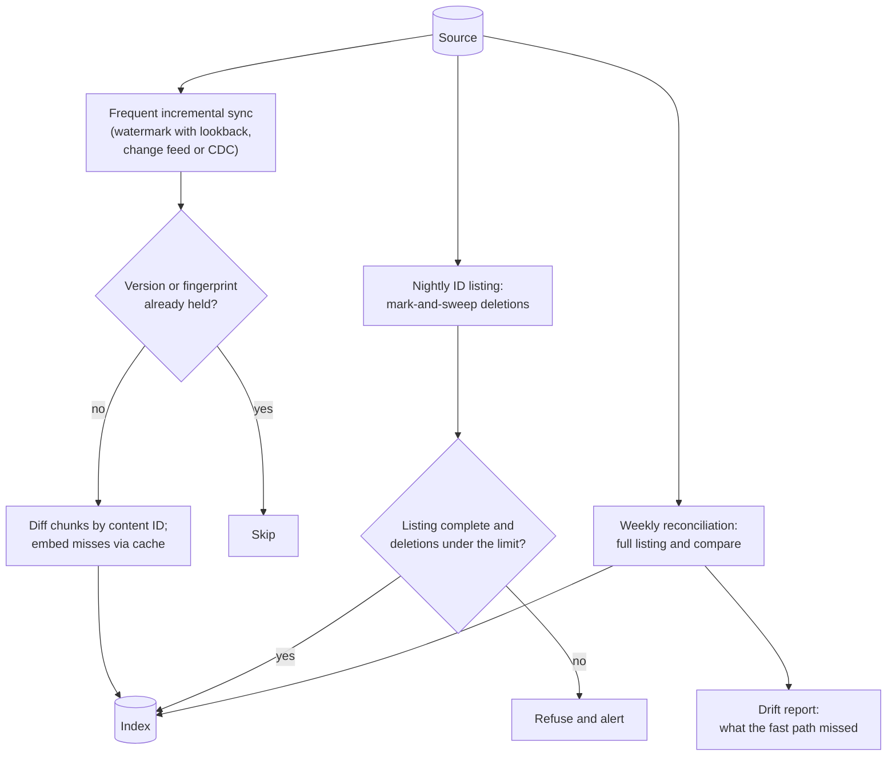

A full rebuild answers the question "what is in the sources?" from scratch every time. **Incremental ingestion** answers a cheaper one: "what has changed since I last looked?" It processes only new, modified and deleted documents, which is what makes frequent runs affordable, and it is how nearly every production RAG index is kept current day to day.

The idea is introduced in Phase 1: the [indexing pipeline](/learn/rag-architecture-fundamentals/indexing-pipeline) skips documents whose content hash is unchanged, and the [end-to-end lifecycle](/learn/rag-architecture-fundamentals/end-to-end-rag-lifecycle) sorts documents into add, update, delete and skip by comparing hashes. Both assume you can look at every document. This lesson is about the harder, real situation: sources too large to read in full on every run, which you must ask for changes. It covers the ways sources report change (watermarks, cursors, change feeds, change data capture), the precise bugs that make each of them miss changes, how to detect deletions safely, and how to avoid re-embedding text that has not changed.

## Learning objectives

- Compare four change-detection mechanisms (full listing, modified-since watermarks, change feeds with tokens, change data capture) by cost, completeness and what they reveal about deletions.
- Explain how ties at the boundary, late-committing writes and clock skew cause watermark-based syncs to miss changes, and fix them with a compound cursor and a lookback window.
- Implement deletion detection by mark-and-sweep with guards against incomplete listings and mass deletion.
- Use content-addressed chunk IDs and a model-aware embedding cache so that a small edit re-embeds only the chunks it changed.
- Decide when an incremental pipeline needs a full reconciliation and how often.

## Prerequisites

- [What is ingestion?](/learn/understanding-document-ingestion/what-is-ingestion): listing versus fetching, version markers, and the change-capability table.
- [Batch ingestion](/learn/understanding-document-ingestion/batch-ingestion): checkpoints, write-then-commit, and guarded publishing.
- [End-to-end RAG lifecycle](/learn/rag-architecture-fundamentals/end-to-end-rag-lifecycle): content hashes and when a full re-index is unavoidable.

## Why this matters

The economics are stark. The [What is ingestion?](/learn/understanding-document-ingestion/what-is-ingestion) lesson worked out that fetching every page of a 4,000-page wiki costs over 8,000 requests, while fetching only the 30 pages that changed costs 70. Embedding cost scales the same way. Without incremental ingestion, freshness is bought with money: every halving of the schedule interval doubles the bill. With it, cost tracks the rate of change, not the schedule.

The danger is equally stark, because incremental ingestion fails by **omission**. A full rebuild that goes wrong usually produces something visibly broken. An incremental sync that goes wrong skips a change, and nothing anywhere records that it was skipped. The index simply keeps the old version of a policy, or keeps a withdrawn page, indefinitely, because no later run will look at that document again unless it changes again. These bugs are subtle (two records with the same timestamp, a transaction that committed a second late) and they are cumulative: every missed change stays missed. Understanding exactly how they happen is the only way to build a sync you can trust, and to know what safety net to put under it.

## The intuition

Imagine keeping a personal copy of a colleague's shared notebook. You could photocopy the whole notebook every evening; that is a full rebuild. Or you could ask: "which pages have you changed since yesterday at 6 pm?" and copy only those.

That question has traps. If two pages were both changed at exactly 6 pm, and yesterday you copied only one of them before you stopped, then "since 6 pm" today excludes the other one forever. If your colleague was halfway through writing a page at 5:59 and finished it at 6:01, but the page carries the 5:59 time, then yesterday it was not ready and today it is "before 6 pm", so you never copy it. If your watch and your colleague's watch disagree by a few minutes, the boundary is wrong in a way neither of you can see. And "which pages have you changed?" never tells you about pages torn out of the notebook.

So you adopt habits. You remember not just the time but the last page number you copied at that time. You ask "since 5:50" rather than "since 6:00", and simply skip pages you already have. Every so often you leaf through the whole notebook to check that your copy has not drifted. Those habits are this lesson.

## How it works

### Four ways to find out what changed

| Mechanism | How it works | Cost per run | Sees deletions? | Main risk |
| --- | --- | --- | --- | --- |
| Full listing and compare | List every item with its version marker; compare with stored versions | Proportional to corpus size (listing) plus changes (fetching) | Yes, by absence, if the listing is complete | Listing cost on large sources; false deletions on partial listings |
| Modified-since watermark | Ask for items with `updated_at` after the last run's high-water mark | Proportional to changes | No | Missed changes at the boundary |
| Change feed with a token | Ask the source for changes since an opaque token it gave you last time | Proportional to changes | Usually yes | Token expiry; storing the token before applying the changes |
| Change data capture | Read the source database's own replication log | Proportional to changes | Yes | Operational complexity; needs database access |

The first is the method of the Phase 1 lessons, extended with cheap version markers. The other three ask the source to do the comparison. They are covered in turn below.

### Watermarks and their three bugs

A **watermark** (or high-water mark) is the largest modification time seen so far. Each run asks for items modified after it, processes them, and advances it. Many REST APIs and almost any database table with an `updated_at` column support this, so it is the most common incremental mechanism in practice. It has three well-known failure modes.

**1. Ties at the boundary.** Timestamps are coarse (often whole seconds) and bulk operations stamp many rows with the same value. Suppose three tickets have `updated_at = 100`, the API returns pages of two, and the cursor is the timestamp alone. Page one returns two of them; the next request asks for `updated_at > 100` and the third is skipped forever. The fix is a **compound cursor**: sort by `(updated_at, id)` and ask for rows strictly after the pair `(100, "T-2")`. Because the pair is unique, nothing is skipped and nothing is repeated. This is often called **keyset pagination**.

**2. Late-committing writes.** A row's timestamp is usually set when the write *starts*, but it becomes visible to readers only when its transaction *commits*. A transaction that begins at 155 and commits at 165 is invisible to a sync that runs at 160 and sets its watermark to 160. At the next run the row is visible, but its timestamp, 155, is behind the watermark, so it is never returned. The same thing happens with replication lag (reading from a replica that is a few seconds behind) and with clocks that disagree across the machines writing timestamps. The fix is a **lookback window**: each run asks for changes after `watermark - L` rather than after `watermark`, deliberately re-reading a short span, and skips items whose version it already holds. $L$ must exceed the longest plausible commit delay, replication lag and clock skew together.

**3. Deletions are invisible.** A deleted row has no `updated_at` to be newer than anything. A modified-since query cannot report it. Unless the source uses **soft deletes** (marking rows `deleted = true` and updating their timestamp), a watermark sync needs a separate deletion mechanism, covered below.

> [!WARNING]
> A lookback window only works if re-reading is harmless. That requires the idempotency the earlier lessons built: stable IDs, version or hash comparison, and upserts. With those, a lookback costs a few redundant reads; without them, it duplicates data.

### Change feeds and tokens

Some platforms do the bookkeeping for you. You ask for the current state once and receive, along with it, an opaque **token** (sometimes called a cursor, delta link or page token). Later you present the token and receive everything that changed since it was issued, including deletions, plus a new token. Microsoft Graph's delta queries and the Google Drive changes API both work this way.

Two rules make change feeds safe:

1. **Store the new token only after the changes it covers have been applied.** If you store it first and then crash, the next run starts after changes you never applied. This is the same write-then-commit rule as checkpoints in [batch ingestion](/learn/understanding-document-ingestion/batch-ingestion) and offsets in [streaming ingestion](/learn/understanding-document-ingestion/streaming-ingestion).
2. **Plan for the token to expire.** Providers keep change history for a limited time and document an error that means "this token is too old; start again". When it happens, the only correct response is a full resynchronisation: a complete listing compared against the index. Build that path before you need it.

### Change data capture

When the source is a database you can access, **change data capture** (CDC) reads its replication log, the record the database itself keeps of every committed change, in commit order. Tools such as Debezium turn that log into a stream of insert, update and delete events. Because it reads committed changes in commit order, CDC has none of the watermark bugs: no ties, no late commits, and deletes appear as events. The cost is operational: a log-reading connector with database privileges, usually a streaming platform to carry the events, and the [streaming ingestion](/learn/understanding-document-ingestion/streaming-ingestion) machinery to consume them.

### Detecting deletions: mark-and-sweep

For sources that cannot report deletions, the general method is **mark-and-sweep**: list every ID that currently exists in the source (the mark), and delete from the index every indexed ID not in that list (the sweep). Listing IDs alone is far cheaper than fetching content, so this can run less often than the change sync, perhaps nightly behind an hourly watermark sync.

The sweep is the most destructive operation in an ingestion system, and it is only as good as the listing. Guard it:

1. **Refuse to sweep after an incomplete listing.** Any error, timeout or permission failure during the listing means the absent IDs prove nothing.
2. **Refuse to sweep a large fraction.** If the sweep would delete more than a set share of the index (for example 20%), stop and alert. A genuine mass deletion is rare and worth a human look; a broken listing is common.
3. **Prefer soft deletion in the index first.** Mark chunks as deleted and exclude them from retrieval, then purge after a grace period. A wrong sweep is then reversible.

### Not re-embedding what did not change

Detecting that a document changed is only half the saving. A one-sentence edit to a 50-chunk handbook page should not re-embed 50 chunks.

Two techniques work together. First, **content-addressed chunk IDs**: derive each chunk's ID from a hash of its document ID and its text, instead of from its position. When a paragraph is inserted near the top, positional IDs all shift and every chunk looks new; content-addressed IDs stay the same for every chunk whose text is unchanged, so the update is a small set of deletions and additions. (The [indexing pipeline lesson's](/learn/rag-architecture-fundamentals/indexing-pipeline) fourth exercise discussed this trade-off; position is then stored as metadata.)

Second, an **embedding cache** keyed by a hash of the **model identifier and the text**. Before embedding a chunk, look up its key; on a hit, reuse the stored vector. The model must be part of the key. A cache keyed by text alone will happily return vectors from the old model after a model change, mixing two embedding spaces in one index, the silent failure described in [Offline and online processing](/learn/rag-architecture-fundamentals/offline-and-online-processing). With the model in the key, a model change simply misses the cache everywhere, which is correct.

### Reconciliation: the safety net

Every incremental mechanism can drift: a missed event, a lookback window that was too short one day, a bug fixed last week whose damage remains. Incremental runs never revisit documents that do not change, so they cannot repair drift. A periodic **reconciliation** does: list everything (IDs and version markers), compare with the index, and fix differences in both directions. It is the full-listing method from the table, run on a slower schedule. Its report is also your best measure of how well the incremental path works: a reconciliation that finds nothing to fix, week after week, is evidence; one that always finds something is a bug report.



### An incremental run, step by step

1. Load the saved cursor (a compound `(timestamp, id)` pair, or a change-feed token).
2. Request changes after the cursor, minus the lookback window if using timestamps, following pagination to the end.
3. For each changed item, compare its version marker or content fingerprint with the stored one; skip it if equal.
4. For items that really changed, fetch, parse and chunk; compute content-addressed chunk IDs; delete the document's chunks that no longer exist and add the new ones, embedding through the cache.
5. Apply deletions reported by the source (change feeds, CDC, soft-delete flags).
6. Save the new cursor only after steps 3 to 5 have been written.
7. On their own slower schedules, run guarded mark-and-sweep and full reconciliation.

## The mathematics

### Requests per run

**Intuition.** Each mechanism pays a fixed cost to find out what changed and a variable cost per change. Mechanisms differ almost entirely in the fixed cost.

For a source of $N$ items, listing page size $p$, and $c$ changed items since the last run:

$$
R_{\text{full}} = N, \qquad R_{\text{list}} = \left\lceil \frac{N}{p} \right\rceil + c, \qquad R_{\text{since}} = \left\lceil \frac{c}{p} \right\rceil + c
$$

- $R_{\text{full}}$: fetching every item (ignoring the listing itself).
- $R_{\text{list}}$: listing everything with version markers, then fetching the changed items.
- $R_{\text{since}}$: a modified-since query or change feed that returns only changed items, then fetching them.

**By hand.** With $N = 4{,}000$, $p = 100$ and $c = 30$: $R_{\text{full}} = 4{,}000$; $R_{\text{list}} = 40 + 30 = 70$; $R_{\text{since}} = \lceil 0.3 \rceil + 30 = 31$. Listing-and-compare is already 57 times cheaper than a full fetch, and it sees deletions; the modified-since query halves it again but does not. That is why a common design runs modified-since frequently and a listing less often.

### The cost of a lookback window

**Intuition.** A lookback re-reads whatever changed during the window. That is wasted work, but small, and the version check stops it from going further than a read.

If changes arrive at $r$ per hour and the lookback is $L$ minutes, each run re-reads about $r \cdot L / 60$ items, and over $n$ runs a day about $n \cdot r \cdot L / 60$.

**By hand.** With $r = 12$ changes per hour, $L = 10$ minutes and a run every 15 minutes ($n = 96$): $12 \times 10 / 60 = 2$ items re-read per run, $192$ a day, each skipped by its fingerprint without being re-embedded. For that price, any write that commits up to ten minutes late is still caught.

```python
N, page, changed = 4000, 100, 30
print("full fetch:            ", N, "requests")
print("list, fetch changed:   ", N // page + changed, "requests")
print("modified-since query:  ", -(-changed // page) + changed, "requests")

rate_per_hour, lookback_min, runs_per_day = 12, 10, 96
reread = rate_per_hour / 60 * lookback_min
print(f"rows re-read per run: {reread:.0f}; per day: {reread * runs_per_day:.0f} (all skipped by fingerprint)")
```

```output
full fetch:             4000 requests
list, fetch changed:    70 requests
modified-since query:   31 requests
rows re-read per run: 2; per day: 192 (all skipped by fingerprint)
```

(`-(-c // p)` is integer ceiling division in Python.)

## In code

**The problem.** Reproduce the two watermark bugs against a simulated ticket API, fix them with a compound cursor and a lookback window, guard a mark-and-sweep deletion, and show that an embedding cache keyed by model and text re-embeds only an edited chunk.

**Dependencies.** The Python standard library only.

The `TicketAPI` class models a REST endpoint that returns tickets modified after a cursor, sorted by `(updated_at, id)`, two per page. It can filter by timestamp alone (the naive cursor) or by the pair (the compound cursor). Rows with `visible=False` model a transaction that has written but not yet committed.

```python
import hashlib
from dataclasses import dataclass


@dataclass
class Row:
    id: str
    updated_at: int      # seconds; coarse, so ties are common
    text: str
    visible: bool = True # False models a transaction that has not committed yet


class TicketAPI:
    """A source with a 'modified since' query, sorted by (updated_at, id), paginated."""

    def __init__(self, rows):
        self.rows = {r.id: r for r in rows}

    def changed_since(self, cursor: tuple[int, str], limit: int, compound: bool):
        visible = sorted((r for r in self.rows.values() if r.visible), key=lambda r: (r.updated_at, r.id))
        if compound:
            page = [r for r in visible if (r.updated_at, r.id) > cursor]
        else:
            page = [r for r in visible if r.updated_at > cursor[0]]
        return page[:limit]


def sync(api, state, *, compound: bool, lookback: int = 0, limit: int = 2) -> list[str]:
    """Pull every change after the saved cursor, page by page. Returns IDs actually (re)indexed."""
    ts, last_id = state["cursor"]
    cursor = (ts - lookback, "") if lookback else (ts, last_id)
    indexed = []
    while True:
        page = api.changed_since(cursor, limit, compound)
        if not page:
            break
        for r in page:
            fingerprint = hashlib.sha256(r.text.encode()).hexdigest()
            if state["seen"].get(r.id) != fingerprint:      # idempotent: skip what we already hold
                state["seen"][r.id] = fingerprint
                indexed.append(r.id)
            cursor = (r.updated_at, r.id)
        state["cursor"] = max(state["cursor"], cursor)       # save only after the page is applied
    return indexed


def scenario(compound: bool, lookback: int):
    api = TicketAPI([Row("T-1", 100, "VPN drops on hotel Wi-Fi"),
                     Row("T-2", 100, "Password reset loop"),
                     Row("T-3", 100, "Laptop will not boot"),
                     Row("T-4", 160, "Reports export fails")])
    late = Row("T-5", 155, "SAML login error", visible=False)   # written at 155, committed late
    api.rows["T-5"] = late
    state = {"cursor": (0, ""), "seen": {}}
    first = sync(api, state, compound=compound, lookback=lookback)
    late.visible = True                                         # the slow transaction commits
    api.rows["T-2"] = Row("T-2", 170, "Password reset loop: fixed by clearing cache")
    second = sync(api, state, compound=compound, lookback=lookback)
    missing = sorted(set(api.rows) - set(state["seen"]))
    print(f"compound={compound!s:<5} lookback={lookback:>2}  run 1: {first}  run 2: {second}  missing: {missing}")


scenario(compound=False, lookback=0)
scenario(compound=True, lookback=0)
scenario(compound=True, lookback=30)


# --- Deletion detection by mark-and-sweep, with guards ---------------------
def sweep(indexed_ids: set, listed_ids: set, listing_complete: bool, max_fraction: float = 0.2):
    if not listing_complete:
        return "refused: listing incomplete", []
    to_delete = indexed_ids - listed_ids
    if len(to_delete) > max_fraction * len(indexed_ids):
        return f"refused: would delete {len(to_delete)}/{len(indexed_ids)}", []
    return "ok", sorted(to_delete)


indexed = {f"T-{i}" for i in range(1, 21)}
print()
print(sweep(indexed, indexed - {"T-7", "T-12"}, listing_complete=True))
print(sweep(indexed, {f"T-{i}" for i in range(1, 11)}, listing_complete=True))
print(sweep(indexed, indexed - {"T-7"}, listing_complete=False))


# --- Chunk-level embedding cache: key includes the model ------------------
cache: dict[str, list[float]] = {}


def embed_cached(chunks: list[str], model: str) -> int:
    misses = [c for c in chunks if hashlib.sha256(f"{model}\n{c}".encode()).hexdigest() not in cache]
    for c in misses:
        cache[hashlib.sha256(f"{model}\n{c}".encode()).hexdigest()] = [0.0]   # stand-in vector
    return len(misses)


handbook_v1 = ["Annual leave is 25 days.", "Up to 5 unused days carry over.",
               "Remote work up to 3 days a week.", "Equipment budget is £400.",
               "Expenses within 30 days.", "Receipts needed over £75."]
handbook_v2 = handbook_v1[:3] + ["Equipment budget is £400; contractors are not eligible."] + handbook_v1[4:]
print("\nfirst load, embedded:", embed_cached(handbook_v1, "all-MiniLM-L6-v2"))
print("one paragraph edited, embedded:", embed_cached(handbook_v2, "all-MiniLM-L6-v2"))
print("same text, new model, embedded:", embed_cached(handbook_v2, "bge-base-en-v1.5"))
```

```output
compound=False lookback= 0  run 1: ['T-1', 'T-2', 'T-4']  run 2: ['T-2']  missing: ['T-3', 'T-5']
compound=True  lookback= 0  run 1: ['T-1', 'T-2', 'T-3', 'T-4']  run 2: ['T-2']  missing: ['T-5']
compound=True  lookback=30  run 1: ['T-1', 'T-2', 'T-3', 'T-4']  run 2: ['T-5', 'T-2']  missing: []

('ok', ['T-12', 'T-7'])
('refused: would delete 10/20', [])
('refused: listing incomplete', [])

first load, embedded: 6
one paragraph edited, embedded: 1
same text, new model, embedded: 6
```

**The important lines.**

- `changed_since` with `compound=False` filters on `updated_at > cursor[0]`, the naive watermark. With `compound=True` it compares the `(updated_at, id)` tuple, which Python orders element by element, exactly like a SQL row comparison `(updated_at, id) > (:ts, :id)`.
- In `sync`, the cursor advances to the last row of each page, and `state["cursor"]` is saved after the page is processed, never before.
- `lookback` rewinds the starting point by a fixed number of seconds. The fingerprint check (`state["seen"].get(r.id) != fingerprint`) is what makes the re-read harmless.
- `max(state["cursor"], cursor)` stops a lookback from moving the saved cursor backwards.
- `sweep` refuses on an incomplete listing and on a deletion fraction above 20%, and only otherwise returns IDs to delete.
- `embed_cached` keys its cache by `model + "\n" + text`. Changing either produces a miss.

**What the output means.**

- **Naive cursor.** Run 1 fetched T-1 and T-2 (both at 100) on the first page, then asked for `updated_at > 100` and got T-4, skipping T-3 for good. T-5 was invisible during run 1, and by run 2 its timestamp, 155, was behind the cursor at 160, so it was missed too. The edit to T-2 in run 2 was caught because its new timestamp, 170, is ahead. Two of five tickets are missing from the index, and nothing reported an error.
- **Compound cursor.** The tie is handled: run 1 indexed all four visible tickets. T-5 is still missing, because a compound cursor fixes ties but not late commits.
- **Compound cursor with a 30-second lookback.** Run 2 started from 130, re-read T-4 (skipped by fingerprint, so not in the list) and picked up T-5 and the edited T-2. Nothing is missing.
- **Sweep.** Two genuinely deleted tickets are removed. A listing that returned only half the IDs, and a listing marked incomplete, are both refused.
- **Cache.** Editing one of six chunks embeds one. A model change embeds all six, as it must.

**Errors you will commonly hit.**

- Rows missing only when a bulk update ran: ties at the boundary. Look for a cursor on the timestamp alone.
- Rows missing at random, more often under load: late commits or replica lag. Add or widen the lookback window; check whether you read from a replica.
- Every run reprocessing the same rows forever: the cursor is never saved, or a lookback without the fingerprint check is re-embedding everything in the window.
- A sweep deleting most of the index after a credentials change: no completeness or fraction guard.

**How to extend it.** Add soft-delete handling: tickets with `deleted=True` arrive through the same modified-since query and are removed. Store the cursor and fingerprints in SQLite and wrap "apply page, save cursor" in one transaction. Then attempt exercise 2.

## A real-world example

The support desk's ticket system at Meridian exposes a REST endpoint that lists tickets updated after a given time. The Platform team's first sync for AskMeridian ran every 15 minutes with a watermark on `updated_at` alone, and it passed every test.

Over a month, Aisha on the support desk collected examples of resolved tickets that AskMeridian did not know about, and the Platform team found two patterns. Tickets closed in bulk by the nightly auto-close job, which stamps hundreds of tickets with the same second, were missing in clusters, always just after a page boundary: the tie bug. And a scattering of tickets updated during busy periods were missing individually. The ticket system's API, it turned out, read from a replica that could lag the primary by up to a minute under load, so a ticket updated at 10:14:50 might first be visible to the API at 10:15:20, after a sync that had already moved its watermark past 10:15:00: the late-visibility bug in a different costume.

The fix was a compound cursor on `(updated_at, id)`, which the API supported through its sort parameters, and a five-minute lookback, five times the worst replica lag the ticket system's owners would commit to. Because ticket versions were already compared before re-indexing, the lookback cost a handful of redundant reads per run. The team also added a weekly reconciliation that listed all ticket IDs and versions and compared them with the index. The first reconciliation repaired several hundred tickets missed before the fix; subsequent ones found nothing, which the team now treats as the sync's real test result.

## Common mistakes

- **A cursor on the timestamp alone.** Ties at a page or run boundary skip items permanently.
- **No lookback window.** Writes that commit late, replica lag and clock skew all produce items whose timestamps fall behind the watermark before they become visible.
- **Saving the cursor or token before applying the changes.** A crash in between loses those changes for good.
- **Assuming modified-since queries report deletions.** They cannot; deleted items stay in the index unless something else detects them.
- **Sweeping after a partial listing.** An error or permission change during listing turns into mass deletion from the index.
- **An embedding cache keyed by text only.** After a model change it serves vectors from the old model and mixes two embedding spaces.
- **No reconciliation.** Drift from any of the above accumulates silently, because incremental runs never revisit unchanged documents.

## Best practices

- Prefer the strongest change mechanism the source offers: CDC or a change feed over a watermark, a watermark over a full listing for frequent runs.
- Use compound `(timestamp, id)` cursors with a lookback window comfortably longer than commit delays, replica lag and clock skew combined.
- Make re-reading harmless with version or fingerprint checks, and save cursors and tokens only after their changes are applied.
- Detect deletions explicitly: soft-delete flags, change-feed deletions, or guarded mark-and-sweep with soft deletion in the index first.
- Use content-addressed chunk IDs and an embedding cache keyed by model and text.
- Run a periodic full reconciliation and track how much it fixes as the health metric of the incremental path.
- Build and test the full-resync path for expired tokens before you need it.

## Performance considerations

The incremental path's cost is set by the rate of change, so measure that first. For the 4,000-page wiki with 30 changes a day, a modified-since sync every 15 minutes costs roughly 96 near-empty queries a day plus the 30 fetches: about 126 requests, against 8,000 for a single full fetch. The listing-based deletion sweep adds 40 listing calls a night. A weekly reconciliation adds 40 listing calls and fetches only for discrepancies.

Embedding cost depends on chunk-level diffing. If an average edit changes 2 of a document's 12 chunks, content-addressed IDs and the cache cut embedding work for edits to about a sixth of a document-level re-embed. The cache costs storage: a 384-dimensional float32 vector is $384 \times 4 = 1{,}536$ bytes, so a cache of 100,000 chunk vectors is about 154 MB plus keys, often worth it, and evictable by age.

The lookback window's cost is the re-read items per run, $r L / 60$ from the mathematics section. It grows with both the change rate and $L$, so a source with very high change rates should get a precise mechanism (a change feed or CDC) rather than an ever-wider window.

## Security considerations

- **Permission changes are changes.** Many sources do not update a document's modification time when its permissions change. A watermark sync then never re-reads the new access list, and the index keeps serving the document to people who lost access. Check whether permission changes bump the version; if not, sync permissions on their own schedule or via the source's audit events.
- **Deletion must propagate within a defined time.** For personal data subject to erasure requests, the time from source deletion to index deletion is a compliance figure. A nightly sweep gives up to a day; document that and shorten it where required.
- **Soft-deleted chunks are still data.** Purge them after the grace period, and exclude them from every retrieval path, including any debugging tools.
- **Caches outlive documents.** An embedding cache keyed by text can hold vectors of deleted content, and vectors can leak information about their text. Expire cache entries and include the cache in deletion processing.

## Summary

- Incremental ingestion processes only what changed, so cost follows the rate of change rather than the schedule.
- Sources report change by full listing, modified-since watermarks, change feeds with tokens or change data capture; each differs in cost and in whether it reveals deletions.
- Watermarks miss changes through ties (fix: compound cursors), late commits and clock skew (fix: a lookback window with idempotent re-reads), and cannot see deletions at all.
- Detect deletions with guarded mark-and-sweep, and save cursors and tokens only after their changes are applied.
- Content-addressed chunk IDs and a model-aware embedding cache keep small edits cheap; periodic reconciliation catches whatever the fast path missed.

## Exercises

**1.** A sync uses a watermark on `updated_at` (whole seconds) with a cursor of the timestamp alone. Page size is 500. A bulk job updates 1,200 tickets, all with `updated_at = 1_700_000_000`. How many of them does the next sync index, and what is the fix?

<details><summary>Show solution</summary>

The first page returns 500 tickets with that timestamp; the cursor becomes `1_700_000_000`; the next request asks for `updated_at > 1_700_000_000` and skips the remaining 700. So 500 are indexed and 700 are missed permanently (until each is next modified). The fix is a compound cursor: order by `(updated_at, id)` and request rows where `(updated_at, id) > (last_ts, last_id)`, which pages through ties correctly. In SQL: `WHERE (updated_at, id) > (%s, %s) ORDER BY updated_at, id LIMIT 500`.

</details>

**2.** Write `plan_chunks(doc_id, old_chunks, new_chunks)` using content-addressed chunk IDs, returning the chunk IDs to delete, the texts to add and the number kept. Test it on an edit that inserts a new first paragraph and changes the last one.

<details><summary>Show solution</summary>

```python
import hashlib


def chunk_ids(doc_id: str, chunks: list[str]) -> dict[str, str]:
    """Content-addressed chunk IDs: hash of document ID plus chunk text."""
    return {hashlib.sha256(f"{doc_id}\n{c}".encode()).hexdigest()[:12]: c for c in chunks}


def plan_chunks(doc_id: str, old_chunks: list[str], new_chunks: list[str]) -> dict:
    old, new = chunk_ids(doc_id, old_chunks), chunk_ids(doc_id, new_chunks)
    return {"delete": sorted(old.keys() - new.keys()),
            "add": sorted(new[k] for k in new.keys() - old.keys()),
            "keep": len(old.keys() & new.keys())}


old = ["Annual leave is 25 days.", "Up to 5 unused days carry over.",
       "Remote work up to 3 days a week.", "Equipment budget is £400."]
new = ["Leave policy summary for 2027.", *old[:3], "Equipment budget is £400; contractors are not eligible."]
plan = plan_chunks("hr-wiki:HR-1", old, new)
print("delete:", plan["delete"])
print("add:   ", plan["add"])
print("keep:  ", plan["keep"])
```

```output
delete: ['3908b01ef6cc']
add:    ['Equipment budget is £400; contractors are not eligible.', 'Leave policy summary for 2027.']
keep:   3
```

With positional IDs (`doc:0`, `doc:1`, ...) the inserted first paragraph would shift every position, and all five chunks would be rewritten and re-embedded. With content-addressed IDs, three chunks are untouched, one is deleted and two are added. The document ID is mixed into the hash so that identical sentences in two documents get different IDs, and so that deleting a document's chunks remains a filter on a stored `doc_id` field. Results are sorted because Python set order is not stable across runs.

</details>

**3.** Your change-feed sync stores the new token, then applies the changes. One night the process is killed between the two steps. Describe the consequence and how you would detect it after the fact.

<details><summary>Show solution</summary>

The stored token now points past changes that were never applied. The next run asks for changes since that token and receives only later ones, so the lost changes (edits, additions, deletions) are never applied by the incremental path. Nothing errors. Detection: the weekly reconciliation will find documents whose source version is newer than the indexed version, and documents present in the index but deleted at the source, clustered around the time of the crash. Fix the order (apply, then store the token in the same transaction as the state it describes, or after the writes are durable) and, for the damage, run a reconciliation or a full resync immediately.

</details>

**4.** Design decision: the HR wiki offers only a modified-since query (no deletions, no change feed), and the handbook has 4,000 pages. HR requires that withdrawn pages disappear from AskMeridian within four hours, and edits within 30 minutes. Design the schedule.

<details><summary>Show solution</summary>

Edits: a modified-since sync every 15 minutes with a compound cursor and a lookback window (say 10 minutes, checked against the wiki's documented behaviour), giving worst-case edit staleness of roughly 15 minutes plus run time, inside the 30-minute target. Deletions: a mark-and-sweep that lists all page IDs (40 listing calls at 100 per page) every 2 to 3 hours, so a withdrawn page is gone within the four-hour requirement even if one sweep is refused; guard it with completeness and fraction checks, soft-delete first, and alert on refusal, since a refused sweep threatens the four-hour target. Ask also whether withdrawn pages are archived rather than deleted (many wikis move them to an archive with a status change, which a modified-since query would report). Weekly: a full reconciliation comparing versions to catch anything the watermark missed. Check whether permission changes update page versions; if not, re-read permissions in the sweep.

</details>

## Check your understanding

```quiz
[
  {
    "q": "Why does a cursor on `updated_at` alone miss rows when pages are limited in size?",
    "options": [
      "Timestamps cannot be compared across time zones",
      "Rows with the same timestamp as the last row of a page are excluded by the next `updated_at >` query",
      "Databases return rows in random order",
      "The cursor is too large to store"
    ],
    "answer": 1,
    "why": "When a page ends partway through a group of rows with an equal timestamp, a strict greater-than on the timestamp skips the rest of the group. A compound (timestamp, id) cursor fixes it."
  },
  {
    "q": "A row is written with `updated_at = 155` but its transaction commits at 165. The sync ran at 160 and saved watermark 160. What prevents the row being missed forever?",
    "options": [
      "A compound cursor",
      "A larger page size",
      "A lookback window that re-reads changes after watermark minus L, with idempotent skipping",
      "Using a faster database"
    ],
    "answer": 2,
    "why": "The row's timestamp is behind the watermark by the time it is visible. Re-reading a window behind the watermark catches it, and version checks make the re-read harmless."
  },
  {
    "q": "Which mechanism does NOT, by itself, tell you that a document was deleted?",
    "options": [
      "A modified-since query on `updated_at`",
      "Change data capture from the database log",
      "A change feed with tokens that reports removed items",
      "A complete listing compared with the index"
    ],
    "answer": 0,
    "why": "A deleted row has no newer modification time to return. The others either report deletions as events or reveal them by absence."
  },
  {
    "q": "A mark-and-sweep run would delete 46% of the index. The listing reported no errors. What should happen?",
    "options": [
      "Delete them: the listing was complete",
      "Delete half of them",
      "Re-embed the whole index",
      "Refuse the sweep and alert a human, since mass deletion is far more often a listing problem than a real event"
    ],
    "answer": 3,
    "why": "A fraction guard protects against listings that silently return less than they should, for example after a permissions change. A real mass deletion can be confirmed and applied deliberately."
  },
  {
    "q": "Why must the embedding cache key include the model identifier?",
    "options": [
      "So that after a model change, cached vectors from the old model are not reused and mixed with new ones",
      "Because hashes of text alone collide often",
      "To make the cache smaller",
      "Because embedding APIs require it"
    ],
    "answer": 0,
    "why": "Vectors from different models live in different spaces. Keying by model and text makes a model change miss the cache, forcing correct re-embedding."
  }
]
```

## Further reading

- Kleppmann, M. (2017). *Designing Data-Intensive Applications*, chapter 11, section "Change Data Capture". O'Reilly.
- Microsoft Graph documentation, "Use delta query to track changes in Microsoft Graph data": [learn.microsoft.com/en-us/graph/delta-query-overview](https://learn.microsoft.com/en-us/graph/delta-query-overview)
- Google Drive API documentation, "Retrieve changes": [developers.google.com/drive/api/guides/manage-changes](https://developers.google.com/drive/api/guides/manage-changes)
- Debezium documentation: [debezium.io/documentation](https://debezium.io/documentation/)
- PostgreSQL documentation, "Row Constructor Comparison" (the `(a, b) > (x, y)` comparison used by keyset pagination): [postgresql.org/docs/current/functions-comparisons.html](https://www.postgresql.org/docs/current/functions-comparisons.html)
