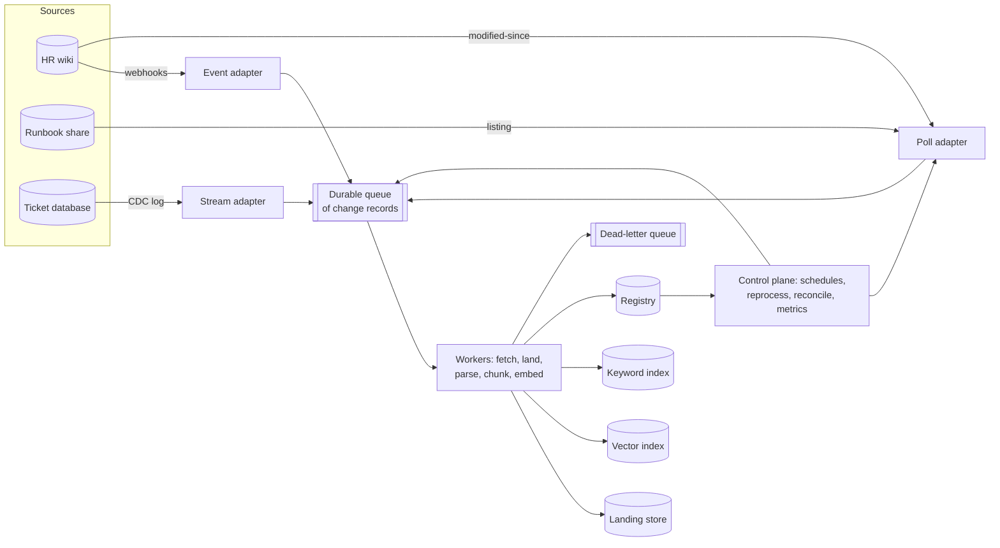

The previous five lessons each examined one way of getting changes out of sources: [batch](/learn/understanding-document-ingestion/batch-ingestion) jobs, [streams](/learn/understanding-document-ingestion/streaming-ingestion), [incremental](/learn/understanding-document-ingestion/incremental-ingestion) syncs and [events](/learn/understanding-document-ingestion/event-driven-ingestion). A real organisation needs several of them at once, across many sources, feeding more than one index, while the pipeline itself keeps changing. **Ingestion architecture** is the design that lets all of that live in one system without each source becoming its own special case.

This lesson assembles the module into a reference architecture: adapters that turn every trigger into one change-record contract, a landing store, a durable queue, stage workers, sinks that must stay consistent with each other, and a control plane that knows what is indexed and how. It also covers how to choose a mode per source, how to reprocess everything when the pipeline changes, what to measure, and how to size each stage. Scaling it across many machines is the business of Phase 14, [Distributed ingestion](/learn/production-architecture/distributed-ingestion) and [Queue-based pipelines](/learn/production-architecture/queue-based-pipelines); this lesson is about the shape that makes scaling possible.

## Learning objectives

- Draw a layered ingestion architecture and state the responsibility of each layer: adapters, landing store, queue, workers, sinks and control plane.
- Define a single change-record contract and explain why every trigger (poll, event, stream, reprocess) should produce it.
- Choose an ingestion mode for a source from its change capability, size, change rate and freshness target.
- Keep several sinks (vector index, keyword index, registry) consistent, and detect when they are not.
- Size each stage with Little's law and name the metrics that show whether ingestion is healthy.

## Prerequisites

- [What is ingestion?](/learn/understanding-document-ingestion/what-is-ingestion)
- [Batch ingestion](/learn/understanding-document-ingestion/batch-ingestion)
- [Streaming ingestion](/learn/understanding-document-ingestion/streaming-ingestion)
- [Incremental ingestion](/learn/understanding-document-ingestion/incremental-ingestion)
- [Event-driven ingestion](/learn/understanding-document-ingestion/event-driven-ingestion)

## Why this matters

Ingestion systems rarely start as architectures. They start as one script for one source. The second source gets a copy of the script with changes. The third needs webhooks, so it gets a small service. A year later there are seven ingestion paths, each with its own idea of a document ID, its own way of chunking, its own retry logic and its own gaps. Changing the chunker means changing seven code paths and re-fetching from seven sources. Nobody can answer "how fresh is the index?" or "which documents failed last night?" because the answer lives in seven different log formats. A permissions bug fixed in one path persists in the other six.

A deliberate architecture prevents this by putting the variation where it belongs, at the edges, and making everything behind the edges the same. Each source needs its own adapter, because sources really are different. But once a change has been noticed, the rest of the path (fetching, landing, parsing, chunking, embedding, writing, recording) should be one shared pipeline that does not know or care whether the change arrived by webhook, by nightly listing or by replay. That is what makes the system changeable: a new chunker is one change, applied to every source, and a reprocess is one operation.

## The intuition

Think of a large parcel-sorting depot. Parcels arrive by many routes: lorries on a timetable, couriers who turn up unannounced, a conveyor from the airport that never stops. Each route has its own unloading bay, because a lorry and a conveyor need different equipment. But the moment a parcel is unloaded it gets the same barcode label as every other parcel, goes onto the same belt, and passes through the same scanning, sorting and loading stations. The stations have no idea how a parcel arrived.

Above the floor sits a control room with a ledger: every parcel's barcode, where it is, which version of the sorting rules handled it. When the rules change, the control room can pull up every parcel sorted under the old rules and send it round again, from the depot's own storage, without asking the senders to post everything a second time. And the control room watches dials: how long parcels wait, how many are in the "problem" cage, which bays have gone quiet.

The bays are **adapters**. The barcode label is the **change record**. The belt is the **queue**. The stations are **stage workers**. The depot's storage is the **landing store**. The ledger is the **registry**, and the control room is the **control plane**.

## How it works

### The reference architecture



Six layers, each with one job:

1. **Adapters** (also called connectors) know one source each: how to authenticate, list, query for changes, receive its events, read its permissions. Their only output is change records. All source-specific code lives here.
2. **The queue** carries change records durably from adapters to workers. It absorbs bursts, decouples the speed of noticing changes from the speed of processing them, and lets workers fail and restart without losing anything. A log such as Kafka, a managed queue such as SQS or Pub/Sub, or for modest volumes a database table used as a queue, all work.
3. **Workers** run the shared pipeline: fetch current content (or read it from the landing store), parse, clean, chunk, enrich, embed, and write. Workers are stateless; everything they need is in the record, the landing store and the registry.
4. **The landing store** keeps the raw bytes of every fetched version, keyed by source, ID and version, as [What is ingestion?](/learn/understanding-document-ingestion/what-is-ingestion) motivated. Reprocessing reads from here.
5. **Sinks** are the stores retrieval reads: one or more vector collections, a keyword index for [sparse retrieval](/learn/sparse-retrieval), perhaps a metadata database. They must agree with each other.
6. **The control plane** holds the **registry** (for every document: its ID, source, version, content hash, pipeline version, chunk count, permissions and status) and runs the things that are not driven by changes: schedules for poll adapters, reconciliation, reprocessing, subscription renewal, metrics and alerts.

### One contract: the change record

The architecture's central decision is that every adapter emits the same record, and that record says *what changed*, not *what the content is*:

| Field | Meaning |
| --- | --- |
| `source`, `external_id` | Which document, in the source's own terms; the document ID is derived from these |
| `op` | `upsert`, `delete`, or `permissions` |
| `version` | The source's version marker, used for ordering and idempotency |
| `via` | Which path produced it: `poll`, `event`, `stream`, `reconcile`, `reprocess` |
| `observed_at` | When the change was noticed, for freshness metrics |

Keeping content out of the record (thin records) means the queue stays small, the same record can be produced by any adapter, and the worker always fetches current content and checks versions, the "notify, then fetch" rule from [event-driven ingestion](/learn/understanding-document-ingestion/event-driven-ingestion) applied everywhere. The `via` field costs nothing and is invaluable later: when a document is missed or indexed twice, it tells you which path was responsible.

Because all paths produce the same record and the worker is idempotent, **paths may overlap freely**. A webhook and the next modified-since poll both report the same edit; the worker processes the first and skips the second as already current. Overlap is not waste to be engineered away; it is how the reliable-but-slow path backs up the fast-but-lossy one.

### Choosing a mode per source

Each source gets the cheapest combination of modes that meets its freshness target with a reliable backstop. A practical decision procedure:

1. **Where does the source sit in the change-capability table?** CDC or a change feed is preferred where available; webhooks are a fast path, never the only path; a full listing is always possible but costs most.
2. **What freshness does the content need?** Days: a nightly incremental batch. Hours: a modified-since poll every 15 to 60 minutes. Minutes: events or a stream, plus a poll as backstop.
3. **How large is it and how fast does it change?** Large, slow-changing sources favour change-based mechanisms; small sources can simply be listed in full each time.
4. **How must deletions and permission changes propagate?** If the fast path cannot see them, schedule a guarded mark-and-sweep and a permissions sync at an interval that meets the requirement.
5. **Add a reconciliation** at a slow interval for every source, whatever else it has.

For Meridian this might produce:

| Source | Fast path | Backstop | Deletions |
| --- | --- | --- | --- |
| HR wiki (handbook) | Webhooks, debounced | Modified-since every 15 min; weekly reconciliation | Webhook plus sweep every 30 min |
| IT runbook share | None (no events) | Listing and compare every 10 min (small share) | From the same complete listing |
| Ticket database | CDC stream | Weekly reconciliation | Delete events in the CDC stream |
| Product documentation | Release pipeline triggers a full build | Alias swap per release | Implicit: each build is complete |

### Lambda and Kappa

Two named architectures from data engineering frame the choice between a batch path and a streaming path. The **Lambda architecture**, described by Nathan Marz, runs a batch layer that periodically recomputes everything from the master data for correctness, and a speed layer that processes recent changes quickly; results from the two are merged. Its drawback is two implementations of the same logic. The **Kappa architecture**, proposed by Jay Kreps in 2014, keeps only the streaming path and handles reprocessing by replaying the log from the beginning through new code.

The design in this lesson borrows from both. It has one implementation of the processing logic (the Kappa idea), fed by several triggers including slow, complete ones (the Lambda idea of a correctness path). Reprocessing replays from the landing store and registry rather than from a log, which works even for sources that never had a log.

### Keeping several sinks consistent

A hybrid RAG system usually writes each chunk to at least two indexes, vector and keyword, and records the result in the registry. These are separate systems with no shared transaction, so a crash between writes leaves them disagreeing: a chunk retrievable by keyword but not by vector, or vice versa, or a registry that believes a document is indexed when one index lacks it.

Three rules keep this manageable:

1. **Make every sink write idempotent** (delete-then-upsert by document, stable chunk IDs), so that redoing a whole document is always safe.
2. **Write the registry last.** The registry is the record of completed work. If a crash happens before it is written, the document still looks unprocessed (or at the old version) and will be redone; if the registry were written first, a failed index write would be hidden.
3. **Audit regularly.** Compare the registry's chunk counts with each index, and list chunks in any index that the registry does not know (orphans). Repair by re-processing the affected documents. Exercise 2 builds this audit.

Distributed-systems patterns such as the transactional outbox exist for stronger guarantees; for most ingestion systems, idempotent writes plus registry-last plus a periodic audit are enough.

### Reprocessing and backfills

The pipeline will change: a better PDF parser, a new chunk size, a new embedding model. Because the registry records the **pipeline version** that produced each document, and the landing store holds the raw content, reprocessing is a query and a replay:

1. Bump the pipeline version in configuration.
2. Select every registry entry with an older pipeline version.
3. Enqueue a `reprocess` change record for each, at its current version.
4. Workers read the content from the landing store, so **no source is contacted**, and rewrite the document under the new pipeline.

For changes that alter vectors (a new embedding model, or a change to what text is embedded), reprocess into a **new** collection and switch with an alias, as in [batch ingestion](/learn/understanding-document-ingestion/batch-ingestion), because an index cannot be partly on one model. For changes that do not alter the vector space, reprocessing in place is acceptable. [Reindexing](/learn/ci-cd-and-mlops/reindexing) in Phase 14 treats this operationally.

A **backfill** (onboarding a new source, or a historical range) is the same mechanism pointed at the source rather than the landing store: an adapter emits records for everything in scope, at a controlled rate, ideally on a separate queue or with lower priority so live changes are not delayed behind it.

### What to measure

Ingestion is healthy when these numbers are where you expect them. Phase 13's [RAG Observability](/learn/rag-observability) module covers the tooling; the measures specific to ingestion are:

- **Freshness lag**: for each processed change, the time from the source's modification to the registry update, as a distribution (median and 95th percentile) per source. This is the number your freshness target is about.
- **Queue age**: the age of the oldest unprocessed record. Rising age means workers cannot keep up.
- **Coverage**: documents in the registry versus documents in the source's last complete listing, per source.
- **Outcomes per run and per path**: indexed, skipped as current, deleted, quarantined, dead-lettered, broken down by `via`.
- **Dead-letter queue depth and age**: items that need a human.
- **Reconciliation drift**: how many documents each reconciliation had to fix. Zero is the target; anything else points at a path that is losing changes.
- **Source silence**: events or changes per source compared with the usual rate, catching expired subscriptions and broken adapters.

### Permissions and tenants

Access control runs through every layer. Adapters must read permissions with content and emit `permissions` change records when access changes. Workers write permissions onto every chunk. The registry stores them so that a permissions-only change can update chunk metadata without re-embedding. In a multi-tenant system, the tenant is part of every document ID, every queue partition key and every sink filter, so that one tenant's backlog or failure cannot leak into another's results. [Multi-tenant RAG](/learn/production-architecture/multi-tenant-rag) and [Document-level permissions](/learn/access-control-and-privacy/document-level-permissions) take these further.

## The mathematics

### Sizing stages with Little's law

**Intuition.** If documents arrive at a steady rate and each spends a fixed time in a stage, the number of documents being worked on at once is the rate times the time. That number is how many workers the stage keeps busy.

**Little's law** (Little, 1961) states that for any stable system, the average number of items in the system $L$ equals the average arrival rate $\lambda$ times the average time each item spends in it $W$:

$$
L = \lambda W
$$

- $L$: the average number of items in the stage at once; for a stage of workers, the number of busy workers.
- $\lambda$: the arrival rate, in items per second.
- $W$: the average time an item spends being processed in the stage, in seconds.

To leave headroom for bursts, provision $\lceil L / \rho \rceil$ workers, where $\rho$ is the target utilisation (for example 0.7).

**By hand.** At peak Meridian's ingestion sees $\lambda = 4$ documents per second (an assumption for the example). Each document spends $0.30$ s being fetched, $0.15$ s being parsed, $0.50$ s being embedded and $0.05$ s being written. For the embed stage, $L = 4 \times 0.50 = 2.0$ busy workers; at 70% utilisation, provision $\lceil 2.0 / 0.7 \rceil = \lceil 2.86 \rceil = 3$. The fetch stage needs $\lceil 1.2 / 0.7 \rceil = 2$, and the parse and write stages one each. The embed stage dominates, which is why stages are scaled separately rather than as one monolithic worker.

```python
import math

peak_docs_per_s = 4
stages = {"fetch": 0.30, "parse": 0.15, "embed": 0.50, "write": 0.05}   # seconds of work per document
for name, w in stages.items():
    busy = peak_docs_per_s * w                       # Little's law: L = lambda * W
    print(f"{name:<6} busy workers at peak = {peak_docs_per_s} x {w:.2f} = {busy:.1f}"
          f" -> provision {math.ceil(busy / 0.7)} at 70% utilisation")
```

```output
fetch  busy workers at peak = 4 x 0.30 = 1.2 -> provision 2 at 70% utilisation
parse  busy workers at peak = 4 x 0.15 = 0.6 -> provision 1 at 70% utilisation
embed  busy workers at peak = 4 x 0.50 = 2.0 -> provision 3 at 70% utilisation
write  busy workers at peak = 4 x 0.05 = 0.2 -> provision 1 at 70% utilisation
```

The law holds only if the system is stable, meaning each stage can on average keep up ($\lambda$ below the stage's capacity). If not, queue age grows without bound, and the drain-time formula from [streaming ingestion](/learn/understanding-document-ingestion/streaming-ingestion) tells you how long recovery takes once capacity is added.

## In code

**The problem.** Build the architecture in miniature: two sources, a poll adapter and an event adapter producing the same change record, a queue, a worker running the shared pipeline into a vector index and a keyword index with the registry written last, a dead-letter queue, confirmed deletions, and a reprocess after a pipeline change that reads from the landing store without contacting the sources.

**Dependencies.** The Python standard library only. Every component is in-process so that the whole architecture fits on one screen and runs anywhere; each one names the production component it stands in for.

```python
import hashlib
import sqlite3
from collections import Counter, deque
from dataclasses import dataclass

PIPELINE_VERSION = "parse-v1|chunk-sentences-v1|MiniLM-L6-v2"


@dataclass(frozen=True)
class ChangeRecord:
    """The one contract every adapter produces, whatever triggered it."""
    source: str
    external_id: str
    op: str              # "upsert" or "delete"
    version: int
    via: str             # "poll", "event", "reprocess" ...


def doc_id(source, external_id):
    return hashlib.sha256(f"{source}:{external_id}".encode()).hexdigest()[:12]


# --- Sources (simulated) and the landing store -------------------------------
SOURCES = {
    "hr-wiki": {"HR-1": (7, "Annual leave is 25 days. Up to 5 unused days carry over."),
                "HR-2": (5, "Remote work up to 3 days a week. Equipment budget is £400.")},
    "it-runbooks": {"vpn.md": (3, "VPN is required on public Wi-Fi. Error E-4021 means the client is out of date."),
                    "broken.pdf": (1, None)},          # the parser will fail on this one
}
LANDING: dict[tuple, str] = {}                         # (source, id, version) -> raw content


# --- Control plane: registry of what is indexed, and how ---------------------
db = sqlite3.connect(":memory:")
db.execute("""CREATE TABLE registry (doc_id TEXT PRIMARY KEY, source TEXT, external_id TEXT,
              version INT, pipeline_version TEXT, chunks INT)""")

# --- Sinks: a vector index and a keyword index that must stay in step --------
VECTORS: dict[str, list[float]] = {}
KEYWORDS: dict[str, set[str]] = {}
QUEUE: deque[ChangeRecord] = deque()
DLQ: list[tuple[ChangeRecord, str]] = []
METRICS: Counter = Counter()


def poll_adapter(source):
    """Pull path: list the source, emit records for anything newer than the registry."""
    for ext, (version, _) in sorted(SOURCES[source].items()):
        row = db.execute("SELECT version FROM registry WHERE doc_id = ?", (doc_id(source, ext),)).fetchone()
        if row is None or row[0] < version:
            QUEUE.append(ChangeRecord(source, ext, "upsert", version, "poll"))
    METRICS["polls"] += 1


def event_adapter(source, ext, op, version):
    """Push path: a verified webhook becomes the same kind of record."""
    QUEUE.append(ChangeRecord(source, ext, op, version, "event"))


def reprocess_stale_pipeline():
    """Replay from the landing store for documents built by an older pipeline."""
    rows = db.execute("SELECT source, external_id, version FROM registry WHERE pipeline_version != ?",
                      (PIPELINE_VERSION,)).fetchall()
    for source, ext, version in rows:
        QUEUE.append(ChangeRecord(source, ext, "upsert", version, "reprocess"))
    return len(rows)


def fetch(rec):
    key = (rec.source, rec.external_id, rec.version)
    if key not in LANDING:                                        # only touch the source on a miss
        METRICS["source_fetches"] += 1
        LANDING[key] = SOURCES[rec.source][rec.external_id][1]
    return LANDING[key]


def parse_and_chunk(raw):
    if raw is None:
        raise ValueError("parser could not extract text")
    return [s.strip() + "." for s in raw.split(".") if s.strip()]


def embed(chunks):
    METRICS["embed_calls"] += 1
    return [[b / 255 for b in hashlib.sha256(c.encode()).digest()[:4]] for c in chunks]


def delete_from_sinks(did):
    for store in (VECTORS, KEYWORDS):
        for cid in [k for k in store if k.startswith(did + ":")]:
            del store[cid]


def write_sinks(did, rec, chunks, vectors):
    """Delete-then-write in both indexes, then the registry: the registry is written last."""
    delete_from_sinks(did)
    for i, (c, v) in enumerate(zip(chunks, vectors)):
        VECTORS[f"{did}:{i}"] = v
        KEYWORDS[f"{did}:{i}"] = set(c.lower().replace(".", "").split())
    db.execute("INSERT OR REPLACE INTO registry VALUES (?, ?, ?, ?, ?, ?)",
               (did, rec.source, rec.external_id, rec.version, PIPELINE_VERSION, len(chunks)))
    db.commit()


def worker():
    while QUEUE:
        rec = QUEUE.popleft()
        did = doc_id(rec.source, rec.external_id)
        row = db.execute("SELECT version, pipeline_version FROM registry WHERE doc_id = ?", (did,)).fetchone()
        if rec.op == "upsert" and row and row[0] >= rec.version and row[1] == PIPELINE_VERSION:
            METRICS["skipped_current"] += 1
            continue
        if rec.op == "delete":
            if rec.external_id in SOURCES[rec.source]:            # confirm with the source first
                METRICS["delete_refused"] += 1
                continue
            delete_from_sinks(did)
            db.execute("DELETE FROM registry WHERE doc_id = ?", (did,))
            db.commit()
            METRICS["deleted"] += 1
            continue
        try:                                  # transient-error retries omitted; see batch ingestion
            chunks = parse_and_chunk(fetch(rec))
            write_sinks(did, rec, chunks, embed(chunks))
            METRICS[f"indexed_via_{rec.via}"] += 1
        except ValueError as exc:                                 # permanent: park it, carry on
            DLQ.append((rec, str(exc)))
            METRICS["dead_lettered"] += 1


def status(label):
    print(f"{label:<28} registry={db.execute('SELECT COUNT(*) FROM registry').fetchone()[0]} "
          f"chunks={len(VECTORS)} keyword_entries={len(KEYWORDS)} dlq={len(DLQ)}")


# 1. Initial load: both sources through the poll adapter.
for s in SOURCES:
    poll_adapter(s)
worker()
status("after initial load")

# 2. A webhook says HR-2 changed; a duplicate poll sees the same change.
SOURCES["hr-wiki"]["HR-2"] = (6, "Remote work up to 3 days a week. Equipment budget is £400. "
                                 "Contractors are not eligible.")
event_adapter("hr-wiki", "HR-2", "upsert", 6)
poll_adapter("hr-wiki")
worker()
status("after an edit (event + poll)")

# 3. A runbook is deleted at the source.
del SOURCES["it-runbooks"]["vpn.md"]
event_adapter("it-runbooks", "vpn.md", "delete", 4)
worker()
status("after a deletion")

# 4. The chunker changes: reprocess from the landing store, not from the sources.
fetches_before = METRICS["source_fetches"]
PIPELINE_VERSION = "parse-v1|chunk-sentences-v2|MiniLM-L6-v2"
print("documents to reprocess:", reprocess_stale_pipeline())
worker()
status("after pipeline change")
print("source fetches during reprocess:", METRICS["source_fetches"] - fetches_before)
print("\nDLQ:", [(r.external_id, err) for r, err in DLQ])
print("metrics:", dict(sorted(METRICS.items())))
```

```output
after initial load           registry=3 chunks=6 keyword_entries=6 dlq=1
after an edit (event + poll) registry=3 chunks=7 keyword_entries=7 dlq=1
after a deletion             registry=2 chunks=5 keyword_entries=5 dlq=1
documents to reprocess: 2
after pipeline change        registry=2 chunks=5 keyword_entries=5 dlq=1
source fetches during reprocess: 0

DLQ: [('broken.pdf', 'parser could not extract text')]
metrics: {'dead_lettered': 1, 'deleted': 1, 'embed_calls': 6, 'indexed_via_event': 1, 'indexed_via_poll': 3, 'indexed_via_reprocess': 2, 'polls': 3, 'skipped_current': 1, 'source_fetches': 5}
```

**The important lines.**

- `ChangeRecord` is the contract. `poll_adapter`, `event_adapter` and `reprocess_stale_pipeline` all produce it, and `worker` consumes nothing else.
- `poll_adapter` compares each listed version with the registry and emits records only for newer versions; it is an incremental listing-and-compare adapter.
- `fetch` reads from `LANDING` when the exact `(source, id, version)` is there and contacts the source only on a miss. That is what makes reprocessing free of source traffic.
- In `worker`, an upsert is skipped only when the registry holds the same or a newer version **and** the same pipeline version. A pipeline change therefore makes every document eligible again.
- A delete is applied only after confirming the source no longer has the document, as [event-driven ingestion](/learn/understanding-document-ingestion/event-driven-ingestion) recommended.
- `write_sinks` deletes the document's chunks from both indexes, writes the new chunks to both, and only then writes the registry row.
- A permanent failure goes to `DLQ` with its reason, and the worker moves on.

**What the output means.**

- **Initial load.** Three documents were indexed (six chunks, in both indexes). The broken PDF went to the dead-letter queue instead of stopping the run.
- **An edit reported twice.** The webhook and the poll both produced a record for HR-2 version 6. The first re-indexed it (now three chunks, so seven in total); the second was counted as `skipped_current`. The two paths overlapped harmlessly.
- **A deletion.** The VPN runbook's two chunks were removed from both indexes and its registry row deleted, after confirming it was gone from the source.
- **A pipeline change.** Bumping the pipeline version made the registry report two documents built by the old pipeline. Both were reprocessed with `source_fetches` unchanged: the content came from the landing store.
- **Metrics.** Six embedding calls in total: three in the initial load, one for the edit, two for the reprocess. The `indexed_via_*` counts show which path did the work.

**Errors you will commonly hit.**

- Reprocessing that hits the sources anyway: the landing store is keyed by something other than the exact version, or it was never written for some sources.
- A document that is never re-indexed after an edit: the skip check compares only versions and ignores the pipeline version, or a buggy adapter emits an old version.
- Counts that disagree between the vector and keyword indexes: a write to one sink failed after the other succeeded, and nothing audits for it. Exercise 2.
- One source's backlog delaying all others: a single shared queue with no per-source fairness. Use separate queues or partitions per source, or per tenant.

**How to extend it.** Replace the deque with a real queue and run several workers. Give each source its own queue. Record `observed_at` on each record and compute freshness lag at registry-write time. Add a `permissions` operation that updates chunk metadata without re-embedding.

## A real-world example

By its second year, AskMeridian indexed the handbook, the runbooks, the ticket system and the product documentation, through four separately written ingestion paths. When the Platform team decided to switch to a structure-aware chunker for better answers on long runbooks, the estimate came back at six weeks: four code paths to change, each with its own chunking call, and a re-fetch of every source, including the documentation platform whose rate limit made a full fetch take most of a day.

Priya, the team's lead, used the estimate to argue for consolidation. Over a quarter, the team rebuilt ingestion around the design in this lesson. Each path was cut down to an adapter that emitted change records onto one queue per source. One worker codebase ran the shared pipeline. A landing store in object storage kept raw content by source, ID and version, and a registry table recorded each document's version, pipeline version, chunk count and permissions. The team kept every existing trigger (webhooks for the wiki, CDC for tickets, listings for the share, release builds for documentation), but each now ended at the queue.

The structure-aware chunker, when it finally shipped, was a configuration change and a pipeline-version bump. Reprocessing ran from the landing store into a new collection overnight, without a single request to any source, was evaluated the next morning and published by moving an alias. The registry also exposed something nobody had known: several dozen runbooks had been sitting in a "failed" state in the old share script for months, unreported. They appeared in the new dead-letter queue on day one, nearly all were PDFs exported from a diagramming tool, and they were fixed within the week.

## Common mistakes

- **One bespoke pipeline per source.** Every pipeline change must be made several times, and fixes in one path do not reach the others.
- **Putting content in the queue records.** The queue becomes large and full of sensitive data, and records cannot be produced uniformly by all adapters.
- **Writing the registry before the indexes.** A failed index write is hidden behind a registry that says the work is done.
- **No pipeline version in the registry.** There is no way to find which documents were built by old logic, so every change means rebuilding everything from the sources.
- **No landing store.** Every reprocess hammers every source and may see different versions than the original run.
- **A single shared queue for backfills and live changes.** A large backfill delays every live update behind it.
- **Measuring only errors.** Without freshness lag, coverage and drift, an ingestion system can be "green" while missing changes.

## Best practices

- Put all source-specific logic in adapters, and have every adapter emit the same thin change record.
- Run one shared, idempotent pipeline behind a durable queue; let fast and slow paths overlap and rely on version checks to deduplicate.
- Keep raw content in a landing store keyed by source, ID and version, and record the pipeline version for every document.
- Write all sinks idempotently, write the registry last, and audit sinks against the registry on a schedule.
- Reprocess from the landing store; build into a new collection and switch an alias when vectors change.
- Scale stages separately using Little's law, and separate backfill traffic from live traffic.
- Track freshness lag, queue age, coverage, outcomes by path, dead-letter depth, reconciliation drift and source silence.

## Performance considerations

The architecture's performance is the performance of its slowest stage at the arrival rate it must sustain. With the numbers from the mathematics section, the embed stage needs three workers at peak; if embedding goes through a hosted API, those "workers" are concurrent requests and the provider's rate limit is the real ceiling, exactly as in [batch ingestion](/learn/understanding-document-ingestion/batch-ingestion). Batching embeddings across documents changes $W$ for the embed stage dramatically, often the single largest gain.

The queue decouples arrival bursts from processing. If a burst of $B$ records arrives, queue age peaks at roughly $B / (\mu - \lambda)$ seconds, where $\mu$ is the stage's capacity; size capacity so that the worst expected burst still drains within the freshness target, or prioritise live records over backfill.

Reprocessing cost is dominated by embedding when vectors change, and by parsing and chunking when they do not. For a corpus of 100,000 documents at 0.5 s of embedding work each, a full re-embed is $100{,}000 \times 0.5 = 50{,}000$ worker-seconds, about 14 worker-hours: five hours with three workers, or less with more. Because it reads from the landing store, it is limited only by your own capacity and the embedding provider, not by source rate limits.

Storage: the landing store holds every retained raw version. Retaining only the latest version per document plus a short history bounds it at little more than the raw corpus size; retaining all versions forever does not, and also keeps deleted content longer than it should.

## Security considerations

- **Adapters hold the keys.** Each adapter's credentials are as powerful as the access they grant. Isolate adapters so a compromise of one does not expose others' secrets, and scope each credential to what that adapter needs.
- **The landing store and queue are full copies of sensitive content.** Encrypt them, restrict access to the ingestion service accounts, and apply the most sensitive source's controls to the whole store, or split stores by sensitivity.
- **Permissions flow end to end.** A `permissions` change record must update every chunk in every sink; audit that chunk permissions match the registry and the source.
- **Deletion reaches every layer.** A deletion must remove chunks from every sink, the registry entry, cached embeddings and the landing store's copies (subject to retention policy), and must not be undone by a later reprocess from a stale landing copy. [Secure deletion](/learn/enterprise-rag-governance/secure-deletion) covers the governance side.
- **Tenant isolation.** In multi-tenant deployments, keep tenant identity in IDs, queue keys and sink filters so that a bug in one stage cannot write one tenant's content into another's index.

## Summary

- An ingestion architecture puts source-specific logic in adapters and runs one shared, idempotent pipeline behind a durable queue.
- Every trigger (poll, event, stream, reconcile, reprocess) emits the same thin change record, so paths can overlap safely and fast, lossy paths can be backed by slow, complete ones.
- Choose modes per source from change capability, freshness target, size and deletion requirements, and give every source a reconciliation.
- A landing store plus a registry that records version and pipeline version make reprocessing a replay that never touches the sources; write sinks idempotently, the registry last, and audit them.
- Size each stage with Little's law, $L = \lambda W$, and measure freshness lag, queue age, coverage, outcomes by path, dead-letter depth and reconciliation drift.

## Exercises

**1.** At peak, 6 documents per second arrive. Fetching takes 0.2 s, parsing 0.4 s, embedding 0.25 s (with batching) and writing 0.05 s per document. How many workers should each stage have at 75% target utilisation, and which stage would you optimise first?

<details><summary>Show solution</summary>

$L = \lambda W$: fetch $6 \times 0.2 = 1.2$, parse $6 \times 0.4 = 2.4$, embed $6 \times 0.25 = 1.5$, write $6 \times 0.05 = 0.3$. Dividing by 0.75 and rounding up: fetch $\lceil 1.6 \rceil = 2$, parse $\lceil 3.2 \rceil = 4$, embed $\lceil 2.0 \rceil = 2$, write $\lceil 0.4 \rceil = 1$. Parsing is the most expensive stage here, so it is the first to optimise (a faster parser for the dominant format, or skipping unchanged documents before parsing). Note that the embed figure assumes batching; at one document per call it might well become the bottleneck again.

</details>

**2.** Write `audit()` for the lesson's architecture: compare the registry's chunk count for every document with the chunks present in each index, and report orphans (chunks whose document is not in the registry). Then simulate a lost keyword write and an orphaned vector and show the audit catches both.

<details><summary>Show solution</summary>

Run after the lesson's code:

```python
def audit() -> list[str]:
    """Compare the registry with both indexes and report every disagreement."""
    problems = []
    registry = dict(db.execute("SELECT doc_id, chunks FROM registry").fetchall())
    for name, store in (("vectors", VECTORS), ("keywords", KEYWORDS)):
        counts = Counter(cid.split(":")[0] for cid in store)
        for did, expected in registry.items():
            if counts.get(did, 0) != expected:
                problems.append(f"{name}: {did} has {counts.get(did, 0)} chunks, registry says {expected}")
        for did in counts.keys() - registry.keys():
            problems.append(f"{name}: {did} is not in the registry (orphan)")
    return sorted(problems)


print("audit before:", audit())
hr1 = doc_id("hr-wiki", "HR-1")
del KEYWORDS[f"{hr1}:1"]                      # simulate a keyword write lost in a crash
VECTORS["deadbeef0000:0"] = [0.0] * 4         # and an orphan left by a half-finished delete
for p in audit():
    print(" ", p)
```

```output
audit before: []
  keywords: e39379bce4b3 has 1 chunks, registry says 2
  vectors: deadbeef0000 is not in the registry (orphan)
```

The audit groups each index's chunk IDs by their document-ID prefix and compares the counts with the registry, in both directions. It found the keyword index one chunk short for HR-1 and a vector chunk belonging to no registered document. The repair for the first is to re-enqueue a `reprocess` record for that document (idempotent writes make this safe); for the second, delete the orphan's chunks from every index. Run the audit on a schedule and alert on any finding, since each one means a write path has a bug or a crash left work half done.

</details>

**3.** A colleague proposes making the webhook adapter write chunks straight into the indexes "to save the queue hop", while the poll adapter keeps using the queue. What goes wrong over time?

<details><summary>Show solution</summary>

There are now two implementations of the pipeline (one inside the webhook adapter, one in the workers), and they will drift: a chunker change or a permissions fix applied to one is forgotten in the other, so documents differ depending on which path last touched them. The webhook path also loses the queue's protections: bursts make the handler slow (causing sender retries and possibly a disabled subscription), a crash mid-write loses the event, and there is no dead-letter queue. Concurrency between the two paths becomes a problem too: a webhook write and a worker write for the same document can interleave, and unless both do identical version checks against the same registry, an older version can win. The queue hop costs milliseconds; the single pipeline is what keeps the index consistent.

</details>

**4.** Design decision: Meridian acquires a company whose 200,000 documents live in a document platform with a change feed and webhooks, and must be searchable in AskMeridian within six weeks, with edits visible within 15 minutes afterwards. Describe how you add this source to the architecture, including the initial load.

<details><summary>Show solution</summary>

Write one adapter for the platform with three entry points: a backfill mode that lists all documents and emits `upsert` records at a controlled rate; a change-feed poller that stores its token only after the records it produced are enqueued (deduplication and version checks downstream make re-emission safe); and a webhook receiver that verifies, deduplicates and emits records. Start the change feed (save the initial token) **before** the backfill begins, so changes made during the multi-day backfill are captured and replayed after it, rather than lost in the gap. Put the backfill on its own queue or at lower priority so the existing sources' live changes are not delayed. Size the backfill: 200,000 documents at, say, 10 fetches per second takes about 5.6 hours of fetching, so the six-week target is comfortable and the rate can be kept gentle on the platform. Permissions: confirm the adapter can read the acquired company's access groups and map them to Meridian's; quarantine anything unmappable. After the backfill, the webhooks give minutes-level freshness, the change feed every 5 minutes guarantees the 15-minute target with lost events, and a weekly reconciliation guards against drift. Register the new source in the metrics (freshness lag, coverage, silence alerts) from day one.

</details>

## Check your understanding

```quiz
[
  {
    "q": "In the reference architecture, where should code that knows a particular source's API live?",
    "options": [
      "In the embedding stage",
      "In the adapter for that source, which emits standard change records",
      "In the vector database",
      "In every worker, selected by an if-statement on the source name"
    ],
    "answer": 1,
    "why": "Adapters isolate all source-specific logic. Behind them, the pipeline handles every source identically."
  },
  {
    "q": "A webhook and the next scheduled poll both report the same edit to a page. What happens in a well-designed architecture?",
    "options": [
      "The page is indexed twice, creating duplicate chunks",
      "The poll must be disabled to prevent this",
      "The worker processes the first record and skips the second because the registry already holds that version",
      "The second record goes to the dead-letter queue"
    ],
    "answer": 2,
    "why": "Paths are allowed to overlap. The version check against the registry makes the duplicate a no-op, and the overlap is what lets a reliable path back up a lossy one."
  },
  {
    "q": "Why does the worker write the registry after writing to the indexes?",
    "options": [
      "The registry is the record of completed work; written first, it could claim success for a write that then failed",
      "The registry is slower to write",
      "Indexes reject writes once the registry is updated",
      "It reduces embedding cost"
    ],
    "answer": 0,
    "why": "If a crash happens before the registry write, the document looks unprocessed and is redone safely. The reverse order would hide the failure."
  },
  {
    "q": "The chunker changes. Which two things let the architecture reprocess every document without contacting any source?",
    "options": [
      "Webhooks and a dead-letter queue",
      "A larger queue and more workers",
      "Content hashes and an embedding cache",
      "A registry that records each document's pipeline version, and a landing store holding raw content by version"
    ],
    "answer": 3,
    "why": "The registry identifies documents built by old logic; the landing store supplies their content, so the replay needs no source requests."
  },
  {
    "q": "At peak, 5 documents per second reach a stage where each takes 0.8 s. By Little's law, how many workers are busy on average?",
    "options": ["4", "0.16", "6.25", "5"],
    "answer": 0,
    "why": "L = lambda x W = 5 x 0.8 = 4 busy workers. Provision more than that for headroom."
  }
]
```

## Further reading

- Kleppmann, M. (2017). *Designing Data-Intensive Applications*, chapters 10 to 12, especially "The Future of Data Systems". O'Reilly.
- Kreps, J. (2014). "Questioning the Lambda Architecture". O'Reilly Radar.
- Marz, N. and Warren, J. (2015). *Big Data: Principles and best practices of scalable realtime data systems*. Manning.
- Little, J. D. C. (1961). "A Proof for the Queuing Formula: L = λW". *Operations Research*, 9(3), 383–387.
- Akidau, T. et al. (2015). "The Dataflow Model: A Practical Approach to Balancing Correctness, Latency, and Cost in Massive-Scale, Unbounded, Out-of-Order Data Processing". *Proceedings of the VLDB Endowment*, 8(12).
