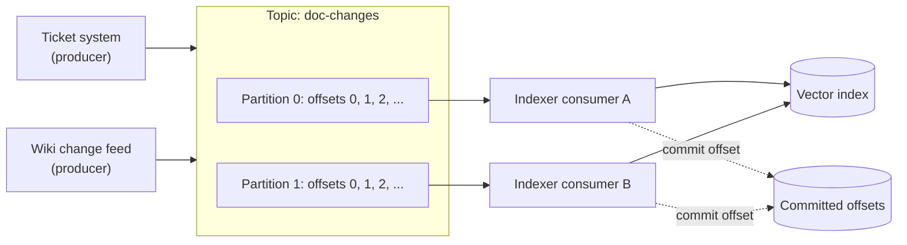

[Batch ingestion](/learn/understanding-document-ingestion/batch-ingestion) treats the sources as a set: list it, process it, stop. Some sources are better described as a **sequence** that never ends: tickets opened and updated all day, chat messages, rows changing in a product database, edits flowing out of a content system. **Streaming ingestion** reads such a sequence continuously, record by record, and keeps the index within seconds or minutes of the source without ever "finishing".

This lesson explains the machinery that makes that safe: the partitioned log (the abstraction behind Apache Kafka and similar systems), offsets and consumer groups, delivery guarantees, ordering, tombstones for deletion, micro-batching for efficient embedding, and backpressure and lag. The running theme is that a streaming consumer will see some records twice and some out of order, and the index must end up correct anyway.

## Learning objectives

- Explain how a partitioned log stores records, and what offsets, partitions, keys and consumer groups are for.
- Distinguish at-most-once, at-least-once and effectively-once processing, and show which commit order produces each.
- Implement an idempotent, version-checked sink that stays correct under redelivery and out-of-order records, including deletions expressed as tombstones.
- Choose a micro-batch size and maximum wait from the record rate, and compute how long a backlog takes to drain.
- Decide when a RAG source justifies streaming ingestion and when a scheduled incremental job is enough.

## Prerequisites

- [What is ingestion?](/learn/understanding-document-ingestion/what-is-ingestion): the four guarantees and the change-capability table.
- [Batch ingestion](/learn/understanding-document-ingestion/batch-ingestion): checkpoints, idempotent writes and at-least-once processing.
- [Indexing pipeline](/learn/rag-architecture-fundamentals/indexing-pipeline): stable IDs and delete-then-upsert per document.

## Why this matters

For many RAG corpora, a nightly job is fine: the employee handbook changes a few times a month. But some knowledge goes stale in minutes. A support assistant that answers from resolved tickets is most useful for the issue that started this morning. An incident assistant must know about the status update posted five minutes ago. An assistant over a product catalogue must stop recommending an item the moment it is withdrawn. For those, the [staleness formula](/learn/rag-architecture-fundamentals/offline-and-online-processing) $S_{\max} = P + D$ has to be pushed towards zero, and running a batch job every minute stops being sensible: each run pays the fixed cost of listing and comparing, most runs find nothing, and runs start to overlap.

Streaming changes the shape of the problem rather than just the frequency. Instead of asking the source "what is there now?", the consumer reads a log of "what happened", in order, from where it left off. That is efficient and fresh, but it brings failure modes a batch job never meets. A consumer that crashes after updating the index but before recording its position reprocesses records. A producer that retries sends a record twice. Two updates to the same document can arrive in the wrong order if they travel by different routes. A burst of a hundred thousand records from a bulk import builds a backlog that takes time to drain. Getting any of these wrong produces an index that is quietly out of step with its source, which is exactly the failure streaming was meant to prevent.

## The intuition

Think of a newsroom's wire service. Stories arrive on a ticker tape, one after another, each stamped with a sequence number. The archivist's job is to keep the archive current: file each new story, replace a story when a correction arrives, pull a story when a retraction arrives.

She does not re-read the whole archive each morning. She keeps a bookmark on the tape: "I have filed everything up to number 48,213". After a tea break she resumes from the bookmark. If she spills tea and loses track, she goes back to the last bookmark she wrote down, which may mean seeing a few stories again. That is harmless as long as she checks the version printed on each story before filing it: a correction numbered 3 does not get overwritten by a re-read copy of version 2.

When the tape is busy she does not walk to the filing cabinet once per story; she gathers a handful and files them together. And when a big event floods the tape, a pile of unfiled stories builds up beside her. How long it takes to clear depends on how much faster she can file than the tape can print.

The tape is the **log**. The sequence number is the **offset**. The bookmark is the **committed offset**. Checking the version is the **idempotent sink**. Filing a handful at a time is **micro-batching**. The pile is **consumer lag**.

## How it works

### The log

A **log**, in this sense, is an append-only, ordered sequence of records. Producers append to the end; consumers read from any position. Records are not removed when read: they stay for a configured **retention** period, so several independent consumers can read the same log, and a consumer can go back and read again. Apache Kafka is the best-known implementation; Amazon Kinesis Data Streams, Apache Pulsar, Redpanda and Redis Streams offer the same core model with differences in detail, and Google Cloud Pub/Sub offers a related, subscription-based model.

Four ideas make a log usable at scale:

- **Records** have a key and a value. For document ingestion, the key is the document ID and the value is the change: the new content or reference, a version, and the operation.
- **Partitions.** A **topic** (a named log) is split into partitions, each an independent ordered sequence. A record's key decides its partition, typically by hashing, so **all records with the same key go to the same partition, in the order they were produced**. There is no ordering guarantee across partitions.
- **Offsets.** Each record in a partition has a position number, its **offset**. A consumer's progress is just "the next offset to read" for each partition.
- **Consumer groups.** A set of consumer processes sharing one group name divides the partitions among themselves, each partition read by exactly one member at a time. Adding consumers (up to the number of partitions) spreads the work; if one dies, its partitions are reassigned to the others, which continue from the last **committed offset**.



Because a document's key always lands in the same partition, and one consumer reads each partition in order, **updates to a single document are processed in the order they were appended**. That is the property that makes streaming ingestion workable. It holds only if every producer uses the document ID as the key.

### Where the records come from

Something has to put changes on the log. Common producers in RAG systems:

- **Change data capture (CDC)** from a database. A tool such as Debezium reads the database's own replication log (the PostgreSQL write-ahead log, the MySQL binary log) and publishes every insert, update and delete as a record. This is the most complete source of change there is, because nothing can change in the database without appearing in its log. [Incremental ingestion](/learn/understanding-document-ingestion/incremental-ingestion) returns to CDC.
- **Application events.** The ticket system or content platform publishes "ticket 8812 updated" itself.
- **Bridges from other mechanisms.** A service that receives webhooks or polls a change feed and republishes each change onto the log, so that everything downstream reads one uniform stream. [Event-driven ingestion](/learn/understanding-document-ingestion/event-driven-ingestion) covers the receiving end.

Records can carry the full content (a **fat** record) or just the ID and version (a **thin** record), leaving the consumer to fetch the content. Fat records save a fetch but make the log large and put document content, possibly sensitive, into another system. Thin records keep the log small and always let the consumer index the *current* content, at the cost of a fetch per change.

### Streaming and event-driven are not the same thing

The two are often confused because both react quickly to change. The difference is in what is delivered and what is guaranteed. Streaming ingestion consumes a **durable, ordered, replayable log** of records, and progress is an offset that the consumer controls. Event-driven ingestion reacts to **notifications pushed by a source**, typically webhooks, which are usually unordered, may be lost, and cannot be replayed on demand. A common production design combines them: webhooks arrive, are verified and are written onto a log, and the indexer consumes the log.

### Delivery guarantees and the commit order

A consumer does two things for each batch of records: it processes them (updates the index) and it commits its offset (records that it has done so). The order of those two operations decides what happens after a crash.

| Order | After a crash between the two steps | Name |
| --- | --- | --- |
| Commit, then process | The records were marked done but never processed. They are lost. | At-most-once |
| Process, then commit | The records were processed but not marked. They are processed again. | At-least-once |

Neither order is perfect, but only one is recoverable. Lost records leave the index permanently wrong; repeated records are harmless *if processing is idempotent*. So the standard design is **process, then commit, with an idempotent sink**, and the result is often called **effectively-once**: records may be delivered more than once, but the index ends up as if each had been applied once.

Kafka does offer exactly-once semantics, through idempotent producers and transactions, but those guarantees cover reading from and writing to Kafka itself. Once the consumer writes to an external system such as a vector database, the external write and the offset commit are two separate operations again, and idempotency at the sink is what makes the result correct.

> [!KEY]
> Assume every record can arrive twice and some can arrive late. Make the index write idempotent and version-aware, then commit offsets only after the write succeeds.

### Versions make the sink idempotent

An upsert keyed by document ID is idempotent for exact duplicates: writing the same content twice leaves the same result. It is not enough on its own, because of reordering. Suppose version 3 of a document is applied, and then a delayed redelivery of version 2 arrives. A plain upsert would overwrite the newer content with the older.

The fix is to carry a **version** in every record and have the sink apply a record only if its version is newer than the one it holds:

1. Look up the stored version for the record's document ID (zero if none).
2. If the record's version is less than or equal to it, skip the record: it is a duplicate or stale.
3. Otherwise, apply the change (upsert or delete) and store the new version.

The version must be monotonic per document and assigned by the source: a revision number, a database log position, a modification timestamp with enough precision. A timestamp from the consumer's own clock is useless for this, because it records when the consumer saw the record, not when the change happened.

### Deletions: tombstones

In a log, a deletion is itself a record: the document's key with a **tombstone** value meaning "this document no longer exists", typically an empty (null) value in Kafka. The sink handles it like any other change, subject to the same version check, and removes the document's chunks.

One subtlety: after deleting a document, the sink must **remember its last version**. If it forgot, a delayed copy of an older update would arrive, find no stored version, and resurrect the deleted document. The code below keeps versions for deleted documents for this reason. In production that memory can be pruned after a period longer than any plausible delay.

Kafka also offers **log compaction**, a retention mode that keeps at least the latest record for each key rather than discarding by age. A compacted topic of document changes is effectively a replayable snapshot of the current state of every document, which makes rebuilding an index from scratch a matter of reading the topic from offset zero. Tombstones in a compacted topic are themselves removed after a configurable period, so a consumer that is offline longer than that may miss a deletion; a periodic reconciliation catches it.

### Micro-batching

Embedding is far cheaper per text in batches. Processing one record at a time throws that away; waiting for a large batch delays every record in it. **Micro-batching** takes the middle path: collect records until either the batch reaches a maximum size $b$ or a maximum wait $w$ has passed since the first record arrived, then process the batch as one unit, then commit.

Micro-batching also allows **coalescing**. If a batch contains three updates to the same document, only the newest needs embedding: the older two would be overwritten immediately. Coalescing per key within a batch is a cheap, safe saving, and on busy keys (a ticket edited every few seconds) it can be large.

### Backpressure and lag

**Consumer lag** is how far behind the end of the log the consumer is, counted in records (the sum over partitions of the latest offset minus the committed offset) or, more usefully, in time (how old the oldest unprocessed record is). Lag in time is your actual freshness.

If records arrive faster than the consumer processes them, lag grows. The log absorbs the surplus, which is one of its virtues: a burst does not crash anything, it just waits. This is **backpressure** handled by buffering. The consumer, in turn, must not overwhelm what is downstream of it. If the embedding service rate-limits, the consumer should slow its reads, not pile up in-memory batches until it runs out of memory. Pull-based consumers make this natural: they read the next batch only when the previous one is done.

The response to sustained lag is to add consumers, up to the number of partitions (more consumers than partitions leaves the extras idle), or to make each batch cheaper. Partition count is therefore a decision about maximum parallelism and is awkward to change later, because changing it changes which partition each key hashes to.

### The consumer loop, step by step

1. Join the consumer group and receive a set of partitions; start each at its committed offset.
2. Read records until the micro-batch is full or the maximum wait has passed.
3. Coalesce: keep only the newest record per document key.
4. Drop records whose version is not newer than the stored version.
5. Fetch content for thin records; parse, chunk and embed the upserts in one batch.
6. Apply to the index: delete-then-upsert for updates, delete for tombstones; store the new versions.
7. Commit the offsets of everything read in step 2.
8. Records that fail permanently go to a **dead-letter queue** (a separate topic for records that could not be processed, kept for inspection and replay), so one malformed record cannot block its partition forever. Then repeat from step 2.

## The mathematics

### Micro-batch latency

**Intuition.** A batch closes when it is full or when its timer runs out, whichever comes first. At low traffic the timer decides; at high traffic the size does.

With records arriving at rate $\lambda$ per second, a batch of size $b$ takes about $b/\lambda$ seconds to fill. The time the first record in a batch waits before processing starts is therefore

$$
W_{\text{batch}} \approx \min\!\left(w,\ \frac{b}{\lambda}\right)
$$

- $w$: the maximum wait, in seconds.
- $b$: the maximum batch size, in records.
- $\lambda$: the arrival rate, in records per second.

**By hand.** Meridian's ticket stream averages $\lambda = 2$ changes per second. With $b = 64$, a batch takes $64 / 2 = 32$ s to fill. With $w = 2$ s, $W_{\text{batch}} = \min(2, 32) = 2$ s: the timer dominates and batches hold about $2 \times 2 = 4$ records. During a busy spell at $\lambda = 100$ per second, a batch fills in $0.64$ s, so size dominates and each embedding call carries the full 64.

### Draining a backlog

**Intuition.** A backlog shrinks only at the difference between how fast you process and how fast new records arrive.

If a backlog of $B$ records has built up, the consumer processes $\mu$ records per second, and new records keep arriving at $\lambda < \mu$, the time to catch up is

$$
T_{\text{drain}} = \frac{B}{\mu - \lambda}
$$

- $B$: the backlog, in records.
- $\mu$: the consumer group's processing rate, in records per second.
- $\lambda$: the ongoing arrival rate.

If $\lambda \geq \mu$ the backlog never drains; it grows by $\lambda - \mu$ records every second.

**By hand.** A bulk import of old tickets puts $B = 30{,}000$ records on the topic. The consumers process $\mu = 50$ per second while normal traffic continues at $\lambda = 2$. Then $T_{\text{drain}} = 30{,}000 / 48 = 625$ s, about 10.4 minutes, during which fresh changes queue behind the import. That delay is why bulk backfills are often sent to a separate topic or consumer group, so that they cannot delay live changes.

```python
lam, b, w = 2, 64, 2.0
print(f"time to fill a batch: {b / lam:.0f} s; wait for first record: {min(w, b / lam):.1f} s")

B, mu = 30_000, 50
print(f"drain time: {B / (mu - lam):.0f} s = {B / (mu - lam) / 60:.1f} min")
```

```output
time to fill a batch: 32 s; wait for first record: 2.0 s
drain time: 625 s = 10.4 min
```

## In code

**The problem.** Consume a stream of document changes (new documents, a correction, a deletion) from a two-partition log, survive a crash between processing and committing, ignore a late redelivery of an old version, and end with an index that matches the newest state of every document.

**Dependencies.** The Python standard library only. The log is a small in-memory class with the same semantics as a Kafka topic: keyed partitioning, offsets, reading from a committed position. A version against a real broker follows afterwards.

```python
import zlib
from dataclasses import dataclass


@dataclass(frozen=True)
class Change:
    doc_id: str
    version: int
    text: str | None          # None is a tombstone: the document was deleted


class Log:
    """A tiny stand-in for a partitioned log such as a Kafka topic."""

    def __init__(self, partitions: int):
        self.partitions = [[] for _ in range(partitions)]

    def produce(self, change: Change) -> None:
        p = zlib.crc32(change.doc_id.encode()) % len(self.partitions)   # same key, same partition
        self.partitions[p].append(change)

    def read(self, partition: int, offset: int, max_records: int) -> list[Change]:
        return self.partitions[partition][offset:offset + max_records]


class Index:
    """The sink. Idempotent: it applies a change only if it is newer than what it holds."""

    def __init__(self):
        self.docs: dict[str, tuple[int, str]] = {}
        self.versions: dict[str, int] = {}      # kept after deletion, so late updates stay dead
        self.embed_calls = 0
        self.texts_embedded = 0

    def apply_batch(self, changes: list[Change]) -> dict:
        stats = {"applied": 0, "stale": 0}
        fresh = []
        for c in changes:
            if c.version <= self.versions.get(c.doc_id, 0):
                stats["stale"] += 1            # a duplicate or an out-of-date redelivery
                continue
            self.versions[c.doc_id] = c.version
            fresh.append(c)
        to_embed = [c for c in fresh if c.text is not None]
        if to_embed:
            self.embed_calls += 1              # one embedding call per micro-batch
            self.texts_embedded += len(to_embed)
        for c in fresh:
            if c.text is None:
                self.docs.pop(c.doc_id, None)
            else:
                self.docs[c.doc_id] = (c.version, c.text)
            stats["applied"] += 1
        return stats


class Consumer:
    def __init__(self, log: Log, index: Index, committed: dict, batch_size: int):
        self.log, self.index, self.committed, self.batch_size = log, index, committed, batch_size

    def poll_once(self, crash_before_commit: bool = False) -> dict:
        total = {"applied": 0, "stale": 0, "records": 0}
        for p in range(len(self.log.partitions)):
            offset = self.committed.get(p, 0)
            batch = self.log.read(p, offset, self.batch_size)
            if not batch:
                continue
            stats = self.index.apply_batch(batch)      # 1. process
            total["records"] += len(batch)
            for k in ("applied", "stale"):
                total[k] += stats[k]
            if crash_before_commit:
                raise RuntimeError(f"crashed after processing partition {p}, before commit")
            self.committed[p] = offset + len(batch)    # 2. then commit the offset
        return total

    def lag(self) -> int:
        return sum(len(part) - self.committed.get(p, 0) for p, part in enumerate(self.log.partitions))


log = Log(partitions=2)
for change in [
    Change("handbook/leave", 1, "Annual leave is 25 days."),
    Change("runbook/vpn", 1, "VPN is required on public Wi-Fi."),
    Change("handbook/remote", 1, "Remote work up to 2 days a week."),
    Change("handbook/remote", 2, "Remote work up to 3 days a week."),   # a correction
    Change("handbook/expenses", 1, "Submit expenses within 30 days."),
    Change("runbook/old-proxy", 1, "Configure the legacy proxy."),
    Change("runbook/old-proxy", 2, None),                               # deleted
]:
    log.produce(change)

print("records per partition:", [len(p) for p in log.partitions])
committed: dict[int, int] = {}          # offsets survive a crash; the consumer's memory does not
index = Index()

consumer = Consumer(log, index, committed, batch_size=3)
try:
    consumer.poll_once(crash_before_commit=True)
except RuntimeError as exc:
    print("CRASH:", exc, "| committed offsets:", committed)

consumer = Consumer(log, index, committed, batch_size=3)    # restart: same group, same offsets
while consumer.lag():
    print("poll:", consumer.poll_once(), "| lag after:", consumer.lag())

# A producer retry redelivers an old version late.
log.produce(Change("handbook/remote", 1, "Remote work up to 2 days a week."))
print("late redelivery:", consumer.poll_once())

print("\nindex:")
for doc_id, (version, text) in sorted(index.docs.items()):
    print(f"  {doc_id:<18} v{version}  {text}")
print("embedding calls:", index.embed_calls, "| texts embedded:", index.texts_embedded)
```

```output
records per partition: [2, 5]
CRASH: crashed after processing partition 0, before commit | committed offsets: {}
poll: {'applied': 3, 'stale': 2, 'records': 5} | lag after: 2
poll: {'applied': 2, 'stale': 0, 'records': 2} | lag after: 0
late redelivery: {'applied': 0, 'stale': 1, 'records': 1}

index:
  handbook/expenses  v1  Submit expenses within 30 days.
  handbook/leave     v1  Annual leave is 25 days.
  handbook/remote    v2  Remote work up to 3 days a week.
  runbook/vpn        v1  VPN is required on public Wi-Fi.
embedding calls: 3 | texts embedded: 6
```

**The important lines.**

- `Log.produce` chooses the partition with a CRC-32 hash of the document ID. Every change to `handbook/remote` lands in the same partition in the order produced. (CRC-32 is used because it is deterministic across runs; Python's built-in `hash` of a string is randomised per process.)
- `Index.apply_batch` is the idempotent, version-aware sink. `c.version <= self.versions.get(...)` rejects both exact duplicates and older versions.
- `self.versions` is not cleared on deletion, so the tombstone's version 2 for `runbook/old-proxy` blocks any delayed version 1 from bringing it back.
- `Consumer.poll_once` processes first and commits second. The `committed` dictionary lives outside the consumer object, as committed offsets live in the broker, so a new consumer resumes from them.
- `lag` is the number of records between each partition's committed offset and its end.

**What the output means.** The hash put `runbook/vpn` and `handbook/expenses` in partition 0 and the other five records in partition 1. The first consumer applied partition 0's two records and crashed before committing, so the committed offsets stayed empty. The restarted consumer re-read those two records and counted them as stale: the index already held version 1 of each, so nothing was written twice. It then read three records from partition 1 and applied them, including the version 1 and version 2 of `handbook/remote` in order. The second poll applied `old-proxy` version 1 and then its tombstone. The late redelivery of `handbook/remote` version 1 was rejected. The final index has four documents, each at its newest version, and the deleted runbook is gone.

The last line shows waste worth removing: six texts were embedded, but two of them (`remote` v1 and `old-proxy` v1) were superseded within the same batch. Exercise 2 fixes this by coalescing.

**Errors you will commonly hit.**

- Documents that revert to old content after a while: the sink upserts without a version check, and a redelivered or reordered record overwrote a newer one.
- Deleted documents that reappear: the sink forgets versions on deletion, or deletions are not published to the log at all.
- A partition that stops advancing while the others move: one record keeps failing and the consumer retries it forever. Send it to a dead-letter queue after a few attempts.
- Ordering bugs after adding a second producer: one producer keys by document ID and the other by something else, so updates to one document land in different partitions.

### Against a real broker

The same loop against Kafka, using the `confluent-kafka` client. This block was **not executed** for this lesson, because it needs a running Kafka broker; it is written against the library's documented `Consumer` API. `apply_batch` is the idempotent sink from above, adapted to your index.

```bash
pip install confluent-kafka
```

```python
import json
import os

from confluent_kafka import Consumer

consumer = Consumer({
    "bootstrap.servers": os.environ["KAFKA_BOOTSTRAP_SERVERS"],
    "group.id": "askmeridian-indexer",
    "enable.auto.commit": False,          # we commit ourselves, after the index write
    "auto.offset.reset": "earliest",      # a brand-new group starts from the oldest record
})
consumer.subscribe(["doc-changes"])

try:
    while True:
        messages = consumer.consume(num_messages=64, timeout=2.0)   # micro-batch: size or wait
        if not messages:
            continue
        changes = []
        for msg in messages:
            if msg.error():
                print("consumer error:", msg.error())
                continue
            doc_id = msg.key().decode()
            if msg.value() is None:                                  # tombstone
                changes.append({"doc_id": doc_id, "version": None, "deleted": True})
            else:
                changes.append({"doc_id": doc_id, **json.loads(msg.value())})
        apply_batch(changes)                    # idempotent, version-checked index write
        consumer.commit(asynchronous=False)     # then commit the offsets just consumed
finally:
    consumer.close()
```

Note that a Kafka tombstone carries no value, so it cannot carry a version in the value; either put the version in a record header or have the producer send an explicit "deleted" record with a version and use a true tombstone only for compaction.

## A real-world example

Meridian's support desk wanted AskMeridian to answer from resolved tickets as well as from the runbooks, because many problems are solved in tickets long before anyone updates a runbook. The ticket system's database already fed a Kafka topic through change data capture for the analytics team, so the Platform team added a consumer group of its own.

The first version worked in testing and drifted in production. After a week, Lucía noticed that some tickets in the index showed an earlier status than in the ticket system: "open, workaround pending" when the ticket had been resolved with a fix. The consumer upserted each record unconditionally. During a deployment, consumers had restarted and been reassigned partitions, re-reading a few minutes of records, and in the meantime a separate backfill job, written months earlier for the first load, had been re-run by hand and had written older snapshots of some tickets straight into the index. Whichever write came last won.

The fix used the database's log position, which Debezium includes in each record's metadata, as the version for every ticket write, whatever its origin. The backfill job was changed to publish to the same topic instead of writing to the index directly, so there was one writer and one ordering. The sink rejected anything not newer than the stored version, and stored versions survived deletions. Finally the team added a metric for lag in seconds, alerting at five minutes, and a weekly reconciliation that compared ticket statuses in the index with the database and counted mismatches. After the change, that count stayed at zero.

## Common mistakes

- **Committing offsets before processing**, or using automatic commits that fire on a timer regardless of whether processing succeeded. A crash loses records permanently.
- **Unconditional upserts.** Redeliveries and reordered records overwrite newer content with older.
- **Using the consumer's clock as the version.** It measures arrival, not change, so it cannot order updates.
- **Keying records by anything other than the document ID.** Updates to one document spread across partitions and lose their order.
- **Forgetting deleted documents' versions.** A late update resurrects a deleted document.
- **One record blocking a partition.** Without a dead-letter queue, a single malformed record stops every later record in its partition.
- **Streaming everything.** A handbook that changes twice a month gains nothing from a streaming pipeline and pays its operational cost every day.

## Best practices

- Key every record by document ID, carry a source-assigned monotonic version, and represent deletions explicitly.
- Process, then commit; make the sink idempotent and version-checked so that at-least-once delivery yields an effectively-once index.
- Micro-batch with both a size and a time limit, and coalesce to the newest record per key before embedding.
- Monitor lag in seconds as well as in records, and alert against your freshness target.
- Route records that fail repeatedly to a dead-letter queue, with tooling to inspect and replay them.
- Keep bulk backfills from delaying live changes: a separate topic or consumer group, or rate-limited publishing.
- Choose a partition count for the parallelism you will need, since changing it later reshuffles key placement.

## Performance considerations

A streaming consumer's throughput is set by its most expensive per-batch step, nearly always embedding. Suppose each record yields 6 chunks on average, the embedding service handles a batch of 64 texts in about 0.4 s, and one consumer runs one embedding call at a time (assumptions for the arithmetic). A full batch is about $64 / 6 \approx 10$ records, so one consumer handles about $10 / 0.4 = 25$ records per second. With 4 partitions and 4 consumers, roughly 100 per second. That comfortably covers Meridian's average of 2 per second and gives headroom for bursts, with drain times from the formula above.

At low traffic, batches are small because the timer closes them, so each embedding call carries few texts. That is less efficient per text, but the absolute cost is low because there is little traffic. The size limit matters for cost during bursts; the time limit matters for freshness during quiet periods.

Storage on the log is proportional to retention times record size. Thin records of a few hundred bytes cost little to keep for a week; fat records carrying whole documents may be tens of kilobytes each and dominate the log's footprint. Retention also bounds your ability to recover: if a consumer is down longer than the retention period, it cannot catch up from the log and needs a batch rebuild.

## Security considerations

- **The log is another copy of your data.** Fat records place document content, including restricted content, in the broker. Encrypt it in transit and at rest, restrict which service accounts can read each topic, and include topic retention in your data-retention policy.
- **Permissions must travel in the stream.** A change to who may read a document is a change like any other and must be published and applied, or the index keeps serving a document to people who have lost access.
- **Deletions must be honoured end to end.** A tombstone must reach the index, any cache built from it and any copy in a dead-letter queue. Records sitting in the log until retention expires may contain erased data; size retention with this in mind.
- **Producers are a trust boundary.** Anyone who can write to the topic can write into your index. Authenticate producers and grant write access per topic.

## Summary

- Streaming ingestion consumes an ordered, durable, replayable log of changes continuously, keeping the index fresh without repeated full listings.
- Keying by document ID puts all of a document's changes in one partition, in order; there is no order across partitions.
- Process then commit, with an idempotent, version-checked sink: at-least-once delivery then produces an effectively-once index, even with redeliveries and late records.
- Deletions are tombstone records; the sink must keep the version of a deleted document so that late updates cannot resurrect it.
- Micro-batch with a size and a time limit, coalesce per key, and watch lag in seconds; a backlog drains at $\mu - \lambda$.

## Exercises

**1.** A consumer group processes 40 records per second. Normal traffic is 5 per second. A migration publishes 63,000 records in one burst. How long until records produced just after the burst are processed? What would you change if that delay breaks a five-minute freshness target?

<details><summary>Show solution</summary>

$T_{\text{drain}} = 63{,}000 / (40 - 5) = 1{,}800$ s, 30 minutes, so a live change made just after the burst waits about half an hour. Options: publish the migration to a separate topic consumed by a separate group, so live changes never queue behind it; rate-limit the migration's publishing to, say, 20 per second, so live traffic always has spare capacity; or add consumers (if the topic has enough partitions) to raise $\mu$ during the migration. The first is the most robust.

</details>

**2.** Add coalescing to the lesson's sink: before the version check, keep only the newest change per document within a batch. Using the same seven records and a batch size of 5, show how many texts are embedded.

<details><summary>Show solution</summary>

Run after the class definitions from the lesson:

```python
def coalesce(changes: list[Change]) -> list[Change]:
    """Keep only the newest change per document within one micro-batch."""
    latest: dict[str, Change] = {}
    for c in changes:
        if c.doc_id not in latest or c.version > latest[c.doc_id].version:
            latest[c.doc_id] = c
    return list(latest.values())


class CoalescingIndex(Index):
    def apply_batch(self, changes):
        kept = coalesce(changes)
        stats = super().apply_batch(kept)
        stats["stale"] += len(changes) - len(kept)
        return stats


log = Log(partitions=2)
for change in [
    Change("handbook/leave", 1, "Annual leave is 25 days."),
    Change("runbook/vpn", 1, "VPN is required on public Wi-Fi."),
    Change("handbook/remote", 1, "Remote work up to 2 days a week."),
    Change("handbook/remote", 2, "Remote work up to 3 days a week."),
    Change("handbook/expenses", 1, "Submit expenses within 30 days."),
    Change("runbook/old-proxy", 1, "Configure the legacy proxy."),
    Change("runbook/old-proxy", 2, None),
]:
    log.produce(change)

index = CoalescingIndex()
consumer = Consumer(log, index, {}, batch_size=5)
print(consumer.poll_once())
print(sorted(index.docs), "| embedding calls:", index.embed_calls, "| texts embedded:", index.texts_embedded)
```

```output
{'applied': 5, 'stale': 2, 'records': 7}
['handbook/expenses', 'handbook/leave', 'handbook/remote', 'runbook/vpn'] | embedding calls: 2 | texts embedded: 4
```

Partition 1's five records collapse to three (`leave` v1, `remote` v2, the `old-proxy` tombstone), so only four texts are embedded instead of six, and the final index is identical. Coalescing is safe because records for one key are in one partition, in order, so the newest version in a batch really is the latest change seen so far.

</details>

**3.** A colleague proposes using the time at which the consumer receives a record as its version, "since the log is ordered anyway". Give a concrete sequence of events in which this produces a wrong index.

<details><summary>Show solution</summary>

The log is ordered per partition, but records reach the sink by more than one route. Sequence: at 10:00:00 a consumer processes version 2 of `handbook/remote` and stores receive-time 10:00:00 as its version, but crashes before committing. At 10:00:05 an operator re-runs the old backfill job, which writes version 1 of the same document with receive-time 10:00:05: newer by the consumer's clock, so it is accepted and overwrites version 2. Or, without any second route: the restarted consumer re-reads version 1 from the uncommitted range at 10:00:10, which beats 10:00:00 and reverts the document. In both cases the stored "version" measures when the sink saw a record, not when the change happened, so it cannot tell new from old. The version has to come from the source.

</details>

**4.** Design decision: for each Meridian source, decide whether streaming ingestion is justified: (a) the employee handbook, edited a few times a month; (b) support tickets, changing all day, needed in answers within a few minutes; (c) product documentation, published in releases every two weeks.

<details><summary>Show solution</summary>

(a) **No.** A daily incremental job gives a lag of at most a day for content that changes monthly; a streaming pipeline would add brokers, consumers and lag monitoring for no visible benefit. If HR needs urgent changes visible quickly, an event-driven trigger or a manual "re-index now" is simpler. (b) **Yes.** Changes are frequent and continuous, freshness of minutes matters, and the ticket database can feed a topic through change data capture with a reliable version (the log position). (c) **No.** Changes arrive in discrete releases, so a batch job triggered by the release process (build into a new collection, then swap an alias) matches the source's own rhythm and keeps each release's documentation consistent.

</details>

## Check your understanding

```quiz
[
  {
    "q": "Why should records about a document be keyed by its document ID?",
    "options": [
      "Keys are required for compression",
      "Records with the same key go to the same partition in production order, so changes to one document are processed in order",
      "It makes the records smaller",
      "Consumers can only read records with string keys"
    ],
    "answer": 1,
    "why": "Partitioning is by key, and order is guaranteed only within a partition. A consistent key keeps a document's changes in sequence."
  },
  {
    "q": "A consumer commits its offset, then writes the batch to the vector index, and crashes between the two. What happens to those records?",
    "options": [
      "They are processed again on restart",
      "They are moved to a dead-letter queue",
      "They are lost: the restarted consumer starts after them",
      "Kafka detects the failure and rolls back the commit"
    ],
    "answer": 2,
    "why": "Commit-then-process is at-most-once. The committed offset says the records were handled, so they are never read again."
  },
  {
    "q": "The sink holds version 5 of a document. A redelivered record with version 4 arrives. What should happen?",
    "options": [
      "Skip it: it is not newer than the stored version",
      "Apply it, because it arrived most recently",
      "Delete the document, because versions conflict",
      "Store both versions"
    ],
    "answer": 0,
    "why": "A version-checked sink applies only strictly newer versions. That makes redeliveries and reordered records harmless."
  },
  {
    "q": "Records arrive at 1 per second. The micro-batch limits are 100 records or 3 seconds. Roughly how many records does a typical batch hold?",
    "options": ["100", "33", "1", "About 3"],
    "answer": 3,
    "why": "Filling 100 records would take 100 s, so the 3-second timer closes each batch first, after about 3 records."
  },
  {
    "q": "Why must the sink remember the version of a document after deleting it?",
    "options": [
      "To support undo",
      "So that a delayed older update cannot recreate the deleted document",
      "Because vector databases cannot delete points",
      "To compute consumer lag"
    ],
    "answer": 1,
    "why": "If the version is forgotten, a late record with an older version finds nothing to compare against and is applied, resurrecting the document."
  }
]
```

## Further reading

- Kreps, J. (2013). "The Log: What every software engineer should know about real-time data's unifying abstraction". LinkedIn Engineering blog.
- Kleppmann, M. (2017). *Designing Data-Intensive Applications*, chapter 11, "Stream Processing". O'Reilly.
- Akidau, T., Chernyak, S. and Lax, R. (2018). *Streaming Systems*. O'Reilly.
- Apache Kafka documentation, including the sections on consumers, offsets and log compaction: [kafka.apache.org/documentation](https://kafka.apache.org/documentation/)
- Debezium documentation: [debezium.io/documentation](https://debezium.io/documentation/)
