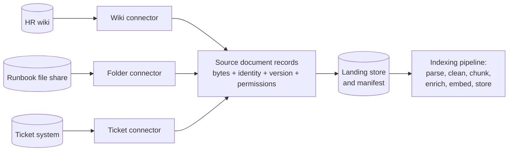
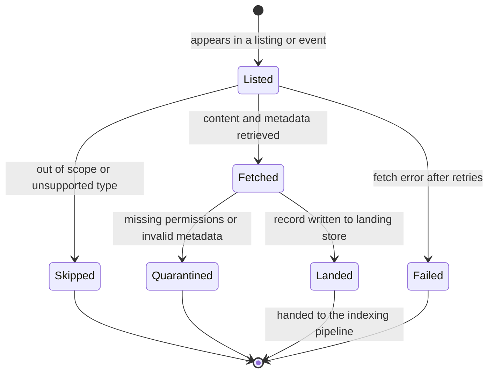

The [indexing pipeline](/learn/rag-architecture-fundamentals/indexing-pipeline) began with a stage called *load*, described in one line: read the bytes and record where they came from. In a real organisation that one line hides most of the difficulty. Documents live in a dozen systems, each with its own API, its own idea of what a "document" is, its own permissions and its own way of telling you (or not telling you) that something changed. **Ingestion** is the engineering discipline that turns those systems into a steady, trustworthy supply of documents for the indexing pipeline, and keeps that supply in step with the sources as they change.

This lesson defines ingestion precisely, separates it from the parsing and chunking that follow it, and introduces the vocabulary the rest of this module uses: sources, connectors, listings, versions, the landing store and the four guarantees every ingestion system must give. The later lessons in the module then take each way of running ingestion in turn: [batch](/learn/understanding-document-ingestion/batch-ingestion), [streaming](/learn/understanding-document-ingestion/streaming-ingestion), [incremental](/learn/understanding-document-ingestion/incremental-ingestion) and [event-driven](/learn/understanding-document-ingestion/event-driven-ingestion), before [Ingestion architecture](/learn/understanding-document-ingestion/ingestion-architecture) assembles them into one system.

## Learning objectives

- Define ingestion and state where it ends and the rest of the indexing pipeline begins.
- Describe the four guarantees an ingestion system owes the index: completeness, freshness, fidelity and deletion.
- Classify a source system by how it can be read (pull or push) and by what it can tell you about change.
- Implement a connector interface that separates listing from fetching and captures identity, version and permissions for every document.
- Account for every item a run sees, so that "seen" always equals "ingested + skipped + quarantined + failed".

## Prerequisites

- [Indexing pipeline](/learn/rag-architecture-fundamentals/indexing-pipeline): the seven stages, document IDs, content hashes and idempotency.
- [End-to-end RAG lifecycle](/learn/rag-architecture-fundamentals/end-to-end-rag-lifecycle): the states a document passes through and the idea of freshness lag.
- [Offline and online processing](/learn/rag-architecture-fundamentals/offline-and-online-processing): why indexing work happens ahead of time, and the staleness formula.

## Why this matters

A RAG system can only be as current, as complete and as correctly permissioned as the data that reaches its index. Every one of those properties is decided at ingestion, and every failure of ingestion is silent at query time.

Consider what goes wrong when ingestion is treated as "a script that copies some files":

- A connector reads the first page of an API's results and never follows the pagination link. Three quarters of the wiki is missing from the index, and the assistant answers "I don't know" to questions the wiki answers. No error was raised: the script did exactly what it was written to do.
- A connector cannot read the permissions of one space, so it records none, and the next stage treats "no permissions" as "visible to everyone". Payroll pages are now retrievable by every employee.
- A page is deleted from the wiki because the policy was withdrawn. The script only ever adds, so the withdrawn policy stays in the index and keeps being cited.
- A source starts returning HTTP 429 (too many requests) halfway through a run. The script logs a warning and carries on. The run reports success; a third of the documents were never fetched.

None of these is a model problem, a retrieval problem or a prompt problem, and none can be fixed downstream. The retriever cannot find a page that was never ingested, and the generator cannot know that a cited policy was withdrawn. Ingestion is where those facts are either captured or lost.

## The intuition

Think of the reference library in a large company, run by a librarian whose job is to keep a shelf of current copies of every important document.

The originals do not live in the library. They live in the departments that write them: HR keeps the handbook, IT keeps the runbooks, Finance keeps its procedures. The librarian's job has four parts. She must know **what exists**, so she walks round every department and asks for a list. She must **get copies**, which means a different procedure in each department: one hands over a folder, another lets her photocopy pages two at a time, a third sends a memo whenever something changes. She must **label each copy** with where it came from, which edition it is and who is allowed to read it. And she must **keep the shelf current**: replace copies when the originals are revised, and remove copies when the originals are withdrawn.

Two habits make her trustworthy. She never shelves a copy without knowing who may read it; a document with no access label goes in a locked drawer until someone tells her. And at the end of every round she can say exactly what happened to every item on every list: shelved, replaced, skipped because it was a poster rather than a document, or set aside because something was wrong with it.

The departments are **source systems**. Her procedure for each department is a **connector**. The labels are **metadata**. Keeping the shelf current is **synchronisation**. Everything she does is ingestion; what happens to the copies afterwards (reading them, cutting them into index cards, filing the cards) is the rest of the indexing pipeline.

## How it works

### A definition

**Ingestion** is the process of discovering content in source systems, retrieving it with its identity, version and access metadata, and delivering it to the indexing pipeline, repeatedly, so that the index stays a faithful copy of the sources over time.

Three words in that definition carry the weight:

- **Discovering.** Ingestion must find out what exists before it can fetch anything. For a folder that is a directory walk; for a wiki it is a paginated API; for a website it is a crawl.
- **Identity, version and access metadata.** Bytes alone are not enough. The pipeline needs to know which document they are (so it can replace them later), which edition they are (so it can tell whether they changed) and who may read them (so retrieval can enforce it).
- **Repeatedly.** A one-off import is the easy case. Ingestion is a continuing obligation: the index is **derived data**, a copy computed from the sources, and the sources keep changing.

### Where ingestion ends

Ingestion stops at the point where the indexing pipeline can take over without talking to the source system again. In practice that means its output is a **source document record**: raw bytes plus metadata. Parsing those bytes into text, cleaning, chunking and embedding are the next stages, and they belong to the rest of this phase and the next: [Advanced Document Parsing](/learn/advanced-document-parsing), [Document Preprocessing](/learn/document-preprocessing) and [Chunking Fundamentals](/learn/chunking-fundamentals).



Keeping the boundary sharp has a practical payoff. Source systems are slow, rate-limited, sometimes down and sometimes expensive to query. Parsers, chunkers and embedding models change often. If ingestion stores what it fetched (in a **landing store**, sometimes called a raw zone), the downstream stages can be re-run as often as you like, for example after a chunker change, without touching a single source system again.

### The source document record

Every connector, whatever system it reads, should produce the same record. The fields fall into four groups.

| Group | Fields | Why the pipeline needs it |
| --- | --- | --- |
| Identity | source name, external ID, document ID, URI | To replace or delete this document later, and to link citations back to it |
| Version | source version (ETag, revision number or modified time), modified-at, raw content hash | To tell whether the document changed since the last run |
| Content | raw bytes, content type (media type) | For the parser, which picks a strategy by type |
| Access | the groups or users allowed to read it | So that retrieval returns it only to people who may see it |

The **external ID** is the source system's own name for the item: a page ID, a file path, a ticket number. The **document ID** is the pipeline's name for it, derived deterministically from source name and external ID, so it never changes when the content does. The [indexing pipeline lesson](/learn/rag-architecture-fundamentals/indexing-pipeline) explained why it must be stable; [Document identifiers](/learn/document-engineering/document-identifiers) examines the design space in depth.

The **source version** deserves a note. Many systems expose a cheap version marker without the content: an HTTP `ETag` header, a page revision number, a file's modification time. Comparing version markers is far cheaper than downloading and hashing every document, and the module's later lessons lean on it heavily. A content hash of the raw bytes is still worth recording, because version markers can change when content did not (a file re-saved unchanged) and, in badly behaved systems, can fail to change when content did.

> [!KEY]
> A connector's output is not "some text". It is a record that says which document this is, which version of it, what bytes it has, and who may read it. A record missing any of the four cannot be safely kept up to date.

### Listing and fetching are different operations

Almost every connector does two distinct things:

1. **List**: enumerate the items in the source, returning for each one its external ID and its version marker, but not its content. Listings are usually paginated.
2. **Fetch**: retrieve one item's content and full metadata.

Separating them matters because listing is cheap and fetching is expensive. A listing of 10,000 pages might be 100 API calls of 100 items each; fetching them all is 10,000 calls, plus permission lookups. If the listing tells you a page's revision number has not changed since the last run, you need not fetch it at all. That single idea is the basis of [incremental ingestion](/learn/understanding-document-ingestion/incremental-ingestion).

The listing is also the only way to learn about **deletions** in sources that do not announce them. An item that was in the last complete listing and is missing from this one has, probably, been deleted. "Probably" is doing real work there: an item can also vanish from a listing because the connector lost permission to see it, or because the listing failed partway. Treating an incomplete listing as complete is one of the most destructive bugs in ingestion, because it deletes good documents from the index.

### Pull and push

Source systems offer two basic ways to get data out.

- **Pull**: your connector asks the source, on its own schedule. "List everything", "give me page HR-3", "what changed since this cursor?" Almost every system supports some form of pull.
- **Push**: the source tells you when something happens, by calling a URL you registered (a **webhook**), by publishing to a message queue, or by emitting a notification such as an object-storage event. Push is faster but less universal, and it is rarely reliable enough on its own.

What a source can tell you about change determines how cheaply you can keep up with it. From least to most helpful:

| Capability | Example | What the connector must do |
| --- | --- | --- |
| Nothing but content | A public website | Crawl and compare content hashes |
| A listing with version markers | A file share with modification times | List everything, fetch what changed |
| A "modified since" query | A database table with an `updated_at` column, many REST APIs | Ask only for items modified after the last run |
| A change feed with a cursor | Microsoft Graph delta queries, the Google Drive changes API | Ask for changes since a saved token, including deletions |
| Notifications | Webhooks, object-store events | React to each event, then fetch the item |
| A log of every change | Database change data capture, an event stream | Consume the log in order |

The bottom rows give fresher data for less work, but each comes with its own failure modes, which the module's later lessons examine. A useful habit when meeting any new source is to locate it in this table first.

### Four ways to run ingestion

The remaining lessons each take one way of running ingestion. They are not mutually exclusive, and a production system usually combines them.

- **[Batch ingestion](/learn/understanding-document-ingestion/batch-ingestion)** processes a bounded set of documents as one job, usually on a schedule. It is the simplest to reason about and the foundation of everything else: even systems that are otherwise real-time need batch jobs for the first load and for rebuilds.
- **[Streaming ingestion](/learn/understanding-document-ingestion/streaming-ingestion)** treats changes as an unbounded, ordered sequence of records, read continuously from a log such as Apache Kafka.
- **[Incremental ingestion](/learn/understanding-document-ingestion/incremental-ingestion)** processes only what changed since the last run, using version markers, cursors, change feeds and deletion detection.
- **[Event-driven ingestion](/learn/understanding-document-ingestion/event-driven-ingestion)** starts work in response to notifications pushed by the source.

These answer different questions. Batch versus streaming is about the *shape of the input* (a finite set or an endless sequence). Incremental versus full is about *how much* is processed. Event-driven versus scheduled is about *what triggers* the work. A nightly job that processes only changed documents is batch, incremental and scheduled all at once.

### The four guarantees

Whatever the mode, an ingestion system owes the index four things.

1. **Completeness.** Every in-scope document in the sources is in the index. The test is accounting: for every run, the number of items seen equals the number ingested plus the number skipped, quarantined or failed, and each category is visible.
2. **Freshness.** A change in a source reaches the index within an agreed time, the freshness target. The [staleness formula](/learn/rag-architecture-fundamentals/offline-and-online-processing) gives the worst case for a scheduled job; other modes change the terms of that formula.
3. **Fidelity.** What reaches the index is what the source holds, with the metadata the source holds: the right version, the right title and, above all, the right permissions. If the source cannot tell the connector who may read a document, the safe answer is to quarantine it, never to assume it is public.
4. **Deletion.** When a document is removed from a source, or a user loses access to it, the index reflects that too. This is the guarantee most often forgotten, because adding is the natural direction of a copy job.



Every item that enters a run must end in exactly one of the terminal states, and the run's report must show how many ended in each. A run that "succeeded" but cannot account for its items has not succeeded.

### The ingestion run, step by step

Putting the pieces together, one run of a pull-based connector does this:

1. **Start from known state.** Load what the last run recorded: which documents exist, at which versions, and any saved cursor.
2. **List.** Enumerate the source, following pagination to the end. Record whether the listing completed.
3. **Filter by scope.** Drop items outside the agreed scope (wrong space, unsupported media type), recording each as skipped with a reason.
4. **Decide what to fetch.** Compare each item's version marker with the recorded one. New and changed items are fetched; unchanged items are not.
5. **Fetch and validate.** Retrieve content and metadata. Reject records with no permissions or no identity into quarantine.
6. **Land.** Write raw bytes to the landing store and the record to the manifest.
7. **Detect deletions**, but only if the listing completed: recorded documents absent from the listing are candidates for deletion.
8. **Hand off and record.** Pass landed records to the indexing pipeline, save the new state and emit the run report.

This lesson's code implements steps 2, 3, 5 and 6, and the accounting. Steps 4 and 7 are the subject of [Incremental ingestion](/learn/understanding-document-ingestion/incremental-ingestion); doing them safely at scale is the subject of [Batch ingestion](/learn/understanding-document-ingestion/batch-ingestion).

## In code

**The problem.** Build two connectors for two very different Meridian sources, the IT runbooks on a file share and the HR wiki that hosts the handbook, behind one interface, and run them through a single ingestion function that lands raw content and accounts for every item.

**Dependencies.** The Python standard library only.

```bash
python --version   # 3.10 or later, for the X | Y type syntax
```

The wiki is simulated by a small class with the same shape as a real paginated API: a listing call that returns IDs and revision numbers two at a time with a cursor, and a fetch call per page. One of its spaces, Finance, has no permission data, standing in for a common real gap (an API token that can read pages but not their restrictions).

```python
import hashlib
import os
import tempfile
from dataclasses import dataclass
from datetime import datetime, timezone
from pathlib import Path
from typing import Iterator, Protocol


@dataclass(frozen=True)
class SourceRef:
    """What a listing returns: enough to identify and version an item, no content."""
    source: str
    external_id: str
    version: str           # an ETag, revision number or modified time from the source
    content_type: str


@dataclass(frozen=True)
class SourceDocument:
    """What ingestion hands to the indexing pipeline."""
    doc_id: str            # stable: derived from source + external_id
    source: str
    external_id: str
    uri: str
    title: str
    content: bytes         # raw bytes; parsing is a later stage
    content_type: str
    version: str
    modified_at: str
    allowed_groups: tuple[str, ...] | None   # None means "the source did not tell us"
    raw_sha256: str


class Connector(Protocol):
    name: str
    def list_items(self) -> Iterator[SourceRef]: ...
    def fetch(self, ref: SourceRef) -> SourceDocument: ...


def make_doc_id(source: str, external_id: str) -> str:
    return hashlib.sha256(f"{source}:{external_id}".encode()).hexdigest()[:16]


# --- Connector 1: a folder of files (a file share or synced drive) ---------
class FolderConnector:
    name = "it-runbooks"
    TYPES = {".md": "text/markdown", ".pdf": "application/pdf", ".png": "image/png"}

    def __init__(self, root: Path, allowed_groups: tuple[str, ...]):
        self.root, self.allowed_groups = root, allowed_groups

    def list_items(self):
        for path in sorted(self.root.rglob("*")):
            if path.is_file():
                st = path.stat()
                yield SourceRef(self.name, str(path.relative_to(self.root)),
                                version=str(st.st_mtime_ns),
                                content_type=self.TYPES.get(path.suffix, "application/octet-stream"))

    def fetch(self, ref):
        path = self.root / ref.external_id
        data = path.read_bytes()
        modified = datetime.fromtimestamp(path.stat().st_mtime, timezone.utc)
        return SourceDocument(make_doc_id(self.name, ref.external_id), self.name, ref.external_id,
                              path.as_uri(), path.stem.replace("-", " ").title(), data,
                              ref.content_type, ref.version, modified.isoformat(),
                              self.allowed_groups, hashlib.sha256(data).hexdigest())


# --- Connector 2: a wiki behind a paginated API (simulated) ----------------
class FakeWikiAPI:
    PAGES = [
        {"id": "HR-1", "title": "Annual leave", "rev": 7, "space": "HR",
         "body": "Annual leave is 25 days. Up to 5 unused days carry over until 31 March.",
         "updated": "2026-10-02T09:14:00+00:00"},
        {"id": "HR-2", "title": "Remote work", "rev": 3, "space": "HR",
         "body": "Staff may work remotely up to 3 days a week. Equipment budget: £400.",
         "updated": "2026-09-18T16:40:00+00:00"},
        {"id": "HR-3", "title": "Expenses", "rev": 12, "space": "HR",
         "body": "Submit expenses within 30 days. Over £75 needs a receipt.",
         "updated": "2026-11-01T11:05:00+00:00"},
        {"id": "FIN-9", "title": "Payroll calendar", "rev": 2, "space": "FINANCE",
         "body": "Payroll runs on the 25th of each month.",
         "updated": "2026-08-30T08:00:00+00:00"},
    ]
    SPACE_PERMISSIONS = {"HR": ["all-staff"]}      # FINANCE permissions missing: an API gap

    def list_pages(self, cursor: int = 0, limit: int = 2):
        batch = self.PAGES[cursor:cursor + limit]
        next_cursor = cursor + limit if cursor + limit < len(self.PAGES) else None
        return [{"id": p["id"], "rev": p["rev"]} for p in batch], next_cursor

    def get_page(self, page_id):
        return next(p for p in self.PAGES if p["id"] == page_id)


class WikiConnector:
    name = "hr-wiki"

    def __init__(self, api: FakeWikiAPI):
        self.api = api

    def list_items(self):
        cursor = 0
        while cursor is not None:                       # follow pagination to the end
            items, cursor = self.api.list_pages(cursor)
            for item in items:
                yield SourceRef(self.name, item["id"], f"rev-{item['rev']}", "text/html")

    def fetch(self, ref):
        p = self.api.get_page(ref.external_id)
        groups = self.api.SPACE_PERMISSIONS.get(p["space"])
        data = p["body"].encode()
        return SourceDocument(make_doc_id(self.name, ref.external_id), self.name, ref.external_id,
                              f"https://wiki.meridian.example/pages/{p['id']}", p["title"], data,
                              ref.content_type, ref.version, p["updated"],
                              tuple(groups) if groups else None, hashlib.sha256(data).hexdigest())


# --- The ingestion run ------------------------------------------------------
SUPPORTED = {"text/markdown", "text/html", "application/pdf"}


def ingest(connector: Connector, landing: dict, manifest: list) -> dict:
    counts = {"seen": 0, "ingested": 0, "skipped": 0, "quarantined": 0}
    for ref in connector.list_items():
        counts["seen"] += 1
        if ref.content_type not in SUPPORTED:
            counts["skipped"] += 1
            manifest.append((ref.source, ref.external_id, "skipped: unsupported type"))
            continue
        doc = connector.fetch(ref)
        if doc.allowed_groups is None:                 # never guess permissions
            counts["quarantined"] += 1
            manifest.append((doc.source, doc.external_id, "quarantined: no permissions"))
            continue
        landing[doc.raw_sha256] = doc.content           # raw bytes, content-addressed
        manifest.append((doc.source, doc.external_id, f"ok {doc.version} -> {doc.doc_id}"))
        counts["ingested"] += 1
    assert counts["seen"] == counts["ingested"] + counts["skipped"] + counts["quarantined"]
    return counts


with tempfile.TemporaryDirectory() as tmp:
    root = Path(tmp)
    files = {"vpn/public-wifi.md": "VPN is required on public Wi-Fi.",
             "accounts/password-rotation.md": "Passwords must be rotated every 90 days.",
             "accounts/lost-laptop.md": "Report a lost laptop to the support desk at once.",
             "diagrams/network.png": "\x89PNG..."}
    for i, (rel, text) in enumerate(files.items()):
        p = root / rel
        p.parent.mkdir(parents=True, exist_ok=True)
        p.write_text(text)
        ts = 1_793_000_000 + i * 3600                    # fixed mtimes for a repeatable run
        os.utime(p, (ts, ts))

    landing, manifest = {}, []
    for conn in [FolderConnector(root, ("it", "all-staff")), WikiConnector(FakeWikiAPI())]:
        print(f"{conn.name:<12}", ingest(conn, landing, manifest))

print()
for row in manifest:
    print(f"{row[0]:<12} {row[1]:<32} {row[2]}")
print("\nraw objects in landing store:", len(landing))
```

```output
it-runbooks  {'seen': 4, 'ingested': 3, 'skipped': 1, 'quarantined': 0}
hr-wiki      {'seen': 4, 'ingested': 3, 'skipped': 0, 'quarantined': 1}

it-runbooks  accounts/lost-laptop.md          ok 1793007200000000000 -> ef5edba2cca36e51
it-runbooks  accounts/password-rotation.md    ok 1793003600000000000 -> ca2c4d710dd73c20
it-runbooks  diagrams/network.png             skipped: unsupported type
it-runbooks  vpn/public-wifi.md               ok 1793000000000000000 -> 71ece4363649c829
hr-wiki      HR-1                             ok rev-7 -> e39379bce4b33f33
hr-wiki      HR-2                             ok rev-3 -> 9e86c1aff14e2541
hr-wiki      HR-3                             ok rev-12 -> 10d19b88632e89aa
hr-wiki      FIN-9                            quarantined: no permissions

raw objects in landing store: 6
```

**The important lines.**

- `SourceRef` and `SourceDocument` are the two halves of the list-then-fetch split. A listing produces cheap `SourceRef`s; only items worth processing become expensive `SourceDocument`s.
- `Connector` is a `Protocol`: any class with a `name`, `list_items` and `fetch` qualifies. `ingest` knows nothing about folders or wikis. Adding a ticket system means writing one more class, not changing `ingest`.
- `make_doc_id` hashes the source name with the external ID. The same page always gets the same ID, and two sources with an item called `README.md` do not collide.
- `WikiConnector.list_items` loops until the API returns no cursor. Forgetting this loop is the classic "only the first page was ingested" bug.
- `allowed_groups: ... | None` distinguishes "no restrictions recorded" from "the connector could not find out". `ingest` quarantines the second case instead of letting it through.
- The landing store is keyed by the SHA-256 of the raw bytes, so identical content is stored once and any stored object can be verified against its key.
- The `assert` at the end of `ingest` is the completeness guarantee in one line: every item seen must be accounted for.

**What the output means.** Each connector saw four items. The file share contributed three Markdown runbooks and one image, which was skipped by type and recorded with a reason, not silently dropped. The wiki contributed three HR pages; the Finance page was quarantined because its permissions were unknown. Six raw objects were landed. Note that the manifest lists the runbooks in sorted path order and that each version marker is a nanosecond modification time from the filesystem; the wiki's version markers are revision numbers. Both are opaque strings to `ingest`, which only ever compares them for equality.

**Errors you will commonly hit.**

- `StopIteration` from `get_page`: the listing and the fetch disagree, usually because a page was deleted between them. Real connectors must expect this race and treat "not found on fetch" as a probable deletion, not a crash.
- `PermissionError` on a file share: the service account cannot read a subfolder. If `rglob` raises, you have an incomplete listing, and nothing should be deleted on the strength of it.
- Version markers that change every run (a modification time on a filesystem that rewrites files on sync): everything looks changed. Fall back to the content hash.

**How to extend it.** Add a `failed` count and wrap `fetch` in a try/except that records the exception per item. Persist the manifest to SQLite so the next run can compare versions. Add a `TicketConnector` for the support desk's ticket system to see how little `ingest` has to change.

## A real-world example

Meridian's Platform team launched AskMeridian over the employee handbook with an ingestion script that exported the HR wiki space once a night. Six weeks later, the Finance department asked for its procedures to be included and created a new space for them. The script was pointed at both spaces and the next morning Finance questions were answering well.

Two days later, a member of the support desk asked AskMeridian when payroll runs and received a correct answer citing a Finance page that, by the department's own configuration, only Finance staff could open. The citation link returned "access denied" to the person who had just been shown its contents.

Mei, the engineer who investigated, found that the script fetched page restrictions with a token that had been granted read access to the HR space only. On the Finance space the restrictions call returned an empty list, which the script interpreted as "no restrictions", and the enrich stage duly marked every Finance chunk visible to all staff. No error was raised anywhere.

The fix had three parts. The connector now distinguished "no restrictions" from "could not read restrictions" and quarantined documents in the second case, exactly as this lesson's `ingest` does. The run report gained a `quarantined` count, with an alert when it is non-zero. And the team added a test that ingests a deliberately restricted page and asserts that it never reaches the index with a wider audience than the source gives it. The Finance pages were purged, the token's scope was corrected and the space was re-ingested. The lesson the team wrote into its runbook was short: an ingestion system must never manufacture permissions it was not given.

## Common mistakes

- **Not following pagination.** Only the first page of results is ingested, and the missing documents produce "I don't know" answers with no error anywhere.
- **Treating "no permissions returned" as "public".** Restricted content becomes retrievable by everyone. This is a data breach, not a quality issue.
- **Deriving document IDs from content or from the run.** Every edit or every run looks like a new document, so old versions are never replaced.
- **Deleting on an incomplete listing.** A listing that stopped early, or a connector that lost access, makes good documents look deleted, and the next step removes them from the index.
- **Discarding raw content after parsing.** Every parser or chunker change then requires re-fetching from every source, which is slow, rate-limited and sometimes impossible if the source has since changed.
- **Reports that say only "success" or "failure".** Without per-category counts nobody notices that a quarter of the items were skipped or quarantined.
- **One connector per question.** Writing a bespoke script for each source, each with its own output format, makes every downstream stage handle every source's quirks.

## Best practices

- Define one source document record for all connectors, with identity, version, content and access fields, and validate it before landing.
- Separate listing from fetching, and fetch only what the version comparison says has changed.
- Store raw content in a landing store, keyed by content hash, so downstream stages can be re-run without the sources.
- Make every run account for every item: seen equals ingested plus skipped plus quarantined plus failed, with reasons.
- Treat unknown permissions as a reason to quarantine, and alert on any quarantine.
- Record whether each listing completed; allow deletion detection only after a complete listing.
- For each new source, write down where it sits in the change-capability table before choosing how to ingest it.

## Performance considerations

Ingestion cost is dominated by calls to source systems, not by local work. Reason about it in requests.

Suppose the HR wiki has 4,000 pages, its listing API returns 100 items per call and each page needs one content call and one permissions call. A full fetch is $4{,}000 / 100 = 40$ listing calls plus $4{,}000 \times 2 = 8{,}000$ fetch calls: 8,040 requests. If the API allows 10 requests per second (assume this; real limits vary by product and plan and are documented by the vendor), the run takes at least $8{,}040 / 10 = 804$ seconds, about 13.4 minutes, however fast your code is.

If on a typical day 30 pages change, a run that lists everything but fetches only changed pages makes $40 + 30 \times 2 = 100$ requests: 10 seconds at the same limit. The listing is the floor; the fetches scale with the rate of change. This arithmetic is why version markers in listings matter so much, and why [incremental ingestion](/learn/understanding-document-ingestion/incremental-ingestion) is the default for any source of real size.

Memory should not grow with the corpus. The connector in this lesson yields one reference at a time and fetches one document at a time; a connector that builds a list of every document's content before processing any of them will fail on the first large source. Storage for the landing store is roughly the size of the raw corpus per retained version, which is usually small next to the vector index, but plan retention explicitly if documents include large PDFs or media.

## Security considerations

- **Connector credentials are high-value secrets.** A token that can read every page of the wiki is more privileged than most staff accounts. Store it in a secrets manager, scope it to the spaces you ingest, rotate it, and never log it.
- **Least privilege cuts both ways.** A token with too little access produces incomplete listings and, as the example showed, missing permission data. Test what the token can see, and fail loudly when it cannot read permissions.
- **Permissions are content.** Capture them at ingestion and carry them with the record; they cannot be reconstructed later. [Document-level permissions](/learn/access-control-and-privacy/document-level-permissions) covers enforcement at query time.
- **Raw content is untrusted input.** Files from shared drives and pages from wikis can be malformed, enormous or malicious. Enforce size limits at fetch, and parse in a constrained environment.
- **The landing store holds everything.** It is a complete copy of every ingested source, including personal data. Encrypt it, restrict access to it as tightly as the most sensitive source it contains, and make sure deletions reach it too.

## Summary

- Ingestion discovers content in source systems, retrieves it with identity, version and access metadata, and delivers it to the indexing pipeline, repeatedly, so the index stays a faithful copy.
- It ends where the pipeline no longer needs the source: a source document record of raw bytes plus metadata, kept in a landing store.
- Listing and fetching are separate operations; version markers in listings let you avoid fetching unchanged documents, and complete listings are how you detect deletions in sources that do not announce them.
- Sources differ in what they can tell you about change, from nothing at all to a full change log; that capability shapes how each one should be ingested.
- An ingestion system owes the index completeness, freshness, fidelity and deletion, and every run must account for every item it sees.

## Exercises

**1.** A wiki API returns 50 pages per listing call. A connector calls it once, receives 50 items and a `next` cursor, and ingests the 50. The wiki has 1,380 pages. What does the index contain, what do users experience, and what one-line check in the run report would have caught it?

<details><summary>Show solution</summary>

The index contains 50 of 1,380 pages, about 3.6%. Questions about the other 1,330 pages get refusals or, worse, answers from whichever of the 50 pages is closest in topic. A check that compares the number of items listed with a count the source reports independently (many APIs return a total, or a space's page count can be read separately) would catch it: `assert listed == source_reported_total`. Without such a count, a sudden drop in `seen` between runs is the next best signal.

</details>

**2.** Extend the lesson's `ingest` function so that a fetch that raises an exception is counted as `failed` with the exception's message in the manifest, without stopping the run. Make `FakeWikiAPI.get_page` raise a `TimeoutError` for page `HR-2` to test it, and keep the accounting assertion.

<details><summary>Show solution</summary>

```python
def ingest(connector, landing, manifest):
    counts = {"seen": 0, "ingested": 0, "skipped": 0, "quarantined": 0, "failed": 0}
    for ref in connector.list_items():
        counts["seen"] += 1
        if ref.content_type not in SUPPORTED:
            counts["skipped"] += 1
            manifest.append((ref.source, ref.external_id, "skipped: unsupported type"))
            continue
        try:
            doc = connector.fetch(ref)
        except Exception as exc:                      # record and continue
            counts["failed"] += 1
            manifest.append((ref.source, ref.external_id, f"failed: {type(exc).__name__}: {exc}"))
            continue
        if doc.allowed_groups is None:
            counts["quarantined"] += 1
            manifest.append((doc.source, doc.external_id, "quarantined: no permissions"))
            continue
        landing[doc.raw_sha256] = doc.content
        manifest.append((doc.source, doc.external_id, f"ok {doc.version} -> {doc.doc_id}"))
        counts["ingested"] += 1
    assert counts["seen"] == sum(v for k, v in counts.items() if k != "seen")
    return counts


class FlakyWikiAPI(FakeWikiAPI):
    def get_page(self, page_id):
        if page_id == "HR-2":
            raise TimeoutError("wiki did not respond in 10 s")
        return super().get_page(page_id)


landing, manifest = {}, []
print(ingest(WikiConnector(FlakyWikiAPI()), landing, manifest))
for row in manifest:
    print(row)
```

```output
{'seen': 4, 'ingested': 2, 'skipped': 0, 'quarantined': 1, 'failed': 1}
('hr-wiki', 'HR-1', 'ok rev-7 -> e39379bce4b33f33')
('hr-wiki', 'HR-2', 'failed: TimeoutError: wiki did not respond in 10 s')
('hr-wiki', 'HR-3', 'ok rev-12 -> 10d19b88632e89aa')
('hr-wiki', 'FIN-9', 'quarantined: no permissions')
```

Catching a broad `Exception` is right here because the goal is isolation: one bad document must not stop the others. A real implementation would retry transient errors such as timeouts before counting them as failed; [Batch ingestion](/learn/understanding-document-ingestion/batch-ingestion) adds that.

</details>

**3.** Locate each of these Meridian sources in the change-capability table and say what the connector has to do: (a) the public marketing website; (b) the IT runbooks on a file share; (c) the ticket system, whose REST API supports `GET /tickets?updated_since=...`; (d) a document library on a platform that offers delta queries returning changed and deleted items since a saved token.

<details><summary>Show solution</summary>

(a) **Nothing but content.** Crawl the site, hash each page's cleaned content and compare with the last crawl. Deletions are pages that now return 404 or are no longer linked. (b) **Listing with version markers.** Walk the share, compare modification times (or hashes) with the last run, fetch what changed; deletions are paths missing from a complete walk. (c) **A "modified since" query.** Ask for tickets updated after the last run's high-water mark. This does not reveal deleted tickets, so either the API exposes deletion some other way or a periodic full listing is needed. (d) **A change feed with a cursor.** Store the token, ask for changes since it, apply additions, updates and deletions, save the new token. This is the cheapest and most complete option, provided the token is stored only after the changes are applied.

</details>

**4.** Design decision: the Platform team proposes skipping the landing store and parsing documents straight from the source API into text, keeping only the text. Give two concrete situations in which they will regret it, and one cost of keeping the landing store.

<details><summary>Show solution</summary>

Regret 1: the team switches PDF parser to one that handles tables properly. Without raw bytes they must re-download every PDF from every source, subject to rate limits, and documents changed in the meantime will be parsed at a different version from the rest. Regret 2: a user reports a wrong answer and the team wants to know whether the parser or the source was at fault; without the bytes that were actually fetched, they cannot reproduce what the parser saw. A third is an audit request asking what exactly the system held on a given date. Cost: the landing store is a full copy of every source, including sensitive and personal data, so it must be secured, retained under a policy and included in deletion requests, and it costs storage.

</details>

## Check your understanding

```quiz
[
  {
    "q": "Which of these is part of ingestion rather than a later stage of the indexing pipeline?",
    "options": [
      "Splitting text into 500-token chunks",
      "Following an API's pagination cursor until every page has been listed",
      "Removing headers and footers from extracted text",
      "Computing embeddings in batches of 64"
    ],
    "answer": 1,
    "why": "Discovering what exists in the source, including paging through listings, is ingestion. Chunking, cleaning and embedding operate on content that ingestion has already delivered."
  },
  {
    "q": "A connector cannot read the permissions of one wiki space. What should it do with those pages?",
    "options": [
      "Ingest them as visible to all staff, since no restrictions were returned",
      "Ingest them as visible to nobody and continue silently",
      "Quarantine them, count them in the run report and alert, until permissions can be read",
      "Delete the space from the source"
    ],
    "answer": 2,
    "why": "Unknown permissions must never be treated as public. Quarantining keeps the pages out of the index and the count makes the problem visible so it gets fixed."
  },
  {
    "q": "Why should a connector separate listing from fetching?",
    "options": [
      "Listings return version markers cheaply, so unchanged items need not be fetched at all",
      "Fetching is only possible after a webhook arrives",
      "Listing returns parsed text and fetching returns raw bytes",
      "Vector databases require two separate write calls"
    ],
    "answer": 0,
    "why": "A listing gives IDs and versions for many items per call; fetching is one call or more per item. Comparing versions first means only new and changed items cost a fetch."
  },
  {
    "q": "A run's report says: seen 1,200, ingested 1,050, skipped 40, quarantined 10. What is wrong?",
    "options": [
      "Nothing: the numbers are plausible",
      "Skipped items should have been ingested",
      "Quarantine should not be counted",
      "100 items are unaccounted for: the run lost track of them, perhaps as uncounted failures"
    ],
    "answer": 3,
    "why": "Seen must equal the sum of all terminal states. 1,050 + 40 + 10 = 1,100, so 100 items ended somewhere the report does not show."
  },
  {
    "q": "A nightly job uses a modified-since query, processes only changed documents and is started by a scheduler. Which description fits it?",
    "options": [
      "Streaming, full and event-driven",
      "Batch, incremental and scheduled",
      "Batch, full and event-driven",
      "Streaming, incremental and scheduled"
    ],
    "answer": 1,
    "why": "It processes a bounded set per run (batch), only what changed (incremental), and starts on a timetable (scheduled). The three distinctions are independent."
  }
]
```

## Further reading

- Kleppmann, M. (2017). *Designing Data-Intensive Applications*, Part III, "Derived Data" (chapters 10 to 12). O'Reilly. The clearest account of systems of record versus derived data.
- Kreps, J. (2013). "The Log: What every software engineer should know about real-time data's unifying abstraction". LinkedIn Engineering blog.
- Manning, C., Raghavan, P. and Schütze, H. (2008). *Introduction to Information Retrieval*, chapter 20, "Web crawling and indexes". [nlp.stanford.edu/IR-book](https://nlp.stanford.edu/IR-book/)
- Python documentation: [`typing.Protocol`](https://docs.python.org/3/library/typing.html#typing.Protocol) and [`pathlib`](https://docs.python.org/3/library/pathlib.html).
- Microsoft Graph documentation, "Use delta query to track changes in Microsoft Graph data": [learn.microsoft.com/en-us/graph/delta-query-overview](https://learn.microsoft.com/en-us/graph/delta-query-overview)
