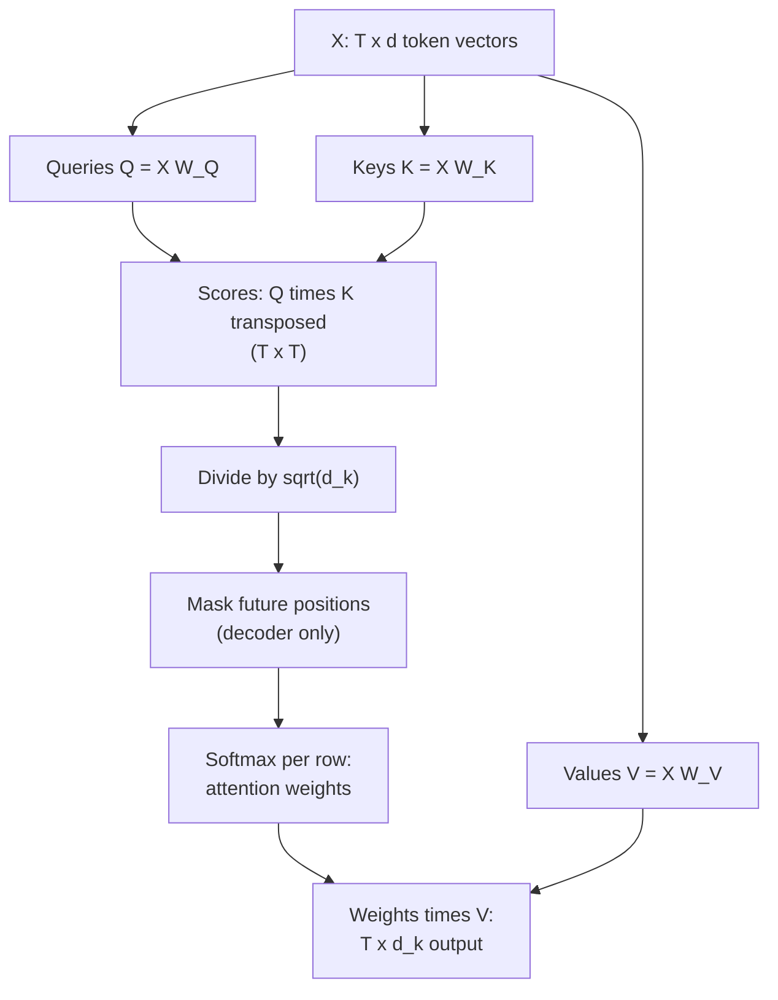

[Transformer architecture](/learn/understanding-large-language-models/transformer-architecture) left one component as a black box: self-attention, the only place in the model where one token's vector can influence another's. This lesson opens that box. You will derive the formula, compute it by hand for three tokens, implement it in NumPy, and then add the two refinements every real model uses: the causal mask and multiple heads.

Attention is the mechanism by which a generator *uses* a retrieved chunk. When AskMeridian writes "25" in an answer about annual leave, it can do so because the position producing that token attended to the "25" in the handbook passage further up the prompt. Attention is also what makes long prompts expensive, because every token is compared with every other.

## Learning objectives

- Explain attention as a weighted average of value vectors, with weights computed from queries and keys.
- Compute scaled dot-product attention by hand for a three-token example.
- Implement attention, a causal mask and multi-head attention in NumPy and state the shape of each intermediate array.
- Explain why the cost of attention grows with the square of the sequence length.
- Relate attention to how a generator reads retrieved context and to the cost of long prompts.

## Prerequisites

- [Embeddings](/learn/understanding-large-language-models/embeddings), for dot products and similarity.
- [Transformer architecture](/learn/understanding-large-language-models/transformer-architecture), for where attention sits in the block.
- [How LLMs work](/learn/understanding-large-language-models/how-llms-work), for softmax.

## Why this matters

Retrieval puts the right passage in the prompt. That is necessary and not sufficient: the model still has to find the relevant words inside a prompt of a few thousand tokens and carry their content to the place where the answer is being written. Attention is the only route by which that can happen.

Three practical facts about RAG follow from how attention works:

- **Context competes.** Attention weights at each position sum to 1. Every extra token in the prompt is another candidate for a share of that fixed total, so irrelevant chunks are not free.
- **Context costs.** Attention compares each token with every other. Ten times the prompt means about a hundred times the comparisons.
- **Reading jointly beats reading separately.** A model that attends across a question and a passage together can judge relevance more finely than one that embeds them apart. That is the difference between a cross-encoder reranker and an embedding model, covered in [Cross-encoders](/learn/reranking-fundamentals/cross-encoders).

## The intuition

A Python dictionary does a hard lookup: give it a key, and it returns the one value stored under exactly that key, or nothing.

Attention is a soft lookup. Each token asks a question (its **query**). Every token also advertises what it contains (its **key**) and holds something to hand over (its **value**). The asking token compares its query with every key, and instead of taking the single best match, it takes a *blend* of all the values, weighted by how well each key matched.

Consider "The laptop was slow, so IT replaced it." To build a good representation of "it", the model needs to know what "it" refers to. The query from "it" says, loosely, "I am a pronoun looking for a thing that can be replaced". The key from "laptop" matches that well; the key from "slow" matches poorly. So the vector for "it" receives mostly the value from "laptop".

If this sounds like retrieval, it is. A query is scored against a set of keys by dot product, and the best matches contribute most. Vector search returns the top few results; attention keeps all of them with soft weights. The model performs this small retrieval at every position, in every layer.

## How it works

### Queries, keys and values

The input is the matrix $X$ of shape $T \times d$: one vector per token. Attention first makes three different versions of each token vector by multiplying by three learned matrices:

- the **query** $\mathbf{q}_i = \mathbf{x}_i W_Q$: what position $i$ is looking for;
- the **key** $\mathbf{k}_j = \mathbf{x}_j W_K$: what position $j$ offers to be matched on;
- the **value** $\mathbf{v}_j = \mathbf{x}_j W_V$: what position $j$ passes on if it is attended to.

Separate matrices let a token look for something different from what it offers. "it" seeks a noun; it does not offer itself as one.

### The computation

1. **Project.** Compute $Q = XW_Q$, $K = XW_K$, $V = XW_V$.
2. **Score.** For every pair of positions $(i, j)$, take the dot product of query $i$ with key $j$. A high score means position $j$ is relevant to position $i$. All the scores together form a $T \times T$ matrix.
3. **Scale.** Divide every score by $\sqrt{d_k}$, where $d_k$ is the width of the keys, to keep the scores in a sensible range.
4. **Mask** (decoder-only models). Set the score to $-\infty$ wherever $j$ is later than $i$, so no position can attend to the future.
5. **Normalise.** Apply softmax to each row. Row $i$ becomes a set of non-negative **attention weights** that sum to 1.
6. **Blend.** The output for position $i$ is the weighted average of all the value vectors, using row $i$ of the weights.



The output has one row per token, as the input did. Each row is now a mixture of information from the positions that row attended to.

### Causal masking

A decoder-only model is trained to predict token $t+1$ from tokens $1$ to $t$. If position $t$ could attend to position $t+1$, it would simply copy the answer. The **causal mask** prevents this. It is a lower-triangular pattern: position 1 sees only itself, position 2 sees positions 1 and 2, and so on. The mask is applied to the scores *before* the softmax, by setting forbidden entries to $-\infty$. Since $e^{-\infty} = 0$, those entries get weight exactly 0 and the remaining weights still sum to 1.

Encoder-only models, such as those behind embedding models, use no causal mask: every token attends in both directions.

### Multi-head attention

A single softmax gives each position one distribution over the others, which tends to concentrate on one kind of relationship. But a token often needs several things at once: "it" wants its referent, the verb acting on it, and perhaps the tense of the sentence.

**Multi-head attention** runs several attention computations in parallel, each with its own share of the query, key and value projections. With model width $d$ and $h$ heads, each head works in $d_k = d / h$ dimensions. The $h$ outputs are concatenated back to width $d$ and passed through one more learned matrix, $W_O$, which mixes them. Because the width is divided between the heads, the cost is about the same as one full-width head. Different heads learn to attend to different things, though what an individual head has learned is often hard to state in words.

### Self-attention and cross-attention

Everything above is **self-attention**: queries, keys and values all come from the same sequence. In an encoder-decoder model the decoder also has **cross-attention** layers, where queries come from the decoder and keys and values from the encoder's output. The arithmetic is identical.

A decoder-only generator needs no cross-attention to read retrieved documents. The chunks are simply part of its input sequence, and ordinary causal self-attention lets every answer token attend back to them.

## The mathematics

### Scaled dot-product attention

The six steps collapse into one line:

$$
\text{Attention}(Q, K, V) = \text{softmax}\!\left(\frac{QK^\top}{\sqrt{d_k}}\right) V
$$

- $Q$ is the $T \times d_k$ matrix of queries, one row per position.
- $K$ is the $T \times d_k$ matrix of keys; $K^\top$ is its transpose, so $QK^\top$ is the $T \times T$ matrix whose entry $(i, j)$ is $\mathbf{q}_i \cdot \mathbf{k}_j$.
- $d_k$ is the width of each query and key.
- softmax is applied to each row separately.
- $V$ is the $T \times d_v$ matrix of values. Multiplying the weights by $V$ takes, for each row, the weighted average of the value vectors.

Written for a single position, with $\alpha_{ij}$ the weight that position $i$ gives to position $j$:

$$
\alpha_{ij} = \frac{\exp\!\left(\mathbf{q}_i \cdot \mathbf{k}_j / \sqrt{d_k}\right)}{\sum_{m=1}^{T} \exp\!\left(\mathbf{q}_i \cdot \mathbf{k}_m / \sqrt{d_k}\right)}, \qquad \mathbf{o}_i = \sum_{j=1}^{T} \alpha_{ij}\, \mathbf{v}_j
$$

**Why divide by $\sqrt{d_k}$?** A dot product is a sum of $d_k$ terms. If each coordinate of the query and key has roughly unit variance, the sum has variance about $d_k$, so its typical size grows like $\sqrt{d_k}$. Large scores make softmax put almost all of its weight on one entry, and in that regime the gradients used for training become very small. Dividing by $\sqrt{d_k}$ brings the scores back to a typical size of about 1 whatever the width. This is the reasoning given in the original paper.

### A three-token example by hand

Take three tokens with two-dimensional vectors. To keep the arithmetic visible, let $W_Q$, $W_K$ and $W_V$ all be the identity matrix, so $Q = K = V = X$:

$$
X = \begin{bmatrix} 1 & 0 \\ 0 & 1 \\ 1 & 1 \end{bmatrix}
$$

Token 1 points along the first axis, token 2 along the second, and token 3 has something of both.

**Scores.** Entry $(i, j)$ of $XX^\top$ is the dot product of rows $i$ and $j$:

$$
XX^\top = \begin{bmatrix} 1 & 0 & 1 \\ 0 & 1 & 1 \\ 1 & 1 & 2 \end{bmatrix}
$$

For example, row 3 with row 3 is $1 \times 1 + 1 \times 1 = 2$, and row 1 with row 2 is $1 \times 0 + 0 \times 1 = 0$.

**Scale.** $d_k = 2$, so divide by $\sqrt{2} = 1.414$:

$$
\begin{bmatrix} 0.707 & 0 & 0.707 \\ 0 & 0.707 & 0.707 \\ 0.707 & 0.707 & 1.414 \end{bmatrix}
$$

**Softmax, row 1.** $e^{0.707} = 2.028$, $e^{0} = 1$, $e^{0.707} = 2.028$. The sum is $5.056$. The weights are $2.028/5.056 = 0.401$, $1/5.056 = 0.198$ and $0.401$.

**Softmax, row 3.** $e^{0.707} = 2.028$ twice and $e^{1.414} = 4.113$. The sum is $8.169$. The weights are $0.248$, $0.248$ and $0.503$.

Row 2 mirrors row 1: $0.198$, $0.401$, $0.401$.

**Blend.** The output for token 1 is the weighted average of the three value vectors:

$$
\mathbf{o}_1 = 0.401\,[1, 0] + 0.198\,[0, 1] + 0.401\,[1, 1] = [0.802,\; 0.599]
$$

Token 1 started as $[1, 0]$, with nothing on the second axis. After attention it has $0.599$ there, picked up from tokens 2 and 3. That is information moving between positions. Likewise $\mathbf{o}_3 = 0.248\,[1,0] + 0.248\,[0,1] + 0.503\,[1,1] = [0.752, 0.752]$, using unrounded weights.

**With a causal mask.** Token 1 may attend only to itself, so its weights are $[1, 0, 0]$ and $\mathbf{o}_1 = [1, 0]$. Token 2 sees tokens 1 and 2, with scaled scores $0$ and $0.707$: $e^0 = 1$, $e^{0.707} = 2.028$, sum $3.028$, weights $[0.330, 0.670, 0]$, so $\mathbf{o}_2 = [0.330, 0.670]$. Token 3 sees everything, so its row is unchanged.

### In NumPy

```python
import numpy as np

np.set_printoptions(precision=3, suppress=True)

def softmax(z):
    z = z - z.max(axis=-1, keepdims=True)
    e = np.exp(z)
    return e / e.sum(axis=-1, keepdims=True)

def attention(Q, K, V, mask=None):
    d_k = K.shape[-1]
    scores = Q @ K.T / np.sqrt(d_k)                  # (T, T): one score per (query, key) pair
    if mask is not None:
        scores = np.where(mask, scores, -np.inf)     # forbidden positions get -infinity
    weights = softmax(scores)                        # each row sums to 1
    return weights @ V, weights

X = np.array([[1.0, 0.0],     # token 1
              [0.0, 1.0],     # token 2
              [1.0, 1.0]])    # token 3

out, w = attention(X, X, X)   # Q = K = V = X, as in the hand calculation
print("scaled scores:\n", X @ X.T / np.sqrt(2))
print("attention weights:\n", w)
print("row sums:", w.sum(axis=1))
print("outputs:\n", out)

causal = np.tril(np.ones((3, 3), dtype=bool))
print("\ncausal mask:\n", causal.astype(int))
out_c, w_c = attention(X, X, X, mask=causal)
print("masked weights:\n", w_c)
print("masked outputs:\n", out_c)
```

```output
scaled scores:
 [[0.707 0.    0.707]
 [0.    0.707 0.707]
 [0.707 0.707 1.414]]
attention weights:
 [[0.401 0.198 0.401]
 [0.198 0.401 0.401]
 [0.248 0.248 0.503]]
row sums: [1. 1. 1.]
outputs:
 [[0.802 0.599]
 [0.599 0.802]
 [0.752 0.752]]

causal mask:
 [[1 0 0]
 [1 1 0]
 [1 1 1]]
masked weights:
 [[1.    0.    0.   ]
 [0.33  0.67  0.   ]
 [0.248 0.248 0.503]]
masked outputs:
 [[1.    0.   ]
 [0.33  0.67 ]
 [0.752 0.752]]
```

Every number matches the hand calculation. The `attention` function is four lines: scores, optional mask, softmax, blend. `np.tril` builds the lower-triangular mask, and `np.where(mask, scores, -np.inf)` keeps a score where the mask is true and replaces it with $-\infty$ elsewhere.

### Multi-head attention

With $h$ heads, head $r$ has its own projections and produces its own output; the results are concatenated and mixed:

$$
\text{head}_r = \text{Attention}(XW_Q^{(r)},\; XW_K^{(r)},\; XW_V^{(r)}), \qquad \text{MultiHead}(X) = \big[\text{head}_1 ;\, \dots ;\, \text{head}_h\big]\, W_O
$$

- $W_Q^{(r)}$, $W_K^{(r)}$, $W_V^{(r)}$ are the $d \times d_k$ projection matrices of head $r$, with $d_k = d/h$.
- $[\,\cdot\,;\,\cdot\,]$ joins the head outputs side by side, restoring width $h \cdot d_k = d$.
- $W_O$ is a $d \times d$ output matrix.

In code the $h$ small matrices are stored as one $d \times d$ matrix whose columns are divided among the heads, which is why the parameter formula in the previous lesson had four $d \times d$ matrices: $W_Q$, $W_K$, $W_V$ and $W_O$.

**Worked shapes.** For $T = 3$, $d = 4$, $h = 2$: each head has $d_k = 2$; $Q$, $K$ and $V$ are each reshaped to $2 \times 3 \times 2$ (heads, tokens, head width); the scores are $2 \times 3 \times 3$; each head's output is $3 \times 2$; concatenated they are $3 \times 4$ again.

### Quadratic cost

The score matrix has one entry for every (query, key) pair, so $T \times T = T^2$ entries per head, per layer:

$$
\text{pairwise scores} = L \times h \times T^2
$$

- $L$ is the number of layers, $h$ the number of heads per layer, $T$ the number of tokens.

**Worked example.** For $T = 1{,}000$ there are $1{,}000{,}000$ scores per head per layer. Doubling to $T = 2{,}000$ gives $4{,}000{,}000$: twice the tokens, four times the work. The MLP, by contrast, processes each token alone, so its cost only doubles.

## In code

### Multi-head causal self-attention

**The problem.** Implement the full layer as it appears inside a decoder block, with learned-style projections, two heads and a causal mask, and check every shape against the worked shapes above.

```bash
pip install numpy
```

```python
import numpy as np

np.set_printoptions(precision=3, suppress=True)
rng = np.random.default_rng(0)

T, d_model, n_heads = 3, 4, 2
d_head = d_model // n_heads

def softmax(z):
    z = z - z.max(axis=-1, keepdims=True)
    e = np.exp(z)
    return e / e.sum(axis=-1, keepdims=True)

X = rng.normal(size=(T, d_model))                    # 3 token vectors of width 4
W_q, W_k, W_v, W_o = (rng.normal(size=(d_model, d_model)) for _ in range(4))

def split_heads(M):
    # (T, d_model) -> (n_heads, T, d_head)
    return M.reshape(T, n_heads, d_head).transpose(1, 0, 2)

Q, K, V = split_heads(X @ W_q), split_heads(X @ W_k), split_heads(X @ W_v)
print("Q, K, V per head:", Q.shape)

scores = Q @ K.transpose(0, 2, 1) / np.sqrt(d_head)  # (n_heads, T, T)
mask = np.tril(np.ones((T, T), dtype=bool))
weights = softmax(np.where(mask, scores, -np.inf))
print("attention weights:", weights.shape)
print("head 0:\n", weights[0])
print("head 1:\n", weights[1])

per_head = weights @ V                               # (n_heads, T, d_head)
concat = per_head.transpose(1, 0, 2).reshape(T, d_model)
out = concat @ W_o
print("per-head output:", per_head.shape, "-> concatenated:", concat.shape, "-> final:", out.shape)
```

```output
Q, K, V per head: (2, 3, 2)
attention weights: (2, 3, 3)
head 0:
 [[1.    0.    0.   ]
 [0.456 0.544 0.   ]
 [0.064 0.005 0.931]]
head 1:
 [[1.    0.    0.   ]
 [0.691 0.309 0.   ]
 [0.173 0.142 0.685]]
per-head output: (2, 3, 2) -> concatenated: (3, 4) -> final: (3, 4)
```

**The important lines.**

- `X @ W_q` projects all tokens at once. `split_heads` then cuts the width-4 result into two width-2 halves and moves the head axis to the front, so that NumPy's `@` handles both heads in one batched matrix product.
- `K.transpose(0, 2, 1)` transposes each head's key matrix, giving scores of shape `(n_heads, T, T)`.
- The same `(T, T)` mask is broadcast across both heads.
- `transpose(1, 0, 2).reshape(T, d_model)` undoes `split_heads`, placing the two heads' outputs side by side.

**What the output means.** Both weight matrices are lower-triangular: the zeros above the diagonal are the causal mask at work, and every row sums to 1. The two heads disagree. For token 3, head 0 puts 0.931 on the token itself and almost nothing on token 2, while head 1 spreads its weight 0.173, 0.142, 0.685. With random weights these patterns mean nothing, but the mechanism is on show: the heads see the same input and attend differently, and their outputs are combined. The final shape is `(3, 4)`, the same as the input, which is what lets this layer sit inside the residual stream of a block.

**Common errors.** `reshape` fails if `d_model` is not divisible by `n_heads`. Applying the mask after the softmax instead of before leaves rows that no longer sum to 1. Forgetting the transpose in `split_heads` mixes tokens with heads and produces plausible shapes with wrong numbers, which is why the `(2, 3, 2)` check is worth making.

**Extending it.** Remove the mask to get encoder-style attention. Add a batch dimension at the front and the same code processes many sequences at once.

### How fast the score matrix grows

**The problem.** Put numbers on the quadratic term for prompt sizes a RAG system actually produces.

```python
print(f"{'tokens T':>10}{'scores per head (T*T)':>24}{'float32 memory per head':>26}")
for T in [500, 2_000, 8_000, 32_000, 128_000]:
    entries = T * T
    print(f"{T:>10,}{entries:>24,}{entries * 4 / 1e9:>23.3f} GB")

chunk_tokens, question_tokens = 400, 100
for k in [3, 10, 30]:
    T = question_tokens + k * chunk_tokens
    print(f"top-{k:<2} chunks -> {T:>6,} prompt tokens -> {T * T:>12,} pairwise scores per head per layer")
```

```output
  tokens T   scores per head (T*T)   float32 memory per head
       500                 250,000                  0.001 GB
     2,000               4,000,000                  0.016 GB
     8,000              64,000,000                  0.256 GB
    32,000           1,024,000,000                  4.096 GB
   128,000          16,384,000,000                 65.536 GB
top-3  chunks ->  1,300 prompt tokens ->    1,690,000 pairwise scores per head per layer
top-10 chunks ->  4,100 prompt tokens ->   16,810,000 pairwise scores per head per layer
top-30 chunks -> 12,100 prompt tokens ->  146,410,000 pairwise scores per head per layer
```

Each step in the first table multiplies $T$ by 4 and the score count by 16. Going from 3 retrieved chunks to 30 multiplies the prompt by about 9 and the pairwise scores by about 87. The memory column is what a single head's score matrix would occupy if stored whole as 32-bit floats; production systems avoid holding it all at once, and a causal model needs only the lower triangle, but the number of comparisons is still of order $T^2$.

## A real-world example

AskMeridian initially passes the top 5 retrieved chunks to the generator. After a few missed answers, an engineer named Oluwaseun raises it to 40, reasoning that the right chunk will then nearly always be present and "attention will find it".

Two things happen. Responses get slower, and the bill rises roughly in line with the input tokens, which have grown more than sevenfold. And answer quality does not improve as hoped. On questions where chunk 1 already held the answer, some responses now blend in details from loosely related chunks: a question about carrying over annual leave comes back with a remark about the expenses deadline, because both passages mention dates and days.

The team reasons from the mechanism. Each position's attention weights sum to 1, so 35 extra chunks add thousands of keys competing for that total, many of them superficially similar to the question. Published evaluations have also found that models use information in the middle of a long context less reliably than information near the start or end, which is the subject of [Lost-in-the-middle problem](/learn/context-engineering/lost-in-the-middle-problem). Their fix is to keep retrieving 40 candidates, because recall matters, but to rerank them and pass only the best 5 to the generator. Cost and latency return to where they were, and the distracting passages no longer reach the prompt.

## Common mistakes

- **Assuming more context can only help.** Attention is a fixed budget per position. Irrelevant chunks compete for it, and answers can get worse as well as slower and dearer.
- **Treating cost as linear in prompt length.** The attention part grows with $T^2$. Doubling the context more than doubles the compute behind the request, even where the price list is linear per token.
- **Applying the causal mask after the softmax.** The weights no longer sum to 1 and the layer computes something else. Mask the scores, then normalise.
- **Reading attention weights as an explanation of the answer.** Weights from one head in one layer show where that head looked, not why the model said what it said. They are a debugging aid at best, and hosted APIs do not expose them. If you need to know which chunk an answer relied on, ask the model to cite.
- **Thinking attention knows word order.** Without positional information and without a mask, shuffling the input rows only shuffles the output rows (Exercise 2). Order comes from the positional vectors and the mask.
- **Assuming a generator needs a special mechanism to read retrieved text.** Retrieved chunks are ordinary input tokens. The same self-attention that links a pronoun to its noun links the answer to the passage.

## Best practices

- Send the generator the smallest set of chunks that contains the answer. Retrieve broadly, rerank, then cut.
- Budget prompts in tokens and track how input length changes over time; growth in $T$ is the main driver of latency before the first token.
- Use a cross-encoder reranker when you need fine-grained relevance. It lets question tokens attend directly to passage tokens, which separately computed embeddings cannot do.
- Keep important instructions and the most relevant chunks near the start or the end of the context, and test the effect on your own data.
- When writing or reviewing attention code, assert the shapes: scores `(heads, T, T)`, rows summing to 1, output `(T, d)`.

## Performance considerations

**Time.** For one layer, attention costs on the order of $T^2 \cdot d$ operations (each of $T^2$ scores is a dot product, and each output is a weighted sum), while the MLP costs on the order of $T \cdot d^2$. For short inputs the MLP dominates; once $T$ is several times larger than the width $d$, attention takes over. Long RAG prompts sit in the regime where attention matters.

**Encoders pay it once.** An embedding model computes attention over a chunk of a few hundred tokens in a single pass. With $T = 256$, that is $65{,}536$ scores per head per layer: small. This is one reason embedding short chunks is cheap.

**Generators pay it per token.** While generating, each new token attends to every token before it. Token number $t$ costs about $t$ comparisons per head per layer, so producing $m$ tokens after an $n$-token prompt costs about $n \cdot m + m^2/2$ comparisons, on top of the $n^2/2$ needed to read the prompt. A long context makes every generated token dearer. [Model inference](/learn/understanding-large-language-models/model-inference) explains the caching that keeps this from being worse.

**Cross-encoders pay it per pair.** Reranking 50 candidates of 400 tokens against a 20-token question means 50 passes with $T = 420$: $50 \times 420^2 \approx 8.8$ million scores per head per layer. Reranking 5,000 candidates would be a hundred times that, which is why rerankers run on a shortlist and never on the whole index.

**What limits context.** The maximum input length, and what it costs to use it, is the subject of [Context windows](/learn/understanding-large-language-models/context-windows).

## Summary

- Attention gives each position a weighted average of all positions' value vectors, with weights from the match between that position's query and every key.
- The formula is $\text{softmax}(QK^\top / \sqrt{d_k})\,V$: dot-product scores, scaled by $\sqrt{d_k}$ to keep softmax well-behaved, normalised per row, then used to blend the values.
- A causal mask sets scores for future positions to $-\infty$ before the softmax, so a decoder-only model cannot see what it is about to predict.
- Multi-head attention runs several attentions in parallel on slices of the width and concatenates the results, at about the cost of one.
- The score matrix is $T \times T$ per head per layer, so attention cost grows with the square of the sequence length.
- In RAG, attention is how the answer draws on retrieved text. Extra context both competes for a fixed attention budget and raises cost.

## Exercises

**1.** In the hand example, recompute token 3's attention weights *without* dividing by $\sqrt{d_k}$. Compare them with the scaled weights and explain the difference.

<details><summary>Show solution</summary>

Unscaled scores for row 3 are $[1, 1, 2]$. Exponentiate: $e^1 = 2.718$, $e^1 = 2.718$, $e^2 = 7.389$. The sum is $12.826$. The weights are $[0.212, 0.212, 0.576]$.

With scaling they were $[0.248, 0.248, 0.503]$. Without it, the largest score takes a bigger share: the distribution is sharper. With $d_k = 2$ the effect is modest. For a realistic $d_k$ of 64 or more, unscaled dot products are typically several times larger, and softmax would put nearly all its weight on a single position, which makes training difficult. Scaling keeps the sharpness independent of the width.

</details>

**2.** Using the `attention` function from the lesson, show that unmasked attention has no sense of order: reorder the three input tokens and check that the outputs are the same vectors in the new order. Then repeat with the causal mask.

<details><summary>Show solution</summary>

```python
X = np.array([[1.0, 0.0], [0.0, 1.0], [1.0, 1.0]])
perm = [2, 0, 1]                       # new order: token 3, token 1, token 2

out, _ = attention(X, X, X)
out_perm, _ = attention(X[perm], X[perm], X[perm])
print(out)
print(out_perm)
print("outputs are the same vectors, reordered:", np.allclose(out[perm], out_perm))

mask = np.tril(np.ones((3, 3), dtype=bool))
out_m, _ = attention(X, X, X, mask)
out_m_perm, _ = attention(X[perm], X[perm], X[perm], mask)
print("still true with a causal mask:", np.allclose(out_m[perm], out_m_perm))
```

```output
[[0.802 0.599]
 [0.599 0.802]
 [0.752 0.752]]
[[0.752 0.752]
 [0.802 0.599]
 [0.599 0.802]]
outputs are the same vectors, reordered: True
still true with a causal mask: False
```

Without a mask, each token's output depends only on the *set* of tokens present, not on where they sit, so reordering the input just reorders the output. An encoder with no positional information would therefore treat a sentence as a bag of tokens. The causal mask breaks the symmetry, because which tokens a position may see depends on its place in the sequence. Even so, a mask alone gives only a weak sense of order, which is why models add explicit positional information.

</details>

**3.** A prompt has 150 tokens of instructions and question plus $k$ chunks of 400 tokens. Compute the prompt length and the pairwise scores per head per layer for $k = 5$ and $k = 40$. By what factor does each grow?

<details><summary>Show solution</summary>

For $k = 5$: $T = 150 + 5 \times 400 = 2{,}150$ tokens and $T^2 = 4{,}622{,}500$ scores.

For $k = 40$: $T = 150 + 40 \times 400 = 16{,}150$ tokens and $T^2 = 260{,}822{,}500$ scores.

The prompt is $16{,}150 / 2{,}150 \approx 7.5$ times longer. The score count is $7.5^2 \approx 56$ times larger. A per-token price list would show a bill about 7.5 times higher for input; the compute behind the attention layers rises much more steeply, which shows up as latency.

</details>

**4.** An embedding model (a bi-encoder) encodes the question and each passage separately and compares the two vectors. A cross-encoder reranker feeds question and passage through the model together. Using what you know about attention, explain why the cross-encoder judges relevance more accurately, and why it cannot be used to search a whole index.

<details><summary>Show solution</summary>

**Accuracy.** In a bi-encoder, attention operates only within the question and only within the passage. No question token ever attends to a passage token. Each text must be compressed into one vector without knowing what it will be compared with, and the only interaction between the two is a single dot product at the end. In a cross-encoder the two texts form one sequence, so in every layer each question token can attend to each passage token and the reverse. The model can check directly whether the passage states the thing the question asks about, for instance linking "carry over" in the question to "5 unused days carry over" in the passage, instead of relying on two summaries happening to align.

**Cost.** That interaction has to be computed for each (question, passage) pair, at query time, because it depends on the question. Nothing can be precomputed. For an index of $N$ passages, that is $N$ forward passes per question, each with attention over the combined length. A bi-encoder embeds every passage once, offline, and at query time needs one forward pass for the question plus cheap vector comparisons. So the bi-encoder finds a shortlist across the whole index, and the cross-encoder re-scores only that shortlist.

</details>

## Check your understanding

```quiz
[
  {
    "q": "In attention, what are the query and key used for?",
    "options": [
      "The query is the user's question and the key is the API key",
      "They are added together to form the output",
      "Their dot product scores how relevant one position is to another, and the scores become the weights for blending values",
      "The key selects exactly one value, as in a dictionary"
    ],
    "answer": 2,
    "why": "Each position's query is compared with every position's key by dot product. After scaling and softmax, those scores are the weights of a weighted average of the value vectors."
  },
  {
    "q": "A sequence has 6 tokens and the model uses 4 attention heads. What is the shape of the attention weight array in one layer?",
    "options": [
      "(4, 6, 6)",
      "(6, 4)",
      "(6, 6, 6, 6)",
      "(4, 6)"
    ],
    "answer": 0,
    "why": "Each head has a T by T matrix of weights, one row per querying position and one column per attended position, so 4 heads give (4, 6, 6)."
  },
  {
    "q": "Why is the causal mask applied to the scores before the softmax and not to the weights afterwards?",
    "options": [
      "It makes no difference; either order gives the same result",
      "Setting scores to minus infinity makes those weights exactly zero while the remaining weights still sum to 1",
      "The softmax cannot be computed on unmasked scores",
      "Masking afterwards would let the model see future tokens"
    ],
    "answer": 1,
    "why": "The exponential of minus infinity is 0, so masked positions drop out of the softmax and the rest are normalised among themselves. Zeroing weights afterwards would leave rows that sum to less than 1."
  },
  {
    "q": "A prompt grows from 2,000 to 6,000 tokens. Roughly how does the number of pairwise attention scores per head per layer change?",
    "options": [
      "It triples",
      "It stays the same",
      "It grows 6 times",
      "It grows 9 times"
    ],
    "answer": 3,
    "why": "The score matrix has T times T entries. Tripling T multiplies the count by 3 squared, which is 9: from 4 million to 36 million."
  },
  {
    "q": "AskMeridian's generator is a decoder-only model. How does it make use of a retrieved handbook chunk in the prompt?",
    "options": [
      "The chunk is written into the model's weights before generation",
      "A separate cross-attention module is added for retrieved documents",
      "The chunk's tokens are part of the input sequence, and positions generating the answer attend back to them through ordinary self-attention",
      "The chunk is compared with the answer by cosine similarity after generation"
    ],
    "answer": 2,
    "why": "Retrieved text is just more input tokens. Causal self-attention lets every later position, including those producing the answer, draw on the chunk's token vectors."
  }
]
```

## Further reading

- Ashish Vaswani et al. (2017), "Attention Is All You Need": [arxiv.org/abs/1706.03762](https://arxiv.org/abs/1706.03762). Section 3.2 defines scaled dot-product and multi-head attention.
- Dzmitry Bahdanau, Kyunghyun Cho and Yoshua Bengio (2014), "Neural Machine Translation by Jointly Learning to Align and Translate": [arxiv.org/abs/1409.0473](https://arxiv.org/abs/1409.0473). The paper that introduced attention.
- Nelson F. Liu et al. (2023), "Lost in the Middle: How Language Models Use Long Contexts": [arxiv.org/abs/2307.03172](https://arxiv.org/abs/2307.03172)
- Jay Alammar, "The Illustrated Transformer": [jalammar.github.io/illustrated-transformer](https://jalammar.github.io/illustrated-transformer/)
- Daniel Jurafsky and James H. Martin, *Speech and Language Processing* (3rd edition draft), the chapter on Transformers: [web.stanford.edu/~jurafsky/slp3](https://web.stanford.edu/~jurafsky/slp3/)
