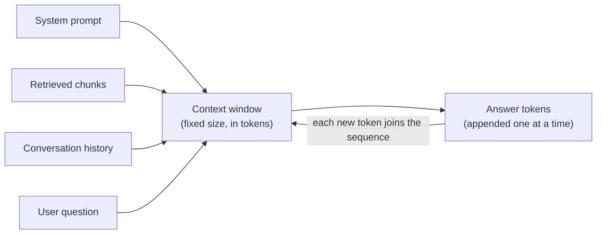

A language model can only read a fixed amount of text in one request. That limit is the **context window**, and it is measured in tokens, the sub-word pieces you met in [Tokens and tokenisation](/learn/understanding-large-language-models/tokens-and-tokenisation). Everything a RAG system does at answer time, from choosing how many chunks to retrieve to deciding how long the answer may be, is a decision about how to spend that limit.

This lesson defines the window precisely, shows that the prompt and the answer draw on the same allowance, and turns "how many chunks can I send?" into arithmetic you can do on paper and a Python function you can reuse. Selecting, ordering and compressing what goes into the window are the subject of a later module, [Context Engineering](/learn/context-engineering); this lesson gives you the foundation those techniques stand on.

## Learning objectives

- Define the context window and explain why it is counted in tokens, not characters or words.
- Explain why input tokens and output tokens share one limit, and what a separate output cap does.
- Calculate a token budget for a RAG request: system prompt, retrieved chunks, question, answer reserve and safety margin.
- Write a Python function that packs ranked chunks into a budget without overflowing it.
- Recognise the two failure modes of a mis-sized budget: rejected requests and truncated answers.

## Prerequisites

- [What is RAG?](/learn/introduction-to-rag/what-is-rag), for chunks and retrieval.
- [How LLMs work](/learn/understanding-large-language-models/how-llms-work), for next-token prediction.
- [Tokens and tokenisation](/learn/understanding-large-language-models/tokens-and-tokenisation), for what a token is and how text is counted.
- [Attention mechanisms](/learn/understanding-large-language-models/attention-mechanisms), for why the cost of attention grows with sequence length.

## Why this matters

A RAG system assembles its prompt at run time. The question varies in length, the retriever returns a varying number of chunks of varying size, and a conversation grows with every turn. If nobody adds up the pieces, one of three things eventually happens:

- **The request is rejected.** The prompt is longer than the model accepts, the API returns an error, and the user sees a failure for a question that worked yesterday with shorter documents.
- **The answer is cut off.** The prompt fits, but too little room is left for the answer, so generation stops mid-sentence.
- **Text is silently dropped.** Some libraries trim an over-long prompt for you. If the part they trim is the chunk containing the answer, the model answers without it, and nothing in your logs says so.

There is also a quieter cost. You pay for every token you send, on every request, and a longer prompt takes longer to process. A team that fills the window "because it is there" pays for it in money and latency, and often in answer quality too. Budgeting is how you avoid all of these on purpose rather than by luck.

## The intuition

Picture a desk of fixed size. To answer a question you may lay out papers on it: a sheet of standing instructions, a few pages photocopied from the handbook, the question itself, and a blank pad on which to write the answer. Everything has to be on the desk at once. Nothing off the desk can be consulted.

Two things follow immediately. First, the blank pad takes desk space too: if you cover the whole desk with photocopies, there is nowhere to write. Second, more photocopies means less room for everything else, so you want the *right* pages, not the most pages.

A tiny numerical version: suppose the desk holds 100 units. Instructions take 15, the question takes 5, and you want 20 for the answer. That leaves $100 - 15 - 5 - 20 = 60$ units for photocopies. If each page is 25 units, you can lay out two pages (50 units), not three (75). That subtraction and that division are the whole of token budgeting; the rest of the lesson makes the units real.

## How it works

### What the window is

A transformer processes a sequence of token positions, and it was trained with a maximum sequence length. The context window is that maximum: the largest number of tokens the model can take into account in a single forward computation. It exists for two reasons you have already seen. The model's sense of position was learned only up to a certain length ([Transformer architecture](/learn/understanding-large-language-models/transformer-architecture)), and attention compares every token with every other token, so memory and compute rise steeply as the sequence grows ([Attention mechanisms](/learn/understanding-large-language-models/attention-mechanisms)).

The window is counted in tokens because tokens are what the model actually receives. A character count or a word count is only an estimate, and the ratio between words and tokens depends on the language, the kind of text and the tokeniser. Code, tables, long numbers and non-English text usually take more tokens per word than plain English prose.

Window sizes differ enormously between models, from a few thousand tokens in early models to hundreds of thousands, and in some current models around a million. The number belongs to a specific model version, so read it from the provider's documentation rather than from memory.

### Input and output share it

Recall from [How LLMs work](/learn/understanding-large-language-models/how-llms-work) that a model generates one token at a time, and each new token is appended to the sequence before the next one is predicted. The answer is therefore not written somewhere separate. It grows inside the same sequence as the prompt:



So the rule is:

```text
input tokens + output tokens  <=  context window
```

Hosted APIs add a second, smaller limit: a **maximum output length**. You request it per call (the `max_tokens` argument in the Anthropic SDK), and each model also has a ceiling it will not exceed. This parameter is a hard stop, not a target. The model does not know the number and does not plan around it; if it reaches the cap, generation simply ends. You can detect this: the response says why it stopped, and a value indicating the token limit (`stop_reason == "max_tokens"` in the Anthropic API) means the answer was cut off rather than finished.

> [!NOTE]
> Some models produce hidden reasoning tokens before the visible answer. Where they do, those tokens are generated like any others, so they count as output and draw on the same allowance. Check your provider's documentation and leave room for them.

### What fills the window in a RAG request

A typical request to AskMeridian, Meridian's internal assistant, contains five things:

| Part | What it is | Size behaviour |
| --- | --- | --- |
| System prompt | Standing instructions: role, grounding rules, citation format | Fixed; you wrote it |
| Retrieved chunks | Passages the retriever returned for this question | Variable; you choose how many |
| Conversation history | Earlier turns, if the assistant is multi-turn | Grows every turn |
| Question | What the user typed | Variable; usually small |
| Answer reserve | Room kept free for the model's output | You choose it |

Only one of these is truly under your control at request time: the retrieved chunks. The budget's job is to work out how much room they may have.

### The budgeting procedure

1. **Find the window size** $W$ for the exact model you call.
2. **Count the fixed parts** in tokens: the system prompt $S$, plus any formatting you always add.
3. **Count the question** $Q$ (and the history, if you keep one).
4. **Reserve room for the answer** $R$. Pick it from the longest answer you want to allow, and pass the same number as the output cap.
5. **Subtract a safety margin** $M$. Your token count is often an estimate, and requests carry a little overhead for roles and formatting.
6. **What remains is the chunk budget**: $C = W - S - Q - R - M$.
7. **Pack chunks in rank order** until the next one would not fit.
8. **Check the outcome**: if no chunk fits, fail loudly; if the response stopped at the output cap, the reserve was too small.

Try it with the visualiser. Change the window size, the chunk size and the answer reserve, and watch how many chunks fit:

```playground
context-window
```

### Fitting is not the same as using well

A budget tells you what *can* go in. It says nothing about what *should*. Models do not use every part of a long prompt equally well: Liu and colleagues (2023) measured that accuracy fell when the relevant passage sat in the middle of a long context rather than near the start or the end. Padding the window with weakly relevant chunks therefore costs money and can hide the one chunk that matters. That trade-off is examined in [RAG versus long-context prompting](/learn/introduction-to-rag/rag-versus-long-context-prompting) and, in depth, in [Lost-in-the-middle problem](/learn/context-engineering/lost-in-the-middle-problem). For now, treat the budget as an upper bound, not a goal.

## The mathematics

### The chunk budget

**Intuition.** The window is a fixed total. Subtract everything that is not a retrieved chunk, and what is left is the room for chunks.

$$
C = W - S - Q - R - M
$$

- $W$: context window of the model, in tokens.
- $S$: tokens in the system prompt and fixed formatting.
- $Q$: tokens in the user's question (plus conversation history, if any).
- $R$: answer reserve, the output tokens you allow.
- $M$: safety margin, commonly a fraction of the window, $M = mW$.
- $C$: tokens available for retrieved chunks.

### How many chunks fit

**Intuition.** Each chunk costs its own tokens plus a few for the wrapper around it (an identifier, tags, a blank line). Divide the budget by that cost and round down, because part of a chunk is of little use.

$$
k = \left\lfloor \frac{C}{c + o} \right\rfloor
$$

- $c$: tokens in one chunk (use the largest chunk size your splitter produces).
- $o$: overhead tokens added per chunk by your formatting.
- $\lfloor \cdot \rfloor$: round down to a whole number.
- $k$: the largest number of chunks that is guaranteed to fit.

### Worked by hand

Suppose AskMeridian runs on a model with a 16,000-token window (an assumed figure, chosen to keep the arithmetic readable). The system prompt is 400 tokens, questions are at most 60 tokens, the answer reserve is 1,200 tokens, the margin is 10% of the window, chunks are at most 350 tokens, and each chunk's wrapper costs 15 tokens.

$$
M = 0.10 \times 16{,}000 = 1{,}600
$$

$$
C = 16{,}000 - 400 - 60 - 1{,}200 - 1{,}600 = 12{,}740
$$

$$
k = \left\lfloor \frac{12{,}740}{350 + 15} \right\rfloor = \left\lfloor 34.9 \right\rfloor = 34
$$

Thirty-four chunks is the ceiling. The request would then carry $400 + 60 + 34 \times 365 = 12{,}870$ input tokens.

### The same in Python

```python
W, S, Q, R = 16_000, 400, 60, 1_200
margin = int(0.10 * W)
C = W - S - Q - R - margin
chunk, overhead = 350, 15
k = C // (chunk + overhead)

print("margin:", margin)
print("chunk budget C:", C)
print("max chunks k:", k)
print("input tokens:", S + Q + k * (chunk + overhead))
print("share of window that is retrieved text: {:.1%}".format(k * (chunk + overhead) / W))
```

```output
margin: 1600
chunk budget C: 12740
max chunks k: 34
input tokens: 12870
share of window that is retrieved text: 77.6%
```

The code agrees with the hand calculation. Notice that 34 is what fits, not what is wise: most questions about a handbook are answered by a handful of chunks, and the remaining thirty would be paid-for noise.

## In code

**The problem.** Given a ranked list of retrieved chunks, keep as many as fit in the budget, in rank order, and refuse to build a request that cannot work.

**Dependencies.** Only `tiktoken`, used here as an offline token counter:

```bash
pip install tiktoken
```

> [!WARNING]
> Every model family has its own tokeniser. `tiktoken` implements OpenAI's encodings, so for any other model its counts are estimates and can be noticeably low. That is one reason the function below takes a safety margin. For an exact count, call your provider's token-counting endpoint, shown after this example.

```python
import tiktoken

enc = tiktoken.get_encoding("cl100k_base")


def count_tokens(text: str) -> int:
    """Offline estimate. Each model family has its own tokeniser."""
    return len(enc.encode(text))


def chunk_budget(window: int, system: int, question: int,
                 answer_reserve: int, safety: float = 0.10) -> int:
    """Tokens left for retrieved chunks after everything else is paid for."""
    margin = int(window * safety)
    budget = window - system - question - answer_reserve - margin
    if budget <= 0:
        raise ValueError(f"nothing left for context: budget is {budget} tokens")
    return budget


def fit_chunks(ranked_chunks: list[str], budget: int, per_chunk_overhead: int = 12):
    """Keep chunks in rank order until the next one would overflow the budget."""
    kept, used = [], 0
    for chunk in ranked_chunks:
        cost = count_tokens(chunk) + per_chunk_overhead
        if used + cost > budget:
            break
        kept.append(chunk)
        used += cost
    return kept, used


SYSTEM = ("You are AskMeridian, the internal assistant for Meridian staff. "
          "Answer only from the documents provided. "
          "If the answer is not in them, say you don't know.")
QUESTION = "How many unused leave days can I carry over, and by when must I use them?"

# Already ranked by the retriever, best first.
ranked = [
    "Annual leave is 25 days per year. Up to 5 unused days carry over and must be used by 31 March.",
    "Leave requests are made in the HR portal and need manager approval before travel is booked.",
    "Staff may work remotely up to 3 days a week. The home-office equipment budget is £400.",
    "Expenses must be submitted within 30 days. Anything over £75 needs a receipt.",
    "Passwords must be rotated every 90 days. VPN is required on public Wi-Fi.",
    "Laptops are refreshed every 3 years. The support desk is open 08:00 to 18:00 UK time.",
]

system_tokens = count_tokens(SYSTEM)
question_tokens = count_tokens(QUESTION)
print(f"system prompt : {system_tokens} tokens")
print(f"question      : {question_tokens} tokens")
for i, c in enumerate(ranked, 1):
    print(f"chunk {i}       : {count_tokens(c)} tokens")

# A deliberately tiny window so the limit bites with six short chunks.
budget = chunk_budget(window=220, system=system_tokens, question=question_tokens,
                      answer_reserve=60, safety=0.10)
kept, used = fit_chunks(ranked, budget)
print(f"\nchunk budget  : {budget} tokens")
print(f"chunks kept   : {len(kept)} of {len(ranked)} ({used} tokens used)")

try:
    chunk_budget(window=220, system=system_tokens, question=question_tokens,
                 answer_reserve=150)
except ValueError as err:
    print(f"error         : {err}")
```

```output
system prompt : 35 tokens
question      : 18 tokens
chunk 1       : 26 tokens
chunk 2       : 17 tokens
chunk 3       : 21 tokens
chunk 4       : 18 tokens
chunk 5       : 17 tokens
chunk 6       : 26 tokens

chunk budget  : 85 tokens
chunks kept   : 2 of 6 (67 tokens used)
error         : nothing left for context: budget is -5 tokens
```

**What the important lines do.**

- `chunk_budget` is the formula $C = W - S - Q - R - M$. It raises an error when the result is zero or negative, because a request with no room for context is a bug to surface, not something to send.
- `fit_chunks` walks the list in rank order and stops at the first chunk that does not fit. It uses `break`, not `continue`: skipping a large high-ranked chunk in favour of a small low-ranked one would change the ranking the retriever worked to produce.
- `per_chunk_overhead` accounts for the tags and identifiers you wrap around each chunk in the real prompt.

**What the output means.** With a 220-token window, 35 go to the system prompt, 18 to the question, 60 to the answer and 22 to the margin, leaving 85. The first chunk costs $26 + 12 = 38$, the second $17 + 12 = 29$, for 67 in total. The third would cost 33 and take the total to 100, so it is left out. The final line shows the guard working: asking for a 150-token answer leaves a budget of $-5$.

The packing loop is easy to follow one step at a time:

```trace
{
  "title": "Packing ranked chunks into an 85-token budget",
  "code": [
    "kept, used = [], 0",
    "for chunk in ranked_chunks:",
    "    cost = count_tokens(chunk) + per_chunk_overhead",
    "    if used + cost > budget:",
    "        break",
    "    kept.append(chunk)",
    "    used += cost"
  ],
  "steps": [
    {"line": 1, "vars": {"budget": "85", "used": "0", "kept": "[]"}, "note": "Nothing has been packed yet."},
    {"line": 3, "vars": {"chunk": "1 (leave policy)", "cost": "26 + 12 = 38"}, "note": "The chunk's tokens plus the wrapper overhead."},
    {"line": 4, "vars": {"used + cost": "38", "budget": "85"}, "note": "38 is not greater than 85, so the chunk fits."},
    {"line": 7, "vars": {"used": "38", "kept": "[chunk 1]"}, "note": "Chunk 1 is kept."},
    {"line": 3, "vars": {"chunk": "2 (leave requests)", "cost": "17 + 12 = 29"}, "note": "Next chunk in rank order."},
    {"line": 4, "vars": {"used + cost": "67", "budget": "85"}, "note": "67 is not greater than 85, so it fits."},
    {"line": 7, "vars": {"used": "67", "kept": "[chunk 1, chunk 2]"}, "note": "Chunk 2 is kept."},
    {"line": 3, "vars": {"chunk": "3 (remote work)", "cost": "21 + 12 = 33"}, "note": "Third chunk."},
    {"line": 4, "vars": {"used + cost": "100", "budget": "85"}, "note": "100 is greater than 85: this chunk would overflow."},
    {"line": 5, "vars": {"used": "67", "kept": "[chunk 1, chunk 2]"}, "note": "Stop. Two chunks, 67 tokens."}
  ]
}
```

**Exact counts and a real call.** The following needs the `anthropic` package and an `ANTHROPIC_API_KEY`, so it was not run here. The counting endpoint returns the true input size for the model you name, and the response reports what was actually used:

```python
import anthropic

client = anthropic.Anthropic()  # reads ANTHROPIC_API_KEY from the environment

prompt = "\n\n".join(kept) + f"\n\nQuestion: {QUESTION}"

exact = client.messages.count_tokens(
    model="claude-opus-5-5",
    system=SYSTEM,
    messages=[{"role": "user", "content": prompt}],
)
print("exact input tokens:", exact.input_tokens)

response = client.messages.create(
    model="claude-opus-5-5",
    max_tokens=1024,
    system=SYSTEM,
    messages=[{"role": "user", "content": prompt}],
)
answer = "".join(block.text for block in response.content if block.type == "text")
print(response.usage.input_tokens, response.usage.output_tokens, response.stop_reason)
```

Your exact numbers will differ; the output looks like this:

```output
exact input tokens: 131
131 38 end_turn
```

A `stop_reason` of `max_tokens` instead of `end_turn` would tell you the answer hit the cap.

**Common errors.**

- An "input too long" error from the API: the estimate was too low or history grew. Increase the margin or count exactly.
- `ValueError: nothing left for context`: the answer reserve or system prompt is too large for this model.
- Answers ending mid-sentence: the output cap is smaller than the answers the prompt invites.

**How to extend it.** Add a `history` term to the budget; cap the number of chunks as well as the tokens; log `used`, `budget` and `stop_reason` on every request so that drift is visible ([Token tracking](/learn/rag-observability/token-tracking)).

## A real-world example

The platform team at Meridian shipped AskMeridian with a simple rule: retrieve the top 8 chunks and send them all. It worked for months, because handbook chunks were about 300 tokens each.

Then the IT team indexed their runbooks. The runbook splitter kept whole procedures together, so some chunks were several thousand tokens long. Two symptoms appeared in the same week. A few questions about VPN setup failed outright with an input-length error. Others returned answers that stopped halfway through a numbered list.

Dilnoza, the engineer on call, pulled the logged token counts for the failing requests. The failures had one thing in common: eight long runbook chunks plus four turns of conversation history exceeded what the model accepted. The truncated answers were requests that only just fitted, on a deployment where the output cap had been left at a small default.

The fix was not a larger model. She replaced "top 8" with a token budget: a fixed answer reserve passed as the output cap, a margin, and a packing loop like the one above. She added a maximum chunk size to the runbook splitter and a log line recording the budget, the tokens used and the stop reason. The errors stopped, and the log line later showed that most requests used fewer than half the tokens the old rule had been sending.

## Common mistakes

- **Counting characters or words instead of tokens.** The ratio varies by content; code and non-English text overflow budgets that prose fits comfortably.
- **Forgetting the answer.** A prompt that fills the window leaves the model nowhere to write, and the answer is truncated or the request rejected.
- **Using one tokeniser's count for another model.** The estimate can be low by a wide margin, and the request fails only on long inputs, which makes the bug intermittent.
- **Treating the output cap as a length instruction.** The model cannot see it. Ask for brevity in the prompt and use the cap as a safety net.
- **Letting conversation history grow without limit.** Every turn is re-sent on every request, so a long chat eventually crowds out retrieved chunks.
- **Filling the window because it is large.** You pay for every token, wait longer, and bury the relevant passage among irrelevant ones.
- **Truncating silently.** If your code or a library drops text to make a prompt fit and does not log it, you will debug wrong answers with no evidence.

## Best practices

- Compute a budget for every request; never rely on a fixed chunk count alone.
- Set the answer reserve deliberately and pass the same number as the output cap.
- Keep a safety margin, and use the provider's token-counting endpoint when an exact figure matters.
- Pack chunks in rank order and stop at the first that does not fit.
- Enforce a maximum chunk size at indexing time so that one chunk can never consume the budget.
- Log input tokens, output tokens, chunks kept and the stop reason for every request.
- Fail loudly when nothing fits; a clear error is better than an answer built on no context.

## Performance considerations

Cost and latency both scale with tokens, so the budget is also a performance control.

**Cost.** Providers charge per token, usually at a higher rate for output than for input. With assumed prices of 3 US dollars per million input tokens and 15 US dollars per million output tokens (illustrative figures, not any provider's price list), the 34-chunk request from the mathematics section costs

$$
\frac{12{,}870}{10^6} \times 3 + \frac{1{,}200}{10^6} \times 15 = 0.0386 + 0.0180 = 0.0566 \text{ dollars}
$$

if the whole answer reserve is used. At 10,000 requests a day that is about 566 dollars a day. Sending 5 chunks instead of 34 cuts input to $400 + 60 + 5 \times 365 = 2{,}285$ tokens and the input cost to under a fifth. Input tokens dominate RAG bills because every request carries the retrieved text.

**Latency.** The model must process the whole prompt before it produces the first output token, so a longer prompt delays the start of the answer; the answer itself then takes time proportional to its length. [Model inference](/learn/understanding-large-language-models/model-inference) works through that arithmetic.

**Compute.** Because attention relates every token to every other token, the work inside the model grows faster than linearly with prompt length. Doubling the context more than doubles the attention work, which is part of why long prompts are priced and rate-limited as they are.

## Summary

- The context window is the maximum number of tokens a model can consider in one request, and it is fixed per model.
- Input and output share the window: $\text{input} + \text{output} \le W$. A separate output cap is a hard stop the model cannot see.
- The chunk budget is $C = W - S - Q - R - M$, and the number of chunks that fit is $\lfloor C / (c + o) \rfloor$.
- Count tokens with the right tokeniser, or estimate and keep a margin.
- A budget is an upper bound. Fewer, better chunks are cheaper, faster and often more accurate than a full window.
- Log token usage and stop reasons so that overflow and truncation are visible.

## Exercises

**1.** A model has an 8,000-token window. Your system prompt is 250 tokens, the question 40 tokens, the answer reserve 800 tokens and the margin 10% of the window. Chunks are 400 tokens with 20 tokens of overhead each. How many chunks fit?

<details><summary>Show solution</summary>

Margin: $0.10 \times 8{,}000 = 800$.

Chunk budget: $C = 8{,}000 - 250 - 40 - 800 - 800 = 6{,}110$.

Chunks: $\lfloor 6{,}110 / 420 \rfloor = \lfloor 14.5 \rfloor = 14$.

Fourteen chunks fit, using $14 \times 420 = 5{,}880$ tokens and leaving 230 unused.

</details>

**2.** A user reports that AskMeridian's answers to "list every step of the laptop refresh procedure" stop partway through. The request does not error. What is the most likely cause, how would you confirm it from the response, and what are two fixes?

<details><summary>Show solution</summary>

The output cap is being reached before the answer is complete. Confirm it by reading the stop reason on the response: a value meaning the token limit was hit (`max_tokens` in the Anthropic API) rather than a natural end (`end_turn`), together with `usage.output_tokens` equal to the cap.

Fixes: raise the answer reserve and the output cap together, reducing the chunk budget by the same amount so the request still fits; or change the prompt so the answer is shorter (for example, ask for a summary with a link to the full runbook). Detecting the stop reason in code and showing "this answer was truncated" is a sensible safeguard either way.

</details>

**3.** Extend `chunk_budget` to account for conversation history. Write a function `trim_history(turns, max_tokens)` that keeps the most recent turns that fit in `max_tokens`, preserving their order, and show it working on four short turns.

<details><summary>Show solution</summary>

Walk the history from newest to oldest, keep turns while they fit, then restore chronological order.

```python
import tiktoken

enc = tiktoken.get_encoding("cl100k_base")


def count_tokens(text: str) -> int:
    return len(enc.encode(text))


def trim_history(turns: list[str], max_tokens: int) -> tuple[list[str], int]:
    kept, used = [], 0
    for turn in reversed(turns):           # newest first
        cost = count_tokens(turn)
        if used + cost > max_tokens:
            break
        kept.append(turn)
        used += cost
    return list(reversed(kept)), used      # back to chronological order


turns = [
    "User: How many days of annual leave do I get?",
    "Assistant: You get 25 days of annual leave per year.",
    "User: Can I carry any over?",
    "Assistant: Yes, up to 5 unused days, to be used by 31 March.",
]
kept, used = trim_history(turns, max_tokens=30)
print(used, "tokens")
for t in kept:
    print(t)
```

```output
27 tokens
User: Can I carry any over?
Assistant: Yes, up to 5 unused days, to be used by 31 March.
```

The budget then becomes `window - system - question - history - answer_reserve - margin`, with `history` set to the `used` value returned here. Dropping old turns loses information; summarising them instead is covered in [Multi-turn RAG](/learn/generation-strategies/multi-turn-rag).

</details>

**4.** Design decision. Your team is moving AskMeridian from a model with a 16,000-token window to one with a window more than fifty times larger. A colleague proposes removing the budget code and sending the top 200 chunks on every request. Give three arguments against, and say what you would change instead.

<details><summary>Show solution</summary>

Arguments against:

1. **Cost.** Input tokens are billed on every request. At 365 tokens per chunk, 200 chunks is 73,000 input tokens per question compared with under 2,000 for 5 chunks, roughly forty times the input cost for the same question.
2. **Latency.** The model has to process the whole prompt before the first answer token appears, so every user waits longer.
3. **Quality.** Chunks ranked 50th to 200th are mostly irrelevant. Models use long contexts unevenly, and surrounding the relevant passage with unrelated text makes it easier to miss and gives the model more material to confuse with the answer.

A fourth: the budget code is also what protects you from an unusually long chunk or a long conversation, and those risks do not disappear with a larger window.

What to change instead: keep the budget function, update the window size, and treat the extra room as headroom. Use it selectively, for example to keep more conversation history, to include whole parent sections for the top few chunks, or to allow longer answers, and measure whether each change improves answers before adopting it.

</details>

## Check your understanding

```quiz
[
  {
    "q": "A model has a 10,000-token context window. Your prompt is 9,600 tokens and you set the output cap to 1,000 tokens. What is the best description of the situation?",
    "options": [
      "It is fine, because the output cap is counted separately from the window",
      "The prompt and the answer together can exceed the window, so the request is rejected or the answer has at most about 400 tokens of room",
      "The model will summarise the prompt down to 9,000 tokens automatically",
      "The answer will be exactly 1,000 tokens long"
    ],
    "answer": 1,
    "why": "Input and output share the window. 9,600 + 1,000 is more than 10,000, so depending on the API the request fails validation or the answer is limited to the remaining room."
  },
  {
    "q": "Why is the context window measured in tokens instead of words?",
    "options": [
      "Tokens are what the model actually receives, and the number of tokens per word varies with language and content",
      "Words are copyrighted and cannot be counted by APIs",
      "A token is always exactly four characters, which makes billing simple",
      "Words are only used during training, never at inference"
    ],
    "answer": 0,
    "why": "The model operates on token positions. A word may be one token or several, so only a token count measures what actually occupies the window."
  },
  {
    "q": "What does this print?\n```python\nW, S, Q, R = 4000, 300, 50, 500\nM = int(0.10 * W)\nC = W - S - Q - R - M\nprint(C // (250 + 10))\n```",
    "options": ["10", "11", "12", "15"],
    "answer": 0,
    "why": "M is 400, so C = 4000 - 300 - 50 - 500 - 400 = 2750. Integer division by 260 gives 10 (10 x 260 = 2600; 11 x 260 = 2860 is too many)."
  },
  {
    "q": "A response comes back with a stop reason indicating the token limit was reached. What does that tell you?",
    "options": [
      "The prompt was longer than the context window",
      "The retriever returned too few chunks",
      "Generation was cut off at the output cap, so the answer is probably incomplete",
      "The model decided the answer was complete"
    ],
    "answer": 2,
    "why": "The output cap is a hard stop. Reaching it means the model was still generating when it was halted, so the reserve was too small for this answer."
  },
  {
    "q": "The packing loop stops at the first chunk that does not fit instead of skipping it and trying smaller, lower-ranked chunks. What is the main reason?",
    "options": [
      "Python cannot continue a loop after a failed comparison",
      "Smaller chunks always contain less information",
      "Skipping would make the token count inaccurate",
      "It preserves the retriever's ranking, so a less relevant chunk never displaces a more relevant one"
    ],
    "answer": 3,
    "why": "The retriever ranked the chunks by relevance. Filling leftover space with lower-ranked chunks adds weaker material; whether that is worth doing is a deliberate choice, not a default."
  }
]
```

## Further reading

- Vaswani, A. et al. (2017). *Attention Is All You Need*. [arxiv.org/abs/1706.03762](https://arxiv.org/abs/1706.03762). The transformer, and the source of the quadratic cost of self-attention.
- Liu, N. F. et al. (2023). *Lost in the Middle: How Language Models Use Long Contexts*. [arxiv.org/abs/2307.03172](https://arxiv.org/abs/2307.03172). Evidence that position within a long context affects accuracy.
- Anthropic, *Claude Developer Platform documentation*: context windows, token counting and stop reasons. [platform.claude.com/docs](https://platform.claude.com/docs)
- OpenAI, *tiktoken* (the tokeniser library used for the offline estimates here). [github.com/openai/tiktoken](https://github.com/openai/tiktoken)
- Jurafsky, D. and Martin, J. H. *Speech and Language Processing* (3rd edition draft), chapters on transformers and large language models. [web.stanford.edu/~jurafsky/slp3](https://web.stanford.edu/~jurafsky/slp3/)
