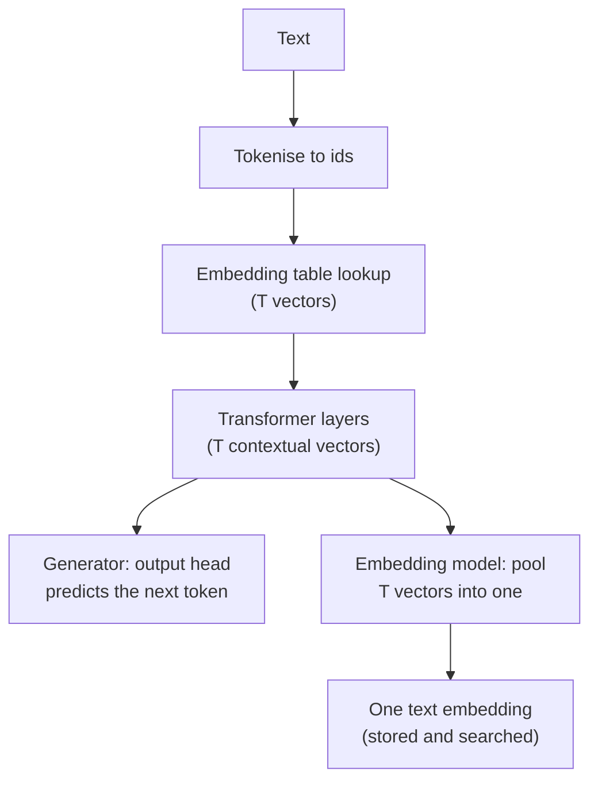

A tokeniser turns text into integers, and an integer is a poor description of a word. Token 5387 and token 5388 are neighbours as numbers and have nothing to do with each other as text. Before a neural network can do anything useful with a token, the id has to be replaced by something richer: a list of numbers, called an **embedding**, in which similar meanings get similar numbers.

The word "embedding" is used for two related things, and RAG engineers need to keep them apart. One is the table of token vectors inside every language model. The other is the single vector that an embedding model produces for a whole sentence or chunk, which is what retrieval searches over. This lesson builds both from first principles. Phase 5, starting with [What are embeddings?](/learn/embedding-fundamentals/what-are-embeddings), returns to the second kind in depth.

## Learning objectives

- Explain what an embedding is and why token ids alone are not enough.
- Implement an embedding table lookup in NumPy and state the shape of its result.
- Distinguish token embeddings inside an LLM from text embeddings produced by an embedding model.
- Compute cosine similarity by hand and in NumPy, and use it to rank documents against a query.
- State why a query and the documents it is compared with must be embedded by the same model.

## Prerequisites

- [How LLMs work](/learn/understanding-large-language-models/how-llms-work)
- [Tokens and tokenisation](/learn/understanding-large-language-models/tokens-and-tokenisation)
- Vectors as lists of numbers; NumPy array indexing.

## Why this matters

When a member of staff asks AskMeridian "How much holiday do I get?", the handbook sentence that answers it is "Annual leave is 25 days." The two share no meaningful word. A system that matches on words alone will not connect them. Retrieval by embeddings can, because "holiday" and "leave" are placed close together in a space of meanings, and closeness is something a computer can measure.

That is the retrieval half. In the generation half, every token of the prompt enters the model through an embedding table. If you blur the two, you make mistakes that are expensive to find: trying to pull retrieval vectors out of a chat model, comparing vectors that came from two different models, or expecting a similarity score to mean "this chunk answers the question".

## The intuition

Describe a city by two numbers, its latitude and longitude. Paris is (48.9, 2.4), Brussels is (50.8, 4.4), Sydney is (−33.9, 151.2). Without knowing anything else about them, you can tell from the numbers that Paris and Brussels are close and Sydney is far away. The coordinates turn "near" into arithmetic.

An embedding does the same for meaning. Imagine scoring words on three hand-picked scales, each from 0 to 1: how much the word is about time off, about money, and about IT security.

| Word | Time off | Money | IT security |
| --- | --- | --- | --- |
| leave | 0.9 | 0.1 | 0.0 |
| holiday | 0.8 | 0.2 | 0.1 |
| expenses | 0.1 | 0.9 | 0.0 |
| password | 0.0 | 0.1 | 0.9 |

"leave" and "holiday" have nearly the same coordinates; "password" is somewhere else entirely. Real embeddings differ from this picture in two ways. They have hundreds or thousands of coordinates instead of three, and nobody chooses what each coordinate means: the values are learned during training, and individual coordinates usually have no nameable meaning. What survives is the geometry. Things used in similar ways end up near each other.

The visualiser below shows a set of texts projected into two dimensions. Look for the clusters before reading on.

```playground
embeddings-map
```

## How it works

### Token embeddings: the model's first layer

Every language model begins with an **embedding table**: a matrix with one row per vocabulary entry. If the vocabulary has $V$ tokens and the model works with vectors of width $d$ (often written $d_\text{model}$), the table has shape $V \times d$.

Turning token ids into vectors is a lookup:

1. The tokeniser produces a list of $T$ token ids.
2. For each id, take the row of the table with that index.
3. Stack the rows. The result has shape $T \times d$: one vector per token, in order.

This matrix of token vectors is what flows into the Transformer blocks of the [next lesson](/learn/understanding-large-language-models/transformer-architecture). The table is not designed by anyone. Its entries start as random numbers and are adjusted by gradient descent along with every other weight, because moving the vector for "holiday" closer to the vector for "leave" helps the model predict the next token in sentences where either could appear.

Two properties of token embeddings matter here:

- **They are context-free at the input.** The row for "leave" is the same in "annual leave" and "leave the building". Sorting out which sense is meant is the job of the layers above, which mix information between positions.
- **They belong to one model.** The table is tied to that model's tokeniser and learned for that model's task. Hosted generators do not expose it, and it would not be useful for search if they did.

### Text embeddings: one vector for a whole passage

Retrieval needs something different: a single vector that stands for an entire query or chunk, so that one comparison tells you whether a chunk is relevant. A **text embedding model** (also called a sentence embedding model) produces it:

1. Tokenise the text with the embedding model's own tokeniser.
2. Look up token embeddings in the embedding model's own table.
3. Pass them through the model's Transformer layers, so that each token's vector comes to reflect the tokens around it.
4. **Pool** the $T$ resulting vectors into one, most commonly by averaging them (mean pooling).
5. Usually, scale the result to length 1 (normalisation).

The output is one vector of fixed size, 384 numbers for the `all-MiniLM-L6-v2` model used in this course, whatever the length of the input.



The two kinds of model share the first three boxes and differ at the end. They also differ in training. A generator is trained to predict the next token. An embedding model is trained so that texts which belong together, such as a question and the passage that answers it, receive nearby vectors, and unrelated texts receive distant ones. That training method, [contrastive learning](/learn/embedding-optimisation/contrastive-learning), is what makes distance in the output space track relevance.

| | Token embeddings | Text embeddings |
| --- | --- | --- |
| What gets a vector | Each token | A whole query, sentence or chunk |
| Where it lives | First layer of any language model | Output of an embedding model |
| Depends on context | No (a fixed row per token) | Yes (the whole text shapes the vector) |
| Trained for | The model's own objective, such as next-token prediction | Similar meaning gives nearby vectors |
| Role in RAG | Internal to the generator and to the embedding model | Indexed in the vector store and searched |

> [!NOTE]
> Anthropic does not offer an embedding endpoint. A RAG system that generates with Claude takes its text embeddings from somewhere else: a local model through `sentence-transformers`, or another provider's embedding API. The generator and the embedding model are independent choices.

### Using text embeddings for retrieval

Once every chunk has a vector, retrieval is geometry:

1. Offline, embed every chunk and store the vectors.
2. When a question arrives, embed it **with the same model**.
3. Compute a similarity score between the query vector and every chunk vector.
4. Return the chunks with the highest scores.

Step 2 carries a hard rule. Two embedding models produce two unrelated coordinate systems, even when they have the same number of dimensions. A query vector from one model compared with chunk vectors from another yields numbers that mean nothing.

## The mathematics

### The lookup is a matrix product

Selecting row $i$ of the table $E$ is the same as multiplying $E$ by a **one-hot** vector, which is all zeros except for a 1 in position $i$:

$$
\mathbf{x} = \mathbf{o}_i^\top E
$$

- $E$ is the embedding table, with $V$ rows and $d$ columns.
- $\mathbf{o}_i$ is the one-hot vector of length $V$ for token $i$.
- $\mathbf{x}$ is the resulting embedding, of length $d$.

**Worked example.** With $V = 3$, $d = 2$, and token id 1 (counting from 0):

$$
E = \begin{bmatrix} 0.2 & 0.7 \\ 0.9 & 0.1 \\ 0.4 & 0.4 \end{bmatrix}, \qquad \mathbf{o}_1 = [0, 1, 0], \qquad \mathbf{o}_1^\top E = [0 \cdot 0.2 + 1 \cdot 0.9 + 0 \cdot 0.4,\;\; 0 \cdot 0.7 + 1 \cdot 0.1 + 0 \cdot 0.4] = [0.9, 0.1]
$$

That is row 1 of $E$. The zeros wipe out every other row. Code uses indexing because it is faster, but seeing the lookup as a matrix product explains why the table is a trainable weight like any other. It also gives its size: $V \times d$ numbers. For GPT-2 small, $50{,}257 \times 768 = 38{,}597{,}376$ parameters in the embedding table alone.

### Cosine similarity

To compare two embeddings we want a number that is high when they point the same way. The **dot product** multiplies matching coordinates and adds the results:

$$
\mathbf{a} \cdot \mathbf{b} = \sum_{i=1}^{d} a_i b_i
$$

It is large when both vectors are large in the same coordinates. It also grows when either vector is simply long, which is usually not what we mean by "similar". Dividing by the two lengths removes that effect and leaves the cosine of the angle between the vectors:

$$
\cos(\mathbf{a}, \mathbf{b}) = \frac{\mathbf{a} \cdot \mathbf{b}}{\lVert \mathbf{a} \rVert \, \lVert \mathbf{b} \rVert}, \qquad \lVert \mathbf{a} \rVert = \sqrt{\sum_{i=1}^{d} a_i^2}
$$

- $\mathbf{a}$, $\mathbf{b}$ are the two vectors, each with $d$ coordinates $a_i$, $b_i$.
- $\lVert \mathbf{a} \rVert$ is the length (norm) of $\mathbf{a}$.
- The result lies between $-1$ (opposite directions) and $1$ (same direction); $0$ means the vectors are perpendicular, sharing nothing.

**Worked example.** Take leave $= [0.9, 0.1, 0.0]$ and holiday $= [0.8, 0.2, 0.1]$ from the table above.

Dot product: $0.9 \times 0.8 + 0.1 \times 0.2 + 0.0 \times 0.1 = 0.72 + 0.02 + 0 = 0.74$.

Lengths: $\lVert \text{leave} \rVert = \sqrt{0.81 + 0.01 + 0} = \sqrt{0.82} = 0.9055$; $\lVert \text{holiday} \rVert = \sqrt{0.64 + 0.04 + 0.01} = \sqrt{0.69} = 0.8307$.

Cosine: $0.74 / (0.9055 \times 0.8307) = 0.74 / 0.7522 = 0.984$.

Now leave against password $= [0.0, 0.1, 0.9]$: the dot product is $0 + 0.01 + 0 = 0.01$, both lengths are $0.9055$, and the cosine is $0.01 / 0.82 = 0.012$. Nearly the same direction in one case, nearly perpendicular in the other.

If both vectors already have length 1, the denominator is 1 and cosine similarity is just the dot product. That is why embedding models are usually asked to normalise their output: similarity search reduces to one matrix multiplication. [Cosine similarity](/learn/embedding-mathematics/cosine-similarity) and its neighbours in Phase 5 compare it with the other measures.

### Mean pooling

The simplest way to turn $T$ token vectors into one is to average them, coordinate by coordinate:

$$
\mathbf{s} = \frac{1}{T} \sum_{t=1}^{T} \mathbf{h}_t
$$

- $\mathbf{h}_t$ is the vector for token $t$.
- $T$ is the number of tokens.
- $\mathbf{s}$ is the pooled vector for the whole text.

**Worked example.** Pool leave $[0.9, 0.1, 0.0]$ and days $[0.6, 0.1, 0.1]$: $\mathbf{s} = [(0.9 + 0.6)/2,\; (0.1 + 0.1)/2,\; (0.0 + 0.1)/2] = [0.75, 0.10, 0.05]$. Its length is $\sqrt{0.5625 + 0.01 + 0.0025} = 0.7583$, so the normalised vector is $[0.989, 0.132, 0.066]$.

The NumPy versions of all three calculations are in the next section.

## In code

### An embedding table lookup

**The problem.** See the lookup that begins every model's forward pass, and confirm it equals the one-hot matrix product.

```bash
pip install numpy
```

```python
import numpy as np

vocab = ["annual", "leave", "is", "25", "days", "vpn"]
stoi = {tok: i for i, tok in enumerate(vocab)}

rng = np.random.default_rng(0)
d_model = 4
E = rng.normal(0, 1, size=(len(vocab), d_model)).round(2)   # the embedding table
print("E has shape", E.shape)
print(E)

ids = np.array([stoi[t] for t in ["annual", "leave", "is", "25", "days"]])
X = E[ids]                                                  # the lookup
print("\ntoken ids:", ids)
print("X = E[ids] has shape", X.shape)
print("row for 'leave':", X[1])

one_hot = np.zeros((len(ids), len(vocab)))
one_hot[np.arange(len(ids)), ids] = 1
print("\nsame as one-hot matrix times E:", np.allclose(one_hot @ E, X))
```

```output
E has shape (6, 4)
[[ 0.13 -0.13  0.64  0.1 ]
 [-0.54  0.36  1.3   0.95]
 [-0.7  -1.27 -0.62  0.04]
 [-2.33 -0.22 -1.25 -0.73]
 [-0.54 -0.32  0.41  1.04]
 [-0.13  1.37 -0.67  0.35]]

token ids: [0 1 2 3 4]
X = E[ids] has shape (5, 4)
row for 'leave': [-0.54  0.36  1.3   0.95]

same as one-hot matrix times E: True
```

`E[ids]` is the whole operation: NumPy indexing with an array of ids returns the corresponding rows, giving shape `(T, d_model)`, here `(5, 4)`. The table is random because nothing has been trained; these vectors carry no meaning yet. The final line confirms the one-hot identity from the mathematics section. The usual error is an `IndexError` from an id that is at least the vocabulary size, which in practice means the text was tokenised with a tokeniser that does not belong to the model.

### Similarity search on toy vectors

**The problem.** Build the whole retrieval idea in miniature: vectors for words, a pooled vector for each document, a query vector, and a ranking by cosine similarity. The word vectors are written by hand so that every number can be checked.

```python
import numpy as np

# Hand-made 3-d "embeddings". Axes: [time off, money, IT security]
word_vecs = {
    "leave":    [0.9, 0.1, 0.0],
    "holiday":  [0.8, 0.2, 0.1],
    "days":     [0.6, 0.1, 0.1],
    "expenses": [0.1, 0.9, 0.0],
    "receipt":  [0.0, 0.8, 0.2],
    "budget":   [0.1, 0.9, 0.1],
    "password": [0.0, 0.1, 0.9],
    "vpn":      [0.1, 0.0, 0.9],
    "wi-fi":    [0.1, 0.1, 0.7],
}
word_vecs = {w: np.array(v) for w, v in word_vecs.items()}

def cosine(a, b):
    return float(a @ b / (np.linalg.norm(a) * np.linalg.norm(b)))

print("leave vs holiday :", round(cosine(word_vecs["leave"], word_vecs["holiday"]), 4))
print("leave vs password:", round(cosine(word_vecs["leave"], word_vecs["password"]), 4))

def embed(text):
    """Toy text embedding: average the vectors of the known words, then scale to length 1."""
    vecs = [word_vecs[w] for w in text.lower().replace("?", "").replace(".", "").split() if w in word_vecs]
    v = np.mean(vecs, axis=0)
    return v / np.linalg.norm(v)

docs = [
    "Annual leave is 25 days.",
    "Expenses over £75 need a receipt.",
    "The home-office equipment budget is £400.",
    "Password rotation is every 90 days.",
    "VPN is required on public Wi-Fi.",
]
D = np.stack([embed(d) for d in docs])          # (5, 3): one row per document
print("\ndocument matrix shape:", D.shape)

for query in ["How much holiday do I get?", "Do I need a receipt?", "Is hotel wi-fi safe?"]:
    q = embed(query)
    scores = D @ q                              # cosine, because every row has length 1
    print(f"\n{query}")
    for i in np.argsort(-scores)[:2]:
        print(f"  {scores[i]:.3f}  {docs[i]}")
```

```output
leave vs holiday : 0.9838
leave vs password: 0.0122

document matrix shape: (5, 3)

How much holiday do I get?
  0.992  Annual leave is 25 days.
  0.631  Password rotation is every 90 days.

Do I need a receipt?
  0.990  Expenses over £75 need a receipt.
  0.985  The home-office equipment budget is £400.

Is hotel wi-fi safe?
  0.997  VPN is required on public Wi-Fi.
  0.923  Password rotation is every 90 days.
```

**The important lines.** `cosine` is the formula from above, and its two printed values match the hand calculation. `embed` is mean pooling followed by normalisation. `D @ q` multiplies the document matrix by the query vector, producing one dot product per document; because every vector has length 1, each is a cosine similarity. `np.argsort(-scores)[:2]` returns the two best.

**What the output means.**

- "How much holiday do I get?" finds "Annual leave is 25 days." at 0.992 although the word "holiday" does not occur in it. That is the point of embeddings: the match is on position in the space, not on shared words.
- The second result for that query, the password policy at 0.631, got there only because it contains "days". Similarity is not the same as relevance, and the second-best hit can be about something else.
- For "Do I need a receipt?" the top two documents score 0.990 and 0.985. Both are about money, and a three-number space cannot tell them apart well. Real models have hundreds of dimensions for exactly this reason, and even they produce near-ties that later stages such as reranking must resolve.

**Limits of the toy.** Averaging fixed word vectors ignores word order and context: "expenses need a receipt" and "a receipt needs expenses" get the same vector. A real embedding model avoids this by running Transformer layers before pooling. A query made only of unknown words crashes `embed` with a warning about the mean of an empty list (Exercise 2 fixes it); real models never meet unknown words, thanks to subword tokens.

### A real embedding model

The same pipeline with a trained model. This downloads the model on first use, so it was not run here:

```bash
pip install sentence-transformers
```

```python
from sentence_transformers import SentenceTransformer

model = SentenceTransformer("sentence-transformers/all-MiniLM-L6-v2")

docs = [
    "Annual leave is 25 days.",
    "Expenses over £75 need a receipt.",
    "VPN is required on public Wi-Fi.",
]
D = model.encode(docs, normalize_embeddings=True)                       # shape (3, 384)
q = model.encode(["How much holiday do I get?"], normalize_embeddings=True)[0]

scores = D @ q
for i in scores.argsort()[::-1]:
    print(f"{scores[i]:.3f}  {docs[i]}")
```

The output is three lines, a score and a document each, with the annual leave sentence first. Your exact scores depend on the library and model version. Structurally nothing has changed from the toy: `encode` replaces the hand-written `embed`, the vectors have 384 coordinates instead of 3, and the ranking is still `D @ q`.

## A real-world example

Meridian's first AskMeridian index was built with a 384-dimension local model. Months later, an engineer named Callum upgrades the query service to a newer embedding model that scores better on public benchmarks and also happens to output 384 dimensions. He deploys the query service on a Friday. The nightly job that re-embeds documents is scheduled for the following week.

Nothing crashes. The vector store accepts 384-number queries and returns five chunks for every question, each with a similarity score. But the answers are nonsense: a question about expenses receives chunks about laptop refresh cycles. Because the scores are all low and close together, the top five are effectively random.

The cause is the rule from this lesson. The query vectors and the chunk vectors came from different models, so they live in unrelated coordinate systems; matching dimensions made the mistake silent instead of loud. The team rolls back, then changes the deployment so that the embedding model's name and version are stored with the index and checked by the query service at start-up. A model change now means building a complete new index and switching both sides over together.

## Common mistakes

- **Embedding queries and documents with different models.** The scores are meaningless, and if the dimensions happen to match there is no error to warn you.
- **Confusing the generator's token embeddings with retrieval embeddings.** A chat model's internal table is not exposed, is context-free and was not trained for similarity. Retrieval needs a dedicated embedding model.
- **Treating a similarity score as a probability or as "percent relevant".** A cosine of 0.63 has no absolute meaning; score ranges differ from model to model. Only comparisons within one model, and thresholds tuned on your own data, are meaningful.
- **Assuming the nearest chunk answers the question.** Nearest means most similar in topic and wording. The password policy was the second-nearest chunk to a holiday question because both mention days.
- **Forgetting that the embedding model has a token limit.** Text beyond the limit is cut off before pooling, so it contributes nothing to the vector. See [Tokens and tokenisation](/learn/understanding-large-language-models/tokens-and-tokenisation).
- **Mixing normalised and unnormalised vectors.** A dot product equals cosine similarity only when both vectors have length 1.

## Best practices

- Record the embedding model's name, version and dimension alongside the index, and refuse to query an index with a different model.
- Normalise embeddings once, at write time, and use the dot product for search.
- When changing embedding model, build a new index in full and switch queries and documents together.
- Check the model card for how the model expects queries and passages to be presented; some require a prefix on each.
- Judge an embedding model on your own questions and documents, not only on leaderboard position. [Embedding evaluation](/learn/embedding-optimisation/embedding-evaluation) shows how.
- Look at the second and third results, not just the first, when debugging. Near-ties tell you where the model cannot discriminate.

## Performance considerations

**Storage.** A text embedding of $d$ 32-bit floats takes $4d$ bytes. One million chunks at 384 dimensions is $1{,}000{,}000 \times 384 \times 4 = 1.536$ GB before any index overhead; at 1,536 dimensions it is $6.144$ GB. Dimension is a direct multiplier on memory and on the cost of every comparison.

**Search.** Scoring a query against every chunk by brute force costs $N \times d$ multiplications: 384 million for the example above. That is feasible on one machine but grows linearly with the corpus, which is why Phase 6 introduces approximate indexes.

**Embedding compute.** Each chunk is embedded once at indexing time, and again whenever it changes or the model changes. Each query is embedded at request time, so the embedding model's speed sits directly on the latency path of every question. Smaller models answer faster and produce smaller vectors, at some cost in retrieval quality; that trade is revisited in [Model selection](/learn/embedding-optimisation/model-selection).

**Inside the generator.** The token embedding table adds $V \times d$ parameters. It is a lookup, so it costs almost nothing at run time, but it is one reason vocabulary size is not made arbitrarily large.

## Security considerations

A text embedding is derived from the text and retains much of its content. Published research has shown that a substantial part of the original text can be reconstructed from embeddings alone (Morris et al., 2023, listed below). Treat an index of embeddings as carrying the same sensitivity as the documents it was built from: the same access controls, the same encryption, the same care about where it is hosted. If you send text to a third-party embedding API, that provider receives the full text, so the usual rules about personal and confidential data apply.

## Summary

- An embedding is a list of numbers that represents a token or a text so that similar meanings have similar vectors.
- Token embeddings are a learned table of shape $V \times d$ at the input of every language model; the lookup `E[ids]` turns $T$ token ids into a $T \times d$ matrix.
- Text embeddings are single vectors for whole passages, produced by an embedding model that runs Transformer layers and then pools. They are what a RAG system indexes and searches.
- Cosine similarity, the dot product divided by both lengths, measures how closely two vectors point the same way. For vectors of length 1 it equals the dot product.
- A query must be embedded with the same model as the documents. Vectors from different models are not comparable.
- High similarity means "close in the model's space", not "answers the question".

## Exercises

**1.** Compute by hand the cosine similarity of $\mathbf{a} = [1, 2, 2]$ and $\mathbf{b} = [2, 1, 2]$.

<details><summary>Show solution</summary>

Dot product: $1 \times 2 + 2 \times 1 + 2 \times 2 = 2 + 2 + 4 = 8$.

Lengths: $\lVert \mathbf{a} \rVert = \sqrt{1 + 4 + 4} = 3$ and $\lVert \mathbf{b} \rVert = \sqrt{4 + 1 + 4} = 3$.

Cosine: $8 / (3 \times 3) = 0.889$. Checking with the `cosine` function from the lesson returns `0.8889`.

</details>

**2.** In the toy search, `embed("What is the dress code?")` fails because none of the words has a vector. Write a version that handles this, then run the query "How many days?" and explain the result.

<details><summary>Show solution</summary>

```python
def embed_safe(text):
    words = text.lower().replace("?", "").replace(".", "").split()
    vecs = [word_vecs[w] for w in words if w in word_vecs]
    if not vecs:
        return None                      # nothing this vocabulary can represent
    v = np.mean(vecs, axis=0)
    return v / np.linalg.norm(v)

for query in ["What is the dress code?", "How many days?"]:
    q = embed_safe(query)
    if q is None:
        print(f"{query} -> no known words, nothing to search with")
        continue
    scores = D @ q
    print(query)
    for i in np.argsort(-scores)[:2]:
        print(f"  {scores[i]:.3f}  {docs[i]}")
```

```output
What is the dress code? -> no known words, nothing to search with
How many days?
  0.995  Annual leave is 25 days.
  0.658  Password rotation is every 90 days.
```

"How many days?" is ambiguous: it could be about leave, password rotation or the expenses deadline. The search still returns a confident-looking 0.995 for annual leave, because the hand-made vector for "days" leans towards time off. A real embedding model behaves the same way in spirit: it always returns a vector and the search always returns its top results, whether or not the question can be answered. Handling vague or unanswerable queries is the job of later stages (score thresholds, query rewriting, and an instruction to the generator to say when the context does not contain the answer).

</details>

**3.** A colleague suggests saving money by skipping the embedding model: "Just take the generator's token embedding table and average the rows for the tokens in each chunk." Give three reasons this would retrieve poorly.

<details><summary>Show solution</summary>

1. **No context.** Rows of the table are fixed per token. "leave" has the same vector in "annual leave" and "leave the building", so the average cannot reflect which sense a chunk uses. A real embedding model runs Transformer layers before pooling so that each token vector reflects its neighbours.
2. **No word order.** An average is the same whatever order the tokens come in, so "the manager approves the request" and "the request approves the manager" are identical.
3. **Wrong training objective.** The table was learned to help predict the next token, not so that a question lands near the passage that answers it. Embedding models are trained specifically for that property.

There is also a practical obstacle: hosted generators do not expose their embedding tables, and Anthropic offers no embedding endpoint at all.

</details>

**4.** Meridian's index holds 2 million chunks embedded at 384 dimensions. The team wants to move to a 1,024-dimension model. Estimate the raw vector storage before and after, and list what has to be redone.

<details><summary>Show solution</summary>

Before: $2{,}000{,}000 \times 384 \times 4$ bytes $= 3.07$ GB. After: $2{,}000{,}000 \times 1{,}024 \times 4$ bytes $= 8.19$ GB. Raw storage grows by a factor of $1{,}024 / 384 \approx 2.67$, and so does the arithmetic per comparison.

What has to be redone: every one of the 2 million chunks must be re-embedded with the new model, since old and new vectors cannot be mixed; a new index must be built, because the dimension differs and the old one cannot hold the new vectors; the query service must switch to the new model at the same moment the new index goes live; any similarity thresholds must be re-tuned, because score ranges differ between models; and chunk sizes should be re-checked against the new model's token limit. Before doing any of it, the team should measure on their own question set whether the new model actually retrieves better.

</details>

## Check your understanding

```quiz
[
  {
    "q": "A model has a vocabulary of 1,000 tokens and an embedding width of 16. A prompt is tokenised into 7 tokens. What is the shape of the matrix produced by the embedding lookup?",
    "options": [
      "(1000, 16)",
      "(7, 1000)",
      "(7, 16)",
      "(16, 7)"
    ],
    "answer": 2,
    "why": "The lookup selects one row of width 16 for each of the 7 tokens, giving 7 rows and 16 columns. The table itself is (1000, 16)."
  },
  {
    "q": "What is the main difference between a token embedding and a text embedding?",
    "options": [
      "A token embedding is a fixed vector per token inside a model; a text embedding is one vector for a whole passage, produced by an embedding model for comparison and search",
      "Token embeddings are integers and text embeddings are floating-point numbers",
      "Token embeddings are used for retrieval and text embeddings are used only during training",
      "There is no difference; the terms are interchangeable"
    ],
    "answer": 0,
    "why": "Token embeddings are rows of the model's input table, one per token and the same in every context. Text embeddings summarise an entire text in a single vector and are what a RAG index stores."
  },
  {
    "q": "What does this print?\n```python\nimport numpy as np\na = np.array([3.0, 4.0])\nb = np.array([6.0, 8.0])\nprint(round(float(a @ b / (np.linalg.norm(a) * np.linalg.norm(b))), 2))\n```",
    "options": [
      "50.0",
      "0.5",
      "2.0",
      "1.0"
    ],
    "answer": 3,
    "why": "b is a scaled copy of a, so they point in the same direction. The dot product is 50 and the lengths are 5 and 10, giving 50 / 50 = 1.0. Cosine similarity ignores length."
  },
  {
    "q": "An index was built with embedding model A. The query service is switched to model B, which has the same number of dimensions. What happens?",
    "options": [
      "Search improves, because model B is newer",
      "Search runs without error but the results are meaningless, because the two models use unrelated vector spaces",
      "The vector store raises a dimension mismatch error",
      "Nothing changes, because all embedding models with the same dimension are compatible"
    ],
    "answer": 1,
    "why": "Each model learns its own coordinate system. Matching dimensions lets the arithmetic run, but the scores no longer reflect similarity, and nothing reports the problem."
  },
  {
    "q": "In the toy search, the password policy was the second result for a question about holiday. What does that illustrate?",
    "options": [
      "Cosine similarity was computed incorrectly",
      "The vectors were not normalised",
      "A high similarity score reflects closeness in the embedding space, such as a shared word like days, not that the document answers the question",
      "Embeddings cannot represent numbers"
    ],
    "answer": 2,
    "why": "Both texts involve the word days, which pulled their vectors together. Similarity is a signal of relatedness, and later stages have to decide whether a retrieved chunk is actually relevant."
  }
]
```

## Further reading

- Tomas Mikolov, Kai Chen, Greg Corrado and Jeffrey Dean (2013), "Efficient Estimation of Word Representations in Vector Space" (word2vec): [arxiv.org/abs/1301.3781](https://arxiv.org/abs/1301.3781)
- Nils Reimers and Iryna Gurevych (2019), "Sentence-BERT: Sentence Embeddings using Siamese BERT-Networks": [arxiv.org/abs/1908.10084](https://arxiv.org/abs/1908.10084)
- Sentence Transformers documentation: [sbert.net](https://www.sbert.net/)
- Daniel Jurafsky and James H. Martin, *Speech and Language Processing* (3rd edition draft), the chapter on vector semantics and embeddings: [web.stanford.edu/~jurafsky/slp3](https://web.stanford.edu/~jurafsky/slp3/)
- John X. Morris, Volodymyr Kuleshov, Vitaly Shmatikov and Alexander M. Rush (2023), "Text Embeddings Reveal (Almost) As Much As Text". On reconstructing text from embeddings.
